## Document Control
- Phase: Excavation
- Status: Draft — issued for the end-of-Excavation milestone review
- Milestone Target: end of Excavation (AR) — not yet achieved

## Deployment Topology

This model records the topology the code declares. It declares no environment of its own: no file in the delivery names a target host, a TLS terminator, a network rule or a deployment shape (CON-A06; SS DC-006, DC-008). Where the topology stops, the model says so rather than completing it.

Fired as an OPTIONAL artifact on its §5.2 trigger: the system is genuinely multi-node — an Aspire-orchestrated API service, a web-server service and a SQLite viewer container, joined by service discovery and a reverse-proxy forwarder — and its configuration is non-trivial across environments (Development Case, Optional Artifact Triggers).

```plantuml
@startuml
title Deployment Model — the three shapes the delivery distinguishes, and what each one does and does not establish
skinparam shadowing false
skinparam defaultTextAlignment left
skinparam componentStyle rectangle
skinparam packageStyle rectangle

package "Shape 1 — Development under the AppHost: the only shape that runs" {
  node "Developer machine" as DEVNODE {
    component "TodoApp.AppHost\nAspire orchestrator" as AH1
    component "todoapi\nCOMP-007 · COMP-008 · COMP-009 · COMP-010 · COMP-011 · COMP-013" as API1
    component "todo-web-server\nCOMP-001 · COMP-002 · COMP-003" as WEB1
    artifact "Todo.Api/.db/Todos.db" as DB1
    artifact "Data protection key ring\nper-user file default, resolved per host" as K1
  }
  node "Container runtime" as RT1 {
    component "sqliteweb\nExcludeFromManifest" as SQ1
  }
  component "Aspire dashboard\nOTLP collector" as DASH
  AH1 --> API1 : starts after the migration
  AH1 --> WEB1 : starts, injects the API reference
  AH1 --> RT1 : runs sqliteweb
  SQ1 --> DB1 : bind mount of the .db directory
  API1 ..> DASH : OTLP
  WEB1 ..> DASH : OTLP
  note bottom of K1
    Both hosts resolve the same per-user directory on one
    machine, so the rings agree here. They would not agree
    across two nodes (AN-017).
  end note
}

package "Shape 2 — one host process, started without the AppHost: never described by the delivery" {
  node "A single host process" as OTHER {
    component "todoapi" as API2
    component "todo-web-server" as WEB2
  }
  note bottom of OTHER
    AN-012: the web host forwards to http://todoapi and no
    configuration key supplies an address, so without service
    discovery the BFF has no route to the API. No file in the
    delivery describes this mode; the README documents running
    the API alone, which is a third shape again.
  end note
}

package "Shape 3 — a container deployment: images declared, topology unstated" {
  node "Web host container\nContainerImageName todo-web-server" as CWEB {
    artifact "key ring — per-container under the default" as KW
  }
  node "API container\nContainerImageName todo-api" as CAPI {
    artifact "key ring — per-container under the default" as KA
    artifact "Todos.db — no volume declared anywhere" as DB3
  }
  CWEB --> CAPI : service name todoapi\nno manifest declares the network
  note bottom of KW
    AN-017: two containers, two rings, one discriminator. A cookie
    minted by the web host cannot be read at the API, and the
    provider key cannot be unprotected. Where the ring is meant
    to live is stated by no file (DC-005, DC-007).
  end note
  note bottom of DB3
    .db is gitignored and no volume is declared: this shape would
    migrate an empty database on every start (RE-004, BR-024).
  end note
}
@enduml
```

### Nodes

| Node | What runs there | Declared by | Anchor |
|---|---|---|---|
| Developer machine, orchestrator process | `TodoApp.AppHost` — starts the migration, then the API and the web host, then the sqliteweb container | `Aspire.AppHost.Sdk` 13.1.1, output type `Exe` | `TodoApp.AppHost/TodoApp.AppHost.csproj:1-3`; `TodoApp.AppHost/Program.cs:1-27` |
| Developer machine, service `todoapi` | COMP-007, COMP-008, COMP-009, COMP-010, COMP-011, COMP-013 over `Todos.db` | `builder.AddProject<Projects.Todo_Api>("todoapi")` | `TodoApp.AppHost/Program.cs:5`; `Todo.Api/Todo.Api.csproj` (`ContainerImageName` `todo-api`) |
| Developer machine, service `todo-web-server` | COMP-001, COMP-002, COMP-003; holds the cookie and the forwarder | `builder.AddProject<Projects.Todo_Web_Server>(…).WithReference(todoapi)` | `TodoApp.AppHost/Program.cs:7-8`; `Todo.Web/Server/Todo.Web.Server.csproj:3-4` (`ContainerImageName` `todo-web-server`) |
| Container runtime | `sqliteweb` from `tomdesinto/sqliteweb`, HTTP endpoint 8080, bind mount of `Todo.Api/.db` as `/db`, argument `Todos.db`; `ExcludeFromManifest()` | `builder.AddContainer(...)` | `TodoApp.AppHost/Program.cs:10-17` |
| Browser | The Blazor WebAssembly bundle and the authentication cookie; no code of the system other than COMP-004 and COMP-005 | served by the web host at `/` | `Todo.Web/Server/App.razor:5-25`; `Todo.Web/Client/wwwroot/` |
| OTLP collector — the Aspire dashboard locally, any endpoint named by `OTEL_EXPORTER_OTLP_ENDPOINT` | Inbound OTLP export of logs, metrics and traces, registered only when that setting is non-empty | `TodoApp.ServiceDefaults/Extensions.cs:73-90` | as cited |
| Container runtime as an external system | The runtime the AppHost asks to run `sqliteweb` — Docker or Podman, named by neither file | `builder.AddContainer` implies a runtime; the delivery names none | `TodoApp.AppHost/Program.cs:13-17` |
| The developer's machine as a build environment | The `dotnet-ef` global tool, installed and run by the AppHost; the NuGet feed at restore time | `dotnet tool install --global dotnet-ef` | `TodoApp.AppHost/Extensions.cs:17-33`; `nuget.config:3-12` |

**Two facts about the node set.** The API and the web host are added as **projects**, not containers, so the declared container images are unused by the only run shape the delivery supports (DC-005). And the sqliteweb container is the only node the delivery excludes from its published manifest — it is a development aid, and its presence is not evidence of a deployment posture.

### Environments

| Environment | How it differs | Anchor |
|---|---|---|
| Development | HSTS is replaced by WebAssembly debugging in the web host; the API maps the Scalar reference UI, combines HTTP logs and logs response bodies and headers; both hosts map `/health` and `/alive`; the rate-limit budget is 50 / 50 / 50 | `Todo.Web/Server/Program.cs:32-39`; `Todo.Api/Program.cs:37-58`; `TodoApp.ServiceDefaults/Extensions.cs:101-117`; `Todo.Api/appsettings.Development.json:9-13` |
| Any other environment | HSTS enabled and no WebAssembly debugging; the Scalar UI is not mapped while `/` still redirects to it and the OpenAPI document stays published; no HTTP logging configuration applies; no health probes are mapped; the rate-limit budget falls back to the code defaults 100 / 100 / 100 | `Todo.Web/Server/Program.cs:35-39`; `Todo.Api/Program.cs:49-62`; `TodoApp.ServiceDefaults/Extensions.cs:103`; `RateLimitExtensions.cs:20-27` |

Both hosts read `appsettings.json` and `appsettings.Development.json`, and three projects carry a `UserSecretsId`. No shipped file carries a credential, and no shipped file carries an `Authentication:Schemes` section (SU-006; AN-002).

## Nodes and Connectors
| ID | Connector | Between | Protocol and form | Properties the deployment must hold | Anchor |
|---|---|---|---|---|---|
| IF-001 | Browser ↔ web host | Client machine → `todo-web-server` | HTTPS; routes `/`, `/auth/register`, `/auth/login`, `/auth/logout`, `/todos/{*path}` | TLS terminates at the web host (`UseHttpsRedirection`, HSTS outside Development); the API's port needs no client route | `Todo.Web/Server/Program.cs:20-37`; `EP-017`…`EP-023` |
| IF-002 | Web host → API, identity | `todo-web-server` → `todoapi` | HTTP POST to `http://todoapi`, bodies `UserInfo` and `ExternalUserInfo`, response `AuthToken` | Service discovery must resolve the name `todoapi`; no address key exists | `Todo.Web/Server/Program.cs:24-30`; `AuthClient.cs:3-46`; AN-012 |
| IF-003 | Web host → API, todos | `todo-web-server` → `todoapi` | YARP forwarder, every verb, `Authorization: Bearer <accessToken>` | The same name resolution; the forwarder takes no retry path | `Todo.Web/Server/TodoApi.cs:14-26`; RE-009 |
| IF-004 | API ↔ SQLite | `todoapi` → `Todos.db` | EF Core 9.0.8 + `Microsoft.EntityFrameworkCore.Sqlite`; `ConnectionStrings:Todos`, default `Data Source=.db/Todos.db` | A writable file on the API node's own file system; no volume is declared for a container shape | `Todo.Api/Program.cs:22-24`; `Todo.Api/TodoDbContext.cs:7-21` |
| IF-005 | Both hosts → OTLP collector | `todoapi`, `todo-web-server` → collector | OTLP export over HTTP, enabled only when `OTEL_EXPORTER_OTLP_ENDPOINT` is non-empty | Optional in every shape; no file names a collector endpoint | `TodoApp.ServiceDefaults/Extensions.cs:73-90` |
| IF-006 | AppHost → container runtime | Orchestrator → runtime | The orchestrator asks the runtime to run `sqliteweb` with a bind mount | A container runtime must be installed; the delivery names none | `TodoApp.AppHost/Program.cs:10-17` |
| IF-007 | AppHost → `dotnet-ef` | Orchestrator → global tool | `dotnet tool install --global dotnet-ef`, then `dotnet ef database update --no-build` | The tool must be installable from the configured feed; the command runs against the API project directory | `TodoApp.AppHost/Extensions.cs:17-33` |
| IF-008 | Any host → NuGet feed | Build time only | `https://api.nuget.org/v3/index.json`, the single mapped source | `nuget.org` reachable at restore; no other source is configured | `nuget.config:3-12` |
| IF-010 | Developer → API reference | `todoapi` | HTTP JSON at `/openapi/v1.json`; HTML at `/scalar/v1` in Development only | The document is reachable in every environment, the UI in Development only | `Todo.Api/Program.cs:49-58,62` |

**The one connector with no fallback.** IF-002 and IF-003 both depend on the name `todoapi` resolving. Nothing in the delivery supplies that resolution except Aspire's service discovery, which the web host obtains from `AddHttpForwarderWithServiceDiscovery()` and `ConfigureHttpClientDefaults(http => http.AddServiceDiscovery())`. Started outside the AppHost, the browser-facing half has no route to its backend and no configuration key can give it one (AN-012, ADR-007).

**The one connector with no shared state.** IF-002 carries a data-protected provider key on the external-provider path, and the cookie itself is protected by the web host and never read by the API. Both hosts therefore need a key ring that agrees, and IF-004's sibling — the key ring — is a store no connector carries (AN-017, ADR-008).

### Connectors the numbering omits

| ID | Connector | Where it is defined | Why it is not in the table above |
|---|---|---|---|
| IF-009 | Web host → external identity provider — OAuth2/OIDC authorization-code redirect, registered only when `Authentication:Schemes:<provider>` exists | Supplementary Specification, Interfaces | It is not a connector of the recovered product. No shipped configuration supplies the scheme section, and the stakeholder excluded the mechanism on 2026-11-19 (`EX-001`). The identifiers are shared across the two artifacts, so the jump from IF-008 to IF-010 marks the excluded connector rather than a missing row |

## Environment Mapping

| Concern | Development, under the AppHost | Any other environment | A container shape |
|---|---|---|---|
| Discovery of the API's address | Aspire service discovery resolves `todoapi` | **Unresolved** — no key, no discovery provider named | **Unstated** — no manifest declares the network |
| Where the schema comes from | `dotnet ef database update --no-build`, gated on `.db` being absent, before the API starts | **Unstated by the delivery** — the AppHost is the only thing that runs the migration | **Unstated**; `.db` is gitignored and no volume is declared, so an empty database would be migrated on each start |
| Where the data-protection key ring lives | Framework per-user file default inside each host's own file system; the two hosts share one machine, so they resolve the same directory | **Unstated** | **Two rings** under the default, with one discriminator: cookies undecryptable and the provider key unreadable across hosts (AN-017) |
| TLS termination | Development certificate; `UseHttpsRedirection` always, HSTS outside Development | `UseHsts()` with the framework's 30-day default | Not declared at either node |
| Health probes | `/health` and `/alive` mapped on both hosts | **Not mapped** — `MapDefaultEndpoints` maps them only in Development | Not mapped |
| API reference exposure | Scalar UI mapped; document published; `/` redirects to it | UI not mapped, document still published, `/` still redirects to a route that does not exist (AN-016, BR-028) | As the environment it runs in |
| Rate-limit budget | 50 tokens, 50 per period, queue 50 | 100 / 100 / 100 — the code default, since no shipped file carries a `RateLimiting` section | As the environment it runs in |
| Telemetry | Aspire dashboard as the OTLP collector | Only if `OTEL_EXPORTER_OTLP_ENDPOINT` is set | Only if that setting is set |
| Credentials | None shipped; user secrets or environment variables | As above | Not declared — no secret store is named |

**What the mapping exposes.** Development is the only shape in which every connector resolves: the name resolves, the migration runs, both hosts see one key ring, the probes are there and the reference UI works. Every other shape is missing at least one of those, and no file supplies the missing piece. This model therefore states the Development shape as the one the delivery establishes and records the other two as declared-but-unestablished — it does not complete them with a plausible deployment.
