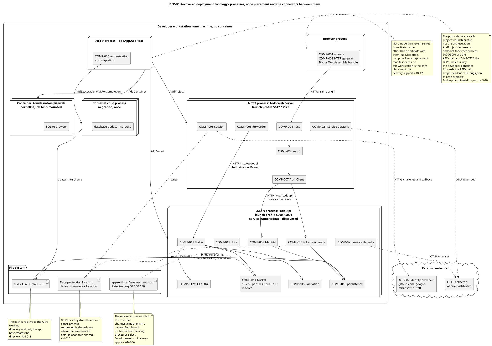

## Document Control
- Phase: Excavation
- Status: Draft — produced for the end-of-Excavation (AR) milestone review
- Milestone Target: end-of-Excavation (AR) — not yet achieved
- Iteration: 3, Cycle 1
- Owner: Software Architect
## Deployment Topology
The system has **one supported placement and no deployment artifact**: no Dockerfile, compose file, Kubernetes manifest or infrastructure definition is anywhere in the tree, and `.iari/README.md` records that it is not deployed. The `ContainerImageName` and `ContainerImageTag` properties two project files still carry are a residue the tree no longer backs. What places the processes is `TodoApp.AppHost`, and it does so on one machine, in one developer's session.

| Property | As the delivery has it | Anchor |
|---|---|---|
| Node count | One machine. A browser process, three long-lived .NET processes, two short-lived children (the global tool install and the migration) and one container, all co-located | `TodoApp.AppHost/Program.cs:1-28`; `Extensions.cs:25-33` |
| Network hops | Two between servers: COMP-007 and COMP-008 each reach the API over `http://todoapi`. The browser reaches only the server | `Todo.Web/Server/Program.cs:23-26`; `Todo.Web/Server/TodoApi.cs:16` |
| Discovery | By resource name through Aspire service discovery; no address is written anywhere in the code | `TodoApp.ServiceDefaults/Extensions.cs:34-35`; `Todo.Web/Server/Program.cs:25` |
| Ports | **The orchestration declares none.** `AddProject` takes a name and no endpoint. Each process binds its own launch profile: `Todo.Api` 5000 (http) and 5001 (https); `Todo.Web.Server` 5147 and 7123. The only fixed port in the tree is the container's target 8080. The developer container forwards 5000 and 5001 — the API's pair, not the BFF's | `TodoApp.AppHost/Program.cs:5-19`; `Todo.Api/Properties/launchSettings.json`; `Todo.Web/Server/Properties/launchSettings.json`; `.devcontainer/devcontainer.json:1-11` |
| Transport security | HTTPS between browser and server (`UseHttpsRedirection`, HSTS outside Development); HTTP in the clear between the BFF and the API | `Todo.Web/Server/Program.cs:38-45`; `Todo.Web/Server/TodoApi.cs:16` |
| Environments | `Development` is the only environment this delivery starts in: every launch profile of both serving processes sets it. Two things differ from any other environment — the reference UI, both health endpoints and body-and-header logging exist only there, and the request budget is bound to 50 / 50 / queue 50 there against the code's 100 / 100 / queue 100 (AN-024) | `Todo.Api/Program.cs:35-56`; `TodoApp.ServiceDefaults/Extensions.cs:110-118`; `Todo.Api/appsettings.Development.json:8-12`; both `launchSettings.json` |
| Deployment mechanism | None. `dotnet run` on the app host, or the Aspire CLI pinned by `.aspire/settings.json` | `.aspire/settings.json:1-3`; `README.md` |

### What the topology would have to change for a second node

Recorded because it is what a deployment decision would meet, not as a recommendation:

| Element | Why it is bound to one node | Anchor |
|---|---|---|
| `Todos.db` | A file path relative to the API's working directory; a second API node would need a shared store or its own file | `Todo.Api/Program.cs:23` |
| The data-protection key ring | No key store is pinned, so two nodes share a ring only if the framework's default file location is shared between them — which a container split does not give | `Todo.Web/Server/Program.cs:13`; `Todo.Api/Program.cs:11`; AN-010 |
| The request budget | `appsettings.Development.json` binds the bucket's three values, and it is a file in the API's content root: a node running any other environment falls back to the code's 100 / 100 / queue 100, so the throttle would differ per node | `Todo.Api/appsettings.Development.json:8-12`; AN-024 |
| The sqlite-web container | A bind mount of the API's `.db` directory; meaningful only where that directory is on the same file system — and it is excluded from the manifest, so it would not ship | `TodoApp.AppHost/Program.cs:14-19` |
| Service discovery | Aspire's development-time discovery; nothing in the tree states a production resolver | `TodoApp.ServiceDefaults/Extensions.cs:30-35` |
| The migration | Run by the app host, which is a development process and skips the block entirely outside run mode, not a deploy step | `TodoApp.AppHost/Extensions.cs:5-7` |
| The serving processes' ports | Declared only in each project's launch profile. A published or hosted process would bind the framework's default, and the developer container's forwarded pair would point nowhere | `Todo.Api/Properties/launchSettings.json`; `Todo.Web/Server/Properties/launchSettings.json` |

## Nodes and Connectors
| Node | What runs there | Placed by | Reachable from | Anchor |
|---|---|---|---|---|
| Browser process | COMP-001, COMP-002, COMP-003 as a WebAssembly bundle | Static assets served by COMP-004 from the same origin | Nothing — it initiates | `Todo.Web/Server/Program.cs:47-49`; `Todo.Web/Client/Program.cs:5-13` |
| Todo.Web.Server | COMP-004 to COMP-008, COMP-021 | `AddProject<Todo_Web_Server>("todo-web-server")` with a reference to the API resource. **No endpoint is declared in the orchestration**, so the served port is assigned by the app host. Run on its own, its profiles bind 5147 (http) and 7123 (https) | The browser, on the port the app host assigned | `TodoApp.AppHost/Program.cs:9-10`; `Todo.Web/Server/Properties/launchSettings.json` |
| Todo.Api | COMP-009 to COMP-018, COMP-021 | `AddProject<Todo_Api>("todoapi")`. **No endpoint is declared either**; run on its own its profiles bind 5000 (http) and 5001 (https) and launch at `scalar/v1` | The BFF, by discovery name only — it publishes no endpoint of its own to the outside | `TodoApp.AppHost/Program.cs:5-7`; `Todo.Api/Properties/launchSettings.json` |
| TodoApp.AppHost | COMP-020 | Started by the developer. Sets `UserSecretsId`, so a developer's own secrets load here | Nothing | `TodoApp.AppHost/Program.cs:1-28`; `TodoApp.AppHost/TodoApp.AppHost.csproj` |
| `dotnet-ef` child process | `dotnet ef database update --no-build`, preceded by a global tool install it waits on | `AddExecutable`, gated on run mode and on `Todo.Api/.db` being absent | Nothing; the API and the container wait on its completion | `TodoApp.AppHost/Extensions.cs:25-33` |
| `tomdesinto/sqliteweb` container | A SQLite browser over the bind-mounted directory, target port 8080 — the one fixed port in the tree | `AddContainer`, excluded from the manifest | The developer, through the app host's dashboard | `TodoApp.AppHost/Program.cs:14-19` |
| File system | `Todo.Api/.db/Todos.db`; the data-protection key ring at the framework default location | Created by the migration; the ring by whichever process writes first | Todo.Api, and Todo.Web.Server for the ring | `Todo.Api/Program.cs:23`; AN-013, AN-010 |

**Two port facts, and they are different facts.** The orchestration declares no port for either serving process; the launch profiles declare one for each, and only when that project is run alone. The 5000/5001 pair the developer container forwards belongs to `Todo.Api`'s profiles, not to the BFF's — a reader who takes the forwarded pair as the system's entry point reaches the API, not the screens.

## Environment Mapping
Two environments exist and the delivery distinguishes them, but it does not run in both: every launch profile in both serving processes sets `ASPNETCORE_ENVIRONMENT=Development`, so Development is the only environment this delivery starts in. No environment file in the delivery carries a connection string, a provider credential or an address. All four carry logging levels; the two `appsettings.json` files add `AllowedHosts` (`Todo.Api/appsettings.json:1-10`; `Todo.Web/Server/appsettings.json:1-12`), and the two `appsettings.Development.json` files add nothing beyond logging — except one. `Todo.Api/appsettings.Development.json:8-12` is the only environment file in the tree that binds a mechanism's values: the request budget, at 50 / 50 / 50 where the code defaults it to 100 / 100 / queue 100 (AN-024).

| Capability | Development — the environment every launch profile selects | Any other environment | Consequence | Anchor |
|---|---|---|---|---|
| Rate limiting, `COMP-014` | **50 tokens, 50 per 10 s, queue 50** — `appsettings.Development.json:8-12` binds all three; 429 on rejection | Code defaults: 100 tokens, 100 per 10 s, queue 100, because no other environment file binds them | The bucket in force is **half** its code default. A throttling reading taken from the code constants alone is off by a factor of two, and the value is tunable — in one file, for one environment, which is the one the delivery runs in (AN-024, R025) | `Todo.Api/appsettings.Development.json:8-12`; `Todo.Api/Extensions/RateLimitExtensions.cs:14-31`; `Todo.Api/Properties/launchSettings.json`; `Todo.Web/Server/Properties/launchSettings.json` |
| Scalar reference UI, `EP-019` | Mapped | Not mapped | The route does not exist outside Development | `Todo.Api/Program.cs:49-56` |
| Redirect of `/` to `/scalar/v1`, `EP-017` | Fires | **Also fires** | The root path redirects to an endpoint the process does not serve (AN-017) | `Todo.Api/Program.cs:62` |
| OpenAPI document, `EP-018` | Served | Served | Unconditionally mapped; it is the contract, not a diagnostic | `Todo.Api/Program.cs:58` |
| `GET /health`, `EP-020` and `GET /alive`, `EP-021` | Mapped | Not mapped | An operating instance exposes no readiness or liveness probe at all | `TodoApp.ServiceDefaults/Extensions.cs:110-118` |
| HTTP logging with bodies and headers | Combined logs, response body and headers | Middleware registered, no fields configured | `UseHttpLogging` runs in every environment; only the field selection is gated | `Todo.Api/Program.cs:35-44` |
| WebAssembly debugging, HSTS | Debugging middleware | HSTS, 30 days | — | `Todo.Web/Server/Program.cs:30-39` |
| Provider registration | None — no `Authentication:Schemes` section exists in either file | None | UC-003 cannot be entered anywhere in the delivered configuration | `Todo.Web/Server/appsettings.json`; `AuthenticationExtensions.cs:57-75` |
| Database | `Data Source=.db/Todos.db`, relative to the API's working directory | Same, unless `ConnectionStrings:Todos` is set | No environment file sets it; the one connection string in the delivery is the literal in `Program.cs` | `Todo.Api/Program.cs:23` |
| Telemetry export | OTLP only when `OTEL_EXPORTER_OTLP_ENDPOINT` is non-empty | Same | One environment variable is the whole OTLP switch | `TodoApp.ServiceDefaults/Extensions.cs:76-81` |
| The developer container | `mcr.microsoft.com/dotnet/sdk:8.0`, forwards 5000 and 5001, installs `dotnet-ef` on create | — | The image's SDK contradicts the `net9.0` target and the `9.0.100` pin: the container cannot build the solution it ships with (AN-007) | `.devcontainer/devcontainer.json:1-11`; `.devcontainer/init.sh`; `Directory.Build.props:4`; `global.json:3` |

**Two settings separate the environments, not one.** The first is the set of Development-only surfaces — the reference UI, the health endpoints and the request log's field selection — with the root redirect as the one asymmetry (AN-017). The second is the request budget: `appsettings.Development.json:8-12` halves all three rate-limit values, and because both launch profiles of both serving processes select Development, every request this delivery ever serves is metered at 50 / 50 / queue 50 (AN-024).

**What this mapping means for anyone placing the system.** The only environment-dependent behaviour that matters to an operator is the absence of health endpoints outside Development: a process started in any other environment publishes no probe, so no orchestrator could judge its readiness. The only environment-dependent behaviour that matters to a developer is that the reference UI is Development-only while the redirect to it is not — the one asymmetry in the mapping (AN-017). And the throttle a load reading would be taken against is the Development one, 50, never the code's constant of 100.
