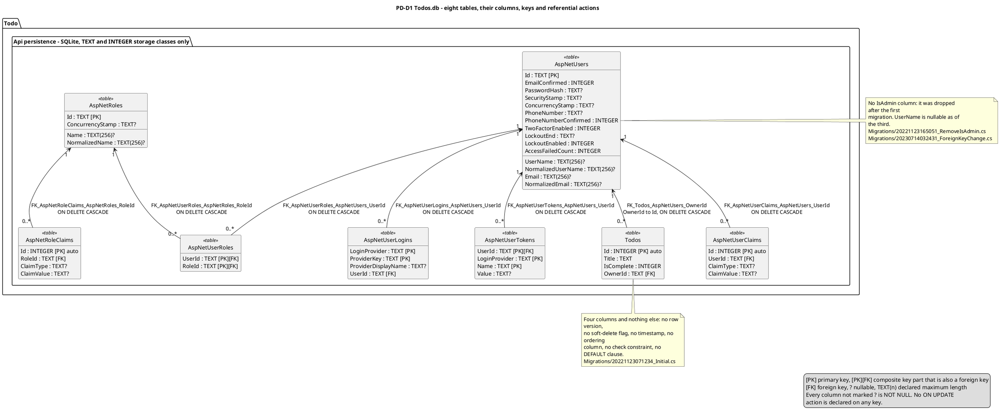
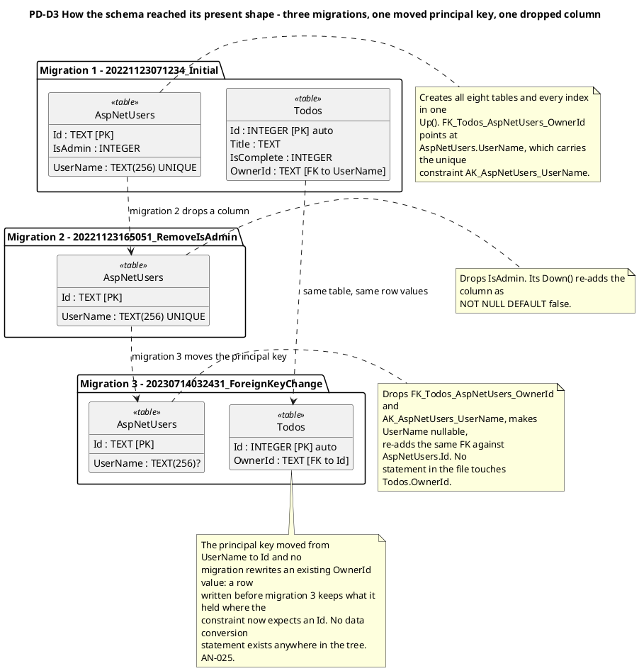
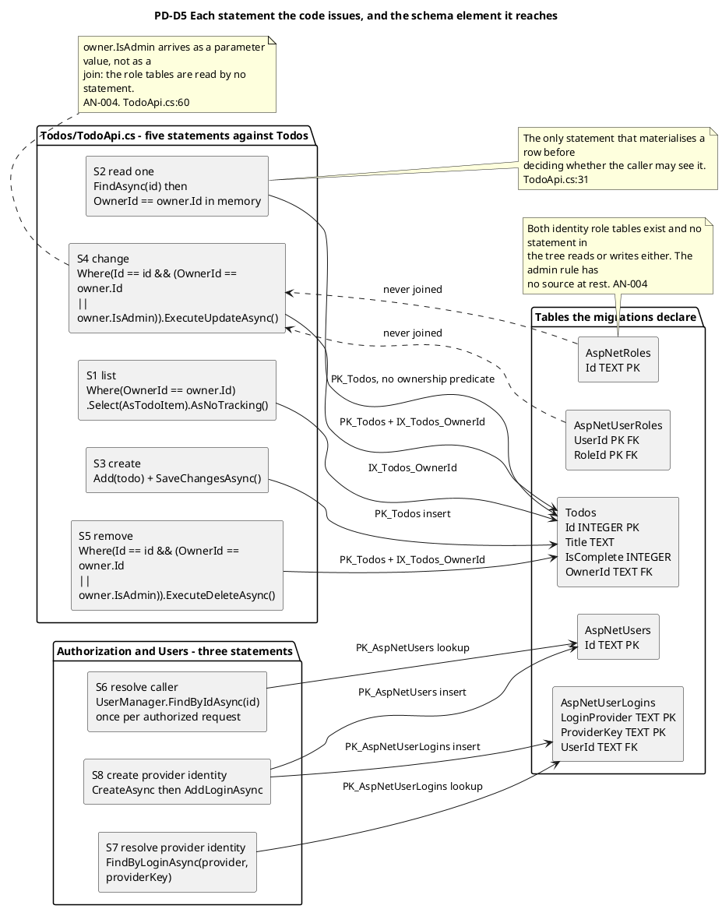
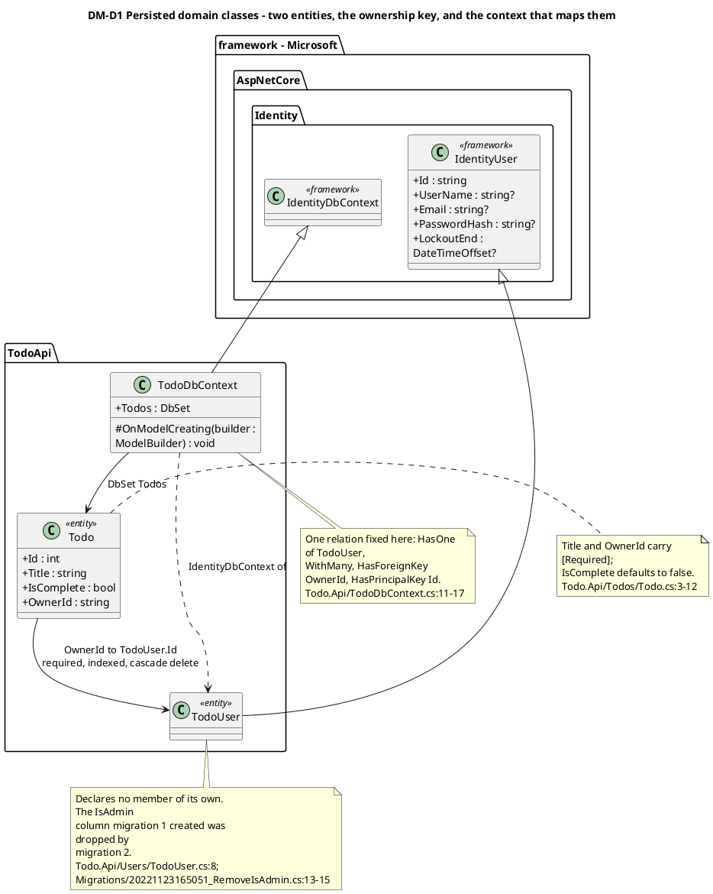
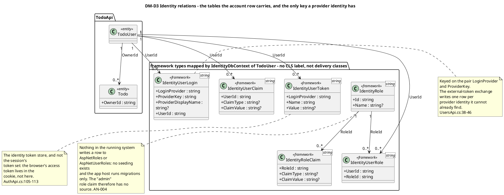

## Document Control
- Phase: Excavation
- Status: Draft — produced for the end-of-Excavation (AR) milestone review
- Milestone Target: end-of-Excavation (AR) — not yet achieved
- Iteration: 2, Cycle 1
- Owner: Designer
## Design Overview
The delivery carries no design document of its own (`.iari/README.md`; the tree holds none), so this model is recovered from code: every class below is recorded as the code declares it, and each carries the file and lines it was read from. Nothing here is attributed to an author who cannot be asked.

The design model is recovered in the System Inventory's priority order, and this section-set covers three stages of that order: **the domain classes** — the business objects the code holds, their attributes, their operations and their relationships — **the classes of every package**, which is where the behaviour lives, and **the persistent store** those classes are mapped onto.

| Section | State in this iteration |
|---|---|
| Domain Model | Recovered. Two persisted entities, six persisted framework-mapped types, seven request/response shapes, one mapping helper and one persistence context, each anchored |
| Use-Case Realizations | Not yet recovered. The use cases are recovered (Use-Case Model) and the interactions are documented there as flows; their realization as design-object collaborations is later-phase work |
| Design Packages and Classes | Recovered. Thirty-one classes in eleven packages, each anchored; the package diagram, the five per-package class diagrams and one consolidated class diagram are here |
| Interface Contracts | Not yet recovered. No interface is declared anywhere in the delivery: the two process boundaries are crossed by HTTP over concrete request shapes, not by interface types |
| Persistent Data Classes | Recovered by the Database Designer. Eight tables, their keys, indexes, constraints, referential actions and the O/R mapping per persistent class, plus the three migrations that built the schema — recorded under "Persistent data — the recovered store, its keys and its associations" in this section |
| Boundary Classes and Navigation Map | Not yet recovered |
| Capsules, Protocols and Signals | Not applicable to this delivery — no capsule, protocol or state-machine construct exists in it, and nothing is scheduled or event-driven |

`[OMITTED: Data Model — the Development Case's §5.2 trigger has not fired: the store holds eight persisted entity types, below the >10 threshold, the system is not data-centric and no data migration is in scope, so the data lives inline in this model]`

**What the model is anchored to.** The System Inventory records the recovery order and the System Analyst records which entry point performs each use case; the Software Architecture Document records the component each file belongs to. Where those and the code disagree, the code is recorded and the disagreement is named.

### Persistent data — the recovered store, its keys and its associations

The store is recovered as it exists: SQLite through the EF Core 9 SQLite provider, one file, eight tables, and no SQL script, view, trigger, stored procedure or database-resident rule anywhere in the tree. Every table, key, index and referential action below is read from the three migrations and the model snapshot that are the schema's only definitions. Nothing here is proposed; each element carries the file it was read from.

Tables are named by their physical names, not by minted labels: the Data Model is not produced in this phase, so no `TBL-NNN` family is declared and the schema elements are identified by the names the database itself carries.



#### Tables to entities

Every table traces to the class that maps it. Eight tables, and only two are mapped by a class the delivery writes: `Todos` by CLS-001 `Todo`, `AspNetUsers` by CLS-007 `TodoUser`. The six Identity child tables are mapped by framework entity types that `IdentityDbContext<TodoUser>` maps without the delivery declaring them.

| Table | Mapped by | Kind of mapping | Anchor |
|---|---|---|---|
| `Todos` | CLS-001 `Todo` | Hand-declared entity; the context exposes it as `DbSet<Todo> Todos` | `Todo.Api/Todos/Todo.cs:3-12`; `Todo.Api/TodoDbContext.cs:8` |
| `AspNetUsers` | CLS-007 `TodoUser` | Derives from `IdentityUser`; the table carries every `IdentityUser` property and nothing of `TodoUser`'s own | `Todo.Api/Users/TodoUser.cs:8`; `Todo.Api/Migrations/TodoDbContextModelSnapshot.cs` — `TodoApi.TodoUser` |
| `AspNetUserLogins` | `IdentityUserLogin<string>` | Framework type, mapped wholesale; no delivery class exists for it | `Todo.Api/Migrations/TodoDbContextModelSnapshot.cs`; `Todo.Api/Migrations/20221123071234_Initial.cs` |
| `AspNetUserClaims` | `IdentityUserClaim<string>` | Framework type, mapped wholesale | `Todo.Api/Migrations/TodoDbContextModelSnapshot.cs` |
| `AspNetUserTokens` | `IdentityUserToken<string>` | Framework type, mapped wholesale | `Todo.Api/Migrations/TodoDbContextModelSnapshot.cs` |
| `AspNetUserRoles` | `IdentityUserRole<string>` | Framework type, mapped wholesale; no delivery code writes a row | `Todo.Api/Migrations/TodoDbContextModelSnapshot.cs` |
| `AspNetRoles` | `IdentityRole<string>` | Framework type, mapped wholesale; no delivery code writes a row | `Todo.Api/Migrations/TodoDbContextModelSnapshot.cs` |
| `AspNetRoleClaims` | `IdentityRoleClaim<string>` | Framework type, mapped wholesale; no delivery code writes a row | `Todo.Api/Migrations/TodoDbContextModelSnapshot.cs` |

**The request, response and mapping shapes persist nothing.** CLS-002, CLS-003, CLS-004, CLS-005, CLS-008, CLS-009, CLS-010 and CLS-011 have no table: they exist for the duration of a request as serialized JSON. `TodoItem` is a projection of `Todos` built by CLS-003, and `AuthToken` wraps a token the API issues, never a value stored at rest.

#### How inheritance is stored

There is no inheritance hierarchy in the schema. `TodoUser` derives from `IdentityUser`, but `IdentityUser` is not a mapped entity of its own: `IdentityDbContext<TodoUser>` maps the derived type only, so the base class contributes columns to one table and produces no parent table and no discriminator. The single level of inheritance is flattened into `AspNetUsers` — one table, one concrete type, no `Discriminator` column.

The delivery declares no abstract entity, no table-per-type split and no shared base for `Todo` and `TodoUser`. The snapshot holds exactly two delivery entity types (`Todo`, `TodoApi.TodoUser`) and six framework ones, each mapped to one table.

#### Primary keys and identity strategy

| Table | Primary key | Identity strategy | Anchor |
|---|---|---|---|
| `Todos` | `PK_Todos (Id)` | Declared `Sqlite:Autoincrement`; `ValueGeneratedOnAdd` in the snapshot, so the database assigns the value | `Todo.Api/Migrations/20221123071234_Initial.cs`; `Todo.Api/Migrations/TodoDbContextModelSnapshot.cs` |
| `AspNetUsers` | `PK_AspNetUsers (Id)` | No database default. The value is generated in the Identity store and supplied on insert | `Todo.Api/Migrations/20221123071234_Initial.cs`; `Todo.Api/Migrations/TodoDbContextModelSnapshot.cs` |
| `AspNetRoles` | `PK_AspNetRoles (Id)` | No database default; supplied by the store | `Todo.Api/Migrations/20221123071234_Initial.cs` |
| `AspNetUserLogins` | `PK_AspNetUserLogins (LoginProvider, ProviderKey)` | None — both parts supplied. The provider identity is the key, so one row per provider account | `Todo.Api/Migrations/20221123071234_Initial.cs` |
| `AspNetUserRoles` | `PK_AspNetUserRoles (UserId, RoleId)` | None — a junction row, both parts supplied | `Todo.Api/Migrations/20221123071234_Initial.cs` |
| `AspNetUserTokens` | `PK_AspNetUserTokens (UserId, LoginProvider, Name)` | None — all parts supplied | `Todo.Api/Migrations/20221123071234_Initial.cs` |
| `AspNetUserClaims` | `PK_AspNetUserClaims (Id)` | Declared `Sqlite:Autoincrement` | `Todo.Api/Migrations/20221123071234_Initial.cs` |
| `AspNetRoleClaims` | `PK_AspNetRoleClaims (Id)` | Declared `Sqlite:Autoincrement` | `Todo.Api/Migrations/20221123071234_Initial.cs` |

`Todos.Id` and `AspNetUsers.Id` are the only keys the delivery's own statements address: `FindAsync(id)` and the `Where(t => t.Id == id && …)` predicates of the update and the delete on one side, the per-request account lookup on the other. The six Identity child tables are reached only through `UserManager<TodoUser>` and the Identity endpoint set.

#### Foreign keys to associations

Seven foreign keys, every one `ON DELETE CASCADE` and none with an `ON UPDATE` action. No `RESTRICT`, `NO ACTION` or `SET NULL` exists anywhere in the schema.

| Association recovered | From | To | Multiplicity | Referential action | Anchor |
|---|---|---|---|---|---|
| Ownership — a task belongs to one account | `Todos.OwnerId` | `AspNetUsers.Id` | 0..* tasks to 1 account, required on the task side | `FK_Todos_AspNetUsers_OwnerId`, cascade delete | `Todo.Api/TodoDbContext.cs:11-17`; `Todo.Api/Migrations/20230714032431_ForeignKeyChange.cs` |
| Session claims of an account | `AspNetUserClaims.UserId` | `AspNetUsers.Id` | 0..* to 1 | `FK_AspNetUserClaims_AspNetUsers_UserId`, cascade delete | `Todo.Api/Migrations/20221123071234_Initial.cs` |
| Provider identities of an account | `AspNetUserLogins.UserId` | `AspNetUsers.Id` | 0..* to 1 | `FK_AspNetUserLogins_AspNetUsers_UserId`, cascade delete | `Todo.Api/Migrations/20221123071234_Initial.cs` |
| Role membership | `AspNetUserRoles.UserId`, `.RoleId` | `AspNetUsers.Id`, `AspNetRoles.Id` | 0..* to each; composite key | both cascade delete | `Todo.Api/Migrations/20221123071234_Initial.cs` |
| Identity token store | `AspNetUserTokens.UserId` | `AspNetUsers.Id` | 0..* to 1 | `FK_AspNetUserTokens_AspNetUsers_UserId`, cascade delete | `Todo.Api/Migrations/20221123071234_Initial.cs` |
| Claims of a role | `AspNetRoleClaims.RoleId` | `AspNetRoles.Id` | 0..* to 1 | `FK_AspNetRoleClaims_AspNetRoles_RoleId`, cascade delete | `Todo.Api/Migrations/20221123071234_Initial.cs` |

**The ownership association is declared at neither end.** `Todo.OwnerId` is a plain `string` and `TodoUser` has no `Todo` collection: the relation exists only as the fluent declaration in the context and as the constraint in the database. No navigation property exists on either class, so no delivery query joins the two tables and no ORM lazy or eager loading can occur along it. Deleting an account deletes every task it owned, and no delivery statement does that deliberately — it happens by cascade.

**Cascade is the only delete policy in the schema.** Nothing in the delivery deletes an `AspNetUsers` row, so the cascade onto `Todos` is latent rather than exercised: the test host's `CreateUserAsync` inserts accounts and its `Dispose` drops the whole in-memory database.

#### Indexes, and the statement each one serves

```plantuml
@startuml
title PD-D2 The indexes and keys the migrations declare, and the statement each one serves

skinparam shadowing false
skinparam classAttributeIconSize 0
skinparam wrapWidth 250
hide circle
hide empty members

package "Todos - the only table the delivery queries in its own code" {
  class Todos <<table>> {
    Id : INTEGER [PK]
    OwnerId : TEXT [FK]
  }
  class "PK_Todos" as P1 <<index>> {
    Id : INTEGER
  }
  class "IX_Todos_OwnerId" as I1 <<index>> {
    OwnerId : TEXT
    not unique
  }
}

package "AspNetUsers - reached only through UserManager" {
  class AspNetUsers <<table>> {
    Id : TEXT [PK]
  }
  class "PK_AspNetUsers" as P2 <<index>> {
    Id : TEXT
  }
  class "UserNameIndex" as I2 <<index>> {
    NormalizedUserName : TEXT
    UNIQUE
  }
  class "EmailIndex" as I3 <<index>> {
    NormalizedEmail : TEXT
    not unique
  }
}

package "Identity child tables" {
  class AspNetUserLogins <<table>> {
    LoginProvider : TEXT [PK]
    ProviderKey : TEXT [PK]
  }
  class AspNetUserRoles <<table>> {
    UserId : TEXT [PK]
    RoleId : TEXT [PK]
  }
  class AspNetUserClaims <<table>> {
    Id : INTEGER [PK]
  }
  class AspNetRoleClaims <<table>> {
    Id : INTEGER [PK]
  }
  class AspNetUserTokens <<table>> {
    UserId : TEXT [PK]
  }
  class "IX_AspNetUserLogins_UserId" as I4 <<index>>
  class "IX_AspNetUserRoles_RoleId" as I5 <<index>>
  class "IX_AspNetUserClaims_UserId" as I6 <<index>>
  class "IX_AspNetRoleClaims_RoleId" as I7 <<index>>
  class "PK_AspNetUserLogins" as P3 <<index>>
  class "PK_AspNetUserRoles" as P4 <<index>>
  class "PK_AspNetUserTokens" as P5 <<index>>
  class "RoleNameIndex" as I8 <<index>> {
    NormalizedName : TEXT
    UNIQUE
  }
}

Todos --> P1
Todos --> I1
AspNetUsers --> P2
AspNetUsers --> I2
AspNetUsers --> I3
AspNetUserLogins --> I4
AspNetUserLogins --> P3
AspNetUserRoles --> I5
AspNetUserRoles --> P4
AspNetUserClaims --> I6
AspNetRoleClaims --> I7
AspNetUserTokens --> P5
I8 ..> AspNetUsers : constrains a table nothing writes

note right of I1
  Serves the three predicates written against
  OwnerId: the list, the update and the delete.
  The item read is a primary-key lookup.
  Todos/TodoApi.cs
end note

note right of I2
  Unique on NormalizedUserName - the account-name
  rule. The delivery issues no query of its own
  against it; UserManager does.
end note

note bottom of I4
  One non-unique index per foreign key column,
  created by the first migration and unchanged
  since. No composite index exists on
  AspNetUserLogins beyond its key pair.
  Migrations/20221123071234_Initial.cs
end note

note bottom of I8
  Nothing in the running system writes a row to
  AspNetRoles, so this unique index constrains an
  empty table. AN-004
end note

@enduml
```



| Index | Table and columns | Unique | The statement or rule it serves | Anchor |
|---|---|---|---|---|
| `IX_Todos_OwnerId` | `Todos (OwnerId)` | no | The list predicate `t.OwnerId == owner.Id`; the `OwnerId` half of the update and delete predicates. The item read uses the primary key instead | `Todo.Api/Migrations/20221123071234_Initial.cs`; `Todo.Api/Todos/TodoApi.cs:26,60,70` |
| `PK_Todos` | `Todos (Id)` | yes | `FindAsync(id)` and the `t.Id == id` predicates of update and delete | `Todo.Api/Migrations/20221123071234_Initial.cs`; `Todo.Api/Todos/TodoApi.cs:31,60,70` |
| `PK_AspNetUsers` | `AspNetUsers (Id)` | yes | The per-request account lookup every authorized call pays, and the principal key of the ownership association | `Todo.Api/Authorization/CurrentUserExtensions.cs:22-26`; `Todo.Api/Migrations/20221123071234_Initial.cs` |
| `UserNameIndex` | `AspNetUsers (NormalizedUserName)` | yes | The account-name uniqueness rule, enforced where Identity looks an account up by name. No delivery statement queries it | `Todo.Api/Migrations/20221123071234_Initial.cs` |
| `EmailIndex` | `AspNetUsers (NormalizedEmail)` | no | Identity's account-by-email lookup. **Not unique**, so nothing in the schema stops two accounts holding one email | `Todo.Api/Migrations/20221123071234_Initial.cs` |
| `RoleNameIndex` | `AspNetRoles (NormalizedName)` | yes | The role-name rule, constraining a table nothing in the running system writes | `Todo.Api/Migrations/20221123071234_Initial.cs` |
| `PK_AspNetUserLogins` | `AspNetUserLogins (LoginProvider, ProviderKey)` | yes | The provider-identity lookup the token exchange performs before creating a login row | `Todo.Api/Users/UsersApi.cs:38-46`; `Todo.Api/Migrations/20221123071234_Initial.cs` |
| `IX_AspNetUserLogins_UserId` | `AspNetUserLogins (UserId)` | no | The foreign-key column, so the cascade delete can find the rows | `Todo.Api/Migrations/20221123071234_Initial.cs` |
| `IX_AspNetUserClaims_UserId` | `AspNetUserClaims (UserId)` | no | Foreign-key column, as above | `Todo.Api/Migrations/20221123071234_Initial.cs` |
| `IX_AspNetUserRoles_RoleId` | `AspNetUserRoles (RoleId)` | no | Foreign-key column; the composite key already covers `UserId` first | `Todo.Api/Migrations/20221123071234_Initial.cs` |
| `IX_AspNetRoleClaims_RoleId` | `AspNetRoleClaims (RoleId)` | no | Foreign-key column | `Todo.Api/Migrations/20221123071234_Initial.cs` |

No index beyond these exists: there is no full-text index, no partial index, no covering index, no index on `Todos.Title` and none on `Todos.IsComplete`. The item read (`GET /todos/{id}`) reaches a row by primary key and then filters it in memory against `OwnerId`, which the index on `OwnerId` cannot help with.

#### Constraints the schema enforces, and the rules it leaves to code

| Rule | Enforced in the schema | How | Anchor |
|---|---|---|---|
| A task has a title | yes | `Todos.Title` is `TEXT` NOT NULL, from `[Required]` on CLS-001 | `Todo.Api/Todos/Todo.cs:6-7`; `Todo.Api/Migrations/20221123071234_Initial.cs` |
| A task belongs to an account | yes | `Todos.OwnerId` is `TEXT` NOT NULL with a foreign key to `AspNetUsers.Id` | `Todo.Api/Todos/Todo.cs:10-11`; `Todo.Api/Migrations/20230714032431_ForeignKeyChange.cs` |
| Two accounts cannot share a provider identity | yes | `AspNetUserLogins` composite primary key on `(LoginProvider, ProviderKey)` | `Todo.Api/Migrations/20221123071234_Initial.cs` |
| Two accounts cannot share a user name | yes | `UserNameIndex` unique on `NormalizedUserName` | `Todo.Api/Migrations/20221123071234_Initial.cs` |
| Two accounts cannot share an email | **no** | `EmailIndex` is not unique; Identity performs a duplicate check in code, not in the schema | `Todo.Api/Migrations/20221123071234_Initial.cs` |
| A completion flag is a boolean | only by type affinity | `IsComplete` is `INTEGER` with no `CHECK (IsComplete IN (0,1))` | `Todo.Api/Migrations/20221123071234_Initial.cs` |
| A task title has a length bound | **no** | `Todos.Title` is unbounded `TEXT`; the `[StringLength]` rules are Razor component attributes, not schema | `Todo.Web/Client/Components/LogInForm.razor:55-68`; `Todo.Api/Migrations/20221123071234_Initial.cs` |
| Two concurrent writes cannot overwrite each other | **no, on `Todos`** | `Todos` carries no row version or concurrency token; `AspNetUsers` and `AspNetRoles` carry `ConcurrencyStamp`, marked `IsConcurrencyToken` | `Todo.Api/Migrations/TodoDbContextModelSnapshot.cs`; `Todo.Api/Todos/TodoApi.cs:59-63` |
| A task's owner is an existing account | yes | The foreign key refuses an orphan row | `Todo.Api/Migrations/20230714032431_ForeignKeyChange.cs` |
| A caller is an administrator | **no** | No column and no seeded row; `IsAdmin` was dropped and `AspNetRoles`/`AspNetUserRoles` are never written, so the rule behind AN-004 exists nowhere at rest | `Todo.Api/Migrations/20221123165051_RemoveIsAdmin.cs`; AN-004 |
| An account has a user name | **no, as of migration 3** | The re-point made `UserName` nullable and dropped `AK_AspNetUsers_UserName` in the same step | `Todo.Api/Migrations/20230714032431_ForeignKeyChange.cs` |

**No `CHECK` constraint exists in any table, and no database-resident rule of any kind.** There is no trigger, no stored procedure, no view, no computed column, no sequence and no default expression in the schema. Every rule the system enforces beyond keys and nullability is application code: the data-annotation filter in CLS-020, Identity's own policies, and the ownership predicate written four times in CLS-012. The schema's contribution to integrity is primary keys, foreign keys with cascade, two unique indexes and NOT NULL.

#### Normalization, as the schema stands

Recorded as found, with no change proposed:

| Table | Form | Evidence |
|---|---|---|
| `Todos` | 3NF | Four atomic columns, one key, no repeating group, no transitive dependency. One flat table — a task belongs to an account and to nothing else |
| `AspNetUsers` | 3NF, with two application-maintained derived columns | `NormalizedUserName` and `NormalizedEmail` are functions of `UserName` and `Email`, written by Identity on every save. The redundancy is Identity's strategy for case-insensitive uniqueness under SQLite's default collation, not a delivery decision |
| The six Identity child tables | 3NF | Junction and detail tables keyed on their own or their parent's key, with no attribute depending on a non-key |

#### Object/relational mapping, per persistent class

| Design class | Table | Column mapping | Identity | Loading policy, as the code has it | Anchor |
|---|---|---|---|---|---|
| CLS-001 `Todo` | `Todos` | `Id`→`Id`, `Title`→`Title`, `IsComplete`→`IsComplete`, `OwnerId`→`OwnerId`; no property renamed, no value converter, no owned type | `Id` is database-generated; the entity is inserted with `Id` unset | Read by projection with `AsNoTracking()` in the list; tracked by `FindAsync` in the item read; the update and the delete bypass the change tracker through `ExecuteUpdateAsync` and `ExecuteDeleteAsync` | `Todo.Api/TodoDbContext.cs:8`; `Todo.Api/Todos/TodoApi.cs:24-73` |
| CLS-007 `TodoUser` | `AspNetUsers` | Every property inherited from `IdentityUser` maps one-to-one; `TodoUser` adds none | `Id` is supplied by the Identity store, not by the database | Never loaded through a `DbSet<TodoUser>`; resolved by `UserManager.FindByIdAsync` once per request in the claims transformation, then read only for its existence and its `Id` | `Todo.Api/Users/TodoUser.cs:8`; `Todo.Api/Authorization/CurrentUserExtensions.cs:16-30` |
| `IdentityUserLogin<string>` | `AspNetUserLogins` | Framework mapping | Composite key, both parts supplied | Written by the token exchange when no row matches `(LoginProvider, ProviderKey)` | `Todo.Api/Users/UsersApi.cs:38-46` |
| `IdentityUserClaim<string>`, `IdentityUserToken<string>`, `IdentityUserRole<string>`, `IdentityRole<string>`, `IdentityRoleClaim<string>` | their five remaining tables | Framework mapping | As declared | No delivery code path reads or writes any of them; they are reachable only through `UserManager<TodoUser>` | `Todo.Api/Migrations/TodoDbContextModelSnapshot.cs` |

No navigation property exists on either delivery entity, so no lazy-loading proxy, no `Include` and no eager-loading policy is involved anywhere in the delivery. There is no repository, no unit of work and no specification object: handlers receive `TodoDbContext` and CLS-013 directly.

**Two of the five task operations do not use the change tracker.** The update and the delete issue one SQL statement each and never call `SaveChangesAsync`, so no entity is materialized and no concurrency check can occur — consistent with `Todos` having no concurrency token. The create is the only operation that materializes an entity and calls `SaveChangesAsync`.

#### The schema's history and how it reached its present shape



| Migration | What it does to the schema | Rollback | Anchor |
|---|---|---|---|
| `20221123071234_Initial` | Creates all eight tables, every index, and the ownership foreign key against `AspNetUsers.UserName` with the unique constraint `AK_AspNetUsers_UserName`. `IsAdmin` is created `NOT NULL` with no default | `Down()` drops the eight tables in dependency order | `Todo.Api/Migrations/20221123071234_Initial.cs` |
| `20221123165051_RemoveIsAdmin` | Drops `AspNetUsers.IsAdmin` | `Down()` re-adds it as `NOT NULL DEFAULT false`, so every existing row reads `false` | `Todo.Api/Migrations/20221123165051_RemoveIsAdmin.cs` |
| `20230714032431_ForeignKeyChange` | Drops the ownership foreign key and `AK_AspNetUsers_UserName`, makes `UserName` nullable, re-adds the same foreign key against `AspNetUsers.Id`. Touches no row of `Todos` | `Down()` reverses all three steps and restores `UserName` as `NOT NULL DEFAULT ""` | `Todo.Api/Migrations/20230714032431_ForeignKeyChange.cs` |

Two facts about this history govern any later work on the store, and both are consequences of the schema as it stands.

**No migration converts existing `OwnerId` values** (AN-025). Between migration 1 and migration 3 the principal key moved from the account's user name to its identifier, and the third migration contains only constraint and nullability changes. A database written by migration 1 or 2 therefore holds user names in `OwnerId` under a constraint that now requires identifiers. Whether such a database exists outside the test host cannot be determined from the tree.

**The deployed schema and the tested schema are built by different mechanisms.** `Todos.db` is built by these three migrations, run by the app host; the test host builds its schema with `EnsureCreated` from the model and never runs a migration (AN-005). A divergence between the model and the migration history is invisible to the test suite and surfaces only where the app host runs the migration.

#### What the schema does not hold

Recorded so that nothing is carried forward from what a task store is usually expected to contain. Each was looked for in all three migrations and in the snapshot and is absent:

| Expected | What the schema holds instead | Anchor |
|---|---|---|
| An administrative flag or a seeded administrator | No column and no seeded row. `IsAdmin` was dropped and `AspNetRoles` is never written, so the role the code checks has no source at rest | `Todo.Api/Migrations/20221123165051_RemoveIsAdmin.cs`; AN-004 |
| An audit, created-at or updated-at column | Nothing. `Todos` holds four columns and no row records when it was made or changed | `Todo.Api/Migrations/20221123071234_Initial.cs` |
| A soft-delete or archival marker | Nothing. The delete is `ExecuteDeleteAsync`, a physical row removal | `Todo.Api/Todos/TodoApi.cs:68-73` |
| A concurrency token on the task table | Nothing. `AspNetUsers` and `AspNetRoles` carry `ConcurrencyStamp`; `Todos` carries no equivalent | `Todo.Api/Migrations/TodoDbContextModelSnapshot.cs` |
| An ordering, priority or grouping column | Nothing. The list query declares no order and the schema offers no column to order by | `Todo.Api/Todos/TodoApi.cs:24-27` |
| Any database-resident logic | No trigger, stored procedure, view, function or check constraint exists in the tree. The schema exists only as the three migrations and their snapshot | System Inventory — Documentation; DC4 |
| A second store, a cache or a read model | Nothing. One SQLite file, one context, one set of tables. The BFF's session is a cookie, not a table | System Inventory — Persistent Data |
| Partitioning, table spaces or storage parameters | Nothing expressible: SQLite carries no tablespace and no partitioning, and the migrations declare no storage parameter. The only physical decision is the file path `Data Source=.db/Todos.db`, relative to the API's working directory | `Todo.Api/Program.cs:23-24`; AN-013 |

#### What the schema constrains in the use cases

Four persistence facts bound the recovered use cases and belong with the store rather than with any single operation.

| Fact | Consequence for a use case or a later implementation | Anchor |
|---|---|---|
| A task row's owner is never carried to the caller and never accepted from a body | The owner is set from the resolved account on insert and never read from the request, so no use case may claim to choose or to see an owner | `Todo.Api/Todos/TodoApi.cs:38-50`; CLS-002 |
| Deleting an account destroys its tasks by cascade, and nothing in the delivery deletes an account | No recovered use case deletes an account; the cascade is a latent path only the test host could reach | `Todo.Api/Migrations/20221123071234_Initial.cs` |
| The per-request account lookup is one indexed primary-key read | Every authorized operation pays an additional `AspNetUsers` lookup before its own statement | `Todo.Api/Authorization/CurrentUserExtensions.cs:22-26` |
| The list returns every row the caller owns in one response | No pagination exists in the query or in the schema, so no access path may claim a bounded response | `Todo.Api/Todos/TodoApi.cs:24-27` |

The ownership predicate is written four times in CLS-012 and, as AN-018 records, not identically: the list filters on `OwnerId` alone while the three single-row operations also admit the `admin` claim. The schema serves either predicate through `IX_Todos_OwnerId` and `PK_Todos`; the disagreement is in the code, and the store records nothing about it.

### Constraints the schema enforces, and the rules it leaves to code

**No stored procedure, trigger, view, function, computed column, sequence or `CHECK` constraint exists anywhere in the tree, and there is no `.sql` file.** The three migration classes contain only `CreateTable`, `CreateIndex`, `DropColumn`, `DropForeignKey`, `DropUniqueConstraint`, `AlterColumn` and `AddForeignKey` — the schema is declarative structure and nothing else. Every rule the system enforces beyond keys and nullability is application code, and each is recorded below with the statement that carries it. Thirteen rules are enforced; seven the system relies on are held by nothing.

```plantuml
@startuml
title PD-D4 Every storage rule, where it is enforced, and what the store leaves to code

skinparam shadowing false
skinparam classAttributeIconSize 0
hide circle
hide empty members
skinparam wrapWidth 250

package "Enforced by a constraint in a migration - R1 to R6" {
  class "R1 a task has a title" as R1 <<rule>>
  class "R2 a task names an existing account" as R2 <<rule>>
  class "R3 a task id is unique" as R3 <<rule>>
  class "R4 a provider identity is unique" as R4 <<rule>>
  class "R5 a normalised user name is unique" as R5 <<rule>>
  class "R6 deleting an account deletes its tasks" as R6 <<rule>>
}

package "Enforced by the delivery's own statements - R7 to R11" {
  class "R7 the owner is taken from the caller" as R7 <<rule>>
  class "R8 one row is changed by its owner" as R8 <<rule>>
  class "R9 one row is read by its owner" as R9 <<rule>>
  class "R10 the list returns the caller's rows" as R10 <<rule>>
  class "R11 an admin claim admits any row" as R11 <<rule>>
}

package "Enforced by framework code - R12, R13" {
  class "R12 password policy at register" as R12 <<rule>>
  class "R13 lockout consulted at sign-in" as R13 <<rule>>
}

package "Enforced nowhere - N1 to N7" {
  class "N1 an email is unique" as N1 <<unenforced>>
  class "N2 a title has a length bound" as N2 <<unenforced>>
  class "N3 a completion flag is boolean" as N3 <<unenforced>>
  class "N4 two writes cannot collide" as N4 <<unenforced>>
  class "N5 an account has a user name" as N5 <<unenforced>>
  class "N6 a caller is an administrator" as N6 <<unenforced>>
  class "N7 lockout is checked on a request" as N7 <<unenforced>>
}

R11 ..> R10 : the list does not apply it
R11 ..> R9 : compiled from a client-side bool
N6 --> R11 : no row exists to test
N5 --> R2 : the principal key moved, no row was converted

note right of R2
  FK_Todos_AspNetUsers_OwnerId, ON DELETE CASCADE.
  Migrations/20230714032431_ForeignKeyChange.cs:35-42;
  Migrations/20221123071234_Initial.cs
end note

note right of R9
  FindAsync(id) first, then OwnerId == owner.Id in memory:
  the row is materialised before it is authorised, so the
  statement carries no ownership predicate.
  Todos/TodoApi.cs:31-35
end note

note bottom of R10
  Filters on OwnerId alone, with no admin branch, unlike
  R8 and R9. AN-018. Todos/TodoApi.cs:26
end note

note right of R11
  owner.IsAdmin is a client-side bool derived from a role
  claim and parameterised into the statement. Role claims
  come from AspNetUserRoles and AspNetRoles, which no
  statement in the tree writes. AN-004
end note

note bottom of N4
  Todos carries no row version, and ExecuteUpdateAsync and
  ExecuteDeleteAsync bypass the change tracker, so the last
  write wins with no version check. Todos/TodoApi.cs:59-63
end note

note bottom of N7
  LockoutEnabled and LockoutEnd are columns the framework's
  sign-in path reads; the delivery's own requirement handler
  records its lockout check as a TODO and does not perform it.
  Authorization/CheckCurrentUserAuthHandler.cs:26-35
end note

@enduml
```



| ID | Rule | Enforced | How, exactly | Anchor |
|---|---|---|---|---|
| R1 | A task has a title | Yes, in the schema | `Todos.Title` is `TEXT NOT NULL`, declared from `[Required]` on CLS-001 | `Todo.Api/Todos/Todo.cs:6-7`; `Todo.Api/Migrations/20221123071234_Initial.cs:190` |
| R2 | A task names an existing account | Yes, in the schema | `Todos.OwnerId` is `TEXT NOT NULL` with `FK_Todos_AspNetUsers_OwnerId` to `AspNetUsers.Id` | `Todo.Api/Todos/Todo.cs:10-11`; `Todo.Api/Migrations/20230714032431_ForeignKeyChange.cs:35-42` |
| R3 | A task identifier is unique | Yes, in the schema | `PK_Todos (Id)`, `Sqlite:Autoincrement` | `Todo.Api/Migrations/20221123071234_Initial.cs:198-201` |
| R4 | Two accounts cannot share a provider identity | Yes, in the schema | `PK_AspNetUserLogins (LoginProvider, ProviderKey)` | `Todo.Api/Migrations/20221123071234_Initial.cs:112-118` |
| R5 | Two accounts cannot share a user name | Yes, in the schema, for non-null values | `UserNameIndex` UNIQUE on `NormalizedUserName`. SQLite permits several NULL values in a unique index, so the rule holds only where the normalised name is present | `Todo.Api/Migrations/20221123071234_Initial.cs:243-247` |
| R6 | Deleting an account deletes its tasks | Yes, in the schema | `ON DELETE CASCADE` on the ownership foreign key. Latent: no statement in the delivery deletes an `AspNetUsers` row | `Todo.Api/Migrations/20230714032431_ForeignKeyChange.cs:41` |
| R7 | A task's owner is the authenticated caller, never a request body | Yes, in the delivery's code | The insert assigns `OwnerId = owner.Id`; the request shape CLS-002 carries no owner field, so no caller can supply one | `Todo.Api/Todos/TodoApi.cs:41-45` |
| R8 | One row is changed or removed only by its owner, or by a caller with the `admin` role | Yes, in the delivery's code | One predicate on both statements: `t.Id == id && (t.OwnerId == owner.Id \|\| owner.IsAdmin)`. `PUT` additionally refuses a body whose `Id` differs from the route | `Todo.Api/Todos/TodoApi.cs:54-65,68-73` |
| R9 | One row is read only by its owner, or by a caller with the `admin` role | Yes, in the delivery's code | `FindAsync(id) switch { Todo todo when todo.OwnerId == owner.Id \|\| owner.IsAdmin => … }` — the predicate runs in memory after materialisation | `Todo.Api/Todos/TodoApi.cs:29-37` |
| R10 | The list returns the caller's own rows | Yes, in the delivery's code | `Where(todo => todo.OwnerId == owner.Id)` with **no** admin branch — the disagreement AN-018 records | `Todo.Api/Todos/TodoApi.cs:24-27` |
| R11 | A caller holding the `admin` role reaches any row | Code-only, and no source exists | `CurrentUser.IsAdmin => Principal.IsInRole("admin")`. Role claims come from `AspNetUserRoles`/`AspNetRoles`, which no statement in the tree writes, so the rule cannot be satisfied in the delivered system (AN-004) | `Todo.Api/Authorization/CurrentUser.cs:12` |
| R12 | A password satisfies Identity's policy at registration | Yes, in framework code | `AddIdentityCore<TodoUser>()` applies the framework's default password policy; the delivery configures no policy of its own | `Todo.Api/Program.cs:17-20` |
| R13 | A locked-out account cannot sign in | Yes, in framework code, on the framework's own sign-in path | `SignInManager` consults `LockoutEnd`/`LockoutEnabled` on the Identity login endpoint | `Todo.Api/Users/UsersApi.cs:20` |
| N1 | Two accounts cannot share an email | **No** | `EmailIndex` on `NormalizedEmail` is **not unique**; the store stops nothing. Any duplicate check is Identity code, not schema | `Todo.Api/Migrations/20221123071234_Initial.cs:232-236` |
| N2 | A task title has a length bound | **No** | `Todos.Title` is unbounded `TEXT`. The `[StringLength]` rules are Razor component attributes on the client form, not schema and not the API contract | `Todo.Web/Client/Components/LogInForm.razor:55-68`; `Todo.Api/Migrations/20221123071234_Initial.cs:190` |
| N3 | A completion flag is a boolean | **No**, beyond type affinity | `IsComplete` is `INTEGER` with no `CHECK (IsComplete IN (0,1))` and no `DEFAULT`; the `false` every created row carries is supplied by the CLR default because the insert omits the column | `Todo.Api/Migrations/20221123071234_Initial.cs:191`; `Todo.Api/Todos/TodoApi.cs:41-45` |
| N4 | Two concurrent writes cannot silently overwrite each other | **No, on `Todos`** | `Todos` carries no row version or concurrency token, and `ExecuteUpdateAsync`/`ExecuteDeleteAsync` bypass the change tracker entirely. `AspNetUsers` and `AspNetRoles` carry `ConcurrencyStamp`; `Todos` has no equivalent | `Todo.Api/Migrations/TodoDbContextModelSnapshot.cs`; `Todo.Api/Todos/TodoApi.cs:59-63` |
| N5 | An account has a user name | **No, as of migration 3** | The third migration made `UserName` nullable and dropped `AK_AspNetUsers_UserName` in the same step | `Todo.Api/Migrations/20230714032431_ForeignKeyChange.cs:19-27` |
| N6 | A caller is an administrator | **No, and no source at rest** | No column and no seeded row. `IsAdmin` was dropped by migration 2; `AspNetRoles`, `AspNetUserRoles` and `AspNetRoleClaims` are created by migration 1 and never written by the running system | `Todo.Api/Migrations/20221123165051_RemoveIsAdmin.cs:13-15`; AN-004 |
| N7 | Lockout is checked on every authorized request | **No** | `CheckCurrentUserAuthHandler` succeeds when an account row exists, and records the lockout check as a `TODO` it does not perform | `Todo.Api/Authorization/CheckCurrentUserAuthHandler.cs:26-35` |

The schema's whole contribution to integrity is primary keys, foreign keys with cascade, two unique indexes and NOT NULL. Everything else — the data-annotation filter in CLS-020, Identity's policies, and the ownership predicate written four times in CLS-012 — is code, and `N1` to `N7` are the rules that follow from that boundary.

### Each association and rule confirmed against the statement that exercises it

The rules in the preceding block are not inferred from the class model: every association and rule was checked against the statement that actually reads or writes it, and where the schema holds an element no statement reaches, that is recorded as such rather than passed over. Two consequences follow from the table and belong with the store.



| Schema element or rule | The statement that exercises it | Confirmed | Anchor |
|---|---|---|---|
| Ownership association, `FK_Todos_AspNetUsers_OwnerId` | The insert assigns `OwnerId = owner.Id`; the predicate reads `t.OwnerId == owner.Id` in three statements | Yes | `Todo.Api/Todos/TodoApi.cs:26,33,41-45,60,70` |
| `OwnerId` never crosses the wire | The create body is CLS-002, three properties and no owner; the projection `AsTodoItem` drops `OwnerId` | Yes | `Todo.Api/Todos/Todo.cs:15-21,23-34` |
| `PK_Todos` | `db.Todos.FindAsync(id)`; `Where(t => t.Id == id …)` in the update and the delete | Yes | `Todo.Api/Todos/TodoApi.cs:31,60,70` |
| `IX_Todos_OwnerId` | The list predicate, and the `OwnerId` half of the update and delete predicates | Yes | `Todo.Api/Todos/TodoApi.cs:26,60,70` |
| `Todos.Title` NOT NULL | `POST` writes `Title`; `PUT` writes `Title` and `IsComplete` together — no statement writes a NULL title | Yes | `Todo.Api/Todos/TodoApi.cs:41-45,62-63` |
| `Todos.IsComplete` never set on insert | The create copies `Title` alone, so every new row carries the CLR default `false`; only `PUT` changes it | Yes | `Todo.Api/Todos/TodoApi.cs:41-45,63` |
| Cascade `R6` | No statement deletes an `AspNetUsers` row; the test host's `Dispose` drops the whole in-memory database instead | **Present, unexercised** | `Todo.Api/Migrations/20230714032431_ForeignKeyChange.cs:41`; `Todo.Api.Tests/TodoApplication.cs` |
| `PK_AspNetUsers` | `userManager.FindByIdAsync(id)` once per authorized request, inside the claims transformation | Yes | `Todo.Api/Authorization/CurrentUserExtensions.cs:22-26` |
| `PK_AspNetUserLogins` | `FindByLoginAsync(provider, providerKey)`, then `AddLoginAsync` when no row matches | Yes | `Todo.Api/Users/UsersApi.cs:36-46` |
| `AspNetUsers.UserName` nullable | `new TodoUser() { UserName = userInfo.Username }` on the provider path; the Identity register path supplies one | Yes | `Todo.Api/Users/UsersApi.cs:42` |
| `AspNetRoles`, `AspNetUserRoles`, `AspNetRoleClaims`, `AspNetUserClaims` | No statement in the tree inserts a role, a role claim or a user claim | **Absent** — the tables exist and nothing writes them | `Todo.Api/Migrations/20221123071234_Initial.cs`; AN-004 |
| `AspNetUserTokens` | No statement reads or writes a row. The browser's access token lives in the session cookie's token set, not here | **Absent** | `Todo.Web/Server/AuthApi.cs:104-121`; `Todo.Web/Server/TodoApi.cs:18-22` |
| `R11` admin admission | `owner.IsAdmin` is a bool computed from the principal and passed into the statement as a parameter — never a join to `AspNetUserRoles` | **Code-only, with no source at rest** | `Todo.Api/Authorization/CurrentUser.cs:12`; `Todo.Api/Todos/TodoApi.cs:33,60,70` |
| `R5` user-name uniqueness | No delivery statement queries `NormalizedUserName`; the framework's user manager does | **Framework path only** | `Todo.Api/Migrations/20221123071234_Initial.cs:243-247` |
| `N1` email uniqueness | No delivery statement queries `NormalizedEmail`, and no UNIQUE index exists on it | **Unenforced by the store** | `Todo.Api/Migrations/20221123071234_Initial.cs:232-236` |

**Single-task authorization has two different shapes.** The item read materialises the row and then decides in memory (`R9`), while the update and the delete push the whole predicate into the statement (`R8`). Both admit the same two callers, so the difference is a performance property rather than a behavioural one — but it means `PK_Todos` alone serves the item read, whereas the update and the delete are served by `PK_Todos` and `IX_Todos_OwnerId` together.

**The list and the item operations disagree on who may see a row** (`R10` against `R8`/`R9`), which AN-018 records. The schema is neutral: `IX_Todos_OwnerId` serves either predicate, and nothing in the store can enforce or prevent either. The disagreement is in code.

## Domain Model


### CLS-001 Todo — the task row

| Attribute | Type | Constraint the code declares | Anchor |
|---|---|---|---|
| `Id` | `int` | Integer key, autoincrement in the schema | `Todo.Api/Todos/Todo.cs:5` |
| `Title` | `string` | `[Required]`, initialised to `default!` | `Todo.Api/Todos/Todo.cs:6-7` |
| `IsComplete` | `bool` | defaults to `false`; written only by the update statement | `Todo.Api/Todos/Todo.cs:8` |
| `OwnerId` | `string` | `[Required]`, initialised to `default!`; foreign key to `TodoUser.Id` | `Todo.Api/Todos/Todo.cs:10-11` |

| Operation | Kind | What it does | Anchor |
|---|---|---|---|
| — | — | The class declares no operation. It is a property bag read and written by endpoint statements | `Todo.Api/Todos/Todo.cs:3-12` |

| Relationship | Target | Multiplicity | How it is declared | Anchor |
|---|---|---|---|---|
| Ownership | CLS-007 `TodoUser` | one owner to zero or more tasks; the task side is required | `HasOne<TodoUser>().WithMany().HasForeignKey(t => t.OwnerId).HasPrincipalKey(u => u.Id)` — declared in the context, not on either class, and no navigation property exists on either side | `Todo.Api/TodoDbContext.cs:12-16` |

The relation's principal key was `AspNetUsers.UserName` and was re-pointed to `AspNetUsers.Id` by the third migration; the index `IX_Todos_OwnerId` and cascade delete were created with the table and survive the re-point (`Todo.Api/Migrations/20221123071234_Initial.cs:220-247`; `Todo.Api/Migrations/20230714032431_ForeignKeyChange.cs:12-47`).

### CLS-007 TodoUser — the account row

| Attribute | Type | Where it comes from | Anchor |
|---|---|---|---|
| every property the account has | — | `IdentityUser`. `TodoUser` adds nothing: its whole declaration is an empty body, and the comment above it says custom properties could be added there | `Todo.Api/Users/TodoUser.cs:6-8` |

`Id`, `UserName`, `Email`, `PasswordHash`, `LockoutEnd` and the rest are `IdentityUser`'s and are mapped by `IdentityDbContext<TodoUser>` (`Todo.Api/Program.cs:17-20`; `Todo.Api/Migrations/20221123071234_Initial.cs:36-66`). The `IsAdmin` column the first migration created on `AspNetUsers` was dropped by the second, so the class holds no administrative flag and the schema holds none (`Todo.Api/Migrations/20221123165051_RemoveIsAdmin.cs:13-15`).

### CLS-006 TodoDbContext — the persistence context

| Operation | Signature | What it does | Anchor |
|---|---|---|---|
| `Todos` | `DbSet<Todo>` get-only property | The one domain set the context exposes; every task statement starts here | `Todo.Api/TodoDbContext.cs:8` |
| `OnModelCreating` | `protected void OnModelCreating(builder : ModelBuilder)` | Fixes the ownership relation and delegates to the identity model | `Todo.Api/TodoDbContext.cs:10-19` |

The context derives from `IdentityDbContext<TodoUser>`, so the seven identity sets are its own without being declared. No `DbSet<TodoUser>` is declared and no user query in the delivery goes through the context: callers resolve an account through `UserManager<TodoUser>` instead (`Todo.Api/Authorization/CurrentUserExtensions.cs:11-30`). `Todos` is reached three ways — `Where(...).Select(...)`, `FindAsync(id)`, and `ExecuteUpdateAsync` / `ExecuteDeleteAsync` that bypass the change tracker entirely (`Todo.Api/Todos/TodoApi.cs:24-73`).



### The shape the caller sees — declared twice

```plantuml
@startuml
title DM-D2 The wire shapes, declared twice in two assemblies that do not reference each other

skinparam shadowing false
skinparam classAttributeIconSize 0
skinparam wrapWidth 205

package "Todo.Web.Shared - compiled into the client and the BFF" {
  class "TodoItem (shared)" as S1 {
    +Id : int
    +Title : string
    +IsComplete : bool
  }
  class "UserInfo (shared)" as S2 {
    +Email : string
    +Password : string
  }
  class "ExternalUserInfo (shared)" as S3 {
    +Username : string
    +ProviderKey : string
  }
  class "AuthToken (shared)" as S4 <<record>> {
    +Token : string
  }
}

package "Todo.Api - its own declaration, no reference to Shared" {
  class "TodoItem (API)" as A1 {
    +Id : int
    +Title : string
    +IsComplete : bool
  }
  class "UserInfo (API)" as A2 {
    +Email : string
    +Password : string
  }
  class "ExternalUserInfo (API)" as A3 {
    +Username : string
    +ProviderKey : string
  }
  class TodoMappingExtensions <<static>> {
    +AsTodoItem(todo : Todo) : TodoItem
  }
}

class Todo <<entity>> {
  +Id : int
  +Title : string
  +IsComplete : bool
  +OwnerId : string
}

S1 .. A1 : same shape, no link,\nno compiler check
S2 .. A2 : same shape
S3 .. A3 : same shape
TodoMappingExtensions ..> A1 : returns the API's TodoItem
Todo --> TodoMappingExtensions : projected by

note bottom of A1
  Todo.Api/Todos/Todo.cs:15-21 against
  Todo.Web/Shared/SharedClass.cs:5-11 - the same
  three properties on both sides, and nothing
  compares them. AN-003
end note

note bottom of A3
  The one /users request shape the validation
  filter covers, because MapUsers registers it.
  UsersApi.cs:18
end note

note bottom of S4
  AuthToken wraps the "accessToken" property name
  the Identity endpoints answer with, and is the
  only shape in Shared that has no twin in the API.
  SharedClass.cs:31
end note

@enduml
```

### Class inventory — every recovered domain class and its anchor

| ID | Class | Kind | Responsibility, as the code gives it | Anchor |
|---|---|---|---|---|
| CLS-001 | `Todo` | Entity, persisted | The task row: integer key, required title, completion flag, required owner key. Declares no operation | `Todo.Api/Todos/Todo.cs:3-12` |
| CLS-002 | `TodoItem` (API) | Request and response shape | What every task operation accepts and returns. Carries no `OwnerId`, so the ownership key cannot round-trip to a caller | `Todo.Api/Todos/Todo.cs:15-21` |
| CLS-003 | `TodoMappingExtensions` | Static mapping helper | Projects `Todo` onto `TodoItem`, copying `Id`, `Title`, `IsComplete` and dropping `OwnerId` | `Todo.Api/Todos/Todo.cs:23-34` |
| CLS-004 | `UserInfo` (API) | Request shape | Email and password, both required — the body of the Identity register and login calls | `Todo.Api/Users/TodoUser.cs:12-19` |
| CLS-005 | `ExternalUserInfo` (API) | Request shape | User name and a data-protection-protected provider key, both required — the body of the external-token exchange | `Todo.Api/Users/TodoUser.cs:21-28` |
| CLS-006 | `TodoDbContext` | Persistence context | `IdentityDbContext<TodoUser>` plus the `Todos` set and the one relation it fixes | `Todo.Api/TodoDbContext.cs:6-20` |
| CLS-007 | `TodoUser` | Entity, persisted | The account row. Declares no member of its own; every property is `IdentityUser`'s | `Todo.Api/Users/TodoUser.cs:8` |
| CLS-008 | `TodoItem` (shared) | Request and response shape | The same three properties as CLS-002, declared in the assembly the client and the BFF compile against | `Todo.Web/Shared/SharedClass.cs:5-11` |
| CLS-009 | `UserInfo` (shared) | Request shape | The same two properties as CLS-004, in the shared assembly | `Todo.Web/Shared/SharedClass.cs:13-20` |
| CLS-010 | `ExternalUserInfo` (shared) | Request shape | The same two properties as CLS-005, in the shared assembly | `Todo.Web/Shared/SharedClass.cs:22-29` |
| CLS-011 | `AuthToken` | Response shape, positional record | The single `accessToken` property the Identity endpoints answer with, read by the BFF's token client | `Todo.Web/Shared/SharedClass.cs:31` |

**Persisted types recorded without a design-class label.** Six entity types are mapped by `IdentityDbContext<TodoUser>` and by the migrations, and the delivery writes no class of its own for any of them: `IdentityUserLogin<string>`, `IdentityRole<string>`, `IdentityUserRole<string>`, `IdentityUserClaim<string>`, `IdentityRoleClaim<string>`, `IdentityUserToken<string>`. They are framework classes, not classes the Implementer writes, so they are named in DM-D3 and in the relationship table below rather than given `CLS` labels. The table that backs each is created by the first migration: `AspNetUserLogins` and `AspNetUserRoles` and `AspNetUserTokens` and `AspNetUserClaims` and `AspNetRoles` and `AspNetRoleClaims` (`Todo.Api/Migrations/20221123071234_Initial.cs:16-268`).

### Relationship inventory

| Relationship | From | To | Multiplicity | Declared how, and where | Anchor |
|---|---|---|---|---|---|
| Ownership | `Todo` (`OwnerId`) | `TodoUser` (`Id`) | 0..* tasks to 1 account; required on the task side | Fluent model in the context; no navigation property on either class | `Todo.Api/TodoDbContext.cs:12-16` |
| Provider identity | `IdentityUserLogin` | `TodoUser` | 0..* logins to 1 account, cascade delete | Framework model; the delivery writes one row | `Todo.Api/Users/UsersApi.cs:38-46` |
| Role membership | `IdentityUserRole` | `TodoUser`, `IdentityRole` | 0..* to each; composite key | Framework model; nothing writes a row | `Todo.Api/Migrations/20221123071234_Initial.cs:16-268` |
| Claims | `IdentityUserClaim`, `IdentityRoleClaim` | `TodoUser`, `IdentityRole` | 0..* to each | Framework model; nothing writes a row | `Todo.Api/Migrations/20221123071234_Initial.cs:16-268` |
| Identity tokens | `IdentityUserToken` | `TodoUser` | 0..* to 1 | Framework model; no delivery code writes it — the session's token set is a cookie, not a row | `Todo.Web/Server/AuthApi.cs:105-113` |

**No association exists between the two wire declarations or between them and the entities.** `TodoItem` neither references nor inherits `Todo`; the only link is `AsTodoItem`, one direction, in one assembly. `UserInfo` and `ExternalUserInfo` have no relation to `TodoUser` beyond being the shapes `UserManager` calls are handed.

### What the code does not hold

Recorded so that nothing is carried forward from what a task list is expected to have. Each of these was looked for in the domain and in the schema and is absent:

| Expected | What the code holds instead | Anchor |
|---|---|---|
| An account entity with an administrative flag | No flag. The column existed and was dropped; `IsAdmin` is read from a role claim, and no role row is ever written | `Todo.Api/Migrations/20221123165051_RemoveIsAdmin.cs:13-15`; `Todo.Api/Authorization/CurrentUser.cs:12` |
| A list, project, category or tag a task belongs to | Nothing. A task belongs to an account and to nothing else; there is one flat table | `Todo.Api/TodoDbContext.cs:8` |
| A due date, priority, ordering or audit column | Nothing. `Todo` holds four properties, and the list query declares no order | `Todo.Api/Todos/Todo.cs:3-12`; `Todo.Api/Todos/TodoApi.cs:24-27` |
| A domain operation, aggregate or invariant on either entity | Nothing. Both entities are property bags; every rule is a statement in an endpoint handler | `Todo.Api/Todos/TodoApi.cs:24-73` |
| A repository, unit-of-work or service abstraction over the store | Nothing. Handlers take `TodoDbContext` directly, and two of the five statements bypass the change tracker | `Todo.Api/Todos/TodoApi.cs:17-22,52-73` |
| A concurrency token or row version | Nothing. The update names two fields and carries no version check | `Todo.Api/Todos/TodoApi.cs:59-63` |

### What the classes do in the use cases

The classes above are the vocabulary; the behaviour is in the endpoint handlers and is realized in later phases. Two facts bind them and belong here.

`Todo` and `CLS-002`/`CLS-008` decide one rule between them: the request shape carries no `OwnerId`, so the owner is never read from a body and `OwnerId` never leaves the process. A create body that asks for a completed row still produces `IsComplete` false, because the insert copies only the title (`Todo.Api/Todos/TodoApi.cs:38-50`).

`CLS-007` is the class the ownership predicate is decided against, and the row that must exist before any task operation succeeds: the authorization handler fails the request when no account row matches the token's `NameIdentifier` (`Todo.Api/Authorization/CheckCurrentUserAuthHandler.cs:28-36`; `Todo.Api/Authorization/CurrentUserExtensions.cs:11-30`).

### Use cases no domain class realizes

| Use case | Why no domain class appears in its row | What it touches instead | Anchor |
|---|---|---|---|
| UC-004 Sign out | It persists nothing and reads no entity: one call signs the cookie scheme out, and the row the account lives in is untouched | The BFF's cookie scheme; the session cookie's token set, which `AuthApi.SignIn` wrote and this operation discards | `Todo.Web/Server/AuthApi.cs:40-52` |
| UC-011 Consult the API reference | It reads metadata the framework generated, not data the model holds | The OpenAPI document and the Scalar UI mapping; the bearer scheme it declares | `Todo.Api/Program.cs:46-58`; `Todo.Api/Extensions/OpenApiOptionsExtensions.cs` |

Both are recovered use cases with a real entry point; neither has a domain class in its path, so neither appears as a `Traces From` value above. That is the model's shape, not a gap in the realization.

## Use-Case Realizations

Not yet recovered. The eleven use cases are recovered and their flows are documented in the Use-Case Model, each anchored to its entry point; what is missing here is the translation of those flows into collaborations of design objects.

The reason it is deferred is the phase, not a gap in the code: Excavation records the system as it is, and the architecturally significant paths are already stated as component collaborations in the Software Architecture Document — SEQ-1 for UC-006, SEQ-2 for UC-001, SEQ-3 for UC-003. Realizing each use case as messages between the classes recovered in "Design Packages and Classes" is later-phase work.

Two facts bound that future realization and are recorded here so it does not begin from a wrong premise.

| Fact | What it means for the realization | Anchor |
|---|---|---|
| No object owns a task operation | Each of the five task operations is an anonymous lambda registered by CLS-012; a realization cannot send a message to a "TodoService" because no such object exists | `Todo.Api/Todos/TodoApi.cs:24-73` |
| The session state is not an object either | CLS-023 writes the token into the cookie's token set and CLS-025 reads it back; neither holds it, so a realization of UC-006 has to model the cookie, not a session object | `Todo.Web/Server/AuthApi.cs:99-116`; `Todo.Web/Server/TodoApi.cs:18-22` |

## Design Packages and Classes
Thirty-one classes beyond the eleven already recovered as domain classes, in the packages below — one row per assembly and folder that declares a class — each anchored to the file that declares it.

**The packages are the assemblies and the folders, not namespaces.** Seven assemblies exist and are the real package boundaries. Inside them the API's five behavioural files all declare the single namespace `TodoApi`, so its folder structure carries no namespace of its own — `Todos/`, `Authorization/`, `Users/`, `Filters/` and `Extensions/` separate the files and nothing more. The entity files and the shared shapes declare no namespace at all and sit in the global namespace, which is why the client and the API can each declare a type named `TodoItem` without a clash.
## Traceability
| Element | Traces From | Link Type | Traces To |
|---|---|---|---|
| CLS-001 | UC-006, UC-007, UC-008, UC-009, UC-010 | Realizes | — |
| CLS-002 | UC-006, UC-007, UC-009, UC-010 | Realizes | — |
| CLS-003 | UC-006, UC-007, UC-009 | Realizes | — |
| CLS-004 | UC-001, UC-002 | Realizes | — |
| CLS-005 | UC-003 | Realizes | — |
| CLS-006 | UC-001, UC-002, UC-003, UC-005, UC-006, UC-007, UC-008, UC-009, UC-010 | Realizes | — |
| CLS-007 | UC-001, UC-002, UC-003, UC-005, UC-006, UC-007, UC-008, UC-009, UC-010 | Realizes | — |
| CLS-008 | UC-006, UC-007, UC-008 | Realizes | — |
| CLS-009 | UC-001, UC-002 | Realizes | — |
| CLS-010 | UC-003 | Realizes | — |
| CLS-011 | UC-001, UC-002, UC-003 | Realizes | — |
| CLS-012 | UC-006, UC-007, UC-008, UC-009, UC-010 | Realizes | — |
| CLS-013 | UC-006, UC-007, UC-008, UC-009, UC-010 | Realizes | — |
| CLS-014 | UC-006, UC-007, UC-008, UC-009, UC-010 | Realizes | — |
| CLS-015 | UC-006, UC-007, UC-008, UC-009, UC-010 | Realizes | — |
| CLS-016 | UC-006, UC-007, UC-008, UC-009, UC-010 | Realizes | — |
| CLS-017 | UC-006, UC-007, UC-008, UC-009, UC-010 | Realizes | — |
| CLS-018 | UC-006, UC-007, UC-008, UC-009, UC-010 | Realizes | — |
| CLS-019 | UC-001, UC-002, UC-003, UC-005 | Realizes | — |
| CLS-020 | UC-007, UC-010 | Realizes | — |
| CLS-021 | UC-006, UC-007, UC-008, UC-009, UC-010 | Realizes | — |
| CLS-022 | UC-011 | Realizes | — |
| CLS-023 | UC-001, UC-002, UC-003, UC-004 | Realizes | — |
| CLS-024 | UC-001, UC-002, UC-003 | Realizes | — |
| CLS-025 | UC-006, UC-007, UC-008 | Realizes | — |
| CLS-026 | UC-001, UC-002, UC-003, UC-004, UC-006, UC-007, UC-008 | Realizes | — |
| CLS-027 | UC-003, UC-004 | Realizes | — |
| CLS-028 | UC-003, UC-004 | Realizes | — |
| CLS-029 | UC-003, UC-004, UC-006, UC-007, UC-008 | Realizes | — |
| CLS-030 | UC-003, UC-004 | Realizes | — |
| CLS-031 | UC-001, UC-002, UC-003, UC-006, UC-007, UC-008 | Realizes | — |
| CLS-032 | UC-001, UC-002, UC-004, UC-006, UC-007, UC-008 | Realizes | — |
| CLS-033 | UC-001, UC-002, UC-003, UC-004, UC-006, UC-007, UC-008 | Realizes | — |
| CLS-034 | UC-001, UC-002, UC-003 | Realizes | — |
| CLS-035 | UC-006, UC-007, UC-008 | Realizes | — |
| CLS-036 | — | — | — |
| CLS-037 | — | — | — |
| CLS-038 | — | — | — |
| CLS-039 | — | — | — |
| CLS-040 | — | — | — |
| CLS-041 | — | — | — |
| CLS-042 | — | — | — |
