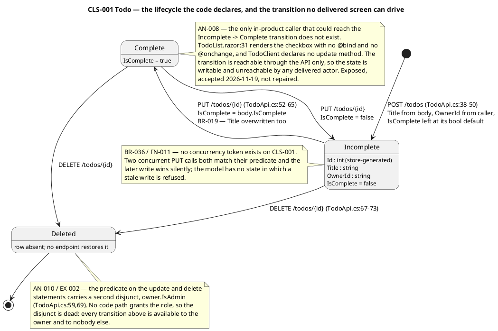
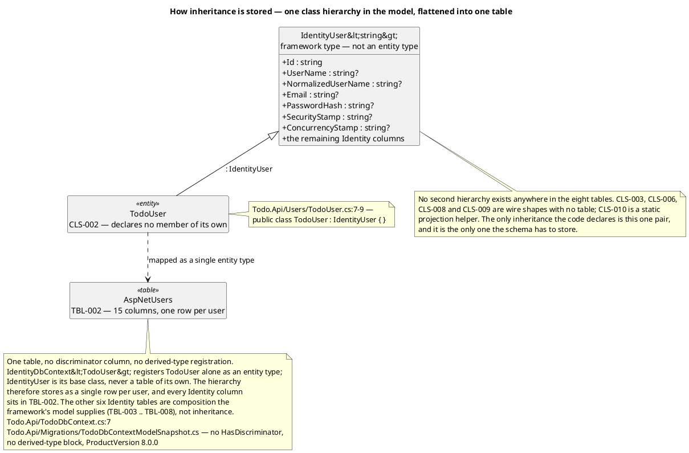
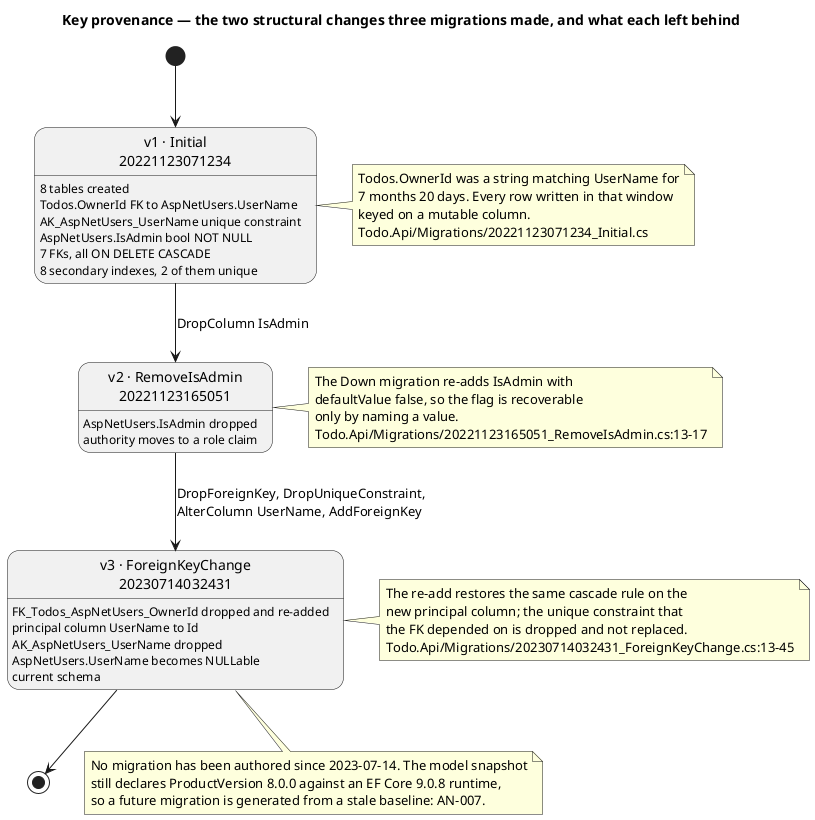

## Document Control
- Phase: Excavation
- Status: Draft — Domain Model, Design Packages and Classes and Persistent Data Classes recovered; Use-Case Realizations and Interface Contracts not yet recovered
- Milestone Target: end of Excavation (AR) — not yet achieved

## Design Overview
This document records the design the delivered code already holds. Nothing here is designed by this project: every class, member, visibility modifier and relationship is read out of the file named beside it, and no member is named that the code does not declare. Where the code is silent — a concurrency token, a lifecycle state an operation would need but no operation exists to reach — the silence is recorded as such, not filled.

The model is produced in stages. This iteration recovers the **domain model** and the **design packages and classes**; the use-case realizations and the interface contracts follow in later stages of this phase, and each section below states its own status.

| Section | What its diagram fixes | Status this iteration |
|---|---|---|
| Domain Model | The classes the code declares as business objects, their members, and the one relationship that holds between them | Recovered |
| Design Packages and Classes | The same classes grouped by the component that declares them, with every operation the code implements, and the classes of the host-configuration, orchestration and verification components | Recovered |
| Use-Case Realizations | Which objects collaborate, in what order, for each of the eight recovered use cases | Not yet recovered |
| Interface Contracts | Pre/postconditions on every operation a component boundary crosses | Not yet recovered |
| Persistent Data Classes | Column, key, index, constraint and cascade detail of the eight tables | Recovered — owned by the Database Designer |
| Boundary Classes and Navigation Map | The Razor components as boundary classes | Owned by the User Interface Designer |
| Capsules, Protocols and Signals | — | `[OMITTED: Capsules, Protocols and Signals — Development Case DC-D3: real-time-system = false, so no capsule, protocol or signal work runs in any phase]` |

**What is recovered and what is not.** Thirty-four classes carry the product and its declared wire shapes. Ten are business objects: one entity the project authored (`Todo`), the Identity-derived user, six DTO declarations that exist twice over — once in each host — plus the projection helper and one token record. Seventeen carry the code that reads and writes those objects. Seven more carry the host configuration, the orchestration, the migration and the test harness — the components the architecture summarises as carrying none. Each class is anchored where it is described; a class with no member the code declares is shown with none.

**One component declares no class at all.** COMP-018 is a workflow document; `TodoApp.AppHost/Program.cs` is top-level statements. Neither is a compilation unit, so neither has a class to recover. Every other component of the architecture holds at least one.

## Domain Model
The business objects the code declares are six: one entity the product authors, the Identity-derived user, and four DTO shapes. Three of those four exist twice over, because `Todo.Api` references `TodoApp.ServiceDefaults` alone and declares its own `TodoItem`, `UserInfo` and `ExternalUserInfo` while the two web projects share a second declaration through `Todo.Web.Shared` (ADR-011, CON-A10). There is one persistent relationship in the whole model and it is the ownership edge.

```plantuml
@startuml
title Domain Model — the business objects the code declares, and the two independent declarations of every wire shape
skinparam shadowing false
skinparam classAttributeIconSize 0
skinparam packageStyle rectangle
hide empty members
hide circle

package "Todo.Api — the API host's own declaration" {
  class "Todo\nCLS-001" as TODO <<entity>> {
    + Id : int
    + Title : string [Required]
    + IsComplete : bool
    + OwnerId : string [Required]
  }
  class "TodoUser\nCLS-002" as TODOUSER <<entity>> {
    .. no member declared ..
    (IdentityUser supplies Id, UserName, Email, PasswordHash)
  }
  class "TodoItem\nCLS-003" as APITODOITEM <<DTO>> {
    + Id : int
    + Title : string [Required]
    + IsComplete : bool
  }
  class "UserInfo\nCLS-004" as APIUSERINFO <<DTO>> {
    + Email : string [Required]
    + Password : string [Required]
  }
  class "ExternalUserInfo\nCLS-005" as APIEXTUSERINFO <<DTO>> {
    + Username : string [Required]
    + ProviderKey : string [Required]
  }
  class "TodoMappingExtensions\nCLS-010" as MAPPER <<static helper>> {
    {static} + AsTodoItem(todo : Todo) : TodoItem
  }
}

package "Todo.Web.Shared — the web projects' declaration" {
  class "TodoItem\nCLS-006" as WEBTODOITEM <<DTO>> {
    + Id : int
    + Title : string [Required]
    + IsComplete : bool
  }
  class "UserInfo\nCLS-007" as WEBUSERINFO <<DTO>> {
    + Email : string [Required]
    + Password : string [Required]
  }
  class "ExternalUserInfo\nCLS-008" as WEBEXTUSERINFO <<DTO>> {
    + Username : string [Required]
    + ProviderKey : string [Required]
  }
  class "AuthToken\nCLS-009" as AUTHTOKEN <<record>> {
    + Token : string [JsonPropertyName "accessToken"]
  }
}

TODO "0..*" --> "1" TODOUSER : OwnerId -> Id\nON DELETE CASCADE
MAPPER ..> TODO : reads
MAPPER ..> APITODOITEM : creates

apiTodoItem -[hidden]down- AUTHTOKEN
WEBTODOITEM -[hidden]down- AUTHTOKEN

note right of APITODOITEM
  ADR-011 — the wire shape is declared twice.
  TodoItem, UserInfo and ExternalUserInfo exist once per
  side and agree on member names by inspection only:
  Todo.Api/Todo.Api.csproj:24-26 references
  TodoApp.ServiceDefaults alone, never Todo.Web.Shared.
  CLS-003 Todo.Api/Todos/Todo.cs:14-19
  CLS-004 Todo.Api/Users/TodoUser.cs:12-19
  CLS-005 Todo.Api/Users/TodoUser.cs:24-29
end note

note right of TODOUSER
  AN-010 / EX-002: CurrentUser.IsAdmin reads the role claim
  "admin", but no code path grants a role and migration
  RemoveIsAdmin dropped the persisted flag. AspNetRoles and
  AspNetUserRoles exist and nothing writes them.
  CLS-002 Todo.Api/Users/TodoUser.cs:7-9
end note

note bottom of TODO
  CLS-001 Todo.Api/Todos/Todo.cs:3-12 — one entity the product
  authors; the seven Identity tables beside it are supplied by
  the framework.
  CLS-010 Todo.Api/Todos/Todo.cs:27-40
end note

note bottom of AUTHTOKEN
  CLS-006 Todo.Web/Shared/SharedClass.cs:5-11
  CLS-007 Todo.Web/Shared/SharedClass.cs:13-20
  CLS-008 Todo.Web/Shared/SharedClass.cs:22-29
  CLS-009 Todo.Web/Shared/SharedClass.cs:31
  AuthToken is web-only: AuthClient reads the API's
  AccessTokenResponse payload into this record and keeps
  one member of it. CLS-005 and CLS-008 are reached by no
  recovered use case — EP-011 is an exclusion.
end note
@enduml
```

### Domain classes, as the code declares them

| ID | Class | Stereotype | Members, as declared | Anchor |
|---|---|---|---|---|
| CLS-001 | `Todo` | `<<entity>>` | `Id : int`; `Title : string` `[Required]`; `IsComplete : bool`; `OwnerId : string` `[Required]` | `Todo.Api/Todos/Todo.cs:3-12` |
| CLS-002 | `TodoUser` | `<<entity>>` | declares no member of its own — `: IdentityUser`, which supplies `Id`, `UserName`, `NormalizedUserName`, `Email`, `PasswordHash`, `ConcurrencyStamp`, `SecurityStamp`, `LockoutEnd` and the rest of the Identity schema | `Todo.Api/Users/TodoUser.cs:7-9` |
| CLS-003 | `TodoItem` (API) | `<<DTO>>` | `Id : int`; `Title : string` `[Required]`; `IsComplete : bool` — excludes `OwnerId` by design, with the comment "we don't want that exposed to clients" | `Todo.Api/Todos/Todo.cs:14-19` |
| CLS-004 | `UserInfo` (API) | `<<DTO>>` | `Email : string` `[Required]`; `Password : string` `[Required]` | `Todo.Api/Users/TodoUser.cs:12-19` |
| CLS-005 | `ExternalUserInfo` (API) | `<<DTO>>` | `Username : string` `[Required]`; `ProviderKey : string` `[Required]` | `Todo.Api/Users/TodoUser.cs:24-29` |
| CLS-006 | `TodoItem` (web) | `<<DTO>>` | `Id : int`; `Title : string` `[Required]`; `IsComplete : bool` | `Todo.Web/Shared/SharedClass.cs:5-11` |
| CLS-007 | `UserInfo` (web) | `<<DTO>>` | `Email : string` `[Required]`; `Password : string` `[Required]` | `Todo.Web/Shared/SharedClass.cs:13-20` |
| CLS-008 | `ExternalUserInfo` (web) | `<<DTO>>` | `Username : string` `[Required]`; `ProviderKey : string` `[Required]` | `Todo.Web/Shared/SharedClass.cs:22-29` |
| CLS-009 | `AuthToken` | `<<record>>` | `Token : string` mapped to the JSON member `accessToken` by attribute | `Todo.Web/Shared/SharedClass.cs:31` |
| CLS-010 | `TodoMappingExtensions` | static extension class | `AsTodoItem(todo : Todo) : TodoItem` — projects the entity onto the DTO, dropping `OwnerId` | `Todo.Api/Todos/Todo.cs:27-40` |

### Domain relationships

| Relationship | Multiplicity the code declares | Consequence it carries | Anchor |
|---|---|---|---|
| `Todo` → `TodoUser` on `OwnerId` | many-to-one, required (`[Required]` on `OwnerId`; required by the non-nullable `string` under `Nullable enable`) | Every todo belongs to exactly one account, and no todo can exist unattached. Every read, update and delete carries the column in its predicate, so a row is never fetched by id alone and then checked — a non-owner's item answers `404`, never `403` | `Todo.Api/TodoDbContext.cs:11-15`; `Todo.Api/Todos/Todo.cs:9-11`; `Todo.Api/Todos/TodoApi.cs:33,59,69` |
| `Todo` → `TodoUser` on delete | cascade | Declared in the third migration against `AspNetUsers.Id`; the first migration had pointed the same foreign key at `AspNetUsers.UserName`. No endpoint deletes a user, so the rule exists and the operation does not | `Todo.Api/Migrations/20230714032431_ForeignKeyChange.cs:27-34` |
| `Todo` → `TodoItem` (CLS-003) | projection, not an association — computed per response | The wire shape and the stored shape are separate types, and the projection is the only place the owner is dropped. No mapping library is used | `Todo.Api/Todos/Todo.cs:27-40`; `Todo.Api/Todos/TodoApi.cs:26,35,49` |
| `TodoUser` → Identity tables | one-to-many supplied by the framework schema | Seven tables, of which `AspNetRoles` and `AspNetUserRoles` are written by nothing (AN-010, EX-003) | `Todo.Api/TodoDbContext.cs:7`; `Todo.Api/Migrations/20221123071234_Initial.cs` |

**No other association exists.** `TodoUser` exposes no collection of todos; there is no navigation property on either side, so a user's items are reachable only by a query that filters on `OwnerId`. The model is one entity and one edge, and the Identity schema the framework contributes around it.

### CLS-001 Todo — lifecycle

Three states are reachable and a fourth is declared by no operation. The diagram records which transition the delivered product cannot drive, which is the same fact AN-008 records against the update use case.

| State | Reachable by | Guard the code applies | Invariant |
|---|---|---|---|
| Incomplete | `POST /todos` on a new row | `Title` non-empty — CLS-016 is attached to the group and `TodoItem` is its declared type (ADR-004) | `OwnerId` is the caller's `NameIdentifier` and cannot be supplied by the body, because `TodoItem` carries no `OwnerId` member |
| Complete | `PUT /todos/{id}` with `IsComplete = true` | Route id equals body id, owner matches, single `UPDATE ... WHERE` | — |
| Deleted | `DELETE /todos/{id}` | Owner matches, single `DELETE ... WHERE` | No restore path exists |

## Design Packages and Classes
The classes group by the component that declares them, and the grouping is not the project grouping: five packages sit inside `Todo.Api`'s one project because each mechanism is a registration applied to route groups rather than a folder; the BFF package holds seven classes because they share a host and a pipeline; and the remaining five projects each contribute one package. Eleven packages across seven projects. The decomposition is held by the interfaces the Software Architecture Document names (`INT-001` … `INT-012`), not by the `.csproj` files.

Every class below is read out of the file named beside it, and none is named that the code does not declare. Where the code declares a class the architecture's component summary does not mention, it is recorded here: a component is a unit of change, not a unit of source files, and the class set is what the compiler holds.

```plantuml
@startuml
title Design Packages — the eleven packages and the classes each component declares
skinparam shadowing false
skinparam classAttributeIconSize 0
skinparam packageStyle rectangle
hide empty members
hide circle

package "Todo.Api · Todos — COMP-008" {
  class "Todo\nCLS-001" as TODO {
    + Id : int
    + Title : string
    + IsComplete : bool
    + OwnerId : string
  }
  class "TodoItem\nCLS-003" as APIDTO {
    + Id : int
    + Title : string
    + IsComplete : bool
  }
  class "TodoMappingExtensions\nCLS-010" as MAPPER {
    {static} + AsTodoItem(todo : Todo) : TodoItem
  }
  class "TodoApi\nCLS-020" as API_TODOS <<internal static module>> {
    {static} + MapTodos(routes) : RouteGroupBuilder
    - GET / (db, owner)
    - GET /{id} (db, id, owner)
    - POST / (db, newTodo : TodoItem, owner)
    - PUT /{id} (db, id, todo : TodoItem, owner)
    - DELETE /{id} (db, id, owner)
  }
}

package "Todo.Api · Users — COMP-007" {
  class "TodoUser\nCLS-002" as TODOUSER
  class "UserInfo\nCLS-004" as APIUSERINFO
  class "ExternalUserInfo\nCLS-005" as APIEXTUSER
  class "UsersApi\nCLS-019" as API_USERS <<static module>> {
    {static} + MapUsers(routes) : RouteGroupBuilder
    - POST /token/{provider} (provider, userInfo, userManager, signInManager, dpp)
  }
}

package "Todo.Api · Persistence — COMP-012" {
  class "TodoDbContext\nCLS-011" as DBCTX {
    + Todos : DbSet~Todo~
    # OnModelCreating(builder)
  }
}

package "Todo.Api · Authorization — COMP-009" {
  class "CurrentUser\nCLS-012" as CUR {
    + User : TodoUser?
    + Principal : ClaimsPrincipal
    + Id : string {readOnly}
    + IsAdmin : bool {readOnly}
  }
  class "ClaimsTransformation\nCLS-013" as CLAIMTRANS <<private sealed>> {
    + TransformAsync(principal) : ClaimsPrincipal
  }
  class "CheckCurrentUserAuthHandler\nCLS-014" as AUTHHANDLER <<private>> {
    # HandleRequirementAsync(context, requirement)
  }
}

package "Todo.Api · Cross-cutting — COMP-010, COMP-011, COMP-013" {
  class "RateLimitExtensions\nCLS-015" as RATELIMIT <<static>> {
    {static} + AddRateLimiting(services)
    {static} + RequirePerUserRateLimit(builder)
  }
  class "ValidationFilterExtensions\nCLS-016" as VALIDATION <<static>> {
    {static} + WithParameterValidation~TBuilder~(builder, params Type[])
  }
  class "OpenApiOptionsExtensions\nCLS-017" as OPENAPI <<static>> {
    {static} + AddBearerTokenAuthentication(options)
  }
}

package "Todo.Web.Server · BFF" {
  class "AuthenticationExtensions\nCLS-028" as AUTHEXT <<public static>> {
    - ExternalAuthProvider(builder, configure) {delegate}
    {static} + AddAuthentication(builder) : WebApplicationBuilder
    - SetAuth0SignInScheme(builder) {local}
    - ExternalProviderKey : string = "ExternalProviderName"
    {static} + GetExternalProvider(properties) : string?
    {static} + SetExternalProvider(properties, providerName)
  }
  class "AuthClient\nCLS-018" as AUTHCLIENT {
    + GetTokenAsync(userInfo : UserInfo) : string?
    + CreateUserAsync(userInfo : UserInfo) : string?
    + GetOrCreateUserAsync(provider, userInfo : ExternalUserInfo) : string?
  }
  class "AuthApi\nCLS-021" as WEB_AUTH <<static module>> {
    {static} + MapAuth(routes) : RouteGroupBuilder
    - POST /auth/register (userInfo, client)
    - POST /auth/login (userInfo, client)
    - POST /auth/logout (context) [authorized]
    - GET /auth/login/{provider} (provider)
    - GET /auth/signin/{provider} (provider, client, context, dpp)
    - {static} SignIn(userId, userName, token, providerName)
  }
  class "TodoApi\nCLS-022" as WEB_FWD <<static module>> {
    {static} + MapTodos(routes) : RouteGroupBuilder
    - /todos/{*path} YARP MapForwarder [authorized]
  }
  class "ExternalProviders\nCLS-023" as EXTPROV {
    + GetProviderNamesAsync() : Task~string[]~
  }
  class "HttpAuthenticationStateProvider\nCLS-024" as AUTHSTATE {
    + GetAuthenticationStateAsync() : Task~AuthenticationState~
  }
  class "TokenNames\nCLS-025" as TOKENNAMES {
    {static} + AccessToken : string = "accessToken"
  }
  class "AuthenticationSchemes\nCLS-026" as SCHEMES {
    {static} + ExternalScheme : string = "External"
  }
}

package "Todo.Web.Client — COMP-005" {
  class "TodoClient\nCLS-027" as TODOCLIENT {
    + AddTodoAsync(title : string?) : TodoItem?
    + DeleteTodoAsync(id : int) : bool
    + GetTodosAsync() : (HttpStatusCode, List~TodoItem~?)
    + LoginAsync(email, password) : bool
    + CreateUserAsync(email, password) : bool
    + LogoutAsync() : bool
  }
}

package "Todo.Web.Shared — COMP-006, the web projects' declaration" {
  class "TodoItem\nCLS-006" as WEBDTO
  class "UserInfo\nCLS-007" as WEBUSERINFO
  class "ExternalUserInfo\nCLS-008" as WEBEXTUSER
  class "AuthToken\nCLS-009" as AUTHTOKEN
}

API_TODOS ..> DBCTX
API_TODOS ..> CUR
API_TODOS ..> APIDTO
API_TODOS ..> TODO
API_TODOS ..> MAPPER
API_USERS ..> TODOUSER
API_USERS ..> APIEXTUSER
API_USERS ..> DBCTX
DBCTX ..> TODO
DBCTX ..> TODOUSER
CLAIMTRANS ..> CUR
CLAIMTRANS ..> TODOUSER
AUTHHANDLER ..> CUR
WEB_AUTH ..> AUTHCLIENT
WEB_AUTH ..> TOKENNAMES
WEB_AUTH ..> AUTHEXT : SetExternalProvider
WEB_FWD ..> TOKENNAMES
AUTHCLIENT ..> API_USERS : HTTP users/register,\nusers/login, users/token/{provider}
TODOCLIENT ..> WEB_AUTH : HTTP auth/*
TODOCLIENT ..> WEB_FWD : HTTP todos
AUTHSTATE ..> SCHEMES
EXTPROV ..> SCHEMES
AUTHEXT ..> SCHEMES
AUTHEXT ..> AUTHSTATE : registers
AUTHEXT ..> EXTPROV : registers
WEB_AUTH ..> WEBUSERINFO : serializes
AUTHCLIENT ..> WEBUSERINFO : serializes
AUTHCLIENT ..> WEBEXTUSER : serializes
AUTHCLIENT ..> AUTHTOKEN : reads accessToken
TODOCLIENT ..> WEBDTO

note right of AUTHEXT
  CLS-028 Todo.Web/Server/Authentication/
  AuthenticationExtensions.cs:12-100.
  Registering the cookie scheme is the whole
  of SS-001: AddCookie() for the default scheme
  and AddCookie("External") for the provider hop.
  The provider loop at :40-52 adds GitHub, Google,
  Microsoft and Auth0 only when
  Authentication:Schemes:<provider> exists — no
  shipped settings file carries it, so the four
  schemes are inert (AN-002, EX-001).
  Every other class in this package is reached from
  here: it is the only caller that registers
  CLS-023, CLS-024 and CLS-026.
end note
note right of TODOCLIENT
  CLS-027 Todo.Web/Client/TodoClient.cs:7-71.
  No update method exists — the counterpart of AN-008.
end note
note bottom of WEBDTO
  ADR-011 — the wire shape is declared twice.
  CLS-006..CLS-009 Todo.Web/Shared/SharedClass.cs:5-31
  are the web projects' declarations; CLS-003, CLS-004
  and CLS-005 in the Todo.Api packages are the API's own,
  and no reference edge joins the two (CON-A10).
end note
note bottom of CUR
  CLS-012 Todo.Api/Authorization/CurrentUser.cs:6-15.
  IsAdmin is the dead branch (AN-010, EX-002).
end note
@enduml
```

### Design classes, with the operations the code implements

| ID | Class | Package | Operations, as declared | Anchored dependency | Anchor |
|---|---|---|---|---|---|
| CLS-020 | `TodoApi` | Todo.Api · Todos | `MapTodos(routes) : RouteGroupBuilder`; five handlers: list, read one, create, update, delete | `TodoDbContext`, `CurrentUser`, `TodoItem`, `Todo`, `AsTodoItem` | `Todo.Api/Todos/TodoApi.cs:8-77` |
| CLS-019 | `UsersApi` | Todo.Api · Users | `MapUsers(routes) : RouteGroupBuilder`; the stock `MapIdentityApi<TodoUser>()` group plus one custom handler `POST /token/{provider}` | `TodoUser`, `ExternalUserInfo`, `UserManager`, `SignInManager`, `IDataProtectionProvider` | `Todo.Api/Users/UsersApi.cs:10-64` |
| CLS-011 | `TodoDbContext` | Todo.Api · Persistence | `Todos : DbSet<Todo>`; `OnModelCreating(builder)` declaring the ownership foreign key against `AspNetUsers.Id` | primary constructor over `DbContextOptions<TodoDbContext>`; base `IdentityDbContext<TodoUser>` | `Todo.Api/TodoDbContext.cs:7-21` |
| CLS-012 | `CurrentUser` | Todo.Api · Authorization | `User : TodoUser?` (settable); `Principal : ClaimsPrincipal` (settable); `Id : string` (computed from `NameIdentifier`); `IsAdmin : bool` (computed from the `admin` role claim) | `ClaimsPrincipal`, `TodoUser` | `Todo.Api/Authorization/CurrentUser.cs:6-15` |
| CLS-013 | `ClaimsTransformation` | Todo.Api · Authorization | `TransformAsync(principal) : ClaimsPrincipal` | `CurrentUser`, `UserManager<TodoUser>` | `Todo.Api/Authorization/CurrentUserExtensions.cs:14-35` |
| CLS-014 | `CheckCurrentUserAuthHandler` | Todo.Api · Authorization | `HandleRequirementAsync(context, requirement)` — succeeds only when `CurrentUser.User` is non-null | `CurrentUser` | `Todo.Api/Authorization/CheckCurrentUserAuthHandler.cs:17-39` |
| CLS-015 | `RateLimitExtensions` | Todo.Api · Cross-cutting | `AddRateLimiting(services)`; `RequirePerUserRateLimit(builder) : IEndpointConventionBuilder` | framework rate limiter, `TokenBucketRateLimiterOptions` | `Todo.Api/Extensions/RateLimitExtensions.cs:11-71` |
| CLS-016 | `ValidationFilterExtensions` | Todo.Api · Cross-cutting | `WithParameterValidation<TBuilder>(builder, params Type[]) : TBuilder` | `MiniValidator` | `Todo.Api/Filters/ValidationFilter.cs:7-58` |
| CLS-017 | `OpenApiOptionsExtensions` | Todo.Api · Cross-cutting | `AddBearerTokenAuthentication(options) : OpenApiOptions` | `Microsoft.OpenApi.Models`, `IAuthorizeData` | `Todo.Api/Extensions/OpenApiOptionsExtensions.cs:7-47` |
| CLS-028 | `AuthenticationExtensions` | Todo.Web.Server · BFF | `AddAuthentication(builder) : WebApplicationBuilder`; the private delegate `ExternalAuthProvider`; the local `SetAuth0SignInScheme(builder)`; `ExternalProviderKey = "ExternalProviderName"`; `GetExternalProvider(properties) : string?`; `SetExternalProvider(properties, providerName)` | `AuthenticationSchemes`, `ExternalProviders`, `HttpAuthenticationStateProvider`, `IAuthenticationSchemeProvider`, four provider option types | `Todo.Web/Server/Authentication/AuthenticationExtensions.cs:12-100` |
| CLS-018 | `AuthClient` | Todo.Web.Server · BFF | `GetTokenAsync(UserInfo) : Task<string?>`; `CreateUserAsync(UserInfo) : Task<string?>`; `GetOrCreateUserAsync(string, ExternalUserInfo) : Task<string?>` | `HttpClient` with `BaseAddress = http://todoapi` | `Todo.Web/Server/AuthClient.cs:3-46` |
| CLS-021 | `AuthApi` | Todo.Web.Server · BFF | `MapAuth(routes) : RouteGroupBuilder`; three public POSTs, two provider GETs, one private `SignIn` overload pair | `AuthClient`, `TokenNames`, `AuthenticationSchemes`, `AuthenticationExtensions.SetExternalProvider`, `IDataProtectionProvider` | `Todo.Web/Server/AuthApi.cs:12-128` |
| CLS-022 | `TodoApi` | Todo.Web.Server · BFF | `MapTodos(routes) : RouteGroupBuilder`; one YARP `MapForwarder` at `{*path}` with a request transform | `TokenNames`, `IHttpForwarder` | `Todo.Web/Server/TodoApi.cs:9-28` |
| CLS-023 | `ExternalProviders` | Todo.Web.Server · BFF | `GetProviderNamesAsync() : Task<string[]>` — every scheme that is neither cookie scheme, memoized in a field | `IAuthenticationSchemeProvider` | `Todo.Web/Server/Authentication/ExternalProviders.cs:5-35` |
| CLS-024 | `HttpAuthenticationStateProvider` | Todo.Web.Server · BFF | `GetAuthenticationStateAsync() : Task<AuthenticationState>` — `HttpContext.User`, or an empty principal | `IHttpContextAccessor` | `Todo.Web/Server/Authentication/HttpAuthenticationStateProvider.cs:3-10` |
| CLS-025 | `TokenNames` | Todo.Web.Server · BFF | `static AccessToken : string = "accessToken"` — the one token name the BFF holds | — | `Todo.Web/Server/Authentication/TokenNames.cs:3-6` |
| CLS-026 | `AuthenticationSchemes` | Todo.Web.Server · BFF | `static ExternalScheme : string = "External"` | — | `Todo.Web/Server/Authentication/AuthenticationSchemes.cs:3-7` |
| CLS-027 | `TodoClient` | Todo.Web.Client | `AddTodoAsync(string?) : Task<TodoItem?>`; `DeleteTodoAsync(int) : Task<bool>`; `GetTodosAsync() : Task<(HttpStatusCode, List<TodoItem>?)>`; `LoginAsync`; `CreateUserAsync`; `LogoutAsync` | `HttpClient` with `BaseAddress = HostEnvironment.BaseAddress` | `Todo.Web/Client/TodoClient.cs:7-71` |

`CLS-028` is the class the architecture's component summary does not name and the code holds: the only caller of `AddCookie`, the only caller that registers `CLS-023`, `CLS-024` and `CLS-026`, and the sole site of the provider loop that `EX-001` excludes. It is the whole of mechanism `SS-001` in one static class, and it is a member of COMP-002 because the session authority is defined as the component that owns the cookie scheme.

### What the class model fixes that the requirement statements do not

Four facts belong to the class model because no use-case text can carry them, and each is a constraint the Implementer inherits.

**CLS-027 declares no update operation.** `TodoClient` carries six methods and not one of them issues `PUT`. The absence is a fact of the class, not a gap in a screen — which is why the update use case has an API path and no client path (AN-008). A design that added the method would be adding a capability no requirement declares.

**CLS-012 exposes `IsAdmin` as a computed read-only property with no writer in product code.** `CurrentUser.User` and `Principal` are settable and are written by CLS-013; `Id` and `IsAdmin` are computed and nothing in the product assigns them. `IsAdmin` derives from a claim only CLS-033 mints, so the two disjuncts in `TodoApi.cs:59,69` that read it are unreachable in any delivered run (AN-010, `EX-002`). The member is recovered because the code declares it; it is not evidence of a capability.

**CLS-016 matches on the declared parameter type, and that type is not the credential body.** `WithParameterValidation(typeof(ExternalUserInfo))` is applied to the `/users` group and `WithParameterValidation(typeof(TodoItem))` to `/todos`. `UserInfo` — the body of registration and sign-in — is named by neither call site, so the filter is attached to no endpoint that receives it and CLS-004's `[Required]` attributes are enforced by nothing on the server (BR-032, ADR-004). The `[Required]` attributes on CLS-004 and CLS-007 do take effect in the browser through `DataAnnotationsValidator` on the login form, which is where the only enforcement sits.

**CLS-028 is the model's only cookie registration, and it is static.** The two `AddCookie` calls sit inside `AddAuthentication(this WebApplicationBuilder)`, called once from `Todo.Web/Server/Program.cs:9`. No option, lifetime, sliding-expiry or key-repository value is set here, so the cookie's lifetime is the framework default and `SS-001`'s properties are held by convention rather than by configuration (ADR-002, AN-015, AN-017).

### Ownership trace — every class to the component that holds it

| Package | Component (SAD) | Classes | Project |
|---|---|---|---|
| Todo.Api · Todos | COMP-008 | CLS-001, CLS-003, CLS-010, CLS-020 | `Todo.Api` |
| Todo.Api · Users | COMP-007 | CLS-002, CLS-004, CLS-005, CLS-019 | `Todo.Api` |
| Todo.Api · Persistence | COMP-012 | CLS-011 | `Todo.Api` |
| Todo.Api · Authorization | COMP-009 | CLS-012, CLS-013, CLS-014 | `Todo.Api` |
| Todo.Api · Cross-cutting | COMP-010, COMP-011, COMP-013 | CLS-015, CLS-016, CLS-017 | `Todo.Api` |
| Todo.Web.Server · BFF | COMP-002 (CLS-018, CLS-021, CLS-025, CLS-026, CLS-028); COMP-003 (CLS-022); COMP-001 (CLS-023, CLS-024) | CLS-018, CLS-021, CLS-022, CLS-023, CLS-024, CLS-025, CLS-026, CLS-028 | `Todo.Web/Server` |
| Todo.Web.Client | COMP-005 | CLS-027 | `Todo.Web/Client` |
| Todo.Web.Shared | COMP-006 | CLS-006, CLS-007, CLS-008, CLS-009 | `Todo.Web/Shared` |
| TodoApp.ServiceDefaults | COMP-014 | CLS-029 | `TodoApp.ServiceDefaults` |
| TodoApp.AppHost | COMP-015, COMP-016 | CLS-030 | `TodoApp.AppHost` |
| Todo.Api.Tests | COMP-017 | CLS-031, CLS-032, CLS-033, CLS-034 | `Todo.Api.Tests` |

One component carries no class: COMP-018, the CI pipeline, which is a workflow document with no compilation unit. `TodoApp.AppHost/Program.cs` likewise declares no class — it is top-level statements — so the orchestrator's behaviour is held entirely by CLS-030 across COMP-015 and COMP-016.

### Host configuration, orchestration and verification classes

Five components were recorded as carrying no class of their own. Four of them declare one; the fifth — COMP-018, the CI workflow — declares none because it is a YAML document, not a compilation unit.

```plantuml
@startuml
title The four components the architecture records without a class also declare one — host configuration, orchestration and verification
skinparam shadowing false
skinparam classAttributeIconSize 0
skinparam packageStyle rectangle
hide empty members
hide circle

package "TodoApp.ServiceDefaults — COMP-014" {
  class "Extensions\nCLS-029" as SDExt <<public static, namespace Microsoft.Extensions.Hosting>> {
    {static} + AddServiceDefaults~TBuilder~(builder) : TBuilder
    {static} + ConfigureOpenTelemetry~TBuilder~(builder) : TBuilder
    - {static} + AddOpenTelemetryExporters~TBuilder~(builder) : TBuilder
    {static} + AddDefaultHealthChecks~TBuilder~(builder) : TBuilder
    {static} + MapDefaultEndpoints(app) : WebApplication
  }
}

package "TodoApp.AppHost — COMP-015 and COMP-016" {
  class "Extensions\nCLS-030" as AHExt <<internal static>> {
    {static} + AddTodoDbMigration(builder) : IResourceBuilder~ExecutableResource~?
    {static} + AddEfMigration~TProject~(builder, name) : IResourceBuilder~ExecutableResource~
    {static} + GetProjectDirectory(project) : string
  }
}

package "Todo.Api.Tests — COMP-017" {
  class "TodoApplication\nCLS-031" as TESTAPP <<internal, : WebApplicationFactory~Program~>> {
    - _sqliteConnection : SqliteConnection
    + CreateTodoDbContext() : TodoDbContext
    + CreateUserAsync(username, password) : Task
    + CreateClient(id, isAdmin = false) : HttpClient
    # CreateHost(builder) : IHost
    # Dispose(disposing)
  }
  class "AuthHandler\nCLS-032" as AUTHH <<private sealed, : DelegatingHandler, nested>> {
    # SendAsync(request, cancellationToken) : HttpResponseMessage
  }
  class "TokenService\nCLS-033" as TOKENSVC <<public sealed>> {
    - _options : BearerTokenOptions
    + GenerateTokenAsync(username, isAdmin = false) : Task~string~
  }
  class "DbContextExtensions\nCLS-034" as DBEXT <<internal static>> {
    {static} + AddDbContextOptions~TContext~(services, configure) : IServiceCollection
  }
}

TESTAPP +-- AUTHH : nested
TESTAPP ..> DBEXT : replaces the DbContext options
TESTAPP ..> TOKENSVC : registered scoped
AUTHH ..> TOKENSVC : resolves and mints
TOKENSVC ..> TODOUSER : builds the principal
TESTAPP ..> DBCTX : EnsureCreated over :memory:

class "TodoUser\nCLS-002" as TODOUSER
class "TodoDbContext\nCLS-011\nCOMP-012" as DBCTX

note right of SDExt
  CLS-029 TodoApp.ServiceDefaults/Extensions.cs:16-117.
  AddServiceDefaults is called by both hosts
  (Todo.Api/Program.cs:7, Todo.Web/Server/Program.cs:6),
  which is what makes it COMP-014 rather than a
  library of its own. AddOpenTelemetryExporters is
  private despite being an extension method; the
  OTLP branch at :75-81 is the SS-009 mechanism.
  MapDefaultEndpoints maps /health and /alive inside
  IsDevelopment only — EP-025.
end note

note right of AHExt
  CLS-030 TodoApp.AppHost/Extensions.cs:1-38.
  One class carries both COMP-015's start-up ordering
  and COMP-016's migration: AddTodoDbMigration gates on
  the .db directory's absence, AddEfMigration chains
  WaitForCompletion over the global dotnet-ef install.
  Program.cs:1-28 is top-level statements and declares
  no class, so this is the only class the orchestrator
  authors.
end note

note bottom of TESTAPP
  CLS-031..CLS-034 Todo.Api.Tests/.
  The harness replaces the data-protection provider with
  EphemeralDataProtectionProvider (:53) and the DbContext
  options with a held-open in-memory connection (:37-56),
  which is why AN-020 holds: this proves Todo.Api alone,
  never the assembled topology.
  TokenService mints the admin claim (TokenService.cs:16-21)
  that no product code path can mint (AN-010, EX-002).
end note
@enduml
```

| ID | Class | Package | Operations, as declared | Component | Anchor |
|---|---|---|---|---|---|
| CLS-029 | `Extensions` | TodoApp.ServiceDefaults | `AddServiceDefaults<TBuilder>(builder) : TBuilder`; `ConfigureOpenTelemetry<TBuilder>(builder) : TBuilder`; private `AddOpenTelemetryExporters<TBuilder>(builder) : TBuilder`; `AddDefaultHealthChecks<TBuilder>(builder) : TBuilder`; `MapDefaultEndpoints(app) : WebApplication` | COMP-014 | `TodoApp.ServiceDefaults/Extensions.cs:16-117` |
| CLS-030 | `Extensions` | TodoApp.AppHost | `AddTodoDbMigration(builder) : IResourceBuilder<ExecutableResource>?`; `AddEfMigration<TProject>(builder, name) : IResourceBuilder<ExecutableResource>`; `GetProjectDirectory(project) : string` | COMP-015, COMP-016 | `TodoApp.AppHost/Extensions.cs:1-38` |
| CLS-031 | `TodoApplication` | Todo.Api.Tests | `CreateTodoDbContext() : TodoDbContext`; `CreateUserAsync(username, password) : Task`; `CreateClient(id, isAdmin = false) : HttpClient`; protected `CreateHost(builder) : IHost`; protected `Dispose(disposing)`; private field `_sqliteConnection : SqliteConnection` | COMP-017 | `Todo.Api.Tests/TodoApplication.cs:5-95` |
| CLS-032 | `AuthHandler` | Todo.Api.Tests | `SendAsync(request, cancellationToken) : HttpResponseMessage` — mints a bearer token and writes it onto the outgoing request | COMP-017 | `Todo.Api.Tests/TodoApplication.cs:77-95` |
| CLS-033 | `TokenService` | Todo.Api.Tests | `GenerateTokenAsync(username, isAdmin = false) : Task<string>` — builds the principal, adds the `admin` role claim when asked, protects a bearer ticket | COMP-017 | `Todo.Api.Tests/TokenService.cs:8-33` |
| CLS-034 | `DbContextExtensions` | Todo.Api.Tests | `AddDbContextOptions<TContext>(services, configure) : IServiceCollection` — removes the registered options and re-adds them as singletons | COMP-017 | `Todo.Api.Tests/DbContextExtensions.cs:3-29` |

`CLS-033` is the only class in the whole model that mints the `admin` role claim (`TokenService.cs:16-21`). No product class can: `CLS-012.IsAdmin` reads a claim only this test type writes, and `AspNetRoles`/`AspNetUserRoles` are written by nothing (AN-010, `EX-002`). The claim's existence in the model is evidence of a test fixture, not of a capability.

## Persistent Data Classes

Eight tables exist and every one of them is declared by `Todo.Api/Migrations`. No DDL script, no schema file and no database instance is delivered (`AN-004`): the schema is read out of three migrations and a model snapshot whose `ProductVersion` is `8.0.0` against an EF Core 9.0.8 runtime (`AN-007`). The engine is recorded, not chosen — SQLite through `Microsoft.EntityFrameworkCore.Sqlite` 9.0.8, one file at `Data Source=.db/Todos.db`. `[OMITTED: Data Model — DC §5.2 trigger not fired for this project; the persistent structures are recorded here, inline in the Design Model]`

```plantuml
@startuml
title Persistent schema — eight tables as the three EF Core migrations declare them
skinparam shadowing false
skinparam classAttributeIconSize 0
skinparam packageStyle rectangle
hide empty members
hide circle

package "SQLite — Todos.db, built only by Todo.Api/Migrations" {

  class "Todos\nTBL-001" as TODOS <<table>> {
    PK Id : int [INTEGER, autoincrement]
    Title : string [TEXT, NOT NULL]
    IsComplete : bool [INTEGER, NOT NULL]
    FK OwnerId : string [TEXT, NOT NULL]
  }

  class "AspNetUsers\nTBL-002" as USERS <<table>> {
    PK Id : string [TEXT]
    UserName : string [TEXT 256, NULL]
    NormalizedUserName : string [TEXT 256, NULL]
    Email : string [TEXT 256, NULL]
    NormalizedEmail : string [TEXT 256, NULL]
    EmailConfirmed : bool [INTEGER, NOT NULL]
    PasswordHash : string [TEXT, NULL]
    SecurityStamp : string [TEXT, NULL]
    ConcurrencyStamp : string [TEXT, NULL, concurrency token]
    PhoneNumber : string [TEXT, NULL]
    PhoneNumberConfirmed : bool [INTEGER, NOT NULL]
    TwoFactorEnabled : bool [INTEGER, NOT NULL]
    LockoutEnd : DateTimeOffset? [TEXT, NULL]
    LockoutEnabled : bool [INTEGER, NOT NULL]
    AccessFailedCount : int [INTEGER, NOT NULL]
  }

  class "AspNetRoles\nTBL-003" as ROLES <<table>> {
    PK Id : string [TEXT]
    Name : string [TEXT 256, NULL]
    NormalizedName : string [TEXT 256, NULL]
    ConcurrencyStamp : string [TEXT, NULL, concurrency token]
  }

  class "AspNetUserRoles\nTBL-004" as USERROLES <<table>> {
    PK FK UserId : string [TEXT]
    PK FK RoleId : string [TEXT]
  }

  class "AspNetUserClaims\nTBL-005" as USERCLAIMS <<table>> {
    PK Id : int [INTEGER, autoincrement]
    FK UserId : string [TEXT, NOT NULL]
    ClaimType : string [TEXT, NULL]
    ClaimValue : string [TEXT, NULL]
  }

  class "AspNetRoleClaims\nTBL-006" as ROLECLAIMS <<table>> {
    PK Id : int [INTEGER, autoincrement]
    FK RoleId : string [TEXT, NOT NULL]
    ClaimType : string [TEXT, NULL]
    ClaimValue : string [TEXT, NULL]
  }

  class "AspNetUserLogins\nTBL-007" as USERLOGINS <<table>> {
    PK FK LoginProvider : string [TEXT]
    PK FK ProviderKey : string [TEXT]
    FK UserId : string [TEXT]
    ProviderDisplayName : string [TEXT, NULL]
  }

  class "AspNetUserTokens\nTBL-008" as USERTOKENS <<table>> {
    PK FK UserId : string [TEXT]
    PK FK LoginProvider : string [TEXT]
    PK FK Name : string [TEXT]
    Value : string [TEXT, NULL]
  }
}

TODOS "0..*" --> "1" USERS : OwnerId to Id\nFK_Todos_AspNetUsers_OwnerId CASCADE
USERROLES "0..*" --> "1" USERS : UserId CASCADE
USERROLES "0..*" --> "1" ROLES : RoleId CASCADE
USERCLAIMS "0..*" --> "1" USERS : UserId CASCADE
ROLECLAIMS "0..*" --> "1" ROLES : RoleId CASCADE
USERLOGINS "0..*" --> "1" USERS : UserId CASCADE
USERTOKENS "0..*" --> "1" USERS : UserId CASCADE

note right of TODOS
  TBL-001 stores CLS-001 Todo and nothing else.
  Index IX_Todos_OwnerId on (OwnerId), non-unique.
  No concurrency token, no timestamp, no soft-delete
  column: BR-036 / FN-011.
  Todo.Api/Migrations/20221123071234_Initial.cs
  Todo.Api/Todos/Todo.cs:3-12
  Todo.Api/TodoDbContext.cs:11-15
end note

note right of USERS
  TBL-002 stores CLS-002 TodoUser (: IdentityUser).
  Unique index UserNameIndex on (NormalizedUserName);
  index EmailIndex on (NormalizedEmail).
  IsAdmin was a NOT NULL column here for 9 h 38 min of
  migration history; 20221123165051_RemoveIsAdmin dropped it.
  UserName is NULLable since 20230714032431_ForeignKeyChange,
  which dropped AK_AspNetUsers_UserName.
end note

note bottom of ROLES
  TBL-003 and TBL-004 are written by nothing in the delivery.
  Unique index RoleNameIndex on (NormalizedName);
  index IX_AspNetUserRoles_RoleId on (RoleId).
  CurrentUser.IsAdmin reads the role claim "admin", which only
  the test fixture TokenService mints. EX-002 / AN-010.
end note

note bottom of USERLOGINS
  TBL-007 is the table the excluded external-provider flow
  would have written. Composite PK (LoginProvider, ProviderKey),
  index IX_AspNetUserLogins_UserId on (UserId), CASCADE.
  No product code path writes it. EX-001 / AN-002.
  TBL-008 AspNetUserTokens likewise: composite PK
  (UserId, LoginProvider, Name), no secondary index, unwritten.
end note

note bottom of TODOS
  No PK is a natural key. TBL-001 keys on a store-generated
  surrogate int; every Identity table keys on CLS-002's string
  Id (a GUID the framework generates), except the three
  junction tables, which key on the pair or triple they join.
  Every association in the schema carries ON DELETE CASCADE.
  No CHECK constraint, view, trigger or stored procedure exists
  anywhere: AN-004.
end note
@enduml
```

### Tables and the classes that own them

One table stores a product entity; six are the framework's Identity composition around the user entity; one stores nothing the delivery ever writes. No table carries a column no class declares, and no class in the Design Model declares a persistent member with no column — the mapping is one-to-one in both directions.

| Table | Columns | What it stores | Persistent class | Traces From | Anchor |
|---|---|---|---|---|---|
| TBL-001 `Todos` | 4 | The todo entity, one row per item | CLS-001 `Todo` | CLS-001 | `Todo.Api/Todos/Todo.cs:3-12`; `Todo.Api/TodoDbContext.cs:9-15`; `Todo.Api/Migrations/20221123071234_Initial.cs` |
| TBL-002 `AspNetUsers` | 15 | The user entity and its credential state | CLS-002 `TodoUser` | CLS-002 | `Todo.Api/Users/TodoUser.cs:7-9`; `20221123071234_Initial.cs`; `20230714032431_ForeignKeyChange.cs` |
| TBL-003 `AspNetRoles` | 4 | Role definitions | none — composed by `IdentityDbContext<TodoUser>`, the base type of CLS-011; no product class declares a role | CLS-011 | `20221123071234_Initial.cs`; `Todo.Api/TodoDbContext.cs:7` |
| TBL-004 `AspNetUserRoles` | 2 | User-to-role join | none — same base type | CLS-011 | `20221123071234_Initial.cs` |
| TBL-005 `AspNetUserClaims` | 4 | Per-user claims | none — same base type | CLS-011 | `20221123071234_Initial.cs` |
| TBL-006 `AspNetRoleClaims` | 4 | Per-role claims | none — same base type | CLS-011 | `20221123071234_Initial.cs` |
| TBL-007 `AspNetUserLogins` | 4 | External-login bindings | none — same base type | CLS-011 | `20221123071234_Initial.cs` |
| TBL-008 `AspNetUserTokens` | 4 | Tokens the identity store persists (not the bearer tokens the API issues) | none — same base type | CLS-011 | `20221123071234_Initial.cs` |

`CLS-003`, `CLS-006`, `CLS-008` and `CLS-009` are wire shapes and are stored nowhere: the API projects `Todo` onto `TodoItem` per response (`Todo.Api/Todos/Todo.cs:27-40`), and the bearer token lives in a cookie the API never sees (`EX-001`, `AN-015`). `CLS-010` is a static projection helper with no state.

### Keys

Every primary key is either a store-generated surrogate or the identity the schema already carries; no natural business key is used as a primary key anywhere, and no table has a foreign key outside the eight.

| Table | Primary key | Strategy | Anchor |
|---|---|---|---|
| TBL-001 | `Id` INTEGER | store-generated surrogate, `Sqlite:Autoincrement` | `20221123071234_Initial.cs`; `TodoDbContextModelSnapshot.cs` (`ValueGeneratedOnAdd`) |
| TBL-002 | `Id` TEXT | supplied by the Identity user store before insert; no autoincrement annotation | same |
| TBL-003 | `Id` TEXT | supplied by the role store; nothing in the delivery calls it | same |
| TBL-004 | (`UserId`, `RoleId`) | composite — the association itself is the key | same |
| TBL-005 | `Id` INTEGER | store-generated surrogate; the claim is not unique per user | same |
| TBL-006 | `Id` INTEGER | store-generated surrogate | same |
| TBL-007 | (`LoginProvider`, `ProviderKey`) | composite natural key — one binding per provider identity | same |
| TBL-008 | (`UserId`, `LoginProvider`, `Name`) | composite natural key | same |

| Foreign key | Child → parent | Column → principal column | On delete | Anchor |
|---|---|---|---|---|
| FK_Todos_AspNetUsers_OwnerId | TBL-001 → TBL-002 | `OwnerId` → `Id` | CASCADE | `20230714032431_ForeignKeyChange.cs:27-34` |
| FK_AspNetUserClaims_AspNetUsers_UserId | TBL-005 → TBL-002 | `UserId` → `Id` | CASCADE | `20221123071234_Initial.cs` |
| FK_AspNetUserLogins_AspNetUsers_UserId | TBL-007 → TBL-002 | `UserId` → `Id` | CASCADE | same |
| FK_AspNetUserRoles_AspNetUsers_UserId | TBL-004 → TBL-002 | `UserId` → `Id` | CASCADE | same |
| FK_AspNetUserRoles_AspNetRoles_RoleId | TBL-004 → TBL-003 | `RoleId` → `Id` | CASCADE | same |
| FK_AspNetUserTokens_AspNetUsers_UserId | TBL-008 → TBL-002 | `UserId` → `Id` | CASCADE | same |
| FK_AspNetRoleClaims_AspNetRoles_RoleId | TBL-006 → TBL-003 | `RoleId` → `Id` | CASCADE | same |

All seven carry `ReferentialAction.Cascade` and none carries `RESTRICT`, `SET NULL` or `NO ACTION`, so an account deletion removes that account's todos, claims, logins, roles and tokens. No endpoint deletes a user, so the rule is declared and the operation that would exercise it does not exist.

### How inheritance is stored

The model declares exactly one inheritance pair, and the schema stores it flattened into one table.

No table-per-type, no table-per-concrete, no discriminator: the strategy is one table for the hierarchy, which is the framework's own registration and needs no `OnModelCreating` rule of the delivery's. `CLS-011` adds one entity configuration to it — the ownership foreign key — and calls `base.OnModelCreating(builder)`, which is where the six Identity tables and the `TodoUser` map come from.

### Schema evolution — three migrations, two structural changes

Each migration carries a `Down` that reverses it, so the schema is reversible as delivered. `RemoveIsAdmin.Down` re-adds the column with `defaultValue: false`; `ForeignKeyChange.Down` restores the `UserName` principal and its unique constraint. The applied order is fixed by the migration id prefix and enforced by the `__EFMigrationsHistory` table the provider creates; that table is the ninth table in any created database and it is the only one not declared by a migration body.

### Index strategy — each index against the query that issues it

Eight secondary indexes exist. Four are issued by a delivered query, four by none.

| Index | Table, column(s) | Unique | The query that issues it | Anchor |
|---|---|---|---|---|
| `IX_Todos_OwnerId` | TBL-001 (`OwnerId`) | no — one user owns many todos | `EP-012` list: `db.Todos.Where(todo => todo.OwnerId == owner.Id)`, one index range per caller | `Todo.Api/Todos/TodoApi.cs:24-27` |
| `PK_Todos` (the rowid index) | TBL-001 (`Id`) | yes | `EP-013` read-one: `db.Todos.FindAsync(id)`; `EP-015`/`EP-016`: `Where(t => t.Id == id && …)` | `Todo.Api/Todos/TodoApi.cs:29-36,52-73` |
| `UserNameIndex` | TBL-002 (`NormalizedUserName`) | yes | The Identity user lookup issued on every `EP-002` sign-in and on `EP-001`'s duplicate-name check — `UserManager.FindByNameAsync` behind `MapIdentityApi<TodoUser>()` | `Todo.Api/Users/UsersApi.cs:12,20` |
| `EmailIndex` | TBL-002 (`NormalizedEmail`) | no | No in-scope query: the user-by-email lookup belongs to `/users/manage/info` (`EP-009`), an excluded operation. Kept because the framework's model declares it | `EX-003`; `Todo.Api/Users/UsersApi.cs:12,20` |
| `IX_AspNetUserClaims_UserId` | TBL-005 (`UserId`) | no | None — no product code path reads or writes a user claim | `20221123071234_Initial.cs` |
| `IX_AspNetUserLogins_UserId` | TBL-007 (`UserId`) | no | None — the external-login lookup is `EX-001` | same |
| `IX_AspNetUserRoles_RoleId` | TBL-004 (`RoleId`) | no | None — no code path grants or reads a role | same; `AN-010` |
| `IX_AspNetRoleClaims_RoleId` | TBL-006 (`RoleId`) | no | None — no code path reads or writes a role claim | same |
| `RoleNameIndex` | TBL-003 (`NormalizedName`) | yes | None — nothing creates a role | same |

The three composite primary keys double as indexes, each usable by its leading column: TBL-004 by `UserId`, TBL-008 by `UserId`. No covering index exists and no wider index on `Todos` is issued by a delivered query — the list filters on `OwnerId` alone and projects `Title` and `IsComplete`, which the index does not carry, so a wider index would serve nothing the delivery asks for.

### Constraints — what the store enforces and what it does not

| Constraint kind | Declared | Where it lands |
|---|---|---|
| NOT NULL | `Todos.Title`, `Todos.IsComplete`, `Todos.OwnerId`, the five non-nullable `AspNetUsers` booleans and its `AccessFailedCount`, `AspNetUsers.Id`, `AspNetRoles.Id`, and every foreign-key column of TBL-004 … TBL-008 | `20221123071234_Initial.cs`; `TodoDbContextModelSnapshot.cs` (`IsRequired()`) |
| UNIQUE | `UserNameIndex` on `AspNetUsers(NormalizedUserName)`; `RoleNameIndex` on `AspNetRoles(NormalizedName)` | same |
| CHECK | none | — |
| DEFAULT | none in the current schema — the only default the history carried, `IsAdmin = false`, left with the column in v2 | `20221123165051_RemoveIsAdmin.cs:13-17` |
| FOREIGN KEY | seven, all `ON DELETE CASCADE`, none `ON UPDATE` | `20230714032431_ForeignKeyChange.cs:27-34`; `20221123071234_Initial.cs` |
| Concurrency token | `AspNetUsers.ConcurrencyStamp` and `AspNetRoles.ConcurrencyStamp` are declared `IsConcurrencyToken()`; `Todos` carries none | `TodoDbContextModelSnapshot.cs`; `BR-036` |
| View, trigger, stored procedure, function | none — the delivery has no `.sql` file and no `HasDbFunction`, `ToView` or trigger declaration | `AN-004` |

Four domain rules are therefore not enforced by the store, and each is stated as a fact of the delivered schema rather than a gap to fill here:

- **`Todos.Title` may be the empty string.** `[Required]` gives NOT NULL; nothing rejects `''`. The only check is the parameter-validation filter attached to the `/todos` group (`CLS-016`), which runs in the API and not in the store.
- **`AspNetUsers.Email` is not unique.** `EmailIndex` is a non-unique index; two accounts may carry the same address. Uniqueness is enforced on `NormalizedUserName` alone, and the register endpoint supplies the email as the username.
- **`Todos.IsComplete` is an INTEGER with no domain check.** Any integer the provider accepts would be stored; the API only ever writes a `bool`.
- **Referential integrity depends on a connection setting the delivery does not make.** The seven cascade rules are declared in the schema, and no pragma, journal mode or connection setting is configured anywhere in the delivery, so whether the engine enforces them at run time is the provider's default rather than a value this project chose.

### O/R mapping specification

Column mapping is by member name throughout: no `HasColumnName`, `HasConversion`, `HasColumnType` beyond the provider's own inference, or owned-type declaration appears in `CLS-011`, so every column name equals the property name it stores.

| Persistent class | Table | Identity strategy | Nullability in the store | Loading policy the code applies |
|---|---|---|---|---|
| CLS-001 `Todo` | TBL-001 | `Id` store-generated (`ValueGeneratedOnAdd`); `IsComplete` written from the request body, never defaulted in the store | `Title`, `OwnerId`, `IsComplete` NOT NULL | List projected with `AsNoTracking()` and a `Select` onto the wire shape; read-one tracked through `FindAsync`; update and delete never materialise an entity — `ExecuteUpdateAsync` and `ExecuteDeleteAsync` issue one statement each |
| CLS-002 `TodoUser` | TBL-002 | `Id` supplied by the Identity store before insert | `UserName`, `Email`, `PasswordHash`, `SecurityStamp`, `ConcurrencyStamp`, `PhoneNumber`, `LockoutEnd` all NULLable | Resolved once per request by `ClaimsTransformation` into `CurrentUser.User`; on sign-in by `UserManager` |
| `IdentityUserRole<string>`, `IdentityUserClaim<string>`, `IdentityUserLogin<string>`, `IdentityUserToken<string>`, `IdentityRole` | TBL-003 … TBL-008 | composite or store-supplied, as in the Keys table | as declared per table | Never loaded by product code: the role, claim and login stores are called by nothing (`AN-010`, `EX-001`, `EX-003`) |

There is no navigation property on either side of the ownership edge, so no loading policy can be lazy or eager: a user's todos are reachable only by a query that filters on `OwnerId`, and `Todo` exposes no `TodoUser` reference at all even though the column that carries it is NOT NULL.

### Storage parameters

SQLite imposes its own physical model and the delivery sets none of it: one file opened as `Data Source=.db/Todos.db`, one ROWID table per declared table, TEXT and INTEGER column affinity, and `autoincrement` on the two integer surrogate keys. There is no tablespace, no partitioned table, no cluster key, no fill factor and no compression option to record, because the engine has none of them. No journal mode, page size, cache size or pragma is configured by the delivery, so every storage-level parameter in force is the provider's default. Nothing in the schema carries a retention, archive, validity-interval or audit column, so no retention rule can be expressed against it — `Todos` rows persist until a `DELETE` removes them and no endpoint restores one.

## Traceability
Every class below is recovered from code, and the anchor cited where it is described is its source. A class the code declares but no recovered use case crosses carries no upstream and none is composed for it: `CLS-005` and `CLS-008` (`ExternalUserInfo` on each side — `EP-011` is an exclusion), `CLS-023` (`ExternalProviders`, whose list no shipped configuration populates), `CLS-026` (`AuthenticationSchemes`, whose only member names the external-cookie scheme the excluded provider flow uses), and `CLS-029` … `CLS-034` — the host-configuration, orchestration and test classes, which lie on no actor's path. The architecture records COMP-014 … COMP-017 as realizing no use case; the classes those components declare inherit that absence.

Three pairs are one fact declared twice, not six facts: `CLS-003`/`CLS-006`, `CLS-004`/`CLS-007` and `CLS-005`/`CLS-008` are the two declarations of one wire shape per ADR-011, and each declaration is traced on its own side because each is a separate class the compiler holds.

`DependsOn` is written only where a class reaches across a package boundary, and it is written by the depending class. Dependencies inside a package are in the class diagram and are not repeated here.

| Element | Traces From | Link Type | Traces To |
|---|---|---|---|
| CLS-001 | UC-004, UC-005, UC-006, UC-007 | Realizes | — |
| CLS-002 | UC-001, UC-002 | Realizes | — |
| CLS-003 | UC-004, UC-005, UC-006 | Realizes | — |
| CLS-004 | UC-001, UC-002 | Realizes | — |
| CLS-005 | — | — | — |
| CLS-006 | UC-004, UC-005, UC-007 | Realizes | — |
| CLS-007 | UC-001, UC-002 | Realizes | — |
| CLS-008 | — | — | — |
| CLS-009 | UC-001, UC-002 | Realizes | — |
| CLS-010 | UC-004, UC-005, UC-006 | Realizes | — |
| CLS-011 | UC-001, UC-002, UC-004, UC-005, UC-006, UC-007 | Realizes | — |
| CLS-012 | UC-004, UC-005, UC-006, UC-007 | Realizes | — |
| CLS-013 | UC-004, UC-005, UC-006, UC-007 | Realizes | CLS-012, CLS-002 |
| CLS-014 | UC-004, UC-005, UC-006, UC-007 | Realizes | CLS-012 |
| CLS-015 | UC-004, UC-005, UC-006, UC-007 | Realizes | — |
| CLS-016 | UC-005, UC-006 | Realizes | — |
| CLS-017 | UC-008 | Realizes | — |
| CLS-018 | UC-001, UC-002 | Realizes | — |
| CLS-019 | UC-001, UC-002 | Realizes | CLS-002, CLS-011 |
| CLS-020 | UC-004, UC-005, UC-006, UC-007 | Realizes | CLS-001, CLS-003, CLS-010, CLS-011, CLS-012 |
| CLS-021 | UC-001, UC-002, UC-003 | Realizes | CLS-018, CLS-025 |
| CLS-022 | UC-004, UC-005, UC-006, UC-007 | Realizes | CLS-025 |
| CLS-023 | — | — | — |
| CLS-024 | UC-001, UC-002, UC-003, UC-004 | Realizes | — |
| CLS-025 | UC-001, UC-002, UC-004, UC-005, UC-006, UC-007 | Realizes | — |
| CLS-026 | — | — | — |
| CLS-027 | UC-001, UC-002, UC-003, UC-004, UC-005, UC-007 | Realizes | — |
| CLS-028 | UC-001, UC-002, UC-003 | Realizes | — |
| CLS-029 | — | — | — |
| CLS-030 | — | — | — |
| CLS-031 | — | — | CLS-011 |
| CLS-032 | — | — | CLS-033 |
| CLS-033 | — | — | CLS-002 |
| CLS-034 | — | — | — |
| TBL-001 | CLS-001 | Specifies | — |
| TBL-002 | CLS-002 | Specifies | — |
| TBL-003 | CLS-011 | Specifies | — |
| TBL-004 | CLS-011 | Specifies | — |
| TBL-005 | CLS-011 | Specifies | — |
| TBL-006 | CLS-011 | Specifies | — |
| TBL-007 | CLS-011 | Specifies | — |
| TBL-008 | CLS-011 | Specifies | — |
