## Document Control
- Phase: Consolidation
- Status: Draft — produced for the end-of-Consolidation (GHR) milestone review
- Milestone Target: end-of-Consolidation (GHR) — not yet achieved
- Iteration: 2, Cycle 1
- Owner: Designer
## Design Overview
The delivery carries no design document of its own (`.iari/README.md`; the tree holds none), so this model is recovered from code: every class below is recorded as the code declares it, and each carries the file and lines it was read from. Nothing here is attributed to an author who cannot be asked.

The design model is recovered in the System Inventory's priority order, and this section-set covers three stages of that order: **the domain classes** — the business objects the code holds, their attributes, their operations and their relationships — **the classes of every package**, which is where the behaviour lives, and **the persistent store** those classes are mapped onto.

| Section | State in this iteration |
|---|---|
| Domain Model | Recovered. Two persisted entities, six persisted framework-mapped types, seven request/response shapes, one mapping helper and one persistence context, each anchored |
| Use-Case Realizations | Not yet recovered. The use cases are recovered (Use-Case Model) and the interactions are documented there as flows; their realization as design-object collaborations is later-phase work |
| Design Packages and Classes | Recovered. Thirty-one classes beyond the domain classes, in the thirteen packages below, each anchored. Ten diagrams: the package diagram `PKG-D0`, five per-package class diagrams `PKG-D1` to `PKG-D5`, the consolidated class diagram `CLS-D1`, two relationship diagrams `PKG-D6` and `PKG-D7`, and the collaborator diagram `PKG-D8`. The relationship inventory states every association among these classes with its kind, multiplicity and declaring construct; a separate table states each signature in the full form the code declares |
| Interface Contracts | Not yet recovered. No interface is declared anywhere in the delivery: the two process boundaries are crossed by HTTP over concrete request shapes, not by interface types |
| Persistent Data Classes | Recovered by the Database Designer. Eight tables, their keys, indexes, constraints, referential actions and the O/R mapping per persistent class, plus the three migrations that built the schema — recorded under "Persistent data — the recovered store, its keys and its associations" in this section |
| Boundary Classes and Navigation Map | Not yet recovered |
| Capsules, Protocols and Signals | Not applicable to this delivery — no capsule, protocol or state-machine construct exists in it, and nothing is scheduled or event-driven |

`[OMITTED: Data Model — the Development Case's §5.2 trigger has not fired: the store holds eight persisted entity types, below the >10 threshold, the system is not data-centric and no data migration is in scope, so the data lives inline in this model]`

**What the model is anchored to.** The System Inventory records the recovery order and the System Analyst records which entry point performs each use case; the Software Architecture Document records the component each file belongs to. Where those and the code disagree, the code is recorded and the disagreement is named.

### Persistent data — the recovered store, its keys and its associations

The store is `Todos.db`, reached through `TodoDbContext` deriving from `IdentityDbContext<TodoUser>` over the EF Core 9 SQLite provider. No connection string is configured, so the fallback `Data Source=.db/Todos.db` applies, resolved against the API's working directory (`Todo.Api/Program.cs:23-24`; `Todo.Api/TodoDbContext.cs:6-20`). The schema exists only as the three migrations and their snapshot — the tree holds no SQL script, view, trigger or stored procedure (`DC4`).

Every table, key, index and referential action below was read from the migration that creates it, not inferred from an entity class. Eight tables, eight primary keys, seven foreign keys, eight indexes.

```plantuml
@startuml
title PD-D1 The eight tables the migrations create - every column with its declared type, nullability and key role

skinparam shadowing false
skinparam classAttributeIconSize 0
skinparam wrapWidth 240
hide empty methods

package "Identity tables - created by migration 1, mapped by IdentityDbContext of TodoUser" {
  class "AspNetRoles" as TB1 <<table>> {
    Id : TEXT NOT NULL [PK]
    Name : TEXT(256) NULL
    NormalizedName : TEXT(256) NULL [unique index]
    ConcurrencyStamp : TEXT NULL
  }
  class "AspNetUsers" as TB2 <<table>> {
    Id : TEXT NOT NULL [PK]
    UserName : TEXT(256) NULL
    NormalizedUserName : TEXT(256) NULL [unique index]
    Email : TEXT(256) NULL
    NormalizedEmail : TEXT(256) NULL [index]
    EmailConfirmed : INTEGER NOT NULL
    PasswordHash : TEXT NULL
    SecurityStamp : TEXT NULL
    ConcurrencyStamp : TEXT NULL
    PhoneNumber : TEXT NULL
    PhoneNumberConfirmed : INTEGER NOT NULL
    TwoFactorEnabled : INTEGER NOT NULL
    LockoutEnd : TEXT NULL
    LockoutEnabled : INTEGER NOT NULL
    AccessFailedCount : INTEGER NOT NULL
  }
  class "AspNetRoleClaims" as TB3 <<table>> {
    Id : INTEGER NOT NULL [PK autoincrement]
    RoleId : TEXT NOT NULL [FK]
    ClaimType : TEXT NULL
    ClaimValue : TEXT NULL
  }
  class "AspNetUserClaims" as TB4 <<table>> {
    Id : INTEGER NOT NULL [PK autoincrement]
    UserId : TEXT NOT NULL [FK]
    ClaimType : TEXT NULL
    ClaimValue : TEXT NULL
  }
  class "AspNetUserLogins" as TB5 <<table>> {
    LoginProvider : TEXT NOT NULL [PK]
    ProviderKey : TEXT NOT NULL [PK]
    ProviderDisplayName : TEXT NULL
    UserId : TEXT NOT NULL [FK]
  }
  class "AspNetUserRoles" as TB6 <<table>> {
    UserId : TEXT NOT NULL [PK, FK]
    RoleId : TEXT NOT NULL [PK, FK]
  }
  class "AspNetUserTokens" as TB7 <<table>> {
    UserId : TEXT NOT NULL [PK, FK]
    LoginProvider : TEXT NOT NULL [PK]
    Name : TEXT NOT NULL [PK]
    Value : TEXT NULL
  }
}

package "Domain table - created by migration 1, its owner key re-pointed by migration 3" {
  class "Todos" as TB8 <<table>> {
    Id : INTEGER NOT NULL [PK autoincrement]
    Title : TEXT NOT NULL
    IsComplete : INTEGER NOT NULL
    OwnerId : TEXT NOT NULL [FK]
  }
}

TB2 "1" --> "0..*" TB5 : FK UserId, ON DELETE CASCADE
TB2 "1" --> "0..*" TB4 : FK UserId, ON DELETE CASCADE
TB2 "1" --> "0..*" TB6 : FK UserId, ON DELETE CASCADE
TB2 "1" --> "0..*" TB7 : FK UserId, ON DELETE CASCADE
TB1 "1" --> "0..*" TB6 : FK RoleId, ON DELETE CASCADE
TB1 "1" --> "0..*" TB3 : FK RoleId, ON DELETE CASCADE
TB2 "1" --> "0..*" TB8 : FK OwnerId, ON DELETE CASCADE

note right of TB8
  The only foreign key the delivery's own code declares:
  HasOne of TodoUser, WithMany, HasForeignKey OwnerId,
  HasPrincipalKey Id. TodoDbContext.cs:12-16
  Migration 1 pointed it at AspNetUsers.UserName instead;
  migration 3 re-pointed it at Id. PD-D4.
end note

note bottom of TB2
  IsAdmin was created here with UserName NOT NULL and the
  unique constraint AK_AspNetUsers_UserName. Migration 2
  dropped IsAdmin; migration 3 dropped the unique constraint
  and made UserName nullable. The account row holds no
  administrative flag today.
  Initial.cs:36-58; RemoveIsAdmin.cs:13-15; ForeignKeyChange.cs:18-27
end note

note bottom of TB1
  Nothing in the running system writes a row to AspNetRoles
  or AspNetUserRoles: no seeding exists and the app host runs
  the migration only. The "admin" role claim therefore has no
  source. AN-004
end note

note bottom of TB5
  Keyed on the pair LoginProvider and ProviderKey, so the token
  exchange's lookup by that pair is a primary-key lookup.
  UsersApi.cs:36-46
end note

@enduml
```

| Table | Primary key | Foreign keys | Rows the delivery writes | Anchor |
|---|---|---|---|---|
| TBL-001 `Todos` | `Id` INTEGER, `Sqlite:Autoincrement` | `OwnerId` → `AspNetUsers.Id`, cascade | Yes — create, update and delete, five statement forms | `Todo.Api/Migrations/20221123071234_Initial.cs:220-247` |
| TBL-002 `AspNetUsers` | `Id` TEXT | — | Yes — register on `EP-015`, token exchange on `EP-016` | `Todo.Api/Migrations/20221123071234_Initial.cs:33-58` |
| TBL-003 `AspNetUserLogins` | (`LoginProvider`, `ProviderKey`) composite | `UserId` → `AspNetUsers.Id`, cascade | Yes — one row per external identity the exchange cannot already find | `Todo.Api/Migrations/20221123071234_Initial.cs:120-140`; `Todo.Api/Users/UsersApi.cs:38-46` |
| TBL-004 `AspNetUserRoles` | (`UserId`, `RoleId`) composite | both columns, cascade | **No** — nothing grants a role | `Todo.Api/Migrations/20221123071234_Initial.cs:142-166`; AN-004 |
| TBL-005 `AspNetUserClaims` | `Id` INTEGER, autoincrement | `UserId` → `AspNetUsers.Id`, cascade | **No** | `Todo.Api/Migrations/20221123071234_Initial.cs:98-118` |
| TBL-006 `AspNetUserTokens` | (`UserId`, `LoginProvider`, `Name`) composite | `UserId` → `AspNetUsers.Id`, cascade | **No** — the session's token set is a cookie, not a row | `Todo.Api/Migrations/20221123071234_Initial.cs:168-190`; `Todo.Web/Server/AuthApi.cs:105-113` |
| TBL-007 `AspNetRoles` | `Id` TEXT | — | **No** — no seeding exists | `Todo.Api/Migrations/20221123071234_Initial.cs:16-31` |
| TBL-008 `AspNetRoleClaims` | `Id` INTEGER, autoincrement | `RoleId` → `AspNetRoles.Id`, cascade | **No** | `Todo.Api/Migrations/20221123071234_Initial.cs:78-96` |

### The O/R mapping — each persistent class to its table, identity and load policy

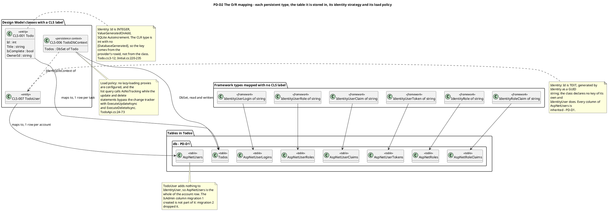

| Design class | Table | Column mapping | Identity strategy | Load policy | Anchor |
|---|---|---|---|---|---|
| CLS-001 `Todo` | TBL-001 `Todos` | Four properties to four columns, one for one: `Id`→`Id`, `Title`→`Title`, `IsComplete`→`IsComplete`, `OwnerId`→`OwnerId`. No column is renamed and none is computed | Database-generated: `Id` is `INTEGER` with `Sqlite:Autoincrement`, mapped from CLR `int`. The class declares no `[DatabaseGenerated]`, so the key is the provider's rowid | Read untracked — the list query ends `.AsNoTracking()`. Read tracked by `FindAsync` on the single-row read. Written tracked on create (`Add` + `SaveChangesAsync`); written untracked by `ExecuteUpdateAsync` and `ExecuteDeleteAsync`, which bypass the change tracker entirely | `Todo.Api/Todos/Todo.cs:3-12`; `Todo.Api/Todos/TodoApi.cs:24-73`; `Todo.Api/Migrations/20221123071234_Initial.cs:220-235` |
| CLS-007 `TodoUser` | TBL-002 `AspNetUsers` | Nothing of the class's own — its whole declaration is an empty body, and all fifteen columns are inherited from `IdentityUser`. `UserName` and `Email` are set by the register path; the exchange sets `UserName` to the submitted `Username` and leaves `Email` and `PasswordHash` null | Identity-generated `Id`: `TEXT`, a GUID string produced by `UserManager` | Resolved through `UserManager<TodoUser>`, one `FindByIdAsync` per authorized API request inside the authorization pipeline, and one `FindByLoginAsync` per token exchange. No `DbSet<TodoUser>` is declared | `Todo.Api/Users/TodoUser.cs:8`; `Todo.Api/Authorization/CurrentUserExtensions.cs:22-26`; `Todo.Api/Migrations/20221123071234_Initial.cs:33-76` |
| CLS-006 `TodoDbContext` | all eight | The mapping declaration itself. `OnModelCreating` fixes one relation and delegates to `base.OnModelCreating` for the seven identity entities | — | Exposes one set, `Todos`; the seven identity sets are inherited. Three access shapes in use: `Where(...).Select(...)`, `FindAsync(id)`, and the two `Execute*` statements | `Todo.Api/TodoDbContext.cs:6-20` |
| six `Identity*<string>` framework types | TBL-003 to TBL-008 | Mapped by `IdentityDbContext<TodoUser>`'s own model, not by delivery code. `IdentityUserLogin`→`AspNetUserLogins`, `IdentityUserRole`→`AspNetUserRoles`, `IdentityUserClaim`→`AspNetUserClaims`, `IdentityUserToken`→`AspNetUserTokens`, `IdentityRole`→`AspNetRoles`, `IdentityRoleClaim`→`AspNetRoleClaims` | `IdentityUserLogin` composite (`LoginProvider`, `ProviderKey`); `IdentityUserRole` composite (`UserId`, `RoleId`); `IdentityUserToken` composite (`UserId`, `LoginProvider`, `Name`); the two claim types integer autoincrement; `IdentityRole` a GUID string | Only `IdentityUserLogin` is reached by delivery code, through `UserManager.FindByLoginAsync` and `AddLoginAsync`. The other five are read and written by framework endpoints alone | `Todo.Api/Migrations/TodoDbContextModelSnapshot.cs`; `Todo.Api/Users/UsersApi.cs:36-46` |

**No entity class carries a navigation property.** The ownership association is declared once, fluently, in `OnModelCreating`; neither `Todo` nor `TodoUser` declares a reference to the other (`Todo.Api/TodoDbContext.cs:12-16`). An O/R mapping generated from the classes alone would therefore miss the foreign key entirely — the context is the only place it exists.

### Constraints, referential actions and the rules the store does not enforce

| Constraint | Where it is declared | What it admits | Anchor |
|---|---|---|---|
| `NOT NULL` on `Todos.Id`, `Title`, `IsComplete`, `OwnerId` | The migration's column declarations | A task row can carry no null in any of its four columns | `Todo.Api/Migrations/20221123071234_Initial.cs:220-235` |
| `NOT NULL` on all seven FK columns and all six composite-key columns | The migration | No orphan row and no partially-keyed row | `Todo.Api/Migrations/20221123071234_Initial.cs:78-190` |
| `NOT NULL` on `AspNetUsers.Id`, and on `EmailConfirmed`, `PhoneNumberConfirmed`, `TwoFactorEnabled`, `LockoutEnabled`, `AccessFailedCount` | The migration | The account row is complete on those six; `UserName`, `Email`, `PasswordHash` and the rest are nullable — which is what lets the token-exchange path create a row with no email and no password | `Todo.Api/Migrations/20221123071234_Initial.cs:36-76` |
| FK `Todos.OwnerId` → `AspNetUsers.Id`, `ON DELETE CASCADE` | Re-pointed by migration 3; originally → `UserName` | Deleting an account deletes its tasks. The index `IX_Todos_OwnerId` survives the re-point | `Todo.Api/Migrations/20230714032431_ForeignKeyChange.cs:33-44`; `Todo.Api/Migrations/20221123071234_Initial.cs:236-247` |
| Six further FKs, all `ON DELETE CASCADE` | The migration and the snapshot's `DeleteBehavior.Cascade` | Deleting an account deletes its logins, roles, claims and tokens; deleting a role deletes its memberships and claims | `Todo.Api/Migrations/TodoDbContextModelSnapshot.cs` |
| `UNIQUE` on `AspNetRoles.NormalizedName` (`RoleNameIndex`) | The migration | One role per normalised name | `Todo.Api/Migrations/20221123071234_Initial.cs:200-204` |
| `UNIQUE` on `AspNetUsers.NormalizedUserName` (`UserNameIndex`) | The migration | One account per normalised user name — the constraint that actually holds, since migration 3 dropped the separate `AK_AspNetUsers_UserName` on `UserName` itself and restored `UserName` to nullable | `Todo.Api/Migrations/20221123071234_Initial.cs:216-220`; `Todo.Api/Migrations/20230714032431_ForeignKeyChange.cs:14-27` |

**No CHECK constraint, no trigger and no default value exists anywhere in the schema.** The three migrations carry no `table.CheckConstraint` call and no `migrationBuilder.Sql` call in either direction (`Todo.Api/Migrations/`). Every domain rule is therefore enforced in a handler or nowhere:

| Rule the domain has | Where it is enforced | What the store would admit if the API were bypassed | Anchor |
|---|---|---|---|
| A task belongs to exactly one account | `NOT NULL` FK — the only half the store enforces | A row whose `OwnerId` names no existing `AspNetUsers.Id` is refused; a row owned by the *wrong* account is admitted | `Todo.Api/Migrations/20221123071234_Initial.cs:236-247` |
| A caller sees only its own tasks | `Where(todo => todo.OwnerId == owner.Id)` in the handler | Any row, to any reader | `Todo.Api/Todos/TodoApi.cs:24-27` |
| A task's title is not empty | `[Required]` on CLS-002, run by the registered validation filter | An empty string, since `NOT NULL` is not `NOT EMPTY` | `Todo.Api/Filters/ValidationFilter.cs:10-63`; `Todo.Api/Todos/Todo.cs:15-21` |
| A path id matches the body id | `if (id != todo.Id) return BadRequest()` | Any `Id`/`OwnerId` combination the FK admits | `Todo.Api/Todos/TodoApi.cs:54-57` |
| Two concurrent writers do not overwrite each other | Nowhere — no row version, no concurrency token, and the update names two fields | Last writer wins in arrival order | `Todo.Api/Todos/TodoApi.cs:59-63`; `F9` |

### The index strategy — each index against the statement it serves

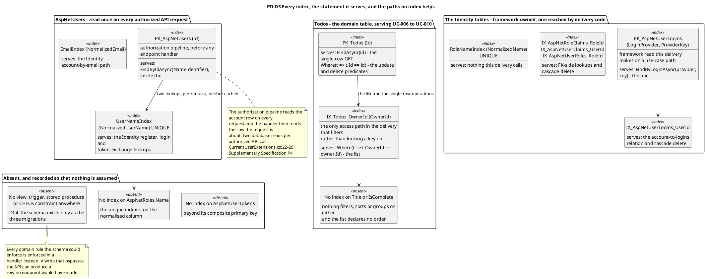

| Index | Table | Columns | Serves | Justified by | Anchor |
|---|---|---|---|---|---|
| `PK_Todos` | TBL-001 | `Id` | `FindAsync(id)` on the single-row read; `Where(t => t.Id == id)` on update and delete | UC-007, UC-009, UC-010 — one primary-key lookup each, as `P3` states | `Todo.Api/Migrations/20221123071234_Initial.cs:236-240`; `Todo.Api/Todos/TodoApi.cs:31,55,69` |
| `IX_Todos_OwnerId` | TBL-001 | `OwnerId` | `Where(todo => todo.OwnerId == owner.Id)` on the list | UC-006 — the only filtering access path in the delivery; `P3` records it as one statement over an indexed `OwnerId` | `Todo.Api/Migrations/20221123071234_Initial.cs:244-247`; `Todo.Api/Todos/TodoApi.cs:26` |
| `PK_AspNetUsers` | TBL-002 | `Id` | `FindByIdAsync(NameIdentifier)`, once per authorized API request | UC-006 to UC-010 — `P4` records this as a read in addition to the query the request performs | `Todo.Api/Migrations/20221123071234_Initial.cs:52-56`; `Todo.Api/Authorization/CurrentUserExtensions.cs:22-26` |
| `UserNameIndex` | TBL-002 | `NormalizedUserName`, unique | The Identity register, login and token-exchange lookups | UC-001, UC-002, UC-003; also the constraint that keeps one account per normalised name after migration 3 dropped the constraint on `UserName` itself | `Todo.Api/Migrations/20221123071234_Initial.cs:216-220` |
| `EmailIndex` | TBL-002 | `NormalizedEmail` | The Identity account-by-email path | UC-001, UC-002, UC-005 through the framework's endpoints | `Todo.Api/Migrations/20221123071234_Initial.cs:212-216` |
| `PK_AspNetUserLogins` | TBL-003 | `LoginProvider`, `ProviderKey` | `FindByLoginAsync(provider, key)` | UC-003 — the one framework read this delivery makes on a use-case path; the composite key makes it a key lookup | `Todo.Api/Migrations/20221123071234_Initial.cs:120-140`; `Todo.Api/Users/UsersApi.cs:36` |
| `IX_AspNetUserLogins_UserId` | TBL-003 | `UserId` | The account-to-logins relation and its cascade | The FK side of the same relation; required so that deleting an account does not scan the table | `Todo.Api/Migrations/20221123071234_Initial.cs:224-227` |
| `IX_AspNetRoleClaims_RoleId`, `IX_AspNetUserClaims_UserId`, `IX_AspNetUserRoles_RoleId`, `RoleNameIndex` | TBL-008, TBL-005, TBL-004, TBL-007 | as named | FK-side lookups, cascade delete, and one unique constraint on the normalised role name | Framework-owned; no delivery code path reaches them and no NFR rests on them. Recorded because the migration creates them | `Todo.Api/Migrations/20221123071234_Initial.cs:196-220` |

**What the store fixes for the performance criteria, and what it does not.** `P3` records that every task read and write is one statement over an indexed `OwnerId` or one primary-key lookup, and that the list declares no pagination and no ordering — so it returns every row the caller owns in one response, and no response-time figure can hold for a caller with an unbounded number of rows. `P4` records the second read per request. `P2` records that no payload size limit is configured. These are the only performance statements the delivery fixes; no throughput or response-time target is declared, and this model proposes none, since a threshold with no requirement behind it would read downstream as an agreed figure. `AspNetUserTokens` carries no index beyond its composite key and no delivery code path reaches it (`Todo.Api/Migrations/20221123071234_Initial.cs:168-190`).

### The migration strategy — three migrations, and the row conversion they do not perform

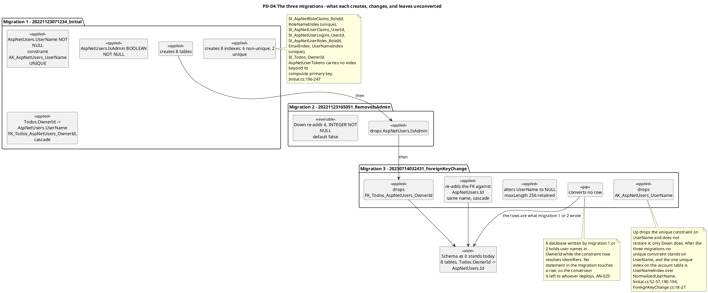

| Migration | Order | What it does | Rollback it declares | What it leaves to the operator | Anchor |
|---|---|---|---|---|---|
| `20221123071234_Initial` | 1 | Creates all eight tables, eight indexes and one unique constraint; points `Todos.OwnerId` at `AspNetUsers.UserName`; creates `AspNetUsers.IsAdmin` | `Down` drops the eight tables in dependency order | — | `Todo.Api/Migrations/20221123071234_Initial.cs` |
| `20221123165051_RemoveIsAdmin` | 2 | `DropColumn` on `AspNetUsers.IsAdmin` | `Down` re-adds the column `INTEGER NOT NULL` with `defaultValue: false` — so a rollback restores the column but not the values it held | — | `Todo.Api/Migrations/20221123165051_RemoveIsAdmin.cs` |
| `20230714032431_ForeignKeyChange` | 3 | Drops the FK, drops the unique constraint on `UserName`, makes `UserName` nullable, re-adds the FK against `AspNetUsers.Id` under the same name with cascade | `Down` reverses all four: `UserName` back to `NOT NULL` with `defaultValue: ""`, the unique constraint restored, the FK back against `UserName` | **The row conversion.** No `Sql` call exists in `Up` and none in `Down`, so an existing `Todos.OwnerId` holding a user name is not rewritten to the account id the constraint now resolves. `AN-025` records the consequence | `Todo.Api/Migrations/20230714032431_ForeignKeyChange.cs:9-44` |

**How the schema reaches a database, and the path it does not take.** The only mechanism in the delivery that applies these migrations is the app host's `AddTodoDbMigration`, gated three ways: run mode only, `Todo.Api/.db` absent only, and no connection string passed — the `TODO` at `TodoApp.AppHost/Extensions.cs:24` records the last (`AN-013`, `DC11`). The test host does not use them: `TodoApplication.CreateHost` builds its schema with `EnsureCreated` over an in-memory SQLite connection, so no test reproduces the schema the deployment creates (`AN-005`; `Todo.Api.Tests/TodoApplication.cs:11-14`). Two schema-building mechanisms exist and only one is exercised by the suite.

**A note on the snapshot's product version.** `TodoDbContextModelSnapshot` records `HasAnnotation("ProductVersion", "8.0.0")` while `Directory.Build.props:4` targets `net9.0` and `Directory.Packages.props` resolves the EF Core packages at 9.x. The migrations and the snapshot were generated against a different EF Core major version than the one the build resolves (`Todo.Api/Migrations/TodoDbContextModelSnapshot.cs`). Recorded as the file states it; nothing in the delivery reconciles the two.

### What the persistent classes do not carry

Recorded so that nothing is carried forward from what a store of this kind is usually expected to have. Each was looked for in the migrations, the snapshot and the context:

| Expected | What the tree holds instead | Anchor |
|---|---|---|
| A repository, unit-of-work or service type over the store | Nothing. Handlers take `TodoDbContext` directly, and two of the five statements bypass the change tracker | `Todo.Api/Todos/TodoApi.cs:17-73` |
| A concurrency token or row version | Nothing. `ConcurrencyStamp` exists on `AspNetUsers` and `AspNetRoles` because Identity declares it, not because any delivery statement checks it, and `Todos` has no version column at all | `Todo.Api/Migrations/TodoDbContextModelSnapshot.cs`; `Todo.Api/Todos/TodoApi.cs:59-63` |
| A soft-delete, audit or timestamp column | Nothing. No `CreatedAt`, `UpdatedAt` or `IsDeleted` on any table; the three migrations create none | `Todo.Api/Migrations/20221123071234_Initial.cs` |
| A seed or lookup-data script | Nothing. No `HasData`, no `Sql` call, no seeding path — which is why `AspNetRoles` is always empty and the `admin` claim has no source | `Todo.Api/Migrations/`; `AN-004` |
| A view, stored procedure or trigger | Nothing. `DC4` records the schema as the three migrations alone | `Todo.Api/Migrations/`; `DC4` |
| A migration history beyond the three | Nothing. Three migrations and one snapshot in one folder; the history table is created by the framework at run time, not by the tree | `Todo.Api/Migrations/` |

### The enforced rules — what the schema binds, and the five rules that rest on a handler

The three migrations were read in full for this record: `20221123071234_Initial.cs`, `20221123165051_RemoveIsAdmin.cs` and `20230714032431_ForeignKeyChange.cs`. **The delivery enforces no rule through a view, a trigger or a stored procedure.** No `migrationBuilder.Sql` call exists in any `Up` or `Down` of the three, and no `CheckConstraint` call exists in any of them. The whole enforced surface as it stands today is eight tables, eight primary keys, seven foreign keys and eight indexes, two of which are unique; no table-level unique constraint survives, because the one migration 1 declared on `AspNetUsers.UserName` was removed by migration 3. All of it is declared as DDL through the migration builder, and all of it except what migration 3 rewrites was created by migration 1. The only table the tree does not create is `__EFMigrationsHistory`, which the EF Core runtime writes when it applies a migration.

Every rule the completed use cases depend on is therefore either one of those DDL declarations or a predicate in a handler. The two are not interchangeable: a DDL construct binds every writer, and a handler binds only the requests that reach it.

```plantuml
@startuml
title PD-D5 The enforced-rule surface - every rule the completed use cases rest on, the construct that enforces it, and the five that rest on nothing

skinparam shadowing false
skinparam classAttributeIconSize 0
skinparam wrapWidth 215
hide circle
hide empty members

package "Completed use cases that touch the store" {
  class "UC-001 Create an account\nUC-002 Sign in with a password\nUC-005 Maintain one's own account" as U_IDN <<use case>>
  class "UC-003 Sign in with an external provider" as U_EXT <<use case>>
  class "UC-006 See one's own tasks" as U_LIST <<use case>>
  class "UC-007 Add a task\nUC-009 Read one task by id\nUC-010 Change a task" as U_ITEM <<use case>>
  class "UC-008 Remove a task" as U_DEL <<use case>>
}

package "Enforced by a DDL construct the migrations declare" {
  class "PK_Todos on Todos.Id\nINTEGER, Sqlite:Autoincrement, NOT NULL" as C_PK
  class "FK_Todos_AspNetUsers_OwnerId\nOwnerId to AspNetUsers.Id, ON DELETE CASCADE" as C_FK
  class "IX_Todos_OwnerId on Todos.OwnerId" as C_IX
  class "NOT NULL on Todos.Title and Todos.IsComplete" as C_NN
  class "PK_AspNetUsers on AspNetUsers.Id, NOT NULL" as C_UPK
  class "UserNameIndex on NormalizedUserName\nUNIQUE" as C_UQ
  class "PK_AspNetUserLogins\n(LoginProvider, ProviderKey)" as C_LPK
  class "The six remaining FK constraints\nall ON DELETE CASCADE" as C_FK6
}

package "Rested on, and enforced by no construct" {
  class "G1 The ownership predicate\nWHERE OwnerId = caller, or a claim nobody holds" as G_OWN
  class "G2 The completion flag's domain\nBOOLEAN over INTEGER: 0 and 1 written,\nany INTEGER admitted" as G_BOOL
  class "G3 A title that is not empty\nNOT NULL is not NOT EMPTY" as G_TITLE
  class "G4 The exchange's two writes as one unit\nCreateAsync then AddLoginAsync, two commits" as G_ATM
  class "G5 One account per user name\nholds only while NormalizedUserName is not null" as G_UNIQ
}

U_LIST --> C_IX : one indexed filter
U_LIST --> G_OWN
U_ITEM --> C_PK : key lookup
U_ITEM --> C_FK
U_ITEM --> C_NN
U_ITEM --> G_OWN
U_ITEM --> G_TITLE
U_ITEM --> G_BOOL
U_DEL --> C_PK
U_DEL --> G_OWN
U_IDN --> C_UPK
U_IDN --> C_UQ
U_IDN --> G_UNIQ
U_EXT --> C_UPK
U_EXT --> C_LPK
U_EXT --> G_ATM
U_EXT --> G_UNIQ
C_FK6 --> U_DEL : account deletion takes its rows

note right of C_UQ
  AK_AspNetUsers_UserName was dropped by migration 3's Up and
  is restored only by its Down; UserName is nullable from the
  same Up. Uniqueness of a user name is held by UserNameIndex
  over the normalised column, which Identity always writes.
  ForeignKeyChange.cs:18-27
end note

note bottom of G_OWN
  TodoApi.cs:26,33,59,69. The store enforces that OwnerId names
  a real account. It never enforces that OwnerId names the
  caller: a write that bypasses the API admits any account's
  row to any reader.
end note

note bottom of G_ATM
  UsersApi.cs:38-46. CreateAsync commits the account row, then
  AddLoginAsync commits the login row, with no transaction over
  the pair. A failure between them leaves an account no provider
  can reach, and a retry collides on UserNameIndex because the
  exchange reuses the submitted user name.
end note

note bottom of G_UNIQ
  SQLite evaluates a UNIQUE index per row and admits any number
  of rows whose key column is NULL. Since UserName is nullable,
  a row written with no user name is outside UserNameIndex
  altogether. Reachable only through a caller that posts to
  /users register or /users/token with no user name: the register
  body is validated by Identity's own annotations, the token body
  by ExternalUserInfo at UsersApi.cs:18.
end note

@enduml
```

| Rule the completed use cases rely on | Construct that enforces it | What the store refuses | What it still admits | Anchor |
|---|---|---|---|---|
| A task row is addressable by one integer key | `PK_Todos` on `Todos.Id`, `INTEGER`, `Sqlite:Autoincrement` | A duplicate or null id; an insert that names its own id | — | `Todo.Api/Migrations/20221123071234_Initial.cs:220-240` |
| A task belongs to an account that exists | `FK_Todos_AspNetUsers_OwnerId`, `OwnerId` → `AspNetUsers.Id`, `ON DELETE CASCADE` | A row whose `OwnerId` names no account | A row owned by the wrong account — G1 | `Todo.Api/Migrations/20230714032431_ForeignKeyChange.cs:33-44` |
| Deleting an account or a role takes every row that names it | All seven FKs, each `ON DELETE CASCADE`: five reference `AspNetUsers` — `AspNetUserLogins.UserId`, `AspNetUserClaims.UserId`, `AspNetUserRoles.UserId`, `AspNetUserTokens.UserId`, `Todos.OwnerId`; two reference `AspNetRoles` — `AspNetRoleClaims.RoleId`, `AspNetUserRoles.RoleId` | An orphan row after either parent is deleted | — | `Todo.Api/Migrations/20221123071234_Initial.cs:78-190, 246` |
| A task row carries no null in `Id`, `Title`, `IsComplete`, `OwnerId` | The four `nullable: false` column declarations | A null title, a null owner, a null flag | An empty title — G3 | `Todo.Api/Migrations/20221123071234_Initial.cs:220-235` |
| The list's filter is an index seek, not a scan | `IX_Todos_OwnerId` on `OwnerId` | — | — | `Todo.Api/Migrations/20221123071234_Initial.cs:244-247` |
| One account per normalised user name | `UserNameIndex` on `NormalizedUserName`, `unique: true` | A second row with the same non-null `NormalizedUserName` | Any number of rows with a null one — G5 | `Todo.Api/Migrations/20221123071234_Initial.cs:216-220` |
| An account is addressable by one identifier | `PK_AspNetUsers` on `Id`, `TEXT` `NOT NULL` | A null or duplicate id | — | `Todo.Api/Migrations/20221123071234_Initial.cs:33-56` |
| One provider identity per login provider, keyed | `PK_AspNetUserLogins` on (`LoginProvider`, `ProviderKey`) | A duplicate pair, so the exchange's lookup is a key lookup | — | `Todo.Api/Migrations/20221123071234_Initial.cs:120-140` |
| A role is one normalised name | `RoleNameIndex` on `NormalizedName`, `unique: true` | A duplicate normalised role name | — nothing writes a role row at all | `Todo.Api/Migrations/20221123071234_Initial.cs:200-204` |

**Five rules the store does not enforce, and what holds each instead.** Each is held by a handler, a client control or nothing; each is recorded because a reader of the completed use cases will assume the database holds it.

| Rule | Where it actually lives | What a write bypassing the API produces | Anchor |
|---|---|---|---|
| G1 — a caller reads and writes only its own rows | The predicate `OwnerId == owner.Id \|\| owner.IsAdmin` in four handlers | Any account's row reachable by any caller | `Todo.Api/Todos/TodoApi.cs:26, 33, 59, 69`; `AN-018` |
| G2 — the completion flag is a boolean | The `bool` CLR type over an `INTEGER` column; no `CHECK` | Any integer in `IsComplete` | `Todo.Api/Todos/Todo.cs:8`; `Todo.Api/Migrations/20221123071234_Initial.cs:220-235` |
| G3 — a task's title is not empty | `[Required]` on `Todo` and `TodoItem`, run by the validation filter registered on `/todos` | An empty string, which `NOT NULL` admits | `Todo.Api/Todos/Todo.cs:6-7, 10-11`; `Todo.Api/Filters/ValidationFilter.cs:10-63` |
| G4 — the external-identity exchange creates an account and its login as one unit | Nothing. Two `UserManager` calls, each committing | An account with no login row, reachable by no provider and by no password | `Todo.Api/Users/UsersApi.cs:38-46` |
| G5 — one account per user name, without exception | `UserNameIndex`, which admits nulls | Accounts whose `NormalizedUserName` is null, any number of them | `Todo.Api/Migrations/20221123071234_Initial.cs:216-220`; `Todo.Api/Migrations/20230714032431_ForeignKeyChange.cs:18-27` |

**Two of the five are defects the schema could have prevented and does not.** G4 is the one an atomicity boundary would close: the exchange at `UsersApi.cs:38-46` calls `CreateAsync` and then `AddLoginAsync` with no transaction over the pair, so a failure between the two commits leaves an account row that no provider link names — and because the exchange reuses the submitted user name, the retry meets `UserNameIndex` and is refused rather than converging. G5 follows from migration 3: its `Up` makes `UserName` nullable and drops the unique constraint on it, and restores neither in `Up`, so the only uniqueness standing on the account table is over the normalised column, which SQLite's unique index does not bind when null. Neither is a rule the recovered set states the system should have; both are what the migrations actually enforce, and they are recorded as such rather than proposed against a requirement nothing declares.

**Which persistent classes the completed use cases reach, table by table.** All eleven use cases but UC-011 resolve their rows through `TodoDbContext` (CLS-006) and `TodoUser` (CLS-007); the five task use cases write and read `Todo` (CLS-001) alone. Of the eight tables:

| Table | Reaching use cases | What they do with it |
|---|---|---|
| TBL-001 `Todos` | UC-006, UC-007, UC-008, UC-009, UC-010 | Read, insert, update and delete; the only table the domain writes |
| TBL-002 `AspNetUsers` | UC-001, UC-002, UC-003, UC-005 and, through the caller resolution in the authorization pipeline, UC-006 to UC-010 | Insert on register and on the exchange; read once per authorized API request |
| TBL-003 `AspNetUserLogins` | UC-003 | `FindByLoginAsync`, then `AddLoginAsync` when absent — the one framework read on a use-case path |
| TBL-006 `AspNetUserTokens` | UC-005, through `manage/2fa` only | Stores the authenticator key. The *session's* token set is the cookie, never a row |
| TBL-005 `AspNetUserClaims`, TBL-008 `AspNetRoleClaims` | None | No endpoint `MapIdentityApi` maps and no delivery handler writes or reads either table |
| TBL-004 `AspNetUserRoles`, TBL-007 `AspNetRoles` | None | Nothing in the running system writes a row; no seeding exists, so the `admin` claim `AN-004` records has no source |

The class-to-table mapping, identity strategy and load policy per class are stated in `PD-D2` and its table above; the eight tables with every column are `PD-D1`; each index against the statement it serves is `PD-D3`; the three migrations, their rollback and the row conversion none performs is `PD-D4`.

### The store outside the schema — the data-protection key ring

`UC-003` is the one completed use case whose data does not all land in `Todos.db`. The external-identity exchange protects the provider key under a data protector named after the provider at the BFF (`Todo.Web/Server/AuthApi.cs:82-90`) and unprotects it at the API (`Todo.Api/Users/UsersApi.cs:24-34`). The key that protects it lives in the ASP.NET Core data-protection key ring, which is a filesystem store: the delivery configures only the application discriminator `TodoApp`, on both sides (`Todo.Web/Server/Program.cs:13`; `Todo.Api/Program.cs:11`), and configures no path, no directory and no key lifetime.

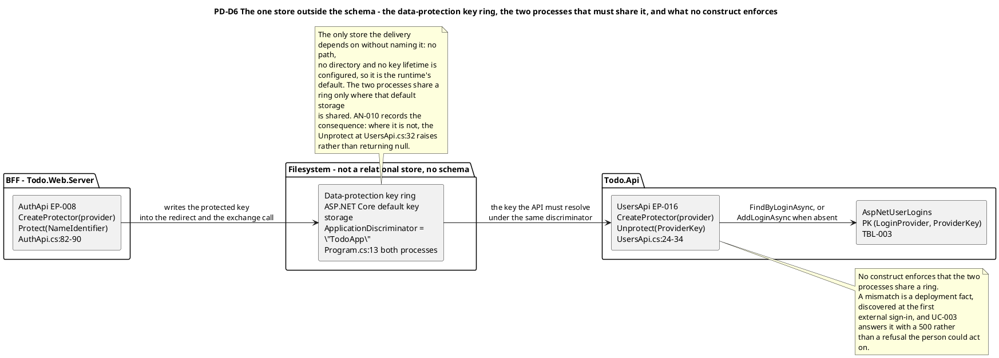

| Aspect | What the delivery configures | What no construct enforces | Anchor |
|---|---|---|---|
| Where keys are stored | Nothing — the runtime's default filesystem storage. No `PersistKeysToFileSystem`, no `PersistKeysToDbContext`, no application name beyond the discriminator | That the directory is writable, survives a redeploy, or is shared between the two processes | `Todo.Web/Server/Program.cs:13`; `Todo.Api/Program.cs:11` |
| Key identity | `ApplicationDiscriminator = "TodoApp"` on both processes | That both processes resolve the same ring. A protector built under the same purpose string over a different ring unprotects to a different payload, or raises | `AN-010`; `Todo.Api/Users/UsersApi.cs:32` |
| Key lifetime | Nothing — the framework default 90 days | That a key revoked or expiring mid-session is recoverable | `Todo.Web/Server/AuthApi.cs:82-90` |
| The protected value's transit | The protected provider key travels in the redirect and in the `users/token/{provider}` request body | That the transit is over TLS — no requirement declares it and no configuration binds it | `Todo.Web/Server/AuthApi.cs:82-90`; `Todo.Api/Users/UsersApi.cs:24-34` |

This store is recorded because `UC-003`'s postcondition — a local account tied to the provider identity — cannot be reached without it, and because it is the one persistent concern the migrations do not describe. It carries no table, no key constraint the schema declares, and therefore no `TBL` label: it is not a table in `Todos.db`, and minting a table label for a filesystem directory would put an element in the trace graph that no migration creates. Its anchor is the two configuration lines and the protect/unprotect pair cited above.

## Domain Model
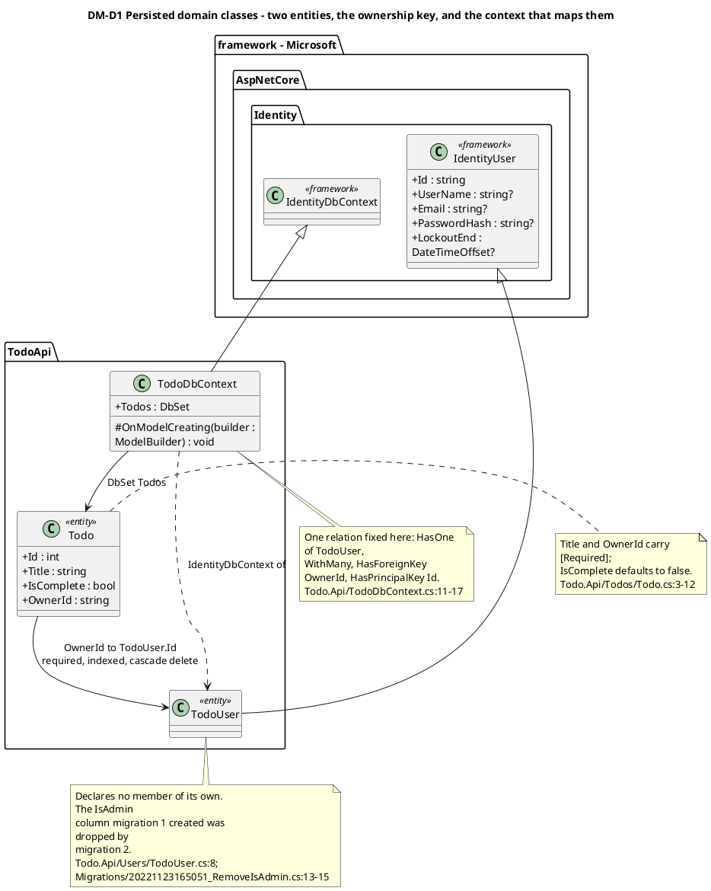

### CLS-001 Todo — the task row

| Attribute | Type | Constraint the code declares | Anchor |
|---|---|---|---|
| `Id` | `int` | Integer key, autoincrement in the schema | `Todo.Api/Todos/Todo.cs:5` |
| `Title` | `string` | `[Required]`, initialised to `default!` | `Todo.Api/Todos/Todo.cs:6-7` |
| `IsComplete` | `bool` | defaults to `false`; written only by the update statement | `Todo.Api/Todos/Todo.cs:8` |
| `OwnerId` | `string` | `[Required]`, initialised to `default!`; foreign key to `TodoUser.Id` | `Todo.Api/Todos/Todo.cs:10-11` |

| Operation | Kind | What it does | Anchor |
|---|---|---|---|
| — | — | The class declares no operation. It is a property bag read and written by endpoint statements | `Todo.Api/Todos/Todo.cs:3-12` |

| Relationship | Target | Multiplicity | How it is declared | Anchor |
|---|---|---|---|---|
| Ownership | CLS-007 `TodoUser` | one owner to zero or more tasks; the task side is required | `HasOne<TodoUser>().WithMany().HasForeignKey(t => t.OwnerId).HasPrincipalKey(u => u.Id)` — declared in the context, not on either class, and no navigation property exists on either side | `Todo.Api/TodoDbContext.cs:12-16` |

The relation's principal key was `AspNetUsers.UserName` and was re-pointed to `AspNetUsers.Id` by the third migration; the index `IX_Todos_OwnerId` and cascade delete were created with the table and survive the re-point (`Todo.Api/Migrations/20221123071234_Initial.cs:220-247`; `Todo.Api/Migrations/20230714032431_ForeignKeyChange.cs:12-47`).

### CLS-007 TodoUser — the account row

| Attribute | Type | Where it comes from | Anchor |
|---|---|---|---|
| every property the account has | — | `IdentityUser`. `TodoUser` adds nothing: its whole declaration is an empty body, and the comment above it says custom properties could be added there | `Todo.Api/Users/TodoUser.cs:6-8` |

`Id`, `UserName`, `Email`, `PasswordHash`, `LockoutEnd` and the rest are `IdentityUser`'s and are mapped by `IdentityDbContext<TodoUser>` (`Todo.Api/Program.cs:17-20`; `Todo.Api/Migrations/20221123071234_Initial.cs:36-66`). The `IsAdmin` column the first migration created on `AspNetUsers` was dropped by the second, so the class holds no administrative flag and the schema holds none (`Todo.Api/Migrations/20221123165051_RemoveIsAdmin.cs:13-15`).

### CLS-006 TodoDbContext — the persistence context

| Operation | Signature | What it does | Anchor |
|---|---|---|---|
| `Todos` | `DbSet<Todo>` get-only property | The one domain set the context exposes; every task statement starts here | `Todo.Api/TodoDbContext.cs:8` |
| `OnModelCreating` | `protected void OnModelCreating(builder : ModelBuilder)` | Fixes the ownership relation and delegates to the identity model | `Todo.Api/TodoDbContext.cs:10-19` |

The context derives from `IdentityDbContext<TodoUser>`, so the seven identity sets are its own without being declared. No `DbSet<TodoUser>` is declared and no user query in the delivery goes through the context: callers resolve an account through `UserManager<TodoUser>` instead (`Todo.Api/Authorization/CurrentUserExtensions.cs:11-30`). `Todos` is reached three ways — `Where(...).Select(...)`, `FindAsync(id)`, and `ExecuteUpdateAsync` / `ExecuteDeleteAsync` that bypass the change tracker entirely (`Todo.Api/Todos/TodoApi.cs:24-73`).

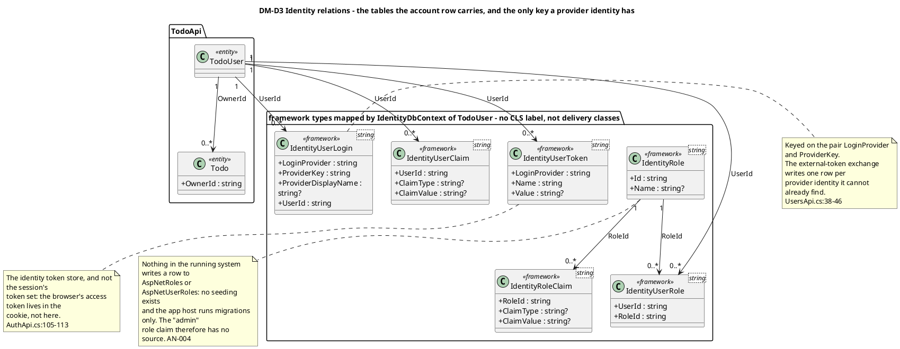

### The shape the caller sees — declared twice

```plantuml
@startuml
title DM-D2 The wire shapes, declared twice in two assemblies that do not reference each other

skinparam shadowing false
skinparam classAttributeIconSize 0
skinparam wrapWidth 205

package "Todo.Web.Shared - compiled into the client and the BFF" {
  class "TodoItem (shared)" as S1 {
    +Id : int
    +Title : string
    +IsComplete : bool
  }
  class "UserInfo (shared)" as S2 {
    +Email : string
    +Password : string
  }
  class "ExternalUserInfo (shared)" as S3 {
    +Username : string
    +ProviderKey : string
  }
  class "AuthToken (shared)" as S4 <<record>> {
    +Token : string
  }
}

package "Todo.Api - its own declaration, no reference to Shared" {
  class "TodoItem (API)" as A1 {
    +Id : int
    +Title : string
    +IsComplete : bool
  }
  class "UserInfo (API)" as A2 {
    +Email : string
    +Password : string
  }
  class "ExternalUserInfo (API)" as A3 {
    +Username : string
    +ProviderKey : string
  }
  class TodoMappingExtensions <<static>> {
    +AsTodoItem(todo : Todo) : TodoItem
  }
}

class Todo <<entity>> {
  +Id : int
  +Title : string
  +IsComplete : bool
  +OwnerId : string
}

S1 .. A1 : same shape, no link,\nno compiler check
S2 .. A2 : same shape
S3 .. A3 : same shape
TodoMappingExtensions ..> A1 : returns the API's TodoItem
Todo --> TodoMappingExtensions : projected by

note bottom of A1
  Todo.Api/Todos/Todo.cs:15-21 against
  Todo.Web/Shared/SharedClass.cs:5-11 - the same
  three properties on both sides, and nothing
  compares them. AN-003
end note

note bottom of A3
  The one /users request shape the validation
  filter covers, because MapUsers registers it.
  UsersApi.cs:18
end note

note bottom of S4
  AuthToken wraps the "accessToken" property name
  the Identity endpoints answer with, and is the
  only shape in Shared that has no twin in the API.
  SharedClass.cs:31
end note

@enduml
```

### Class inventory — every recovered domain class and its anchor

| ID | Class | Kind | Responsibility, as the code gives it | Anchor |
|---|---|---|---|---|
| CLS-001 | `Todo` | Entity, persisted | The task row: integer key, required title, completion flag, required owner key. Declares no operation | `Todo.Api/Todos/Todo.cs:3-12` |
| CLS-002 | `TodoItem` (API) | Request and response shape | What every task operation accepts and returns. Carries no `OwnerId`, so the ownership key cannot round-trip to a caller | `Todo.Api/Todos/Todo.cs:15-21` |
| CLS-003 | `TodoMappingExtensions` | Static mapping helper | Projects `Todo` onto `TodoItem`, copying `Id`, `Title`, `IsComplete` and dropping `OwnerId` | `Todo.Api/Todos/Todo.cs:23-34` |
| CLS-004 | `UserInfo` (API) | Request shape | Email and password, both required — the body of the Identity register and login calls | `Todo.Api/Users/TodoUser.cs:12-19` |
| CLS-005 | `ExternalUserInfo` (API) | Request shape | User name and a data-protection-protected provider key, both required — the body of the external-token exchange | `Todo.Api/Users/TodoUser.cs:21-28` |
| CLS-006 | `TodoDbContext` | Persistence context | `IdentityDbContext<TodoUser>` plus the `Todos` set and the one relation it fixes | `Todo.Api/TodoDbContext.cs:6-20` |
| CLS-007 | `TodoUser` | Entity, persisted | The account row. Declares no member of its own; every property is `IdentityUser`'s | `Todo.Api/Users/TodoUser.cs:8` |
| CLS-008 | `TodoItem` (shared) | Request and response shape | The same three properties as CLS-002, declared in the assembly the client and the BFF compile against | `Todo.Web/Shared/SharedClass.cs:5-11` |
| CLS-009 | `UserInfo` (shared) | Request shape | The same two properties as CLS-004, in the shared assembly | `Todo.Web/Shared/SharedClass.cs:13-20` |
| CLS-010 | `ExternalUserInfo` (shared) | Request shape | The same two properties as CLS-005, in the shared assembly | `Todo.Web/Shared/SharedClass.cs:22-29` |
| CLS-011 | `AuthToken` | Response shape, positional record | The single `accessToken` property the Identity endpoints answer with, read by the BFF's token client | `Todo.Web/Shared/SharedClass.cs:31` |

**Persisted types recorded without a design-class label.** Six entity types are mapped by `IdentityDbContext<TodoUser>` and by the migrations, and the delivery writes no class of its own for any of them: `IdentityUserLogin<string>`, `IdentityRole<string>`, `IdentityUserRole<string>`, `IdentityUserClaim<string>`, `IdentityRoleClaim<string>`, `IdentityUserToken<string>`. They are framework classes, not classes the Implementer writes, so they are named in DM-D3 and in the relationship table below rather than given `CLS` labels. The table that backs each is created by the first migration: `AspNetUserLogins` and `AspNetUserRoles` and `AspNetUserTokens` and `AspNetUserClaims` and `AspNetRoles` and `AspNetRoleClaims` (`Todo.Api/Migrations/20221123071234_Initial.cs:16-268`).

### Relationship inventory

| Relationship | From | To | Multiplicity | Declared how, and where | Anchor |
|---|---|---|---|---|---|
| Ownership | `Todo` (`OwnerId`) | `TodoUser` (`Id`) | 0..* tasks to 1 account; required on the task side | Fluent model in the context; no navigation property on either class | `Todo.Api/TodoDbContext.cs:12-16` |
| Provider identity | `IdentityUserLogin` | `TodoUser` | 0..* logins to 1 account, cascade delete | Framework model; the delivery writes one row | `Todo.Api/Users/UsersApi.cs:38-46` |
| Role membership | `IdentityUserRole` | `TodoUser`, `IdentityRole` | 0..* to each; composite key | Framework model; nothing writes a row | `Todo.Api/Migrations/20221123071234_Initial.cs:16-268` |
| Claims | `IdentityUserClaim`, `IdentityRoleClaim` | `TodoUser`, `IdentityRole` | 0..* to each | Framework model; nothing writes a row | `Todo.Api/Migrations/20221123071234_Initial.cs:16-268` |
| Identity tokens | `IdentityUserToken` | `TodoUser` | 0..* to 1 | Framework model; no delivery code writes it — the session's token set is a cookie, not a row | `Todo.Web/Server/AuthApi.cs:105-113` |

**No association exists between the two wire declarations or between them and the entities.** `TodoItem` neither references nor inherits `Todo`; the only link is `AsTodoItem`, one direction, in one assembly. `UserInfo` and `ExternalUserInfo` have no relation to `TodoUser` beyond being the shapes `UserManager` calls are handed.

### What the code does not hold

Recorded so that nothing is carried forward from what a task list is expected to have. Each of these was looked for in the domain and in the schema and is absent:

| Expected | What the code holds instead | Anchor |
|---|---|---|
| An account entity with an administrative flag | No flag. The column existed and was dropped; `IsAdmin` is read from a role claim, and no role row is ever written | `Todo.Api/Migrations/20221123165051_RemoveIsAdmin.cs:13-15`; `Todo.Api/Authorization/CurrentUser.cs:12` |
| A list, project, category or tag a task belongs to | Nothing. A task belongs to an account and to nothing else; there is one flat table | `Todo.Api/TodoDbContext.cs:8` |
| A due date, priority, ordering or audit column | Nothing. `Todo` holds four properties, and the list query declares no order | `Todo.Api/Todos/Todo.cs:3-12`; `Todo.Api/Todos/TodoApi.cs:24-27` |
| A domain operation, aggregate or invariant on either entity | Nothing. Both entities are property bags; every rule is a statement in an endpoint handler | `Todo.Api/Todos/TodoApi.cs:24-73` |
| A repository, unit-of-work or service abstraction over the store | Nothing. Handlers take `TodoDbContext` directly, and two of the five statements bypass the change tracker | `Todo.Api/Todos/TodoApi.cs:17-22,52-73` |
| A concurrency token or row version | Nothing. The update names two fields and carries no version check | `Todo.Api/Todos/TodoApi.cs:59-63` |

### What the classes do in the use cases

The classes above are the vocabulary; the behaviour is in the endpoint handlers and is realized in later phases. Two facts bind them and belong here.

`Todo` and `CLS-002`/`CLS-008` decide one rule between them: the request shape carries no `OwnerId`, so the owner is never read from a body and `OwnerId` never leaves the process. A create body that asks for a completed row still produces `IsComplete` false, because the insert copies only the title (`Todo.Api/Todos/TodoApi.cs:38-50`).

`CLS-007` is the class the ownership predicate is decided against, and the row that must exist before any task operation succeeds: the authorization handler fails the request when no account row matches the token's `NameIdentifier` (`Todo.Api/Authorization/CheckCurrentUserAuthHandler.cs:28-36`; `Todo.Api/Authorization/CurrentUserExtensions.cs:11-30`).

### Use cases no domain class realizes

| Use case | Why no domain class appears in its row | What it touches instead | Anchor |
|---|---|---|---|
| UC-004 Sign out | It persists nothing and reads no entity: one call signs the cookie scheme out, and the row the account lives in is untouched | The BFF's cookie scheme; the session cookie's token set, which `AuthApi.SignIn` wrote and this operation discards | `Todo.Web/Server/AuthApi.cs:40-52` |
| UC-011 Consult the API reference | It reads metadata the framework generated, not data the model holds | The OpenAPI document and the Scalar UI mapping; the bearer scheme it declares | `Todo.Api/Program.cs:46-58`; `Todo.Api/Extensions/OpenApiOptionsExtensions.cs` |

Both are recovered use cases with a real entry point; neither has a domain class in its path, so neither appears as a `Traces From` value above. That is the model's shape, not a gap in the realization.

### The token and provider-login shapes the session flows cross

Two framework types sit on every session path and the delivery declares a class for neither, so they carry no `CLS` label — the convention DM-D3 already applies to the six Identity entity types. They are recorded here because the use-case specifications name them at the steps where the domain model previously stopped.

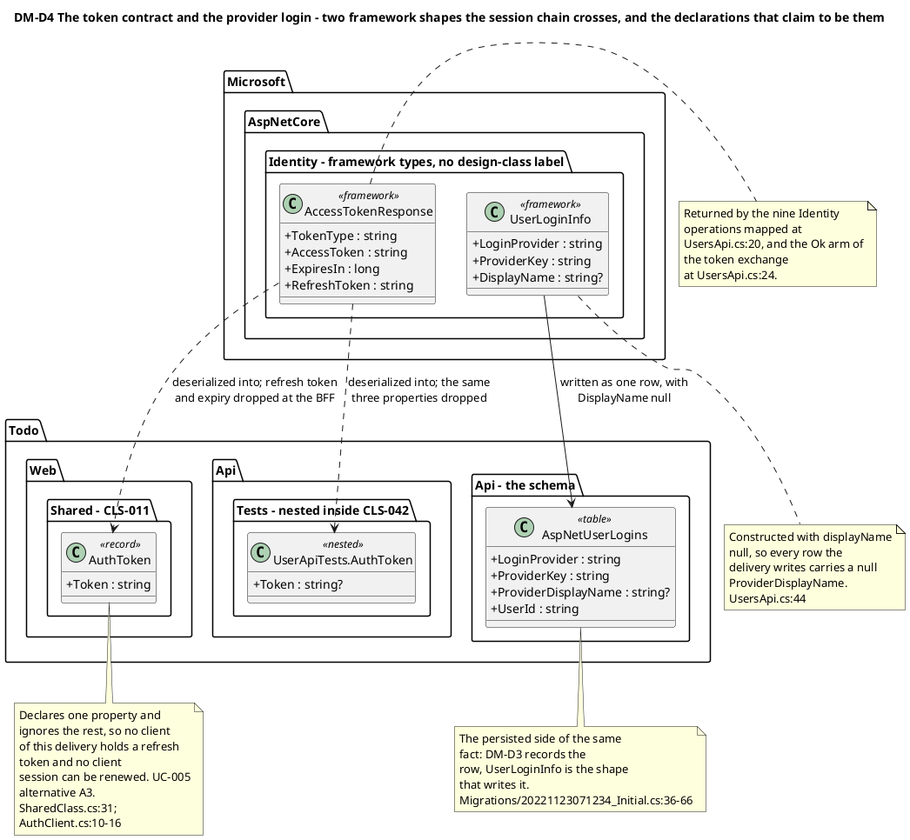

| Type | Where a completed flow names it | What the delivery fixes about it | Anchor |
|---|---|---|---|
| `AccessTokenResponse` | UC-001 step 4, UC-002 step 4, UC-003 step 7, UC-005 step 4 | The success body of the nine Identity operations and the `Ok` arm of the token exchange. Four properties; `accessToken` is the only one this delivery reads | `Todo.Api/Users/UsersApi.cs:20,24` |
| `UserLoginInfo` | UC-003 step 6 | Constructed with `displayName` null, so every row the exchange writes has a null `ProviderDisplayName` | `Todo.Api/Users/UsersApi.cs:44` |
| `AuthToken` (nested in CLS-042) | not on a use-case path | The third declaration of the token shape, after CLS-011 and the framework's own; asserts the `accessToken` property name from the test side | `Todo.Api.Tests/UserApiTests.cs:178-183` |

**The consequence for CLS-011.** It declares one property of four, so the BFF discards `refreshToken` and `expiresIn` on every successful sign-in, and no client of this delivery holds a refresh token. `UC-005` names `refresh` among the operations it covers, and no route from this delivery's screens or BFF reaches it: the account can be refreshed only by a caller that talks to `EP-015` directly with its own token. That is the same fact `AN-027` records from the account side, and it is the reason `UC-005`'s primary actor is `ACT-003` alone.

### The account row's two creation paths, and the state each leaves

`CLS-007` carries no member of its own, so its attribute state is decided entirely by which path creates the row. The two paths leave different state, and the difference is what `UC-003` and `UC-005` are shaped by.

| Path | `Id` | `UserName` | `Email` | `PasswordHash` | Anchor |
|---|---|---|---|---|---|
| UC-001 register on `EP-015` | generated by Identity | the submitted email | the submitted email | set from the submitted password | `Todo.Api/Users/UsersApi.cs:20` |
| UC-003 provider exchange on `EP-016` | generated by Identity | the submitted `Username` | never set — stays null | never set — stays null | `Todo.Api/Users/UsersApi.cs:40-46` |

A row created by the second path can therefore never sign in with a password, confirm an address, recover a password or refresh a token through the framework's own endpoints: `AN-027` states that exposure and `UC-003` alternative A5 and `UC-005` alternative A3 are its two visible faces. No column, constraint or check in the schema distinguishes the two paths, so the state is readable only by looking at the two nulls.

## Use-Case Realizations

Not yet recovered. The eleven use cases are recovered and their flows are documented in the Use-Case Model, each anchored to its entry point; what is missing here is the translation of those flows into collaborations of design objects.

The reason it is deferred is the phase, not a gap in the code: Excavation records the system as it is, and the architecturally significant paths are already stated as component collaborations in the Software Architecture Document — SEQ-1 for UC-006, SEQ-2 for UC-001, SEQ-3 for UC-003. Realizing each use case as messages between the classes recovered in "Design Packages and Classes" is later-phase work.

Two facts bound that future realization and are recorded here so it does not begin from a wrong premise.

| Fact | What it means for the realization | Anchor |
|---|---|---|
| No object owns a task operation | Each of the five task operations is an anonymous lambda registered by CLS-012; a realization cannot send a message to a "TodoService" because no such object exists | `Todo.Api/Todos/TodoApi.cs:24-73` |
| The session state is not an object either | CLS-023 writes the token into the cookie's token set and CLS-025 reads it back; neither holds it, so a realization of UC-006 has to model the cookie, not a session object | `Todo.Web/Server/AuthApi.cs:99-116`; `Todo.Web/Server/TodoApi.cs:18-22` |

## Design Packages and Classes
Thirty-one classes beyond the eleven already recovered as domain classes, in the packages below — one row per assembly and folder that declares a class — each anchored to the file that declares it.

**The packages are the assemblies and the folders, not namespaces.** Seven assemblies exist and are the real package boundaries. Inside them the API's five behavioural files all declare the single namespace `TodoApi`, so its folder structure carries no namespace of its own — `Todos/`, `Authorization/`, `Users/`, `Filters/` and `Extensions/` separate the files and nothing more. The entity files and the shared shapes declare no namespace at all and sit in the global namespace, which is why the client and the API can each declare a type named `TodoItem` without a clash.

### The anomalies these classes carry, and the two a reader may confuse

Four anomalies are cited repeatedly across this model, and two of them concern closely adjacent facts: the schema the migrations build, and the schema the test suite builds instead. Each citation below belongs to its own subject. A reader following AN-005 reaches test coverage; a reader following AN-025 reaches data conversion. Neither stands for the other anywhere in this model.

| Anomaly | Its subject | Where this model cites it | Anchor |
|---|---|---|---|
| AN-003 | The request contracts are declared twice, in two assemblies that do not reference each other, so nothing checks that they still agree | DM-D2, the note on CLS-D1, and the table of what the packages do not hold | `Todo.Api/Todos/Todo.cs:15-21`; `Todo.Web/Shared/SharedClass.cs:5-11` |
| AN-004 | The `admin` role is granted by nothing in the running system: no seeding exists, and the only code that adds the claim is the test harness | The note on CLS-013 in PKG-D1, the notes on `AspNetRoles` in DM-D3 and in PD-D2, and the `N6`/`R11` rows | `Todo.Api/Authorization/CurrentUser.cs:11-12`; `Todo.Api/Todos/TodoApi.cs:33,60,70`; `Todo.Api.Tests/TokenService.cs:16-19` |
| AN-005 | The test host builds its schema with `EnsureCreated` and never runs a migration, so a migration that no longer matches the model surfaces only where the app host runs it | The paragraph on the two schema-building mechanisms under Design Overview | `Todo.Api.Tests/TodoApplication.cs:11-14`; `TodoApp.AppHost/Extensions.cs:9-21` |
| AN-025 | The third migration re-pointed the owner key from `AspNetUsers.UserName` to `AspNetUsers.Id` and converted no row, so a database written by migration 1 or 2 holds user names under a constraint that now resolves identifiers | PD-D3 and the paragraphs on what that history means | `Todo.Api/Migrations/20230714032431_ForeignKeyChange.cs:9-44` |

The consequence for these packages: CLS-020 and CLS-021 are the two pipeline conventions bound at registration, and CLS-038 is the class that substitutes the persistence registration; AN-003 is carried by the class pairs CLS-002/CLS-008, CLS-004/CLS-009 and CLS-005/CLS-010, identical in shape and linked by no reference; AN-025 is carried by CLS-001 and CLS-006, whose `OwnerId` column is the one the third migration re-pointed.

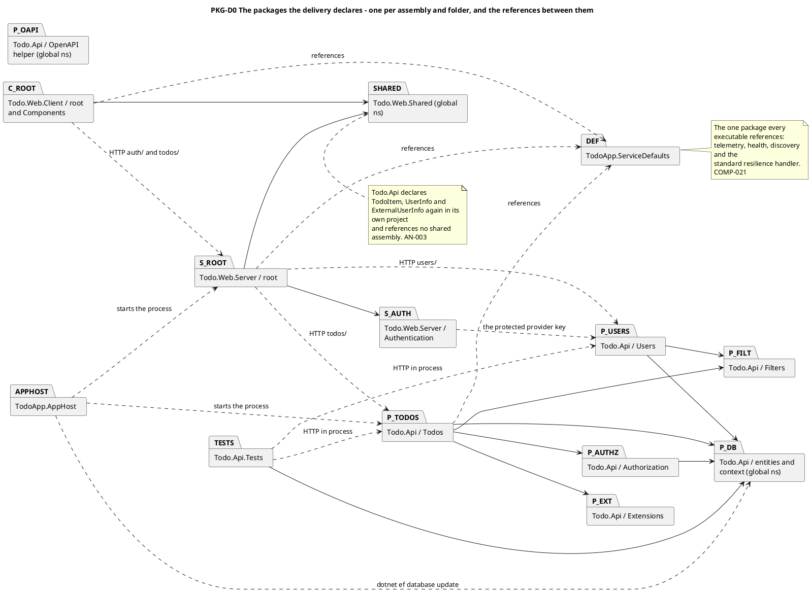

| Package | Assembly and namespace | Classes recovered | Component (SAD) | Cross-package dependencies |
|---|---|---|---|---|
| Todo.Api / Todos | `Todo.Api`, `TodoApi` | CLS-001, CLS-002, CLS-003, CLS-012 | COMP-011 | Authorization, Filters, Extensions, persistence |
| Todo.Api / Authorization | `Todo.Api`, `TodoApi` | CLS-013, CLS-014, CLS-015, CLS-016, CLS-017, CLS-018 | COMP-012, COMP-013 | persistence, through `UserManager<TodoUser>` |
| Todo.Api / Users | `Todo.Api`, `TodoApi` | CLS-004, CLS-005, CLS-019 | COMP-009, COMP-010 | Filters, persistence |
| Todo.Api / Filters | `Todo.Api`, `TodoApi` | CLS-020 | COMP-015 | none — framework types only |
| Todo.Api / Extensions | `Todo.Api`, `TodoApi`, global namespace | CLS-021, CLS-022 | COMP-014, COMP-017 | none — framework types only |
| Todo.Api / entities and context | `Todo.Api`, global namespace | CLS-001, CLS-006, CLS-007 | COMP-016 | none |
| Todo.Web.Server / root | `Todo.Web.Server` | CLS-023, CLS-024, CLS-025, CLS-026 | COMP-004, COMP-006, COMP-007, COMP-008 | Shared, Authentication, ServiceDefaults |
| Todo.Web.Server / Authentication | `Todo.Web.Server` | CLS-027, CLS-028, CLS-029, CLS-030, CLS-031 | COMP-005 | framework authentication types only |
| Todo.Web.Client | `Todo.Web.Client` | CLS-032, CLS-033, CLS-034, CLS-035 | COMP-001, COMP-002 | Shared, ServiceDefaults |
| Todo.Web.Shared | `Todo.Web.Shared`, global namespace | CLS-008, CLS-009, CLS-010, CLS-011 | COMP-019 | none |
| TodoApp.AppHost | `TodoApp.AppHost`, global namespace | CLS-036 | COMP-020 | none — it starts processes |
| TodoApp.ServiceDefaults | `TodoApp.ServiceDefaults`, `Microsoft.Extensions.Hosting` | CLS-037 | COMP-021 | none |
| Todo.Api.Tests | `Todo.Api.Tests`, `TodoApi.Tests` and `TodoApi` | CLS-038, CLS-039, CLS-040, CLS-041, CLS-042 | COMP-022 | Todo.Api by project reference |

Three recovered components add no class of their own: COMP-003 (client bootstrap, a top-level statement block in `Todo.Web/Client/Program.cs`), COMP-018 (HTTP logging, four configuration lines in `Todo.Api/Program.cs:35-46`) and the Razor pipeline registration in COMP-004. They are configuration, not design elements, and no `CLS` label is minted for them.

**Todo.Api / Todos — the five task operations.**

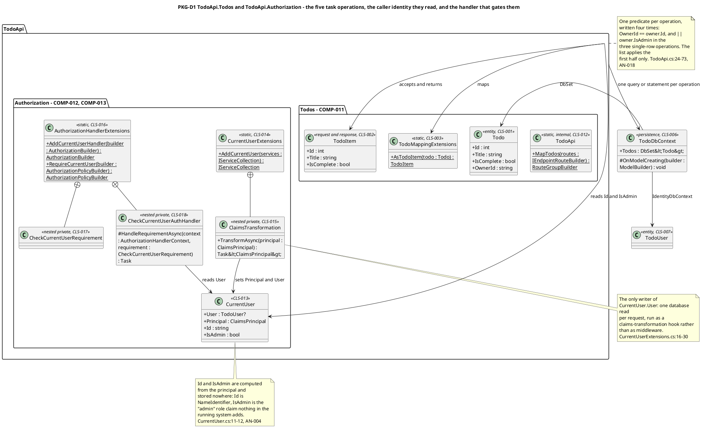

CLS-012 `TodoApi` — the endpoint group.

| Operation | Signature | What it does | Anchor |
|---|---|---|---|
| `MapTodos` | `static RouteGroupBuilder MapTodos(this IEndpointRouteBuilder routes)` | Maps `/todos`, tags it `Todos`, and fixes the three conventions every operation inherits: `RequireAuthorization(pb => pb.RequireCurrentUser())`, `RequirePerUserRateLimit()`, `WithParameterValidation(typeof(TodoItem))` | `Todo.Api/Todos/TodoApi.cs:8-22` |

| Registered operation | Route and verb | Handler signature the code gives it | Anchor |
|---|---|---|---|
| List | `GET /todos/` | `async (TodoDbContext db, CurrentUser owner) => Task<List<TodoItem>>` | `Todo.Api/Todos/TodoApi.cs:24-27` |
| Read one | `GET /todos/{id}` | `async Task<Results<Ok<TodoItem>, NotFound>> (TodoDbContext db, int id, CurrentUser owner)` | `Todo.Api/Todos/TodoApi.cs:29-37` |
| Create | `POST /todos/` | `async Task<Created<TodoItem>> (TodoDbContext db, TodoItem newTodo, CurrentUser owner)` | `Todo.Api/Todos/TodoApi.cs:39-50` |
| Change | `PUT /todos/{id}` | `async Task<Results<Ok, NotFound, BadRequest>> (TodoDbContext db, int id, TodoItem todo, CurrentUser owner)` | `Todo.Api/Todos/TodoApi.cs:52-66` |
| Remove | `DELETE /todos/{id}` | `async Task<Results<NotFound, Ok>> (TodoDbContext db, int id, CurrentUser owner)` | `Todo.Api/Todos/TodoApi.cs:68-74` |

The five handlers are anonymous lambda delegates declared inline in `MapTodos`, so the class declares exactly one named operation. There is no controller, no handler type and no service: the statements sit inside the registration call, which is why the ownership predicate, the projection and the update are readable only as five separate expressions in one method (`Todo.Api/Todos/TodoApi.cs:24-73`). The class is `internal static` and declares no field; its state is the group it returns.

CLS-013 `CurrentUser` — the caller, as a scoped service.

| Attribute | Declared as | What the code gives it | Anchor |
|---|---|---|---|
| `User` | `public TodoUser? User { get; set; }` | The account row resolved for this request, or `null` when the token names none | `Todo.Api/Authorization/CurrentUser.cs:7` |
| `Principal` | `public ClaimsPrincipal Principal { get; set; } = default!` | The request's principal, assigned by the claims transformation; `default!` means it is unset until then | `Todo.Api/Authorization/CurrentUser.cs:8` |
| `Id` | `public string Id => Principal.FindFirstValue(ClaimTypes.NameIdentifier)!` | Get-only, re-computed on every read; the `!` is unchecked, so an absent claim surfaces as a null string at the call site | `Todo.Api/Authorization/CurrentUser.cs:10` |
| `IsAdmin` | `public bool IsAdmin => Principal.IsInRole("admin")` | Get-only, computed from a role claim | `Todo.Api/Authorization/CurrentUser.cs:11` |

The class declares no operation. It is a request-scoped carrier whose two computed properties re-derive their value on every access: `Id` is read once per operation in CLS-012, `IsAdmin` once per single-row operation (`Todo.Api/Todos/TodoApi.cs:26,33,60,70`).

CLS-014 `CurrentUserExtensions` and CLS-015 `ClaimsTransformation`.

| Class | Operation | Signature | What it does | Anchor |
|---|---|---|---|---|
| CLS-014 | `AddCurrentUser` | `static IServiceCollection AddCurrentUser(this IServiceCollection services)` | Registers CLS-013 as scoped and CLS-015 as the `IClaimsTransformation` | `Todo.Api/Authorization/CurrentUserExtensions.cs:8-13` |
| CLS-015 | `TransformAsync` | `Task<ClaimsPrincipal> TransformAsync(ClaimsPrincipal principal)` | Sets `currentUser.Principal`, resolves the account by `NameIdentifier`, stores it on `currentUser.User`, returns the principal unchanged | `Todo.Api/Authorization/CurrentUserExtensions.cs:16-30` |

CLS-015 is `private sealed` and nested inside CLS-014, so it is registered and not referenceable outside the file. It is the mechanism by which every authorized request pays a database read: `FindByIdAsync` runs inside the authorization pipeline, before any endpoint handler (`Todo.Api/Authorization/CurrentUserExtensions.cs:22-26`).

CLS-016, CLS-017 and CLS-018 — one requirement, its handler and the two registration methods.

| Class | Kind | Operations and members | Anchor |
|---|---|---|---|
| CLS-016 `AuthorizationHandlerExtensions` | `public static`, declared in the file named for the handler | `AddCurrentUserHandler(AuthorizationBuilder)` registers the handler; `RequireCurrentUser(AuthorizationPolicyBuilder)` requires an authenticated user and adds the requirement | `Todo.Api/Authorization/CheckCurrentUserAuthHandler.cs:5-20` |
| CLS-017 `CheckCurrentUserRequirement` | `private class`, nested, `IAuthorizationRequirement` | No member — a marker requirement | `Todo.Api/Authorization/CheckCurrentUserAuthHandler.cs:22` |
| CLS-018 `CheckCurrentUserAuthHandler` | `private class`, nested, extends `AuthorizationHandler<CheckCurrentUserRequirement>` | `protected override Task HandleRequirementAsync(AuthorizationHandlerContext, CheckCurrentUserRequirement)` — succeeds only when `currentUser.User is not null`; the lockout check is written as a `TODO` and not performed | `Todo.Api/Authorization/CheckCurrentUserAuthHandler.cs:26-35` |

The file is named `CheckCurrentUserAuthHandler.cs` while the only public type in it is the extensions class: a reader searching for `CheckCurrentUserAuthHandler` finds a `private` nested type. The three types are one unit of design and are unreachable from outside the file except through CLS-016.

**Todo.Api / Users, Filters, Extensions and the OpenAPI helper.**

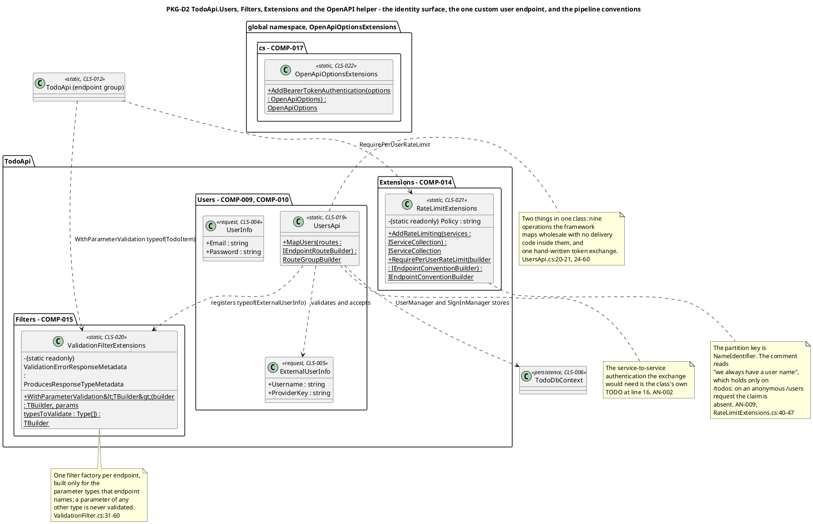

CLS-019 `UsersApi` — nine mapped operations and one written one.

| Operation | Signature | What it does | Anchor |
|---|---|---|---|
| `MapUsers` | `static RouteGroupBuilder MapUsers(this IEndpointRouteBuilder routes)` | Maps `/users`, tags it `Users`, registers `WithParameterValidation(typeof(ExternalUserInfo))`, calls `MapIdentityApi<TodoUser>()` and maps `POST /users/token/{provider}` | `Todo.Api/Users/UsersApi.cs:9-62` |

| Registered operation | Verb and route | Origin | Anchor |
|---|---|---|---|
| Nine Identity operations | `POST register`, `POST login`, `POST refresh`, `GET confirmEmail`, `POST resendConfirmationEmail`, `POST forgotPassword`, `POST resetPassword`, `POST manage/2fa`, `GET or POST manage/info`, all under `/users` | The framework, mapped wholesale by `MapIdentityApi<TodoUser>()` — no delivery code inside any of them | `Todo.Api/Users/UsersApi.cs:20` |
| Token exchange | `POST /users/token/{provider}` | The delivery's own handler, written because `MapIdentityApi` exposes no external-login endpoint | `Todo.Api/Users/UsersApi.cs:24-60` |

The exchange handler's six parameters are the whole of its design: `string provider`, `ExternalUserInfo userInfo`, `UserManager<TodoUser>`, `SignInManager<TodoUser>` and `IDataProtectionProvider`, returning `Task<Results<Ok<AccessTokenResponse>, SignInHttpResult, ValidationProblem>>`. It unprotects the provider key with a protector named after the provider, resolves the account by the `(provider, key)` pair, creates the account and the login row when neither exists, and answers `TypedResults.SignIn(principal)` on success or a validation problem built from `IdentityResult.Errors` (`Todo.Api/Users/UsersApi.cs:26-58`). The class declares no field and holds no state; the handler is an inline lambda.

CLS-004 and CLS-005 are recorded again in this package because CLS-019 names them — `typeof(ExternalUserInfo)` at line 18 and the `ExternalUserInfo` parameter at line 24. Their attributes are in the Domain Model and are not restated here.

CLS-020 `ValidationFilterExtensions` — the endpoint filter factory.

| Member | Declared as | What it does | Anchor |
|---|---|---|---|
| `ValidationErrorResponseMetadata` | `private static readonly ProducesResponseTypeMetadata` | The 400 `application/problem+json` metadata added to an endpoint that has at least one validatable parameter | `Todo.Api/Filters/ValidationFilter.cs:9-10` |
| `WithParameterValidation<TBuilder>` | `static TBuilder WithParameterValidation<TBuilder>(this TBuilder, params Type[] typesToValidate)` | Reads the endpoint's `MethodInfo`, collects the positions of parameters whose type is named in `typesToValidate`, and adds one filter factory that runs `MiniValidator.TryValidate` over each | `Todo.Api/Filters/ValidationFilter.cs:12-62` |

The filter is attached per endpoint and per named type: `/todos` names CLS-002 and `/users` names CLS-005 alone, so CLS-004 — the body of the register and login calls the framework maps — is never validated by this filter (`Todo.Api/Todos/TodoApi.cs:22`; `Todo.Api/Users/UsersApi.cs:18`).

CLS-021 `RateLimitExtensions` — the per-caller bucket.

| Member | Declared as | What it fixes | Anchor |
|---|---|---|---|
| `Policy` | `private static readonly string Policy = "PerUserRatelimit"` | One policy name, private to the file, shared by the registration and the convention | `Todo.Api/Extensions/RateLimitExtensions.cs:9` |
| `AddRateLimiting` | `static IServiceCollection AddRateLimiting(this IServiceCollection services)` | Sets `ReplenishmentPeriod` 10 s, `AutoReplenishment` true, `TokenLimit` 100, `TokensPerPeriod` 100, `QueueLimit` 100; binds them to a `RateLimiting` section; sets `RejectionStatusCode` 429; adds the policy partitioned on `NameIdentifier` | `Todo.Api/Extensions/RateLimitExtensions.cs:11-51` |
| `RequirePerUserRateLimit` | `static IEndpointConventionBuilder RequirePerUserRateLimit(this IEndpointConventionBuilder builder)` | Applies the policy to one endpoint group | `Todo.Api/Extensions/RateLimitExtensions.cs:53-56` |

CLS-022 `OpenApiOptionsExtensions` — the document's security scheme.

| Operation | Signature | What it does | Anchor |
|---|---|---|---|
| `AddBearerTokenAuthentication` | `static OpenApiOptions AddBearerTokenAuthentication(this OpenApiOptions options)` | Adds a document transformer that registers the bearer scheme, and an operation transformer that applies the security requirement to every operation carrying `IAuthorizeData` | `Todo.Api/Extensions/OpenApiOptionsExtensions.cs:7-48` |

It names `IdentityConstants.BearerScheme` rather than a local constant, so it is coupled to the framework's scheme name (`Todo.Api/Extensions/OpenApiOptionsExtensions.cs:10,25,31`).

**Todo.Web.Server — the Razor host and the session endpoints.**

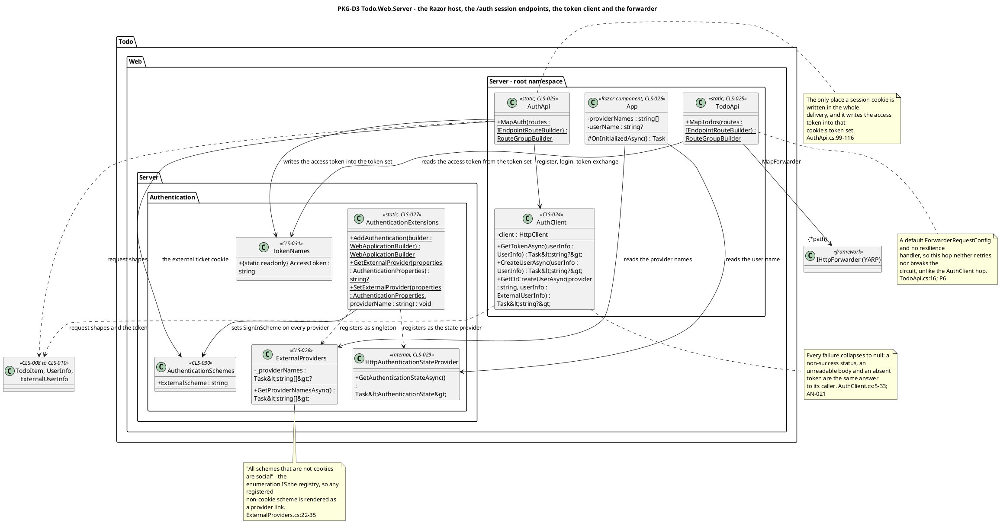

CLS-023 `AuthApi` — the five session endpoints.

| Registered operation | Verb and route | Authorization | What it does | Anchor |
|---|---|---|---|---|
| Register | `POST /auth/register` | none declared on the endpoint | Calls `AuthClient.CreateUserAsync`; answers `Results.Unauthorized()` on `null`, else writes the cookie | `Todo.Web/Server/AuthApi.cs:13-23` |
| Login | `POST /auth/login` | none declared on the endpoint | Calls `AuthClient.GetTokenAsync`; answers 401 on `null`, else writes the cookie | `Todo.Web/Server/AuthApi.cs:25-35` |
| Logout | `POST /auth/logout` | `RequireAuthorization()` | Signs the cookie scheme out; remote-provider sign-out is commented out with a `TODO` | `Todo.Web/Server/AuthApi.cs:37-50` |
| Challenge | `GET /auth/login/{provider}` | none | `Results.Challenge` with the route segment as the scheme list and `/auth/signin/{provider}` as the redirect | `Todo.Web/Server/AuthApi.cs:52-62` |
| Callback | `GET /auth/signin/{provider}` | none | Authenticates the external cookie, protects the provider id, calls `AuthClient.GetOrCreateUserAsync`, writes the cookie when a token comes back, signs the external cookie out on every path and redirects to `/` | `Todo.Web/Server/AuthApi.cs:64-97` |

| Private operation | Signature | What it does | Anchor |
|---|---|---|---|
| `SignIn` | `static IResult SignIn(UserInfo userInfo, string token)` | Delegates with the email as both identifier and name | `Todo.Web/Server/AuthApi.cs:99-102` |
| `SignIn` | `static IResult SignIn(string userId, string userName, string token, string? providerName)` | Builds the `NameIdentifier` and `Name` claims, stores the provider name in the properties, stores the token under `TokenNames.AccessToken`, returns `Results.SignIn` on the cookie scheme | `Todo.Web/Server/AuthApi.cs:104-121` |

The class declares no field: its dependencies arrive as handler parameters.

CLS-024 `AuthClient` — the token client.

| Operation | Signature | What it posts, what it answers | Anchor |
|---|---|---|---|
| `GetTokenAsync` | `Task<string?> GetTokenAsync(UserInfo userInfo)` | `POST users/login`; returns `AuthToken.Token`, or `null` on any non-success | `Todo.Web/Server/AuthClient.cs:5-16` |
| `CreateUserAsync` | `Task<string?> CreateUserAsync(UserInfo userInfo)` | `POST users/register`, then `GetTokenAsync` on success; one `null` covers a refused registration and an unreachable API | `Todo.Web/Server/AuthClient.cs:18-28` |
| `GetOrCreateUserAsync` | `Task<string?> GetOrCreateUserAsync(string provider, ExternalUserInfo userInfo)` | `POST users/token/{provider}`; returns the token or `null` | `Todo.Web/Server/AuthClient.cs:30-39` |

The class takes its `HttpClient` by primary constructor; the base address `http://todoapi` and the resilience handler it inherits are fixed at registration in `Program.cs`, not by the class (`Todo.Web/Server/Program.cs:23-26`).

CLS-025 `TodoApi` (BFF forwarder).

| Operation | Signature | What it does | Anchor |
|---|---|---|---|
| `MapTodos` | `static RouteGroupBuilder MapTodos(this IEndpointRouteBuilder routes)` | Maps `/todos` with `RequireAuthorization()`, then `MapForwarder("{*path}", "http://todoapi", new ForwarderRequestConfig(), …)` with one request transform that reads the access token from the session's token set and writes `Authorization: Bearer <token>` | `Todo.Web/Server/TodoApi.cs:9-26` |

It accepts any method and any sub-path; no route, verb or shape is declared here. Its behaviour is a configuration object plus one transform.

CLS-026 `App` — the Razor host component.

| Member | Declared as | What the code gives it | Anchor |
|---|---|---|---|
| page route | `@page "/"` | The host's single page route | `Todo.Web/Server/App.razor:5` |
| `providerNames` | `string[] providerNames = Array.Empty<string>()` | The scheme names CLS-028 returned, passed into the interactive component | `Todo.Web/Server/App.razor:38,46` |
| `userName` | `string? userName` | `authState.User.Identity.Name` or null, passed into the interactive component | `Todo.Web/Server/App.razor:39,45` |
| `OnInitializedAsync` | `protected override async Task OnInitializedAsync()` | Resolves the authentication state through CLS-029 and the provider names through CLS-028 | `Todo.Web/Server/App.razor:41-47` |

It renders CLS-033 under `RenderMode.InteractiveWebAssembly` and passes both values as parameters (`Todo.Web/Server/App.razor:24`). It is the only place the server-side session state crosses into the browser-hosted component.

CLS-027 to CLS-031 — the authentication package.

| Class | Members | What fixes the design | Anchor |
|---|---|---|---|
| CLS-027 `AuthenticationExtensions` | `AddAuthentication(WebApplicationBuilder)`; private delegate `ExternalAuthProvider`; `GetExternalProvider` and `SetExternalProvider`; private `SetAuth0SignInScheme`; private static readonly `ExternalProviderKey = "ExternalProviderName"` | Registers two cookie schemes and four providers from a dictionary, each only when its `Authentication:Schemes:{name}` section exists; forces `SignInScheme` to the external cookie; registers CLS-028 as a singleton and CLS-029 as the state provider | `Todo.Web/Server/Authentication/AuthenticationExtensions.cs:13-107` |
| CLS-028 `ExternalProviders` | `private Task<string[]>? _providerNames`; `GetProviderNamesAsync()`; private `GetProviderNamesAsyncCore()` | Enumerates every registered scheme, skips the two cookie schemes, returns the rest; caches the result for the process lifetime | `Todo.Web/Server/Authentication/ExternalProviders.cs:6-38` |
| CLS-029 `HttpAuthenticationStateProvider` | `GetAuthenticationStateAsync()` | Returns the HTTP context's principal, or an empty one when there is no context; `internal`, so only the assembly can construct it | `Todo.Web/Server/Authentication/HttpAuthenticationStateProvider.cs:3-11` |
| CLS-030 `AuthenticationSchemes` | `static string ExternalScheme => "External"` | A get-only property rather than a constant; the external scheme's name in one place | `Todo.Web/Server/Authentication/AuthenticationSchemes.cs:6` |
| CLS-031 `TokenNames` | `static readonly string AccessToken = "accessToken"` | The key the token is stored under in the cookie's token set and read back by CLS-025 | `Todo.Web/Server/Authentication/TokenNames.cs:5` |

The provider set is configuration-driven and the code is correct about it: with no `Authentication:Schemes` section in `appsettings.json` the loop registers nothing, CLS-028 returns an empty array, and CLS-034 renders no provider link. The four providers the code names are GitHub, Google, Microsoft and Auth0 (`Todo.Web/Server/Authentication/AuthenticationExtensions.cs:48-53`).

**Todo.Web.Client — the gateway and the three components.**

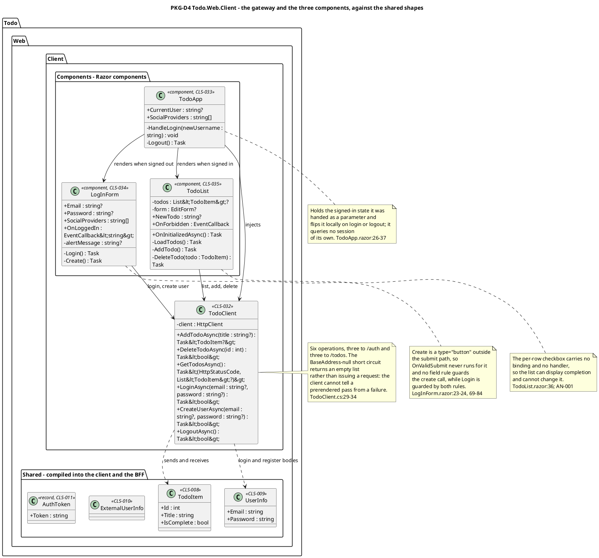

CLS-032 `TodoClient` — the six operations.

| Operation | Signature | Route it calls | Failure it returns, and what it discards | Anchor |
|---|---|---|---|---|
| `AddTodoAsync` | `Task<TodoItem?> AddTodoAsync(string? title)` | `POST todos` | `null` for an empty title before any request exists, and for any non-success status | `Todo.Web/Client/TodoClient.cs:9-25` |
| `DeleteTodoAsync` | `Task<bool> DeleteTodoAsync(int id)` | `DELETE todos/{id}` | `false` for any non-success | `Todo.Web/Client/TodoClient.cs:27-31` |
| `GetTodosAsync` | `Task<(HttpStatusCode, List<TodoItem>?)> GetTodosAsync()` | `GET todos` | `(200, empty)` with no request when `BaseAddress` is null; otherwise the status, and the rows on success | `Todo.Web/Client/TodoClient.cs:33-50` |
| `LoginAsync` | `Task<bool> LoginAsync(string? email, string? password)` | `POST auth/login` | `false` for an empty field or any non-success | `Todo.Web/Client/TodoClient.cs:52-62` |
| `CreateUserAsync` | `Task<bool> CreateUserAsync(string? email, string? password)` | `POST auth/register` | `false` for an empty field or any non-success | `Todo.Web/Client/TodoClient.cs:64-74` |
| `LogoutAsync` | `Task<bool> LogoutAsync()` | `POST auth/logout` | `false` for any non-success | `Todo.Web/Client/TodoClient.cs:76-80` |

Six operations are public and only `GetTodosAsync` returns a status; it is the only caller that distinguishes 401 and 403 from other failures (`Todo.Web/Client/Components/TodoList.razor:60-63`). The class holds no state beyond its `HttpClient`; the base address and the `X-Requested-With` header are set in the client's `Program.cs` (`Todo.Web/Client/Program.cs:7-13`).

CLS-033, CLS-034 and CLS-035 — the three components.

| Class | Parameters and fields | Operations | What the design gives it | Anchor |
|---|---|---|---|---|
| CLS-033 `TodoApp` | `[Parameter] string? CurrentUser`; `[Parameter] string[] SocialProviders` | `void HandleLogin(string)`, `async Task Logout()` | Renders the logged-in header and CLS-035 when `CurrentUser` is non-empty, else CLS-034; sets `CurrentUser` locally on login and to `null` on a successful logout | `Todo.Web/Client/TodoApp.razor:3-38` |
| CLS-034 `LogInForm` | `[Parameter] EventCallback<string> OnLoggedIn`; `[Parameter] string[] SocialProviders`; `string? alertMessage`; `[Required][StringLength(256)] string? Email`; `[Required][StringLength(32, MinimumLength = 6)][RegularExpression] string? Password` | `async Task Login()`, `async Task Create()` | Two submit paths with unequal guards, one provider-link loop, and one `alertMessage` string for every failure | `Todo.Web/Client/Components/LogInForm.razor:3-98` |
| CLS-035 `TodoList` | `List<TodoItem>? todos`; `EditForm? form`; `[Required] string? NewTodo`; `[Parameter] EventCallback OnForbidden` | `OnInitializedAsync()`, `async Task LoadTodos()`, `async Task AddTodo()`, `async Task DeleteTodo(TodoItem)` | Loads on initialisation, raises `OnForbidden` on 401 or 403, appends the created row locally, removes the deleted row locally | `Todo.Web/Client/Components/TodoList.razor:3-76` |

CLS-034 is the only component holding validation rules of its own, and they are not the API's: the password expression demands a lower-case letter, an upper-case letter, a digit and a special character in 6 to 32 characters, while the API's Identity configuration applies the framework's own default policy (`Todo.Web/Client/Components/LogInForm.razor:70-77`; `Todo.Api/Program.cs:17-20`). `Create` bypasses those rules entirely, which is the local half of the cause AN-021 records.

**AppHost, ServiceDefaults and the test suite.**

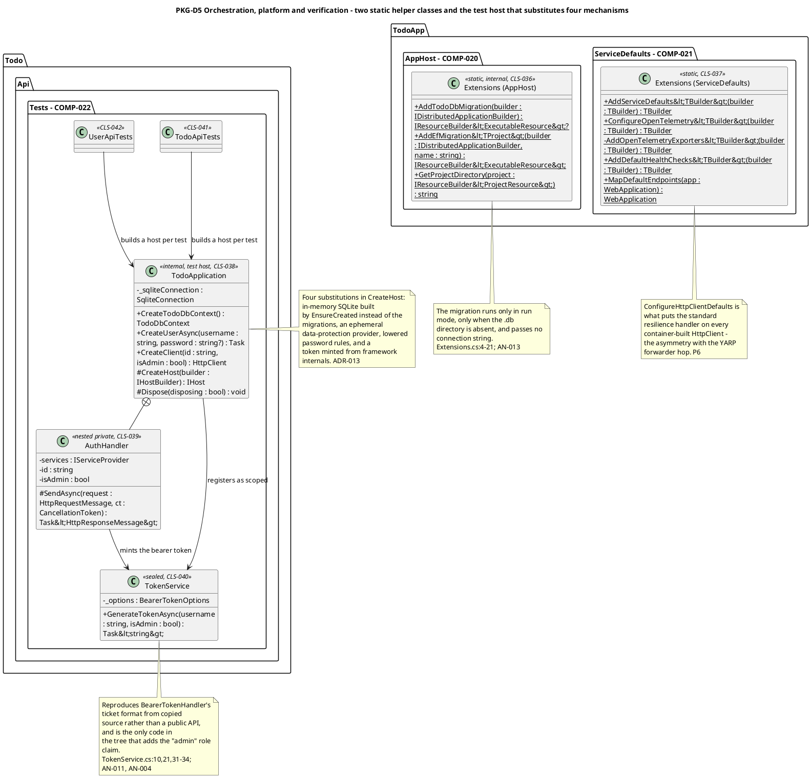

| Class | Members | What fixes the design | Anchor |
|---|---|---|---|
| CLS-036 `Extensions` (AppHost) | `AddTodoDbMigration(IDistributedApplicationBuilder) : IResourceBuilder<ExecutableResource>?`; `AddEfMigration<TProject>(…)`; `GetProjectDirectory(IResourceBuilder<ProjectResource>) : string` | Returns `default` — no migration — unless the host is in run mode and `.db` is absent; installs `dotnet-ef` globally, then runs `ef database update --no-build`, and everything waits on both | `TodoApp.AppHost/Extensions.cs:3-34` |
| CLS-037 `Extensions` (ServiceDefaults) | `AddServiceDefaults<TBuilder>`; `ConfigureOpenTelemetry<TBuilder>`; private `AddOpenTelemetryExporters<TBuilder>`; `AddDefaultHealthChecks<TBuilder>`; `MapDefaultEndpoints(WebApplication)` | Registers telemetry, a `self` liveness check, service discovery, and `ConfigureHttpClientDefaults` with `AddStandardResilienceHandler` and `AddServiceDiscovery`; maps `/health` and `/alive` in Development only | `TodoApp.ServiceDefaults/Extensions.cs:17-130` |
| CLS-038 `TodoApplication` | `SqliteConnection _sqliteConnection = new("Filename=:memory:")`; `CreateTodoDbContext()`; `CreateUserAsync(string, string?)`; `CreateClient(string, bool)`; `protected override IHost CreateHost(IHostBuilder)`; `protected override void Dispose(bool)` | Derives from `WebApplicationFactory<Program>`; opens the in-memory connection, substitutes the `DbContextOptions`, the identity password rules and the data-protection provider, registers CLS-040 | `Todo.Api.Tests/TodoApplication.cs:6-87` |
| CLS-039 `AuthHandler` | `IServiceProvider services`; `string id`; `bool isAdmin`; `protected override Task<HttpResponseMessage> SendAsync(…)` | A `DelegatingHandler` that mints a token per request through CLS-040 and writes it as the bearer header | `Todo.Api.Tests/TodoApplication.cs:74-86` |
| CLS-040 `TokenService` | `BearerTokenOptions _options`; `Task<string> GenerateTokenAsync(string username, bool isAdmin = false)` | Builds the principal with `SignInManager.CreateUserPrincipalAsync`, optionally adds the `admin` role claim, and protects a ticket shaped as the framework's handler shapes it | `Todo.Api.Tests/TokenService.cs:8-34` |
| CLS-041 `TodoApiTests` | Ten `[Fact]` methods over `/todos` | The only tests of the ownership predicate, the projection and the validation filter; two of them mint an admin token | `Todo.Api.Tests/TodoApiTests.cs:2-266` |
| CLS-042 `UserApiTests` | Six `[Fact]` methods over `/users` and a nested `AuthToken` class | Tests register, login, validation problems and the provider exchange over HTTP; declares the token shape a third time | `Todo.Api.Tests/UserApiTests.cs:5-185` |

CLS-036 and CLS-037 share the type name `Extensions` and are not the same class: one is `internal static` in the AppHost, the other is `public static` in the `Microsoft.Extensions.Hosting` namespace. A grep for `Extensions` finds both. CLS-042's nested `AuthToken` is the third declaration of the token response shape, after CLS-011 in `Todo.Web.Shared` and the framework's `AccessTokenResponse` the API returns; none of the three is linked to another.

**Every recovered design class in one view.**

```plantuml
@startuml
title CLS-D1 Every recovered design class, its package, and the classes it depends on

skinparam shadowing false
skinparam classAttributeIconSize 0
skinparam wrapWidth 190
skinparam packageStyle rectangle

package "TodoApi.Todos" {
  class "CLS-001 Todo" as C1
  class "CLS-002 TodoItem" as C2
  class "CLS-003 TodoMappingExtensions" as C3
  class "CLS-012 TodoApi" as C12
}
package "TodoApi entities and persistence" {
  class "CLS-006 TodoDbContext" as C6
  class "CLS-007 TodoUser" as C7
}
package "TodoApi.Authorization" {
  class "CLS-013 CurrentUser" as C13
  class "CLS-014 CurrentUserExtensions" as C14
  class "CLS-015 ClaimsTransformation" as C15
  class "CLS-016 AuthorizationHandlerExtensions" as C16
  class "CLS-017 CheckCurrentUserRequirement" as C17
  class "CLS-018 CheckCurrentUserAuthHandler" as C18
}
package "TodoApi.Users" {
  class "CLS-004 UserInfo" as C4
  class "CLS-005 ExternalUserInfo" as C5
  class "CLS-019 UsersApi" as C19
}
package "TodoApi.Filters" {
  class "CLS-020 ValidationFilterExtensions" as C20
}
package "TodoApi.Extensions" {
  class "CLS-021 RateLimitExtensions" as C21
  class "CLS-022 OpenApiOptionsExtensions" as C22
}
package "Todo.Web.Server" {
  class "CLS-023 AuthApi" as C23
  class "CLS-024 AuthClient" as C24
  class "CLS-025 TodoApi (forwarder)" as C25
  class "CLS-026 App" as C26
}
package "Todo.Web.Server.Authentication" {
  class "CLS-027 AuthenticationExtensions" as C27
  class "CLS-028 ExternalProviders" as C28
  class "CLS-029 HttpAuthenticationStateProvider" as C29
  class "CLS-030 AuthenticationSchemes" as C30
  class "CLS-031 TokenNames" as C31
}
package "Todo.Web.Client" {
  class "CLS-032 TodoClient" as C32
  class "CLS-033 TodoApp (component)" as C33
  class "CLS-034 LogInForm" as C34
  class "CLS-035 TodoList" as C35
}
package "Todo.Web.Shared" {
  class "CLS-008 TodoItem (shared)" as C8
  class "CLS-009 UserInfo (shared)" as C9
  class "CLS-010 ExternalUserInfo (shared)" as C10
  class "CLS-011 AuthToken" as C11
}
package "TodoApp.AppHost" {
  class "CLS-036 Extensions (AppHost)" as C36
}
package "TodoApp.ServiceDefaults" {
  class "CLS-037 Extensions (ServiceDefaults)" as C37
}
package "Todo.Api.Tests" {
  class "CLS-038 TodoApplication" as C38
  class "CLS-039 AuthHandler" as C39
  class "CLS-040 TokenService" as C40
  class "CLS-041 TodoApiTests" as C41
  class "CLS-042 UserApiTests" as C42
}

C12 --> C13
C12 --> C6
C12 --> C2
C12 --> C3
C12 --> C21
C12 --> C20
C13 --> C7
C14 +-- C15
C15 --> C13
C16 +-- C18
C16 +-- C17
C18 --> C13
C19 --> C5
C19 --> C6
C19 --> C20
C23 --> C24
C23 --> C30
C23 --> C31
C25 --> C31
C26 --> C28
C26 --> C29
C27 --> C28
C27 --> C29
C27 --> C30
C32 --> C8
C32 --> C9
C33 --> C32
C33 --> C35
C33 --> C34
C34 --> C32
C35 --> C32
C1 --> C6 : mapped by
C7 --> C6 : mapped by
C38 --> C40
C38 +-- C39
C39 --> C40
C41 --> C38
C42 --> C38

note right of C12
  The four packages Todo.Api's behaviour
  lives in: todos, authorization, filters,
  extensions
end note

note bottom of C8
  The contract has two authorities: CLS-002 in the API
  and CLS-008 here, with no reference and no compiler
  between them. AN-003
end note

@enduml
```

| ID | Class | Package | Kind, as the code declares it | Responsibility, as the code gives it | Anchor |
|---|---|---|---|---|---|
| CLS-012 | `TodoApi` | Todo.Api/Todos | `internal static` | Maps the five task operations and the three conventions they all inherit | `Todo.Api/Todos/TodoApi.cs:6-75` |
| CLS-013 | `CurrentUser` | Todo.Api/Authorization | `public`, scoped service | Carries the request's principal and its resolved account row; derives `Id` and `IsAdmin` from the principal | `Todo.Api/Authorization/CurrentUser.cs:6-13` |
| CLS-014 | `CurrentUserExtensions` | Todo.Api/Authorization | `public static` | Registers the scoped caller service and the claims transformation that populates it | `Todo.Api/Authorization/CurrentUserExtensions.cs:8-13` |
| CLS-015 | `ClaimsTransformation` | Todo.Api/Authorization | `private sealed`, nested in CLS-014 | Sets `CurrentUser.Principal`, resolves the account by `NameIdentifier`, stores it | `Todo.Api/Authorization/CurrentUserExtensions.cs:15-31` |
| CLS-016 | `AuthorizationHandlerExtensions` | Todo.Api/Authorization | `public static` | Registers the requirement handler and adds the `RequireCurrentUser` policy | `Todo.Api/Authorization/CheckCurrentUserAuthHandler.cs:5-20` |
| CLS-017 | `CheckCurrentUserRequirement` | Todo.Api/Authorization | `private`, nested in CLS-016, `IAuthorizationRequirement` | A marker requirement with no member | `Todo.Api/Authorization/CheckCurrentUserAuthHandler.cs:22` |
| CLS-018 | `CheckCurrentUserAuthHandler` | Todo.Api/Authorization | `private`, nested in CLS-016 | Succeeds the requirement when the token names an account row; does not check lockout | `Todo.Api/Authorization/CheckCurrentUserAuthHandler.cs:26-35` |
| CLS-019 | `UsersApi` | Todo.Api/Users | `public static` | Maps the nine Identity operations and writes the one external-token exchange | `Todo.Api/Users/UsersApi.cs:8-62` |
| CLS-020 | `ValidationFilterExtensions` | Todo.Api/Filters | `public static` | Builds one endpoint filter per named parameter type, rejecting a failing data annotation with a problem detail | `Todo.Api/Filters/ValidationFilter.cs:6-63` |
| CLS-021 | `RateLimitExtensions` | Todo.Api/Extensions | `public static` | Configures the per-caller token bucket and applies it to an endpoint group | `Todo.Api/Extensions/RateLimitExtensions.cs:8-57` |
| CLS-022 | `OpenApiOptionsExtensions` | Todo.Api, global namespace | `public static` | Adds the bearer scheme and the per-operation security requirement to the OpenAPI document | `Todo.Api/Extensions/OpenApiOptionsExtensions.cs:7-48` |
| CLS-023 | `AuthApi` | Todo.Web.Server | `public static` | Maps the five `/auth` session operations and writes the only session cookie in the delivery | `Todo.Web/Server/AuthApi.cs:9-121` |
| CLS-024 | `AuthClient` | Todo.Web.Server | `public`, primary constructor | Calls the three `/users` operations the BFF needs and collapses every failure to `null` | `Todo.Web.Server/AuthClient.cs:3-39` |
| CLS-025 | `TodoApi` | Todo.Web.Server | `public static` | Forwards any `/todos` sub-path to the API, rewriting the session token into a bearer header | `Todo.Web/Server/TodoApi.cs:9-26` |
| CLS-026 | `App` | Todo.Web.Server | Razor component, `@page "/"` | Resolves the session and the provider list and passes both into the interactive client | `Todo.Web/Server/App.razor:1-47` |
| CLS-027 | `AuthenticationExtensions` | Todo.Web.Server/Authentication | `public static` | Registers the two cookie schemes and the configuration-gated external providers | `Todo.Web/Server/Authentication/AuthenticationExtensions.cs:13-107` |
| CLS-028 | `ExternalProviders` | Todo.Web.Server/Authentication | `public`, singleton | Enumerates the registered schemes and returns those that are not cookies | `Todo.Web/Server/Authentication/ExternalProviders.cs:6-38` |
| CLS-029 | `HttpAuthenticationStateProvider` | Todo.Web.Server/Authentication | `internal` | Returns the HTTP context's principal as the Blazor authentication state | `Todo.Web/Server/Authentication/HttpAuthenticationStateProvider.cs:3-11` |
| CLS-030 | `AuthenticationSchemes` | Todo.Web.Server/Authentication | `public` | Names the external ticket cookie scheme | `Todo.Web/Server/Authentication/AuthenticationSchemes.cs:4-7` |
| CLS-031 | `TokenNames` | Todo.Web.Server/Authentication | `public` | Names the token-set key the access token is stored and read under | `Todo.Web/Server/Authentication/TokenNames.cs:3-6` |
| CLS-032 | `TodoClient` | Todo.Web.Client | `public`, primary constructor | The client's six HTTP operations, each reduced to a value or `false` | `Todo.Web/Client/TodoClient.cs:7-81` |
| CLS-033 | `TodoApp` | Todo.Web.Client/Components | Razor component | Chooses between the signed-in view and the login form, and holds the signed-in state it was handed | `Todo.Web/Client/TodoApp.razor:1-38` |
| CLS-034 | `LogInForm` | Todo.Web.Client/Components | Razor component | Login and create-user forms, the provider-link loop, and the field rules only `Login` obeys | `Todo.Web/Client/Components/LogInForm.razor:3-98` |
| CLS-035 | `TodoList` | Todo.Web.Client/Components | Razor component | Loads, appends and removes task rows locally; reports 401 and 403 to its parent | `Todo.Web/Client/Components/TodoList.razor:3-76` |
| CLS-036 | `Extensions` | TodoApp.AppHost | `internal static` | Creates the `.db` directory and runs the migration once, in run mode only | `TodoApp.AppHost/Extensions.cs:3-34` |
| CLS-037 | `Extensions` | TodoApp.ServiceDefaults | `public static`, in `Microsoft.Extensions.Hosting` | Telemetry, health, service discovery and the standard resilience handler for every process | `TodoApp.ServiceDefaults/Extensions.cs:17-130` |
| CLS-038 | `TodoApplication` | Todo.Api.Tests | `internal`, extends `WebApplicationFactory<Program>` | Boots the API in process over an in-memory database with four mechanisms substituted | `Todo.Api.Tests/TodoApplication.cs:6-87` |
| CLS-039 | `AuthHandler` | Todo.Api.Tests | `private sealed`, nested in CLS-038 | Writes a minted bearer token onto every outgoing test request | `Todo.Api.Tests/TodoApplication.cs:74-86` |
| CLS-040 | `TokenService` | Todo.Api.Tests | `public sealed` | Mints a bearer token by reproducing the framework's ticket format | `Todo.Api.Tests/TokenService.cs:8-34` |
| CLS-041 | `TodoApiTests` | Todo.Api.Tests | `public`, xunit | Ten facts over `/todos`: ownership, projection, validation, and two admin-path facts | `Todo.Api.Tests/TodoApiTests.cs:2-266` |
| CLS-042 | `UserApiTests` | Todo.Api.Tests | `public`, xunit | Six facts over `/users`, including the provider token exchange | `Todo.Api.Tests/UserApiTests.cs:5-185` |

**What the packages do not hold.** Recorded so that nothing is carried forward from what this shape is usually expected to have. Each was looked for across all seven assemblies.

| Expected | What the code holds instead | Anchor |
|---|---|---|
| An interface the delivery declares itself | None. Every interface in the dependency graph — `IClaimsTransformation`, `IAuthorizationHandler`, `IAuthorizationRequirement`, `IEndpointConventionBuilder`, `IResult` — is the framework's | `Todo.Api/Authorization/CurrentUserExtensions.cs:10`; `Todo.Api/Authorization/CheckCurrentUserAuthHandler.cs:7,14,22` |
| A service layer, repository or unit-of-work type | None. The endpoint lambdas take `TodoDbContext` and `CurrentUser` directly; every statement is inline in the registration | `Todo.Api/Todos/TodoApi.cs:24-73` |
| A controller or a handler class per use case | None. Six static extension classes and three Razor components carry all the request handling across four processes | `Todo.Api/Todos/TodoApi.cs`; `Todo.Api/Users/UsersApi.cs`; `Todo.Web/Server/AuthApi.cs` |
| A type representing a provider or a scheme | None. Providers are a `Dictionary<string, ExternalAuthProvider>` inside a method body and schemes are strings; there is no provider type, enum or registry object | `Todo.Web/Server/Authentication/AuthenticationExtensions.cs:48-53` |
| A view model or state container on the client | None. CLS-033 carries the signed-in name, CLS-035 carries the row list, and no type outlives either component | `Todo.Web/Client/TodoApp.razor:26-37`; `Todo.Web/Client/Components/TodoList.razor:44-47` |
| An abstraction over the two declarations of the wire contract | None. Three declarations of the token shape and two of each request shape, with no shared type and no compiler between them | `Todo.Web/Shared/SharedClass.cs:5-31`; `Todo.Api/Todos/Todo.cs:15-21`; `Todo.Api.Tests/UserApiTests.cs:178-183` |

### Relationship inventory — every association among the package classes

The Domain Model carries a relationship inventory for the eleven domain classes. The thirty-one classes of the packages carried none, and a class diagram without multiplicities and anchors leaves the Implementer to decide the wire-up. This is that layer: one row per association the code declares, with the kind of link the code gives it and where in the file it is written. Each anchor names the construct and the range that encloses it, so a reader lands on the declaration rather than on a line count.

An arrow in `CLS-D1` says only that a dependency exists. The distinction that matters for implementation is the **Kind** column: an injected constructor or lambda parameter is resolved per request by the container, a static extension call is a compile-time binding with no instance, a `*--` composition is a `private` nested type nothing outside the declaring file can name, and a serialized shape is a type written to or read from JSON with no reference in either direction.

**Todo.Api / Todos and Authorization.**

```plantuml
@startuml
title PKG-D6 Todo.Api - every relationship among its package classes, with kind and multiplicity

skinparam shadowing false
skinparam classAttributeIconSize 0
skinparam wrapWidth 200
hide circle
hide empty members

package "Todos" {
  class "CLS-012 TodoApi" as C12
  class "CLS-001 Todo" as C1
  class "CLS-002 TodoItem" as C2
  class "CLS-003 TodoMappingExtensions" as C3
}

package "Authorization" {
  class "CLS-013 CurrentUser" as C13
  class "CLS-014 CurrentUserExtensions" as C14
  class "CLS-015 ClaimsTransformation" as C15
  class "CLS-016 AuthorizationHandlerExtensions" as C16
  class "CLS-017 CheckCurrentUserRequirement" as C17
  class "CLS-018 CheckCurrentUserAuthHandler" as C18
}

package "Users" {
  class "CLS-019 UsersApi" as C19
  class "CLS-005 ExternalUserInfo" as C5
}

package "Filters and Extensions" {
  class "CLS-020 ValidationFilterExtensions" as C20
  class "CLS-021 RateLimitExtensions" as C21
  class "CLS-022 OpenApiOptionsExtensions" as C22
}

package "Entities and persistence" {
  class "CLS-006 TodoDbContext" as C6
  class "CLS-007 TodoUser" as C7
}

C12 --> C6 : inject 1 scoped
C12 --> C13 : inject 1 scoped
C12 --> C2 : bind and return 0..* per handler
C12 ..> C3 : call static, 1 per projected row
C12 ..> C1 : construct 0..1 per POST
C12 ..> C21 : apply 1 policy to the group
C12 ..> C20 : add 1 filter per named type
C3 ..> C1 : parameter 1
C3 ..> C2 : return 1
C13 --> C7 : property User 0..1
C14 ..> C13 : register scoped
C14 ..> C15 : register as IClaimsTransformation
C14 *-- C15 : nested private sealed
C15 --> C13 : set Principal and User
C15 ..> C7 : resolve via UserManager 0..1
C16 *-- C17 : nested private
C16 *-- C18 : nested private
C16 ..> C18 : register handler
C16 ..> C17 : construct 1 per policy
C18 --> C13 : read User 1
C18 ..> C17 : parameter 1
C19 --> C5 : bind 0..1
C19 ..> C5 : typeof, 1
C19 ..> C7 : create 0..1
C19 ..> C20 : add 1 filter to the group
C6 --> C1 : DbSet
C6 --> C7 : IdentityDbContext of

note bottom of C15
  Nested inside CLS-014 as private sealed, so nothing
  outside the file can reference it. Registered as
  IClaimsTransformation.
end note

note bottom of C18
  Nested inside CLS-016 together with CLS-017. The file
  is named for CLS-018 and the only public type in it
  is CLS-016.
end note

note bottom of C22
  Called once from Todo.Api's top-level program, which
  declares no class: no CLS element holds the call site.
end note

note right of C19
  The exchange handler also injects UserManager of
  TodoUser, SignInManager of TodoUser and
  IDataProtectionProvider - framework types, no
  CLS label.
end note

@enduml
```

| From | To | Kind | Multiplicity | Where the code declares it |
|---|---|---|---|---|
| CLS-012 `TodoApi` | CLS-006 `TodoDbContext` | Injected lambda parameter | 1 per request, in all five handlers | `Todo.Api/Todos/TodoApi.cs:24-73` — each `group.Map*` parameter list |
| CLS-012 `TodoApi` | CLS-013 `CurrentUser` | Injected lambda parameter | 1 per request, in all five handlers | `Todo.Api/Todos/TodoApi.cs:24-73` — each `group.Map*` parameter list |
| CLS-012 `TodoApi` | CLS-002 `TodoItem` (API) | Request body bound, and response returned | 0..* per operation: one list, one item, one body | `Todo.Api/Todos/TodoApi.cs:22` — `WithParameterValidation(typeof(TodoItem))`; `:24-66` — handler returns and body parameters |
| CLS-012 `TodoApi` | CLS-001 `Todo` | Constructed | 0..1 per `POST`; never constructed on the other four | `Todo.Api/Todos/TodoApi.cs:39-50` — the create handler's object initialiser |
| CLS-012 `TodoApi` | CLS-003 `TodoMappingExtensions` | Static extension call | 1 per projected row, three call sites | `Todo.Api/Todos/TodoApi.cs:24-50` — `.AsTodoItem()` in the list, the read-one and the create |
| CLS-012 `TodoApi` | CLS-021 `RateLimitExtensions` | Static extension call | 1 policy applied to the whole group | `Todo.Api/Todos/TodoApi.cs:9-22` — `group.RequirePerUserRateLimit()` among the three conventions |
| CLS-012 `TodoApi` | CLS-020 `ValidationFilterExtensions` | Static extension call | 1 filter factory per named type; names CLS-002 alone | `Todo.Api/Todos/TodoApi.cs:9-22` — `group.WithParameterValidation(typeof(TodoItem))` |
| CLS-003 `TodoMappingExtensions` | CLS-001 `Todo` | Parameter | 1 per call, `this Todo todo` | `Todo.Api/Todos/Todo.cs:23-34` — `AsTodoItem(this Todo todo)` |
| CLS-003 `TodoMappingExtensions` | CLS-002 `TodoItem` (API) | Return value | 1 per call | `Todo.Api/Todos/Todo.cs:23-34` — `AsTodoItem(this Todo todo)` |
| CLS-013 `CurrentUser` | CLS-007 `TodoUser` | Property `User` | 0..1 — null when the token names no account row | `Todo.Api/Authorization/CurrentUser.cs:4-11` — `public TodoUser? User` |
| CLS-014 `CurrentUserExtensions` | CLS-013 `CurrentUser` | Registers as scoped | 1 registration | `Todo.Api/Authorization/CurrentUserExtensions.cs:8-13` — `AddCurrentUser` |
| CLS-014 `CurrentUserExtensions` | CLS-015 `ClaimsTransformation` | Registers as `IClaimsTransformation` | 1 registration | `Todo.Api/Authorization/CurrentUserExtensions.cs:8-13` — the second `AddScoped` |
| CLS-014 `CurrentUserExtensions` | CLS-015 `ClaimsTransformation` | Composition — nested `private sealed` | 1, unreachable from outside the file | `Todo.Api/Authorization/CurrentUserExtensions.cs:15-31` — the nested declaration |
| CLS-015 `ClaimsTransformation` | CLS-013 `CurrentUser` | Primary-constructor parameter, then two property writes | 1 per request | `Todo.Api/Authorization/CurrentUserExtensions.cs:15-30` — parameter list and `TransformAsync` body |
| CLS-015 `ClaimsTransformation` | CLS-007 `TodoUser` | Resolved through `UserManager<TodoUser>` | 0..1 per request, once | `Todo.Api/Authorization/CurrentUserExtensions.cs:15-30` — `FindByIdAsync` |
| CLS-016 `AuthorizationHandlerExtensions` | CLS-017 `CheckCurrentUserRequirement` | Composition — nested `private`; constructed per policy | 1 per `RequireCurrentUser` call | `Todo.Api/Authorization/CheckCurrentUserAuthHandler.cs:5-22` — `RequireCurrentUser` and the nested marker class |
| CLS-016 `AuthorizationHandlerExtensions` | CLS-018 `CheckCurrentUserAuthHandler` | Composition — nested `private`; registered as `IAuthorizationHandler` | 1 registration, 1 instance per request | `Todo.Api/Authorization/CheckCurrentUserAuthHandler.cs:5-36` — the handler registration and the nested type |
| CLS-018 `CheckCurrentUserAuthHandler` | CLS-013 `CurrentUser` | Primary-constructor parameter, then read | 1 per request | `Todo.Api/Authorization/CheckCurrentUserAuthHandler.cs:24-36` — parameter list and `HandleRequirementAsync` |
| CLS-018 `CheckCurrentUserAuthHandler` | CLS-017 `CheckCurrentUserRequirement` | Handler parameter | 1 per authorization evaluation | `Todo.Api/Authorization/CheckCurrentUserAuthHandler.cs:26-35` — `HandleRequirementAsync` |
| CLS-019 `UsersApi` | CLS-005 `ExternalUserInfo` (API) | Request body bound; and named in `typeof` | 0..1 per exchange; 1 filter attachment | `Todo.Api/Users/UsersApi.cs:18` — `typeof(ExternalUserInfo)`; `:24-60` — the handler's body parameter |
| CLS-019 `UsersApi` | CLS-007 `TodoUser` | Constructed and created through `UserManager` | 0..1 per exchange, only when no login row matches | `Todo.Api/Users/UsersApi.cs:24-60` — `new TodoUser()` and `FindByLoginAsync` |
| CLS-019 `UsersApi` | CLS-020 `ValidationFilterExtensions` | Static extension call | 1 filter factory, naming CLS-005 alone | `Todo.Api/Users/UsersApi.cs:9-22` — `group.WithParameterValidation` |
| CLS-006 `TodoDbContext` | CLS-001 `Todo` | `DbSet<Todo>` | 0..* rows | `Todo.Api/TodoDbContext.cs:6-20` — `public DbSet<Todo> Todos` |
| CLS-006 `TodoDbContext` | CLS-007 `TodoUser` | `IdentityDbContext<TodoUser>` base and the fluent relation | 1 account per task row | `Todo.Api/TodoDbContext.cs:6-20` — the base list and `OnModelCreating` |
| CLS-020 `ValidationFilterExtensions` | — | None | Framework types only: `IEndpointConventionBuilder`, `MethodInfo`, `MiniValidator`, `Results` | `Todo.Api/Filters/ValidationFilter.cs:6-63` |
| CLS-021 `RateLimitExtensions` | — | None | Framework types only: `IServiceCollection`, `RateLimitPartition`, `ClaimTypes` | `Todo.Api/Extensions/RateLimitExtensions.cs:8-57` |
| CLS-022 `OpenApiOptionsExtensions` | — | None | Framework types only: `OpenApiOptions`, `OpenApiSecurityScheme`, `IAuthorizeData` | `Todo.Api/Extensions/OpenApiOptionsExtensions.cs:7-48` |

**Three of these classes are unreachable from outside their declaring file.** CLS-015, CLS-017 and CLS-018 are `private` nested types: the only way into any of them is the one registration call in its enclosing class. That is not an oversight for implementation to repair — it is what the code declares, and a design that exposed them would be designing a different system.

**CLS-022 has no CLS caller.** `AddBearerTokenAuthentication` is called once, in `Todo.Api/Program.cs`, inside a lambda in a top-level program that declares no type. The three conventions CLS-012 applies do arrive through a CLS class, so their call site is drawn; CLS-022's is not, and a class diagram cannot draw an edge to a program.

**Todo.Web.Server, Todo.Web.Client, Todo.Web.Shared, orchestration and the tests.**

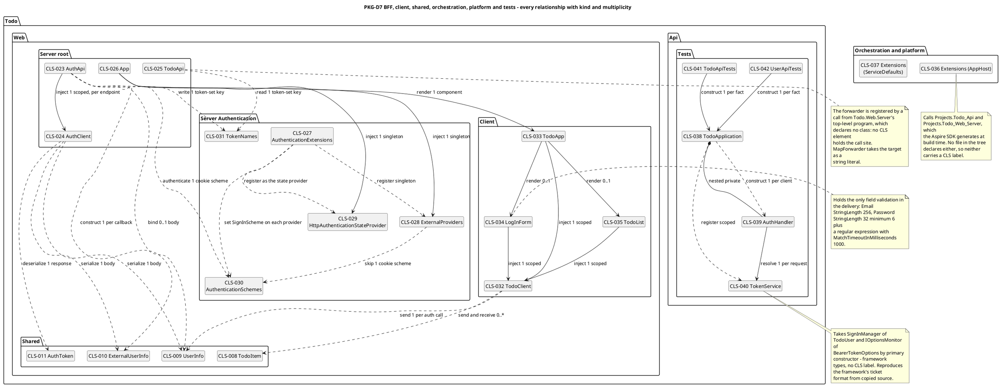

| From | To | Kind | Multiplicity | Where the code declares it |
|---|---|---|---|---|
| CLS-023 `AuthApi` | CLS-024 `AuthClient` | Injected lambda parameter | 1 per request, three of the five endpoints | `Todo.Web/Server/AuthApi.cs:13-97` — the `register`, `login` and `signin` handler parameter lists |
| CLS-023 `AuthApi` | CLS-009 `UserInfo` (shared) | Request body bound | 0..1 per `register` and per `login` | `Todo.Web/Server/AuthApi.cs:13-35` — the two handler parameter lists |
| CLS-023 `AuthApi` | CLS-010 `ExternalUserInfo` (shared) | Constructed with the protected provider id | 1 per callback | `Todo.Web/Server/AuthApi.cs:64-97` — the object initialiser passed to `GetOrCreateUserAsync` |
| CLS-023 `AuthApi` | CLS-030 `AuthenticationSchemes` | Static read | 1 per callback path — authenticate, then sign out | `Todo.Web/Server/AuthApi.cs:64-97` — both `context.AuthenticateAsync`/`SignOutAsync` calls |
| CLS-023 `AuthApi` | CLS-031 `TokenNames` | Static read, written into the cookie's token set | 1 per successful sign-in | `Todo.Web/Server/AuthApi.cs:104-121` — `properties.StoreTokens([...])` |
| CLS-023 `AuthApi` | CLS-011 `AuthToken` | Never referenced | 0 — the BFF receives the token as a `string` from CLS-024 and never deserializes it | `Todo.Web/Server/AuthApi.cs:9-121` — no occurrence of the type |
| CLS-024 `AuthClient` | CLS-009 `UserInfo` (shared) | Serialized request body | 1 per login and per register | `Todo.Web/Server/AuthClient.cs:5-28` — `PostAsJsonAsync` in `GetTokenAsync` and `CreateUserAsync` |
| CLS-024 `AuthClient` | CLS-010 `ExternalUserInfo` (shared) | Serialized request body | 1 per exchange | `Todo.Web/Server/AuthClient.cs:30-39` — `GetOrCreateUserAsync` |
| CLS-024 `AuthClient` | CLS-011 `AuthToken` | Deserialized response | 0..1 per successful call | `Todo.Web/Server/AuthClient.cs:5-39` — `ReadFromJsonAsync<AuthToken>()` |
| CLS-025 `TodoApi` (BFF forwarder) | CLS-031 `TokenNames` | Static read | 1 per forwarded request | `Todo.Web/Server/TodoApi.cs:9-26` — `GetTokenAsync(TokenNames.AccessToken)` in the request transform |
| CLS-026 `App` | CLS-028 `ExternalProviders` | Injected | 1 singleton, read once per render | `Todo.Web/Server/App.razor:1-47` — the `@inject` and `OnInitializedAsync` |
| CLS-026 `App` | CLS-029 `HttpAuthenticationStateProvider` | Injected as `AuthenticationStateProvider` | 1 singleton, read once per render | `Todo.Web/Server/App.razor:1-47` — the `@inject` and `OnInitializedAsync` |
| CLS-026 `App` | CLS-033 `TodoApp` | Renders, passing both values as parameters | 1 component | `Todo.Web/Server/App.razor:20-28` — the `<TodoApp>` element with its two parameters |
| CLS-027 `AuthenticationExtensions` | CLS-028 `ExternalProviders` | Registers as singleton | 1 registration | `Todo.Web/Server/Authentication/AuthenticationExtensions.cs:13-107` — `AddSingleton<ExternalProviders>()` |
| CLS-027 `AuthenticationExtensions` | CLS-029 `HttpAuthenticationStateProvider` | Registers as the `AuthenticationStateProvider` | 1 registration | `Todo.Web/Server/Authentication/AuthenticationExtensions.cs:13-107` — the `AddSingleton<AuthenticationStateProvider, ...>` line |
| CLS-027 `AuthenticationExtensions` | CLS-030 `AuthenticationSchemes` | Static read; writes `SignInScheme` into each provider's options | 1 per configured provider — zero in the delivered configuration | `Todo.Web/Server/Authentication/AuthenticationExtensions.cs:13-107` — the external cookie registration, the options callback and the Auth0 post-configure |
| CLS-028 `ExternalProviders` | CLS-030 `AuthenticationSchemes` | Static read, skips the named cookie | 1 per enumeration | `Todo.Web/Server/Authentication/ExternalProviders.cs:22-35` — the scheme loop's skip condition |
| CLS-032 `TodoClient` | CLS-008 `TodoItem` (shared) | Sent and received over JSON | 0..* — one list, one created item | `Todo.Web/Client/TodoClient.cs:7-50` — the todo operations |
| CLS-032 `TodoClient` | CLS-009 `UserInfo` (shared) | Sent over JSON | 1 per login and per register | `Todo.Web/Client/TodoClient.cs:52-74` — `LoginAsync` and `CreateUserAsync` |
| CLS-033 `TodoApp` | CLS-032 `TodoClient` | Injected | 1 scoped | `Todo.Web/Client/TodoApp.razor:1-38` — the `@inject` and `Logout` |
| CLS-033 `TodoApp` | CLS-035 `TodoList` | Renders, one `EventCallback` outward | 0..1 — only when `CurrentUser` is non-empty | `Todo.Web/Client/TodoApp.razor:3-38` — the signed-in branch |
| CLS-033 `TodoApp` | CLS-034 `LogInForm` | Renders, one `EventCallback` outward | 0..1 — only when `CurrentUser` is empty | `Todo.Web/Client/TodoApp.razor:15-21` — the signed-out branch |
| CLS-034 `LogInForm` | CLS-032 `TodoClient` | Injected | 1 scoped | `Todo.Web/Client/Components/LogInForm.razor:3-98` — the `@inject` and the two submit paths |
| CLS-035 `TodoList` | CLS-032 `TodoClient` | Injected | 1 scoped | `Todo.Web/Client/Components/TodoList.razor:3-76` — the `@inject` and the three operations |
| CLS-036 `Extensions` (AppHost) | — | None | Depends on Aspire types and on SDK-generated project metadata | `TodoApp.AppHost/Extensions.cs:3-34` |
| CLS-037 `Extensions` (ServiceDefaults) | — | None | Depends on framework and OpenTelemetry types only | `TodoApp.ServiceDefaults/Extensions.cs:17-130` |
| CLS-038 `TodoApplication` | CLS-039 `AuthHandler` | Composition — nested `private sealed`, constructed per client | 1 per `CreateClient` call | `Todo.Api.Tests/TodoApplication.cs:20-23,74-86` — `CreateClient` and the nested type |
| CLS-038 `TodoApplication` | CLS-040 `TokenService` | Registers as scoped | 1 registration | `Todo.Api.Tests/TodoApplication.cs:38-72` — `CreateHost`'s service substitutions |
| CLS-039 `AuthHandler` | CLS-040 `TokenService` | Resolved from the request scope | 1 per outgoing request | `Todo.Api.Tests/TodoApplication.cs:74-86` — `SendAsync` |
| CLS-041 `TodoApiTests` | CLS-038 `TodoApplication` | Constructs and disposes | 1 per `[Fact]`, ten facts | `Todo.Api.Tests/TodoApiTests.cs` — every fact's first statement |
| CLS-042 `UserApiTests` | CLS-038 `TodoApplication` | Constructs and disposes | 1 per `[Fact]`, six facts | `Todo.Api.Tests/UserApiTests.cs` — every fact's first statement |

**Two cross-process relations have no edge a class diagram can draw, and they are the ones the use cases follow.** CLS-032 reaches CLS-023 and CLS-025 over HTTP at the relative paths `auth/...` and `todos`; CLS-024 and CLS-025 reach CLS-019 and CLS-012 over HTTP at the base address `http://todoapi`. The client's base address is the host environment's address (`Todo.Web/Client/Program.cs`) and the BFF's is a literal (`Todo.Web/Server/Program.cs`). Both cross a process boundary with no interface type, which is why "Interface Contracts" records that the delivery declares none.

**`AuthToken` is declared three times and linked to nothing in any direction.** CLS-011 in the shared assembly, `AccessTokenResponse` in the framework, and a `private` nested `AuthToken` inside CLS-042. Nothing checks that they agree, and the third is private to the test class, so nothing outside `UserApiTests.cs` can even name it.

### Signatures the tables flattened, restored as the code declares them

A per-package table abbreviates a declaration to the part a reader needs at that point. This is the authority on the full form: where a per-package row shortens a signature, the row here is what the Implementer writes. The constraint or modifier in each case is part of the contract, not decoration — an Implementer who omits `where TBuilder : IEndpointConventionBuilder` produces code that does not compile against the call sites in CLS-012 and CLS-019.

| Class | Full declaration | Why the part the summary omits is load-bearing | Anchor |
|---|---|---|---|
| CLS-020 `ValidationFilterExtensions` | `public static TBuilder WithParameterValidation<TBuilder>(this TBuilder builder, params Type[] typesToValidate) where TBuilder : IEndpointConventionBuilder` | The constraint is what lets the body call `builder.Add(...)` and reach `eb.FilterFactories`; without it the method does not compile, and both call sites pass a `RouteGroupBuilder` | `Todo.Api/Filters/ValidationFilter.cs` — `WithParameterValidation`, its `where` clause and the `builder.Add` body |
| CLS-020 `ValidationFilterExtensions` | `private static readonly ProducesResponseTypeMetadata ValidationErrorResponseMetadata = new(400, typeof(HttpValidationProblemDetails), ["application/problem+json"])` | The 400 status, the problem-details type and the single media type are all fixed here, and the field is `private` — no other class can supply a different one | `Todo.Api/Filters/ValidationFilter.cs` — the field declaration |
| CLS-036 `Extensions` (AppHost) | `public static IResourceBuilder<ExecutableResource> AddEfMigration<TProject>(this IDistributedApplicationBuilder builder, string name) where TProject : IProjectMetadata, new()` | `new()` is required because the body constructs `new TProject().ProjectPath`; `IProjectMetadata` is required for that `.ProjectPath` read | `TodoApp.AppHost/Extensions.cs` — `AddEfMigration`, its `where` clause and the `new TProject()` body |
| CLS-037 `Extensions` (ServiceDefaults) | `AddServiceDefaults`, `ConfigureOpenTelemetry`, `AddOpenTelemetryExporters` and `AddDefaultHealthChecks` each declare `where TBuilder : IHostApplicationBuilder`; `MapDefaultEndpoints` takes a concrete `WebApplication` and declares no constraint | The constraint is the only thing giving the four generic methods `Services`, `Configuration`, `Logging` and `Environment`; the fifth is a different shape because it is called on the built app, not on the builder | `TodoApp.ServiceDefaults/Extensions.cs` — each `public static TBuilder …` declaration with its `where` clause; `MapDefaultEndpoints(WebApplication app)` |
| CLS-042 `UserApiTests` | `class AuthToken` with no access modifier, declared inside `public class UserApiTests` — in C# that is `private` | Private to its declaring class, so the type is invisible outside `UserApiTests.cs`; it constrains nothing outside the file and cannot be shared with the other two declarations of the token shape | `Todo.Api.Tests/UserApiTests.cs` — the nested `class AuthToken` at the end of the file |
| CLS-028 `ExternalProviders` | `public class ExternalProviders(IAuthenticationSchemeProvider schemeProvider)` | The primary constructor takes the scheme provider; the class holds no other dependency and cannot be constructed without one | `Todo.Web/Server/Authentication/ExternalProviders.cs` — the class declaration |
| CLS-024 `AuthClient` | `public class AuthClient(HttpClient client)` | The `HttpClient` arrives by primary constructor and the class declares no field of its own | `Todo.Web/Server/AuthClient.cs` — the class declaration |
| CLS-032 `TodoClient` | `public class TodoClient(HttpClient client)` | As CLS-024; the base address and the `X-Requested-With` header are fixed at registration in `Todo.Web/Client/Program.cs`, not by the class | `Todo.Web/Client/TodoClient.cs` — the class declaration |
| CLS-040 `TokenService` | `public sealed class TokenService(SignInManager<TodoUser> signInManager, IOptionsMonitor<BearerTokenOptions> options)` | `sealed`, and takes the options monitor rather than the options: it resolves the named `BearerTokenOptions` for `IdentityConstants.BearerScheme` at construction | `Todo.Api.Tests/TokenService.cs` — the class declaration and the `_options` field |

Three declarations are worth isolating because an Implementer who reads them as ordinary members breaks them.

| Member | As declared | What the shape decides | Anchor |
|---|---|---|---|
| `CLS-030` `ExternalScheme` | `public static string ExternalScheme => "External"` | A static get-only property, not a constant: it re-evaluates on every read and cannot be used in an attribute or a `switch` label | `Todo.Web/Server/Authentication/AuthenticationSchemes.cs` |
| `CLS-031` `AccessToken` | `public static readonly string AccessToken = "accessToken"` | A field, initialised once — the opposite shape to CLS-030 in the adjacent file; an Implementer who treats the two alike breaks one of them | `Todo.Web/Server/Authentication/TokenNames.cs` |
| `CLS-013` `Id` and `Principal` | `Id => Principal.FindFirstValue(ClaimTypes.NameIdentifier)!`; `Principal { get; set; } = default!` | The null-forgiving operator suppresses the warning rather than handling an absent claim, so `Id` is typed `string` and can be null at run time; a `CurrentUser` read before CLS-015 runs dereferences null | `Todo.Api/Authorization/CurrentUser.cs` |

**`CLS-034` holds the only field validation in the delivery, and it guards one of its two paths.** `Email` is `[Required] [StringLength(256)]`; `Password` is `[Required] [StringLength(32, MinimumLength = 6)]` plus a `[RegularExpression]` with `MatchTimeoutInMilliseconds = 1000` demanding a lower-case letter, an upper-case letter, a digit and a special character. `Login()` is the `EditForm`'s `OnValidSubmit`, so both run for it. `Create()` is a `type="button"` with an `@onclick`, outside the submit path, so `OnValidSubmit` never fires for it and neither attribute runs. That is the local half of the cause AN-021 records (`Todo.Web/Client/Components/LogInForm.razor`).

**`CLS-021` binds the bucket options from configuration, so the class's own defaults are not the values in force.** `Configure` sets `TokenLimit` 100, `TokensPerPeriod` 100, `QueueLimit` 100 and a 10-second replenishment, and the chain ends with `.BindConfiguration("RateLimiting")`, so any `RateLimiting` section in the host's configuration overrides them. The delivered Development configuration does exactly that — 50 / 50 / 50, recorded under `AN-024` (`Todo.Api/Extensions/RateLimitExtensions.cs`; `appsettings.Development.json`).

### The collaborators that carry no class, and where the call sites live

Every class above names, in its constructor or its body, collaborators that are not classes the delivery declares. They fall in three kinds, and each kind is missing from the class diagrams for a different reason: a framework contract is not the Implementer's to write, a generated type has no source file, and a top-level program is not a type at all.

```plantuml
@startuml
title PKG-D8 The collaborators the 42 classes depend on that carry no CLS label, and why

skinparam shadowing false
skinparam classAttributeIconSize 0
skinparam wrapWidth 210
hide circle
hide empty members

package "Framework types the delivery injects" {
  class "UserManager&lt;TodoUser&gt;" as UM <<framework>>
  class "SignInManager&lt;TodoUser&gt;" as SM <<framework>>
  class "IDataProtectionProvider" as DPP <<framework>>
  class "IAuthenticationSchemeProvider" as ASP <<framework>>
  class "IHttpContextAccessor" as HCA <<framework>>
  class "HttpClient" as HC <<framework>>
  class "IClaimsTransformation" as ICT <<framework>>
  class "IAuthorizationHandler" as IAH <<framework>>
}

package "SDK-generated at build time" {
  class "Projects.Todo_Api" as PA <<generated>>
  class "Projects.Todo_Web_Server" as PW <<generated>>
}

package "Top-level program statements - no type declared" {
  class "Todo.Api/Program.cs" as P1 <<program>>
  class "Todo.Web.Server/Program.cs" as P2 <<program>>
  class "Todo.Web.Client/Program.cs" as P3 <<program>>
  class "TodoApp.AppHost/Program.cs" as P4 <<program>>
}

package "Classes that carry a CLS label" {
  class "CLS-015 ClaimsTransformation" as C15
  class "CLS-018 CheckCurrentUserAuthHandler" as C18
  class "CLS-019 UsersApi" as C19
  class "CLS-023 AuthApi" as C23
  class "CLS-024 AuthClient" as C24
  class "CLS-026 App" as C26
  class "CLS-028 ExternalProviders" as C28
  class "CLS-029 HttpAuthenticationStateProvider" as C29
  class "CLS-032 TodoClient" as C32
  class "CLS-036 Extensions (AppHost)" as C36
  class "CLS-040 TokenService" as C40
  class "CLS-012 TodoApi" as C12
  class "CLS-014 CurrentUserExtensions" as C14
  class "CLS-016 AuthorizationHandlerExtensions" as C16
  class "CLS-021 RateLimitExtensions" as C21
  class "CLS-022 OpenApiOptionsExtensions" as C22
  class "CLS-025 TodoApi (forwarder)" as C25
  class "CLS-027 AuthenticationExtensions" as C27
}

C15 ..|> ICT : implements
C18 ..> IAH : registered as
C19 --> UM
C19 --> SM
C19 --> DPP
C23 --> DPP
C24 --> HC
C26 --> HCA : resolves through CLS-029
C28 --> ASP
C29 --> HCA
C32 --> HC
C36 ..> PA
C36 ..> PW
C40 --> SM
P1 ..> C19 : Maps
P1 ..> C12 : Maps
P1 ..> C22 : calls
P1 ..> C21 : calls
P1 ..> C14 : calls
P1 ..> C16 : calls
P2 ..> C23 : Maps
P2 ..> C25 : Maps
P2 ..> C27 : calls
P3 ..> C32 : registers
P4 ..> C36 : calls

note bottom of PA
  Aspire generates Projects.Todo_Api and
  Projects.Todo_Web_Server from the project
  references; no file in the tree declares
  either.
end note

note bottom of P1
  The four programs are top-level statements.
  Several calls into CLS classes originate here
  and nowhere else, which is why no class diagram
  can show that call site: CLS-022 and CLS-025
  each have exactly one, and it is one of these.
end note

note right of UM
  Every one of these is a framework contract the
  delivery implements or consumes; none is a class
  the Implementer writes, so none takes a CLS label.
end note

@enduml
```

| Collaborator | Kind | Who depends on it | What the dependency fixes | Anchor |
|---|---|---|---|---|
| `UserManager<TodoUser>` | Framework contract | CLS-015, CLS-019, CLS-038, CLS-041, CLS-042 | Account creation, lookup by id, lookup by provider login, adding a login row. It is the only route to `AspNetUsers` in the delivery | `Todo.Api/Authorization/CurrentUserExtensions.cs:23`; `Todo.Api/Users/UsersApi.cs:24,36,44` |
| `SignInManager<TodoUser>` | Framework contract | CLS-019, CLS-040 | Builds the claims principal for a sign-in; CLS-040 also reads the bearer options from it | `Todo.Api/Users/UsersApi.cs:24,53`; `Todo.Api.Tests/TokenService.cs:8,11` |
| `IDataProtectionProvider` | Framework contract | CLS-019, CLS-023 | Protects the provider id for transport and unprotects it on exchange. Both processes share the key ring through the `TodoApp` application discriminator | `Todo.Api/Users/UsersApi.cs:24,28`; `Todo.Web/Server/AuthApi.cs:64,77`; `Todo.Api/Program.cs:11`; `Todo.Web/Server/Program.cs:15` |
| `IAuthenticationSchemeProvider` | Framework contract | CLS-028 | The enumeration CLS-028 turns into the provider list; the class holds no registry of its own | `Todo.Web/Server/Authentication/ExternalProviders.cs:6,22` |
| `IHttpContextAccessor` | Framework contract | CLS-026, CLS-029 | The HTTP principal CLS-029 returns as the Blazor authentication state; registered by CLS-027 | `Todo.Web/Server/Authentication/AuthenticationExtensions.cs:91`; `Todo.Web/Server/Authentication/HttpAuthenticationStateProvider.cs:3,7` |
| `HttpClient` | Framework contract | CLS-024, CLS-032 | The only outbound HTTP in the delivery. Its base address and handlers are fixed at registration, not by the class | `Todo.Web/Server/AuthClient.cs:3`; `Todo.Web/Client/TodoClient.cs:7` |
| `IClaimsTransformation` | Framework contract, implemented | CLS-015 | The hook CLS-015 uses to populate CLS-013 without middleware | `Todo.Api/Authorization/CurrentUserExtensions.cs:15` |
| `IAuthorizationHandler` | Framework contract, implemented | CLS-018 | The registration CLS-018 answers through | `Todo.Api/Authorization/CheckCurrentUserAuthHandler.cs:7,26` |
| `Projects.Todo_Api`, `Projects.Todo_Web_Server` | SDK-generated, no source | CLS-036 | The project paths the migration step resolves | `TodoApp.AppHost/Extensions.cs:14,25`; `TodoApp.AppHost/Program.cs:5,7` |
| `Todo.Api/Program.cs` | Top-level statements, no type | CLS-012, CLS-014, CLS-016, CLS-019, CLS-021, CLS-022 | Maps the two endpoint groups and registers the six services they need | `Todo.Api/Program.cs:1-64` |
| `Todo.Web.Server/Program.cs` | Top-level statements, no type | CLS-023, CLS-025, CLS-027, CLS-032 | Maps the session endpoints and the forwarder; registers `TodoClient` and the `AuthClient` `HttpClient` | `Todo.Web/Server/Program.cs:1-50` |
| `Todo.Web.Client/Program.cs` | Top-level statements, no type | CLS-032 | Registers the client service and fixes the base address and the `X-Requested-With` header | `Todo.Web/Client/Program.cs:1-14` |
| `TodoApp.AppHost/Program.cs` | Top-level statements, no type | CLS-036 | Calls the migration helper and wires the wait chain | `TodoApp.AppHost/Program.cs:1-29` |

**Nothing in this table takes a `CLS` label.** A label is a handle for a class the Implementer writes; these are contracts the Implementer consumes, types the build generates, and entry statements that are not types. Minting labels for them would put elements in the trace graph that no implementation can be traced to.

**Why this matters for the use-case realizations.** Two of the delivery's behaviours have no owning class and therefore no edge a class diagram can carry: the registration of the forwarder (`Todo.Web/Server/Program.cs:35`) and the registration of the OpenAPI bearer scheme (`Todo.Api/Program.cs:31`). Both are performed by a top-level statement. A realization that shows CLS-025 receiving a request must start from the forwarder's registration in the program, not from a message between two objects.

## Traceability
| Element | Traces From | Link Type | Traces To |
|---|---|---|---|
| CLS-001 | UC-006, UC-007, UC-008, UC-009, UC-010 | Realizes | — |
| CLS-002 | UC-006, UC-007, UC-009, UC-010 | Realizes | — |
| CLS-003 | UC-006, UC-007, UC-009 | Realizes | — |
| CLS-004 | UC-001, UC-002 | Realizes | — |
| CLS-005 | UC-003 | Realizes | — |
| CLS-006 | UC-001, UC-002, UC-003, UC-005, UC-006, UC-007, UC-008, UC-009, UC-010 | Realizes | — |
| CLS-007 | UC-001, UC-002, UC-003, UC-005, UC-006, UC-007, UC-008, UC-009, UC-010 | Realizes | — |
| CLS-008 | UC-006, UC-007, UC-008 | Realizes | — |
| CLS-009 | UC-001, UC-002 | Realizes | — |
| CLS-010 | UC-003 | Realizes | — |
| CLS-011 | UC-001, UC-002, UC-003, UC-005 | Realizes | — |
| CLS-012 | UC-006, UC-007, UC-008, UC-009, UC-010 | Realizes | — |
| CLS-013 | UC-006, UC-007, UC-008, UC-009, UC-010 | Realizes | — |
| CLS-014 | UC-006, UC-007, UC-008, UC-009, UC-010 | Realizes | — |
| CLS-015 | UC-006, UC-007, UC-008, UC-009, UC-010 | Realizes | — |
| CLS-016 | UC-006, UC-007, UC-008, UC-009, UC-010 | Realizes | — |
| CLS-017 | UC-006, UC-007, UC-008, UC-009, UC-010 | Realizes | — |
| CLS-018 | UC-006, UC-007, UC-008, UC-009, UC-010 | Realizes | — |
| CLS-019 | UC-001, UC-002, UC-003, UC-005 | Realizes | — |
| CLS-020 | UC-007, UC-010 | Realizes | — |
| CLS-021 | UC-006, UC-007, UC-008, UC-009, UC-010 | Realizes | — |
| CLS-022 | UC-011 | Realizes | — |
| CLS-023 | UC-001, UC-002, UC-003, UC-004 | Realizes | — |
| CLS-024 | UC-001, UC-002, UC-003 | Realizes | — |
| CLS-025 | UC-006, UC-007, UC-008 | Realizes | — |
| CLS-026 | UC-001, UC-002, UC-003, UC-004, UC-006, UC-007, UC-008 | Realizes | — |
| CLS-027 | UC-003, UC-004 | Realizes | — |
| CLS-028 | UC-003, UC-004 | Realizes | — |
| CLS-029 | UC-003, UC-004, UC-006, UC-007, UC-008 | Realizes | — |
| CLS-030 | UC-003, UC-004 | Realizes | — |
| CLS-031 | UC-001, UC-002, UC-003, UC-006, UC-007, UC-008 | Realizes | — |
| CLS-032 | UC-001, UC-002, UC-004, UC-006, UC-007, UC-008 | Realizes | — |
| CLS-033 | UC-001, UC-002, UC-003, UC-004, UC-006, UC-007, UC-008 | Realizes | — |
| CLS-034 | UC-001, UC-002, UC-003 | Realizes | — |
| CLS-035 | UC-006, UC-007, UC-008 | Realizes | — |
| CLS-036 | — | — | — |
| CLS-037 | — | — | — |
| CLS-038 | — | — | — |
| CLS-039 | — | — | — |
| CLS-040 | — | — | — |
| CLS-041 | — | — | — |
| CLS-042 | — | — | — |
| TBL-001 | CLS-001 | Specifies | — |
| TBL-002 | CLS-007 | Specifies | — |
| TBL-003 | — | — | — |
| TBL-004 | — | — | — |
| TBL-005 | — | — | — |
| TBL-006 | — | — | — |
| TBL-007 | — | — | — |
| TBL-008 | — | — | — |

Thirty-five class rows carry a `Realizes` edge; seven carry none, and those seven are the classes no recovered use case's path crosses — the orchestration helper, the platform defaults, and the five test types. Their upstream is the code they were read from, cited at each row of the class inventory, and not a use case.

**Each `Realizes` row is one edge from the class to the use case it serves; each `Specifies` row is one edge from the design class to the table that is its physical storage.** The two `Specifies` edges are read at source and hold at both ends: `CLS-001` is four properties and `TBL-001` stores them in four columns, `CLS-007` adds no member of its own and `TBL-002` stores all fifteen it inherits from `IdentityUser`. The evidence is stated at `DM-D1` and `PD-D2` and is not restated here.

**The two `CLS-020` edges rest on the group registration, not on the filter's declaration.** `CLS-012` attaches the filter to `/todos` naming `typeof(TodoItem)` at `Todo.Api/Todos/TodoApi.cs:22`, so both the create and the change operation carry it and a malformed task body is rejected before the ownership predicate runs. The constraint refinement changed how the filter is declared, not which use cases the group serves.

```plantuml
@startuml
title DM-TR2 The two cross-level chains of this model - a design class to the use cases it serves, a table to the class it stores

skinparam shadowing false
skinparam classAttributeIconSize 0
skinparam wrapWidth 220
hide circle
hide empty members

package "Business - UC" {
  class "UC-007\nChange a task" as U7 <<UseCase>>
  class "UC-010\nApply the ownership rule" as U10 <<UseCase>>
}

package "Logical - CLS" {
  class "CLS-012 TodoApi\nendpoint group" as C12 <<DesignClass>>
  class "CLS-020 ValidationFilterExtensions\nendpoint filter factory" as C20 <<DesignClass>>
  class "CLS-001 Todo" as C1 <<DesignClass>>
  class "CLS-007 TodoUser" as C7 <<DesignClass>>
}

package "Platform - TBL" {
  class "TBL-001\nTodos" as T1 <<DatabaseTable>>
  class "TBL-002\nAspNetUsers" as T2 <<DatabaseTable>>
}

C12 ..> U7 : Realizes
C20 ..> U7 : Realizes
C20 ..> U10 : Realizes
C1 ..> U7 : Realizes
C1 ==> T1 : Specifies
C7 ==> T2 : Specifies

note right of C20
  Attached to the /todos group by CLS-012 at
  TodoApi.cs:22, naming typeof(TodoItem). Both the
  create and the change operation carry it.
end note

note bottom of T1
  Four properties, four columns. Detail at DM-D1
  and PD-D2.
end note

@enduml
```

**The eight table rows.** `TBL-001` to `TBL-008` are held by the Database Designer in the Persistent Data Classes section. Two carry a `Specifies` edge to the design class whose physical storage they are; six carry none, because their upstream is a framework type the delivery declares no class for — `IdentityUserLogin`, `IdentityUserRole`, `IdentityUserClaim`, `IdentityUserToken`, `IdentityRole` and `IdentityRoleClaim`. Minting `CLS` labels for those would put elements in the graph no implementation can be traced to; the migration that creates each table is cited in the table inventory, and that is their source.

Four framework types carry a completed flow and no `CLS` label, so they carry no row: `IdentityUser`, `IdentityDbContext` (`DM-D1`), and `AccessTokenResponse` and `UserLoginInfo`, whose `DM-D4` record covers the session chain's use of both. The eight framework contracts, two generated project types and four top-level programs of `PKG-D8` likewise carry no row: none is a class the Implementer writes, so no implementation could be traced to one. Every row above other than the eight `TBL` rows is a class the delivery declares.

