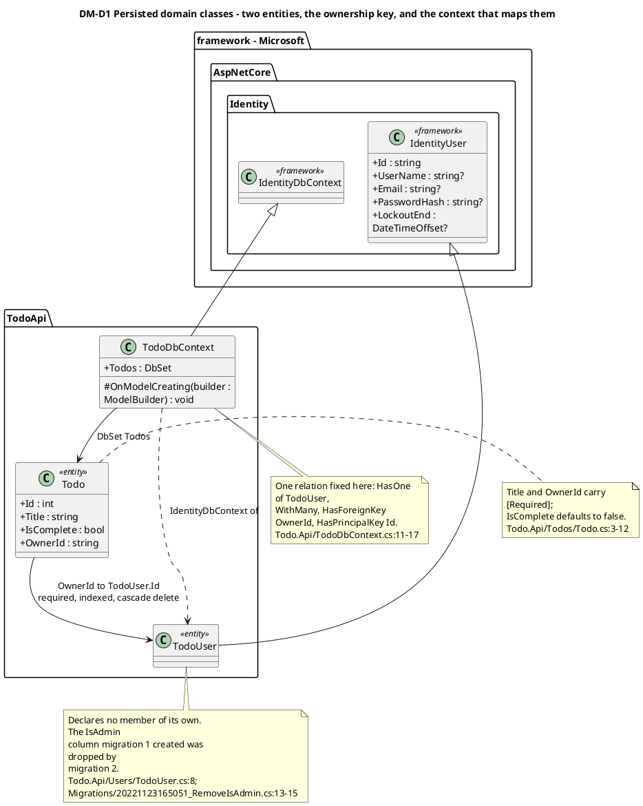
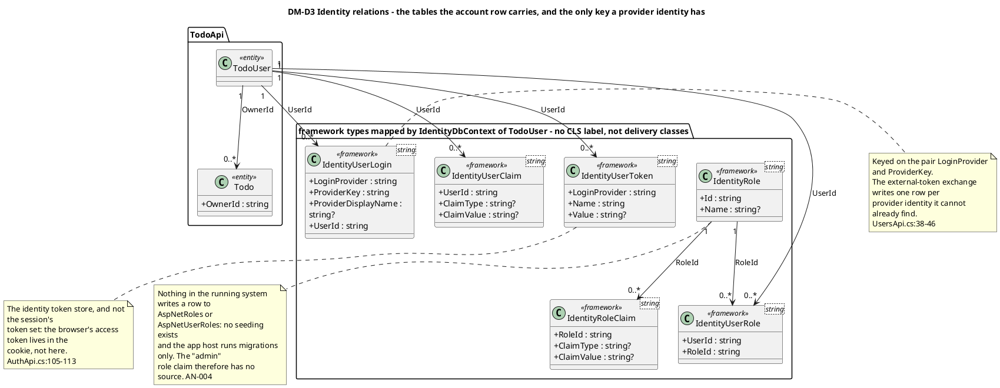
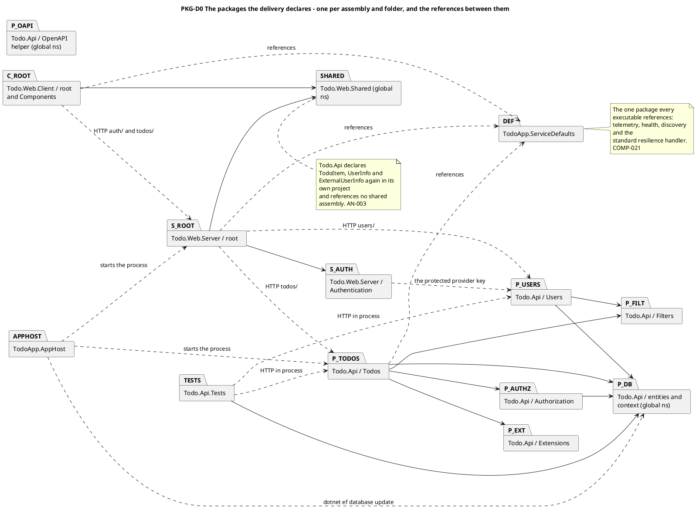
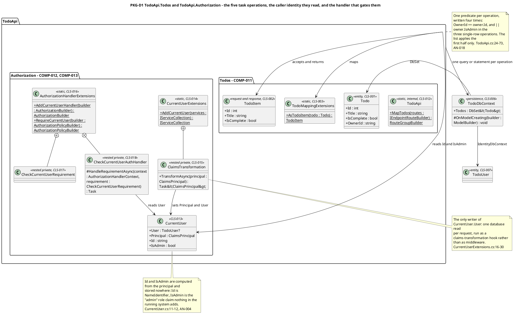
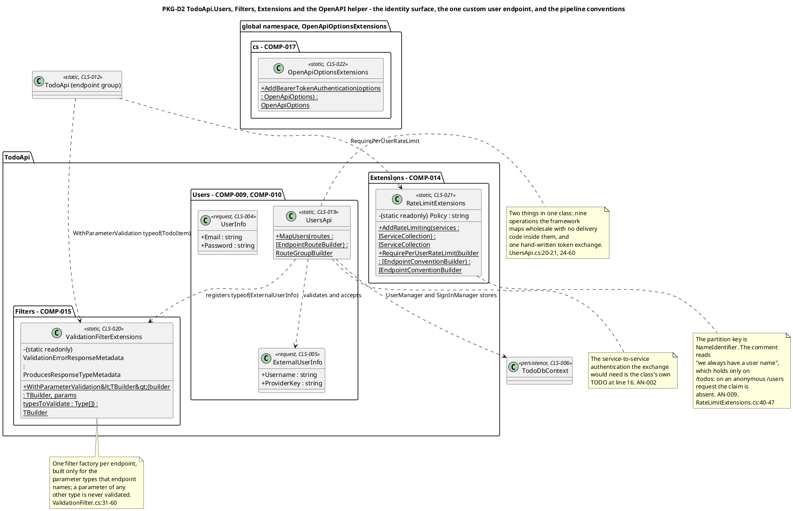
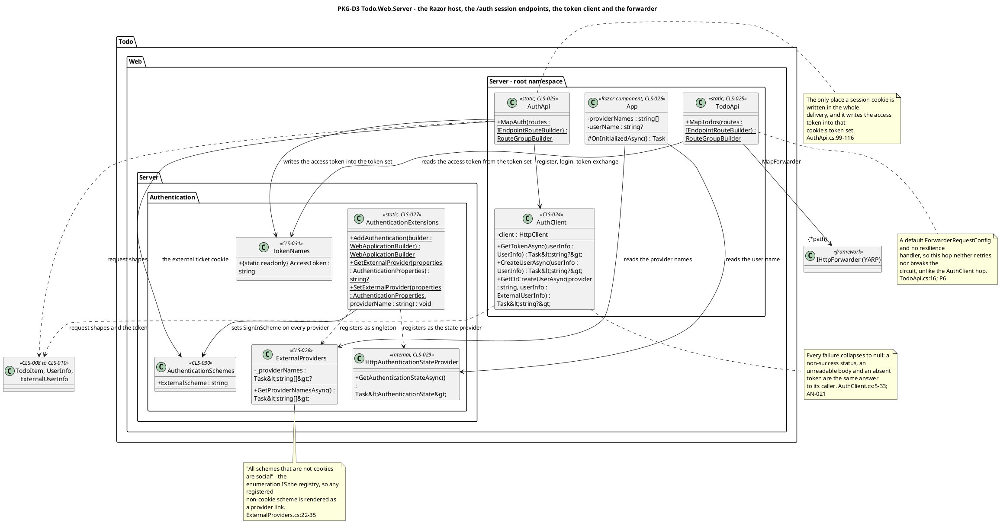
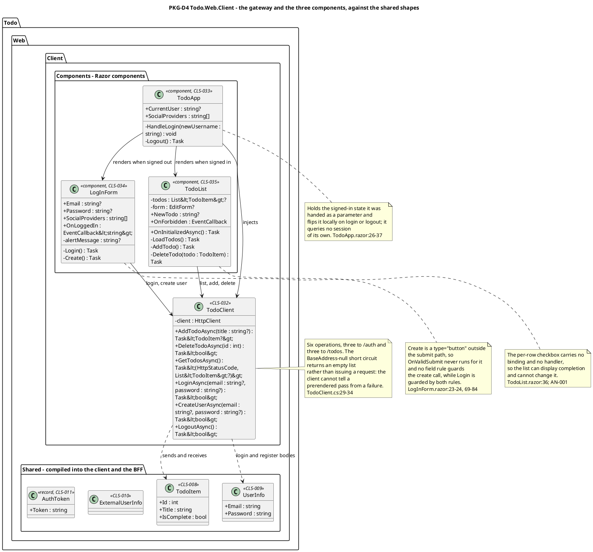
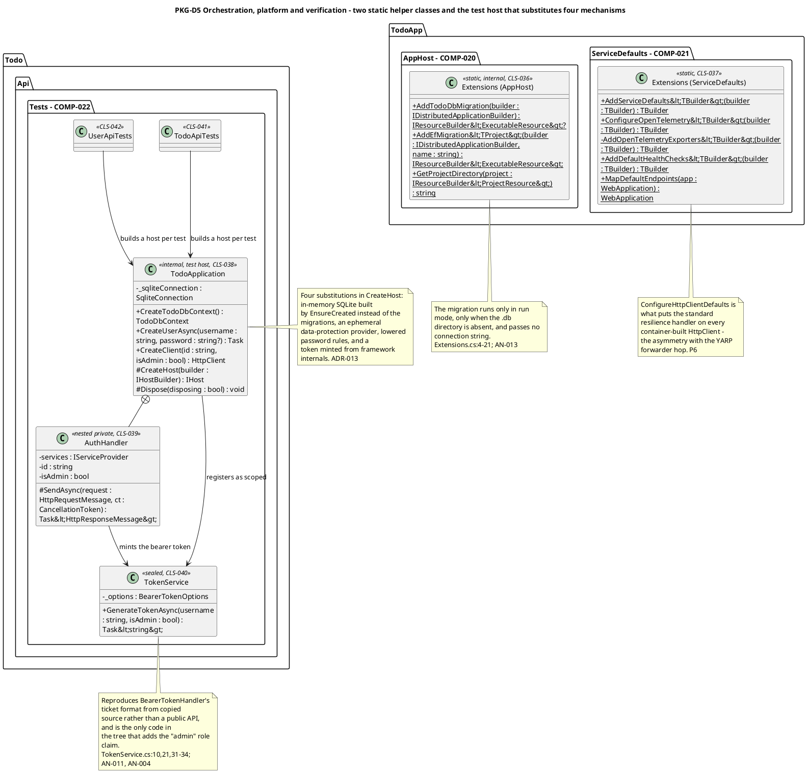

## Document Control

- Phase: Excavation
- Status: Draft — produced for the end-of-Excavation (AR) milestone review
- Milestone Target: end-of-Excavation (AR) — not yet achieved
- Iteration: 1, Cycle 1
- Owner: Designer

## Design Overview

The delivery carries no design document of its own (`.iari/README.md`; the tree holds none), so this model is recovered from code: every class below is recorded as the code declares it, and each carries the file and lines it was read from. Nothing here is attributed to an author who cannot be asked.

The design model is recovered in the System Inventory's priority order, and this section-set covers two stages of that order: **the domain classes** — the business objects the code holds, their attributes, their operations and their relationships — and **the classes of every package**, which is where the behaviour lives.

| Section | State in this iteration |
|---|---|
| Domain Model | Recovered. Two persisted entities, six persisted framework-mapped types, seven request/response shapes, one mapping helper and one persistence context, each anchored |
| Use-Case Realizations | Not yet recovered. The use cases are recovered (Use-Case Model) and the interactions are documented there as flows; their realization as design-object collaborations is later-phase work |
| Design Packages and Classes | Recovered. Thirty-one classes in eleven packages, each anchored; the package diagram, the five per-package class diagrams and one consolidated class diagram are here |
| Interface Contracts | Not yet recovered. No interface is declared anywhere in the delivery: the two process boundaries are crossed by HTTP over concrete request shapes, not by interface types |
| Persistent Data Classes | Owned by the Database Designer; not written here |
| Boundary Classes and Navigation Map | Not yet recovered |
| Capsules, Protocols and Signals | Not applicable to this delivery — no capsule, protocol or state-machine construct exists in it, and nothing is scheduled or event-driven |

`[OMITTED: Data Model — the Development Case's §5.2 trigger has not fired: the store holds eight persisted entity types, below the >10 threshold, the system is not data-centric and no data migration is in scope, so the data lives inline in this model]`

**What the model is anchored to.** The System Inventory records the recovery order and the System Analyst records which entry point performs each use case; the Software Architecture Document records the component each file belongs to. Where those and the code disagree, the code is recorded and the disagreement is named.

### Reading the domain, as the code holds it

Three properties of this domain govern every class below.

**It is an anaemic domain.** `Todo` and `TodoUser` declare no operation at all. Every behaviour is a statement inside an endpoint handler — the ownership predicate, the projection, the update and the delete each live in `Todo.Api/Todos/TodoApi.cs:24-73`, not on the entity. There is no domain service, no repository interface and no aggregate root in the delivery.

**The ownership key is a string copied from the identity key, not a reference.** `Todo.OwnerId` is a required `string`; the relation to the account is declared only in the persistence context (`HasOne<TodoUser>().WithMany().HasForeignKey(...)`), so neither class holds a navigation property and no code path walks from a row to its owner or back. The migration history shows the key was first pointed at `AspNetUsers.UserName` and re-pointed to `AspNetUsers.Id` by the third migration.

**The wire vocabulary exists twice.** Seven shapes are declared here and six of them are declared again in the assembly the client and the BFF share, with no reference between the two assemblies and no compiler between the two declarations (AN-003). Both declarations are recovered below, because a later reader has to know which side a change lands on.

## Domain Model


### CLS-001 Todo — the task row

| Attribute | Type | Constraint the code declares | Anchor |
|---|---|---|---|
| `Id` | `int` | Integer key, autoincrement in the schema | `Todo.Api/Todos/Todo.cs:5` |
| `Title` | `string` | `[Required]`, initialised to `default!` | `Todo.Api/Todos/Todo.cs:6-7` |
| `IsComplete` | `bool` | defaults to `false`; written only by the update statement | `Todo.Api/Todos/Todo.cs:8` |
| `OwnerId` | `string` | `[Required]`, initialised to `default!`; foreign key to `TodoUser.Id` | `Todo.Api/Todos/Todo.cs:10-11` |

| Operation | Kind | What it does | Anchor |
|---|---|---|---|
| — | — | The class declares no operation. It is a property bag read and written by endpoint statements | `Todo.Api/Todos/Todo.cs:3-12` |

| Relationship | Target | Multiplicity | How it is declared | Anchor |
|---|---|---|---|---|
| Ownership | CLS-007 `TodoUser` | one owner to zero or more tasks; the task side is required | `HasOne<TodoUser>().WithMany().HasForeignKey(t => t.OwnerId).HasPrincipalKey(u => u.Id)` — declared in the context, not on either class, and no navigation property exists on either side | `Todo.Api/TodoDbContext.cs:12-16` |

The relation's principal key was `AspNetUsers.UserName` and was re-pointed to `AspNetUsers.Id` by the third migration; the index `IX_Todos_OwnerId` and cascade delete were created with the table and survive the re-point (`Todo.Api/Migrations/20221123071234_Initial.cs:220-247`; `Todo.Api/Migrations/20230714032431_ForeignKeyChange.cs:12-47`).

### CLS-007 TodoUser — the account row

| Attribute | Type | Where it comes from | Anchor |
|---|---|---|---|
| every property the account has | — | `IdentityUser`. `TodoUser` adds nothing: its whole declaration is an empty body, and the comment above it says custom properties could be added there | `Todo.Api/Users/TodoUser.cs:6-8` |

`Id`, `UserName`, `Email`, `PasswordHash`, `LockoutEnd` and the rest are `IdentityUser`'s and are mapped by `IdentityDbContext<TodoUser>` (`Todo.Api/Program.cs:17-20`; `Todo.Api/Migrations/20221123071234_Initial.cs:36-66`). The `IsAdmin` column the first migration created on `AspNetUsers` was dropped by the second, so the class holds no administrative flag and the schema holds none (`Todo.Api/Migrations/20221123165051_RemoveIsAdmin.cs:13-15`).

### CLS-006 TodoDbContext — the persistence context

| Operation | Signature | What it does | Anchor |
|---|---|---|---|
| `Todos` | `DbSet<Todo>` get-only property | The one domain set the context exposes; every task statement starts here | `Todo.Api/TodoDbContext.cs:8` |
| `OnModelCreating` | `protected void OnModelCreating(builder : ModelBuilder)` | Fixes the ownership relation and delegates to the identity model | `Todo.Api/TodoDbContext.cs:10-19` |

The context derives from `IdentityDbContext<TodoUser>`, so the seven identity sets are its own without being declared. No `DbSet<TodoUser>` is declared and no user query in the delivery goes through the context: callers resolve an account through `UserManager<TodoUser>` instead (`Todo.Api/Authorization/CurrentUserExtensions.cs:11-30`). `Todos` is reached three ways — `Where(...).Select(...)`, `FindAsync(id)`, and `ExecuteUpdateAsync` / `ExecuteDeleteAsync` that bypass the change tracker entirely (`Todo.Api/Todos/TodoApi.cs:24-73`).



### The shape the caller sees — declared twice

```plantuml
@startuml
title DM-D2 The wire shapes, declared twice in two assemblies that do not reference each other

skinparam shadowing false
skinparam classAttributeIconSize 0
skinparam wrapWidth 205

package "Todo.Web.Shared - compiled into the client and the BFF" {
  class "TodoItem (shared)" as S1 {
    +Id : int
    +Title : string
    +IsComplete : bool
  }
  class "UserInfo (shared)" as S2 {
    +Email : string
    +Password : string
  }
  class "ExternalUserInfo (shared)" as S3 {
    +Username : string
    +ProviderKey : string
  }
  class "AuthToken (shared)" as S4 <<record>> {
    +Token : string
  }
}

package "Todo.Api - its own declaration, no reference to Shared" {
  class "TodoItem (API)" as A1 {
    +Id : int
    +Title : string
    +IsComplete : bool
  }
  class "UserInfo (API)" as A2 {
    +Email : string
    +Password : string
  }
  class "ExternalUserInfo (API)" as A3 {
    +Username : string
    +ProviderKey : string
  }
  class TodoMappingExtensions <<static>> {
    +AsTodoItem(todo : Todo) : TodoItem
  }
}

class Todo <<entity>> {
  +Id : int
  +Title : string
  +IsComplete : bool
  +OwnerId : string
}

S1 .. A1 : same shape, no link,\nno compiler check
S2 .. A2 : same shape
S3 .. A3 : same shape
TodoMappingExtensions ..> A1 : returns the API's TodoItem
Todo --> TodoMappingExtensions : projected by

note bottom of A1
  Todo.Api/Todos/Todo.cs:15-21 against
  Todo.Web/Shared/SharedClass.cs:5-11 - the same
  three properties on both sides, and nothing
  compares them. AN-003
end note

note bottom of A3
  The one /users request shape the validation
  filter covers, because MapUsers registers it.
  UsersApi.cs:18
end note

note bottom of S4
  AuthToken wraps the "accessToken" property name
  the Identity endpoints answer with, and is the
  only shape in Shared that has no twin in the API.
  SharedClass.cs:31
end note

@enduml
```

### Class inventory — every recovered domain class and its anchor

| ID | Class | Kind | Responsibility, as the code gives it | Anchor |
|---|---|---|---|---|
| CLS-001 | `Todo` | Entity, persisted | The task row: integer key, required title, completion flag, required owner key. Declares no operation | `Todo.Api/Todos/Todo.cs:3-12` |
| CLS-002 | `TodoItem` (API) | Request and response shape | What every task operation accepts and returns. Carries no `OwnerId`, so the ownership key cannot round-trip to a caller | `Todo.Api/Todos/Todo.cs:15-21` |
| CLS-003 | `TodoMappingExtensions` | Static mapping helper | Projects `Todo` onto `TodoItem`, copying `Id`, `Title`, `IsComplete` and dropping `OwnerId` | `Todo.Api/Todos/Todo.cs:23-34` |
| CLS-004 | `UserInfo` (API) | Request shape | Email and password, both required — the body of the Identity register and login calls | `Todo.Api/Users/TodoUser.cs:12-19` |
| CLS-005 | `ExternalUserInfo` (API) | Request shape | User name and a data-protection-protected provider key, both required — the body of the external-token exchange | `Todo.Api/Users/TodoUser.cs:21-28` |
| CLS-006 | `TodoDbContext` | Persistence context | `IdentityDbContext<TodoUser>` plus the `Todos` set and the one relation it fixes | `Todo.Api/TodoDbContext.cs:6-20` |
| CLS-007 | `TodoUser` | Entity, persisted | The account row. Declares no member of its own; every property is `IdentityUser`'s | `Todo.Api/Users/TodoUser.cs:8` |
| CLS-008 | `TodoItem` (shared) | Request and response shape | The same three properties as CLS-002, declared in the assembly the client and the BFF compile against | `Todo.Web/Shared/SharedClass.cs:5-11` |
| CLS-009 | `UserInfo` (shared) | Request shape | The same two properties as CLS-004, in the shared assembly | `Todo.Web/Shared/SharedClass.cs:13-20` |
| CLS-010 | `ExternalUserInfo` (shared) | Request shape | The same two properties as CLS-005, in the shared assembly | `Todo.Web/Shared/SharedClass.cs:22-29` |
| CLS-011 | `AuthToken` | Response shape, positional record | The single `accessToken` property the Identity endpoints answer with, read by the BFF's token client | `Todo.Web/Shared/SharedClass.cs:31` |

**Persisted types recorded without a design-class label.** Six entity types are mapped by `IdentityDbContext<TodoUser>` and by the migrations, and the delivery writes no class of its own for any of them: `IdentityUserLogin<string>`, `IdentityRole<string>`, `IdentityUserRole<string>`, `IdentityUserClaim<string>`, `IdentityRoleClaim<string>`, `IdentityUserToken<string>`. They are framework classes, not classes the Implementer writes, so they are named in DM-D3 and in the relationship table below rather than given `CLS` labels. The table that backs each is created by the first migration: `AspNetUserLogins` and `AspNetUserRoles` and `AspNetUserTokens` and `AspNetUserClaims` and `AspNetRoles` and `AspNetRoleClaims` (`Todo.Api/Migrations/20221123071234_Initial.cs:16-268`).

### Relationship inventory

| Relationship | From | To | Multiplicity | Declared how, and where | Anchor |
|---|---|---|---|---|---|
| Ownership | `Todo` (`OwnerId`) | `TodoUser` (`Id`) | 0..* tasks to 1 account; required on the task side | Fluent model in the context; no navigation property on either class | `Todo.Api/TodoDbContext.cs:12-16` |
| Provider identity | `IdentityUserLogin` | `TodoUser` | 0..* logins to 1 account, cascade delete | Framework model; the delivery writes one row | `Todo.Api/Users/UsersApi.cs:38-46` |
| Role membership | `IdentityUserRole` | `TodoUser`, `IdentityRole` | 0..* to each; composite key | Framework model; nothing writes a row | `Todo.Api/Migrations/20221123071234_Initial.cs:16-268` |
| Claims | `IdentityUserClaim`, `IdentityRoleClaim` | `TodoUser`, `IdentityRole` | 0..* to each | Framework model; nothing writes a row | `Todo.Api/Migrations/20221123071234_Initial.cs:16-268` |
| Identity tokens | `IdentityUserToken` | `TodoUser` | 0..* to 1 | Framework model; no delivery code writes it — the session's token set is a cookie, not a row | `Todo.Web/Server/AuthApi.cs:105-113` |

**No association exists between the two wire declarations or between them and the entities.** `TodoItem` neither references nor inherits `Todo`; the only link is `AsTodoItem`, one direction, in one assembly. `UserInfo` and `ExternalUserInfo` have no relation to `TodoUser` beyond being the shapes `UserManager` calls are handed.

### What the code does not hold

Recorded so that nothing is carried forward from what a task list is expected to have. Each of these was looked for in the domain and in the schema and is absent:

| Expected | What the code holds instead | Anchor |
|---|---|---|
| An account entity with an administrative flag | No flag. The column existed and was dropped; `IsAdmin` is read from a role claim, and no role row is ever written | `Todo.Api/Migrations/20221123165051_RemoveIsAdmin.cs:13-15`; `Todo.Api/Authorization/CurrentUser.cs:12` |
| A list, project, category or tag a task belongs to | Nothing. A task belongs to an account and to nothing else; there is one flat table | `Todo.Api/TodoDbContext.cs:8` |
| A due date, priority, ordering or audit column | Nothing. `Todo` holds four properties, and the list query declares no order | `Todo.Api/Todos/Todo.cs:3-12`; `Todo.Api/Todos/TodoApi.cs:24-27` |
| A domain operation, aggregate or invariant on either entity | Nothing. Both entities are property bags; every rule is a statement in an endpoint handler | `Todo.Api/Todos/TodoApi.cs:24-73` |
| A repository, unit-of-work or service abstraction over the store | Nothing. Handlers take `TodoDbContext` directly, and two of the five statements bypass the change tracker | `Todo.Api/Todos/TodoApi.cs:17-22,52-73` |
| A concurrency token or row version | Nothing. The update names two fields and carries no version check | `Todo.Api/Todos/TodoApi.cs:59-63` |

### What the classes do in the use cases

The classes above are the vocabulary; the behaviour is in the endpoint handlers and is realized in later phases. Two facts bind them and belong here.

`Todo` and `CLS-002`/`CLS-008` decide one rule between them: the request shape carries no `OwnerId`, so the owner is never read from a body and `OwnerId` never leaves the process. A create body that asks for a completed row still produces `IsComplete` false, because the insert copies only the title (`Todo.Api/Todos/TodoApi.cs:38-50`).

`CLS-007` is the class the ownership predicate is decided against, and the row that must exist before any task operation succeeds: the authorization handler fails the request when no account row matches the token's `NameIdentifier` (`Todo.Api/Authorization/CheckCurrentUserAuthHandler.cs:28-36`; `Todo.Api/Authorization/CurrentUserExtensions.cs:11-30`).

### Use cases no domain class realizes

| Use case | Why no domain class appears in its row | What it touches instead | Anchor |
|---|---|---|---|
| UC-004 Sign out | It persists nothing and reads no entity: one call signs the cookie scheme out, and the row the account lives in is untouched | The BFF's cookie scheme; the session cookie's token set, which `AuthApi.SignIn` wrote and this operation discards | `Todo.Web/Server/AuthApi.cs:40-52` |
| UC-011 Consult the API reference | It reads metadata the framework generated, not data the model holds | The OpenAPI document and the Scalar UI mapping; the bearer scheme it declares | `Todo.Api/Program.cs:46-58`; `Todo.Api/Extensions/OpenApiOptionsExtensions.cs` |

Both are recovered use cases with a real entry point; neither has a domain class in its path, so neither appears as a `Traces From` value above. That is the model's shape, not a gap in the realization.

## Use-Case Realizations

Not yet recovered. The eleven use cases are recovered and their flows are documented in the Use-Case Model, each anchored to its entry point; what is missing here is the translation of those flows into collaborations of design objects.

The reason it is deferred is the phase, not a gap in the code: Excavation records the system as it is, and the architecturally significant paths are already stated as component collaborations in the Software Architecture Document — SEQ-1 for UC-006, SEQ-2 for UC-001, SEQ-3 for UC-003. Realizing each use case as messages between the classes recovered in "Design Packages and Classes" is later-phase work.

Two facts bound that future realization and are recorded here so it does not begin from a wrong premise.

| Fact | What it means for the realization | Anchor |
|---|---|---|
| No object owns a task operation | Each of the five task operations is an anonymous lambda registered by CLS-012; a realization cannot send a message to a "TodoService" because no such object exists | `Todo.Api/Todos/TodoApi.cs:24-73` |
| The session state is not an object either | CLS-023 writes the token into the cookie's token set and CLS-025 reads it back; neither holds it, so a realization of UC-006 has to model the cookie, not a session object | `Todo.Web/Server/AuthApi.cs:99-116`; `Todo.Web/Server/TodoApi.cs:18-22` |

## Design Packages and Classes

Thirty-one classes beyond the eleven already recovered as domain classes, in eleven packages, each anchored to the file that declares it.

**The packages are the assemblies and the folders, not namespaces.** Seven assemblies exist and are the real package boundaries. Inside them the API's five behavioural files all declare the single namespace `TodoApi`, so its folder structure carries no namespace of its own — `Todos/`, `Authorization/`, `Users/`, `Filters/` and `Extensions/` separate the files and nothing more. The entity files and the shared shapes declare no namespace at all and sit in the global namespace, which is why the client and the API can each declare a type named `TodoItem` without a clash.



| Package | Assembly and namespace | Classes recovered | Component (SAD) | Cross-package dependencies |
|---|---|---|---|---|
| Todo.Api / Todos | `Todo.Api`, `TodoApi` | CLS-001, CLS-002, CLS-003, CLS-012 | COMP-011 | Authorization, Filters, Extensions, persistence |
| Todo.Api / Authorization | `Todo.Api`, `TodoApi` | CLS-013, CLS-014, CLS-015, CLS-016, CLS-017, CLS-018 | COMP-012, COMP-013 | persistence, through `UserManager<TodoUser>` |
| Todo.Api / Users | `Todo.Api`, `TodoApi` | CLS-004, CLS-005, CLS-019 | COMP-009, COMP-010 | Filters, persistence |
| Todo.Api / Filters | `Todo.Api`, `TodoApi` | CLS-020 | COMP-015 | none — framework types only |
| Todo.Api / Extensions | `Todo.Api`, `TodoApi`, global namespace | CLS-021, CLS-022 | COMP-014, COMP-017 | none — framework types only |
| Todo.Api / entities and context | `Todo.Api`, global namespace | CLS-001, CLS-006, CLS-007 | COMP-016 | none |
| Todo.Web.Server / root | `Todo.Web.Server` | CLS-023, CLS-024, CLS-025, CLS-026 | COMP-004, COMP-006, COMP-007, COMP-008 | Shared, Authentication, ServiceDefaults |
| Todo.Web.Server / Authentication | `Todo.Web.Server` | CLS-027, CLS-028, CLS-029, CLS-030, CLS-031 | COMP-005 | framework authentication types only |
| Todo.Web.Client | `Todo.Web.Client` | CLS-032, CLS-033, CLS-034, CLS-035 | COMP-001, COMP-002 | Shared, ServiceDefaults |
| Todo.Web.Shared | `Todo.Web.Shared`, global namespace | CLS-008, CLS-009, CLS-010, CLS-011 | COMP-019 | none |
| TodoApp.AppHost | `TodoApp.AppHost`, global namespace | CLS-036 | COMP-020 | none — it starts processes |
| TodoApp.ServiceDefaults | `TodoApp.ServiceDefaults`, `Microsoft.Extensions.Hosting` | CLS-037 | COMP-021 | none |
| Todo.Api.Tests | `Todo.Api.Tests`, `TodoApi.Tests` and `TodoApi` | CLS-038, CLS-039, CLS-040, CLS-041, CLS-042 | COMP-022 | Todo.Api by project reference |

Three recovered components add no class of their own: COMP-003 (client bootstrap, a top-level statement block in `Todo.Web/Client/Program.cs`), COMP-018 (HTTP logging, four configuration lines in `Todo.Api/Program.cs:35-46`) and the Razor pipeline registration in COMP-004. They are configuration, not design elements, and no `CLS` label is minted for them.

**Todo.Api / Todos — the five task operations.**



CLS-012 `TodoApi` — the endpoint group.

| Operation | Signature | What it does | Anchor |
|---|---|---|---|
| `MapTodos` | `static RouteGroupBuilder MapTodos(this IEndpointRouteBuilder routes)` | Maps `/todos`, tags it `Todos`, and fixes the three conventions every operation inherits: `RequireAuthorization(pb => pb.RequireCurrentUser())`, `RequirePerUserRateLimit()`, `WithParameterValidation(typeof(TodoItem))` | `Todo.Api/Todos/TodoApi.cs:8-22` |

| Registered operation | Route and verb | Handler signature the code gives it | Anchor |
|---|---|---|---|
| List | `GET /todos/` | `async (TodoDbContext db, CurrentUser owner) => Task<List<TodoItem>>` | `Todo.Api/Todos/TodoApi.cs:24-27` |
| Read one | `GET /todos/{id}` | `async Task<Results<Ok<TodoItem>, NotFound>> (TodoDbContext db, int id, CurrentUser owner)` | `Todo.Api/Todos/TodoApi.cs:29-37` |
| Create | `POST /todos/` | `async Task<Created<TodoItem>> (TodoDbContext db, TodoItem newTodo, CurrentUser owner)` | `Todo.Api/Todos/TodoApi.cs:39-50` |
| Change | `PUT /todos/{id}` | `async Task<Results<Ok, NotFound, BadRequest>> (TodoDbContext db, int id, TodoItem todo, CurrentUser owner)` | `Todo.Api/Todos/TodoApi.cs:52-66` |
| Remove | `DELETE /todos/{id}` | `async Task<Results<NotFound, Ok>> (TodoDbContext db, int id, CurrentUser owner)` | `Todo.Api/Todos/TodoApi.cs:68-74` |

The five handlers are anonymous lambda delegates declared inline in `MapTodos`, so the class declares exactly one named operation. There is no controller, no handler type and no service: the statements sit inside the registration call, which is why the ownership predicate, the projection and the update are readable only as five separate expressions in one method (`Todo.Api/Todos/TodoApi.cs:24-73`). The class is `internal static` and declares no field; its state is the group it returns.

CLS-013 `CurrentUser` — the caller, as a scoped service.

| Attribute | Declared as | What the code gives it | Anchor |
|---|---|---|---|
| `User` | `public TodoUser? User { get; set; }` | The account row resolved for this request, or `null` when the token names none | `Todo.Api/Authorization/CurrentUser.cs:7` |
| `Principal` | `public ClaimsPrincipal Principal { get; set; } = default!` | The request's principal, assigned by the claims transformation; `default!` means it is unset until then | `Todo.Api/Authorization/CurrentUser.cs:8` |
| `Id` | `public string Id => Principal.FindFirstValue(ClaimTypes.NameIdentifier)!` | Get-only, re-computed on every read; the `!` is unchecked, so an absent claim surfaces as a null string at the call site | `Todo.Api/Authorization/CurrentUser.cs:10` |
| `IsAdmin` | `public bool IsAdmin => Principal.IsInRole("admin")` | Get-only, computed from a role claim | `Todo.Api/Authorization/CurrentUser.cs:11` |

The class declares no operation. It is a request-scoped carrier whose two computed properties re-derive their value on every access: `Id` is read once per operation in CLS-012, `IsAdmin` once per single-row operation (`Todo.Api/Todos/TodoApi.cs:26,33,60,70`).

CLS-014 `CurrentUserExtensions` and CLS-015 `ClaimsTransformation`.

| Class | Operation | Signature | What it does | Anchor |
|---|---|---|---|---|
| CLS-014 | `AddCurrentUser` | `static IServiceCollection AddCurrentUser(this IServiceCollection services)` | Registers CLS-013 as scoped and CLS-015 as the `IClaimsTransformation` | `Todo.Api/Authorization/CurrentUserExtensions.cs:8-13` |
| CLS-015 | `TransformAsync` | `Task<ClaimsPrincipal> TransformAsync(ClaimsPrincipal principal)` | Sets `currentUser.Principal`, resolves the account by `NameIdentifier`, stores it on `currentUser.User`, returns the principal unchanged | `Todo.Api/Authorization/CurrentUserExtensions.cs:16-30` |

CLS-015 is `private sealed` and nested inside CLS-014, so it is registered and not referenceable outside the file. It is the mechanism by which every authorized request pays a database read: `FindByIdAsync` runs inside the authorization pipeline, before any endpoint handler (`Todo.Api/Authorization/CurrentUserExtensions.cs:22-26`).

CLS-016, CLS-017 and CLS-018 — one requirement, its handler and the two registration methods.

| Class | Kind | Operations and members | Anchor |
|---|---|---|---|
| CLS-016 `AuthorizationHandlerExtensions` | `public static`, declared in the file named for the handler | `AddCurrentUserHandler(AuthorizationBuilder)` registers the handler; `RequireCurrentUser(AuthorizationPolicyBuilder)` requires an authenticated user and adds the requirement | `Todo.Api/Authorization/CheckCurrentUserAuthHandler.cs:5-20` |
| CLS-017 `CheckCurrentUserRequirement` | `private class`, nested, `IAuthorizationRequirement` | No member — a marker requirement | `Todo.Api/Authorization/CheckCurrentUserAuthHandler.cs:22` |
| CLS-018 `CheckCurrentUserAuthHandler` | `private class`, nested, extends `AuthorizationHandler<CheckCurrentUserRequirement>` | `protected override Task HandleRequirementAsync(AuthorizationHandlerContext, CheckCurrentUserRequirement)` — succeeds only when `currentUser.User is not null`; the lockout check is written as a `TODO` and not performed | `Todo.Api/Authorization/CheckCurrentUserAuthHandler.cs:26-35` |

The file is named `CheckCurrentUserAuthHandler.cs` while the only public type in it is the extensions class: a reader searching for `CheckCurrentUserAuthHandler` finds a `private` nested type. The three types are one unit of design and are unreachable from outside the file except through CLS-016.

**Todo.Api / Users, Filters, Extensions and the OpenAPI helper.**



CLS-019 `UsersApi` — nine mapped operations and one written one.

| Operation | Signature | What it does | Anchor |
|---|---|---|---|
| `MapUsers` | `static RouteGroupBuilder MapUsers(this IEndpointRouteBuilder routes)` | Maps `/users`, tags it `Users`, registers `WithParameterValidation(typeof(ExternalUserInfo))`, calls `MapIdentityApi<TodoUser>()` and maps `POST /users/token/{provider}` | `Todo.Api/Users/UsersApi.cs:9-62` |

| Registered operation | Verb and route | Origin | Anchor |
|---|---|---|---|
| Nine Identity operations | `POST register`, `POST login`, `POST refresh`, `GET confirmEmail`, `POST resendConfirmationEmail`, `POST forgotPassword`, `POST resetPassword`, `POST manage/2fa`, `GET or POST manage/info`, all under `/users` | The framework, mapped wholesale by `MapIdentityApi<TodoUser>()` — no delivery code inside any of them | `Todo.Api/Users/UsersApi.cs:20` |
| Token exchange | `POST /users/token/{provider}` | The delivery's own handler, written because `MapIdentityApi` exposes no external-login endpoint | `Todo.Api/Users/UsersApi.cs:24-60` |

The exchange handler's six parameters are the whole of its design: `string provider`, `ExternalUserInfo userInfo`, `UserManager<TodoUser>`, `SignInManager<TodoUser>` and `IDataProtectionProvider`, returning `Task<Results<Ok<AccessTokenResponse>, SignInHttpResult, ValidationProblem>>`. It unprotects the provider key with a protector named after the provider, resolves the account by the `(provider, key)` pair, creates the account and the login row when neither exists, and answers `TypedResults.SignIn(principal)` on success or a validation problem built from `IdentityResult.Errors` (`Todo.Api/Users/UsersApi.cs:26-58`). The class declares no field and holds no state; the handler is an inline lambda.

CLS-004 and CLS-005 are recorded again in this package because CLS-019 names them — `typeof(ExternalUserInfo)` at line 18 and the `ExternalUserInfo` parameter at line 24. Their attributes are in the Domain Model and are not restated here.

CLS-020 `ValidationFilterExtensions` — the endpoint filter factory.

| Member | Declared as | What it does | Anchor |
|---|---|---|---|
| `ValidationErrorResponseMetadata` | `private static readonly ProducesResponseTypeMetadata` | The 400 `application/problem+json` metadata added to an endpoint that has at least one validatable parameter | `Todo.Api/Filters/ValidationFilter.cs:9-10` |
| `WithParameterValidation<TBuilder>` | `static TBuilder WithParameterValidation<TBuilder>(this TBuilder, params Type[] typesToValidate)` | Reads the endpoint's `MethodInfo`, collects the positions of parameters whose type is named in `typesToValidate`, and adds one filter factory that runs `MiniValidator.TryValidate` over each | `Todo.Api/Filters/ValidationFilter.cs:12-62` |

The filter is attached per endpoint and per named type: `/todos` names CLS-002 and `/users` names CLS-005 alone, so CLS-004 — the body of the register and login calls the framework maps — is never validated by this filter (`Todo.Api/Todos/TodoApi.cs:22`; `Todo.Api/Users/UsersApi.cs:18`).

CLS-021 `RateLimitExtensions` — the per-caller bucket.

| Member | Declared as | What it fixes | Anchor |
|---|---|---|---|
| `Policy` | `private static readonly string Policy = "PerUserRatelimit"` | One policy name, private to the file, shared by the registration and the convention | `Todo.Api/Extensions/RateLimitExtensions.cs:9` |
| `AddRateLimiting` | `static IServiceCollection AddRateLimiting(this IServiceCollection services)` | Sets `ReplenishmentPeriod` 10 s, `AutoReplenishment` true, `TokenLimit` 100, `TokensPerPeriod` 100, `QueueLimit` 100; binds them to a `RateLimiting` section; sets `RejectionStatusCode` 429; adds the policy partitioned on `NameIdentifier` | `Todo.Api/Extensions/RateLimitExtensions.cs:11-51` |
| `RequirePerUserRateLimit` | `static IEndpointConventionBuilder RequirePerUserRateLimit(this IEndpointConventionBuilder builder)` | Applies the policy to one endpoint group | `Todo.Api/Extensions/RateLimitExtensions.cs:53-56` |

CLS-022 `OpenApiOptionsExtensions` — the document's security scheme.

| Operation | Signature | What it does | Anchor |
|---|---|---|---|
| `AddBearerTokenAuthentication` | `static OpenApiOptions AddBearerTokenAuthentication(this OpenApiOptions options)` | Adds a document transformer that registers the bearer scheme, and an operation transformer that applies the security requirement to every operation carrying `IAuthorizeData` | `Todo.Api/Extensions/OpenApiOptionsExtensions.cs:7-48` |

It names `IdentityConstants.BearerScheme` rather than a local constant, so it is coupled to the framework's scheme name (`Todo.Api/Extensions/OpenApiOptionsExtensions.cs:10,25,31`).

**Todo.Web.Server — the Razor host and the session endpoints.**



CLS-023 `AuthApi` — the five session endpoints.

| Registered operation | Verb and route | Authorization | What it does | Anchor |
|---|---|---|---|---|
| Register | `POST /auth/register` | none declared on the endpoint | Calls `AuthClient.CreateUserAsync`; answers `Results.Unauthorized()` on `null`, else writes the cookie | `Todo.Web/Server/AuthApi.cs:13-23` |
| Login | `POST /auth/login` | none declared on the endpoint | Calls `AuthClient.GetTokenAsync`; answers 401 on `null`, else writes the cookie | `Todo.Web/Server/AuthApi.cs:25-35` |
| Logout | `POST /auth/logout` | `RequireAuthorization()` | Signs the cookie scheme out; remote-provider sign-out is commented out with a `TODO` | `Todo.Web/Server/AuthApi.cs:37-50` |
| Challenge | `GET /auth/login/{provider}` | none | `Results.Challenge` with the route segment as the scheme list and `/auth/signin/{provider}` as the redirect | `Todo.Web/Server/AuthApi.cs:52-62` |
| Callback | `GET /auth/signin/{provider}` | none | Authenticates the external cookie, protects the provider id, calls `AuthClient.GetOrCreateUserAsync`, writes the cookie when a token comes back, signs the external cookie out on every path and redirects to `/` | `Todo.Web/Server/AuthApi.cs:64-97` |

| Private operation | Signature | What it does | Anchor |
|---|---|---|---|
| `SignIn` | `static IResult SignIn(UserInfo userInfo, string token)` | Delegates with the email as both identifier and name | `Todo.Web/Server/AuthApi.cs:99-102` |
| `SignIn` | `static IResult SignIn(string userId, string userName, string token, string? providerName)` | Builds the `NameIdentifier` and `Name` claims, stores the provider name in the properties, stores the token under `TokenNames.AccessToken`, returns `Results.SignIn` on the cookie scheme | `Todo.Web/Server/AuthApi.cs:104-121` |

The class declares no field: its dependencies arrive as handler parameters.

CLS-024 `AuthClient` — the token client.

| Operation | Signature | What it posts, what it answers | Anchor |
|---|---|---|---|
| `GetTokenAsync` | `Task<string?> GetTokenAsync(UserInfo userInfo)` | `POST users/login`; returns `AuthToken.Token`, or `null` on any non-success | `Todo.Web/Server/AuthClient.cs:5-16` |
| `CreateUserAsync` | `Task<string?> CreateUserAsync(UserInfo userInfo)` | `POST users/register`, then `GetTokenAsync` on success; one `null` covers a refused registration and an unreachable API | `Todo.Web/Server/AuthClient.cs:18-28` |
| `GetOrCreateUserAsync` | `Task<string?> GetOrCreateUserAsync(string provider, ExternalUserInfo userInfo)` | `POST users/token/{provider}`; returns the token or `null` | `Todo.Web/Server/AuthClient.cs:30-39` |

The class takes its `HttpClient` by primary constructor; the base address `http://todoapi` and the resilience handler it inherits are fixed at registration in `Program.cs`, not by the class (`Todo.Web/Server/Program.cs:23-26`).

CLS-025 `TodoApi` (BFF forwarder).

| Operation | Signature | What it does | Anchor |
|---|---|---|---|
| `MapTodos` | `static RouteGroupBuilder MapTodos(this IEndpointRouteBuilder routes)` | Maps `/todos` with `RequireAuthorization()`, then `MapForwarder("{*path}", "http://todoapi", new ForwarderRequestConfig(), …)` with one request transform that reads the access token from the session's token set and writes `Authorization: Bearer <token>` | `Todo.Web/Server/TodoApi.cs:9-26` |

It accepts any method and any sub-path; no route, verb or shape is declared here. Its behaviour is a configuration object plus one transform.

CLS-026 `App` — the Razor host component.

| Member | Declared as | What the code gives it | Anchor |
|---|---|---|---|
| page route | `@page "/"` | The host's single page route | `Todo.Web/Server/App.razor:5` |
| `providerNames` | `string[] providerNames = Array.Empty<string>()` | The scheme names CLS-028 returned, passed into the interactive component | `Todo.Web/Server/App.razor:38,46` |
| `userName` | `string? userName` | `authState.User.Identity.Name` or null, passed into the interactive component | `Todo.Web/Server/App.razor:39,45` |
| `OnInitializedAsync` | `protected override async Task OnInitializedAsync()` | Resolves the authentication state through CLS-029 and the provider names through CLS-028 | `Todo.Web/Server/App.razor:41-47` |

It renders CLS-033 under `RenderMode.InteractiveWebAssembly` and passes both values as parameters (`Todo.Web/Server/App.razor:24`). It is the only place the server-side session state crosses into the browser-hosted component.

CLS-027 to CLS-031 — the authentication package.

| Class | Members | What fixes the design | Anchor |
|---|---|---|---|
| CLS-027 `AuthenticationExtensions` | `AddAuthentication(WebApplicationBuilder)`; private delegate `ExternalAuthProvider`; `GetExternalProvider` and `SetExternalProvider`; private `SetAuth0SignInScheme`; private static readonly `ExternalProviderKey = "ExternalProviderName"` | Registers two cookie schemes and four providers from a dictionary, each only when its `Authentication:Schemes:{name}` section exists; forces `SignInScheme` to the external cookie; registers CLS-028 as a singleton and CLS-029 as the state provider | `Todo.Web/Server/Authentication/AuthenticationExtensions.cs:13-107` |
| CLS-028 `ExternalProviders` | `private Task<string[]>? _providerNames`; `GetProviderNamesAsync()`; private `GetProviderNamesAsyncCore()` | Enumerates every registered scheme, skips the two cookie schemes, returns the rest; caches the result for the process lifetime | `Todo.Web/Server/Authentication/ExternalProviders.cs:6-38` |
| CLS-029 `HttpAuthenticationStateProvider` | `GetAuthenticationStateAsync()` | Returns the HTTP context's principal, or an empty one when there is no context; `internal`, so only the assembly can construct it | `Todo.Web/Server/Authentication/HttpAuthenticationStateProvider.cs:3-11` |
| CLS-030 `AuthenticationSchemes` | `static string ExternalScheme => "External"` | A get-only property rather than a constant; the external scheme's name in one place | `Todo.Web/Server/Authentication/AuthenticationSchemes.cs:6` |
| CLS-031 `TokenNames` | `static readonly string AccessToken = "accessToken"` | The key the token is stored under in the cookie's token set and read back by CLS-025 | `Todo.Web/Server/Authentication/TokenNames.cs:5` |

The provider set is configuration-driven and the code is correct about it: with no `Authentication:Schemes` section in `appsettings.json` the loop registers nothing, CLS-028 returns an empty array, and CLS-034 renders no provider link. The four providers the code names are GitHub, Google, Microsoft and Auth0 (`Todo.Web/Server/Authentication/AuthenticationExtensions.cs:48-53`).

**Todo.Web.Client — the gateway and the three components.**



CLS-032 `TodoClient` — the six operations.

| Operation | Signature | Route it calls | Failure it returns, and what it discards | Anchor |
|---|---|---|---|---|
| `AddTodoAsync` | `Task<TodoItem?> AddTodoAsync(string? title)` | `POST todos` | `null` for an empty title before any request exists, and for any non-success status | `Todo.Web/Client/TodoClient.cs:9-25` |
| `DeleteTodoAsync` | `Task<bool> DeleteTodoAsync(int id)` | `DELETE todos/{id}` | `false` for any non-success | `Todo.Web/Client/TodoClient.cs:27-31` |
| `GetTodosAsync` | `Task<(HttpStatusCode, List<TodoItem>?)> GetTodosAsync()` | `GET todos` | `(200, empty)` with no request when `BaseAddress` is null; otherwise the status, and the rows on success | `Todo.Web/Client/TodoClient.cs:33-50` |
| `LoginAsync` | `Task<bool> LoginAsync(string? email, string? password)` | `POST auth/login` | `false` for an empty field or any non-success | `Todo.Web/Client/TodoClient.cs:52-62` |
| `CreateUserAsync` | `Task<bool> CreateUserAsync(string? email, string? password)` | `POST auth/register` | `false` for an empty field or any non-success | `Todo.Web/Client/TodoClient.cs:64-74` |
| `LogoutAsync` | `Task<bool> LogoutAsync()` | `POST auth/logout` | `false` for any non-success | `Todo.Web/Client/TodoClient.cs:76-80` |

Six operations are public and only `GetTodosAsync` returns a status; it is the only caller that distinguishes 401 and 403 from other failures (`Todo.Web/Client/Components/TodoList.razor:60-63`). The class holds no state beyond its `HttpClient`; the base address and the `X-Requested-With` header are set in the client's `Program.cs` (`Todo.Web/Client/Program.cs:7-13`).

CLS-033, CLS-034 and CLS-035 — the three components.

| Class | Parameters and fields | Operations | What the design gives it | Anchor |
|---|---|---|---|---|
| CLS-033 `TodoApp` | `[Parameter] string? CurrentUser`; `[Parameter] string[] SocialProviders` | `void HandleLogin(string)`, `async Task Logout()` | Renders the logged-in header and CLS-035 when `CurrentUser` is non-empty, else CLS-034; sets `CurrentUser` locally on login and to `null` on a successful logout | `Todo.Web/Client/TodoApp.razor:3-38` |
| CLS-034 `LogInForm` | `[Parameter] EventCallback<string> OnLoggedIn`; `[Parameter] string[] SocialProviders`; `string? alertMessage`; `[Required][StringLength(256)] string? Email`; `[Required][StringLength(32, MinimumLength = 6)][RegularExpression] string? Password` | `async Task Login()`, `async Task Create()` | Two submit paths with unequal guards, one provider-link loop, and one `alertMessage` string for every failure | `Todo.Web/Client/Components/LogInForm.razor:3-98` |
| CLS-035 `TodoList` | `List<TodoItem>? todos`; `EditForm? form`; `[Required] string? NewTodo`; `[Parameter] EventCallback OnForbidden` | `OnInitializedAsync()`, `async Task LoadTodos()`, `async Task AddTodo()`, `async Task DeleteTodo(TodoItem)` | Loads on initialisation, raises `OnForbidden` on 401 or 403, appends the created row locally, removes the deleted row locally | `Todo.Web/Client/Components/TodoList.razor:3-76` |

CLS-034 is the only component holding validation rules of its own, and they are not the API's: the password expression demands a lower-case letter, an upper-case letter, a digit and a special character in 6 to 32 characters, while the API's Identity configuration applies the framework's own default policy (`Todo.Web/Client/Components/LogInForm.razor:70-77`; `Todo.Api/Program.cs:17-20`). `Create` bypasses those rules entirely, which is the local half of the cause AN-021 records.

**AppHost, ServiceDefaults and the test suite.**



| Class | Members | What fixes the design | Anchor |
|---|---|---|---|
| CLS-036 `Extensions` (AppHost) | `AddTodoDbMigration(IDistributedApplicationBuilder) : IResourceBuilder<ExecutableResource>?`; `AddEfMigration<TProject>(…)`; `GetProjectDirectory(IResourceBuilder<ProjectResource>) : string` | Returns `default` — no migration — unless the host is in run mode and `.db` is absent; installs `dotnet-ef` globally, then runs `ef database update --no-build`, and everything waits on both | `TodoApp.AppHost/Extensions.cs:3-34` |
| CLS-037 `Extensions` (ServiceDefaults) | `AddServiceDefaults<TBuilder>`; `ConfigureOpenTelemetry<TBuilder>`; private `AddOpenTelemetryExporters<TBuilder>`; `AddDefaultHealthChecks<TBuilder>`; `MapDefaultEndpoints(WebApplication)` | Registers telemetry, a `self` liveness check, service discovery, and `ConfigureHttpClientDefaults` with `AddStandardResilienceHandler` and `AddServiceDiscovery`; maps `/health` and `/alive` in Development only | `TodoApp.ServiceDefaults/Extensions.cs:17-130` |
| CLS-038 `TodoApplication` | `SqliteConnection _sqliteConnection = new("Filename=:memory:")`; `CreateTodoDbContext()`; `CreateUserAsync(string, string?)`; `CreateClient(string, bool)`; `protected override IHost CreateHost(IHostBuilder)`; `protected override void Dispose(bool)` | Derives from `WebApplicationFactory<Program>`; opens the in-memory connection, substitutes the `DbContextOptions`, the identity password rules and the data-protection provider, registers CLS-040 | `Todo.Api.Tests/TodoApplication.cs:6-87` |
| CLS-039 `AuthHandler` | `IServiceProvider services`; `string id`; `bool isAdmin`; `protected override Task<HttpResponseMessage> SendAsync(…)` | A `DelegatingHandler` that mints a token per request through CLS-040 and writes it as the bearer header | `Todo.Api.Tests/TodoApplication.cs:74-86` |
| CLS-040 `TokenService` | `BearerTokenOptions _options`; `Task<string> GenerateTokenAsync(string username, bool isAdmin = false)` | Builds the principal with `SignInManager.CreateUserPrincipalAsync`, optionally adds the `admin` role claim, and protects a ticket shaped as the framework's handler shapes it | `Todo.Api.Tests/TokenService.cs:8-34` |
| CLS-041 `TodoApiTests` | Ten `[Fact]` methods over `/todos` | The only tests of the ownership predicate, the projection and the validation filter; two of them mint an admin token | `Todo.Api.Tests/TodoApiTests.cs:2-266` |
| CLS-042 `UserApiTests` | Six `[Fact]` methods over `/users` and a nested `AuthToken` class | Tests register, login, validation problems and the provider exchange over HTTP; declares the token shape a third time | `Todo.Api.Tests/UserApiTests.cs:5-185` |

CLS-036 and CLS-037 share the type name `Extensions` and are not the same class: one is `internal static` in the AppHost, the other is `public static` in the `Microsoft.Extensions.Hosting` namespace. A grep for `Extensions` finds both. CLS-042's nested `AuthToken` is the third declaration of the token response shape, after CLS-011 in `Todo.Web.Shared` and the framework's `AccessTokenResponse` the API returns; none of the three is linked to another.

**Every recovered design class in one view.**

```plantuml
@startuml
title CLS-D1 Every recovered design class, its package, and the classes it depends on

skinparam shadowing false
skinparam classAttributeIconSize 0
skinparam wrapWidth 190
skinparam packageStyle rectangle

package "TodoApi.Todos" {
  class "CLS-001 Todo" as C1
  class "CLS-002 TodoItem" as C2
  class "CLS-003 TodoMappingExtensions" as C3
  class "CLS-012 TodoApi" as C12
}
package "TodoApi entities and persistence" {
  class "CLS-006 TodoDbContext" as C6
  class "CLS-007 TodoUser" as C7
}
package "TodoApi.Authorization" {
  class "CLS-013 CurrentUser" as C13
  class "CLS-014 CurrentUserExtensions" as C14
  class "CLS-015 ClaimsTransformation" as C15
  class "CLS-016 AuthorizationHandlerExtensions" as C16
  class "CLS-017 CheckCurrentUserRequirement" as C17
  class "CLS-018 CheckCurrentUserAuthHandler" as C18
}
package "TodoApi.Users" {
  class "CLS-004 UserInfo" as C4
  class "CLS-005 ExternalUserInfo" as C5
  class "CLS-019 UsersApi" as C19
}
package "TodoApi.Filters" {
  class "CLS-020 ValidationFilterExtensions" as C20
}
package "TodoApi.Extensions" {
  class "CLS-021 RateLimitExtensions" as C21
  class "CLS-022 OpenApiOptionsExtensions" as C22
}
package "Todo.Web.Server" {
  class "CLS-023 AuthApi" as C23
  class "CLS-024 AuthClient" as C24
  class "CLS-025 TodoApi (forwarder)" as C25
  class "CLS-026 App" as C26
}
package "Todo.Web.Server.Authentication" {
  class "CLS-027 AuthenticationExtensions" as C27
  class "CLS-028 ExternalProviders" as C28
  class "CLS-029 HttpAuthenticationStateProvider" as C29
  class "CLS-030 AuthenticationSchemes" as C30
  class "CLS-031 TokenNames" as C31
}
package "Todo.Web.Client" {
  class "CLS-032 TodoClient" as C32
  class "CLS-033 TodoApp (component)" as C33
  class "CLS-034 LogInForm" as C34
  class "CLS-035 TodoList" as C35
}
package "Todo.Web.Shared" {
  class "CLS-008 TodoItem (shared)" as C8
  class "CLS-009 UserInfo (shared)" as C9
  class "CLS-010 ExternalUserInfo (shared)" as C10
  class "CLS-011 AuthToken" as C11
}
package "TodoApp.AppHost" {
  class "CLS-036 Extensions (AppHost)" as C36
}
package "TodoApp.ServiceDefaults" {
  class "CLS-037 Extensions (ServiceDefaults)" as C37
}
package "Todo.Api.Tests" {
  class "CLS-038 TodoApplication" as C38
  class "CLS-039 AuthHandler" as C39
  class "CLS-040 TokenService" as C40
  class "CLS-041 TodoApiTests" as C41
  class "CLS-042 UserApiTests" as C42
}

C12 --> C13
C12 --> C6
C12 --> C2
C12 --> C3
C12 --> C21
C12 --> C20
C13 --> C7
C14 +-- C15
C15 --> C13
C16 +-- C18
C16 +-- C17
C18 --> C13
C19 --> C5
C19 --> C6
C19 --> C20
C23 --> C24
C23 --> C30
C23 --> C31
C25 --> C31
C26 --> C28
C26 --> C29
C27 --> C28
C27 --> C29
C27 --> C30
C32 --> C8
C32 --> C9
C33 --> C32
C33 --> C35
C33 --> C34
C34 --> C32
C35 --> C32
C1 --> C6 : mapped by
C7 --> C6 : mapped by
C38 --> C40
C38 +-- C39
C39 --> C40
C41 --> C38
C42 --> C38

note right of C12
  The four packages Todo.Api's behaviour
  lives in: todos, authorization, filters,
  extensions
end note

note bottom of C8
  The contract has two authorities: CLS-002 in the API
  and CLS-008 here, with no reference and no compiler
  between them. AN-003
end note

@enduml
```



| ID | Class | Package | Kind, as the code declares it | Responsibility, as the code gives it | Anchor |
|---|---|---|---|---|---|
| CLS-012 | `TodoApi` | Todo.Api/Todos | `internal static` | Maps the five task operations and the three conventions they all inherit | `Todo.Api/Todos/TodoApi.cs:6-75` |
| CLS-013 | `CurrentUser` | Todo.Api/Authorization | `public`, scoped service | Carries the request's principal and its resolved account row; derives `Id` and `IsAdmin` from the principal | `Todo.Api/Authorization/CurrentUser.cs:6-13` |
| CLS-014 | `CurrentUserExtensions` | Todo.Api/Authorization | `public static` | Registers the scoped caller service and the claims transformation that populates it | `Todo.Api/Authorization/CurrentUserExtensions.cs:8-13` |
| CLS-015 | `ClaimsTransformation` | Todo.Api/Authorization | `private sealed`, nested in CLS-014 | Sets `CurrentUser.Principal`, resolves the account by `NameIdentifier`, stores it | `Todo.Api/Authorization/CurrentUserExtensions.cs:15-31` |
| CLS-016 | `AuthorizationHandlerExtensions` | Todo.Api/Authorization | `public static` | Registers the requirement handler and adds the `RequireCurrentUser` policy | `Todo.Api/Authorization/CheckCurrentUserAuthHandler.cs:5-20` |
| CLS-017 | `CheckCurrentUserRequirement` | Todo.Api/Authorization | `private`, nested in CLS-016, `IAuthorizationRequirement` | A marker requirement with no member | `Todo.Api/Authorization/CheckCurrentUserAuthHandler.cs:22` |
| CLS-018 | `CheckCurrentUserAuthHandler` | Todo.Api/Authorization | `private`, nested in CLS-016 | Succeeds the requirement when the token names an account row; does not check lockout | `Todo.Api/Authorization/CheckCurrentUserAuthHandler.cs:26-35` |
| CLS-019 | `UsersApi` | Todo.Api/Users | `public static` | Maps the nine Identity operations and writes the one external-token exchange | `Todo.Api/Users/UsersApi.cs:8-62` |
| CLS-020 | `ValidationFilterExtensions` | Todo.Api/Filters | `public static` | Builds one endpoint filter per named parameter type, rejecting a failing data annotation with a problem detail | `Todo.Api/Filters/ValidationFilter.cs:6-63` |
| CLS-021 | `RateLimitExtensions` | Todo.Api/Extensions | `public static` | Configures the per-caller token bucket and applies it to an endpoint group | `Todo.Api/Extensions/RateLimitExtensions.cs:8-57` |
| CLS-022 | `OpenApiOptionsExtensions` | Todo.Api, global namespace | `public static` | Adds the bearer scheme and the per-operation security requirement to the OpenAPI document | `Todo.Api/Extensions/OpenApiOptionsExtensions.cs:7-48` |
| CLS-023 | `AuthApi` | Todo.Web.Server | `public static` | Maps the five `/auth` session operations and writes the only session cookie in the delivery | `Todo.Web/Server/AuthApi.cs:9-121` |
| CLS-024 | `AuthClient` | Todo.Web.Server | `public`, primary constructor | Calls the three `/users` operations the BFF needs and collapses every failure to `null` | `Todo.Web/Server/AuthClient.cs:3-39` |
| CLS-025 | `TodoApi` | Todo.Web.Server | `public static` | Forwards any `/todos` sub-path to the API, rewriting the session token into a bearer header | `Todo.Web/Server/TodoApi.cs:9-26` |
| CLS-026 | `App` | Todo.Web.Server | Razor component, `@page "/"` | Resolves the session and the provider list and passes both into the interactive client | `Todo.Web/Server/App.razor:1-47` |
| CLS-027 | `AuthenticationExtensions` | Todo.Web.Server/Authentication | `public static` | Registers the two cookie schemes and the configuration-gated external providers | `Todo.Web/Server/Authentication/AuthenticationExtensions.cs:13-107` |
| CLS-028 | `ExternalProviders` | Todo.Web.Server/Authentication | `public`, singleton | Enumerates the registered schemes and returns those that are not cookies | `Todo.Web/Server/Authentication/ExternalProviders.cs:6-38` |
| CLS-029 | `HttpAuthenticationStateProvider` | Todo.Web.Server/Authentication | `internal` | Returns the HTTP context's principal as the Blazor authentication state | `Todo.Web/Server/Authentication/HttpAuthenticationStateProvider.cs:3-11` |
| CLS-030 | `AuthenticationSchemes` | Todo.Web.Server/Authentication | `public` | Names the external ticket cookie scheme | `Todo.Web/Server/Authentication/AuthenticationSchemes.cs:4-7` |
| CLS-031 | `TokenNames` | Todo.Web.Server/Authentication | `public` | Names the token-set key the access token is stored and read under | `Todo.Web/Server/Authentication/TokenNames.cs:3-6` |
| CLS-032 | `TodoClient` | Todo.Web.Client | `public`, primary constructor | The client's six HTTP operations, each reduced to a value or `false` | `Todo.Web/Client/TodoClient.cs:7-81` |
| CLS-033 | `TodoApp` | Todo.Web.Client/Components | Razor component | Chooses between the signed-in view and the login form, and holds the signed-in state it was handed | `Todo.Web/Client/TodoApp.razor:1-38` |
| CLS-034 | `LogInForm` | Todo.Web.Client/Components | Razor component | Login and create-user forms, the provider-link loop, and the field rules only `Login` obeys | `Todo.Web/Client/Components/LogInForm.razor:3-98` |
| CLS-035 | `TodoList` | Todo.Web.Client/Components | Razor component | Loads, appends and removes task rows locally; reports 401 and 403 to its parent | `Todo.Web/Client/Components/TodoList.razor:3-76` |
| CLS-036 | `Extensions` | TodoApp.AppHost | `internal static` | Creates the `.db` directory and runs the migration once, in run mode only | `TodoApp.AppHost/Extensions.cs:3-34` |
| CLS-037 | `Extensions` | TodoApp.ServiceDefaults | `public static`, in `Microsoft.Extensions.Hosting` | Telemetry, health, service discovery and the standard resilience handler for every process | `TodoApp.ServiceDefaults/Extensions.cs:17-130` |
| CLS-038 | `TodoApplication` | Todo.Api.Tests | `internal`, extends `WebApplicationFactory<Program>` | Boots the API in process over an in-memory database with four mechanisms substituted | `Todo.Api.Tests/TodoApplication.cs:6-87` |
| CLS-039 | `AuthHandler` | Todo.Api.Tests | `private sealed`, nested in CLS-038 | Writes a minted bearer token onto every outgoing test request | `Todo.Api.Tests/TodoApplication.cs:74-86` |
| CLS-040 | `TokenService` | Todo.Api.Tests | `public sealed` | Mints a bearer token by reproducing the framework's ticket format | `Todo.Api.Tests/TokenService.cs:8-34` |
| CLS-041 | `TodoApiTests` | Todo.Api.Tests | `public`, xunit | Ten facts over `/todos`: ownership, projection, validation, and two admin-path facts | `Todo.Api.Tests/TodoApiTests.cs:2-266` |
| CLS-042 | `UserApiTests` | Todo.Api.Tests | `public`, xunit | Six facts over `/users`, including the provider token exchange | `Todo.Api.Tests/UserApiTests.cs:5-185` |

**What the packages do not hold.** Recorded so that nothing is carried forward from what this shape is usually expected to have. Each was looked for across all seven assemblies.

| Expected | What the code holds instead | Anchor |
|---|---|---|
| An interface the delivery declares itself | None. Every interface in the dependency graph — `IClaimsTransformation`, `IAuthorizationHandler`, `IAuthorizationRequirement`, `IEndpointConventionBuilder`, `IResult` — is the framework's | `Todo.Api/Authorization/CurrentUserExtensions.cs:10`; `Todo.Api/Authorization/CheckCurrentUserAuthHandler.cs:7,14,22` |
| A service layer, repository or unit-of-work type | None. The endpoint lambdas take `TodoDbContext` and `CurrentUser` directly; every statement is inline in the registration | `Todo.Api/Todos/TodoApi.cs:24-73` |
| A controller or a handler class per use case | None. Six static extension classes and three Razor components carry all the request handling across four processes | `Todo.Api/Todos/TodoApi.cs`; `Todo.Api/Users/UsersApi.cs`; `Todo.Web/Server/AuthApi.cs` |
| A type representing a provider or a scheme | None. Providers are a `Dictionary<string, ExternalAuthProvider>` inside a method body and schemes are strings; there is no provider type, enum or registry object | `Todo.Web/Server/Authentication/AuthenticationExtensions.cs:48-53` |
| A view model or state container on the client | None. CLS-033 carries the signed-in name, CLS-035 carries the row list, and no type outlives either component | `Todo.Web/Client/TodoApp.razor:26-37`; `Todo.Web/Client/Components/TodoList.razor:44-47` |
| An abstraction over the two declarations of the wire contract | None. Three declarations of the token shape and two of each request shape, with no shared type and no compiler between them | `Todo.Web/Shared/SharedClass.cs:5-31`; `Todo.Api/Todos/Todo.cs:15-21`; `Todo.Api.Tests/UserApiTests.cs:178-183` |

## Traceability
| Element | Traces From | Link Type | Traces To |
|---|---|---|---|
| CLS-001 | UC-006, UC-007, UC-008, UC-009, UC-010 | Realizes | — |
| CLS-002 | UC-006, UC-007, UC-009, UC-010 | Realizes | — |
| CLS-003 | UC-006, UC-007, UC-009 | Realizes | — |
| CLS-004 | UC-001, UC-002 | Realizes | — |
| CLS-005 | UC-003 | Realizes | — |
| CLS-006 | UC-001, UC-002, UC-003, UC-005, UC-006, UC-007, UC-008, UC-009, UC-010 | Realizes | — |
| CLS-007 | UC-001, UC-002, UC-003, UC-005, UC-006, UC-007, UC-008, UC-009, UC-010 | Realizes | — |
| CLS-008 | UC-006, UC-007, UC-008 | Realizes | — |
| CLS-009 | UC-001, UC-002 | Realizes | — |
| CLS-010 | UC-003 | Realizes | — |
| CLS-011 | UC-001, UC-002, UC-003 | Realizes | — |
| CLS-012 | UC-006, UC-007, UC-008, UC-009, UC-010 | Realizes | — |
| CLS-013 | UC-006, UC-007, UC-008, UC-009, UC-010 | Realizes | — |
| CLS-014 | UC-006, UC-007, UC-008, UC-009, UC-010 | Realizes | — |
| CLS-015 | UC-006, UC-007, UC-008, UC-009, UC-010 | Realizes | — |
| CLS-016 | UC-006, UC-007, UC-008, UC-009, UC-010 | Realizes | — |
| CLS-017 | UC-006, UC-007, UC-008, UC-009, UC-010 | Realizes | — |
| CLS-018 | UC-006, UC-007, UC-008, UC-009, UC-010 | Realizes | — |
| CLS-019 | UC-001, UC-002, UC-003, UC-005 | Realizes | — |
| CLS-020 | UC-007, UC-010 | Realizes | — |
| CLS-021 | UC-006, UC-007, UC-008, UC-009, UC-010 | Realizes | — |
| CLS-022 | UC-011 | Realizes | — |
| CLS-023 | UC-001, UC-002, UC-003, UC-004 | Realizes | — |
| CLS-024 | UC-001, UC-002, UC-003 | Realizes | — |
| CLS-025 | UC-006, UC-007, UC-008 | Realizes | — |
| CLS-026 | UC-001, UC-002, UC-003, UC-004, UC-006, UC-007, UC-008 | Realizes | — |
| CLS-027 | UC-003, UC-004 | Realizes | — |
| CLS-028 | UC-003, UC-004 | Realizes | — |
| CLS-029 | UC-003, UC-004, UC-006, UC-007, UC-008 | Realizes | — |
| CLS-030 | UC-003, UC-004 | Realizes | — |
| CLS-031 | UC-001, UC-002, UC-003, UC-006, UC-007, UC-008 | Realizes | — |
| CLS-032 | UC-001, UC-002, UC-004, UC-006, UC-007, UC-008 | Realizes | — |
| CLS-033 | UC-001, UC-002, UC-003, UC-004, UC-006, UC-007, UC-008 | Realizes | — |
| CLS-034 | UC-001, UC-002, UC-003 | Realizes | — |
| CLS-035 | UC-006, UC-007, UC-008 | Realizes | — |
| CLS-036 | — | — | — |
| CLS-037 | — | — | — |
| CLS-038 | — | — | — |
| CLS-039 | — | — | — |
| CLS-040 | — | — | — |
| CLS-041 | — | — | — |
| CLS-042 | — | — | — |
