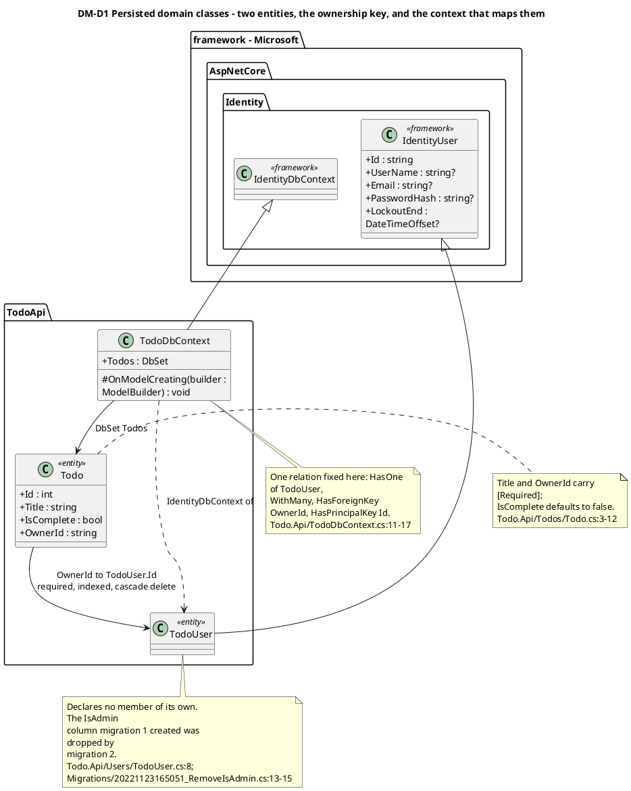

## Document Control

- Phase: Excavation
- Status: Draft — produced for the end-of-Excavation (AR) milestone review
- Milestone Target: end-of-Excavation (AR) — not yet achieved
- Iteration: 1, Cycle 1
- Owner: Designer

## Design Overview

The delivery carries no design document of its own (`.iari/README.md`; the tree holds none), so this model is recovered from code: every class below is recorded as the code declares it, and each carries the file and lines it was read from. Nothing here is attributed to an author who cannot be asked.

The design model is recovered in the System Inventory's priority order, and this section-set covers the first stage of that order: **the domain classes** — the business objects the code holds, their attributes, their operations and their relationships. Which of the eleven recovered use cases each participates in is in the Traceability table at the end.

| Section | State in this iteration |
|---|---|
| Domain Model | Recovered. Two persisted entities, six persisted framework-mapped types, seven request/response shapes, one mapping helper and one persistence context, each anchored |
| Use-Case Realizations | Not yet recovered. The use cases are recovered (Use-Case Model) and the interactions are documented there as flows; their realization as design-object collaborations is later-phase work |
| Design Packages and Classes | Not yet recovered. Recovered next, from the same sources, in the same priority order |
| Interface Contracts | Not yet recovered. No interface is declared anywhere in the delivery: the two process boundaries are crossed by HTTP over concrete request shapes, not by interface types |
| Persistent Data Classes | Owned by the Database Designer; not written here |
| Boundary Classes and Navigation Map | Not yet recovered |
| Capsules, Protocols and Signals | Not applicable to this delivery — no capsule, protocol or state-machine construct exists in it, and nothing is scheduled or event-driven |

`[OMITTED: Data Model — the Development Case's §5.2 trigger has not fired: the store holds eight persisted entity types, below the >10 threshold, the system is not data-centric and no data migration is in scope, so the data lives inline in this model]`

**What the model is anchored to.** The System Inventory records the recovery order and the System Analyst records which entry point performs each use case; the Software Architecture Document records the component each file belongs to. Where those and the code disagree, the code is recorded and the disagreement is named.

### Reading the domain, as the code holds it

Three properties of this domain govern every class below.

**It is an anaemic domain.** `Todo` and `TodoUser` declare no operation at all. Every behaviour is a statement inside an endpoint handler — the ownership predicate, the projection, the update and the delete each live in `Todo.Api/Todos/TodoApi.cs:24-73`, not on the entity. There is no domain service, no repository interface and no aggregate root in the delivery.

**The ownership key is a string copied from the identity key, not a reference.** `Todo.OwnerId` is a required `string`; the relation to the account is declared only in the persistence context (`HasOne<TodoUser>().WithMany().HasForeignKey(...)`), so neither class holds a navigation property and no code path walks from a row to its owner or back. The migration history shows the key was first pointed at `AspNetUsers.UserName` and re-pointed to `AspNetUsers.Id` by the third migration.

**The wire vocabulary exists twice.** Seven shapes are declared here and six of them are declared again in the assembly the client and the BFF share, with no reference between the two assemblies and no compiler between the two declarations (AN-003). Both declarations are recovered below, because a later reader has to know which side a change lands on.

## Domain Model


### CLS-001 Todo — the task row

| Attribute | Type | Constraint the code declares | Anchor |
|---|---|---|---|
| `Id` | `int` | Integer key, autoincrement in the schema | `Todo.Api/Todos/Todo.cs:5` |
| `Title` | `string` | `[Required]`, initialised to `default!` | `Todo.Api/Todos/Todo.cs:6-7` |
| `IsComplete` | `bool` | defaults to `false`; written only by the update statement | `Todo.Api/Todos/Todo.cs:8` |
| `OwnerId` | `string` | `[Required]`, initialised to `default!`; foreign key to `TodoUser.Id` | `Todo.Api/Todos/Todo.cs:10-11` |

| Operation | Kind | What it does | Anchor |
|---|---|---|---|
| — | — | The class declares no operation. It is a property bag read and written by endpoint statements | `Todo.Api/Todos/Todo.cs:3-12` |

| Relationship | Target | Multiplicity | How it is declared | Anchor |
|---|---|---|---|---|
| Ownership | CLS-007 `TodoUser` | one owner to zero or more tasks; the task side is required | `HasOne<TodoUser>().WithMany().HasForeignKey(t => t.OwnerId).HasPrincipalKey(u => u.Id)` — declared in the context, not on either class, and no navigation property exists on either side | `Todo.Api/TodoDbContext.cs:12-16` |

The relation's principal key was `AspNetUsers.UserName` and was re-pointed to `AspNetUsers.Id` by the third migration; the index `IX_Todos_OwnerId` and cascade delete were created with the table and survive the re-point (`Todo.Api/Migrations/20221123071234_Initial.cs:220-247`; `Todo.Api/Migrations/20230714032431_ForeignKeyChange.cs:12-47`).

### CLS-007 TodoUser — the account row

| Attribute | Type | Where it comes from | Anchor |
|---|---|---|---|
| every property the account has | — | `IdentityUser`. `TodoUser` adds nothing: its whole declaration is an empty body, and the comment above it says custom properties could be added there | `Todo.Api/Users/TodoUser.cs:6-8` |

`Id`, `UserName`, `Email`, `PasswordHash`, `LockoutEnd` and the rest are `IdentityUser`'s and are mapped by `IdentityDbContext<TodoUser>` (`Todo.Api/Program.cs:17-20`; `Todo.Api/Migrations/20221123071234_Initial.cs:36-66`). The `IsAdmin` column the first migration created on `AspNetUsers` was dropped by the second, so the class holds no administrative flag and the schema holds none (`Todo.Api/Migrations/20221123165051_RemoveIsAdmin.cs:13-15`).

### CLS-006 TodoDbContext — the persistence context

| Operation | Signature | What it does | Anchor |
|---|---|---|---|
| `Todos` | `DbSet<Todo>` get-only property | The one domain set the context exposes; every task statement starts here | `Todo.Api/TodoDbContext.cs:8` |
| `OnModelCreating` | `protected void OnModelCreating(builder : ModelBuilder)` | Fixes the ownership relation and delegates to the identity model | `Todo.Api/TodoDbContext.cs:10-19` |

The context derives from `IdentityDbContext<TodoUser>`, so the seven identity sets are its own without being declared. No `DbSet<TodoUser>` is declared and no user query in the delivery goes through the context: callers resolve an account through `UserManager<TodoUser>` instead (`Todo.Api/Authorization/CurrentUserExtensions.cs:11-30`). `Todos` is reached three ways — `Where(...).Select(...)`, `FindAsync(id)`, and `ExecuteUpdateAsync` / `ExecuteDeleteAsync` that bypass the change tracker entirely (`Todo.Api/Todos/TodoApi.cs:24-73`).


### The shape the caller sees — declared twice

```plantuml
@startuml
title DM-D2 The wire shapes, declared twice in two assemblies that do not reference each other

skinparam shadowing false
skinparam classAttributeIconSize 0
skinparam wrapWidth 205

package "Todo.Web.Shared - compiled into the client and the BFF" {
  class "TodoItem (shared)" as S1 {
    +Id : int
    +Title : string
    +IsComplete : bool
  }
  class "UserInfo (shared)" as S2 {
    +Email : string
    +Password : string
  }
  class "ExternalUserInfo (shared)" as S3 {
    +Username : string
    +ProviderKey : string
  }
  class "AuthToken (shared)" as S4 <<record>> {
    +Token : string
  }
}

package "Todo.Api - its own declaration, no reference to Shared" {
  class "TodoItem (API)" as A1 {
    +Id : int
    +Title : string
    +IsComplete : bool
  }
  class "UserInfo (API)" as A2 {
    +Email : string
    +Password : string
  }
  class "ExternalUserInfo (API)" as A3 {
    +Username : string
    +ProviderKey : string
  }
  class TodoMappingExtensions <<static>> {
    +AsTodoItem(todo : Todo) : TodoItem
  }
}

class Todo <<entity>> {
  +Id : int
  +Title : string
  +IsComplete : bool
  +OwnerId : string
}

S1 .. A1 : same shape, no link,\nno compiler check
S2 .. A2 : same shape
S3 .. A3 : same shape
TodoMappingExtensions ..> A1 : returns the API's TodoItem
Todo --> TodoMappingExtensions : projected by

note bottom of A1
  Todo.Api/Todos/Todo.cs:15-21 against
  Todo.Web/Shared/SharedClass.cs:5-11 - the same
  three properties on both sides, and nothing
  compares them. AN-003
end note

note bottom of A3
  The one /users request shape the validation
  filter covers, because MapUsers registers it.
  UsersApi.cs:18
end note

note bottom of S4
  AuthToken wraps the "accessToken" property name
  the Identity endpoints answer with, and is the
  only shape in Shared that has no twin in the API.
  SharedClass.cs:31
end note

@enduml
```

### Class inventory — every recovered domain class and its anchor

| ID | Class | Kind | Responsibility, as the code gives it | Anchor |
|---|---|---|---|---|
| CLS-001 | `Todo` | Entity, persisted | The task row: integer key, required title, completion flag, required owner key. Declares no operation | `Todo.Api/Todos/Todo.cs:3-12` |
| CLS-002 | `TodoItem` (API) | Request and response shape | What every task operation accepts and returns. Carries no `OwnerId`, so the ownership key cannot round-trip to a caller | `Todo.Api/Todos/Todo.cs:15-21` |
| CLS-003 | `TodoMappingExtensions` | Static mapping helper | Projects `Todo` onto `TodoItem`, copying `Id`, `Title`, `IsComplete` and dropping `OwnerId` | `Todo.Api/Todos/Todo.cs:23-34` |
| CLS-004 | `UserInfo` (API) | Request shape | Email and password, both required — the body of the Identity register and login calls | `Todo.Api/Users/TodoUser.cs:12-19` |
| CLS-005 | `ExternalUserInfo` (API) | Request shape | User name and a data-protection-protected provider key, both required — the body of the external-token exchange | `Todo.Api/Users/TodoUser.cs:21-28` |
| CLS-006 | `TodoDbContext` | Persistence context | `IdentityDbContext<TodoUser>` plus the `Todos` set and the one relation it fixes | `Todo.Api/TodoDbContext.cs:6-20` |
| CLS-007 | `TodoUser` | Entity, persisted | The account row. Declares no member of its own; every property is `IdentityUser`'s | `Todo.Api/Users/TodoUser.cs:8` |
| CLS-008 | `TodoItem` (shared) | Request and response shape | The same three properties as CLS-002, declared in the assembly the client and the BFF compile against | `Todo.Web/Shared/SharedClass.cs:5-11` |
| CLS-009 | `UserInfo` (shared) | Request shape | The same two properties as CLS-004, in the shared assembly | `Todo.Web/Shared/SharedClass.cs:13-20` |
| CLS-010 | `ExternalUserInfo` (shared) | Request shape | The same two properties as CLS-005, in the shared assembly | `Todo.Web/Shared/SharedClass.cs:22-29` |
| CLS-011 | `AuthToken` | Response shape, positional record | The single `accessToken` property the Identity endpoints answer with, read by the BFF's token client | `Todo.Web/Shared/SharedClass.cs:31` |

**Persisted types recorded without a design-class label.** Six entity types are mapped by `IdentityDbContext<TodoUser>` and by the migrations, and the delivery writes no class of its own for any of them: `IdentityUserLogin<string>`, `IdentityRole<string>`, `IdentityUserRole<string>`, `IdentityUserClaim<string>`, `IdentityRoleClaim<string>`, `IdentityUserToken<string>`. They are framework classes, not classes the Implementer writes, so they are named in DM-D3 and in the relationship table below rather than given `CLS` labels. The table that backs each is created by the first migration: `AspNetUserLogins` and `AspNetUserRoles` and `AspNetUserTokens` and `AspNetUserClaims` and `AspNetRoles` and `AspNetRoleClaims` (`Todo.Api/Migrations/20221123071234_Initial.cs:16-268`).

### Relationship inventory

| Relationship | From | To | Multiplicity | Declared how, and where | Anchor |
|---|---|---|---|---|---|
| Ownership | `Todo` (`OwnerId`) | `TodoUser` (`Id`) | 0..* tasks to 1 account; required on the task side | Fluent model in the context; no navigation property on either class | `Todo.Api/TodoDbContext.cs:12-16` |
| Provider identity | `IdentityUserLogin` | `TodoUser` | 0..* logins to 1 account, cascade delete | Framework model; the delivery writes one row | `Todo.Api/Users/UsersApi.cs:38-46` |
| Role membership | `IdentityUserRole` | `TodoUser`, `IdentityRole` | 0..* to each; composite key | Framework model; nothing writes a row | `Todo.Api/Migrations/20221123071234_Initial.cs:16-268` |
| Claims | `IdentityUserClaim`, `IdentityRoleClaim` | `TodoUser`, `IdentityRole` | 0..* to each | Framework model; nothing writes a row | `Todo.Api/Migrations/20221123071234_Initial.cs:16-268` |
| Identity tokens | `IdentityUserToken` | `TodoUser` | 0..* to 1 | Framework model; no delivery code writes it — the session's token set is a cookie, not a row | `Todo.Web/Server/AuthApi.cs:105-113` |

**No association exists between the two wire declarations or between them and the entities.** `TodoItem` neither references nor inherits `Todo`; the only link is `AsTodoItem`, one direction, in one assembly. `UserInfo` and `ExternalUserInfo` have no relation to `TodoUser` beyond being the shapes `UserManager` calls are handed.

### What the code does not hold

Recorded so that nothing is carried forward from what a task list is expected to have. Each of these was looked for in the domain and in the schema and is absent:

| Expected | What the code holds instead | Anchor |
|---|---|---|
| An account entity with an administrative flag | No flag. The column existed and was dropped; `IsAdmin` is read from a role claim, and no role row is ever written | `Todo.Api/Migrations/20221123165051_RemoveIsAdmin.cs:13-15`; `Todo.Api/Authorization/CurrentUser.cs:12` |
| A list, project, category or tag a task belongs to | Nothing. A task belongs to an account and to nothing else; there is one flat table | `Todo.Api/TodoDbContext.cs:8` |
| A due date, priority, ordering or audit column | Nothing. `Todo` holds four properties, and the list query declares no order | `Todo.Api/Todos/Todo.cs:3-12`; `Todo.Api/Todos/TodoApi.cs:24-27` |
| A domain operation, aggregate or invariant on either entity | Nothing. Both entities are property bags; every rule is a statement in an endpoint handler | `Todo.Api/Todos/TodoApi.cs:24-73` |
| A repository, unit-of-work or service abstraction over the store | Nothing. Handlers take `TodoDbContext` directly, and two of the five statements bypass the change tracker | `Todo.Api/Todos/TodoApi.cs:17-22,52-73` |
| A concurrency token or row version | Nothing. The update names two fields and carries no version check | `Todo.Api/Todos/TodoApi.cs:59-63` |

### What the classes do in the use cases

The classes above are the vocabulary; the behaviour is in the endpoint handlers and is realized in later phases. Two facts bind them and belong here.

`Todo` and `CLS-002`/`CLS-008` decide one rule between them: the request shape carries no `OwnerId`, so the owner is never read from a body and `OwnerId` never leaves the process. A create body that asks for a completed row still produces `IsComplete` false, because the insert copies only the title (`Todo.Api/Todos/TodoApi.cs:38-50`).

`CLS-007` is the class the ownership predicate is decided against, and the row that must exist before any task operation succeeds: the authorization handler fails the request when no account row matches the token's `NameIdentifier` (`Todo.Api/Authorization/CheckCurrentUserAuthHandler.cs:28-36`; `Todo.Api/Authorization/CurrentUserExtensions.cs:11-30`).

### Use cases no domain class realizes

| Use case | Why no domain class appears in its row | What it touches instead | Anchor |
|---|---|---|---|
| UC-004 Sign out | It persists nothing and reads no entity: one call signs the cookie scheme out, and the row the account lives in is untouched | The BFF's cookie scheme; the session cookie's token set, which `AuthApi.SignIn` wrote and this operation discards | `Todo.Web/Server/AuthApi.cs:40-52` |
| UC-011 Consult the API reference | It reads metadata the framework generated, not data the model holds | The OpenAPI document and the Scalar UI mapping; the bearer scheme it declares | `Todo.Api/Program.cs:46-58`; `Todo.Api/Extensions/OpenApiOptionsExtensions.cs` |

Both are recovered use cases with a real entry point; neither has a domain class in its path, so neither appears as a `Traces From` value above. That is the model's shape, not a gap in the realization.

## Traceability
| Element | Traces From | Link Type | Traces To |
|---|---|---|---|
| CLS-001 | UC-006, UC-007, UC-008, UC-009, UC-010 | Realizes | — |
| CLS-002 | UC-006, UC-007, UC-009, UC-010 | Realizes | — |
| CLS-003 | UC-006, UC-007, UC-009 | Realizes | — |
| CLS-004 | UC-001, UC-002 | Realizes | — |
| CLS-005 | UC-003 | Realizes | — |
| CLS-006 | UC-001, UC-002, UC-003, UC-005, UC-006, UC-007, UC-008, UC-009, UC-010 | Realizes | — |
| CLS-007 | UC-001, UC-002, UC-003, UC-005, UC-006, UC-007, UC-008, UC-009, UC-010 | Realizes | — |
| CLS-008 | UC-006, UC-007, UC-008 | Realizes | — |
| CLS-009 | UC-001, UC-002 | Realizes | — |
| CLS-010 | UC-003 | Realizes | — |
| CLS-011 | UC-001, UC-002, UC-003 | Realizes | — |

