## Document Control
- Phase: Consolidation
- Status: Draft — produced for the end-of-Consolidation (GHR) milestone review
- Milestone Target: end-of-Consolidation (GHR) — not yet achieved
- Iteration: 1, Cycle 1
- Owner: Designer
## Design Overview
The delivery carries no design document of its own (`.iari/README.md`; the tree holds none), so this model is recovered from code: every class below is recorded as the code declares it, and each carries the file and lines it was read from. Nothing here is attributed to an author who cannot be asked.

The design model is recovered in the System Inventory's priority order, and this section-set covers three stages of that order: **the domain classes** — the business objects the code holds, their attributes, their operations and their relationships — **the classes of every package**, which is where the behaviour lives, and **the persistent store** those classes are mapped onto.

| Section | State in this iteration |
|---|---|
| Domain Model | Recovered. Two persisted entities, six persisted framework-mapped types, seven request/response shapes, one mapping helper and one persistence context, each anchored |
| Use-Case Realizations | Not yet recovered. The use cases are recovered (Use-Case Model) and the interactions are documented there as flows; their realization as design-object collaborations is later-phase work |
| Design Packages and Classes | Recovered. Thirty-one classes beyond the domain classes, in the thirteen packages below, each anchored; the package diagram, the five per-package class diagrams and one consolidated class diagram are here |
| Interface Contracts | Not yet recovered. No interface is declared anywhere in the delivery: the two process boundaries are crossed by HTTP over concrete request shapes, not by interface types |
| Persistent Data Classes | Recovered by the Database Designer. Eight tables, their keys, indexes, constraints, referential actions and the O/R mapping per persistent class, plus the three migrations that built the schema — recorded under "Persistent data — the recovered store, its keys and its associations" in this section |
| Boundary Classes and Navigation Map | Not yet recovered |
| Capsules, Protocols and Signals | Not applicable to this delivery — no capsule, protocol or state-machine construct exists in it, and nothing is scheduled or event-driven |

`[OMITTED: Data Model — the Development Case's §5.2 trigger has not fired: the store holds eight persisted entity types, below the >10 threshold, the system is not data-centric and no data migration is in scope, so the data lives inline in this model]`

**What the model is anchored to.** The System Inventory records the recovery order and the System Analyst records which entry point performs each use case; the Software Architecture Document records the component each file belongs to. Where those and the code disagree, the code is recorded and the disagreement is named.

### Persistent data — the recovered store, its keys and its associations

The store is recovered as it exists: SQLite through the EF Core 9 SQLite provider, one file, eight tables, and no SQL script, view, trigger, stored procedure or database-resident rule anywhere in the tree. Every table, key, index and referential action below is read from the three migrations and the model snapshot that are the schema's only definitions. Nothing here is proposed; each element carries the file it was read from.

Tables are named by their physical names, not by minted labels: the Data Model is not produced in this phase, so no `TBL-NNN` family is declared and the schema elements are identified by the names the database itself carries.

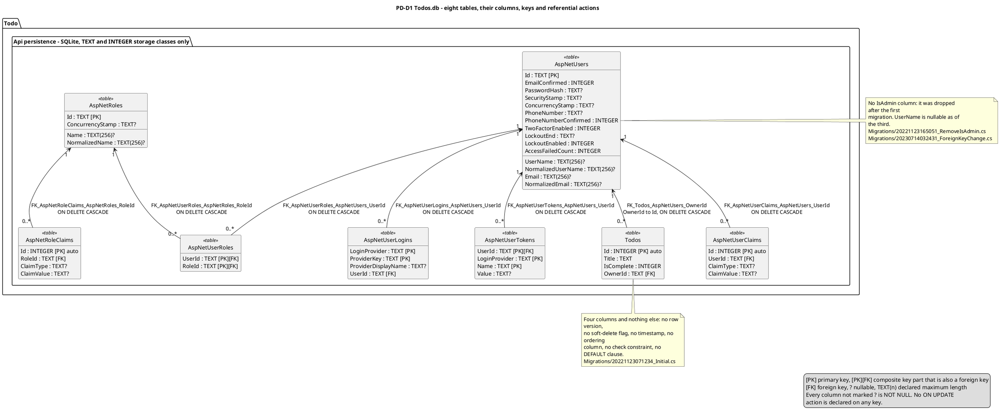

#### Tables to entities

Every table traces to the class that maps it. Eight tables, and only two are mapped by a class the delivery writes: `Todos` by CLS-001 `Todo`, `AspNetUsers` by CLS-007 `TodoUser`. The six Identity child tables are mapped by framework entity types that `IdentityDbContext<TodoUser>` maps without the delivery declaring them.

| Table | Mapped by | Kind of mapping | Anchor |
|---|---|---|---|
| `Todos` | CLS-001 `Todo` | Hand-declared entity; the context exposes it as `DbSet<Todo> Todos` | `Todo.Api/Todos/Todo.cs:3-12`; `Todo.Api/TodoDbContext.cs:8` |
| `AspNetUsers` | CLS-007 `TodoUser` | Derives from `IdentityUser`; the table carries every `IdentityUser` property and nothing of `TodoUser`'s own | `Todo.Api/Users/TodoUser.cs:8`; `Todo.Api/Migrations/TodoDbContextModelSnapshot.cs` — `TodoApi.TodoUser` |
| `AspNetUserLogins` | `IdentityUserLogin<string>` | Framework type, mapped wholesale; no delivery class exists for it | `Todo.Api/Migrations/TodoDbContextModelSnapshot.cs`; `Todo.Api/Migrations/20221123071234_Initial.cs` |
| `AspNetUserClaims` | `IdentityUserClaim<string>` | Framework type, mapped wholesale | `Todo.Api/Migrations/TodoDbContextModelSnapshot.cs` |
| `AspNetUserTokens` | `IdentityUserToken<string>` | Framework type, mapped wholesale | `Todo.Api/Migrations/TodoDbContextModelSnapshot.cs` |
| `AspNetUserRoles` | `IdentityUserRole<string>` | Framework type, mapped wholesale; no delivery code writes a row | `Todo.Api/Migrations/TodoDbContextModelSnapshot.cs` |
| `AspNetRoles` | `IdentityRole<string>` | Framework type, mapped wholesale; no delivery code writes a row | `Todo.Api/Migrations/TodoDbContextModelSnapshot.cs` |
| `AspNetRoleClaims` | `IdentityRoleClaim<string>` | Framework type, mapped wholesale; no delivery code writes a row | `Todo.Api/Migrations/TodoDbContextModelSnapshot.cs` |

**The request, response and mapping shapes persist nothing.** CLS-002, CLS-003, CLS-004, CLS-005, CLS-008, CLS-009, CLS-010 and CLS-011 have no table: they exist for the duration of a request as serialized JSON. `TodoItem` is a projection of `Todos` built by CLS-003, and `AuthToken` wraps a token the API issues, never a value stored at rest.

#### How inheritance is stored

There is no inheritance hierarchy in the schema. `TodoUser` derives from `IdentityUser`, but `IdentityUser` is not a mapped entity of its own: `IdentityDbContext<TodoUser>` maps the derived type only, so the base class contributes columns to one table and produces no parent table and no discriminator. The single level of inheritance is flattened into `AspNetUsers` — one table, one concrete type, no `Discriminator` column.

The delivery declares no abstract entity, no table-per-type split and no shared base for `Todo` and `TodoUser`. The snapshot holds exactly two delivery entity types (`Todo`, `TodoApi.TodoUser`) and six framework ones, each mapped to one table.

#### Primary keys and identity strategy

| Table | Primary key | Identity strategy | Anchor |
|---|---|---|---|
| `Todos` | `PK_Todos (Id)` | Declared `Sqlite:Autoincrement`; `ValueGeneratedOnAdd` in the snapshot, so the database assigns the value | `Todo.Api/Migrations/20221123071234_Initial.cs`; `Todo.Api/Migrations/TodoDbContextModelSnapshot.cs` |
| `AspNetUsers` | `PK_AspNetUsers (Id)` | No database default. The value is generated in the Identity store and supplied on insert | `Todo.Api/Migrations/20221123071234_Initial.cs`; `Todo.Api/Migrations/TodoDbContextModelSnapshot.cs` |
| `AspNetRoles` | `PK_AspNetRoles (Id)` | No database default; supplied by the store | `Todo.Api/Migrations/20221123071234_Initial.cs` |
| `AspNetUserLogins` | `PK_AspNetUserLogins (LoginProvider, ProviderKey)` | None — both parts supplied. The provider identity is the key, so one row per provider account | `Todo.Api/Migrations/20221123071234_Initial.cs` |
| `AspNetUserRoles` | `PK_AspNetUserRoles (UserId, RoleId)` | None — a junction row, both parts supplied | `Todo.Api/Migrations/20221123071234_Initial.cs` |
| `AspNetUserTokens` | `PK_AspNetUserTokens (UserId, LoginProvider, Name)` | None — all parts supplied | `Todo.Api/Migrations/20221123071234_Initial.cs` |
| `AspNetUserClaims` | `PK_AspNetUserClaims (Id)` | Declared `Sqlite:Autoincrement` | `Todo.Api/Migrations/20221123071234_Initial.cs` |
| `AspNetRoleClaims` | `PK_AspNetRoleClaims (Id)` | Declared `Sqlite:Autoincrement` | `Todo.Api/Migrations/20221123071234_Initial.cs` |

`Todos.Id` and `AspNetUsers.Id` are the only keys the delivery's own statements address: `FindAsync(id)` and the `Where(t => t.Id == id && …)` predicates of the update and the delete on one side, the per-request account lookup on the other. The six Identity child tables are reached only through `UserManager<TodoUser>` and the Identity endpoint set.

#### Foreign keys to associations

Seven foreign keys, every one `ON DELETE CASCADE` and none with an `ON UPDATE` action. No `RESTRICT`, `NO ACTION` or `SET NULL` exists anywhere in the schema.

| Association recovered | From | To | Multiplicity | Referential action | Anchor |
|---|---|---|---|---|---|
| Ownership — a task belongs to one account | `Todos.OwnerId` | `AspNetUsers.Id` | 0..* tasks to 1 account, required on the task side | `FK_Todos_AspNetUsers_OwnerId`, cascade delete | `Todo.Api/TodoDbContext.cs:11-17`; `Todo.Api/Migrations/20230714032431_ForeignKeyChange.cs` |
| Session claims of an account | `AspNetUserClaims.UserId` | `AspNetUsers.Id` | 0..* to 1 | `FK_AspNetUserClaims_AspNetUsers_UserId`, cascade delete | `Todo.Api/Migrations/20221123071234_Initial.cs` |
| Provider identities of an account | `AspNetUserLogins.UserId` | `AspNetUsers.Id` | 0..* to 1 | `FK_AspNetUserLogins_AspNetUsers_UserId`, cascade delete | `Todo.Api/Migrations/20221123071234_Initial.cs` |
| Role membership | `AspNetUserRoles.UserId`, `.RoleId` | `AspNetUsers.Id`, `AspNetRoles.Id` | 0..* to each; composite key | both cascade delete | `Todo.Api/Migrations/20221123071234_Initial.cs` |
| Identity token store | `AspNetUserTokens.UserId` | `AspNetUsers.Id` | 0..* to 1 | `FK_AspNetUserTokens_AspNetUsers_UserId`, cascade delete | `Todo.Api/Migrations/20221123071234_Initial.cs` |
| Claims of a role | `AspNetRoleClaims.RoleId` | `AspNetRoles.Id` | 0..* to 1 | `FK_AspNetRoleClaims_AspNetRoles_RoleId`, cascade delete | `Todo.Api/Migrations/20221123071234_Initial.cs` |

**The ownership association is declared at neither end.** `Todo.OwnerId` is a plain `string` and `TodoUser` has no `Todo` collection: the relation exists only as the fluent declaration in the context and as the constraint in the database. No navigation property exists on either class, so no delivery query joins the two tables and no ORM lazy or eager loading can occur along it. Deleting an account deletes every task it owned, and no delivery statement does that deliberately — it happens by cascade.

**Cascade is the only delete policy in the schema.** Nothing in the delivery deletes an `AspNetUsers` row, so the cascade onto `Todos` is latent rather than exercised: the test host's `CreateUserAsync` inserts accounts and its `Dispose` drops the whole in-memory database.

#### Indexes, and the statement each one serves

```plantuml
@startuml
title PD-D2 The indexes and keys the migrations declare, and the statement each one serves

skinparam shadowing false
skinparam classAttributeIconSize 0
skinparam wrapWidth 250
hide circle
hide empty members

package "Todos - the only table the delivery queries in its own code" {
  class Todos <<table>> {
    Id : INTEGER [PK]
    OwnerId : TEXT [FK]
  }
  class "PK_Todos" as P1 <<index>> {
    Id : INTEGER
  }
  class "IX_Todos_OwnerId" as I1 <<index>> {
    OwnerId : TEXT
    not unique
  }
}

package "AspNetUsers - reached only through UserManager" {
  class AspNetUsers <<table>> {
    Id : TEXT [PK]
  }
  class "PK_AspNetUsers" as P2 <<index>> {
    Id : TEXT
  }
  class "UserNameIndex" as I2 <<index>> {
    NormalizedUserName : TEXT
    UNIQUE
  }
  class "EmailIndex" as I3 <<index>> {
    NormalizedEmail : TEXT
    not unique
  }
}

package "Identity child tables" {
  class AspNetUserLogins <<table>> {
    LoginProvider : TEXT [PK]
    ProviderKey : TEXT [PK]
  }
  class AspNetUserRoles <<table>> {
    UserId : TEXT [PK]
    RoleId : TEXT [PK]
  }
  class AspNetUserClaims <<table>> {
    Id : INTEGER [PK]
  }
  class AspNetRoleClaims <<table>> {
    Id : INTEGER [PK]
  }
  class AspNetUserTokens <<table>> {
    UserId : TEXT [PK]
  }
  class "IX_AspNetUserLogins_UserId" as I4 <<index>>
  class "IX_AspNetUserRoles_RoleId" as I5 <<index>>
  class "IX_AspNetUserClaims_UserId" as I6 <<index>>
  class "IX_AspNetRoleClaims_RoleId" as I7 <<index>>
  class "PK_AspNetUserLogins" as P3 <<index>>
  class "PK_AspNetUserRoles" as P4 <<index>>
  class "PK_AspNetUserTokens" as P5 <<index>>
  class "RoleNameIndex" as I8 <<index>> {
    NormalizedName : TEXT
    UNIQUE
  }
}

Todos --> P1
Todos --> I1
AspNetUsers --> P2
AspNetUsers --> I2
AspNetUsers --> I3
AspNetUserLogins --> I4
AspNetUserLogins --> P3
AspNetUserRoles --> I5
AspNetUserRoles --> P4
AspNetUserClaims --> I6
AspNetRoleClaims --> I7
AspNetUserTokens --> P5
I8 ..> AspNetUsers : constrains a table nothing writes

note right of I1
  Serves the three predicates written against
  OwnerId: the list, the update and the delete.
  The item read is a primary-key lookup.
  Todos/TodoApi.cs
end note

note right of I2
  Unique on NormalizedUserName - the account-name
  rule. The delivery issues no query of its own
  against it; UserManager does.
end note

note bottom of I4
  One non-unique index per foreign key column,
  created by the first migration and unchanged
  since. No composite index exists on
  AspNetUserLogins beyond its key pair.
  Migrations/20221123071234_Initial.cs
end note

note bottom of I8
  Nothing in the running system writes a row to
  AspNetRoles, so this unique index constrains an
  empty table. AN-004
end note

@enduml
```

| Index | Table and columns | Unique | The statement or rule it serves | Anchor |
|---|---|---|---|---|
| `IX_Todos_OwnerId` | `Todos (OwnerId)` | no | The list predicate `t.OwnerId == owner.Id`; the `OwnerId` half of the update and delete predicates. The item read uses the primary key instead | `Todo.Api/Migrations/20221123071234_Initial.cs`; `Todo.Api/Todos/TodoApi.cs:26,60,70` |
| `PK_Todos` | `Todos (Id)` | yes | `FindAsync(id)` and the `t.Id == id` predicates of update and delete | `Todo.Api/Migrations/20221123071234_Initial.cs`; `Todo.Api/Todos/TodoApi.cs:31,60,70` |
| `PK_AspNetUsers` | `AspNetUsers (Id)` | yes | The per-request account lookup every authorized call pays, and the principal key of the ownership association | `Todo.Api/Authorization/CurrentUserExtensions.cs:22-26`; `Todo.Api/Migrations/20221123071234_Initial.cs` |
| `UserNameIndex` | `AspNetUsers (NormalizedUserName)` | yes | The account-name uniqueness rule, enforced where Identity looks an account up by name. No delivery statement queries it | `Todo.Api/Migrations/20221123071234_Initial.cs` |
| `EmailIndex` | `AspNetUsers (NormalizedEmail)` | no | Identity's account-by-email lookup. **Not unique**, so nothing in the schema stops two accounts holding one email | `Todo.Api/Migrations/20221123071234_Initial.cs` |
| `RoleNameIndex` | `AspNetRoles (NormalizedName)` | yes | The role-name rule, constraining a table nothing in the running system writes | `Todo.Api/Migrations/20221123071234_Initial.cs` |
| `PK_AspNetUserLogins` | `AspNetUserLogins (LoginProvider, ProviderKey)` | yes | The provider-identity lookup the token exchange performs before creating a login row | `Todo.Api/Users/UsersApi.cs:38-46`; `Todo.Api/Migrations/20221123071234_Initial.cs` |
| `IX_AspNetUserLogins_UserId` | `AspNetUserLogins (UserId)` | no | The foreign-key column, so the cascade delete can find the rows | `Todo.Api/Migrations/20221123071234_Initial.cs` |
| `IX_AspNetUserClaims_UserId` | `AspNetUserClaims (UserId)` | no | Foreign-key column, as above | `Todo.Api/Migrations/20221123071234_Initial.cs` |
| `IX_AspNetUserRoles_RoleId` | `AspNetUserRoles (RoleId)` | no | Foreign-key column; the composite key already covers `UserId` first | `Todo.Api/Migrations/20221123071234_Initial.cs` |
| `IX_AspNetRoleClaims_RoleId` | `AspNetRoleClaims (RoleId)` | no | Foreign-key column | `Todo.Api/Migrations/20221123071234_Initial.cs` |

No index beyond these exists: there is no full-text index, no partial index, no covering index, no index on `Todos.Title` and none on `Todos.IsComplete`. The item read (`GET /todos/{id}`) reaches a row by primary key and then filters it in memory against `OwnerId`, which the index on `OwnerId` cannot help with.

#### Constraints the schema enforces, and the rules it leaves to code

| Rule | Enforced in the schema | How | Anchor |
|---|---|---|---|
| A task has a title | yes | `Todos.Title` is `TEXT` NOT NULL, from `[Required]` on CLS-001 | `Todo.Api/Todos/Todo.cs:6-7`; `Todo.Api/Migrations/20221123071234_Initial.cs` |
| A task belongs to an account | yes | `Todos.OwnerId` is `TEXT` NOT NULL with a foreign key to `AspNetUsers.Id` | `Todo.Api/Todos/Todo.cs:10-11`; `Todo.Api/Migrations/20230714032431_ForeignKeyChange.cs` |
| Two accounts cannot share a provider identity | yes | `AspNetUserLogins` composite primary key on `(LoginProvider, ProviderKey)` | `Todo.Api/Migrations/20221123071234_Initial.cs` |
| Two accounts cannot share a user name | yes | `UserNameIndex` unique on `NormalizedUserName` | `Todo.Api/Migrations/20221123071234_Initial.cs` |
| Two accounts cannot share an email | **no** | `EmailIndex` is not unique; Identity performs a duplicate check in code, not in the schema | `Todo.Api/Migrations/20221123071234_Initial.cs` |
| A completion flag is a boolean | only by type affinity | `IsComplete` is `INTEGER` with no `CHECK (IsComplete IN (0,1))` | `Todo.Api/Migrations/20221123071234_Initial.cs` |
| A task title has a length bound | **no** | `Todos.Title` is unbounded `TEXT`; the `[StringLength]` rules are Razor component attributes, not schema | `Todo.Web/Client/Components/LogInForm.razor:55-68`; `Todo.Api/Migrations/20221123071234_Initial.cs` |
| Two concurrent writes cannot overwrite each other | **no, on `Todos`** | `Todos` carries no row version or concurrency token; `AspNetUsers` and `AspNetRoles` carry `ConcurrencyStamp`, marked `IsConcurrencyToken` | `Todo.Api/Migrations/TodoDbContextModelSnapshot.cs`; `Todo.Api/Todos/TodoApi.cs:59-63` |
| A task's owner is an existing account | yes | The foreign key refuses an orphan row | `Todo.Api/Migrations/20230714032431_ForeignKeyChange.cs` |
| A caller is an administrator | **no** | No column and no seeded row; `IsAdmin` was dropped and `AspNetRoles`/`AspNetUserRoles` are never written, so the rule behind AN-004 exists nowhere at rest | `Todo.Api/Migrations/20221123165051_RemoveIsAdmin.cs`; AN-004 |
| An account has a user name | **no, as of migration 3** | The re-point made `UserName` nullable and dropped `AK_AspNetUsers_UserName` in the same step | `Todo.Api/Migrations/20230714032431_ForeignKeyChange.cs` |

**No `CHECK` constraint exists in any table, and no database-resident rule of any kind.** There is no trigger, no stored procedure, no view, no computed column, no sequence and no default expression in the schema. Every rule the system enforces beyond keys and nullability is application code: the data-annotation filter in CLS-020, Identity's own policies, and the ownership predicate written four times in CLS-012. The schema's contribution to integrity is primary keys, foreign keys with cascade, two unique indexes and NOT NULL.

#### Normalization, as the schema stands

Recorded as found, with no change proposed:

| Table | Form | Evidence |
|---|---|---|
| `Todos` | 3NF | Four atomic columns, one key, no repeating group, no transitive dependency. One flat table — a task belongs to an account and to nothing else |
| `AspNetUsers` | 3NF, with two application-maintained derived columns | `NormalizedUserName` and `NormalizedEmail` are functions of `UserName` and `Email`, written by Identity on every save. The redundancy is Identity's strategy for case-insensitive uniqueness under SQLite's default collation, not a delivery decision |
| The six Identity child tables | 3NF | Junction and detail tables keyed on their own or their parent's key, with no attribute depending on a non-key |

#### Object/relational mapping, per persistent class

| Design class | Table | Column mapping | Identity | Loading policy, as the code has it | Anchor |
|---|---|---|---|---|---|
| CLS-001 `Todo` | `Todos` | `Id`→`Id`, `Title`→`Title`, `IsComplete`→`IsComplete`, `OwnerId`→`OwnerId`; no property renamed, no value converter, no owned type | `Id` is database-generated; the entity is inserted with `Id` unset | Read by projection with `AsNoTracking()` in the list; tracked by `FindAsync` in the item read; the update and the delete bypass the change tracker through `ExecuteUpdateAsync` and `ExecuteDeleteAsync` | `Todo.Api/TodoDbContext.cs:8`; `Todo.Api/Todos/TodoApi.cs:24-73` |
| CLS-007 `TodoUser` | `AspNetUsers` | Every property inherited from `IdentityUser` maps one-to-one; `TodoUser` adds none | `Id` is supplied by the Identity store, not by the database | Never loaded through a `DbSet<TodoUser>`; resolved by `UserManager.FindByIdAsync` once per request in the claims transformation, then read only for its existence and its `Id` | `Todo.Api/Users/TodoUser.cs:8`; `Todo.Api/Authorization/CurrentUserExtensions.cs:16-30` |
| `IdentityUserLogin<string>` | `AspNetUserLogins` | Framework mapping | Composite key, both parts supplied | Written by the token exchange when no row matches `(LoginProvider, ProviderKey)` | `Todo.Api/Users/UsersApi.cs:38-46` |
| `IdentityUserClaim<string>`, `IdentityUserToken<string>`, `IdentityUserRole<string>`, `IdentityRole<string>`, `IdentityRoleClaim<string>` | their five remaining tables | Framework mapping | As declared | No delivery code path reads or writes any of them; they are reachable only through `UserManager<TodoUser>` | `Todo.Api/Migrations/TodoDbContextModelSnapshot.cs` |

No navigation property exists on either delivery entity, so no lazy-loading proxy, no `Include` and no eager-loading policy is involved anywhere in the delivery. There is no repository, no unit of work and no specification object: handlers receive `TodoDbContext` and CLS-013 directly.

**Two of the five task operations do not use the change tracker.** The update and the delete issue one SQL statement each and never call `SaveChangesAsync`, so no entity is materialized and no concurrency check can occur — consistent with `Todos` having no concurrency token. The create is the only operation that materializes an entity and calls `SaveChangesAsync`.

#### The schema's history and how it reached its present shape

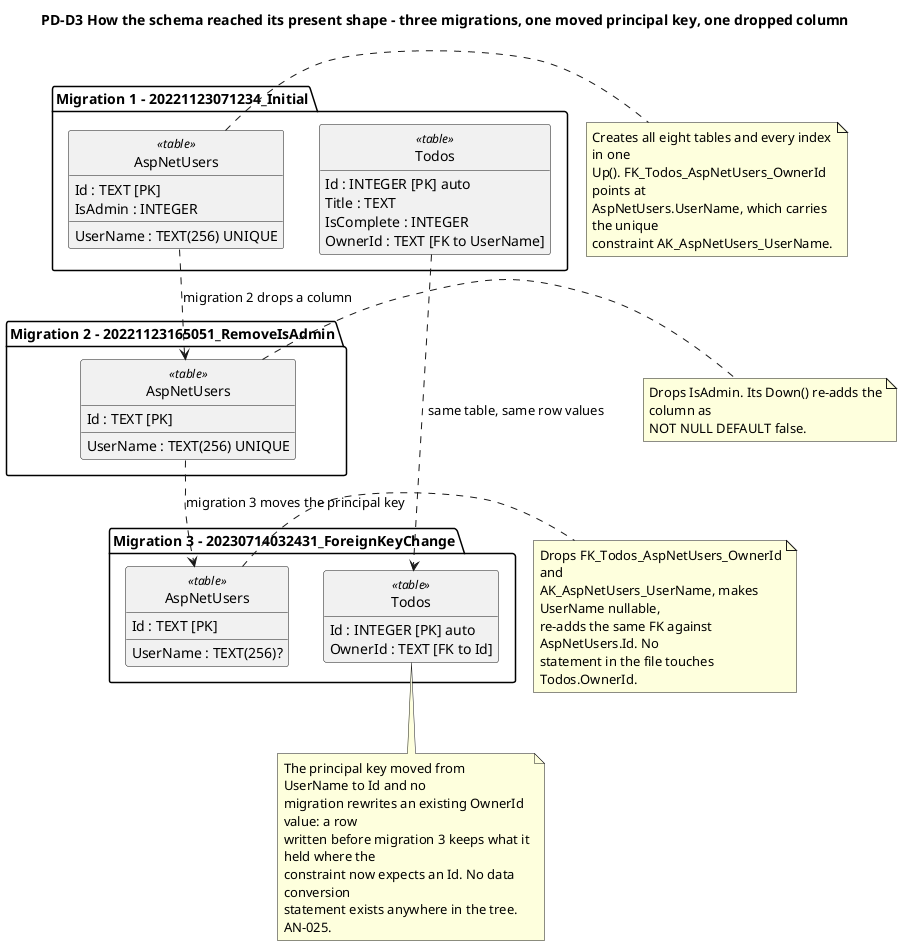

| Migration | What it does to the schema | Rollback | Anchor |
|---|---|---|---|
| `20221123071234_Initial` | Creates all eight tables, every index, and the ownership foreign key against `AspNetUsers.UserName` with the unique constraint `AK_AspNetUsers_UserName`. `IsAdmin` is created `NOT NULL` with no default | `Down()` drops the eight tables in dependency order | `Todo.Api/Migrations/20221123071234_Initial.cs` |
| `20221123165051_RemoveIsAdmin` | Drops `AspNetUsers.IsAdmin` | `Down()` re-adds it as `NOT NULL DEFAULT false`, so every existing row reads `false` | `Todo.Api/Migrations/20221123165051_RemoveIsAdmin.cs` |
| `20230714032431_ForeignKeyChange` | Drops the ownership foreign key and `AK_AspNetUsers_UserName`, makes `UserName` nullable, re-adds the same foreign key against `AspNetUsers.Id`. Touches no row of `Todos` | `Down()` reverses all three steps and restores `UserName` as `NOT NULL DEFAULT ""` | `Todo.Api/Migrations/20230714032431_ForeignKeyChange.cs` |

Two facts about this history govern any later work on the store, and both are consequences of the schema as it stands.

**No migration converts existing `OwnerId` values** (AN-025). Between migration 1 and migration 3 the principal key moved from the account's user name to its identifier, and the third migration contains only constraint and nullability changes. A database written by migration 1 or 2 therefore holds user names in `OwnerId` under a constraint that now requires identifiers. Whether such a database exists outside the test host cannot be determined from the tree.

**The deployed schema and the tested schema are built by different mechanisms.** `Todos.db` is built by these three migrations, run by the app host; the test host builds its schema with `EnsureCreated` from the model and never runs a migration (AN-005). A divergence between the model and the migration history is invisible to the test suite and surfaces only where the app host runs the migration.

#### What the schema does not hold

Recorded so that nothing is carried forward from what a task store is usually expected to contain. Each was looked for in all three migrations and in the snapshot and is absent:

| Expected | What the schema holds instead | Anchor |
|---|---|---|
| An administrative flag or a seeded administrator | No column and no seeded row. `IsAdmin` was dropped and `AspNetRoles` is never written, so the role the code checks has no source at rest | `Todo.Api/Migrations/20221123165051_RemoveIsAdmin.cs`; AN-004 |
| An audit, created-at or updated-at column | Nothing. `Todos` holds four columns and no row records when it was made or changed | `Todo.Api/Migrations/20221123071234_Initial.cs` |
| A soft-delete or archival marker | Nothing. The delete is `ExecuteDeleteAsync`, a physical row removal | `Todo.Api/Todos/TodoApi.cs:68-73` |
| A concurrency token on the task table | Nothing. `AspNetUsers` and `AspNetRoles` carry `ConcurrencyStamp`; `Todos` carries no equivalent | `Todo.Api/Migrations/TodoDbContextModelSnapshot.cs` |
| An ordering, priority or grouping column | Nothing. The list query declares no order and the schema offers no column to order by | `Todo.Api/Todos/TodoApi.cs:24-27` |
| Any database-resident logic | No trigger, stored procedure, view, function or check constraint exists in the tree. The schema exists only as the three migrations and their snapshot | System Inventory — Documentation; DC4 |
| A second store, a cache or a read model | Nothing. One SQLite file, one context, one set of tables. The BFF's session is a cookie, not a table | System Inventory — Persistent Data |
| Partitioning, table spaces or storage parameters | Nothing expressible: SQLite carries no tablespace and no partitioning, and the migrations declare no storage parameter. The only physical decision is the file path `Data Source=.db/Todos.db`, relative to the API's working directory | `Todo.Api/Program.cs:23-24`; AN-013 |

#### What the schema constrains in the use cases

Four persistence facts bound the recovered use cases and belong with the store rather than with any single operation.

| Fact | Consequence for a use case or a later implementation | Anchor |
|---|---|---|
| A task row's owner is never carried to the caller and never accepted from a body | The owner is set from the resolved account on insert and never read from the request, so no use case may claim to choose or to see an owner | `Todo.Api/Todos/TodoApi.cs:38-50`; CLS-002 |
| Deleting an account destroys its tasks by cascade, and nothing in the delivery deletes an account | No recovered use case deletes an account; the cascade is a latent path only the test host could reach | `Todo.Api/Migrations/20221123071234_Initial.cs` |
| The per-request account lookup is one indexed primary-key read | Every authorized operation pays an additional `AspNetUsers` lookup before its own statement | `Todo.Api/Authorization/CurrentUserExtensions.cs:22-26` |
| The list returns every row the caller owns in one response | No pagination exists in the query or in the schema, so no access path may claim a bounded response | `Todo.Api/Todos/TodoApi.cs:24-27` |

The ownership predicate is written four times in CLS-012 and, as AN-018 records, not identically: the list filters on `OwnerId` alone while the three single-row operations also admit the `admin` claim. The schema serves either predicate through `IX_Todos_OwnerId` and `PK_Todos`; the disagreement is in the code, and the store records nothing about it.

### Constraints the schema enforces, and the rules it leaves to code

**No stored procedure, trigger, view, function, computed column, sequence or `CHECK` constraint exists anywhere in the tree, and there is no `.sql` file.** The three migration classes contain only `CreateTable`, `CreateIndex`, `DropColumn`, `DropForeignKey`, `DropUniqueConstraint`, `AlterColumn` and `AddForeignKey` — the schema is declarative structure and nothing else. Every rule the system enforces beyond keys and nullability is application code, and each is recorded below with the statement that carries it. Thirteen rules are enforced; seven the system relies on are held by nothing.

```plantuml
@startuml
title PD-D4 Every storage rule, where it is enforced, and what the store leaves to code

skinparam shadowing false
skinparam classAttributeIconSize 0
hide circle
hide empty members
skinparam wrapWidth 250

package "Enforced by a constraint in a migration - R1 to R6" {
  class "R1 a task has a title" as R1 <<rule>>
  class "R2 a task names an existing account" as R2 <<rule>>
  class "R3 a task id is unique" as R3 <<rule>>
  class "R4 a provider identity is unique" as R4 <<rule>>
  class "R5 a normalised user name is unique" as R5 <<rule>>
  class "R6 deleting an account deletes its tasks" as R6 <<rule>>
}

package "Enforced by the delivery's own statements - R7 to R11" {
  class "R7 the owner is taken from the caller" as R7 <<rule>>
  class "R8 one row is changed by its owner" as R8 <<rule>>
  class "R9 one row is read by its owner" as R9 <<rule>>
  class "R10 the list returns the caller's rows" as R10 <<rule>>
  class "R11 an admin claim admits any row" as R11 <<rule>>
}

package "Enforced by framework code - R12, R13" {
  class "R12 password policy at register" as R12 <<rule>>
  class "R13 lockout consulted at sign-in" as R13 <<rule>>
}

package "Enforced nowhere - N1 to N7" {
  class "N1 an email is unique" as N1 <<unenforced>>
  class "N2 a title has a length bound" as N2 <<unenforced>>
  class "N3 a completion flag is boolean" as N3 <<unenforced>>
  class "N4 two writes cannot collide" as N4 <<unenforced>>
  class "N5 an account has a user name" as N5 <<unenforced>>
  class "N6 a caller is an administrator" as N6 <<unenforced>>
  class "N7 lockout is checked on a request" as N7 <<unenforced>>
}

R11 ..> R10 : the list does not apply it
R11 ..> R9 : compiled from a client-side bool
N6 --> R11 : no row exists to test
N5 --> R2 : the principal key moved, no row was converted

note right of R2
  FK_Todos_AspNetUsers_OwnerId, ON DELETE CASCADE.
  Migrations/20230714032431_ForeignKeyChange.cs:35-42;
  Migrations/20221123071234_Initial.cs
end note

note right of R9
  FindAsync(id) first, then OwnerId == owner.Id in memory:
  the row is materialised before it is authorised, so the
  statement carries no ownership predicate.
  Todos/TodoApi.cs:31-35
end note

note bottom of R10
  Filters on OwnerId alone, with no admin branch, unlike
  R8 and R9. AN-018. Todos/TodoApi.cs:26
end note

note right of R11
  owner.IsAdmin is a client-side bool derived from a role
  claim and parameterised into the statement. Role claims
  come from AspNetUserRoles and AspNetRoles, which no
  statement in the tree writes. AN-004
end note

note bottom of N4
  Todos carries no row version, and ExecuteUpdateAsync and
  ExecuteDeleteAsync bypass the change tracker, so the last
  write wins with no version check. Todos/TodoApi.cs:59-63
end note

note bottom of N7
  LockoutEnabled and LockoutEnd are columns the framework's
  sign-in path reads; the delivery's own requirement handler
  records its lockout check as a TODO and does not perform it.
  Authorization/CheckCurrentUserAuthHandler.cs:26-35
end note

@enduml
```

| ID | Rule | Enforced | How, exactly | Anchor |
|---|---|---|---|---|
| R1 | A task has a title | Yes, in the schema | `Todos.Title` is `TEXT NOT NULL`, declared from `[Required]` on CLS-001 | `Todo.Api/Todos/Todo.cs:6-7`; `Todo.Api/Migrations/20221123071234_Initial.cs:190` |
| R2 | A task names an existing account | Yes, in the schema | `Todos.OwnerId` is `TEXT NOT NULL` with `FK_Todos_AspNetUsers_OwnerId` to `AspNetUsers.Id` | `Todo.Api/Todos/Todo.cs:10-11`; `Todo.Api/Migrations/20230714032431_ForeignKeyChange.cs:35-42` |
| R3 | A task identifier is unique | Yes, in the schema | `PK_Todos (Id)`, `Sqlite:Autoincrement` | `Todo.Api/Migrations/20221123071234_Initial.cs:198-201` |
| R4 | Two accounts cannot share a provider identity | Yes, in the schema | `PK_AspNetUserLogins (LoginProvider, ProviderKey)` | `Todo.Api/Migrations/20221123071234_Initial.cs:112-118` |
| R5 | Two accounts cannot share a user name | Yes, in the schema, for non-null values | `UserNameIndex` UNIQUE on `NormalizedUserName`. SQLite permits several NULL values in a unique index, so the rule holds only where the normalised name is present | `Todo.Api/Migrations/20221123071234_Initial.cs:243-247` |
| R6 | Deleting an account deletes its tasks | Yes, in the schema | `ON DELETE CASCADE` on the ownership foreign key. Latent: no statement in the delivery deletes an `AspNetUsers` row | `Todo.Api/Migrations/20230714032431_ForeignKeyChange.cs:41` |
| R7 | A task's owner is the authenticated caller, never a request body | Yes, in the delivery's code | The insert assigns `OwnerId = owner.Id`; the request shape CLS-002 carries no owner field, so no caller can supply one | `Todo.Api/Todos/TodoApi.cs:41-45` |
| R8 | One row is changed or removed only by its owner, or by a caller with the `admin` role | Yes, in the delivery's code | One predicate on both statements: `t.Id == id && (t.OwnerId == owner.Id \|\| owner.IsAdmin)`. `PUT` additionally refuses a body whose `Id` differs from the route | `Todo.Api/Todos/TodoApi.cs:54-65,68-73` |
| R9 | One row is read only by its owner, or by a caller with the `admin` role | Yes, in the delivery's code | `FindAsync(id) switch { Todo todo when todo.OwnerId == owner.Id \|\| owner.IsAdmin => … }` — the predicate runs in memory after materialisation | `Todo.Api/Todos/TodoApi.cs:29-37` |
| R10 | The list returns the caller's own rows | Yes, in the delivery's code | `Where(todo => todo.OwnerId == owner.Id)` with **no** admin branch — the disagreement AN-018 records | `Todo.Api/Todos/TodoApi.cs:24-27` |
| R11 | A caller holding the `admin` role reaches any row | Code-only, and no source exists | `CurrentUser.IsAdmin => Principal.IsInRole("admin")`. Role claims come from `AspNetUserRoles`/`AspNetRoles`, which no statement in the tree writes, so the rule cannot be satisfied in the delivered system (AN-004) | `Todo.Api/Authorization/CurrentUser.cs:12` |
| R12 | A password satisfies Identity's policy at registration | Yes, in framework code | `AddIdentityCore<TodoUser>()` applies the framework's default password policy; the delivery configures no policy of its own | `Todo.Api/Program.cs:17-20` |
| R13 | A locked-out account cannot sign in | Yes, in framework code, on the framework's own sign-in path | `SignInManager` consults `LockoutEnd`/`LockoutEnabled` on the Identity login endpoint | `Todo.Api/Users/UsersApi.cs:20` |
| N1 | Two accounts cannot share an email | **No** | `EmailIndex` on `NormalizedEmail` is **not unique**; the store stops nothing. Any duplicate check is Identity code, not schema | `Todo.Api/Migrations/20221123071234_Initial.cs:232-236` |
| N2 | A task title has a length bound | **No** | `Todos.Title` is unbounded `TEXT`. The `[StringLength]` rules are Razor component attributes on the client form, not schema and not the API contract | `Todo.Web/Client/Components/LogInForm.razor:55-68`; `Todo.Api/Migrations/20221123071234_Initial.cs:190` |
| N3 | A completion flag is a boolean | **No**, beyond type affinity | `IsComplete` is `INTEGER` with no `CHECK (IsComplete IN (0,1))` and no `DEFAULT`; the `false` every created row carries is supplied by the CLR default because the insert omits the column | `Todo.Api/Migrations/20221123071234_Initial.cs:191`; `Todo.Api/Todos/TodoApi.cs:41-45` |
| N4 | Two concurrent writes cannot silently overwrite each other | **No, on `Todos`** | `Todos` carries no row version or concurrency token, and `ExecuteUpdateAsync`/`ExecuteDeleteAsync` bypass the change tracker entirely. `AspNetUsers` and `AspNetRoles` carry `ConcurrencyStamp`; `Todos` has no equivalent | `Todo.Api/Migrations/TodoDbContextModelSnapshot.cs`; `Todo.Api/Todos/TodoApi.cs:59-63` |
| N5 | An account has a user name | **No, as of migration 3** | The third migration made `UserName` nullable and dropped `AK_AspNetUsers_UserName` in the same step | `Todo.Api/Migrations/20230714032431_ForeignKeyChange.cs:19-27` |
| N6 | A caller is an administrator | **No, and no source at rest** | No column and no seeded row. `IsAdmin` was dropped by migration 2; `AspNetRoles`, `AspNetUserRoles` and `AspNetRoleClaims` are created by migration 1 and never written by the running system | `Todo.Api/Migrations/20221123165051_RemoveIsAdmin.cs:13-15`; AN-004 |
| N7 | Lockout is checked on every authorized request | **No** | `CheckCurrentUserAuthHandler` succeeds when an account row exists, and records the lockout check as a `TODO` it does not perform | `Todo.Api/Authorization/CheckCurrentUserAuthHandler.cs:26-35` |

The schema's whole contribution to integrity is primary keys, foreign keys with cascade, two unique indexes and NOT NULL. Everything else — the data-annotation filter in CLS-020, Identity's policies, and the ownership predicate written four times in CLS-012 — is code, and `N1` to `N7` are the rules that follow from that boundary.

### Each association and rule confirmed against the statement that exercises it

The rules in the preceding block are not inferred from the class model: every association and rule was checked against the statement that actually reads or writes it, and where the schema holds an element no statement reaches, that is recorded as such rather than passed over. Two consequences follow from the table and belong with the store.

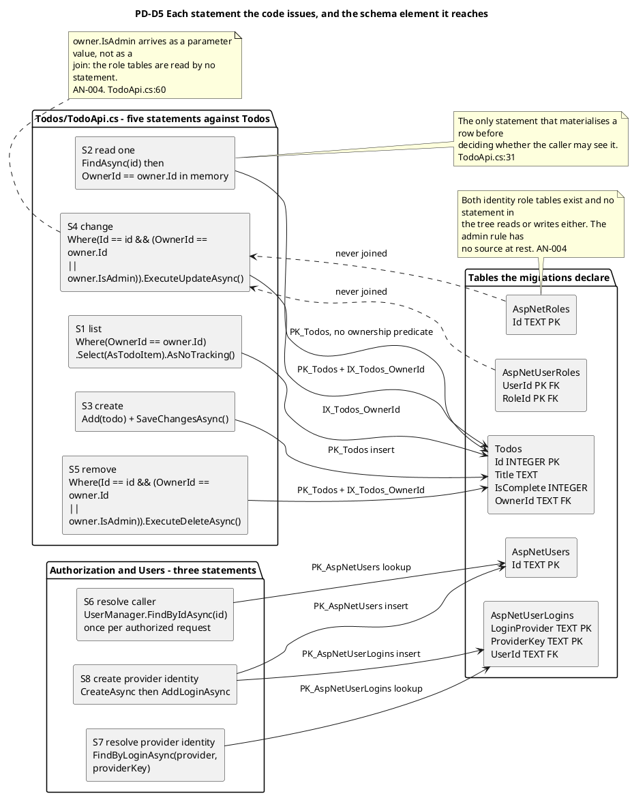

| Schema element or rule | The statement that exercises it | Confirmed | Anchor |
|---|---|---|---|
| Ownership association, `FK_Todos_AspNetUsers_OwnerId` | The insert assigns `OwnerId = owner.Id`; the predicate reads `t.OwnerId == owner.Id` in three statements | Yes | `Todo.Api/Todos/TodoApi.cs:26,33,41-45,60,70` |
| `OwnerId` never crosses the wire | The create body is CLS-002, three properties and no owner; the projection `AsTodoItem` drops `OwnerId` | Yes | `Todo.Api/Todos/Todo.cs:15-21,23-34` |
| `PK_Todos` | `db.Todos.FindAsync(id)`; `Where(t => t.Id == id …)` in the update and the delete | Yes | `Todo.Api/Todos/TodoApi.cs:31,60,70` |
| `IX_Todos_OwnerId` | The list predicate, and the `OwnerId` half of the update and delete predicates | Yes | `Todo.Api/Todos/TodoApi.cs:26,60,70` |
| `Todos.Title` NOT NULL | `POST` writes `Title`; `PUT` writes `Title` and `IsComplete` together — no statement writes a NULL title | Yes | `Todo.Api/Todos/TodoApi.cs:41-45,62-63` |
| `Todos.IsComplete` never set on insert | The create copies `Title` alone, so every new row carries the CLR default `false`; only `PUT` changes it | Yes | `Todo.Api/Todos/TodoApi.cs:41-45,63` |
| Cascade `R6` | No statement deletes an `AspNetUsers` row; the test host's `Dispose` drops the whole in-memory database instead | **Present, unexercised** | `Todo.Api/Migrations/20230714032431_ForeignKeyChange.cs:41`; `Todo.Api.Tests/TodoApplication.cs` |
| `PK_AspNetUsers` | `userManager.FindByIdAsync(id)` once per authorized request, inside the claims transformation | Yes | `Todo.Api/Authorization/CurrentUserExtensions.cs:22-26` |
| `PK_AspNetUserLogins` | `FindByLoginAsync(provider, providerKey)`, then `AddLoginAsync` when no row matches | Yes | `Todo.Api/Users/UsersApi.cs:36-46` |
| `AspNetUsers.UserName` nullable | `new TodoUser() { UserName = userInfo.Username }` on the provider path; the Identity register path supplies one | Yes | `Todo.Api/Users/UsersApi.cs:42` |
| `AspNetRoles`, `AspNetUserRoles`, `AspNetRoleClaims`, `AspNetUserClaims` | No statement in the tree inserts a role, a role claim or a user claim | **Absent** — the tables exist and nothing writes them | `Todo.Api/Migrations/20221123071234_Initial.cs`; AN-004 |
| `AspNetUserTokens` | No statement reads or writes a row. The browser's access token lives in the session cookie's token set, not here | **Absent** | `Todo.Web/Server/AuthApi.cs:104-121`; `Todo.Web/Server/TodoApi.cs:18-22` |
| `R11` admin admission | `owner.IsAdmin` is a bool computed from the principal and passed into the statement as a parameter — never a join to `AspNetUserRoles` | **Code-only, with no source at rest** | `Todo.Api/Authorization/CurrentUser.cs:12`; `Todo.Api/Todos/TodoApi.cs:33,60,70` |
| `R5` user-name uniqueness | No delivery statement queries `NormalizedUserName`; the framework's user manager does | **Framework path only** | `Todo.Api/Migrations/20221123071234_Initial.cs:243-247` |
| `N1` email uniqueness | No delivery statement queries `NormalizedEmail`, and no UNIQUE index exists on it | **Unenforced by the store** | `Todo.Api/Migrations/20221123071234_Initial.cs:232-236` |

**Single-task authorization has two different shapes.** The item read materialises the row and then decides in memory (`R9`), while the update and the delete push the whole predicate into the statement (`R8`). Both admit the same two callers, so the difference is a performance property rather than a behavioural one — but it means `PK_Todos` alone serves the item read, whereas the update and the delete are served by `PK_Todos` and `IX_Todos_OwnerId` together.

**The list and the item operations disagree on who may see a row** (`R10` against `R8`/`R9`), which AN-018 records. The schema is neutral: `IX_Todos_OwnerId` serves either predicate, and nothing in the store can enforce or prevent either. The disagreement is in code.

## Domain Model
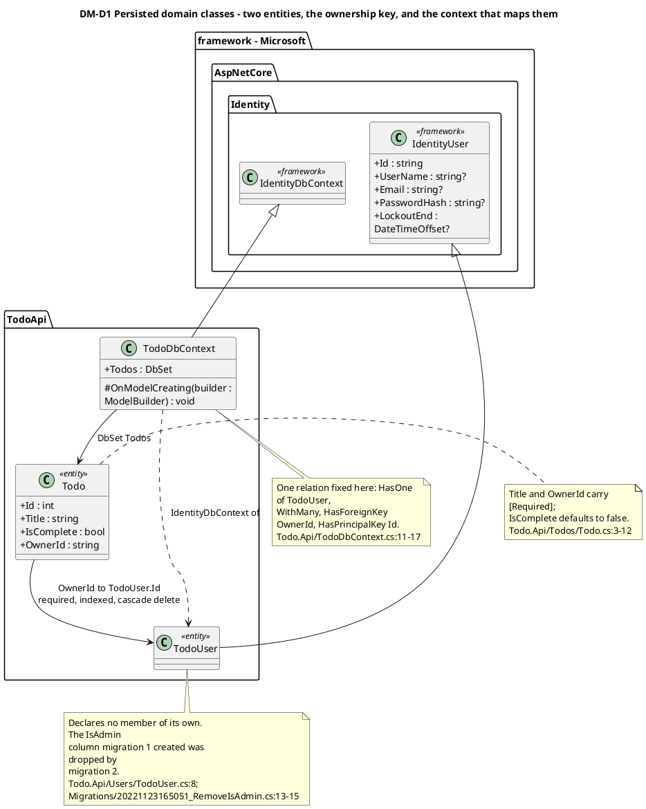

### CLS-001 Todo — the task row

| Attribute | Type | Constraint the code declares | Anchor |
|---|---|---|---|
| `Id` | `int` | Integer key, autoincrement in the schema | `Todo.Api/Todos/Todo.cs:5` |
| `Title` | `string` | `[Required]`, initialised to `default!` | `Todo.Api/Todos/Todo.cs:6-7` |
| `IsComplete` | `bool` | defaults to `false`; written only by the update statement | `Todo.Api/Todos/Todo.cs:8` |
| `OwnerId` | `string` | `[Required]`, initialised to `default!`; foreign key to `TodoUser.Id` | `Todo.Api/Todos/Todo.cs:10-11` |

| Operation | Kind | What it does | Anchor |
|---|---|---|---|
| — | — | The class declares no operation. It is a property bag read and written by endpoint statements | `Todo.Api/Todos/Todo.cs:3-12` |

| Relationship | Target | Multiplicity | How it is declared | Anchor |
|---|---|---|---|---|
| Ownership | CLS-007 `TodoUser` | one owner to zero or more tasks; the task side is required | `HasOne<TodoUser>().WithMany().HasForeignKey(t => t.OwnerId).HasPrincipalKey(u => u.Id)` — declared in the context, not on either class, and no navigation property exists on either side | `Todo.Api/TodoDbContext.cs:12-16` |

The relation's principal key was `AspNetUsers.UserName` and was re-pointed to `AspNetUsers.Id` by the third migration; the index `IX_Todos_OwnerId` and cascade delete were created with the table and survive the re-point (`Todo.Api/Migrations/20221123071234_Initial.cs:220-247`; `Todo.Api/Migrations/20230714032431_ForeignKeyChange.cs:12-47`).

### CLS-007 TodoUser — the account row

| Attribute | Type | Where it comes from | Anchor |
|---|---|---|---|
| every property the account has | — | `IdentityUser`. `TodoUser` adds nothing: its whole declaration is an empty body, and the comment above it says custom properties could be added there | `Todo.Api/Users/TodoUser.cs:6-8` |

`Id`, `UserName`, `Email`, `PasswordHash`, `LockoutEnd` and the rest are `IdentityUser`'s and are mapped by `IdentityDbContext<TodoUser>` (`Todo.Api/Program.cs:17-20`; `Todo.Api/Migrations/20221123071234_Initial.cs:36-66`). The `IsAdmin` column the first migration created on `AspNetUsers` was dropped by the second, so the class holds no administrative flag and the schema holds none (`Todo.Api/Migrations/20221123165051_RemoveIsAdmin.cs:13-15`).

### CLS-006 TodoDbContext — the persistence context

| Operation | Signature | What it does | Anchor |
|---|---|---|---|
| `Todos` | `DbSet<Todo>` get-only property | The one domain set the context exposes; every task statement starts here | `Todo.Api/TodoDbContext.cs:8` |
| `OnModelCreating` | `protected void OnModelCreating(builder : ModelBuilder)` | Fixes the ownership relation and delegates to the identity model | `Todo.Api/TodoDbContext.cs:10-19` |

The context derives from `IdentityDbContext<TodoUser>`, so the seven identity sets are its own without being declared. No `DbSet<TodoUser>` is declared and no user query in the delivery goes through the context: callers resolve an account through `UserManager<TodoUser>` instead (`Todo.Api/Authorization/CurrentUserExtensions.cs:11-30`). `Todos` is reached three ways — `Where(...).Select(...)`, `FindAsync(id)`, and `ExecuteUpdateAsync` / `ExecuteDeleteAsync` that bypass the change tracker entirely (`Todo.Api/Todos/TodoApi.cs:24-73`).

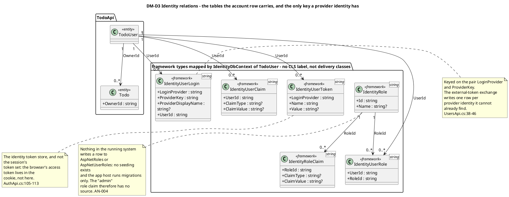

### The shape the caller sees — declared twice

```plantuml
@startuml
title DM-D2 The wire shapes, declared twice in two assemblies that do not reference each other

skinparam shadowing false
skinparam classAttributeIconSize 0
skinparam wrapWidth 205

package "Todo.Web.Shared - compiled into the client and the BFF" {
  class "TodoItem (shared)" as S1 {
    +Id : int
    +Title : string
    +IsComplete : bool
  }
  class "UserInfo (shared)" as S2 {
    +Email : string
    +Password : string
  }
  class "ExternalUserInfo (shared)" as S3 {
    +Username : string
    +ProviderKey : string
  }
  class "AuthToken (shared)" as S4 <<record>> {
    +Token : string
  }
}

package "Todo.Api - its own declaration, no reference to Shared" {
  class "TodoItem (API)" as A1 {
    +Id : int
    +Title : string
    +IsComplete : bool
  }
  class "UserInfo (API)" as A2 {
    +Email : string
    +Password : string
  }
  class "ExternalUserInfo (API)" as A3 {
    +Username : string
    +ProviderKey : string
  }
  class TodoMappingExtensions <<static>> {
    +AsTodoItem(todo : Todo) : TodoItem
  }
}

class Todo <<entity>> {
  +Id : int
  +Title : string
  +IsComplete : bool
  +OwnerId : string
}

S1 .. A1 : same shape, no link,\nno compiler check
S2 .. A2 : same shape
S3 .. A3 : same shape
TodoMappingExtensions ..> A1 : returns the API's TodoItem
Todo --> TodoMappingExtensions : projected by

note bottom of A1
  Todo.Api/Todos/Todo.cs:15-21 against
  Todo.Web/Shared/SharedClass.cs:5-11 - the same
  three properties on both sides, and nothing
  compares them. AN-003
end note

note bottom of A3
  The one /users request shape the validation
  filter covers, because MapUsers registers it.
  UsersApi.cs:18
end note

note bottom of S4
  AuthToken wraps the "accessToken" property name
  the Identity endpoints answer with, and is the
  only shape in Shared that has no twin in the API.
  SharedClass.cs:31
end note

@enduml
```

### Class inventory — every recovered domain class and its anchor

| ID | Class | Kind | Responsibility, as the code gives it | Anchor |
|---|---|---|---|---|
| CLS-001 | `Todo` | Entity, persisted | The task row: integer key, required title, completion flag, required owner key. Declares no operation | `Todo.Api/Todos/Todo.cs:3-12` |
| CLS-002 | `TodoItem` (API) | Request and response shape | What every task operation accepts and returns. Carries no `OwnerId`, so the ownership key cannot round-trip to a caller | `Todo.Api/Todos/Todo.cs:15-21` |
| CLS-003 | `TodoMappingExtensions` | Static mapping helper | Projects `Todo` onto `TodoItem`, copying `Id`, `Title`, `IsComplete` and dropping `OwnerId` | `Todo.Api/Todos/Todo.cs:23-34` |
| CLS-004 | `UserInfo` (API) | Request shape | Email and password, both required — the body of the Identity register and login calls | `Todo.Api/Users/TodoUser.cs:12-19` |
| CLS-005 | `ExternalUserInfo` (API) | Request shape | User name and a data-protection-protected provider key, both required — the body of the external-token exchange | `Todo.Api/Users/TodoUser.cs:21-28` |
| CLS-006 | `TodoDbContext` | Persistence context | `IdentityDbContext<TodoUser>` plus the `Todos` set and the one relation it fixes | `Todo.Api/TodoDbContext.cs:6-20` |
| CLS-007 | `TodoUser` | Entity, persisted | The account row. Declares no member of its own; every property is `IdentityUser`'s | `Todo.Api/Users/TodoUser.cs:8` |
| CLS-008 | `TodoItem` (shared) | Request and response shape | The same three properties as CLS-002, declared in the assembly the client and the BFF compile against | `Todo.Web/Shared/SharedClass.cs:5-11` |
| CLS-009 | `UserInfo` (shared) | Request shape | The same two properties as CLS-004, in the shared assembly | `Todo.Web/Shared/SharedClass.cs:13-20` |
| CLS-010 | `ExternalUserInfo` (shared) | Request shape | The same two properties as CLS-005, in the shared assembly | `Todo.Web/Shared/SharedClass.cs:22-29` |
| CLS-011 | `AuthToken` | Response shape, positional record | The single `accessToken` property the Identity endpoints answer with, read by the BFF's token client | `Todo.Web/Shared/SharedClass.cs:31` |

**Persisted types recorded without a design-class label.** Six entity types are mapped by `IdentityDbContext<TodoUser>` and by the migrations, and the delivery writes no class of its own for any of them: `IdentityUserLogin<string>`, `IdentityRole<string>`, `IdentityUserRole<string>`, `IdentityUserClaim<string>`, `IdentityRoleClaim<string>`, `IdentityUserToken<string>`. They are framework classes, not classes the Implementer writes, so they are named in DM-D3 and in the relationship table below rather than given `CLS` labels. The table that backs each is created by the first migration: `AspNetUserLogins` and `AspNetUserRoles` and `AspNetUserTokens` and `AspNetUserClaims` and `AspNetRoles` and `AspNetRoleClaims` (`Todo.Api/Migrations/20221123071234_Initial.cs:16-268`).

### Relationship inventory

| Relationship | From | To | Multiplicity | Declared how, and where | Anchor |
|---|---|---|---|---|---|
| Ownership | `Todo` (`OwnerId`) | `TodoUser` (`Id`) | 0..* tasks to 1 account; required on the task side | Fluent model in the context; no navigation property on either class | `Todo.Api/TodoDbContext.cs:12-16` |
| Provider identity | `IdentityUserLogin` | `TodoUser` | 0..* logins to 1 account, cascade delete | Framework model; the delivery writes one row | `Todo.Api/Users/UsersApi.cs:38-46` |
| Role membership | `IdentityUserRole` | `TodoUser`, `IdentityRole` | 0..* to each; composite key | Framework model; nothing writes a row | `Todo.Api/Migrations/20221123071234_Initial.cs:16-268` |
| Claims | `IdentityUserClaim`, `IdentityRoleClaim` | `TodoUser`, `IdentityRole` | 0..* to each | Framework model; nothing writes a row | `Todo.Api/Migrations/20221123071234_Initial.cs:16-268` |
| Identity tokens | `IdentityUserToken` | `TodoUser` | 0..* to 1 | Framework model; no delivery code writes it — the session's token set is a cookie, not a row | `Todo.Web/Server/AuthApi.cs:105-113` |

**No association exists between the two wire declarations or between them and the entities.** `TodoItem` neither references nor inherits `Todo`; the only link is `AsTodoItem`, one direction, in one assembly. `UserInfo` and `ExternalUserInfo` have no relation to `TodoUser` beyond being the shapes `UserManager` calls are handed.

### What the code does not hold

Recorded so that nothing is carried forward from what a task list is expected to have. Each of these was looked for in the domain and in the schema and is absent:

| Expected | What the code holds instead | Anchor |
|---|---|---|
| An account entity with an administrative flag | No flag. The column existed and was dropped; `IsAdmin` is read from a role claim, and no role row is ever written | `Todo.Api/Migrations/20221123165051_RemoveIsAdmin.cs:13-15`; `Todo.Api/Authorization/CurrentUser.cs:12` |
| A list, project, category or tag a task belongs to | Nothing. A task belongs to an account and to nothing else; there is one flat table | `Todo.Api/TodoDbContext.cs:8` |
| A due date, priority, ordering or audit column | Nothing. `Todo` holds four properties, and the list query declares no order | `Todo.Api/Todos/Todo.cs:3-12`; `Todo.Api/Todos/TodoApi.cs:24-27` |
| A domain operation, aggregate or invariant on either entity | Nothing. Both entities are property bags; every rule is a statement in an endpoint handler | `Todo.Api/Todos/TodoApi.cs:24-73` |
| A repository, unit-of-work or service abstraction over the store | Nothing. Handlers take `TodoDbContext` directly, and two of the five statements bypass the change tracker | `Todo.Api/Todos/TodoApi.cs:17-22,52-73` |
| A concurrency token or row version | Nothing. The update names two fields and carries no version check | `Todo.Api/Todos/TodoApi.cs:59-63` |

### What the classes do in the use cases

The classes above are the vocabulary; the behaviour is in the endpoint handlers and is realized in later phases. Two facts bind them and belong here.

`Todo` and `CLS-002`/`CLS-008` decide one rule between them: the request shape carries no `OwnerId`, so the owner is never read from a body and `OwnerId` never leaves the process. A create body that asks for a completed row still produces `IsComplete` false, because the insert copies only the title (`Todo.Api/Todos/TodoApi.cs:38-50`).

`CLS-007` is the class the ownership predicate is decided against, and the row that must exist before any task operation succeeds: the authorization handler fails the request when no account row matches the token's `NameIdentifier` (`Todo.Api/Authorization/CheckCurrentUserAuthHandler.cs:28-36`; `Todo.Api/Authorization/CurrentUserExtensions.cs:11-30`).

### Use cases no domain class realizes

| Use case | Why no domain class appears in its row | What it touches instead | Anchor |
|---|---|---|---|
| UC-004 Sign out | It persists nothing and reads no entity: one call signs the cookie scheme out, and the row the account lives in is untouched | The BFF's cookie scheme; the session cookie's token set, which `AuthApi.SignIn` wrote and this operation discards | `Todo.Web/Server/AuthApi.cs:40-52` |
| UC-011 Consult the API reference | It reads metadata the framework generated, not data the model holds | The OpenAPI document and the Scalar UI mapping; the bearer scheme it declares | `Todo.Api/Program.cs:46-58`; `Todo.Api/Extensions/OpenApiOptionsExtensions.cs` |

Both are recovered use cases with a real entry point; neither has a domain class in its path, so neither appears as a `Traces From` value above. That is the model's shape, not a gap in the realization.

### The token and provider-login shapes the session flows cross

Two framework types sit on every session path and the delivery declares a class for neither, so they carry no `CLS` label — the convention DM-D3 already applies to the six Identity entity types. They are recorded here because the use-case specifications name them at the steps where the domain model previously stopped.

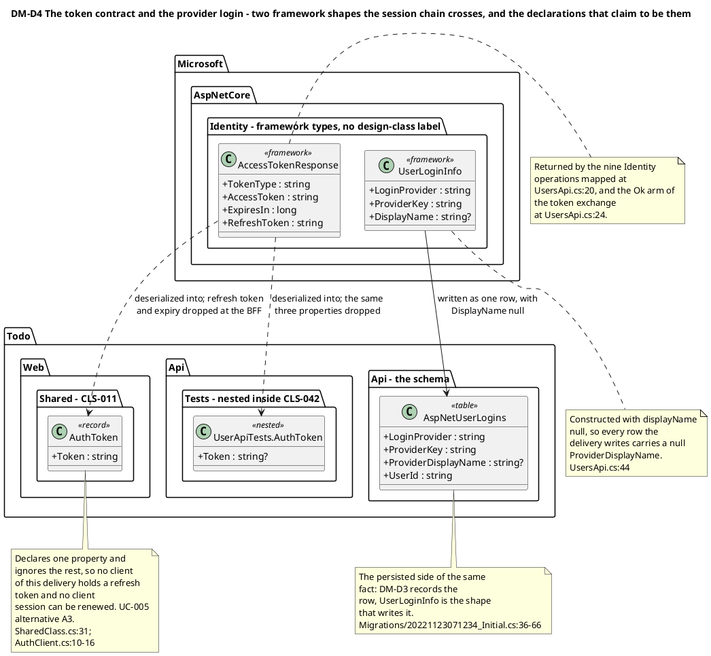

| Type | Where a completed flow names it | What the delivery fixes about it | Anchor |
|---|---|---|---|
| `AccessTokenResponse` | UC-001 step 4, UC-002 step 4, UC-003 step 7, UC-005 step 4 | The success body of the nine Identity operations and the `Ok` arm of the token exchange. Four properties; `accessToken` is the only one this delivery reads | `Todo.Api/Users/UsersApi.cs:20,24` |
| `UserLoginInfo` | UC-003 step 6 | Constructed with `displayName` null, so every row the exchange writes has a null `ProviderDisplayName` | `Todo.Api/Users/UsersApi.cs:44` |
| `AuthToken` (nested in CLS-042) | not on a use-case path | The third declaration of the token shape, after CLS-011 and the framework's own; asserts the `accessToken` property name from the test side | `Todo.Api.Tests/UserApiTests.cs:178-183` |

**The consequence for CLS-011.** It declares one property of four, so the BFF discards `refreshToken` and `expiresIn` on every successful sign-in, and no client of this delivery holds a refresh token. `UC-005` names `refresh` among the operations it covers, and no route from this delivery's screens or BFF reaches it: the account can be refreshed only by a caller that talks to `EP-015` directly with its own token. That is the same fact `AN-027` records from the account side, and it is the reason `UC-005`'s primary actor is `ACT-003` alone.

### The account row's two creation paths, and the state each leaves

`CLS-007` carries no member of its own, so its attribute state is decided entirely by which path creates the row. The two paths leave different state, and the difference is what `UC-003` and `UC-005` are shaped by.

| Path | `Id` | `UserName` | `Email` | `PasswordHash` | Anchor |
|---|---|---|---|---|---|
| UC-001 register on `EP-015` | generated by Identity | the submitted email | the submitted email | set from the submitted password | `Todo.Api/Users/UsersApi.cs:20` |
| UC-003 provider exchange on `EP-016` | generated by Identity | the submitted `Username` | never set — stays null | never set — stays null | `Todo.Api/Users/UsersApi.cs:40-46` |

A row created by the second path can therefore never sign in with a password, confirm an address, recover a password or refresh a token through the framework's own endpoints: `AN-027` states that exposure and `UC-003` alternative A5 and `UC-005` alternative A3 are its two visible faces. No column, constraint or check in the schema distinguishes the two paths, so the state is readable only by looking at the two nulls.

## Use-Case Realizations

Not yet recovered. The eleven use cases are recovered and their flows are documented in the Use-Case Model, each anchored to its entry point; what is missing here is the translation of those flows into collaborations of design objects.

The reason it is deferred is the phase, not a gap in the code: Excavation records the system as it is, and the architecturally significant paths are already stated as component collaborations in the Software Architecture Document — SEQ-1 for UC-006, SEQ-2 for UC-001, SEQ-3 for UC-003. Realizing each use case as messages between the classes recovered in "Design Packages and Classes" is later-phase work.

Two facts bound that future realization and are recorded here so it does not begin from a wrong premise.

| Fact | What it means for the realization | Anchor |
|---|---|---|
| No object owns a task operation | Each of the five task operations is an anonymous lambda registered by CLS-012; a realization cannot send a message to a "TodoService" because no such object exists | `Todo.Api/Todos/TodoApi.cs:24-73` |
| The session state is not an object either | CLS-023 writes the token into the cookie's token set and CLS-025 reads it back; neither holds it, so a realization of UC-006 has to model the cookie, not a session object | `Todo.Web/Server/AuthApi.cs:99-116`; `Todo.Web/Server/TodoApi.cs:18-22` |

## Design Packages and Classes
Thirty-one classes beyond the eleven already recovered as domain classes, in the packages below — one row per assembly and folder that declares a class — each anchored to the file that declares it.

**The packages are the assemblies and the folders, not namespaces.** Seven assemblies exist and are the real package boundaries. Inside them the API's five behavioural files all declare the single namespace `TodoApi`, so its folder structure carries no namespace of its own — `Todos/`, `Authorization/`, `Users/`, `Filters/` and `Extensions/` separate the files and nothing more. The entity files and the shared shapes declare no namespace at all and sit in the global namespace, which is why the client and the API can each declare a type named `TodoItem` without a clash.

### The anomalies these classes carry, and the two a reader may confuse

Four anomalies are cited repeatedly across this model, and two of them concern closely adjacent facts: the schema the migrations build, and the schema the test suite builds instead. Each citation below belongs to its own subject. A reader following AN-005 reaches test coverage; a reader following AN-025 reaches data conversion. Neither stands for the other anywhere in this model.

| Anomaly | Its subject | Where this model cites it | Anchor |
|---|---|---|---|
| AN-003 | The request contracts are declared twice, in two assemblies that do not reference each other, so nothing checks that they still agree | DM-D2, the note on CLS-D1, and the table of what the packages do not hold | `Todo.Api/Todos/Todo.cs:15-21`; `Todo.Web/Shared/SharedClass.cs:5-11` |
| AN-004 | The `admin` role is granted by nothing in the running system: no seeding exists, and the only code that adds the claim is the test harness | The note on CLS-013 in PKG-D1, the notes on `AspNetRoles` in DM-D3 and in PD-D2, and the `N6`/`R11` rows | `Todo.Api/Authorization/CurrentUser.cs:11-12`; `Todo.Api/Todos/TodoApi.cs:33,60,70`; `Todo.Api.Tests/TokenService.cs:16-19` |
| AN-005 | The test host builds its schema with `EnsureCreated` and never runs a migration, so a migration that no longer matches the model surfaces only where the app host runs it | The paragraph on the two schema-building mechanisms under Design Overview | `Todo.Api.Tests/TodoApplication.cs:11-14`; `TodoApp.AppHost/Extensions.cs:9-21` |
| AN-025 | The third migration re-pointed the owner key from `AspNetUsers.UserName` to `AspNetUsers.Id` and converted no row, so a database written by migration 1 or 2 holds user names under a constraint that now resolves identifiers | PD-D3 and the paragraphs on what that history means | `Todo.Api/Migrations/20230714032431_ForeignKeyChange.cs:9-44` |

The consequence for these packages: CLS-020 and CLS-021 are the two pipeline conventions bound at registration, and CLS-038 is the class that substitutes the persistence registration; AN-003 is carried by the class pairs CLS-002/CLS-008, CLS-004/CLS-009 and CLS-005/CLS-010, identical in shape and linked by no reference; AN-025 is carried by CLS-001 and CLS-006, whose `OwnerId` column is the one the third migration re-pointed.

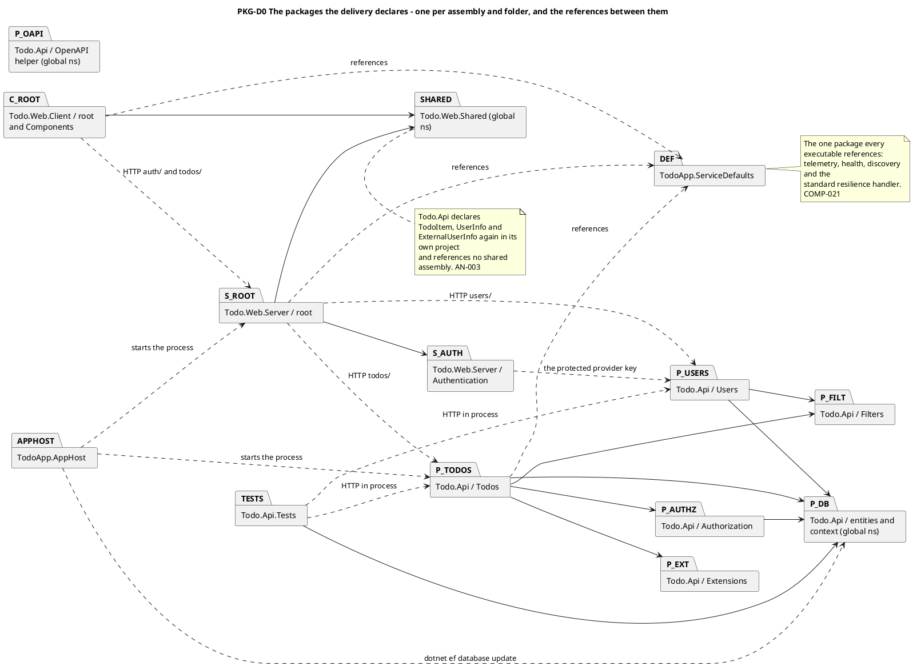

| Package | Assembly and namespace | Classes recovered | Component (SAD) | Cross-package dependencies |
|---|---|---|---|---|
| Todo.Api / Todos | `Todo.Api`, `TodoApi` | CLS-001, CLS-002, CLS-003, CLS-012 | COMP-011 | Authorization, Filters, Extensions, persistence |
| Todo.Api / Authorization | `Todo.Api`, `TodoApi` | CLS-013, CLS-014, CLS-015, CLS-016, CLS-017, CLS-018 | COMP-012, COMP-013 | persistence, through `UserManager<TodoUser>` |
| Todo.Api / Users | `Todo.Api`, `TodoApi` | CLS-004, CLS-005, CLS-019 | COMP-009, COMP-010 | Filters, persistence |
| Todo.Api / Filters | `Todo.Api`, `TodoApi` | CLS-020 | COMP-015 | none — framework types only |
| Todo.Api / Extensions | `Todo.Api`, `TodoApi`, global namespace | CLS-021, CLS-022 | COMP-014, COMP-017 | none — framework types only |
| Todo.Api / entities and context | `Todo.Api`, global namespace | CLS-001, CLS-006, CLS-007 | COMP-016 | none |
| Todo.Web.Server / root | `Todo.Web.Server` | CLS-023, CLS-024, CLS-025, CLS-026 | COMP-004, COMP-006, COMP-007, COMP-008 | Shared, Authentication, ServiceDefaults |
| Todo.Web.Server / Authentication | `Todo.Web.Server` | CLS-027, CLS-028, CLS-029, CLS-030, CLS-031 | COMP-005 | framework authentication types only |
| Todo.Web.Client | `Todo.Web.Client` | CLS-032, CLS-033, CLS-034, CLS-035 | COMP-001, COMP-002 | Shared, ServiceDefaults |
| Todo.Web.Shared | `Todo.Web.Shared`, global namespace | CLS-008, CLS-009, CLS-010, CLS-011 | COMP-019 | none |
| TodoApp.AppHost | `TodoApp.AppHost`, global namespace | CLS-036 | COMP-020 | none — it starts processes |
| TodoApp.ServiceDefaults | `TodoApp.ServiceDefaults`, `Microsoft.Extensions.Hosting` | CLS-037 | COMP-021 | none |
| Todo.Api.Tests | `Todo.Api.Tests`, `TodoApi.Tests` and `TodoApi` | CLS-038, CLS-039, CLS-040, CLS-041, CLS-042 | COMP-022 | Todo.Api by project reference |

Three recovered components add no class of their own: COMP-003 (client bootstrap, a top-level statement block in `Todo.Web/Client/Program.cs`), COMP-018 (HTTP logging, four configuration lines in `Todo.Api/Program.cs:35-46`) and the Razor pipeline registration in COMP-004. They are configuration, not design elements, and no `CLS` label is minted for them.

**Todo.Api / Todos — the five task operations.**

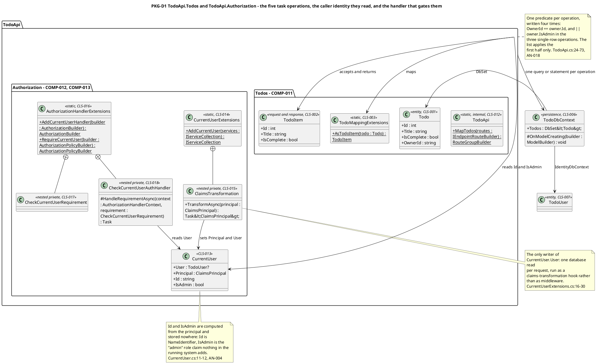

CLS-012 `TodoApi` — the endpoint group.

| Operation | Signature | What it does | Anchor |
|---|---|---|---|
| `MapTodos` | `static RouteGroupBuilder MapTodos(this IEndpointRouteBuilder routes)` | Maps `/todos`, tags it `Todos`, and fixes the three conventions every operation inherits: `RequireAuthorization(pb => pb.RequireCurrentUser())`, `RequirePerUserRateLimit()`, `WithParameterValidation(typeof(TodoItem))` | `Todo.Api/Todos/TodoApi.cs:8-22` |

| Registered operation | Route and verb | Handler signature the code gives it | Anchor |
|---|---|---|---|
| List | `GET /todos/` | `async (TodoDbContext db, CurrentUser owner) => Task<List<TodoItem>>` | `Todo.Api/Todos/TodoApi.cs:24-27` |
| Read one | `GET /todos/{id}` | `async Task<Results<Ok<TodoItem>, NotFound>> (TodoDbContext db, int id, CurrentUser owner)` | `Todo.Api/Todos/TodoApi.cs:29-37` |
| Create | `POST /todos/` | `async Task<Created<TodoItem>> (TodoDbContext db, TodoItem newTodo, CurrentUser owner)` | `Todo.Api/Todos/TodoApi.cs:39-50` |
| Change | `PUT /todos/{id}` | `async Task<Results<Ok, NotFound, BadRequest>> (TodoDbContext db, int id, TodoItem todo, CurrentUser owner)` | `Todo.Api/Todos/TodoApi.cs:52-66` |
| Remove | `DELETE /todos/{id}` | `async Task<Results<NotFound, Ok>> (TodoDbContext db, int id, CurrentUser owner)` | `Todo.Api/Todos/TodoApi.cs:68-74` |

The five handlers are anonymous lambda delegates declared inline in `MapTodos`, so the class declares exactly one named operation. There is no controller, no handler type and no service: the statements sit inside the registration call, which is why the ownership predicate, the projection and the update are readable only as five separate expressions in one method (`Todo.Api/Todos/TodoApi.cs:24-73`). The class is `internal static` and declares no field; its state is the group it returns.

CLS-013 `CurrentUser` — the caller, as a scoped service.

| Attribute | Declared as | What the code gives it | Anchor |
|---|---|---|---|
| `User` | `public TodoUser? User { get; set; }` | The account row resolved for this request, or `null` when the token names none | `Todo.Api/Authorization/CurrentUser.cs:7` |
| `Principal` | `public ClaimsPrincipal Principal { get; set; } = default!` | The request's principal, assigned by the claims transformation; `default!` means it is unset until then | `Todo.Api/Authorization/CurrentUser.cs:8` |
| `Id` | `public string Id => Principal.FindFirstValue(ClaimTypes.NameIdentifier)!` | Get-only, re-computed on every read; the `!` is unchecked, so an absent claim surfaces as a null string at the call site | `Todo.Api/Authorization/CurrentUser.cs:10` |
| `IsAdmin` | `public bool IsAdmin => Principal.IsInRole("admin")` | Get-only, computed from a role claim | `Todo.Api/Authorization/CurrentUser.cs:11` |

The class declares no operation. It is a request-scoped carrier whose two computed properties re-derive their value on every access: `Id` is read once per operation in CLS-012, `IsAdmin` once per single-row operation (`Todo.Api/Todos/TodoApi.cs:26,33,60,70`).

CLS-014 `CurrentUserExtensions` and CLS-015 `ClaimsTransformation`.

| Class | Operation | Signature | What it does | Anchor |
|---|---|---|---|---|
| CLS-014 | `AddCurrentUser` | `static IServiceCollection AddCurrentUser(this IServiceCollection services)` | Registers CLS-013 as scoped and CLS-015 as the `IClaimsTransformation` | `Todo.Api/Authorization/CurrentUserExtensions.cs:8-13` |
| CLS-015 | `TransformAsync` | `Task<ClaimsPrincipal> TransformAsync(ClaimsPrincipal principal)` | Sets `currentUser.Principal`, resolves the account by `NameIdentifier`, stores it on `currentUser.User`, returns the principal unchanged | `Todo.Api/Authorization/CurrentUserExtensions.cs:16-30` |

CLS-015 is `private sealed` and nested inside CLS-014, so it is registered and not referenceable outside the file. It is the mechanism by which every authorized request pays a database read: `FindByIdAsync` runs inside the authorization pipeline, before any endpoint handler (`Todo.Api/Authorization/CurrentUserExtensions.cs:22-26`).

CLS-016, CLS-017 and CLS-018 — one requirement, its handler and the two registration methods.

| Class | Kind | Operations and members | Anchor |
|---|---|---|---|
| CLS-016 `AuthorizationHandlerExtensions` | `public static`, declared in the file named for the handler | `AddCurrentUserHandler(AuthorizationBuilder)` registers the handler; `RequireCurrentUser(AuthorizationPolicyBuilder)` requires an authenticated user and adds the requirement | `Todo.Api/Authorization/CheckCurrentUserAuthHandler.cs:5-20` |
| CLS-017 `CheckCurrentUserRequirement` | `private class`, nested, `IAuthorizationRequirement` | No member — a marker requirement | `Todo.Api/Authorization/CheckCurrentUserAuthHandler.cs:22` |
| CLS-018 `CheckCurrentUserAuthHandler` | `private class`, nested, extends `AuthorizationHandler<CheckCurrentUserRequirement>` | `protected override Task HandleRequirementAsync(AuthorizationHandlerContext, CheckCurrentUserRequirement)` — succeeds only when `currentUser.User is not null`; the lockout check is written as a `TODO` and not performed | `Todo.Api/Authorization/CheckCurrentUserAuthHandler.cs:26-35` |

The file is named `CheckCurrentUserAuthHandler.cs` while the only public type in it is the extensions class: a reader searching for `CheckCurrentUserAuthHandler` finds a `private` nested type. The three types are one unit of design and are unreachable from outside the file except through CLS-016.

**Todo.Api / Users, Filters, Extensions and the OpenAPI helper.**

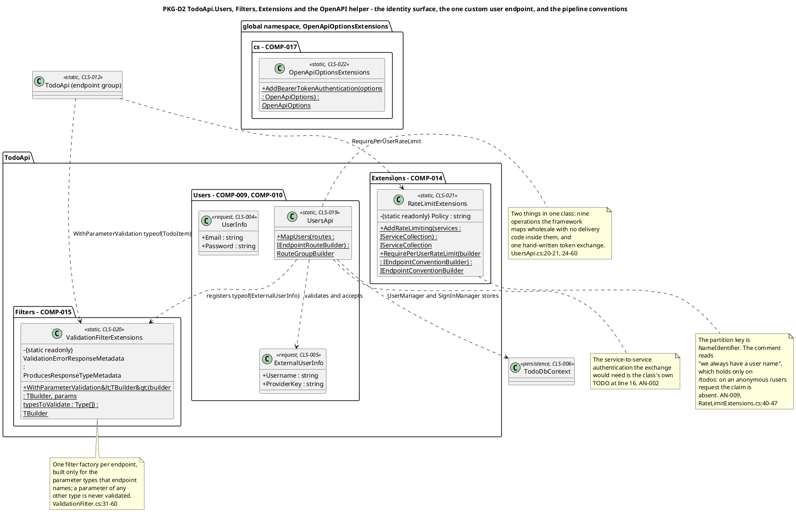

CLS-019 `UsersApi` — nine mapped operations and one written one.

| Operation | Signature | What it does | Anchor |
|---|---|---|---|
| `MapUsers` | `static RouteGroupBuilder MapUsers(this IEndpointRouteBuilder routes)` | Maps `/users`, tags it `Users`, registers `WithParameterValidation(typeof(ExternalUserInfo))`, calls `MapIdentityApi<TodoUser>()` and maps `POST /users/token/{provider}` | `Todo.Api/Users/UsersApi.cs:9-62` |

| Registered operation | Verb and route | Origin | Anchor |
|---|---|---|---|
| Nine Identity operations | `POST register`, `POST login`, `POST refresh`, `GET confirmEmail`, `POST resendConfirmationEmail`, `POST forgotPassword`, `POST resetPassword`, `POST manage/2fa`, `GET or POST manage/info`, all under `/users` | The framework, mapped wholesale by `MapIdentityApi<TodoUser>()` — no delivery code inside any of them | `Todo.Api/Users/UsersApi.cs:20` |
| Token exchange | `POST /users/token/{provider}` | The delivery's own handler, written because `MapIdentityApi` exposes no external-login endpoint | `Todo.Api/Users/UsersApi.cs:24-60` |

The exchange handler's six parameters are the whole of its design: `string provider`, `ExternalUserInfo userInfo`, `UserManager<TodoUser>`, `SignInManager<TodoUser>` and `IDataProtectionProvider`, returning `Task<Results<Ok<AccessTokenResponse>, SignInHttpResult, ValidationProblem>>`. It unprotects the provider key with a protector named after the provider, resolves the account by the `(provider, key)` pair, creates the account and the login row when neither exists, and answers `TypedResults.SignIn(principal)` on success or a validation problem built from `IdentityResult.Errors` (`Todo.Api/Users/UsersApi.cs:26-58`). The class declares no field and holds no state; the handler is an inline lambda.

CLS-004 and CLS-005 are recorded again in this package because CLS-019 names them — `typeof(ExternalUserInfo)` at line 18 and the `ExternalUserInfo` parameter at line 24. Their attributes are in the Domain Model and are not restated here.

CLS-020 `ValidationFilterExtensions` — the endpoint filter factory.

| Member | Declared as | What it does | Anchor |
|---|---|---|---|
| `ValidationErrorResponseMetadata` | `private static readonly ProducesResponseTypeMetadata` | The 400 `application/problem+json` metadata added to an endpoint that has at least one validatable parameter | `Todo.Api/Filters/ValidationFilter.cs:9-10` |
| `WithParameterValidation<TBuilder>` | `static TBuilder WithParameterValidation<TBuilder>(this TBuilder, params Type[] typesToValidate)` | Reads the endpoint's `MethodInfo`, collects the positions of parameters whose type is named in `typesToValidate`, and adds one filter factory that runs `MiniValidator.TryValidate` over each | `Todo.Api/Filters/ValidationFilter.cs:12-62` |

The filter is attached per endpoint and per named type: `/todos` names CLS-002 and `/users` names CLS-005 alone, so CLS-004 — the body of the register and login calls the framework maps — is never validated by this filter (`Todo.Api/Todos/TodoApi.cs:22`; `Todo.Api/Users/UsersApi.cs:18`).

CLS-021 `RateLimitExtensions` — the per-caller bucket.

| Member | Declared as | What it fixes | Anchor |
|---|---|---|---|
| `Policy` | `private static readonly string Policy = "PerUserRatelimit"` | One policy name, private to the file, shared by the registration and the convention | `Todo.Api/Extensions/RateLimitExtensions.cs:9` |
| `AddRateLimiting` | `static IServiceCollection AddRateLimiting(this IServiceCollection services)` | Sets `ReplenishmentPeriod` 10 s, `AutoReplenishment` true, `TokenLimit` 100, `TokensPerPeriod` 100, `QueueLimit` 100; binds them to a `RateLimiting` section; sets `RejectionStatusCode` 429; adds the policy partitioned on `NameIdentifier` | `Todo.Api/Extensions/RateLimitExtensions.cs:11-51` |
| `RequirePerUserRateLimit` | `static IEndpointConventionBuilder RequirePerUserRateLimit(this IEndpointConventionBuilder builder)` | Applies the policy to one endpoint group | `Todo.Api/Extensions/RateLimitExtensions.cs:53-56` |

CLS-022 `OpenApiOptionsExtensions` — the document's security scheme.

| Operation | Signature | What it does | Anchor |
|---|---|---|---|
| `AddBearerTokenAuthentication` | `static OpenApiOptions AddBearerTokenAuthentication(this OpenApiOptions options)` | Adds a document transformer that registers the bearer scheme, and an operation transformer that applies the security requirement to every operation carrying `IAuthorizeData` | `Todo.Api/Extensions/OpenApiOptionsExtensions.cs:7-48` |

It names `IdentityConstants.BearerScheme` rather than a local constant, so it is coupled to the framework's scheme name (`Todo.Api/Extensions/OpenApiOptionsExtensions.cs:10,25,31`).

**Todo.Web.Server — the Razor host and the session endpoints.**

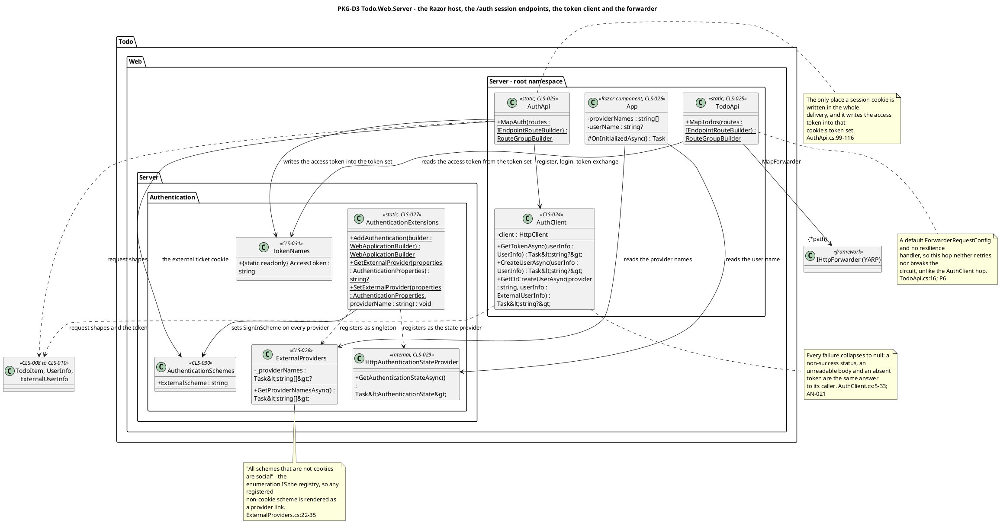

CLS-023 `AuthApi` — the five session endpoints.

| Registered operation | Verb and route | Authorization | What it does | Anchor |
|---|---|---|---|---|
| Register | `POST /auth/register` | none declared on the endpoint | Calls `AuthClient.CreateUserAsync`; answers `Results.Unauthorized()` on `null`, else writes the cookie | `Todo.Web/Server/AuthApi.cs:13-23` |
| Login | `POST /auth/login` | none declared on the endpoint | Calls `AuthClient.GetTokenAsync`; answers 401 on `null`, else writes the cookie | `Todo.Web/Server/AuthApi.cs:25-35` |
| Logout | `POST /auth/logout` | `RequireAuthorization()` | Signs the cookie scheme out; remote-provider sign-out is commented out with a `TODO` | `Todo.Web/Server/AuthApi.cs:37-50` |
| Challenge | `GET /auth/login/{provider}` | none | `Results.Challenge` with the route segment as the scheme list and `/auth/signin/{provider}` as the redirect | `Todo.Web/Server/AuthApi.cs:52-62` |
| Callback | `GET /auth/signin/{provider}` | none | Authenticates the external cookie, protects the provider id, calls `AuthClient.GetOrCreateUserAsync`, writes the cookie when a token comes back, signs the external cookie out on every path and redirects to `/` | `Todo.Web/Server/AuthApi.cs:64-97` |

| Private operation | Signature | What it does | Anchor |
|---|---|---|---|
| `SignIn` | `static IResult SignIn(UserInfo userInfo, string token)` | Delegates with the email as both identifier and name | `Todo.Web/Server/AuthApi.cs:99-102` |
| `SignIn` | `static IResult SignIn(string userId, string userName, string token, string? providerName)` | Builds the `NameIdentifier` and `Name` claims, stores the provider name in the properties, stores the token under `TokenNames.AccessToken`, returns `Results.SignIn` on the cookie scheme | `Todo.Web/Server/AuthApi.cs:104-121` |

The class declares no field: its dependencies arrive as handler parameters.

CLS-024 `AuthClient` — the token client.

| Operation | Signature | What it posts, what it answers | Anchor |
|---|---|---|---|
| `GetTokenAsync` | `Task<string?> GetTokenAsync(UserInfo userInfo)` | `POST users/login`; returns `AuthToken.Token`, or `null` on any non-success | `Todo.Web/Server/AuthClient.cs:5-16` |
| `CreateUserAsync` | `Task<string?> CreateUserAsync(UserInfo userInfo)` | `POST users/register`, then `GetTokenAsync` on success; one `null` covers a refused registration and an unreachable API | `Todo.Web/Server/AuthClient.cs:18-28` |
| `GetOrCreateUserAsync` | `Task<string?> GetOrCreateUserAsync(string provider, ExternalUserInfo userInfo)` | `POST users/token/{provider}`; returns the token or `null` | `Todo.Web/Server/AuthClient.cs:30-39` |

The class takes its `HttpClient` by primary constructor; the base address `http://todoapi` and the resilience handler it inherits are fixed at registration in `Program.cs`, not by the class (`Todo.Web/Server/Program.cs:23-26`).

CLS-025 `TodoApi` (BFF forwarder).

| Operation | Signature | What it does | Anchor |
|---|---|---|---|
| `MapTodos` | `static RouteGroupBuilder MapTodos(this IEndpointRouteBuilder routes)` | Maps `/todos` with `RequireAuthorization()`, then `MapForwarder("{*path}", "http://todoapi", new ForwarderRequestConfig(), …)` with one request transform that reads the access token from the session's token set and writes `Authorization: Bearer <token>` | `Todo.Web/Server/TodoApi.cs:9-26` |

It accepts any method and any sub-path; no route, verb or shape is declared here. Its behaviour is a configuration object plus one transform.

CLS-026 `App` — the Razor host component.

| Member | Declared as | What the code gives it | Anchor |
|---|---|---|---|
| page route | `@page "/"` | The host's single page route | `Todo.Web/Server/App.razor:5` |
| `providerNames` | `string[] providerNames = Array.Empty<string>()` | The scheme names CLS-028 returned, passed into the interactive component | `Todo.Web/Server/App.razor:38,46` |
| `userName` | `string? userName` | `authState.User.Identity.Name` or null, passed into the interactive component | `Todo.Web/Server/App.razor:39,45` |
| `OnInitializedAsync` | `protected override async Task OnInitializedAsync()` | Resolves the authentication state through CLS-029 and the provider names through CLS-028 | `Todo.Web/Server/App.razor:41-47` |

It renders CLS-033 under `RenderMode.InteractiveWebAssembly` and passes both values as parameters (`Todo.Web/Server/App.razor:24`). It is the only place the server-side session state crosses into the browser-hosted component.

CLS-027 to CLS-031 — the authentication package.

| Class | Members | What fixes the design | Anchor |
|---|---|---|---|
| CLS-027 `AuthenticationExtensions` | `AddAuthentication(WebApplicationBuilder)`; private delegate `ExternalAuthProvider`; `GetExternalProvider` and `SetExternalProvider`; private `SetAuth0SignInScheme`; private static readonly `ExternalProviderKey = "ExternalProviderName"` | Registers two cookie schemes and four providers from a dictionary, each only when its `Authentication:Schemes:{name}` section exists; forces `SignInScheme` to the external cookie; registers CLS-028 as a singleton and CLS-029 as the state provider | `Todo.Web/Server/Authentication/AuthenticationExtensions.cs:13-107` |
| CLS-028 `ExternalProviders` | `private Task<string[]>? _providerNames`; `GetProviderNamesAsync()`; private `GetProviderNamesAsyncCore()` | Enumerates every registered scheme, skips the two cookie schemes, returns the rest; caches the result for the process lifetime | `Todo.Web/Server/Authentication/ExternalProviders.cs:6-38` |
| CLS-029 `HttpAuthenticationStateProvider` | `GetAuthenticationStateAsync()` | Returns the HTTP context's principal, or an empty one when there is no context; `internal`, so only the assembly can construct it | `Todo.Web/Server/Authentication/HttpAuthenticationStateProvider.cs:3-11` |
| CLS-030 `AuthenticationSchemes` | `static string ExternalScheme => "External"` | A get-only property rather than a constant; the external scheme's name in one place | `Todo.Web/Server/Authentication/AuthenticationSchemes.cs:6` |
| CLS-031 `TokenNames` | `static readonly string AccessToken = "accessToken"` | The key the token is stored under in the cookie's token set and read back by CLS-025 | `Todo.Web/Server/Authentication/TokenNames.cs:5` |

The provider set is configuration-driven and the code is correct about it: with no `Authentication:Schemes` section in `appsettings.json` the loop registers nothing, CLS-028 returns an empty array, and CLS-034 renders no provider link. The four providers the code names are GitHub, Google, Microsoft and Auth0 (`Todo.Web/Server/Authentication/AuthenticationExtensions.cs:48-53`).

**Todo.Web.Client — the gateway and the three components.**

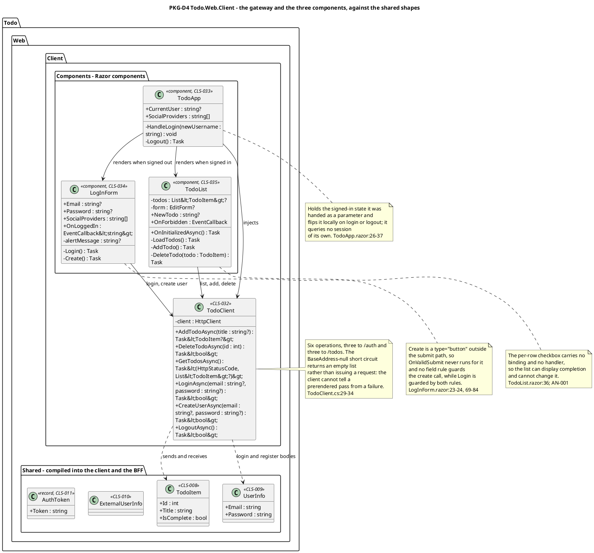

CLS-032 `TodoClient` — the six operations.

| Operation | Signature | Route it calls | Failure it returns, and what it discards | Anchor |
|---|---|---|---|---|
| `AddTodoAsync` | `Task<TodoItem?> AddTodoAsync(string? title)` | `POST todos` | `null` for an empty title before any request exists, and for any non-success status | `Todo.Web/Client/TodoClient.cs:9-25` |
| `DeleteTodoAsync` | `Task<bool> DeleteTodoAsync(int id)` | `DELETE todos/{id}` | `false` for any non-success | `Todo.Web/Client/TodoClient.cs:27-31` |
| `GetTodosAsync` | `Task<(HttpStatusCode, List<TodoItem>?)> GetTodosAsync()` | `GET todos` | `(200, empty)` with no request when `BaseAddress` is null; otherwise the status, and the rows on success | `Todo.Web/Client/TodoClient.cs:33-50` |
| `LoginAsync` | `Task<bool> LoginAsync(string? email, string? password)` | `POST auth/login` | `false` for an empty field or any non-success | `Todo.Web/Client/TodoClient.cs:52-62` |
| `CreateUserAsync` | `Task<bool> CreateUserAsync(string? email, string? password)` | `POST auth/register` | `false` for an empty field or any non-success | `Todo.Web/Client/TodoClient.cs:64-74` |
| `LogoutAsync` | `Task<bool> LogoutAsync()` | `POST auth/logout` | `false` for any non-success | `Todo.Web/Client/TodoClient.cs:76-80` |

Six operations are public and only `GetTodosAsync` returns a status; it is the only caller that distinguishes 401 and 403 from other failures (`Todo.Web/Client/Components/TodoList.razor:60-63`). The class holds no state beyond its `HttpClient`; the base address and the `X-Requested-With` header are set in the client's `Program.cs` (`Todo.Web/Client/Program.cs:7-13`).

CLS-033, CLS-034 and CLS-035 — the three components.

| Class | Parameters and fields | Operations | What the design gives it | Anchor |
|---|---|---|---|---|
| CLS-033 `TodoApp` | `[Parameter] string? CurrentUser`; `[Parameter] string[] SocialProviders` | `void HandleLogin(string)`, `async Task Logout()` | Renders the logged-in header and CLS-035 when `CurrentUser` is non-empty, else CLS-034; sets `CurrentUser` locally on login and to `null` on a successful logout | `Todo.Web/Client/TodoApp.razor:3-38` |
| CLS-034 `LogInForm` | `[Parameter] EventCallback<string> OnLoggedIn`; `[Parameter] string[] SocialProviders`; `string? alertMessage`; `[Required][StringLength(256)] string? Email`; `[Required][StringLength(32, MinimumLength = 6)][RegularExpression] string? Password` | `async Task Login()`, `async Task Create()` | Two submit paths with unequal guards, one provider-link loop, and one `alertMessage` string for every failure | `Todo.Web/Client/Components/LogInForm.razor:3-98` |
| CLS-035 `TodoList` | `List<TodoItem>? todos`; `EditForm? form`; `[Required] string? NewTodo`; `[Parameter] EventCallback OnForbidden` | `OnInitializedAsync()`, `async Task LoadTodos()`, `async Task AddTodo()`, `async Task DeleteTodo(TodoItem)` | Loads on initialisation, raises `OnForbidden` on 401 or 403, appends the created row locally, removes the deleted row locally | `Todo.Web/Client/Components/TodoList.razor:3-76` |

CLS-034 is the only component holding validation rules of its own, and they are not the API's: the password expression demands a lower-case letter, an upper-case letter, a digit and a special character in 6 to 32 characters, while the API's Identity configuration applies the framework's own default policy (`Todo.Web/Client/Components/LogInForm.razor:70-77`; `Todo.Api/Program.cs:17-20`). `Create` bypasses those rules entirely, which is the local half of the cause AN-021 records.

**AppHost, ServiceDefaults and the test suite.**

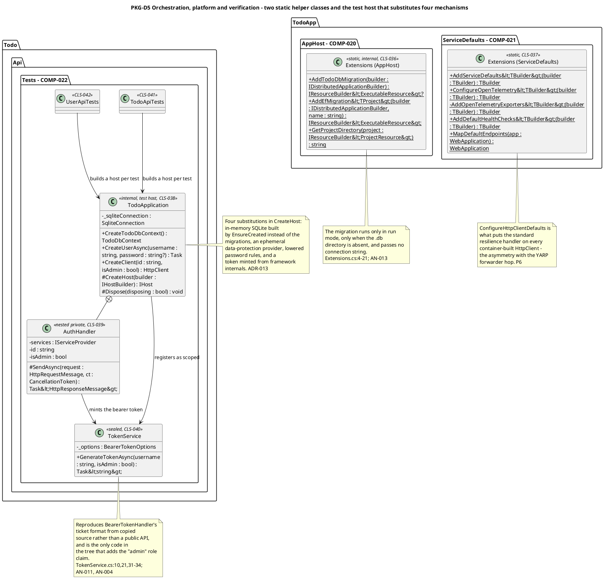

| Class | Members | What fixes the design | Anchor |
|---|---|---|---|
| CLS-036 `Extensions` (AppHost) | `AddTodoDbMigration(IDistributedApplicationBuilder) : IResourceBuilder<ExecutableResource>?`; `AddEfMigration<TProject>(…)`; `GetProjectDirectory(IResourceBuilder<ProjectResource>) : string` | Returns `default` — no migration — unless the host is in run mode and `.db` is absent; installs `dotnet-ef` globally, then runs `ef database update --no-build`, and everything waits on both | `TodoApp.AppHost/Extensions.cs:3-34` |
| CLS-037 `Extensions` (ServiceDefaults) | `AddServiceDefaults<TBuilder>`; `ConfigureOpenTelemetry<TBuilder>`; private `AddOpenTelemetryExporters<TBuilder>`; `AddDefaultHealthChecks<TBuilder>`; `MapDefaultEndpoints(WebApplication)` | Registers telemetry, a `self` liveness check, service discovery, and `ConfigureHttpClientDefaults` with `AddStandardResilienceHandler` and `AddServiceDiscovery`; maps `/health` and `/alive` in Development only | `TodoApp.ServiceDefaults/Extensions.cs:17-130` |
| CLS-038 `TodoApplication` | `SqliteConnection _sqliteConnection = new("Filename=:memory:")`; `CreateTodoDbContext()`; `CreateUserAsync(string, string?)`; `CreateClient(string, bool)`; `protected override IHost CreateHost(IHostBuilder)`; `protected override void Dispose(bool)` | Derives from `WebApplicationFactory<Program>`; opens the in-memory connection, substitutes the `DbContextOptions`, the identity password rules and the data-protection provider, registers CLS-040 | `Todo.Api.Tests/TodoApplication.cs:6-87` |
| CLS-039 `AuthHandler` | `IServiceProvider services`; `string id`; `bool isAdmin`; `protected override Task<HttpResponseMessage> SendAsync(…)` | A `DelegatingHandler` that mints a token per request through CLS-040 and writes it as the bearer header | `Todo.Api.Tests/TodoApplication.cs:74-86` |
| CLS-040 `TokenService` | `BearerTokenOptions _options`; `Task<string> GenerateTokenAsync(string username, bool isAdmin = false)` | Builds the principal with `SignInManager.CreateUserPrincipalAsync`, optionally adds the `admin` role claim, and protects a ticket shaped as the framework's handler shapes it | `Todo.Api.Tests/TokenService.cs:8-34` |
| CLS-041 `TodoApiTests` | Ten `[Fact]` methods over `/todos` | The only tests of the ownership predicate, the projection and the validation filter; two of them mint an admin token | `Todo.Api.Tests/TodoApiTests.cs:2-266` |
| CLS-042 `UserApiTests` | Six `[Fact]` methods over `/users` and a nested `AuthToken` class | Tests register, login, validation problems and the provider exchange over HTTP; declares the token shape a third time | `Todo.Api.Tests/UserApiTests.cs:5-185` |

CLS-036 and CLS-037 share the type name `Extensions` and are not the same class: one is `internal static` in the AppHost, the other is `public static` in the `Microsoft.Extensions.Hosting` namespace. A grep for `Extensions` finds both. CLS-042's nested `AuthToken` is the third declaration of the token response shape, after CLS-011 in `Todo.Web.Shared` and the framework's `AccessTokenResponse` the API returns; none of the three is linked to another.

**Every recovered design class in one view.**

```plantuml
@startuml
title CLS-D1 Every recovered design class, its package, and the classes it depends on

skinparam shadowing false
skinparam classAttributeIconSize 0
skinparam wrapWidth 190
skinparam packageStyle rectangle

package "TodoApi.Todos" {
  class "CLS-001 Todo" as C1
  class "CLS-002 TodoItem" as C2
  class "CLS-003 TodoMappingExtensions" as C3
  class "CLS-012 TodoApi" as C12
}
package "TodoApi entities and persistence" {
  class "CLS-006 TodoDbContext" as C6
  class "CLS-007 TodoUser" as C7
}
package "TodoApi.Authorization" {
  class "CLS-013 CurrentUser" as C13
  class "CLS-014 CurrentUserExtensions" as C14
  class "CLS-015 ClaimsTransformation" as C15
  class "CLS-016 AuthorizationHandlerExtensions" as C16
  class "CLS-017 CheckCurrentUserRequirement" as C17
  class "CLS-018 CheckCurrentUserAuthHandler" as C18
}
package "TodoApi.Users" {
  class "CLS-004 UserInfo" as C4
  class "CLS-005 ExternalUserInfo" as C5
  class "CLS-019 UsersApi" as C19
}
package "TodoApi.Filters" {
  class "CLS-020 ValidationFilterExtensions" as C20
}
package "TodoApi.Extensions" {
  class "CLS-021 RateLimitExtensions" as C21
  class "CLS-022 OpenApiOptionsExtensions" as C22
}
package "Todo.Web.Server" {
  class "CLS-023 AuthApi" as C23
  class "CLS-024 AuthClient" as C24
  class "CLS-025 TodoApi (forwarder)" as C25
  class "CLS-026 App" as C26
}
package "Todo.Web.Server.Authentication" {
  class "CLS-027 AuthenticationExtensions" as C27
  class "CLS-028 ExternalProviders" as C28
  class "CLS-029 HttpAuthenticationStateProvider" as C29
  class "CLS-030 AuthenticationSchemes" as C30
  class "CLS-031 TokenNames" as C31
}
package "Todo.Web.Client" {
  class "CLS-032 TodoClient" as C32
  class "CLS-033 TodoApp (component)" as C33
  class "CLS-034 LogInForm" as C34
  class "CLS-035 TodoList" as C35
}
package "Todo.Web.Shared" {
  class "CLS-008 TodoItem (shared)" as C8
  class "CLS-009 UserInfo (shared)" as C9
  class "CLS-010 ExternalUserInfo (shared)" as C10
  class "CLS-011 AuthToken" as C11
}
package "TodoApp.AppHost" {
  class "CLS-036 Extensions (AppHost)" as C36
}
package "TodoApp.ServiceDefaults" {
  class "CLS-037 Extensions (ServiceDefaults)" as C37
}
package "Todo.Api.Tests" {
  class "CLS-038 TodoApplication" as C38
  class "CLS-039 AuthHandler" as C39
  class "CLS-040 TokenService" as C40
  class "CLS-041 TodoApiTests" as C41
  class "CLS-042 UserApiTests" as C42
}

C12 --> C13
C12 --> C6
C12 --> C2
C12 --> C3
C12 --> C21
C12 --> C20
C13 --> C7
C14 +-- C15
C15 --> C13
C16 +-- C18
C16 +-- C17
C18 --> C13
C19 --> C5
C19 --> C6
C19 --> C20
C23 --> C24
C23 --> C30
C23 --> C31
C25 --> C31
C26 --> C28
C26 --> C29
C27 --> C28
C27 --> C29
C27 --> C30
C32 --> C8
C32 --> C9
C33 --> C32
C33 --> C35
C33 --> C34
C34 --> C32
C35 --> C32
C1 --> C6 : mapped by
C7 --> C6 : mapped by
C38 --> C40
C38 +-- C39
C39 --> C40
C41 --> C38
C42 --> C38

note right of C12
  The four packages Todo.Api's behaviour
  lives in: todos, authorization, filters,
  extensions
end note

note bottom of C8
  The contract has two authorities: CLS-002 in the API
  and CLS-008 here, with no reference and no compiler
  between them. AN-003
end note

@enduml
```

| ID | Class | Package | Kind, as the code declares it | Responsibility, as the code gives it | Anchor |
|---|---|---|---|---|---|
| CLS-012 | `TodoApi` | Todo.Api/Todos | `internal static` | Maps the five task operations and the three conventions they all inherit | `Todo.Api/Todos/TodoApi.cs:6-75` |
| CLS-013 | `CurrentUser` | Todo.Api/Authorization | `public`, scoped service | Carries the request's principal and its resolved account row; derives `Id` and `IsAdmin` from the principal | `Todo.Api/Authorization/CurrentUser.cs:6-13` |
| CLS-014 | `CurrentUserExtensions` | Todo.Api/Authorization | `public static` | Registers the scoped caller service and the claims transformation that populates it | `Todo.Api/Authorization/CurrentUserExtensions.cs:8-13` |
| CLS-015 | `ClaimsTransformation` | Todo.Api/Authorization | `private sealed`, nested in CLS-014 | Sets `CurrentUser.Principal`, resolves the account by `NameIdentifier`, stores it | `Todo.Api/Authorization/CurrentUserExtensions.cs:15-31` |
| CLS-016 | `AuthorizationHandlerExtensions` | Todo.Api/Authorization | `public static` | Registers the requirement handler and adds the `RequireCurrentUser` policy | `Todo.Api/Authorization/CheckCurrentUserAuthHandler.cs:5-20` |
| CLS-017 | `CheckCurrentUserRequirement` | Todo.Api/Authorization | `private`, nested in CLS-016, `IAuthorizationRequirement` | A marker requirement with no member | `Todo.Api/Authorization/CheckCurrentUserAuthHandler.cs:22` |
| CLS-018 | `CheckCurrentUserAuthHandler` | Todo.Api/Authorization | `private`, nested in CLS-016 | Succeeds the requirement when the token names an account row; does not check lockout | `Todo.Api/Authorization/CheckCurrentUserAuthHandler.cs:26-35` |
| CLS-019 | `UsersApi` | Todo.Api/Users | `public static` | Maps the nine Identity operations and writes the one external-token exchange | `Todo.Api/Users/UsersApi.cs:8-62` |
| CLS-020 | `ValidationFilterExtensions` | Todo.Api/Filters | `public static` | Builds one endpoint filter per named parameter type, rejecting a failing data annotation with a problem detail | `Todo.Api/Filters/ValidationFilter.cs:6-63` |
| CLS-021 | `RateLimitExtensions` | Todo.Api/Extensions | `public static` | Configures the per-caller token bucket and applies it to an endpoint group | `Todo.Api/Extensions/RateLimitExtensions.cs:8-57` |
| CLS-022 | `OpenApiOptionsExtensions` | Todo.Api, global namespace | `public static` | Adds the bearer scheme and the per-operation security requirement to the OpenAPI document | `Todo.Api/Extensions/OpenApiOptionsExtensions.cs:7-48` |
| CLS-023 | `AuthApi` | Todo.Web.Server | `public static` | Maps the five `/auth` session operations and writes the only session cookie in the delivery | `Todo.Web/Server/AuthApi.cs:9-121` |
| CLS-024 | `AuthClient` | Todo.Web.Server | `public`, primary constructor | Calls the three `/users` operations the BFF needs and collapses every failure to `null` | `Todo.Web.Server/AuthClient.cs:3-39` |
| CLS-025 | `TodoApi` | Todo.Web.Server | `public static` | Forwards any `/todos` sub-path to the API, rewriting the session token into a bearer header | `Todo.Web/Server/TodoApi.cs:9-26` |
| CLS-026 | `App` | Todo.Web.Server | Razor component, `@page "/"` | Resolves the session and the provider list and passes both into the interactive client | `Todo.Web/Server/App.razor:1-47` |
| CLS-027 | `AuthenticationExtensions` | Todo.Web.Server/Authentication | `public static` | Registers the two cookie schemes and the configuration-gated external providers | `Todo.Web/Server/Authentication/AuthenticationExtensions.cs:13-107` |
| CLS-028 | `ExternalProviders` | Todo.Web.Server/Authentication | `public`, singleton | Enumerates the registered schemes and returns those that are not cookies | `Todo.Web/Server/Authentication/ExternalProviders.cs:6-38` |
| CLS-029 | `HttpAuthenticationStateProvider` | Todo.Web.Server/Authentication | `internal` | Returns the HTTP context's principal as the Blazor authentication state | `Todo.Web/Server/Authentication/HttpAuthenticationStateProvider.cs:3-11` |
| CLS-030 | `AuthenticationSchemes` | Todo.Web.Server/Authentication | `public` | Names the external ticket cookie scheme | `Todo.Web/Server/Authentication/AuthenticationSchemes.cs:4-7` |
| CLS-031 | `TokenNames` | Todo.Web.Server/Authentication | `public` | Names the token-set key the access token is stored and read under | `Todo.Web/Server/Authentication/TokenNames.cs:3-6` |
| CLS-032 | `TodoClient` | Todo.Web.Client | `public`, primary constructor | The client's six HTTP operations, each reduced to a value or `false` | `Todo.Web/Client/TodoClient.cs:7-81` |
| CLS-033 | `TodoApp` | Todo.Web.Client/Components | Razor component | Chooses between the signed-in view and the login form, and holds the signed-in state it was handed | `Todo.Web/Client/TodoApp.razor:1-38` |
| CLS-034 | `LogInForm` | Todo.Web.Client/Components | Razor component | Login and create-user forms, the provider-link loop, and the field rules only `Login` obeys | `Todo.Web/Client/Components/LogInForm.razor:3-98` |
| CLS-035 | `TodoList` | Todo.Web.Client/Components | Razor component | Loads, appends and removes task rows locally; reports 401 and 403 to its parent | `Todo.Web/Client/Components/TodoList.razor:3-76` |
| CLS-036 | `Extensions` | TodoApp.AppHost | `internal static` | Creates the `.db` directory and runs the migration once, in run mode only | `TodoApp.AppHost/Extensions.cs:3-34` |
| CLS-037 | `Extensions` | TodoApp.ServiceDefaults | `public static`, in `Microsoft.Extensions.Hosting` | Telemetry, health, service discovery and the standard resilience handler for every process | `TodoApp.ServiceDefaults/Extensions.cs:17-130` |
| CLS-038 | `TodoApplication` | Todo.Api.Tests | `internal`, extends `WebApplicationFactory<Program>` | Boots the API in process over an in-memory database with four mechanisms substituted | `Todo.Api.Tests/TodoApplication.cs:6-87` |
| CLS-039 | `AuthHandler` | Todo.Api.Tests | `private sealed`, nested in CLS-038 | Writes a minted bearer token onto every outgoing test request | `Todo.Api.Tests/TodoApplication.cs:74-86` |
| CLS-040 | `TokenService` | Todo.Api.Tests | `public sealed` | Mints a bearer token by reproducing the framework's ticket format | `Todo.Api.Tests/TokenService.cs:8-34` |
| CLS-041 | `TodoApiTests` | Todo.Api.Tests | `public`, xunit | Ten facts over `/todos`: ownership, projection, validation, and two admin-path facts | `Todo.Api.Tests/TodoApiTests.cs:2-266` |
| CLS-042 | `UserApiTests` | Todo.Api.Tests | `public`, xunit | Six facts over `/users`, including the provider token exchange | `Todo.Api.Tests/UserApiTests.cs:5-185` |

**What the packages do not hold.** Recorded so that nothing is carried forward from what this shape is usually expected to have. Each was looked for across all seven assemblies.

| Expected | What the code holds instead | Anchor |
|---|---|---|
| An interface the delivery declares itself | None. Every interface in the dependency graph — `IClaimsTransformation`, `IAuthorizationHandler`, `IAuthorizationRequirement`, `IEndpointConventionBuilder`, `IResult` — is the framework's | `Todo.Api/Authorization/CurrentUserExtensions.cs:10`; `Todo.Api/Authorization/CheckCurrentUserAuthHandler.cs:7,14,22` |
| A service layer, repository or unit-of-work type | None. The endpoint lambdas take `TodoDbContext` and `CurrentUser` directly; every statement is inline in the registration | `Todo.Api/Todos/TodoApi.cs:24-73` |
| A controller or a handler class per use case | None. Six static extension classes and three Razor components carry all the request handling across four processes | `Todo.Api/Todos/TodoApi.cs`; `Todo.Api/Users/UsersApi.cs`; `Todo.Web/Server/AuthApi.cs` |
| A type representing a provider or a scheme | None. Providers are a `Dictionary<string, ExternalAuthProvider>` inside a method body and schemes are strings; there is no provider type, enum or registry object | `Todo.Web/Server/Authentication/AuthenticationExtensions.cs:48-53` |
| A view model or state container on the client | None. CLS-033 carries the signed-in name, CLS-035 carries the row list, and no type outlives either component | `Todo.Web/Client/TodoApp.razor:26-37`; `Todo.Web/Client/Components/TodoList.razor:44-47` |
| An abstraction over the two declarations of the wire contract | None. Three declarations of the token shape and two of each request shape, with no shared type and no compiler between them | `Todo.Web/Shared/SharedClass.cs:5-31`; `Todo.Api/Todos/Todo.cs:15-21`; `Todo.Api.Tests/UserApiTests.cs:178-183` |

### Relationship inventory — every association among the package classes

The Domain Model carries a relationship inventory for the eleven domain classes. The thirty-one classes of the packages carry none, and a class diagram without multiplicities and anchors leaves the Implementer to decide the wire-up. This table is that layer: one row per association the code declares, with the kind of link the code gives it and the line that declares it. The two diagrams above and below are the same rows drawn.

An arrow in `CLS-D1` says only that a dependency exists. The distinction that matters for implementation is the one in the **Kind** column: an injected constructor or lambda parameter is resolved per request by the container, a static extension call is a compile-time binding with no instance, a `*--` composition is a `private` nested type that nothing outside the declaring file can name, and a serialized shape is a type written to or read from JSON with no reference in either direction.

**Todo.Api / Todos and Authorization.**

```plantuml
@startuml
title PKG-D6 Todo.Api - every relationship among its package classes, with kind and multiplicity

skinparam shadowing false
skinparam classAttributeIconSize 0
skinparam wrapWidth 200
hide circle
hide empty members

package "Todos" {
  class "CLS-012 TodoApi" as C12
  class "CLS-001 Todo" as C1
  class "CLS-002 TodoItem" as C2
  class "CLS-003 TodoMappingExtensions" as C3
}

package "Authorization" {
  class "CLS-013 CurrentUser" as C13
  class "CLS-014 CurrentUserExtensions" as C14
  class "CLS-015 ClaimsTransformation" as C15
  class "CLS-016 AuthorizationHandlerExtensions" as C16
  class "CLS-017 CheckCurrentUserRequirement" as C17
  class "CLS-018 CheckCurrentUserAuthHandler" as C18
}

package "Users" {
  class "CLS-019 UsersApi" as C19
  class "CLS-005 ExternalUserInfo" as C5
}

package "Filters and Extensions" {
  class "CLS-020 ValidationFilterExtensions" as C20
  class "CLS-021 RateLimitExtensions" as C21
  class "CLS-022 OpenApiOptionsExtensions" as C22
}

package "Entities and persistence" {
  class "CLS-006 TodoDbContext" as C6
  class "CLS-007 TodoUser" as C7
}

C12 --> C6 : inject 1 scoped
C12 --> C13 : inject 1 scoped
C12 --> C2 : bind and return 0..* per handler
C12 ..> C3 : call static, 1 per projected row
C12 ..> C1 : construct 0..1 per POST
C12 ..> C21 : apply 1 policy to the group
C12 ..> C20 : add 1 filter per named type
C3 ..> C1 : parameter 1
C3 ..> C2 : return 1
C13 --> C7 : property User 0..1
C14 ..> C13 : register scoped
C14 ..> C15 : register as IClaimsTransformation
C14 *-- C15 : nested private sealed
C15 --> C13 : set Principal and User
C15 ..> C7 : resolve via UserManager 0..1
C16 *-- C17 : nested private
C16 *-- C18 : nested private
C16 ..> C18 : register handler
C16 ..> C17 : construct 1 per policy
C18 --> C13 : read User 1
C18 ..> C17 : parameter 1
C19 --> C5 : bind 0..1
C19 ..> C5 : typeof, 1
C19 ..> C7 : create 0..1
C19 ..> C20 : add 1 filter to the group
C6 --> C1 : DbSet
C6 --> C7 : IdentityDbContext of

note bottom of C15
  Nested inside CLS-014 as private sealed, so nothing
  outside the file can reference it. Registered as
  IClaimsTransformation.
end note

note bottom of C18
  Nested inside CLS-016 together with CLS-017. The file
  is named for CLS-018 and the only public type in it
  is CLS-016.
end note

note bottom of C22
  Called once from Todo.Api's top-level program, which
  declares no class: no CLS element holds the call site.
end note

note right of C19
  The exchange handler also injects UserManager of
  TodoUser, SignInManager of TodoUser and
  IDataProtectionProvider - framework types, no
  CLS label.
end note

@enduml
```

| From | To | Kind | Multiplicity | Declared at |
|---|---|---|---|---|
| CLS-012 `TodoApi` | CLS-006 `TodoDbContext` | Injected lambda parameter | 1 per request, one per handler — five times | `Todo.Api/Todos/TodoApi.cs:24,29,39,52,68` |
| CLS-012 `TodoApi` | CLS-013 `CurrentUser` | Injected lambda parameter | 1 per request, one per handler — five times | `Todo.Api/Todos/TodoApi.cs:24,29,39,52,68` |
| CLS-012 `TodoApi` | CLS-002 `TodoItem` (API) | Request body bound and response returned | 0..* per operation: one list, one item, one body | `Todo.Api/Todos/TodoApi.cs:22,29,39,49,52` |
| CLS-012 `TodoApi` | CLS-001 `Todo` | Constructed | 0..1 per `POST`; never constructed on the other four | `Todo.Api/Todos/TodoApi.cs:41-45` |
| CLS-012 `TodoApi` | CLS-003 `TodoMappingExtensions` | Static extension call | 1 per projected row — three call sites | `Todo.Api/Todos/TodoApi.cs:26,34,49` |
| CLS-012 `TodoApi` | CLS-021 `RateLimitExtensions` | Static extension call | 1 policy applied to the whole group | `Todo.Api/Todos/TodoApi.cs:18` |
| CLS-012 `TodoApi` | CLS-020 `ValidationFilterExtensions` | Static extension call | 1 filter factory per named type; names CLS-002 alone | `Todo.Api/Todos/TodoApi.cs:21` |
| CLS-003 `TodoMappingExtensions` | CLS-001 `Todo` | Parameter | 1 per call, `this Todo todo` | `Todo.Api/Todos/Todo.cs:25` |
| CLS-003 `TodoMappingExtensions` | CLS-002 `TodoItem` (API) | Return value | 1 per call | `Todo.Api/Todos/Todo.cs:23-34` |
| CLS-013 `CurrentUser` | CLS-007 `TodoUser` | Property `User` | 0..1 — null when the token names no account row | `Todo.Api/Authorization/CurrentUser.cs:7` |
| CLS-014 `CurrentUserExtensions` | CLS-013 `CurrentUser` | Registers as scoped | 1 registration | `Todo.Api/Authorization/CurrentUserExtensions.cs:10` |
| CLS-014 `CurrentUserExtensions` | CLS-015 `ClaimsTransformation` | Registers as `IClaimsTransformation` | 1 registration | `Todo.Api/Authorization/CurrentUserExtensions.cs:11` |
| CLS-014 `CurrentUserExtensions` | CLS-015 `ClaimsTransformation` | Composition — nested `private sealed` | 1, and unreachable from outside the file | `Todo.Api/Authorization/CurrentUserExtensions.cs:15` |
| CLS-015 `ClaimsTransformation` | CLS-013 `CurrentUser` | Constructor parameter, then two property writes | 1 per request | `Todo.Api/Authorization/CurrentUserExtensions.cs:15,20,27` |
| CLS-015 `ClaimsTransformation` | CLS-007 `TodoUser` | Resolved through `UserManager<TodoUser>` | 0..1 per request, once | `Todo.Api/Authorization/CurrentUserExtensions.cs:23` |
| CLS-016 `AuthorizationHandlerExtensions` | CLS-017 `CheckCurrentUserRequirement` | Composition — nested `private`; constructed per policy | 1 per `RequireCurrentUser` call | `Todo.Api/Authorization/CheckCurrentUserAuthHandler.cs:17,22` |
| CLS-016 `AuthorizationHandlerExtensions` | CLS-018 `CheckCurrentUserAuthHandler` | Composition — nested `private`; registered as `IAuthorizationHandler` | 1 registration, 1 instance per request | `Todo.Api/Authorization/CheckCurrentUserAuthHandler.cs:7,26` |
| CLS-018 `CheckCurrentUserAuthHandler` | CLS-013 `CurrentUser` | Primary-constructor parameter, then read | 1 per request | `Todo.Api/Authorization/CheckCurrentUserAuthHandler.cs:26,28` |
| CLS-018 `CheckCurrentUserAuthHandler` | CLS-017 `CheckCurrentUserRequirement` | Handler parameter | 1 per authorization evaluation | `Todo.Api/Authorization/CheckCurrentUserAuthHandler.cs:26` |
| CLS-019 `UsersApi` | CLS-005 `ExternalUserInfo` (API) | Request body bound; and named in `typeof` | 0..1 per exchange; 1 filter attachment | `Todo.Api/Users/UsersApi.cs:18,24` |
| CLS-019 `UsersApi` | CLS-007 `TodoUser` | Constructed and created through `UserManager` | 0..1 per exchange, only when no login row matches | `Todo.Api/Users/UsersApi.cs:42-48` |
| CLS-019 `UsersApi` | CLS-020 `ValidationFilterExtensions` | Static extension call | 1 filter factory, naming CLS-005 alone | `Todo.Api/Users/UsersApi.cs:18` |
| CLS-006 `TodoDbContext` | CLS-001 `Todo` | `DbSet<Todo>` | 0..* rows | `Todo.Api/TodoDbContext.cs:8` |
| CLS-006 `TodoDbContext` | CLS-007 `TodoUser` | `IdentityDbContext<TodoUser>` base | 1 account per request that reaches it | `Todo.Api/TodoDbContext.cs:6` |
| CLS-020 `ValidationFilterExtensions` | — | None | Depends on framework types only: `IEndpointConventionBuilder`, `MethodInfo`, `MiniValidator`, `Results` | `Todo.Api/Filters/ValidationFilter.cs:1-62` |
| CLS-021 `RateLimitExtensions` | — | None | Depends on framework types only: `IServiceCollection`, `RateLimitPartition`, `ClaimTypes` | `Todo.Api/Extensions/RateLimitExtensions.cs:1-56` |
| CLS-022 `OpenApiOptionsExtensions` | — | None | Depends on framework types only: `OpenApiOptions`, `OpenApiSecurityScheme`, `IAuthorizeData` | `Todo.Api/Extensions/OpenApiOptionsExtensions.cs:1-48` |

**Three of these classes are unreachable from outside their declaring file.** CLS-015, CLS-017 and CLS-018 are `private` nested types: the only way into any of them is the one registration call in their enclosing class. That is not an oversight to be repaired in implementation — it is what the code declares, and a design that exposed them would be designing a different system.

**CLS-022 has no CLS caller.** `AddBearerTokenAuthentication` is called once, from `Todo.Api/Program.cs:31`, inside a lambda in a top-level program that declares no type. The same holds for the three conventions CLS-012 applies: they arrive through `MapTodos`, so there the call site is a CLS class. CLS-022's is not, and the class diagram cannot draw an edge to a program.

**Todo.Web.Server, Todo.Web.Client, Todo.Web.Shared, orchestration and the tests.**

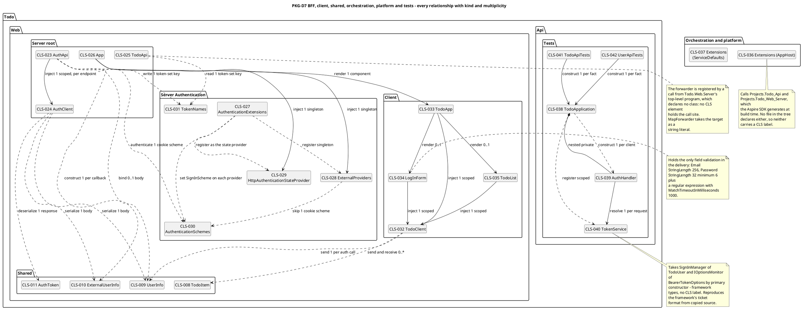

| From | To | Kind | Multiplicity | Declared at |
|---|---|---|---|---|
| CLS-023 `AuthApi` | CLS-024 `AuthClient` | Injected lambda parameter | 1 per request, three of the five endpoints | `Todo.Web/Server/AuthApi.cs:15,27,70` |
| CLS-023 `AuthApi` | CLS-009 `UserInfo` (shared) | Request body bound | 0..1 per `register` and `login` | `Todo.Web/Server/AuthApi.cs:15,27` |
| CLS-023 `AuthApi` | CLS-010 `ExternalUserInfo` (shared) | Constructed with the protected provider id | 1 per callback | `Todo.Web/Server/AuthApi.cs:80` |
| CLS-023 `AuthApi` | CLS-030 `AuthenticationSchemes` | Static read | 1 per callback path — authenticate and sign-out | `Todo.Web/Server/AuthApi.cs:67,89` |
| CLS-023 `AuthApi` | CLS-031 `TokenNames` | Static read, written into the cookie's token set | 1 per successful sign-in | `Todo.Web/Server/AuthApi.cs:114` |
| CLS-023 `AuthApi` | CLS-011 `AuthToken` | Never referenced | 0 — the BFF receives the token as a `string` from CLS-024 and never deserializes it | `Todo.Web/Server/AuthApi.cs:13-121` |
| CLS-024 `AuthClient` | CLS-009 `UserInfo` (shared) | Serialized request body | 1 per login and per register | `Todo.Web/Server/AuthClient.cs:8,20` |
| CLS-024 `AuthClient` | CLS-010 `ExternalUserInfo` (shared) | Serialized request body | 1 per exchange | `Todo.Web/Server/AuthClient.cs:32` |
| CLS-024 `AuthClient` | CLS-011 `AuthToken` | Deserialized response | 0..1 per successful call | `Todo.Web/Server/AuthClient.cs:14,36` |
| CLS-025 `TodoApi` (BFF forwarder) | CLS-031 `TokenNames` | Static read | 1 per forwarded request | `Todo.Web/Server/TodoApi.cs:20` |
| CLS-026 `App` | CLS-028 `ExternalProviders` | Injected | 1 singleton, read once per render | `Todo.Web/Server/App.razor:2,46` |
| CLS-026 `App` | CLS-029 `HttpAuthenticationStateProvider` | Injected as `AuthenticationStateProvider` | 1 singleton, read once per render | `Todo.Web/Server/App.razor:3,45` |
| CLS-026 `App` | CLS-033 `TodoApp` | Renders, passing both values as parameters | 1 component | `Todo.Web/Server/App.razor:24` |
| CLS-027 `AuthenticationExtensions` | CLS-028 `ExternalProviders` | Registers as singleton | 1 registration | `Todo.Web/Server/Authentication/AuthenticationExtensions.cs:87` |
| CLS-027 `AuthenticationExtensions` | CLS-029 `HttpAuthenticationStateProvider` | Registers as the `AuthenticationStateProvider` | 1 registration | `Todo.Web/Server/Authentication/AuthenticationExtensions.cs:90` |
| CLS-027 `AuthenticationExtensions` | CLS-030 `AuthenticationSchemes` | Static read, writes `SignInScheme` into each provider's options | 1 per configured provider, 0 in the delivered configuration | `Todo.Web/Server/Authentication/AuthenticationExtensions.cs:60-67,103` |
| CLS-028 `ExternalProviders` | CLS-030 `AuthenticationSchemes` | Static read, skips the named cookie | 1 per enumeration | `Todo.Web/Server/Authentication/ExternalProviders.cs:26` |
| CLS-032 `TodoClient` | CLS-008 `TodoItem` (shared) | Sent and received over JSON | 0..* — one list, one created item | `Todo.Web/Client/TodoClient.cs:17,34,44,47` |
| CLS-032 `TodoClient` | CLS-009 `UserInfo` (shared) | Sent over JSON | 1 per login and per register | `Todo.Web/Client/TodoClient.cs:55,71` |
| CLS-033 `TodoApp` | CLS-032 `TodoClient` | Injected | 1 scoped | `Todo.Web/Client/TodoApp.razor:1,37` |
| CLS-033 `TodoApp` | CLS-035 `TodoList` | Renders, one `EventCallback` outward | 0..1 — only when `CurrentUser` is non-empty | `Todo.Web/Client/TodoApp.razor:14` |
| CLS-033 `TodoApp` | CLS-034 `LogInForm` | Renders, one `EventCallback` outward | 0..1 — only when `CurrentUser` is empty | `Todo.Web/Client/TodoApp.razor:18` |
| CLS-034 `LogInForm` | CLS-032 `TodoClient` | Injected | 1 scoped | `Todo.Web/Client/Components/LogInForm.razor:1,81,91` |
| CLS-035 `TodoList` | CLS-032 `TodoClient` | Injected | 1 scoped | `Todo.Web/Client/Components/TodoList.razor:1,53,63,72` |
| CLS-036 `Extensions` (AppHost) | — | None | Depends on Aspire types and on the SDK-generated project metadata | `TodoApp.AppHost/Extensions.cs:1-34` |
| CLS-037 `Extensions` (ServiceDefaults) | — | None | Depends on framework and OpenTelemetry types only | `TodoApp.ServiceDefaults/Extensions.cs:1-130` |
| CLS-038 `TodoApplication` | CLS-039 `AuthHandler` | Composition — nested `private sealed`, constructed per client | 1 per `CreateClient` call | `Todo.Api.Tests/TodoApplication.cs:54,74` |
| CLS-038 `TodoApplication` | CLS-040 `TokenService` | Registers as scoped | 1 registration | `Todo.Api.Tests/TodoApplication.cs:66` |
| CLS-039 `AuthHandler` | CLS-040 `TokenService` | Resolved from the request scope | 1 per outgoing request | `Todo.Api.Tests/TodoApplication.cs:78-82` |
| CLS-041 `TodoApiTests` | CLS-038 `TodoApplication` | Constructs and disposes | 1 per `[Fact]`, ten facts | `Todo.Api.Tests/TodoApiTests.cs:2-266` |
| CLS-042 `UserApiTests` | CLS-038 `TodoApplication` | Constructs and disposes | 1 per `[Fact]`, six facts | `Todo.Api.Tests/UserApiTests.cs:5-185` |

**Two cross-process relations have no edge a class diagram can draw, and they are the ones the use cases follow.** CLS-032 reaches CLS-023 and CLS-025 over HTTP at relative paths `auth/...` and `todos`; CLS-024 and CLS-025 reach CLS-019 and CLS-012 over HTTP at the base address `http://todoapi`. The client's base address is the host environment's address (`Todo.Web/Client/Program.cs:9`) and the BFF's is a literal (`Todo.Web/Server/Program.cs:23-26`). Both cross a process boundary with no interface type, which is why "Interface Contracts" records that the delivery declares none.

**`AuthToken` is declared three times and linked to nothing in any direction.** CLS-011 in the shared assembly, `AccessTokenResponse` in the framework, and a `private` nested `AuthToken` inside CLS-042. Nothing checks that they agree, and the third is private to the test class, so nothing outside `UserApiTests.cs` can even name it.

### Signatures the tables flattened, restored as the code declares them

Five operations were recorded with their generic constraints and modifiers dropped, and one type with its accessibility dropped. Each is restated here because the constraint is part of the contract: an Implementer who omits `where TBuilder : IEndpointConventionBuilder` produces a class that does not compile against the call sites in CLS-012 and CLS-019.

| Class | As recorded above | As the code declares it | Why the difference is load-bearing | Anchor |
|---|---|---|---|---|
| CLS-020 `ValidationFilterExtensions` | `static TBuilder WithParameterValidation<TBuilder>(this TBuilder, params Type[] typesToValidate)` | `public static TBuilder WithParameterValidation<TBuilder>(this TBuilder builder, params Type[] typesToValidate) where TBuilder : IEndpointConventionBuilder` | The constraint is what lets the method call `builder.Add(...)` and reach `eb.FilterFactories`; without it the body does not compile, and the two call sites pass `RouteGroupBuilder` | `Todo.Api/Filters/ValidationFilter.cs:12` |
| CLS-036 `Extensions` (AppHost) | `static IResourceBuilder<ExecutableResource> AddEfMigration<TProject>(…)` | `public static IResourceBuilder<ExecutableResource> AddEfMigration<TProject>(this IDistributedApplicationBuilder builder, string name) where TProject : IProjectMetadata, new()` | `new()` is required because the body constructs `new TProject().ProjectPath`; `IProjectMetadata` is required for the `.ProjectPath` read | `TodoApp.AppHost/Extensions.cs:24-25` |
| CLS-037 `Extensions` (ServiceDefaults) | Five generic methods, constraints unrecorded | All five declare `where TBuilder : IHostApplicationBuilder` except `MapDefaultEndpoints`, which takes a concrete `WebApplication` | The constraint is the only thing giving the generic methods `Services`, `Configuration`, `Logging` and `Environment` | `TodoApp.ServiceDefaults/Extensions.cs:19,53,80,99,113` |
| CLS-042 `UserApiTests` | "a nested `AuthToken` class" | `class AuthToken` with no modifier inside `public class UserApiTests` — that is `private` | Private by default in C#: the type is invisible outside its declaring class, so it constrains nothing outside the file and cannot be shared with the other two declarations | `Todo.Api.Tests/UserApiTests.cs:178-183` |
| CLS-028 `ExternalProviders` | `public`, singleton | `public class ExternalProviders(IAuthenticationSchemeProvider schemeProvider)` | The primary constructor takes the scheme provider; the class holds no other dependency and cannot be constructed without one | `Todo.Web/Server/Authentication/ExternalProviders.cs:6` |
| CLS-034 `LogInForm` | "`[RegularExpression] string? Password`" | `[RegularExpression("…", MatchTimeoutInMilliseconds = 1000, ErrorMessage = "…")]` | The timeout is set, so the rule is bounded; and `Create()` is a `type="button"` outside the `EditForm` submit, so **neither** attribute guards the create call | `Todo.Web/Client/Components/LogInForm.razor:70-77,84` |

**`CLS-030` states `ExternalScheme` as a static get-only property, not a constant.** `public static string ExternalScheme => "External"` re-evaluates on every read and cannot be used in an attribute or a `switch` label. CLS-031's `AccessToken` is the opposite: `public static readonly string AccessToken = "accessToken"` is a field, initialised once. The two sit in adjacent files and are declared differently; an Implementer who treats them alike breaks one of them (`Todo.Web/Server/Authentication/AuthenticationSchemes.cs:6`; `Todo.Web/Server/Authentication/TokenNames.cs:5`).

**`CLS-013`'s two computed members carry an unchecked null-forgiving operator.** `Principal.FindFirstValue(ClaimTypes.NameIdentifier)!` suppresses the nullable warning rather than handling the absent claim, so `Id` is typed `string` and can be null at run time. `Principal` is initialised to `default!`, so a `CurrentUser` read before CLS-015 runs dereferences null. Both are the code's contract, not an inference (`Todo.Api/Authorization/CurrentUser.cs:8-11`).

## Traceability
| Element | Traces From | Link Type | Traces To |
|---|---|---|---|
| CLS-001 | UC-006, UC-007, UC-008, UC-009, UC-010 | Realizes | — |
| CLS-002 | UC-006, UC-007, UC-009, UC-010 | Realizes | — |
| CLS-003 | UC-006, UC-007, UC-009 | Realizes | — |
| CLS-004 | UC-001, UC-002 | Realizes | — |
| CLS-005 | UC-003 | Realizes | — |
| CLS-006 | UC-001, UC-002, UC-003, UC-005, UC-006, UC-007, UC-008, UC-009, UC-010 | Realizes | — |
| CLS-007 | UC-001, UC-002, UC-003, UC-005, UC-006, UC-007, UC-008, UC-009, UC-010 | Realizes | — |
| CLS-008 | UC-006, UC-007, UC-008 | Realizes | — |
| CLS-009 | UC-001, UC-002 | Realizes | — |
| CLS-010 | UC-003 | Realizes | — |
| CLS-011 | UC-001, UC-002, UC-003, UC-005 | Realizes | — |
| CLS-012 | UC-006, UC-007, UC-008, UC-009, UC-010 | Realizes | — |
| CLS-013 | UC-006, UC-007, UC-008, UC-009, UC-010 | Realizes | — |
| CLS-014 | UC-006, UC-007, UC-008, UC-009, UC-010 | Realizes | — |
| CLS-015 | UC-006, UC-007, UC-008, UC-009, UC-010 | Realizes | — |
| CLS-016 | UC-006, UC-007, UC-008, UC-009, UC-010 | Realizes | — |
| CLS-017 | UC-006, UC-007, UC-008, UC-009, UC-010 | Realizes | — |
| CLS-018 | UC-006, UC-007, UC-008, UC-009, UC-010 | Realizes | — |
| CLS-019 | UC-001, UC-002, UC-003, UC-005 | Realizes | — |
| CLS-020 | UC-007, UC-010 | Realizes | — |
| CLS-021 | UC-006, UC-007, UC-008, UC-009, UC-010 | Realizes | — |
| CLS-022 | UC-011 | Realizes | — |
| CLS-023 | UC-001, UC-002, UC-003, UC-004 | Realizes | — |
| CLS-024 | UC-001, UC-002, UC-003 | Realizes | — |
| CLS-025 | UC-006, UC-007, UC-008 | Realizes | — |
| CLS-026 | UC-001, UC-002, UC-003, UC-004, UC-006, UC-007, UC-008 | Realizes | — |
| CLS-027 | UC-003, UC-004 | Realizes | — |
| CLS-028 | UC-003, UC-004 | Realizes | — |
| CLS-029 | UC-003, UC-004, UC-006, UC-007, UC-008 | Realizes | — |
| CLS-030 | UC-003, UC-004 | Realizes | — |
| CLS-031 | UC-001, UC-002, UC-003, UC-006, UC-007, UC-008 | Realizes | — |
| CLS-032 | UC-001, UC-002, UC-004, UC-006, UC-007, UC-008 | Realizes | — |
| CLS-033 | UC-001, UC-002, UC-003, UC-004, UC-006, UC-007, UC-008 | Realizes | — |
| CLS-034 | UC-001, UC-002, UC-003 | Realizes | — |
| CLS-035 | UC-006, UC-007, UC-008 | Realizes | — |
| CLS-036 | — | — | — |
| CLS-037 | — | — | — |
| CLS-038 | — | — | — |
| CLS-039 | — | — | — |
| CLS-040 | — | — | — |
| CLS-041 | — | — | — |
| CLS-042 | — | — | — |

Four framework types carry a completed flow and no `CLS` label, so they carry no row: `IdentityUser`, `IdentityDbContext` (DM-D1), and `AccessTokenResponse` and `UserLoginInfo`, whose DM-D4 record now covers the session chain's use of both. They are not classes the Implementer writes, and every row above is a class the delivery declares.

