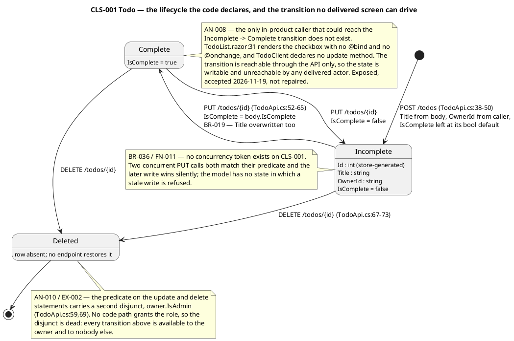

- Phase: Excavation
- Status: Draft — Domain Model and Design Packages recovered; Use-Case Realizations, Interface Contracts and Persistent Data Classes not yet recovered
- Milestone Target: end of Excavation (AR) — not yet achieved

## Design Overview
This document records the design the delivered code already holds. Nothing here is designed by this project: every class, member, visibility modifier and relationship is read out of the file named beside it, and no member is named that the code does not declare. Where the code is silent — a concurrency token, a lifecycle state an operation would need but no operation exists to reach — the silence is recorded as such, not filled.

The model is produced in stages. This iteration recovers the **domain model** and the **design packages**; the use-case realizations, the interface contracts and the persistent-data classes follow in later stages of this phase, and each section below states its own status.

| Section | What its diagram fixes | Status this iteration |
|---|---|---|
| Domain Model | The classes the code declares as business objects, their members, and the one relationship that holds between them | Recovered |
| Design Packages and Classes | The same classes grouped by the component that declares them, with every operation the code implements | Recovered |
| Use-Case Realizations | Which objects collaborate, in what order, for each of the eight recovered use cases | Not yet recovered |
| Interface Contracts | Pre/postconditions on every operation a component boundary crosses | Not yet recovered |
| Persistent Data Classes | Column, key, index and cascade detail of the eight tables | Owned by the Database Designer |
| Boundary Classes and Navigation Map | The Razor components as boundary classes | Owned by the User Interface Designer |
| Capsules, Protocols and Signals | — | `[OMITTED: Capsules, Protocols and Signals — Development Case DC-D3: real-time-system = false, so no capsule, protocol or signal work runs in any phase]` |

**What is recovered and what is not.** Fifteen classes carry the product's own business objects and its declared wire shapes: one entity the project authored (`Todo`), the Identity-derived user, and six DTO declarations that exist twice over — once in each host. Eight further classes carry the code that reads and writes those objects. Each is anchored where it is described; a class with no member the code declares is shown with none.

## Domain Model
The business objects the code declares are six: one entity the product authors, the Identity-derived user, and four DTO shapes. Three of those four exist twice over, because `Todo.Api` references `TodoApp.ServiceDefaults` alone and declares its own `TodoItem`, `UserInfo` and `ExternalUserInfo` while the two web projects share a second declaration through `Todo.Web.Shared` (ADR-011, CON-A10). There is one persistent relationship in the whole model and it is the ownership edge.

```plantuml
@startuml
title Domain Model — the business objects the code declares, and the two independent declarations of every wire shape
skinparam shadowing false
skinparam classAttributeIconSize 0
skinparam packageStyle rectangle
hide empty members
hide circle

package "Todo.Api — the API host's own declaration" {
  class "Todo\nCLS-001" as TODO <<entity>> {
    + Id : int
    + Title : string [Required]
    + IsComplete : bool
    + OwnerId : string [Required]
  }
  class "TodoUser\nCLS-002" as TODOUSER <<entity>> {
    .. no member declared ..
    (IdentityUser supplies Id, UserName, Email, PasswordHash)
  }
  class "TodoItem\nCLS-003" as APITODOITEM <<DTO>> {
    + Id : int
    + Title : string [Required]
    + IsComplete : bool
  }
  class "UserInfo\nCLS-004" as APIUSERINFO <<DTO>> {
    + Email : string [Required]
    + Password : string [Required]
  }
  class "ExternalUserInfo\nCLS-005" as APIEXTUSERINFO <<DTO>> {
    + Username : string [Required]
    + ProviderKey : string [Required]
  }
  class "TodoMappingExtensions\nCLS-010" as MAPPER <<static helper>> {
    {static} + AsTodoItem(todo : Todo) : TodoItem
  }
}

package "Todo.Web.Shared — the web projects' declaration" {
  class "TodoItem\nCLS-006" as WEBTODOITEM <<DTO>> {
    + Id : int
    + Title : string [Required]
    + IsComplete : bool
  }
  class "UserInfo\nCLS-007" as WEBUSERINFO <<DTO>> {
    + Email : string [Required]
    + Password : string [Required]
  }
  class "ExternalUserInfo\nCLS-008" as WEBEXTUSERINFO <<DTO>> {
    + Username : string [Required]
    + ProviderKey : string [Required]
  }
  class "AuthToken\nCLS-009" as AUTHTOKEN <<record>> {
    + Token : string [JsonPropertyName "accessToken"]
  }
}

TODO "0..*" --> "1" TODOUSER : OwnerId -> Id\nON DELETE CASCADE
MAPPER ..> TODO : reads
MAPPER ..> APITODOITEM : creates

apiTodoItem -[hidden]down- AUTHTOKEN
WEBTODOITEM -[hidden]down- AUTHTOKEN

note right of APITODOITEM
  ADR-011 — the wire shape is declared twice.
  TodoItem, UserInfo and ExternalUserInfo exist once per
  side and agree on member names by inspection only:
  Todo.Api/Todo.Api.csproj:24-26 references
  TodoApp.ServiceDefaults alone, never Todo.Web.Shared.
  CLS-003 Todo.Api/Todos/Todo.cs:14-19
  CLS-004 Todo.Api/Users/TodoUser.cs:12-19
  CLS-005 Todo.Api/Users/TodoUser.cs:24-29
end note

note right of TODOUSER
  AN-010 / EX-002: CurrentUser.IsAdmin reads the role claim
  "admin", but no code path grants a role and migration
  RemoveIsAdmin dropped the persisted flag. AspNetRoles and
  AspNetUserRoles exist and nothing writes them.
  CLS-002 Todo.Api/Users/TodoUser.cs:7-9
end note

note bottom of TODO
  CLS-001 Todo.Api/Todos/Todo.cs:3-12 — one entity the product
  authors; the seven Identity tables beside it are supplied by
  the framework.
  CLS-010 Todo.Api/Todos/Todo.cs:27-40
end note

note bottom of AUTHTOKEN
  CLS-006 Todo.Web/Shared/SharedClass.cs:5-11
  CLS-007 Todo.Web/Shared/SharedClass.cs:13-20
  CLS-008 Todo.Web/Shared/SharedClass.cs:22-29
  CLS-009 Todo.Web/Shared/SharedClass.cs:31
  AuthToken is web-only: AuthClient reads the API's
  AccessTokenResponse payload into this record and keeps
  one member of it. CLS-005 and CLS-008 are reached by no
  recovered use case — EP-011 is an exclusion.
end note
@enduml
```

### Domain classes, as the code declares them

| ID | Class | Stereotype | Members, as declared | Anchor |
|---|---|---|---|---|
| CLS-001 | `Todo` | `<<entity>>` | `Id : int`; `Title : string` `[Required]`; `IsComplete : bool`; `OwnerId : string` `[Required]` | `Todo.Api/Todos/Todo.cs:3-12` |
| CLS-002 | `TodoUser` | `<<entity>>` | declares no member of its own — `: IdentityUser`, which supplies `Id`, `UserName`, `NormalizedUserName`, `Email`, `PasswordHash`, `ConcurrencyStamp`, `SecurityStamp`, `LockoutEnd` and the rest of the Identity schema | `Todo.Api/Users/TodoUser.cs:7-9` |
| CLS-003 | `TodoItem` (API) | `<<DTO>>` | `Id : int`; `Title : string` `[Required]`; `IsComplete : bool` — excludes `OwnerId` by design, with the comment "we don't want that exposed to clients" | `Todo.Api/Todos/Todo.cs:14-19` |
| CLS-004 | `UserInfo` (API) | `<<DTO>>` | `Email : string` `[Required]`; `Password : string` `[Required]` | `Todo.Api/Users/TodoUser.cs:12-19` |
| CLS-005 | `ExternalUserInfo` (API) | `<<DTO>>` | `Username : string` `[Required]`; `ProviderKey : string` `[Required]` | `Todo.Api/Users/TodoUser.cs:24-29` |
| CLS-006 | `TodoItem` (web) | `<<DTO>>` | `Id : int`; `Title : string` `[Required]`; `IsComplete : bool` | `Todo.Web/Shared/SharedClass.cs:5-11` |
| CLS-007 | `UserInfo` (web) | `<<DTO>>` | `Email : string` `[Required]`; `Password : string` `[Required]` | `Todo.Web/Shared/SharedClass.cs:13-20` |
| CLS-008 | `ExternalUserInfo` (web) | `<<DTO>>` | `Username : string` `[Required]`; `ProviderKey : string` `[Required]` | `Todo.Web/Shared/SharedClass.cs:22-29` |
| CLS-009 | `AuthToken` | `<<record>>` | `Token : string` mapped to the JSON member `accessToken` by attribute | `Todo.Web/Shared/SharedClass.cs:31` |
| CLS-010 | `TodoMappingExtensions` | static extension class | `AsTodoItem(todo : Todo) : TodoItem` — projects the entity onto the DTO, dropping `OwnerId` | `Todo.Api/Todos/Todo.cs:27-40` |

### Domain relationships

| Relationship | Multiplicity the code declares | Consequence it carries | Anchor |
|---|---|---|---|
| `Todo` → `TodoUser` on `OwnerId` | many-to-one, required (`[Required]` on `OwnerId`; `IsRequired` by the non-nullable `string` under `Nullable enable`) | Every todo belongs to exactly one account, and no todo can exist unattached. Every read, update and delete carries the column in its predicate, so a row is never fetched by id alone and then checked — a non-owner's item answers `404`, never `403` | `Todo.Api/TodoDbContext.cs:11-15`; `Todo.Api/Todos/Todo.cs:9-11`; `Todo.Api/Todos/TodoApi.cs:33,59,69` |
| `Todo` → `TodoUser` on delete | cascade | Declared in the third migration against `AspNetUsers.Id`; the first migration had pointed the same foreign key at `AspNetUsers.UserName`. No endpoint deletes a user, so the rule exists and the operation does not | `Todo.Api/Migrations/20230714032431_ForeignKeyChange.cs:27-34` |
| `Todo` → `TodoItem` (CLS-003) | projection, not an association — computed per response | The wire shape and the stored shape are separate types, and the projection is the only place the owner is dropped. No mapping library is used | `Todo.Api/Todos/Todo.cs:27-40`; `Todo.Api/Todos/TodoApi.cs:26,35,49` |
| `TodoUser` → Identity tables | one-to-many supplied by the framework schema | Seven tables, of which `AspNetRoles` and `AspNetUserRoles` are written by nothing (AN-010, EX-003) | `Todo.Api/TodoDbContext.cs:7`; `Todo.Api/Migrations/20221123071234_Initial.cs` |

**No other association exists.** `TodoUser` exposes no collection of todos; there is no navigation property on either side, so a user's items are reachable only by a query that filters on `OwnerId`. The model is one entity and one edge, and the Identity schema the framework contributes around it.

### CLS-001 Todo — lifecycle

Three states are reachable and a fourth is declared by no operation. The diagram records which transition the delivered product cannot drive, which is the same fact AN-008 records against the update use case.

| State | Reachable by | Guard the code applies | Invariant |
|---|---|---|---|
| Incomplete | `POST /todos` on a new row | `Title` non-empty (CLS-016 validation on the group; `TodoItem` is the declared body type, ADR-004) | `OwnerId` is the caller's `NameIdentifier` and cannot be supplied by the body, because `TodoItem` carries no `OwnerId` member |
| Complete | `PUT /todos/{id}` with `IsComplete = true` | Route id equals body id, owner matches, single `UPDATE ... WHERE` | — |
| Deleted | `DELETE /todos/{id}` | Owner matches, single `DELETE ... WHERE` | No restore path exists |

