## Document Control
- Phase: Consolidation
- Status: Draft — produced for the end-of-Consolidation (GHR) milestone review
- Milestone Target: end-of-Consolidation (GHR) — not yet achieved
- Iteration: 1, Cycle 1
- Owner: Software Architect
## Architectural Representation
The delivery carries no architecture document of its own (`.iari/README.md`, the tree holds none). What follows is recovered from code and configuration: every element cites the file and lines that carry it, and no statement of intent is attributed to authors who cannot be asked.

| View | Diagram | What it is anchored to |
|---|---|---|
| Logical | COMP-D1 component model, COMP-D2 change axes, CLS-1 ownership mechanism | `Todo.Api/`, `Todo.Web/Server/`, `Todo.Web/Client/` |
| Use-Case | COMP-D3, SEQ-1, SEQ-2, SEQ-3, SEQ-4 | `EP-001` to `EP-019` as the System Inventory records them, and the eleven use-case specifications |
| Process | ACT-D1 | `TodoApp.ServiceDefaults/Extensions.cs`, `RateLimitExtensions.cs`, `Todo.Api/appsettings.Development.json:8-12`, `TodoApi.cs:59-63` |
| Deployment | DEP-D1 | `TodoApp.AppHost/Program.cs`, `Program.cs` of both hosts, the `appsettings.json` pairs and `Todo.Api/appsettings.Development.json`, the two `launchSettings.json` files |
| Implementation | IMP-D1 | `TodoApp.sln`, `Directory.Build.props`, `Directory.Packages.props`, the seven project files |
| Data | the table in "Data View" | `Todo.Api/TodoDbContext.cs`, the three migrations |
| Requirements coverage | SPEC-D1 | The Supplementary Specification's eight groups, against the mechanism that answers each |

The topology is stated in full in the **Deployment Model**, which the Development Case's trigger fires; this document states the deployment view only to the depth the other views need it.

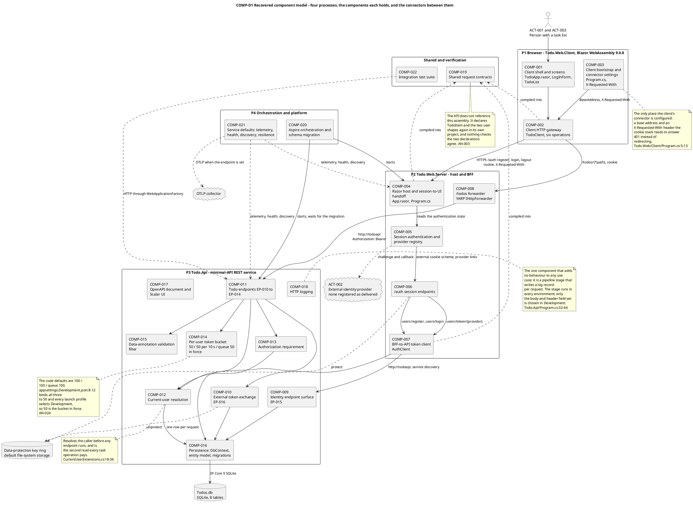
## Architectural Goals and Constraints
**The delivery states no goal.** It carries no requirement, no quality-attribute target and no constraint statement (`.iari/README.md`); nothing in this section is a declared intention. What follows is the set of properties the architecture **does** hold, read from the code, together with the constraints any change to it must live inside.

| Goal the architecture realizes | How it is held | Anchor |
|---|---|---|
| A task row is visible to exactly one account | One predicate on `OwnerId`, applied by the query and by both write statements; `OwnerId` is required, indexed and cascaded, and is excluded from every response shape | `Todo.Api/Todos/TodoApi.cs:24-73`; `Todo.Api/Todos/Todo.cs:3-26`; `Todo.Api/TodoDbContext.cs:11-17` |
| The browser never holds a bearer token | The token lives in the BFF's session cookie's token set and is written into the API request by the forwarder; the client is compiled without any token logic | `Todo.Web/Server/TodoApi.cs:18-22`; `Todo.Web/Server/AuthApi.cs:99-116`; `Todo.Web/Client/TodoClient.cs:7-71` |
| The sign-in mechanism is replaceable without touching the task operations | Provider registration is configuration-driven and the provider key crosses the process boundary protected, not in the clear | `Todo.Web/Server/Authentication/AuthenticationExtensions.cs:39-75`; `Todo.Web/Server/AuthApi.cs:82-84`; `Todo.Api/Users/UsersApi.cs:24-34` |
| One process can be replaced without rebuilding the other | The two hops are HTTP over service discovery with a contract declared on both sides — which is also the cost of that choice (AN-003) | `Todo.Web/Server/Program.cs:23-26`; `Todo.Web/Server/TodoApi.cs:16` |
| Development is diagnosable, production is not talkative | Reference UI, health endpoints and body-and-header logging are all gated on the Development environment, while the root redirect is not (AN-017) | `Todo.Api/Program.cs:35-62`; `TodoApp.ServiceDefaults/Extensions.cs:110-118` |
| The schema has one definition | Three EF Core migrations and their snapshot; no SQL script, procedure or trigger exists in the tree | `Todo.Api/Migrations/`; `.iari/README.md` |

### Constraints the architecture lives within

| Constraint | Anchor |
|---|---|
| `net9.0`, nullable and implicit usings enabled, `LangVersion` `preview`, inherited by all seven projects | `Directory.Build.props:4-7` |
| Every package version centrally managed; `nuget.config` clears sources and maps `*` to nuget.org, so no other feed restores | `Directory.Packages.props:3-5`; `nuget.config` |
| SQLite is the only store; the connection string is `Data Source=.db/Todos.db` relative to the API's working directory when `ConnectionStrings:Todos` is unset | `Todo.Api/Program.cs:23-24` |
| The BFF and the API must share a data-protection key ring, and neither pins one — only `ApplicationDiscriminator` is set (AN-010) | `Todo.Web/Server/Program.cs:13`; `Todo.Api/Program.cs:11` |
| No service-to-service authentication exists between the BFF and the API (AN-002) | `Todo.Api/Users/UsersApi.cs:16` (its own `TODO`) |
| No deployment artifact of any kind is in the tree: no Dockerfile, compose file or manifest (DC12) | `.iari/README.md`; the tree |
| The API's `Program.cs` is exercised by the test suite through `WebApplicationFactory`, so the host stays reachable to the test assembly | `Todo.Api.Tests/TodoApplication.cs` |

### Technology, as the manifests declare it

No enterprise version policy is recorded for this project (`get_version_policy` returns no pins), and the delivery states none. Every version below is read from the pinning files exactly as it stands; nothing is chosen, advanced or recommended here. The three files that decide what restores are `global.json` (SDK), `Directory.Packages.props` (every package, centrally) and `nuget.config` (the feed) — and no project file names a version of its own.

| Ecosystem | Package or SDK | Version as declared | Declared in |
|---|---|---|---|
| nuget | .NET SDK | 9.0.100, `rollForward: latestFeature`, `allowPrerelease: true` | `global.json:3-6` |
| nuget | Target framework | `net9.0` | `Directory.Build.props:4` |
| nuget | Microsoft.AspNetCore.Mvc.Testing | 9.0.8 | `Directory.Packages.props` |
| nuget | Microsoft.EntityFrameworkCore.InMemory | 9.0.8 | `Directory.Packages.props` |
| nuget | Microsoft.NET.Test.Sdk | 17.14.1 | `Directory.Packages.props` |
| nuget | xunit | 2.9.3 | `Directory.Packages.props` |
| nuget | xunit.runner.visualstudio | 3.1.3 | `Directory.Packages.props` |
| nuget | coverlet.collector | 6.0.4 | `Directory.Packages.props` |
| nuget | Microsoft.AspNetCore.Identity.EntityFrameworkCore | 9.0.8 | `Directory.Packages.props` |
| nuget | Microsoft.AspNetCore.OpenApi | 9.0.8 | `Directory.Packages.props` |
| nuget | Microsoft.EntityFrameworkCore.Design | 9.0.8 | `Directory.Packages.props` |
| nuget | Microsoft.EntityFrameworkCore.Sqlite | 9.0.8 | `Directory.Packages.props` |
| nuget | Microsoft.OpenApi | 1.6.22 | `Directory.Packages.props` |
| nuget | MiniValidation | 0.9.2 | `Directory.Packages.props` |
| nuget | AspNet.Security.OAuth.GitHub | 9.4.0 | `Directory.Packages.props` |
| nuget | Auth0.AspNetCore.Authentication | 1.5.0 | `Directory.Packages.props` |
| nuget | Microsoft.AspNetCore.Authentication.Google | 9.0.8 | `Directory.Packages.props` |
| nuget | Microsoft.AspNetCore.Authentication.MicrosoftAccount | 9.0.8 | `Directory.Packages.props` |
| nuget | Microsoft.AspNetCore.Components.WebAssembly.Server | 9.0.8 | `Directory.Packages.props` |
| nuget | Yarp.ReverseProxy | 2.3.0 | `Directory.Packages.props` |
| nuget | Microsoft.AspNetCore.Components.WebAssembly | 9.0.8 | `Directory.Packages.props` |
| nuget | Microsoft.AspNetCore.Components.WebAssembly.DevServer | 9.0.0 | `Directory.Packages.props` |
| nuget | Microsoft.Extensions.Http | 9.0.8 | `Directory.Packages.props` |
| nuget | Microsoft.Extensions.Http.Resilience | 9.7.0 | `Directory.Packages.props` |
| nuget | Microsoft.Extensions.ServiceDiscovery | 9.5.0 | `Directory.Packages.props` |
| nuget | Microsoft.Extensions.ServiceDiscovery.Yarp | 9.5.0 | `Directory.Packages.props` |
| nuget | Scalar.AspNetCore | 2.6.8 | `Directory.Packages.props` |
| nuget | OpenTelemetry.Exporter.OpenTelemetryProtocol, .Extensions.Hosting, .Instrumentation.AspNetCore, .Instrumentation.Http, .Instrumentation.Runtime | 1.12.0 each | `Directory.Packages.props` |
| nuget | Aspire AppHost SDK | 13.1.1 | `TodoApp.AppHost/TodoApp.AppHost.csproj:1` |
| container | `mcr.microsoft.com/dotnet/sdk` | `8.0` | `.devcontainer/devcontainer.json:2` |
| container | `tomdesinto/sqliteweb` | no tag — unpinned | `TodoApp.AppHost/Program.cs:15` |

Three build-level disagreements are recorded, not reconciled: the developer container names SDK 8.0 against a `net9.0` solution and a `9.0.100` pin, so the container cannot build the solution it ships with (AN-007); the server project pins `RazorLangVersion` to 8.0 against the same `net9.0` solution (AN-014); and the test project pins `Microsoft.EntityFrameworkCore.InMemory` 9.0.8 which nothing in the suite calls (AN-006). The `sqliteweb` image is the one dependency the tree declares with no version at all.

### The Supplementary Specification, answered by this architecture

Every group of the Supplementary Specification's requirements is answered below by the mechanism that implements it, or recorded as an absence the architecture carries. An absence is written as an absence — no mechanism is claimed where the code has none.

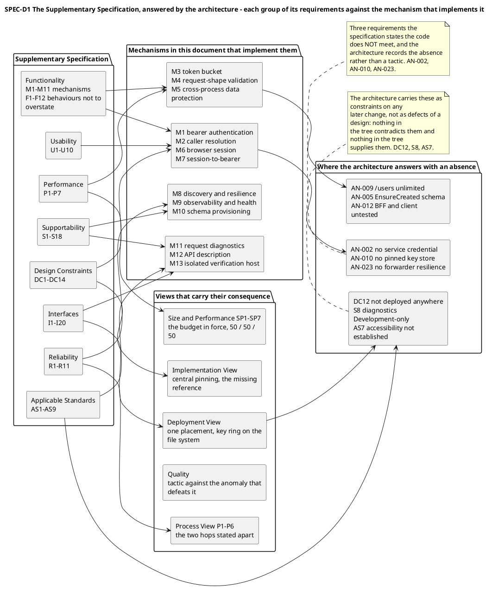

| Specification group | How the architecture answers it | Where it is answered | Absent, and named |
|---|---|---|---|
| Functionality, M1-M11 | Each mechanism is carried as M1 to M13 with the capability it provides, the properties the code fixes, its product where one is stated, and the use cases that use it | Logical View — Architectural mechanisms | Nothing in this group is absent; M14 to M16 of the specification are host and transport posture, carried as DC13 and DC14 below because no component provides them |
| Functionality, F1-F12 | Each behaviour not to be overstated is honoured by the view it constrains: F1 keeps the completion write out of every screen path, F4 and F5 keep the `admin` branch an exceptional entity the flows do not follow, F6 and F10 keep the budget stated at both its values, F7, F11 and F12 keep every trust and transport claim withdrawn | Use-Case View (per-use-case component sets), Size and Performance SP1, Quality, Goals and Constraints (Constraints) | None |
| Usability, U1-U10 | The three screens and their rules are carried by COMP-001 and COMP-002, whose responsibilities name the two shells, the login and create-user form, the task list and the client's six operations | Logical View — Components; Deployment View (the browser node) | U7's two inert controls and U8's missing empty state are behaviours of COMP-001 and are recorded, not answered: no component supplies them (AN-001) |
| Reliability, R1-R11 | M9 carries health and telemetry, M10 carries schema provisioning, M13 carries the isolated verification host, and the two BFF hops are stated apart | Process View P6; Deployment View; Quality (Reliability rows) | R10's transport protection and R11's inheritance of the BFF posture are absent between the processes: the API registers no HSTS, redirection or antiforgery and the target is the literal `http://todoapi` (DC13) |
| Performance, P1-P7 | SP1 to SP7 state what the code fixes on its own behaviour, with the budget in force separated from the code default | Size and Performance | No threshold is claimed: the delivery states none, and SP2 records that no payload limit exists |
| Supportability, S1-S18 | S2 and S10 are the two configuration surfaces the architecture exposes; S13, S14, S15 and S17 are the four that are fixed in code and need a redeploy; S5, S6 and S7 are the verification gaps | Deployment View (Nodes and Connectors, Environment Mapping); Implementation View; Quality (Testability) | S16 and S18 are absent: no deployment artifact exists (DC12) and no diagnostic surface exists outside Development (S8) |
| Design Constraints, DC1-DC14 | DC1 and DC2 are the build root in the Implementation View; DC3 to DC5 and DC11 are the data path; DC6 to DC9 are the contract and key-ring boundaries; DC10, DC13 and DC14 are the environment and transport posture | Implementation View; Data View; Goals and Constraints (Constraints) | None — each is a constraint the architecture lives within, and the Quality view names the anomaly each one leaves |
| Interfaces, I1-I20 | The connectors table gives each hop its mechanism, and the Deployment View places each endpoint on its node | Logical View — Connectors; Deployment View | No interface is claimed to be authenticated between the two processes: I6 and I13 cross a boundary that carries no service credential (AN-002) |
| Applicable Standards, AS1-AS9 | AS1, AS4, AS5 and AS6 are held by the framework the components are built on; AS2 is held for validation errors only; AS9 is held at the BFF's edge only | Quality (Maintainability, Security); Data View (the schema's single definition) | AS3 is unexercised (no provider registered, AN-010) and AS7 is not established at all — no accessibility statement, test or attribute beyond `aria-label` on one inert control |

## Use-Case View
Eleven use cases were recovered by the System Analyst, each anchored to the entry point whose code performs it. The four below are the architecturally significant ones: they cross the most process boundaries, or they carry a mechanism that no other use case exercises. Each was walked through the completed use-case specification step by step, and the components named below are the ones those steps run through.

| Use case | Why it is architecturally significant | Components its confirmed path crosses |
|---|---|---|
| UC-006 See one's own tasks | The widest path in the system: every layer on the screen route, plus the four mechanisms that gate every task operation | COMP-001, COMP-002, COMP-003, COMP-004, COMP-008, COMP-011, COMP-012, COMP-013, COMP-014, COMP-016 |
| UC-007 Add a task | Crosses the same path and adds the validation filter; the only use case where the ownership assignment on a write is exercised end to end | COMP-001, COMP-002, COMP-003, COMP-004, COMP-008, COMP-011, COMP-012, COMP-013, COMP-014, COMP-015, COMP-016 |
| UC-001 Create an account | The only use case that makes one process's write depend on a second call into the other process before a session exists; the mechanism is the token client, shared with UC-002, and the request shape is the shared contract the API redeclares rather than references | COMP-001, COMP-002, COMP-003, COMP-004, COMP-006, COMP-007, COMP-009, COMP-016, COMP-019 |
| UC-003 Sign in with an external provider | Crosses more components than any other — both cookies, the provider registry, data protection on both sides of the process boundary, and the token exchange — and cannot be entered in the delivered configuration | COMP-001, COMP-004, COMP-005, COMP-006, COMP-007, COMP-010, COMP-016, COMP-019 |

**Four components the completed specifications make load-bearing.** The flows name them where the architecture did not: **COMP-003** configures the connector every client call runs on — the base address the call resolves against and the `X-Requested-With` header the cookie stack reads — so it is on the path of every screen-route use case, and it is why UC-006 alternative A2 answers an empty list instead of failing (`Todo.Web/Client/Program.cs:5-13`; AN-026). **COMP-012** resolves the caller for every task operation, not UC-006 alone: UC-007 to UC-010 resolve it through the same requirement. **COMP-019** carries `UserInfo`, `ExternalUserInfo` and `AuthToken` into the client and the BFF, which is how the three account use cases reach the API's `users` endpoints at all — while the API redeclares the same shapes instead of referencing the assembly (AN-003). **COMP-016** is what UC-005 writes its account rows through, so the Identity surface is not a component pair of its own.

The remaining seven, and how far the architecture is exercised on each:

| Use case | Components its confirmed path crosses | Diagram |
|---|---|---|
| UC-002 Sign in with email and password | COMP-001, COMP-002, COMP-003, COMP-004, COMP-006, COMP-007, COMP-009, COMP-019 | SEQ-2 is UC-001; UC-002 differs only in skipping the register call and reaching COMP-009 once instead of twice |
| UC-004 Sign out | COMP-001, COMP-002, COMP-003, COMP-004, COMP-005, COMP-006 | None — its path is shorter than UC-001's and adds no connector |
| UC-005 Maintain one's own account | COMP-009, COMP-016, COMP-019 | None — the framework surface mapped wholesale, with no local code, no screen path and no client call; it writes the account rows and answers the `AuthToken` shape the shared contract declares |
| UC-008 Remove a task | COMP-001, COMP-002, COMP-003, COMP-004, COMP-008, COMP-011, COMP-012, COMP-013, COMP-014, COMP-016 | None — it is SEQ-1 with the query replaced by one delete statement |
| UC-009 Read one task by id | COMP-011, COMP-012, COMP-013, COMP-014, COMP-016 | None — SEQ-1 without the client, the bootstrap and the forwarder |
| UC-010 Change a task | COMP-011, COMP-012, COMP-013, COMP-014, COMP-015, COMP-016 | None — SEQ-1 with the query replaced by one update statement; it is the only writer of `IsComplete` (AN-001) |
| UC-011 Consult the API reference | COMP-017 | None — one component, no connector |

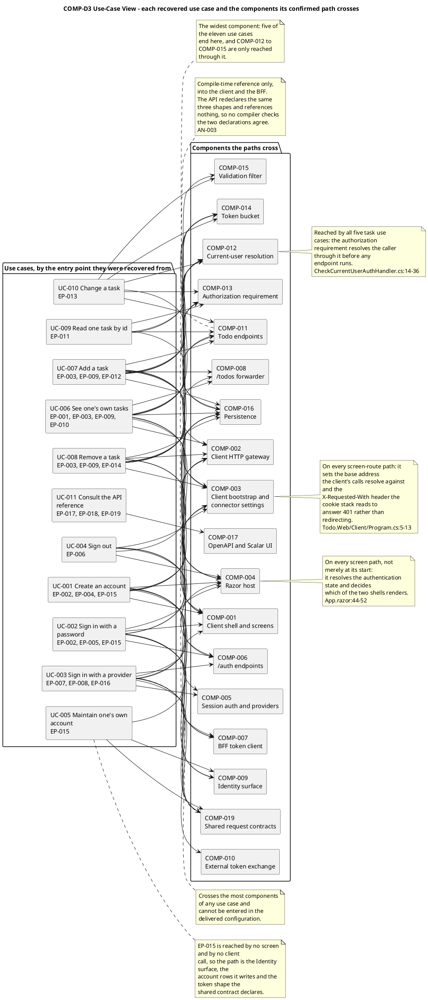

### SEQ-1 UC-006 See one's own tasks — the screen route through all four processes

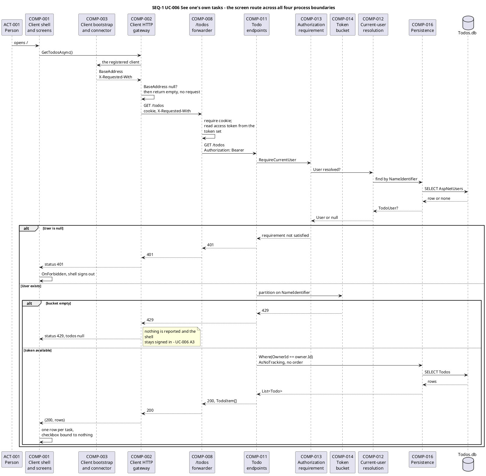

### SEQ-2 UC-001 Create an account — the write that depends on a second process

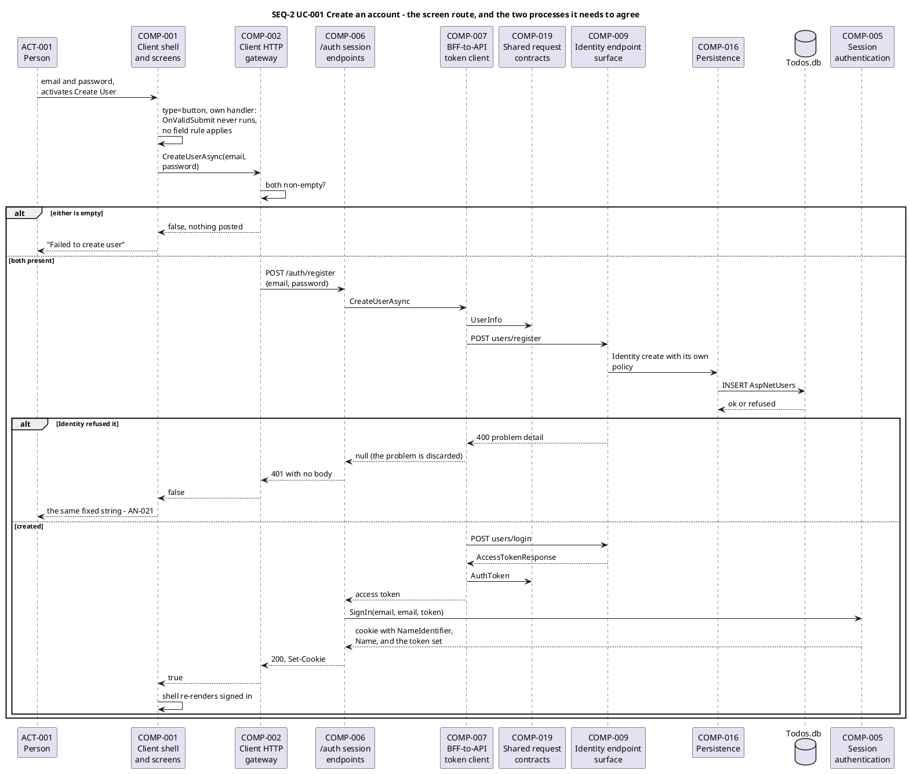

### SEQ-3 UC-003 Sign in with an external provider — the mechanism, and where configuration stops it

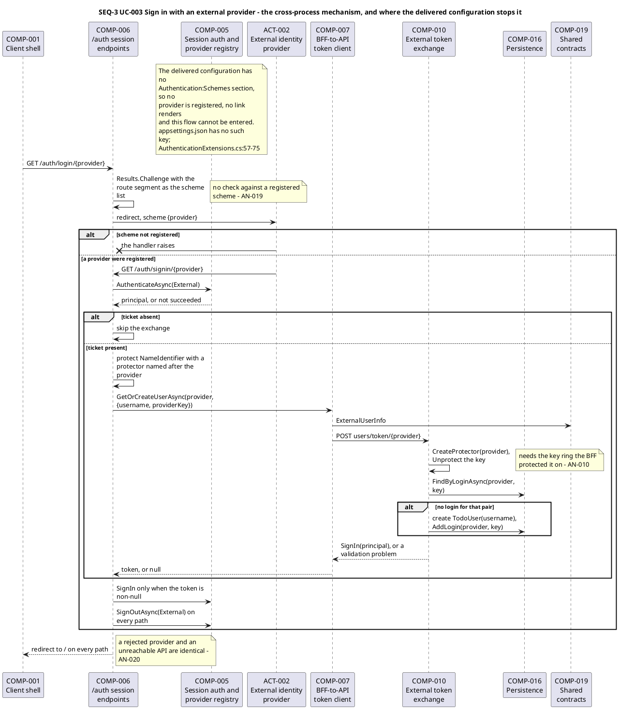

### SEQ-4 UC-007 Add a task — the validation filter, and the one place `OwnerId` is assigned on a write

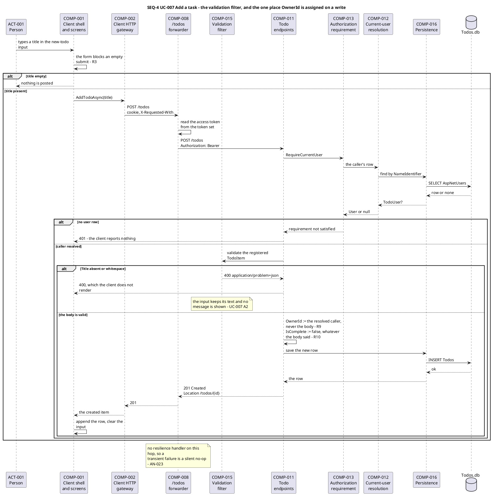

**Why this use case carries its own diagram.** UC-007 is the only use case where the ownership assignment on a write is exercised end to end, and the only one that reaches COMP-015: the validation filter guards this body and UC-010's, and no other. The diagram shows the three things the architecture fixes about it — that `OwnerId` comes from the resolved caller and never from the body (`R9`), that `IsComplete` is created false whatever the body says (`R10`), and that a 400 from the filter is a status the client does not render (`AN-021`).

## Logical View
Twenty-two components in four processes. The decomposition is **by change axis**, not by feature: each component below encapsulates one thing that can change for the whole system, and the diagram after the table names which ones it fails to encapsulate.

### Components

| ID | Component | Responsibility, as the code has it | Anchor |
|---|---|---|---|
| COMP-001 | Client shell and screens | Decides which of two shells renders from the resolved user name, holds the logout control, renders the login and create-user form and the task list | `Todo.Web/Client/TodoApp.razor:3-38`; `Todo.Web/Client/Components/LogInForm.razor:3-98`; `Todo.Web/Client/Components/TodoList.razor:3-76` |
| COMP-002 | Client HTTP gateway | The client's six operations: add, delete, list, login, create user, logout. Refuses to post an empty title, email or password before any request exists | `Todo.Web/Client/TodoClient.cs:7-71` |
| COMP-003 | Client bootstrap and connector settings | Builds the WebAssembly host, sets the base address to the host origin, and adds the `X-Requested-With` header the cookie stack reads to answer 401 rather than redirecting | `Todo.Web/Client/Program.cs:5-13` |
| COMP-004 | Razor host and session-to-UI handoff | Serves the page, resolves the authentication state through the HTTP-context principal, and passes the user name and the registered provider names into the interactive client | `Todo.Web/Server/App.razor:1-56`; `Todo.Web/Server/Authentication/HttpAuthenticationStateProvider.cs:3-11` |
| COMP-005 | Session authentication and provider registry | The cookie scheme, the second cookie for the external ticket, the four configuration-gated providers, and the scheme enumeration the login screen renders | `Todo.Web/Server/Authentication/AuthenticationExtensions.cs:13-107`; `AuthenticationSchemes.cs:5-6`; `ExternalProviders.cs:5-38`; `TokenNames.cs` |
| COMP-006 | `/auth` session endpoints | register, login, logout, external challenge, external callback — and the one place a session cookie is written | `Todo.Web/Server/AuthApi.cs:10-121` |
| COMP-007 | BFF-to-API token client | The typed `HttpClient` over service discovery that calls `users/register`, `users/login` and `users/token/{provider}` and collapses every failure into `null` | `Todo.Web/Server/AuthClient.cs:3-34`; `Todo.Web/Server/Program.cs:23-26` |
| COMP-008 | `/todos` forwarder | Any method, any sub-path under `/todos`; requires the cookie and rewrites the session's access token into `Authorization: Bearer` | `Todo.Web/Server/TodoApi.cs:8-25` |
| COMP-009 | Identity endpoint surface | The framework's nine Identity operations mapped under `/users` wholesale, with no delivery code inside them | `Todo.Api/Users/UsersApi.cs:20`; `Todo.Api/Program.cs:17-20` |
| COMP-010 | External token exchange | `POST /users/token/{provider}`: unprotects the provider key, finds or creates the user and its login row, signs the principal in | `Todo.Api/Users/UsersApi.cs:24-60` |
| COMP-011 | Todo endpoints | The five task operations and the one ownership predicate they apply | `Todo.Api/Todos/TodoApi.cs:8-76` |
| COMP-012 | Current-user resolution | The `IClaimsTransformation` hook that resolves the user row from the user store by the token's `NameIdentifier` on every authenticated request and stores it on a scoped holder exposing `Id` and `IsAdmin` | `Todo.Api/Authorization/CurrentUserExtensions.cs:18-36`; `CurrentUser.cs:6-13` |
| COMP-013 | Authorization requirement | The `CheckCurrentUserRequirement` handler that fails a request whose token names no user row — it tests the row COMP-012 stored, and checks no lockout (its own `TODO`) | `Todo.Api/Authorization/CheckCurrentUserAuthHandler.cs:8-35` |
| COMP-014 | Per-user token bucket | Token bucket partitioned by `NameIdentifier`, applied to `/todos` alone, 429 on rejection. The code defaults are 100 tokens, 100 per 10 s and a queue of 100, all three bound from configuration; the Development configuration overrides all three to 50, and every launch profile in both serving processes selects Development — so 50 / 50 / 50 is the bucket's size wherever this delivery runs (AN-024) | `Todo.Api/Extensions/RateLimitExtensions.cs:10-57`; `Todo.Api/appsettings.Development.json:8-12`; `Todo.Api/Properties/launchSettings.json`; `Todo.Web/Server/Properties/launchSettings.json` |
| COMP-015 | Validation filter | Rejects a registered parameter failing data annotations with 400 `application/problem+json`, and only the parameter types an endpoint registers | `Todo.Api/Filters/ValidationFilter.cs:10-63` |
| COMP-016 | Persistence | `TodoDbContext` over `IdentityDbContext<TodoUser>`, the entity model with the owner foreign key, and the three migrations that are the schema's only definition | `Todo.Api/TodoDbContext.cs:6-20`; `Todo.Api/Todos/Todo.cs:3-12`; `Todo.Api/Migrations/` |
| COMP-017 | OpenAPI document and Scalar UI | Emits the bearer-scheme document unconditionally, serves the reference UI in Development, redirects `/` to it unconditionally | `Todo.Api/Program.cs:27,46-58,62`; `Todo.Api/Extensions/OpenApiOptionsExtensions.cs:11-51` |
| COMP-018 | HTTP logging | The `UseHttpLogging` stage, registered and running in every environment; the body-and-header field set and the combined single-log form are configured only when the environment is Development | `Todo.Api/Program.cs:35-42,44` |
| COMP-019 | Shared request contracts | `TodoItem`, `UserInfo`, `ExternalUserInfo`, `AuthToken` compiled into the client and the BFF | `Todo.Web/Shared/SharedClass.cs:5-31` |
| COMP-020 | Aspire orchestration and schema migration | Starts the two serving processes, runs `dotnet ef database update` once when `.db` is absent, and runs the sqlite-web container | `TodoApp.AppHost/Program.cs:1-28`; `TodoApp.AppHost/Extensions.cs:1-34` |
| COMP-021 | Service defaults | Telemetry, health checks, service discovery and the standard resilience handler configured on every `HttpClient` by default | `TodoApp.ServiceDefaults/Extensions.cs:24-130` |
| COMP-022 | Integration test suite | Exercises the API over HTTP through `WebApplicationFactory`, seeds users and rows directly, and mints tokens from framework internals | `Todo.Api.Tests/TodoApplication.cs`; `TokenService.cs:10-34`; `TodoApiTests.cs`; `UserApiTests.cs` |

### Connectors

| From | To | Mechanism, as the code has it | Anchor |
|---|---|---|---|
| COMP-003 | COMP-002 | In-process registration of the typed client: the base address every call resolves against, and the `X-Requested-With` header the cookie stack reads to answer 401 rather than redirecting. When no base address resolves, the call answers an empty result and issues no request (AN-026) | `Todo.Web/Client/Program.cs:5-13`; `Todo.Web/Client/TodoClient.cs:33-40` |
| COMP-001 | COMP-002 | In-process method calls | `Todo.Web/Client/Components/TodoList.razor:44-76` |
| COMP-002 | COMP-004 | HTTPS to `/auth/*` on the same origin as the page, carrying the cookie | `Todo.Web/Client/TodoClient.cs:47-71`; `Todo.Web/Client/Program.cs:7-10` |
| COMP-002 | COMP-008 | HTTPS to `/todos*` on the same origin, carrying the cookie | `Todo.Web/Client/TodoClient.cs:7-43` |
| COMP-006, COMP-007 | COMP-009, COMP-010 | HTTP over service discovery at `http://todoapi`, base address only, no credential | `Todo.Web/Server/Program.cs:23-26`; `Todo.Web/Server/AuthClient.cs:5-33` |
| COMP-007 | COMP-019 | Compile-time reference: `ExternalUserInfo` and `AuthToken` are the shapes the token client sends and receives | `Todo.Web/Shared/SharedClass.cs:23-31`; `Todo.Web/Server/AuthClient.cs:32-42` |
| COMP-008 | COMP-011 | HTTP for any `/todos` sub-path, `Authorization: Bearer <session token>` | `Todo.Web/Server/TodoApi.cs:12-25` |
| COMP-011 | COMP-012, COMP-013, COMP-014, COMP-015, COMP-016 | In-process: one scoped service, one authorization handler, one rate-limit policy, one endpoint filter, one `DbContext` | `Todo.Api/Todos/TodoApi.cs:17-22` |
| COMP-012 | COMP-016 | In-process, through the Identity user store: `ClaimsTransformation.TransformAsync` calls `UserManager<TodoUser>.FindByIdAsync` on the token's `NameIdentifier` and stores the row on the scoped `CurrentUser`, before any endpoint runs. It is the second database read every task operation pays (`SP4`, `P5`) | `Todo.Api/Authorization/CurrentUserExtensions.cs:20-36`; `CheckCurrentUserAuthHandler.cs:26-35` |
| COMP-013 | COMP-012 | In-process: the requirement handler succeeds only where the transformation stored a user row | `Todo.Api/Authorization/CheckCurrentUserAuthHandler.cs:14-36` |
| COMP-006 | the key ring | Data protection, protector named after the provider | `Todo.Web/Server/AuthApi.cs:82-84` |
| COMP-010 | the key ring | Data protection, protector of the same name, `Unprotect` | `Todo.Api/Users/UsersApi.cs:26-28` |
| COMP-016 | Todos.db | EF Core 9 SQLite over `Data Source=.db/Todos.db` | `Todo.Api/Program.cs:23-24` |
| COMP-020 | COMP-004, COMP-011 | Process start, and `WaitForCompletion` on the migration | `TodoApp.AppHost/Program.cs:5-10,24-27` |
| COMP-021 | every process | In-process registration; OTLP egress only when the endpoint is set | `TodoApp.ServiceDefaults/Extensions.cs:74-81` |
| COMP-022 | COMP-011 and COMP-009 | HTTP through `WebApplicationFactory`, no network | `Todo.Api.Tests/TodoApplication.cs` |

Two connectors the completed use-case flows added to this table, and neither is a new dependency in the code. **COMP-003 to COMP-002** is the registration that makes every client call possible: without it the client's base address is unset and the list answers empty rather than failing, which is why UC-006 alternative A2 states an unreachable API and no tasks alike (`AN-026`). **COMP-012 to COMP-016** is the second database read every task operation pays — the caller resolution reaches the user store before the endpoint runs its own statement (`SP4`, `P5`).

No component depends on more than four others, and the widest fan-in is COMP-016 (five callers: COMP-009, COMP-010, COMP-011, COMP-012 and COMP-022). The only cyclic risk in the model is absent: the client never calls the API directly, and the API never calls the BFF.

### What the decomposition encapsulates, and what it does not

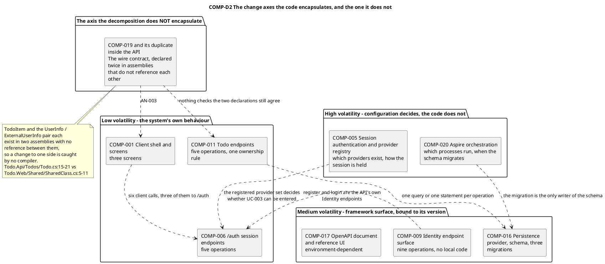

**The one defect the decomposition shows.** The wire contract is the system's most frequently-changing axis — it moves with every operation the API adds — and it is the one axis no boundary encapsulates: COMP-019 exists, and the API re-declares the same three shapes in its own project rather than referencing it, so the contract has two authorities and no check (AN-003). Every other axis is inside a boundary. COMP-005 encapsulates *which providers exist*, COMP-016 encapsulates the schema, COMP-011 encapsulates the ownership rule, COMP-004 encapsulates the rendering handoff.

### Architectural mechanisms

Each mechanism is stated by the capability it provides and the properties the code fixes; none is named by a product where the code states no product, and none by a version the manifest does not pin.

| ID | Capability | Properties the code fixes | Product, where one is fixed | Anchor | Used by |
|---|---|---|---|---|---|
| M1 | Bearer-token authentication | Any structurally valid token is accepted; no lifetime, key or refresh interval configured, so every value is the framework default | ASP.NET Core Identity bearer scheme 9.0.8 | `Todo.Api/Program.cs:14` | Every API request |
| M2 | Caller identity resolution | One user-store read per authenticated request by the token's `NameIdentifier`, performed by an `IClaimsTransformation` hook that runs before authorization; a token naming no user row fails the requirement; lockout is not checked (the code's own `TODO`) | — (the delivery's own code) | `Todo.Api/Authorization/CurrentUserExtensions.cs:18-36`; `CheckCurrentUserAuthHandler.cs:14-36` | UC-006 to UC-010 |
| M3 | Per-caller request throttling | Token bucket: auto-replenish every 10 s, 429 on rejection, partitioned on `NameIdentifier`, applied to `/todos` only. Every value is bound from a `RateLimiting` configuration section: the code defaults are 100 tokens, 100 per 10 s and a queue of 100 (`RateLimitExtensions.cs:14-31`), and `appsettings.Development.json:8-12` overrides all three to 50. Every launch profile in both serving processes sets `ASPNETCORE_ENVIRONMENT=Development`, so 50 tokens, 50 per 10 s and a queue of 50 is the budget in force wherever the delivery runs, and the code defaults apply only in an environment no profile in the tree selects (AN-024). The partition dereferences a claim an anonymous caller lacks, which is why it cannot cover `/users` as written | ASP.NET Core rate limiting 9.0.8 | `Todo.Api/Extensions/RateLimitExtensions.cs:14-57`; `Todo.Api/appsettings.Development.json:8-12`; `Todo.Api/Properties/launchSettings.json`; `Todo.Web/Server/Properties/launchSettings.json` | UC-006 to UC-010 |
| M4 | Request-shape validation | Data annotations over the parameter types an endpoint registers; 400 `application/problem+json`; `/todos` registers `TodoItem`, `/users` registers `ExternalUserInfo` alone | MiniValidation 0.9.2 | `Todo.Api/Filters/ValidationFilter.cs:10-63`; `Todo.Api/Users/UsersApi.cs:18` | UC-003, UC-007, UC-010 |
| M5 | Cross-process data protection | `ApplicationDiscriminator` `TodoApp` set in both processes; no key persistence, lifetime or protection configured, so the ring is shared only where the framework's default location is | ASP.NET Core Data Protection 9.0.8 | `Todo.Web/Server/Program.cs:13`; `Todo.Api/Program.cs:11` | UC-003 |
| M6 | Browser session | Two cookies: the session cookie holds `NameIdentifier`, `Name` and the token set; the external cookie holds the provider ticket; default scheme is the cookie | ASP.NET Core cookie authentication 9.0.8 | `Todo.Web/Server/Authentication/AuthenticationExtensions.cs:14-21`; `AuthApi.cs:99-116` | UC-001 to UC-004, UC-006 to UC-008 |
| M7 | Session-to-bearer translation | A reverse forwarder that reads the token from the session's token set and rewrites the outbound header; any method, any sub-path; configured with a default `ForwarderRequestConfig` | YARP `IHttpForwarder` 2.3.0 | `Todo.Web/Server/TodoApi.cs:12-25` | UC-006 to UC-008 |
| M8 | Process discovery and client resilience | Service discovery by name (`todoapi`); a standard resilience handler applied to every `HttpClient` registered through the container defaults | Microsoft.Extensions.ServiceDiscovery 9.5.0; Microsoft.Extensions.Http.Resilience 9.7.0 | `TodoApp.ServiceDefaults/Extensions.cs:32-42`; `Todo.Web/Server/Program.cs:23-26` | COMP-007 only in practice — see the Process View |
| M9 | Observability and health | Traces, metrics and logs with ASP.NET Core, HTTP and runtime instrumentation; OTLP export only when `OTEL_EXPORTER_OTLP_ENDPOINT` is non-empty; readiness and liveness mapped in Development only | OpenTelemetry 1.12.0 | `TodoApp.ServiceDefaults/Extensions.cs:44-118` | Every process |
| M10 | Schema provisioning | `dotnet ef database update --no-build` run once by the app host, in run mode, only when `Todo.Api/.db` is absent, with no connection string passed, and after a global `dotnet tool install` it waits on | `dotnet-ef` installed globally at run time; EF Core 9.0.8 | `TodoApp.AppHost/Extensions.cs:4-34` | Every use case, before start |
| M11 | Request diagnostics | `UseHttpLogging` is registered and runs in every environment; the field set — response body and headers, combined into one log — is selected only when the environment is Development, so another environment logs the framework's default request fields and no bodies | ASP.NET Core HTTP logging 9.0.8 | `Todo.Api/Program.cs:35-42,44` | Every API request |
| M12 | API description | OpenAPI document mapped unconditionally with the bearer scheme applied to those operations whose metadata carries an authorization attribute; reference UI served in Development with an empty server list | Microsoft.AspNetCore.OpenApi 9.0.8; Scalar.AspNetCore 2.6.8 | `Todo.Api/Extensions/OpenApiOptionsExtensions.cs:11-51`; `Todo.Api/Program.cs:46-58` | UC-011 |
| M13 | Isolated verification host | The API is booted in-process with four substitutions: an in-memory SQLite connection whose schema is built by `EnsureCreated` rather than by the migrations, an ephemeral data-protection provider, Identity password rules lowered, and a bearer token minted by reproducing the ticket format. Each substitution removes a production dependency, and each removes what a test could have observed about it | Microsoft.AspNetCore.Mvc.Testing 9.0.8 (xunit 2.9.3) | `Todo.Api.Tests/TodoApplication.cs:7,11-14,33-56`; `TokenService.cs:10-34` | COMP-019 to COMP-022, all indirectly |

Three mechanism facts carry into the Quality view and are stated there once: **M8 reaches one hop and not the other** (P6), **M3's bound in force is half its code default** (AN-024), and **M13 substitutes the key ring and the schema**, so no test in the delivery exercises M5's cross-process behaviour or M10's migration (AN-005, AN-010).

### The ownership mechanism, as classes

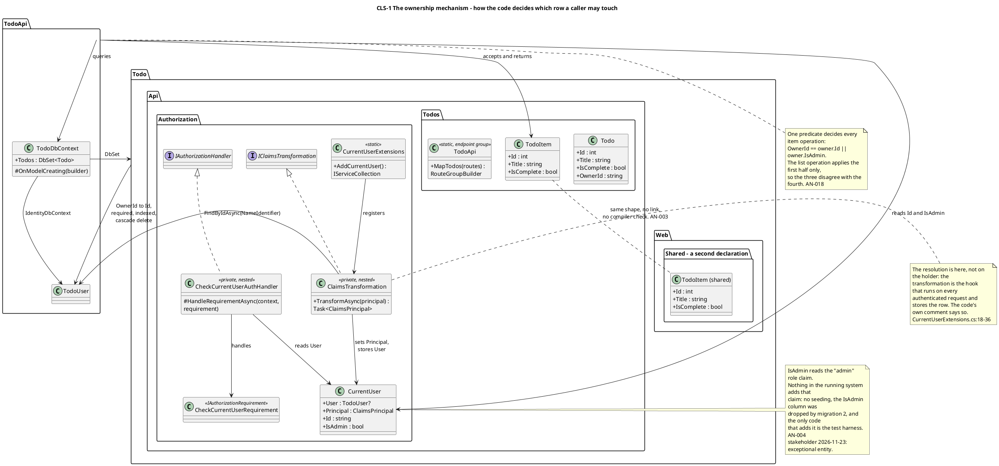

`CurrentUser` is a holder, not a resolver: it exposes `User`, `Principal`, `Id` and `IsAdmin` and reads the identity from claims. The database read is `ClaimsTransformation.TransformAsync`, which the code registers as its `IClaimsTransformation` so that it runs on every authenticated request without custom middleware — the code's own comment calls it "a hook into authorization to set the current user" (`CurrentUserExtensions.cs:18-28`). The requirement handler then only tests that the transformation stored a row (`CheckCurrentUserAuthHandler.cs:26-35`), which is why a structurally valid token for a deleted account is refused.

### Architecture decisions, as the code shows them

Each record states the decision the code embodies, what the delivery's own files show was available instead, and what follows from it. **No rationale is attributed to the authors**: where the code states no reason, the record says so. Every record is `Recovered` — it names a decision already made in the code, not one this document proposes.

| ADR | Decision | Alternative the tree itself shows | Consequence, with its anchor |
|---|---|---|---|
| ADR-001 | Four processes: a WebAssembly client, a host that serves it and brokers authentication, a separate REST API, and an orchestration host. Recovered | A single ASP.NET Core application with server-rendered UI and direct database access — the shape `Todo.Web/Server` would have had without the separate API, and the one its Razor-and-client split still mostly resembles | Two hops where one would serve; every task operation pays a network call and a second serialization. No reason is stated in the tree | `Todo.Web/Client/Program.cs`; `Todo.Web/Server/Program.cs`; `Todo.Api/Program.cs`; `TodoApp.AppHost/Program.cs` |
| ADR-002 | The browser holds a cookie, never a token. The token lives in the cookie's token set and is written into the API request by the reverse forwarder. Recovered | The client calling the API directly with a token it holds, which is exactly what the delivery's own `README.md` documents for the standalone-API route | The client needs no token logic, and the token is unreachable from script; the cost is that a browser request traverses four components to reach one query. `Todo.Web/Server/TodoApi.cs:18-22`; `Todo.Web/Client/Program.cs:5-13` |
| ADR-003 | No service-to-service authentication between the BFF and the API: the API accepts a bearer token from any caller. Recovered | A client credential between the two — the code's own `TODO` names the gap, and the API already has the data-protection facility a shared secret would use | The API cannot distinguish the BFF from any other caller. AN-002; `Todo.Api/Users/UsersApi.cs:16` |
| ADR-004 | The provider key crosses the process boundary protected by data protection rather than by a shared secret or an opaque reference. Recovered | A shared store lookup, or a signed identifier — either would have removed the need for a shared key ring | Correct as designed, unsound as configured: neither process pins a key store, so the two share a ring only where the framework's default file location happens to be shared. AN-010; `Todo.Web/Server/Program.cs:13`; `Todo.Api/Program.cs:11` |
| ADR-005 | SQLite as a single file, with the schema defined only by EF Core migrations and applied by the app host before the API starts. Recovered | Any server database, or a startup migration inside the API — the app host's `WaitForCompletion` exists precisely to order the migration ahead of the API | No deployment artifact of any kind is needed to run it, and no schema exists outside migration code. The path is relative to the API's working directory and only the app host creates it. DC12, AN-013; `TodoApp.AppHost/Extensions.cs:4-21` |
| ADR-006 | Ownership is enforced inside the query and the write statement, and a row the caller does not own answers 404, never 403. Recovered | Fetch-then-check, which would distinguish absent from forbidden and leak the existence of another person's id | The two are indistinguishable to a caller, which is the safer answer; the cost is that the same predicate is repeated in four statements and has already drifted (AN-018). `Todo.Api/Todos/TodoApi.cs:29-73` |
| ADR-007 | Throttling is a per-caller token bucket applied to `/todos` and to nothing else. Recovered | Extending the same policy to `/users`, which the code cannot do as written: the partition key is a claim an anonymous caller does not have | Task operations are bounded per caller; sign-in, registration, refresh and password recovery are unbounded. AN-009; `Todo.Api/Extensions/RateLimitExtensions.cs:38-47`; `Todo.Api/Users/UsersApi.cs:10-20` |
| ADR-008 | The Identity endpoint set is mapped wholesale rather than authored, so nine operations exist with no delivery code inside them. Recovered | Authoring only `register` and `login`, which is all any screen reaches | The system performs nine user-account operations it has no UI, no test and no requirement for. UC-005; `Todo.Api/Users/UsersApi.cs:20` |
| ADR-009 | The wire contract is declared twice — once in the shared assembly for the client and the BFF, once in the API — rather than referenced. Recovered | Referencing a single shared assembly from all three projects, which is what `Todo.Web/Shared` already is for two of them | No compiler checks the two declarations agree, and they are the system's most frequently-changing shape. AN-003; `Todo.Api/Todos/Todo.cs:15-21` vs `Todo.Web/Shared/SharedClass.cs:5-11` |
| ADR-010 | The client runs interactive WebAssembly while the host serves the page server-side and resolves the session, so the user name and the provider list are passed into the interactive component as parameters. Recovered | A purely server-rendered UI, or a purely standalone WebAssembly client fetching its own session | The screen's signed-in/signed-out decision is taken in the host, while every task operation is taken in the browser — a split that puts COMP-004 on every screen path. `Todo.Web/Server/App.razor:44-52`; `Todo.Web/Client/TodoApp.razor:3-22` |
| ADR-011 | Development-only surfaces are gated on the environment, except the root redirect, which is unconditional. Recovered | Gating the redirect with the same check as the UI it leads to | A non-Development host redirects `/` to an endpoint it does not serve. AN-017; `Todo.Api/Program.cs:49-62` |
| ADR-012 | The app host is the only thing that starts the system, and it is a development-time orchestrator rather than a deployment mechanism: it runs the migration only in run mode, excludes the SQLite browser container from the manifest, and declares no endpoint, port, replica or resource bound for either serving process. Recovered | A deployment artifact beside it — and the tree still carries traces of that intent, since two project files keep their container image properties while no Dockerfile exists to honour them | The system has one placement: a developer's machine. Nothing in the tree states how it would be replicated, addressed or health-checked anywhere else, and the migration is bound to a development process. DC12; `TodoApp.AppHost/Program.cs:1-28`; `TodoApp.AppHost/Extensions.cs:5-7,32-33` |
| ADR-013 | Verification happens in one in-process host over the API alone, with four production mechanisms substituted: an in-memory SQLite connection whose schema is built by `EnsureCreated`, an ephemeral data-protection provider, relaxed Identity password rules, and a bearer token minted by reproducing the framework's ticket format. Recovered | Exercising the real migration, the real key ring and a real sign-in — which is what would have made AN-005 and AN-010 observable to a test | The suite is fast, isolated and free of file-system contention, and it cannot see three things the deployment depends on: the migrations, the cross-process key ring, and the token format as issued. AN-005, AN-010, AN-011; `Todo.Api.Tests/TodoApplication.cs:7,11-14,33-56`; `TokenService.cs:10-34` |

## Process View
There is no background work in this system. Every thread of control is a request thread on a Kestrel pool in one of two processes, and the only concurrency the architecture has to reason about is contention on a row and contention on the bucket's queue.

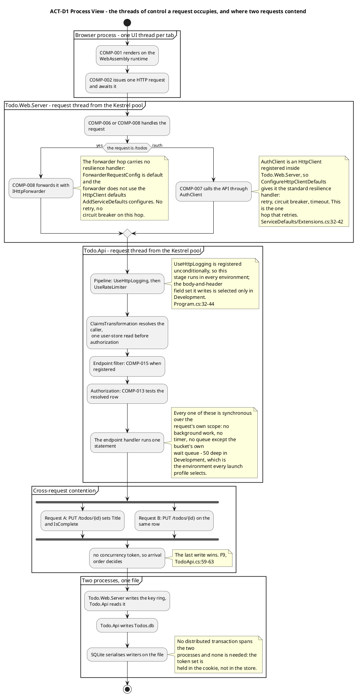

| # | Process property, as the code has it | Consequence for the architecture | Anchor |
|---|---|---|---|
| P1 | No background task, timer, hosted service or message consumer exists in any process. The only scheduled work is the bucket's own replenishment | Scaling means adding request threads, not coordinating workers: there is no shared queue to partition and no idempotency requirement on any operation | `Todo.Api/Program.cs`; `Todo.Web/Server/Program.cs`; `TodoApp.AppHost/Program.cs` — no `IHostedService` is registered anywhere |
| P2 | Two processes read and write the same SQLite file. SQLite serialises writers on the file; the API is the only writer | The write path is single-writer. A second API process writing the same file would contend on the file, not on a lock the code manages | `Todo.Api/Program.cs:23-24` |
| P3 | A completed row can be lost by a concurrent update: the update names `Title` and `IsComplete` and carries no concurrency token | No lost-update detection. Two callers on the same row write in arrival order and neither is told | `Todo.Api/Todos/TodoApi.cs:59-63`; F9 |
| P4 | The bucket admits up to 50 waiting requests per caller before rejecting, and admits 50 tokens replenished 50 per 10-second period. The code defaults are 100 / 100 / queue 100; the Development configuration overrides all three and every launch profile selects Development, so 50 is the depth in force (AN-024) | A burst is queued, not refused, up to 50 deep; beyond that it is 429. The client does not distinguish 429 from any other failure | `Todo.Api/Extensions/RateLimitExtensions.cs:14-31`; `Todo.Api/appsettings.Development.json:8-12`; `Todo.Api/Properties/launchSettings.json`; UC-006 A3 |
| P5 | Caller identity costs one additional user-store read on every authenticated request, inside the same request scope, performed by the `ClaimsTransformation` hook before authorization | Two reads per task operation at minimum, neither cached across requests | `Todo.Api/Authorization/CurrentUserExtensions.cs:20-36`; `CheckCurrentUserAuthHandler.cs:31-36` |
| P6 | **The two HTTP hops out of the BFF are not equally protected.** `ConfigureHttpClientDefaults` applies a standard resilience handler to every client the container builds, which reaches `COMP-007`'s `HttpClient`; the YARP forwarder is not built from the container defaults and carries a default `ForwarderRequestConfig` | The sign-in and registration hop retries and breaks the circuit; the task hop does not. A transient API failure is retried on one path and surfaced as a failure on the other | `TodoApp.ServiceDefaults/Extensions.cs:32-42`; `Todo.Web/Server/Program.cs:23-26`; `Todo.Web/Server/TodoApi.cs:16` |

**The two hops, stated apart.** `AddStandardResilienceHandler()` in `ConfigureHttpClientDefaults` gives the token hop (`COMP-007`) retry, circuit-breaker, timeout and rate-limiter behaviour; the forwarder hop (`COMP-008`) is not built from those defaults and carries none of the four. A use case that signs in and then reads its tasks crosses both, and the two are not equally protected (AN-023, R024).
## Deployment View
**Two environments, and what differs between them.** `Development` is the only environment in which the reference UI and the health endpoints exist, and the only one in which the request log is widened to the response body and headers; `Todo.Api/Program.cs:32-56` and `TodoApp.ServiceDefaults/Extensions.cs:110-118` gate on it, and every launch profile in both serving processes sets it, so it is the environment the delivery runs in. Two surfaces are not gated: the logging middleware itself, which runs in every environment with the framework's default fields, and the root redirect, which fires in every environment and can lead to an endpoint the process does not serve (AN-017). One setting separates Development from any other environment: the request budget — `appsettings.Development.json:8-12` binds `TokenLimit`, `TokensPerPeriod` and `QueueLimit` to 50 where the code defaults them to 100 / 100 / queue 100, so the bucket in force is half its code default (AN-024, M3, SP1). Neither environment file — `Todo.Api/appsettings.json` and `Todo.Web/Server/appsettings.json` — carries a connection string or a provider credential; the only connection string in the delivery is the literal `Data Source=.db/Todos.db` written in `Todo.Api/Program.cs:23`, identical in both environments.
## Implementation View

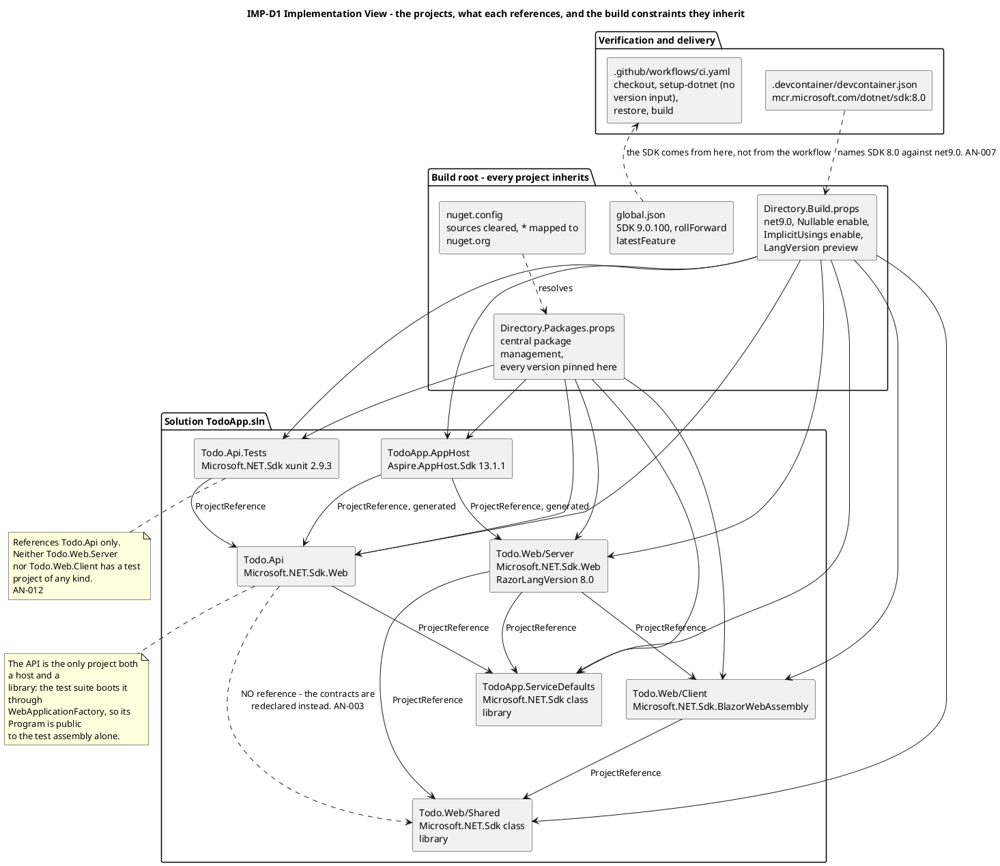

| Project | SDK and kind | References | Anchor |
|---|---|---|---|
| Todo.Web/Client | `Microsoft.NET.Sdk.BlazorWebAssembly` | Shared, ServiceDefaults | `Todo.Web/Client/Todo.Web.Client.csproj`; `Todo.Web/Client/Program.cs:5-13` |
| Todo.Web/Server | `Microsoft.NET.Sdk.Web` | Client, Shared, ServiceDefaults | `Todo.Web/Server/Todo.Web.Server.csproj:7` (`RazorLangVersion` 8.0) |
| Todo.Web/Shared | `Microsoft.NET.Sdk` class library | — | `Todo.Web/Shared/Todo.Web.Shared.csproj` |
| Todo.Api | `Microsoft.NET.Sdk.Web` | ServiceDefaults — **not** Shared | `Todo.Api/Todo.Api.csproj` |
| Todo.Api.Tests | `Microsoft.NET.Sdk` with xunit 2.9.3 | Todo.Api only | `Todo.Api.Tests/Todo.Api.Tests.csproj:4,9` |
| TodoApp.AppHost | `Aspire.AppHost.Sdk` 13.1.1 | Api, Server, generated | `TodoApp.AppHost/TodoApp.AppHost.csproj` |
| TodoApp.ServiceDefaults | `Microsoft.NET.Sdk` class library | — | `TodoApp.ServiceDefaults/TodoApp.ServiceDefaults.csproj` |

**The build structure, and the three places it contradicts itself.** The dependency graph is a diamond with no cycle and one deliberate absence: `P_API` does not reference `P_SHARED`, so the two declarations of the wire contract have no compiler between them (AN-003, ADR-009). Around that graph sit three disagreements the delivery carries unresolved — the developer container names SDK 8.0 against a `net9.0` solution and a `9.0.100` pin (AN-007); `P_SERVER` pins `RazorLangVersion` to 8.0 inside a 9.0 solution (AN-014); and `P_TESTS` declares `Microsoft.EntityFrameworkCore.InMemory` 9.0.8, which nothing in the suite calls (AN-006). Settling the container's SDK is the Integrator's Inception decision; the Development Case records the disagreement and assigns it.

## Data View

The Data Model optional artifact is not triggered (eight persisted entity types, below the >10 threshold, no migration in scope), so the persistent view is stated here and detailed in the Design Model's persistent-data sections by the Database Designer. What the architecture fixes about the data is its **ownership key**, its **single definition path**, and its **two shared files**.

| Store | Kind | What the architecture depends on about it | Anchor |
|---|---|---|---|
| `Todos.db` | Relational, SQLite | One file, created by migration, path relative to the API's working directory | `Todo.Api/Program.cs:23-24`; AN-013 |
| `Todos` | Table: `Id` INTEGER key, `Title` TEXT required, `IsComplete` INTEGER, `OwnerId` TEXT required, index `IX_Todos_OwnerId`, foreign key to `AspNetUsers.Id` cascade on delete | The ownership key is a required, indexed foreign key, and the third migration re-pointed it from `UserName` to `Id` | `Todo.Api/Todos/Todo.cs:3-12`; `Todo.Api/TodoDbContext.cs:11-17`; `Todo.Api/Migrations/20230714032431_ForeignKeyChange.cs` |
| `AspNetUsers`, `AspNetRoles`, `AspNetUserClaims`, `AspNetRoleClaims`, `AspNetUserLogins`, `AspNetUserRoles`, `AspNetUserTokens` | Identity schema | `AspNetUserLogins` is what UC-003 keys a provider identity to; the `IsAdmin` column the first migration created was dropped by the second — the schema holds no administrative flag | `Todo.Api/Program.cs:17-20`; `Todo.Api/Migrations/20221123071234_Initial.cs`; `Migrations/20221123165051_RemoveIsAdmin.cs:13-15` |
| In-memory SQLite `Filename=:memory:` | Test-only schema, built by `EnsureCreated`, not by the migrations | No test reproduces the schema the deployment creates; a migration that no longer matches the model fails only in the app host (AN-005) | `Todo.Api.Tests/TodoApplication.cs:7,11-14` |
| Data-protection key ring | Record file, framework default location | Written by COMP-006, read by COMP-010, across a process boundary the code does not pin (AN-010) | `Todo.Web/Server/Program.cs:13`; `Todo.Api/Program.cs:11` |

Three properties matter to the architecture rather than to the schema. **The schema has exactly one definition** — three migrations and their snapshot; no `.sql` file, procedure or trigger exists in the tree, so any schema statement is a C# statement. **The ownership key is the only access-control datum the data holds** — there is no role table row, no permission, no share; `IsAdmin` is read from a token claim and the column that once backed it is gone. **`OwnerId` is excluded from every response shape** by mapping to `TodoItem`, so the key cannot round-trip to a client.

## Size and Performance
**The delivery declares no performance target** — no response-time threshold, throughput figure, concurrency limit, payload bound or resource budget appears anywhere in the tree. What follows is the budget the code fixes on itself, and what a later threshold must not assume.

| # | What the code fixes | Anchor |
|---|---|---|
| SP1 | A request budget exists on `/todos` and nowhere else. The code defaults are 100 tokens per caller, 100 replenished per 10-second period and a queue of 100 (`RateLimitExtensions.cs:14-31`); `appsettings.Development.json:8-12` binds all three to 50. Every launch profile in both serving processes sets `ASPNETCORE_ENVIRONMENT=Development`, so **50 tokens, 50 per 10 s and a queue of 50 is the budget in force wherever this delivery runs**, and the code's 100 series applies only in an environment no launch profile in the tree selects. Rejection is 429. The fact is AN-024 | `Todo.Api/Extensions/RateLimitExtensions.cs:14-31`; `Todo.Api/appsettings.Development.json:8-12`; `Todo.Api/Properties/launchSettings.json`; `Todo.Web/Server/Properties/launchSettings.json`; S2 of the Supplementary Specification |
| SP2 | No payload size limit is configured on any endpoint, in either process | `Todo.Api/Program.cs`; `Todo.Web/Server/Program.cs` |
| SP3 | Every task read and write is one SQL statement over the indexed `OwnerId`, or one primary-key lookup. The list declares no order and no pagination, so it returns every row the caller owns in one response | `Todo.Api/Todos/TodoApi.cs:24-51` |
| SP4 | Every authorized request costs one extra read for the caller's identity — `UserManager<TodoUser>.FindByIdAsync` inside `ClaimsTransformation` — in the same scope and cached nowhere across requests | `Todo.Api/Authorization/CurrentUserExtensions.cs:20-36` |
| SP5 | Every API request is logged in every environment, because `UseHttpLogging()` is registered unconditionally; it is the Development environment that widens the record to the response body and response headers, combined into one log. So the per-request logging cost exists everywhere, and its body-copying share exists only in the environment a developer measures in | `Todo.Api/Program.cs:32-44` |
| SP6 | No token lifetime is configured, so the framework default applies and no refresh interval is fixed by the delivery | `Todo.Api/Program.cs:14` |
| SP7 | A browser task operation traverses four components and two HTTP hops; a direct API call traverses one. The recovered architecture has both routes and they are not the same cost | `Todo.Web/Server/TodoApi.cs:12-25`; `README.md` |

**What a later threshold must not assume.** No figure stated for the system as a whole can hold for `/users`, which is unlimited (AN-009) and whose policy could not be moved as written. No response-time figure can hold for a caller with an unbounded number of rows, because the list has no page bound. No throttling figure may be taken from the code constants alone: the bound in force is 50, half of them (AN-024). And the two hops out of the BFF are not equivalent under failure: only the token hop retries (P6).
## Quality
Each quality attribute is stated with the tactic the architecture actually embodies and the element that carries it. No attribute is recorded as "to be addressed later": where the delivery holds no tactic, the cell says so and names the anomaly.

| Attribute | Tactic the code embodies | Where it lives | Where the tactic fails or is absent |
|---|---|---|---|
| Security — data isolation | Ownership enforced in the query and the write statement, not in a service layer; 404 for both absent and not-owned | COMP-011 | The predicate is repeated in four statements and the list applies half of it (AN-018); a role claim no caller holds widens it (AN-004) |
| Security — credential handling | The browser never holds a bearer token; the token stays in the session's token set and is written server-side | COMP-006, COMP-008 | The API accepts a bearer token from any caller, so the boundary the token crosses is unauthenticated (AN-002) |
| Security — cross-process secret transport | The provider key is protected with a named protector in one process and unprotected in the other | COMP-006, COMP-010 (M5) | No key store is pinned, so the ring is shared only by accident of the default file location (AN-010) — and the one host that could have proven the two rings differ substitutes an ephemeral provider (ADR-013), so no test exercises this |
| Availability — bounded load | Per-caller token bucket with a wait queue and a 429 rejection status | COMP-014 | The bound in force in the measured environment is **50 tokens, 50 per 10 s and a queue of 50** — the Development configuration overrides the code's 100 / 100 / queue 100 and every launch profile selects Development (AN-024, M3, SP1). Applied to `/todos` only: the authentication surface is unbounded and the policy could not be moved as written (AN-009) |
| Availability — transient failure | A standard resilience handler on every container-built `HttpClient` | COMP-021 reaching COMP-007 | The forwarder hop has none, so the task path is not protected while the auth path is (P6, AN-023) |
| Reliability — referential integrity | `OwnerId` required, indexed, cascade on delete, re-pointed to the identity key by migration 3 | COMP-016 | The test host builds its schema by `EnsureCreated` rather than the migrations (M13), so no test exercises them and a migration that no longer matches the model fails only in the app host (AN-005) |
| Reliability — failure reporting | Problem details for validation errors | COMP-015 | Every authentication failure answers one 401 with no body and the BFF discards the API's problem (AN-021); the provider callback reports nothing and always redirects (AN-020) |
| Maintainability — change isolation | The contract is the only axis no boundary encapsulates: the API redeclares the shapes rather than referencing them | ADR-009 | No compiler checks the two declarations agree (AN-003) |
| Maintainability — version consistency | Every package centrally pinned in one file; one source feed | `Directory.Packages.props`; `nuget.config` | `RazorLangVersion` 8.0 in a 9.0 solution (AN-014); the container names SDK 8.0 (AN-007); the `sqliteweb` image carries no tag at all |
| Testability | The API is bootable in-process through `WebApplicationFactory` with a seeded user and rows, and every production dependency is substitutable | COMP-022 (M13, ADR-013) | Neither the BFF nor the client has any test, and the three defective `/auth` flows are exactly the untested ones (AN-012); the suite mints tokens by reproducing framework internals (AN-011); and the four substitutions mean the migrations, the cross-process key ring and the issued token format are observed by nothing |
| Operability | Readiness and liveness; OTLP export gated on one environment variable; the request log's body-and-header field set, selected in Development | COMP-021, COMP-018 | The health endpoints are mapped only in Development and the body-and-header field set is selected only there — the logging middleware itself runs in every environment, so an operating instance carries no readiness probe and a default-field request log (S8). The OpenAPI document is mapped unconditionally, so it is the diagnostic surface that does survive |
| Portability | One placement, no deployment artifact; the orchestrator declares no endpoint, port or replica | COMP-020 (ADR-012) | Not deployed anywhere; two project files still carry container image properties the tree no longer backs (DC12) |

```plantuml
@startuml
title QUAL-D1 Each quality tactic, the component that carries it, and what defeats it

skinparam componentStyle rectangle
skinparam shadowing false
skinparam wrapWidth 200

package "Tactics the code holds" {
  component "Ownership in the predicate" as T1
  component "Token never in the browser" as T2
  component "Protected provider key" as T3
  component "Per-caller token bucket\n50 / 50 per 10 s / queue 50 in force" as T4
  component "Standard resilience handler" as T5
  component "Migrations as the only schema" as T6
  component "Problem details for validation" as T7
  component "Central package pinning" as T8
  component "Substitutable in-process test host" as T9
  component "Health checks and OTLP" as T10
}

package "What defeats the tactic" {
  component "AN-018, AN-004\nThe predicate drifted and admits\na claim nobody holds" as A1
  component "AN-002\nThe API trusts any bearer token" as A2
  component "AN-010, ADR-013\nNo key store is pinned, and the\nephemeral provider hides it" as A3
  component "AN-009\n/users is unlimited and the policy\ncannot be moved as written" as A4
  component "P6, AN-023\nThe forwarder hop has no handler" as A5
  component "AN-005, ADR-013\nEnsureCreated replaces the migrations" as A6
  component "AN-021, AN-020\nEvery auth failure is one 401;\nthe callback reports nothing" as A7
  component "AN-014, AN-007, untagged image\nThree version disagreements" as A8
  component "AN-012, AN-011, ADR-013\nTwo thirds untested, tokens minted\nfrom framework internals, and four\nsubstitutions" as A9
  component "S8\nHealth endpoints and the log field set\nare Development-only, while the\nOpenAPI document is not" as A10
}

T1 --> A1
T2 --> A2
T3 --> A3
T4 --> A4
T5 --> A5
T6 --> A6
T7 --> A7
T8 --> A8
T9 --> A9
T10 --> A10

note bottom of T4
  The code defaults are 100 / 100 / queue 100.
  appsettings.Development.json:8-12 binds all
  three to 50 and every launch profile selects
  Development, so 50 is the bound in force.
  AN-024, recorded once in SP1 and M3.
end note

note bottom of A5
  The only tactic with no anomaly behind it: it is
  an asymmetry between two hops, found by following
  both calls out of the BFF. See the Process View.
end note

note bottom of A9
  The same substitution that makes the suite
  trustworthy about behaviour is what makes it
  silent about the deployment: it removes the
  migration, the key ring and the token format.
end note

@enduml
```
## Traceability
| Element | Traces From | Link Type | Traces To |
|---|---|---|---|
| COMP-001 | UC-001, UC-002, UC-003, UC-004, UC-006, UC-007, UC-008 | Realizes | — |
| COMP-002 | UC-001, UC-002, UC-004, UC-006, UC-007, UC-008 | Realizes | — |
| COMP-003 | UC-001, UC-002, UC-004, UC-006, UC-007, UC-008 | Realizes | — |
| COMP-004 | UC-001, UC-002, UC-003, UC-004, UC-006, UC-007, UC-008 | Realizes | — |
| COMP-005 | UC-003, UC-004 | Realizes | — |
| COMP-006 | UC-001, UC-002, UC-003, UC-004 | Realizes | — |
| COMP-007 | UC-001, UC-002, UC-003 | Realizes | — |
| COMP-008 | UC-006, UC-007, UC-008 | Realizes | — |
| COMP-009 | UC-001, UC-002, UC-005 | Realizes | — |
| COMP-010 | UC-003 | Realizes | — |
| COMP-011 | UC-006, UC-007, UC-008, UC-009, UC-010 | Realizes | — |
| COMP-012 | UC-006, UC-007, UC-008, UC-009, UC-010 | Realizes | — |
| COMP-013 | UC-006, UC-007, UC-008, UC-009, UC-010 | Realizes | — |
| COMP-014 | UC-006, UC-007, UC-008, UC-009, UC-010 | Realizes | — |
| COMP-015 | UC-007, UC-010 | Realizes | — |
| COMP-016 | UC-001, UC-003, UC-005, UC-006, UC-007, UC-008, UC-009, UC-010 | Realizes | — |
| COMP-017 | UC-011 | Realizes | — |
| COMP-018 | — | — | — |
| COMP-019 | UC-001, UC-002, UC-003, UC-005 | Realizes | — |
| COMP-020 | — | — | — |
| COMP-021 | — | — | — |
| COMP-022 | — | — | — |

Four components carry no `Realizes` edge, and each is stated with its anchor instead of a composed one. **COMP-018** adds no behaviour to any use case: it is the `UseHttpLogging` pipeline stage, which runs in every environment while only the body-and-header field set is selected in Development (`Todo.Api/Program.cs:32-44`). **COMP-020** and **COMP-021** are the platform that starts and instruments the processes rather than any path an actor's goal runs through (`TodoApp.AppHost/Program.cs:1-28`; `TodoApp.ServiceDefaults/Extensions.cs:24-130`). **COMP-022** is the verification host: it reaches the use cases only by calling their endpoints over HTTP, which `Tests` records, so no `Realizes` edge is claimed for it (`Todo.Api.Tests/TodoApplication.cs`).
