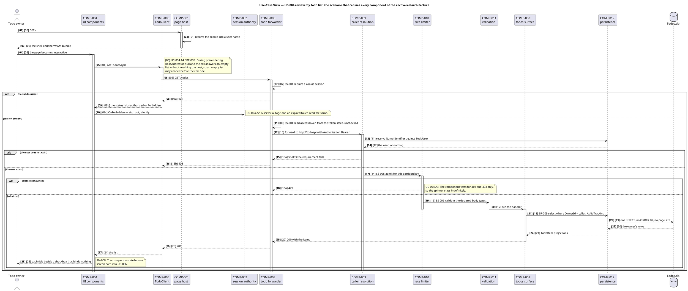
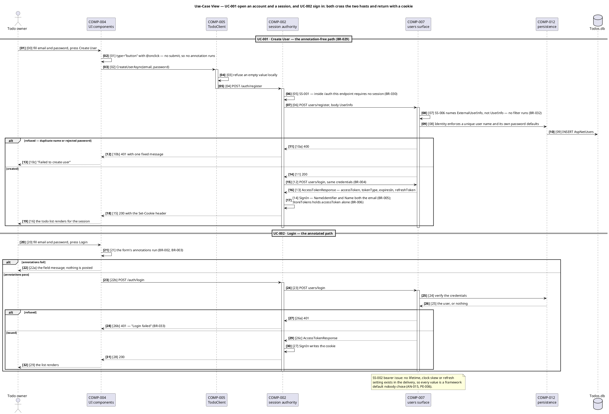
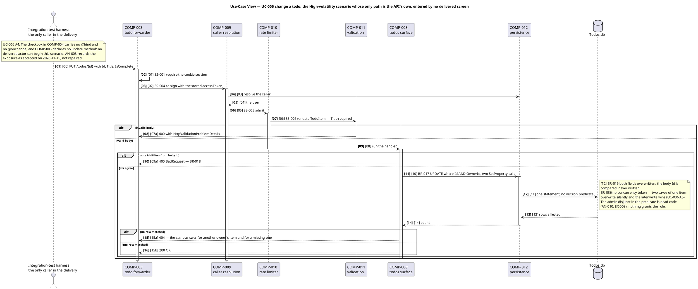
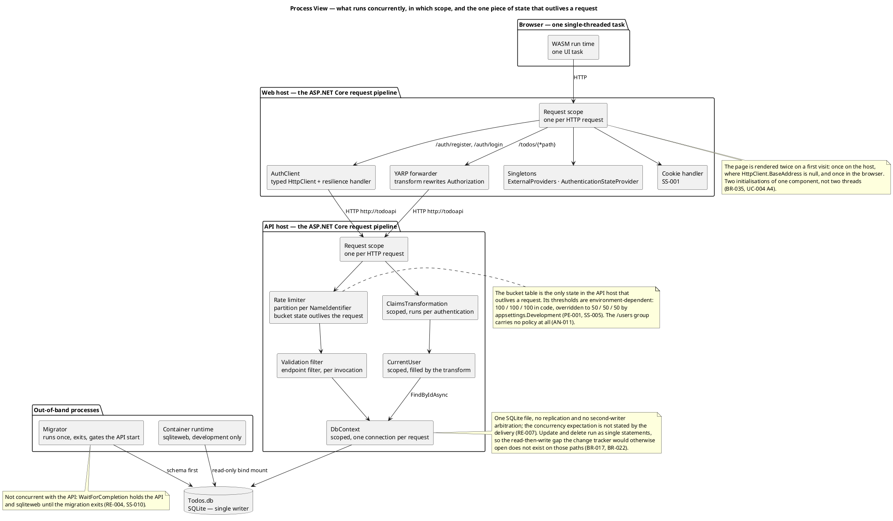
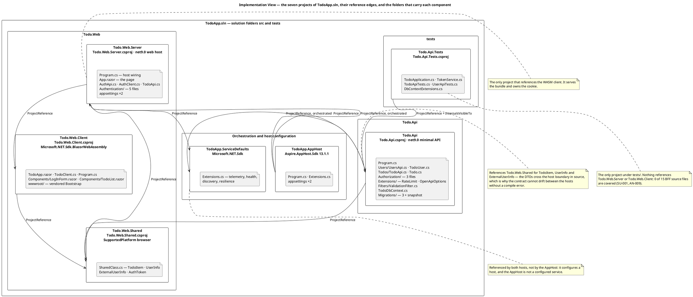
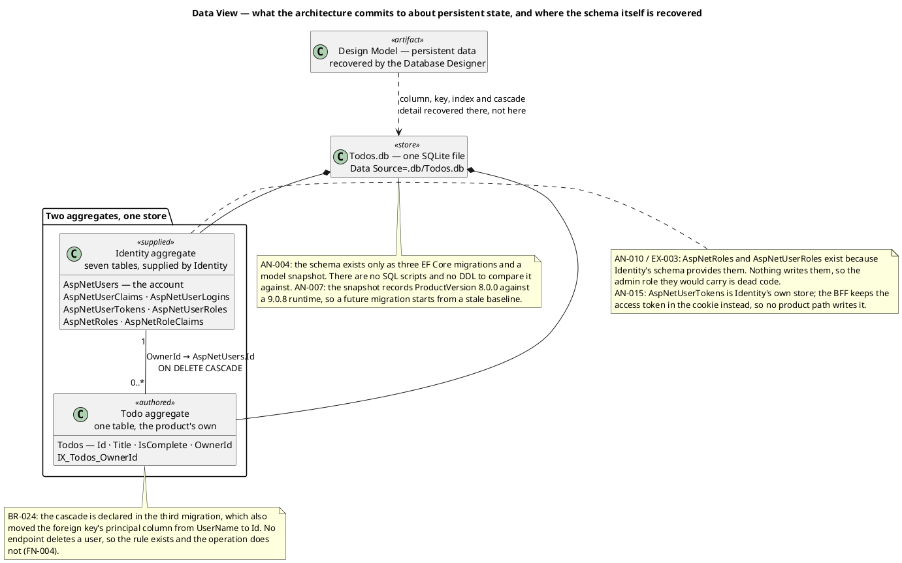

## Document Control
- Phase: Excavation
- Status: Draft — issued for the end-of-Excavation milestone review
- Milestone Target: end of Excavation (AR) — not yet achieved

## Architectural Representation
This document records the architecture the code already holds. It designs nothing. Every element below is anchored to the files that carry it, and every statement about behaviour was checked by reading those files along the path of a recovered use case — never inferred from the technology the code happens to be written in.

| View | Primary diagram | What it fixes |
|---|---|---|
| Logical | Component diagram — eighteen components in five layers | The decomposition, and an interface at every boundary |
| Process | Component diagram — tasks, scopes and the one state that outlives a request | What runs concurrently, and what is shared |
| Deployment | Deployment diagram — three declared nodes and the orchestrator | Where executables run, and where the delivery stops declaring |
| Implementation | Component diagram — seven projects and their reference edges | How the source is organised against the decomposition |
| Data | Class diagram — the two aggregates | Persistent structure, and where it is recovered |
| Use-Case | Three sequence diagrams — UC-004, UC-001/UC-002, UC-006 | That every view above is exercised by a scenario |

**What is architecture here, and what is not.** Eighteen components, five layers, one connector technology per boundary, eleven mechanisms, one shared contract library. The Razor components and the migration set are elements of these views because a change to either crosses a component boundary. The vendored Bootstrap distribution, the launch profiles and the `.vscode` extension list are in no view: nothing in the system's structure depends on them.

### Architectural decisions (recovered)

Each record states what the code decided, the alternative it did not take, and what the decision costs. Status is Recovered throughout: this project took none of these decisions, and none may be reversed without a Change Request.

| ID | Decision as the code holds it | Alternative the code did not take | Consequence in force | Anchor |
|---|---|---|---|---|
| ADR-001 | **Two hosts with a browser-facing proxy in front of the API.** The browser holds a cookie the API never sees; every todo request is forwarded and re-signed with a bearer token. | One host serving the UI and the API, with a single credential end to end | The API needs no public route, and the BFF becomes the system's identity boundary. It is also the half with no automated test (AN-009) | `Todo.Web/Server/Program.cs:20-37`; `Todo.Web/Server/TodoApi.cs:14-26`; `AuthApi.cs:105-127` |
| ADR-002 | **The session credential is a cookie holding an access token and nothing else.** No refresh token is stored, so nothing can extend a session. | Store the refresh token and redeem it through `/users/refresh`, which the API already publishes | A session ends at an access-token lifetime no file states; the only recovery is the silent sign-out the client performs on a 401 (AN-015) | `Authentication/TokenNames.cs:3-6`; `AuthApi.cs:121-123`; `AuthClient.cs:3-46` |
| ADR-003 | **Ownership is a predicate inside the statement that performs the work**, never a check before it. | Read the row, test the owner in code, then write | No read-then-write gap exists, and a non-owner's item answers `404` so the response never discloses that the row exists (BR-009, BR-017, BR-022, BR-020). The same shape leaves nowhere to check a version column (FN-011) | `Todo.Api/Todos/TodoApi.cs:59-73` |
| ADR-004 | **Validation is opt-in per route group, keyed on the declared body type.** | A global filter over every bound parameter | The filter covers `TodoItem` and `ExternalUserInfo`. `UserInfo` — the body of registration and sign-in — is named by neither group, so Identity's unconfigured framework defaults are the only admission rule for a new account (BR-032, BR-037) | `Todo.Api/Todos/TodoApi.cs:29`; `Todo.Api/Users/UsersApi.cs:18`; `Filters/ValidationFilter.cs:22-43` |
| ADR-005 | **A valid bearer token is not sufficient; the principal must resolve to a row.** A claims transformation stores the resolved user on a scoped object and an authorization requirement reads it. | Trust signature and expiry, and let a missing user fail later | A deleted account's token stops being honoured immediately (RE-003). Every handler's owner comparison descends from that one transformation | `Authorization/CurrentUserExtensions.cs:14-35`; `Authorization/CheckCurrentUserAuthHandler.cs:17-39` |
| ADR-006 | **Rate limiting is partitioned per authenticated user, on `/todos` only.** | A per-IP limit, or a limit on the whole pipeline | The endpoints that accept credentials carry no limiter, no lock-out and no attempt counter, so repeated guessing is unlimited (AN-011, BR-038) | `Extensions/RateLimitExtensions.cs:11-71`; `Todo.Api/Users/UsersApi.cs:12-22` |
| ADR-007 | **The client reaches the API at the hardcoded absolute address `http://todoapi`.** | A configuration key, or a path resolved by the same host | The AppHost is the only run mode in which the browser-facing half functions; started without it the BFF has no route to the backend and no key can supply one (AN-012) | `Todo.Web/Server/Program.cs:26-30`; `Todo.Web/Server/TodoApi.cs:18` |
| ADR-008 | **Both hosts share a data-protection discriminator and no key repository.** | A shared key repository, or no cross-host protected payload at all | The provider key the BFF protects must be readable by the API, so the discriminator is shared. Without a repository the ring falls back to each host's own file system, which the container images both projects declare would split (AN-017) | `Todo.Api/Program.cs:10-11`; `Todo.Web/Server/Program.cs:12-13`; `UsersApi.cs:26-28` |
| ADR-009 | **The schema is code, not artefacts.** Three migrations and a model snapshot are its only definition; the AppHost applies them before either host starts. | DDL scripts applied by the environment | Nothing creates the database except `dotnet ef database update` from the API project, so the migration is on the critical path of every start and no second description of the schema exists to compare against (AN-004) | `TodoApp.AppHost/Program.cs:3,19-25`; `TodoApp.AppHost/Extensions.cs:5-16`; `Todo.Api/Migrations/` |
| ADR-010 | **The API document is published in every environment; the interactive reference is mapped in Development only.** | Guard both, or neither | The document is readable by any caller that reaches the port, while `/` still redirects to a route that does not exist outside Development (AN-016) | `Todo.Api/Program.cs:49-62` |
| ADR-011 | **The wire contract is declared twice — once per host — and the API does not reference the shared library.** `Todo.Web.Shared` is referenced by the two web projects only; `Todo.Api` declares its own `TodoItem`, `UserInfo` and `ExternalUserInfo` with the same member names and types. | Have `Todo.Api` reference `Todo.Web.Shared`, so one declaration carries both hosts | No compile error can catch the two shapes drifting apart. They agree today by inspection, not by construction, and the agreement is held by three hand-kept copies — `Todo.Api/Todos/Todo.cs` and `Todo.Api/Users/TodoUser.cs` against `Todo.Web/Shared/SharedClass.cs`. `TodoItem` in particular exists as two independent classes with identical members | `Todo.Api/Todos/Todo.cs:14-19`; `Todo.Api/Users/TodoUser.cs:12-27`; `Todo.Web/Shared/SharedClass.cs:5-26`; `Todo.Api/Todo.Api.csproj:22-24` |
| ADR-012 | **Package versions are managed centrally and pinned by `global.json`; the CI build honours the package pins but not the SDK pin.** One `Directory.Packages.props` supplies every version to every project, and no project file carries one. | Per-project versions, or an SDK-version check in the pipeline | The package graph is single-sourced and cannot drift project by project. The SDK pin is not enforced: `actions/setup-dotnet` receives no `dotnet-version`, so green does not demonstrate that `9.0.100` — the version `global.json` demands — builds the solution (AN-006) | `Directory.Packages.props:1-43`; `global.json:1-8`; `.github/workflows/ci.yaml:12-13`; `Directory.Build.props:1-9` |

## Architectural Goals and Constraints

| Goal | What the architecture does about it | Where it is visible |
|---|---|---|
| One person's items are invisible to every other person | Ownership is a foreign key and a query predicate, not an authorization decision taken in code | `## Data View`; `## Quality` Q1 |
| The browser never holds a credential the API would accept directly | Two hosts joined by a forwarder that re-signs; the cookie is opaque to the API | `## Logical View` COMP-003; ADR-001 |
| An operation on a todo is one statement against the store | No handler loads an entity to inspect it before writing | `## Process View`; ADR-003 |
| The schema exists before the first request is served | Start-up is ordered: migrate, then serve | `## Deployment View`; COMP-016; ADR-009 |
| A change to a screen does not reach the API's internals | The shared DTO library is the only type both hosts compile against | `## Implementation View`; COMP-006 |

Every row below is a fact about the delivery. None is a preference of this project, and none is negotiable inside Excavation.

| ID | Constraint | Anchor |
|---|---|---|
| CON-A01 | The stack is not re-platformed: `net9.0`, SDK `9.0.100`, `LangVersion preview`, `Nullable` enabled, centrally managed package versions, `nuget.org` only. No package or framework is upgraded as a side effect of any task. | Development Case DC-D6; `global.json`; `Directory.Build.props`; `Directory.Packages.props`; SS DC-001 |
| CON-A02 | The project's recorded version policy is authoritative over the registry's latest. Every version named in this document is the pinned one, and none may advance past its pin. | `get_version_policy`; `Directory.Packages.props` |
| CON-A03 | The relational schema exists only as three EF Core migrations and a model snapshot. There are no SQL files, no stored procedures and no triggers. | AN-004; SS DC-002 |
| CON-A04 | The model snapshot records `ProductVersion` 8.0.0 against a 9.0.8 runtime: a future migration starts from a stale baseline. | AN-007; SS DC-003 |
| CON-A05 | Both hosts declare container images while the AppHost runs them as services. The sqliteweb container is a development aid, excluded from the published manifest. | SS DC-005; `TodoApp.AppHost/Program.cs:10-17` |
| CON-A06 | No deployment target, host name, TLS terminator or network rule is named anywhere in the delivery. This document records the topology the code declares and declares no environment. | SS DC-006, DC-008; `.iari/README.md:12-13` |
| CON-A07 | Three parts of the code are outside the recovered product scope by the stakeholder's decision of 2026-11-19: external provider sign-in, the admin role and the self-service identity surface. No architectural statement here claims a capability through them. | SS EX-001, EX-002, EX-003; System Inventory Perimeter |

## Use-Case View

The architecture is validated against the recovered use cases, not against a scenario of this document's own naming. Three runs carry that validation, chosen because between them they cross every layer and every connector in the Logical View.

UC-004 is the validation the Logical View needed: it enters at COMP-001, crosses the cookie boundary at COMP-002 and COMP-003, crosses the host boundary at the forwarder, and leaves through COMP-008 and COMP-012 to the store. A component absent from this path would be an element with no scenario behind it.

This pair is where reading the code contradicted the hypothesis. The mechanism list for the `/users` surface looked obvious — bearer issue plus validation — and the validation filter turned out not to be on the registration path at all, because it is keyed on parameter type and `UserInfo` is named by no group. COMP-011 is therefore absent from UC-001's path, and the Logical View records it as realizing only UC-005 and UC-006.

UC-006 is drawn separately because it is the use case the architecture must keep separable. Its volatility is High — the screen path that would make it an actor's goal does not exist, and any declared requirement for completion will change it. Its realisation touches COMP-008, COMP-011 and COMP-012 and touches no Razor component, which is why the absent screen path is a gap in one component rather than a rewrite of the group.

| UC | Name | Components on the path the code confirms |
|---|---|---|
| UC-001 | Open an account and a session | COMP-001, COMP-002, COMP-004, COMP-005, COMP-006, COMP-007, COMP-012 |
| UC-002 | Sign in to an existing account | COMP-001, COMP-002, COMP-004, COMP-005, COMP-006, COMP-007, COMP-012 |
| UC-003 | Sign out | COMP-001, COMP-002, COMP-004, COMP-005 |
| UC-004 | Review my todo list | COMP-001, COMP-003, COMP-004, COMP-005, COMP-006, COMP-008, COMP-009, COMP-010, COMP-011, COMP-012 |
| UC-005 | Add a todo | COMP-003, COMP-004, COMP-005, COMP-006, COMP-008, COMP-009, COMP-010, COMP-011, COMP-012 |
| UC-006 | Change a todo (title and completion) | COMP-003, COMP-008, COMP-009, COMP-010, COMP-011, COMP-012 |
| UC-007 | Delete a todo | COMP-003, COMP-004, COMP-005, COMP-008, COMP-009, COMP-010, COMP-011, COMP-012 |
| UC-008 | Consult the API reference | COMP-013 |

Five components are absent from every row, and that is the finding rather than an omission. COMP-014 carries the shared host configuration, and SS-009 records that no use case depends on telemetry. COMP-015 and COMP-016 are the orchestrator and the migrator — platform operations, not actor goals. COMP-017 and COMP-018 verify the system from outside it. They are in the Logical View because a change to any of them crosses a boundary the use cases depend on; they are on no scenario path, and no trace claims otherwise.

## Logical View

The decomposition is by area of change, not by feature. The API's two endpoint groups could have been one component — they share a host, a `DbContext` and an authorization policy — and they are separated because they change for different reasons: `/todos` is stable and owner-scoped, `/users` is the surface the excluded identity work would reopen. The five mechanism components are separated from the handlers because each is registered once and applied by convention, so a change to the rate-limit policy is not a change to a todo handler.

```plantuml
@startuml
title Logical View — the eighteen recovered components, the layers they sit in, and the connectors between them
skinparam componentStyle rectangle
skinparam shadowing false
skinparam defaultTextAlignment left
skinparam packageStyle rectangle

actor "Todo owner" as OWNER
actor "Developer" as DEV

package "Browser — the WebAssembly sandbox" {
  component "COMP-004\nUI components\nTodoApp · LogInForm · TodoList" as UI
  component "COMP-005\nTodoClient\nHTTP client for /auth and /todos" as TC
}

package "Web host — Todo.Web.Server (the BFF)" {
  component "COMP-001\nPage host\n/ · prerender · AuthenticationStateProvider" as PAGE
  component "COMP-002\nSession authority\n/auth · cookie scheme · AuthClient" as SES
  component "COMP-003\nTodo forwarder\n/todos · YARP · token re-sign" as FWD
}

package "Shared contract library" {
  component "COMP-006\nTodo.Web.Shared\nTodoItem · UserInfo · AuthToken" as SHARED
}

package "API host — Todo.Api" {
  component "COMP-013\nAPI reference\n/openapi/v1.json · /scalar/v1" as REF
  component "COMP-007\nUsers surface\n/users · Identity · bearer issue" as USERS
  component "COMP-008\nTodos surface\n/todos handlers" as TODOS
  component "COMP-009\nCaller resolution\nclaims transform · requirement handler" as CALLER
  component "COMP-010\nPer-user rate limiter\npolicy PerUserRatelimit" as RL
  component "COMP-011\nValidation filter\nMiniValidation · problem details" as VAL
  component "COMP-012\nPersistence\nDbContext · entities · three migrations" as PERS
}

package "Host configuration layer" {
  component "COMP-014\nTodoApp.ServiceDefaults\ntelemetry · discovery · resilience · probes" as SD
}

package "Orchestration — the only run mode the delivery supports" {
  component "COMP-015\nTodoApp.AppHost\nstarts the API, the web host and sqliteweb" as AH
  component "COMP-016\nDatabase migrator\ndotnet ef database update" as MIG
}

package "Verification" {
  component "COMP-017\nTodo.Api.Tests\nin-process host over in-memory SQLite" as TESTS
  component "COMP-018\nCI pipeline\nrestore · build · test" as CI
}

database "Todos.db\nSQLite — one file" as DB

OWNER --> UI : HTTPS\n/ · /auth/* · /todos/*
UI --> TC
TC --> PAGE : /auth/* and /todos/*
PAGE --> TC : prerender pass, BaseAddress null
PAGE --> SES : the authenticated user name
SES --> USERS : POST users/register, users/login
FWD --> TODOS : Authorization: Bearer
TODOS --> CALLER
TODOS --> RL
TODOS --> VAL
CALLER --> PERS
RL --> PERS
VAL --> PERS
USERS --> PERS
PERS --> DB
DEV --> REF
REF --> TODOS
REF --> USERS

SHARED ..> UI : DTOs
SHARED ..> TC : DTOs
SHARED ..> SES : DTOs
SHARED ..> USERS : DTOs
SHARED ..> TODOS : DTOs

SD ..> PAGE : discovery · resilience · telemetry
SD ..> FWD : discovery
SD ..> USERS : telemetry · discovery
AH --> MIG : starts first
AH --> PAGE : starts, injects the API endpoint
MIG --> DB : creates the schema
TESTS ..> USERS : boots in-process
TESTS ..> TODOS
CI ..> TESTS

note right of SES
  Mechanisms, by the capability they provide —
  Supplementary Specification SS-001 cookie session,
  SS-002 bearer issue, SS-007 data protection under the
  discriminator TodoApp, SS-011 error collapse.
end note
note right of FWD
  SS-004 forwarding with token re-signing. The transform
  attaches whatever the cookie's token store holds, with no
  presence and no freshness check (BR-034).
end note
note bottom of PERS
  SS-010 — the schema must exist before the API serves a
  request, and the migration set is its only definition.
end note
note bottom of AH
  AN-012: without the AppHost the forwarder has no route to
  the API, because http://todoapi resolves under service
  discovery only.
end note
@enduml
```

### Components

| ID | Component | Layer | Responsibility | The interface it offers | Anchor |
|---|---|---|---|---|---|
| COMP-001 | Page host | Presentation, web host | Serves `/`, prerenders the shell, resolves the cookie into a user name through the authentication-state provider, hands the WASM bundle to the browser | `GET /` — `EP-023` | `Todo.Web/Server/App.razor:5-25`; `Authentication/HttpAuthenticationStateProvider.cs:5-10`; `Program.cs:12-20,36-37` |
| COMP-002 | Session authority | Application, web host | Owns the cookie scheme; exposes `/auth/register`, `/auth/login`, `/auth/logout`; calls `AuthClient`; writes the two identity claims and the one-entry token store | `EP-017`, `EP-018`, `EP-019` | `Todo.Web/Server/AuthApi.cs:14-52,105-127`; `AuthClient.cs:5-29` |
| COMP-003 | Todo forwarder | Infrastructure, web host | Forwards every verb under `/todos` to `http://todoapi` through YARP, replacing the `Authorization` header with the stored bearer token | `/todos/{*path}` — `EP-022` | `Todo.Web/Server/TodoApi.cs:9-28`; `Program.cs:24-30` |
| COMP-004 | UI components | Presentation, browser | The delivered screens: a shell switching between the login form and the list, a form with two controls and a provider list, a list with an entry field and a per-item delete link | rendered by COMP-001 at `/` | `Todo.Web/Client/TodoApp.razor:1-44`; `Components/LogInForm.razor:1-89`; `Components/TodoList.razor:1-100` |
| COMP-005 | TodoClient | Application, browser | The browser's whole reachable surface: five methods over `auth/register`, `auth/login`, `auth/logout`, `todos` GET and POST, and `todos/{id}` DELETE. No update method exists | consumes COMP-001's routes | `Todo.Web/Client/TodoClient.cs:7-71` |
| COMP-006 | Shared contracts | Contract | `TodoItem`, `UserInfo`, `ExternalUserInfo`, `AuthToken` — the only types both hosts compile against | the DTO boundary across the host split | `Todo.Web/Shared/SharedClass.cs:3-37` |
| COMP-007 | Users surface | Application, API host | ASP.NET Core Identity over EF Core, the stock identity endpoint group, and the custom external-token endpoint. The product calls registration and login; the rest are excluded | `EP-001`, `EP-002`; `EP-003`…`EP-011` published | `Todo.Api/Users/UsersApi.cs:10-64`; `Users/TodoUser.cs:7-29`; `Todo.Api/Program.cs:14-20` |
| COMP-008 | Todos surface | Application, API host | Five handlers over the `Todos` table — list, read one, create, update, delete — each owner-scoped inside its own statement | `EP-012`…`EP-016` | `Todo.Api/Todos/TodoApi.cs:8-77`; `Todos/Todo.cs:1-40` |
| COMP-009 | Caller resolution | Mechanism, API host | A claims transformation resolving `NameIdentifier` against `TodoUser` onto a scoped `CurrentUser`, plus the authorization requirement that fails when nothing resolved | `RequireCurrentUser()` | `Authorization/CurrentUserExtensions.cs:8-35`; `Authorization/CheckCurrentUserAuthHandler.cs:8-40`; `Authorization/CurrentUser.cs:6-15` |
| COMP-010 | Per-user rate limiter | Mechanism, API host | One token-bucket policy partitioned on the `NameIdentifier` claim, and an extension attaching it to a route group | `RequirePerUserRateLimit()` | `Extensions/RateLimitExtensions.cs:11-71`; `Todo.Api/Program.cs:34,41` |
| COMP-011 | Validation filter | Mechanism, API host | An endpoint filter validating only the parameters whose type the group named, answering `400` with `HttpValidationProblemDetails` | `WithParameterValidation(Type…)` | `Filters/ValidationFilter.cs:7-58` |
| COMP-012 | Persistence | Infrastructure, API host | `TodoDbContext` over Identity and the `Todo` entity, the SQLite provider, and the three migrations that are the schema's only definition | the store boundary `IF-004` | `Todo.Api/TodoDbContext.cs:7-21`; `Todo.Api/Program.cs:22-24`; `Todo.Api/Migrations/` |
| COMP-013 | API reference | Presentation, API host | Publishes the OpenAPI document in every environment, maps the Scalar UI in Development only, and redirects `/` to it unconditionally | `EP-024`; `IF-010` | `Todo.Api/Program.cs:46,49-58,62`; `Extensions/OpenApiOptionsExtensions.cs:7-47` |
| COMP-014 | Service defaults | Host configuration | Applied by both hosts: OpenTelemetry traces, metrics and logs, the OTLP exporter gated on a non-empty endpoint, health probes, service discovery and the standard HTTP resilience handler | `AddServiceDefaults()`, `MapDefaultEndpoints()` | `TodoApp.ServiceDefaults/Extensions.cs:16-117` |
| COMP-015 | AppHost | Orchestration | Starts the migration, then the API, the web host with a reference to the API, and the sqliteweb container bound to the database directory | the run topology | `TodoApp.AppHost/Program.cs:3-27` |
| COMP-016 | Database migrator | Orchestration | Installs `dotnet-ef` globally and runs `dotnet ef database update --no-build` when the database directory is absent; the API waits for it | `EP-026` | `TodoApp.AppHost/Extensions.cs:3-38`; `TodoApp.AppHost/Program.cs:5,19-25` |
| COMP-017 | Integration tests | Verification | Boots the API in-process, replaces the SQLite connection with a shared in-memory one, mints bearer tokens, drives the real endpoints | exercises COMP-007 and COMP-008 only | `Todo.Api.Tests/TodoApplication.cs:10-95`; `TodoApiTests.cs:3-290`; `UserApiTests.cs:6-170` |
| COMP-018 | CI pipeline | Verification | The only executable definition of green: restore, build and test the whole solution on every push and pull request | — | `.github/workflows/ci.yaml:1-21`; `TodoApp.sln:1-12` |

### Interfaces at the component boundaries

Every boundary between components is named by an interface; no component reaches into another's classes.

| ID | Interface | Offered by | Consumed by | Form | Anchor |
|---|---|---|---|---|---|
| INT-001 | `GET /` — the page | COMP-001 | the browser, which mounts COMP-004 | HTTP screen; the host renders the shell and hands over the bundle | `App.razor:5-25`; `Program.cs:36-37` |
| INT-002 | `/auth/register`, `/auth/login`, `/auth/logout` | COMP-002 | COMP-005 | HTTP POST, JSON `UserInfo`, `Set-Cookie` on success, `401` with no reason | `AuthApi.cs:14-52`; `TodoClient.cs:42-69` |
| INT-003 | `users/register`, `users/login` | COMP-007 | COMP-002 through COMP-006's DTOs | HTTP POST over `http://todoapi`, no `Authorization` header, `AccessTokenResponse` returned | `AuthClient.cs:5-29`; `IF-002` |
| INT-004 | `/todos/{*path}` — the forward | COMP-003 | COMP-005 | HTTP, every verb, `Authorization: Bearer <token>` written by a request transform | `Todo.Web/Server/TodoApi.cs:14-26`; `IF-003` |
| INT-005 | `/todos` — the resource group | COMP-008 | COMP-003 | HTTP JSON; five operations; `401`/`403` unauthorised, `404` not owned, `400` problem details, `429` limited | `Todo.Api/Todos/TodoApi.cs:8-77`; `EP-012`…`EP-016` |
| INT-006 | `RequireCurrentUser()` | COMP-009 | COMP-008 | authorization policy builder extension; fails the request before the handler runs | `CheckCurrentUserAuthHandler.cs:17-39` |
| INT-007 | `RequirePerUserRateLimit()` | COMP-010 | COMP-008 | endpoint convention attaching the named policy | `RateLimitExtensions.cs:60-71` |
| INT-008 | `WithParameterValidation(Type…)` | COMP-011 | COMP-007, COMP-008 | endpoint convention matching parameters by exact declared type | `ValidationFilter.cs:11-58` |
| INT-009 | `DbContext` | COMP-012 | COMP-007, COMP-008, COMP-009 | EF Core service resolved into handlers and into the claims transformation | `TodoDbContext.cs:7-21` |
| INT-010 | `TodoItem`, `UserInfo`, `AuthToken` | COMP-006 | both hosts, both sides of the browser boundary | compile-time types; the contract is the type, not a schema | `SharedClass.cs:3-37` |
| INT-011 | `/openapi/v1.json`, `/scalar/v1` | COMP-013 | the developer actor | HTTP; JSON document unguarded, HTML UI in Development only | `Todo.Api/Program.cs:49-62` |
| INT-012 | `AddServiceDefaults()`, `MapDefaultEndpoints()` | COMP-014 | COMP-001, COMP-002, COMP-003, COMP-007, COMP-008 | builder extensions applied at host start; no runtime contract between components | `ServiceDefaults/Extensions.cs:16-24,101-117` |

### Mechanisms, by the capability they provide

A mechanism is named by what it does and what it must hold, not by the package that happens to implement it. The Supplementary Specification carries the thresholds; this table records where each mechanism sits in the architecture.

| ID | Capability | Properties it must hold | Realised in | Anchor |
|---|---|---|---|---|
| SS-001 | A browser-held session that never exposes a token to the page's scripts | The cookie is the only credential the page presents; claims are the email twice; the token store holds one entry | COMP-002 | `AuthApi.cs:105-127`; `TokenNames.cs:3-6` |
| SS-002 | Credential exchange for a bearer token | Token issued on success; lifetime and refresh are framework defaults nothing configured | COMP-007 | `Todo.Api/Program.cs:14-20` |
| SS-003 | Caller authenticity beyond token validity | The principal must resolve to a stored row before any handler runs | COMP-009 | `CurrentUserExtensions.cs:14-35`; `CheckCurrentUserAuthHandler.cs:33-39` |
| SS-004 | Cross-host forwarding that carries identity | Every verb forwarded; the header replaced, never appended; no check that a token is present or current | COMP-003 | `Todo.Web/Server/TodoApi.cs:14-26` |
| SS-005 | Fair use of the API per account | Partition key is the account; rejection is `429`; the budget is environment-dependent | COMP-010 | `RateLimitExtensions.cs:11-71`; `Todo.Api/appsettings.Development.json:9-13` |
| SS-006 | Rejection of a malformed body with the failing member named | Opt-in per group, matched on the declared parameter type | COMP-011 | `ValidationFilter.cs:7-58` |
| SS-007 | Cross-host readability of protected payloads | One discriminator shared by both hosts; no key repository | COMP-001, COMP-002, COMP-007 | `Todo.Api/Program.cs:10-11`; `Todo.Web/Server/Program.cs:12-13` |
| SS-008 | A published API document and an interactive reference | Document published unconditionally; UI Development-only; no server preset; bearer preferred | COMP-013 | `Todo.Api/Program.cs:49-58`; `OpenApiOptionsExtensions.cs:7-47` |
| SS-009 | Observability of a running host | Traces, metrics and logs on one OTLP path, enabled by configuration; probes mapped in Development | COMP-014 | `ServiceDefaults/Extensions.cs:16-117` |
| SS-010 | The schema existing before the first request | One ordered migration, gated on the database directory's absence | COMP-016, COMP-012 | `TodoApp.AppHost/Program.cs:19-25`; `Extensions.cs:5-16` |
| SS-011 | One answer for every failure below the boundary | Any non-success becomes `401` and one fixed message per control | COMP-002 | `AuthClient.cs:5-29`; `LogInForm.razor:79-96` |

## Process View

**Three concurrent processes, and one shared resource.** The browser runs one task. Each host runs an ASP.NET Core request pipeline — one request scope each, no background worker, no timer, no queue and no channel in either. The migrator is a separate process whose only relationship to the API is that the API does not start until it exits. The single shared resource is `Todos.db`: one SQLite file, one writer, an unknown concurrency expectation (RE-007).

**No process is a thread of its own.** The delivery registers no `BackgroundService`, no `IHostedService` beyond the framework's, no channel consumer and no scheduled job. The one piece of state outliving a request is the rate limiter's bucket table, partitioned per account and created on first use — the only place where one request's outcome depends on another's.

**The two-host boundary is synchronous, and the forwarder has no retry.** `AuthClient` is a typed `HttpClient` registered through the service defaults, so the standard resilience handler applies to it. The YARP forwarder is not: it uses `IHttpForwarder` directly, so a `/todos` request meeting a failing API fails at the caller with nothing in between (RE-009). That is a property of the architecture, not a defect recorded against it — no resilience requirement exists in the delivery.

## Deployment View

The Deployment Model is the fired optional artifact and carries node, connector and environment detail. This section records the deployment view of the architecture: which component runs in which node, and where the delivery stops declaring.

```plantuml
@startuml
title Deployment View — the nodes the delivery declares, and the ones it does not
skinparam shadowing false
skinparam defaultTextAlignment left
skinparam componentStyle rectangle

actor "Todo owner" as OWNER
actor "Developer" as DEV

node "Client machine — a browser" as BROWSER {
  artifact "Blazor WebAssembly bundle\nserved by the web host" as WASM
  artifact "Authentication cookie\nNameIdentifier · Name · accessToken" as COOKIE
}

node "AppHost process — the local orchestrator\nAspire, started by hand" as APPHOST {
  component "COMP-015 TodoApp.AppHost" as AH
  component "COMP-016 migrator\ndotnet-ef global tool" as MIG
}

node "Web host node — todo-web-server\ncontainer image declared, run as a project" as WEBNODE {
  component "COMP-001 page host" as PAGE
  component "COMP-002 session authority" as SES
  component "COMP-003 todo forwarder" as FWD
  artifact "Data protection key ring\nframework per-user file default" as WKEY
}

node "API host node — todoapi\ncontainer image declared, run as a project" as APINODE {
  component "COMP-007 users surface" as USERS
  component "COMP-008 todos surface" as TODOS
  component "COMP-009 caller resolution" as CALLER
  component "COMP-010 rate limiter" as RL
  component "COMP-011 validation" as VAL
  component "COMP-013 API reference" as REF
  artifact "Data protection key ring\nframework per-user file default" as AKEY
  artifact "Todos.db — SQLite file\nunder the API project directory" as DB
}

node "Container runtime — Docker or Podman" as RUNTIME {
  component "sqliteweb\ntomdesinto/sqliteweb\nExcludeFromManifest" as SQLWEB
}

cloud "OTLP collector\nendpoint named by OTEL_EXPORTER_OTLP_ENDPOINT" as OTLP
cloud "NuGet feed\nhttps://api.nuget.org/v3/index.json" as NUGET

OWNER --> BROWSER
BROWSER --> WEBNODE : HTTPS\n/ · /auth/* · /todos/*
WEBNODE --> APINODE : HTTP over service discovery\nhttp://todoapi
APPHOST --> WEBNODE : starts, injects the API reference
APPHOST --> APINODE : starts, gated on the migration
APPHOST --> RUNTIME : asks it to run sqliteweb
MIG --> DB : dotnet ef database update
RUNTIME --> SQLWEB
SQLWEB --> DB : bind mount of the .db directory
USERS --> DB
TODOS --> DB
APINODE ..> OTLP : OTLP export when the endpoint is set
WEBNODE ..> OTLP : OTLP export when the endpoint is set
DEV --> APINODE : /scalar/v1 and /openapi/v1.json
NUGET ..> APPHOST : restore time only

note bottom of BROWSER
  The browser never reaches the API node directly: the
  forwarder in the web host is the only route (IF-001).
end note
note bottom of WEBNODE
  AN-017: both hosts set ApplicationDiscriminator "TodoApp" with
  no key repository, so the ring falls back to the per-user file
  default inside each host. A container deployment in the shape
  the project files declare gives each host its own ring, and
  cookies minted by the web host become undecryptable at the API.
  No file states where the ring is meant to live.
end note
note bottom of APINODE
  AN-012: http://todoapi is a hardcoded absolute address that
  resolves only under Aspire service discovery. Started without
  the AppHost the web host has no route to the API, and no
  configuration key can supply one.
end note
note top of RUNTIME
  sqliteweb is excluded from the published manifest: a development
  aid, not part of a deployment (DC-005).
end note
note bottom of APPHOST
  No target environment is named anywhere in the delivery: no host
  name, no TLS terminator, no network rule. This view records the
  topology the code declares, not a deployed environment.
end note
@enduml
```

**What the topology commits the architecture to.** Three addressable endpoints: the web host, which the browser reaches; the API, which only the web host reaches; and the sqliteweb container, which only a developer reaches. Two of the three carry a declared container image. The API's address is a name, not a URL — `http://todoapi` — so service discovery is the connector, and it is the only mechanism that makes the topology work (AN-012).

**What the topology does not commit to.** Where the key ring lives; whether the API has a public route; whether the two host nodes share a file system. Each is a question a deployment must answer and no file in the delivery answers (AN-017, CON-A06).

## Implementation View

**The project boundary is not the component boundary, and that is deliberate.** Three components live in `Todo.Web/Server` — COMP-001, COMP-002, COMP-003 — because they share a host and a pipeline. Five live in `Todo.Api` beyond the two surfaces — COMP-009 to COMP-013 — because each is a registration applied to route groups rather than a folder. The decomposition is held by the interfaces in the Logical View, not by project files; which is also why the version policy sits in `Directory.Packages.props` and the architecture in this document, rather than in the shape of the solution.

**One dependency is structural and worth naming.** `Todo.Api` references `Todo.Web.Shared`, and so does every project that carries a DTO. A change to `TodoItem` therefore reaches the API and the client together and cannot half-land; a change to a mechanism reaches neither. That is the change isolation the Implementation View buys, and it is what makes UC-006 separable (ADR-001).

**The build's definition of green covers the API and not the BFF.** `dotnet test` runs whatever the solution contains, and the solution contains one test project, which references `Todo.Api` alone. No reference exists from any test project to `Todo.Web.Server` — so the web host compiles and nothing executes it (AN-009, AN-020).

## Data View

The persistent structure is recovered into the Design Model by the Database Designer's stages; the Data Model is not produced for this project (Development Case, Optional Artifact Triggers). This view records what the architecture commits to about that structure, not its columns.

**Ownership is structural, not procedural.** `Todos.OwnerId` is a required foreign key into the identity aggregate, indexed, with cascade delete declared in the migration — and every query, update and delete carries that column in its predicate. The architecture therefore has no code path where a row is fetched by id alone and then checked, which is why a non-owner's item answers `404` and never `403` (ADR-003, RE-002).

**The store is a single file with a single writer.** No replication, no declared connection strategy, no second-writer arbitration, no stated concurrency expectation (RE-007). The architecture's tolerance for that is a consequence of the access shape: no handler reads a row in order to modify it later, so no handler holds a transaction open between a read and a write.

**Three tables are written by nothing on the product's paths.** `AspNetRoles` and `AspNetUserRoles` carry what no code grants (AN-010); `AspNetUserTokens` is Identity's own token table, while the session token lives in the cookie (AN-015). They exist because the framework's schema provides them, and their presence in the recovered data view must not be read as a capability.

## Size and Performance

| Measure | Value | Basis |
|---|---|---|
| Projects in the solution | 7 | `TodoApp.sln:1-14` |
| Files in the repository | 132, of which 46 are a vendored Bootstrap distribution | System Inventory, Technology and Size |
| Components in the Logical View | 18, in 5 layers | `## Logical View` |
| Interfaces at component boundaries | 12 | `## Logical View` |
| Mechanisms carried | 11 | `## Logical View` |
| Entry points at the system boundary | 26 recorded, 12 recovered as use cases | System Inventory, Entry Points; `## Use-Case View` |
| Relational tables | 8, of which one is authored by the product | `## Data View` |
| Tests over the API | 2 test classes | `Todo.Api.Tests/TodoApiTests.cs`; `UserApiTests.cs` |
| Tests over the BFF | 0 | `Todo.Api.Tests/Todo.Api.Tests.csproj:6-17`; AN-009 |
| Token budget declared | None | Development Case, Measurement policy; stakeholder answer, 2026-11-19 |

**No performance figure is stated by the delivery, and none is stated here.** Response time, end-to-end latency, concurrent users, resource sizing and list size have no target in any file (PE-002 … PE-005). The architecture therefore cannot be judged against a performance requirement, and this section does not invent one to judge it by.

The only throughput figure anywhere in the delivery is the rate-limit budget, and it is not one figure: 100 tokens replenished at 100 per 10 seconds with a queue of 100 in code, overridden to 50 / 50 / 50 by `Todo.Api/appsettings.Development.json:9-13`. Any environment supplying no `RateLimiting` section falls back to the code defaults, so the same architecture admits half the traffic in Development that it admits elsewhere (PE-001).

Two architectural facts bear on performance, both consequences of decisions recorded above rather than of a performance target:

- **`GET /todos` is unbounded.** It carries no `Take` and no `OrderBy`, so its cost is linear in the number of items an account holds and its result set has no guaranteed order between calls (BR-035, PE-003). Nothing caps it.
- **The write path is one statement.** `ExecuteUpdateAsync` and `ExecuteDeleteAsync` each issue a single statement, so the cost is one round trip to SQLite regardless of the row's width — and that same shape is what removes the concurrency check (ADR-003, FN-011).

**Cost of the architecture to the project itself.** Survey closed at 24 minutes of agent time and 20 minutes of stakeholder queue across 2 iterations and 6 artifacts. No Excavation phase has closed, so this document records no figure for its own production; an estimate would be `[ASSUMPTION — requires validation]` with no comparable closed unit behind it, and the Survey figures are not that unit — Excavation re-reads code, where Survey read an artifact surface. The first measured point is the phase close.

## Quality

```plantuml
@startuml
title Quality — each attribute the delivery can actually answer for, the tactic that serves it, and the component that carries it
skinparam shadowing false
skinparam defaultTextAlignment left
skinparam componentStyle rectangle
skinparam packageStyle rectangle

package "Quality attributes the delivery answers" {
  component "Ownership isolation\nFN-001 · RE-002" as Q1
  component "Caller authenticity\nRE-003 · BR-010" as Q2
  component "Admission control on /todos\nRE-001 · PE-001" as Q3
  component "Rejection with a reason\nRE-008 · ST-001" as Q4
  component "Schema available at start\nRE-004" as Q5
  component "Observability\nSU-005 · ST-006" as Q6
  component "Change isolation\nAN-013 · UC-006 volatility High" as Q7
}

package "Tactics as the code implements them" {
  component "Predicate in the statement,\nnot a filter after the fetch" as T1
  component "Principal resolved against\nthe store before any handler" as T2
  component "Token bucket partitioned\non the account claim" as T3
  component "Endpoint filter keyed on\nthe declared body type" as T4
  component "Ordered start: migrate,\nthen serve" as T5
  component "Instrumentation in a shared\nhost-configuration layer" as T6
  component "Boundary at the DTO and\nat the forwarder" as T7
}

package "Components that carry them" {
  component "COMP-008 todos surface" as C8
  component "COMP-012 persistence" as C12
  component "COMP-009 caller resolution" as C9
  component "COMP-010 rate limiter" as C10
  component "COMP-011 validation" as C11
  component "COMP-016 migrator" as C16
  component "COMP-014 ServiceDefaults" as C14
  component "COMP-006 shared contracts" as C6
  component "COMP-003 todo forwarder" as C3
}

package "What the delivery does NOT answer" {
  component "Performance targets\nPE-002 — not stated" as G1
  component "Concurrency and scale\nPE-003 · PE-004 — not stated" as G2
  component "Availability, RTO, RPO\nRE-006 — not stated" as G3
  component "Session lifetime\nPE-006 — not stated" as G4
  component "Lost-update protection\nFN-011 — absent" as G5
  component "Verification of the BFF\nSU-001 — 0 tests" as G6
}

Q1 --> T1
Q2 --> T2
Q3 --> T3
Q4 --> T4
Q5 --> T5
Q6 --> T6
Q7 --> T7

T1 --> C8
T1 --> C12
T2 --> C9
T3 --> C10
T4 --> C11
T5 --> C16
T6 --> C14
T7 --> C6
T7 --> C3

note right of G1
  These are not gaps a later design fills: no file in the
  delivery states a figure, so no tactic can be judged
  sufficient. They are recorded as not established, not as
  work in hand.
end note
note bottom of G5
  The statement-per-operation shape removes the read-then-write
  gap, and it removes it in a way that also removes the
  concurrency check. Making the write conditional needs a
  declared requirement, not a design decision (FN-011).
end note
@enduml
```

| Attribute | Requirement it serves | How the architecture serves it | Where it fails or is silent |
|---|---|---|---|
| Security — isolation | FN-001, RE-002 | Owner predicate inside every statement; `404` for another owner's item, so the answer never discloses existence | No test covers the BFF side of the identity boundary (SU-001) |
| Security — authenticity | RE-003, BR-010 | Token validity alone is insufficient; the principal must resolve to a row | `/users` requires no authorization and carries no limiter, so its credential endpoints are bounded by nothing (AN-011, AN-018) |
| Reliability — admission | RE-001 | Token bucket partitioned per account; `429` on exhaustion | `/users` has no bucket; a `429` on `/todos` leaves the client spinner indefinitely (UC-004 A3) |
| Reliability — rejection | RE-008 | Problem details naming the failing member | Only the body types a group names are validated; `UserInfo` is not (BR-032) |
| Reliability — start-up | RE-004 | The migration runs before the API starts | The assembled topology has never been run (AN-020) |
| Supportability — observability | SU-005 | One telemetry path in a shared layer; probes mapped | No dashboard, metric, alert, runbook or manual exists (SU-005, SU-007) |
| Modifiability | AN-013, UC-006 High | The DTO library and the forwarder are the only cross-host couplings | The browser-facing half has changed most and is verified least: 43 commits against the API's 10 (AN-013) |
| Performance | PE-002 … PE-005 | — | Not established. No target, no measurement, no declared concurrency |
| Availability | RE-006 | — | Not established. No RTO, RPO, backup or restore statement |
| Concurrency correctness | FN-011 | Single statements remove the read-then-write gap | No version check exists on update: two saves overwrite silently (BR-036) |
| Accessibility, localisation | US-005, US-006 | — | Not stated by the delivery; the checkbox's `aria-label` is a literal ellipsis |

**What this table is for.** It is the boundary of what the architecture may be credited with. Every row in the upper half is a tactic the code implements and this document verified by reading it. Every row in the lower half is an attribute the delivery states no requirement for, and no architecture can be judged against a requirement that does not exist.

## Traceability
Each component realizes the use cases whose path through the code it carries, confirmed in `## Use-Case View`. An edge is written once, in the row of its more concrete end: a component that realizes a use case, and a component that depends on another. Five components carry no use case — COMP-014, COMP-015, COMP-016, COMP-017 and COMP-018. They have no upstream and none is composed for them: their source is the anchor cited where each is described, and they carry only the `DependsOn` edges below.

COMP-011 is absent from UC-001 and UC-002 deliberately: the validation filter is keyed on the declared parameter type, and `UserInfo` — the body of registration and sign-in — is named by no route group, so the filter is on no path through those two use cases (ADR-004, BR-032).

| Element | Traces From | Link Type | Traces To |
|---|---|---|---|
| COMP-001 | UC-001, UC-002, UC-003, UC-004 | Realizes | COMP-014 |
| COMP-002 | UC-001, UC-002, UC-003 | Realizes | COMP-006, COMP-007 |
| COMP-003 | UC-004, UC-005, UC-006, UC-007 | Realizes | COMP-006, COMP-008 |
| COMP-004 | UC-001, UC-002, UC-003, UC-004, UC-005, UC-007 | Realizes | — |
| COMP-005 | UC-001, UC-002, UC-003, UC-004, UC-005, UC-007 | Realizes | — |
| COMP-006 | UC-001, UC-002, UC-004, UC-005, UC-006, UC-007 | Realizes | — |
| COMP-007 | UC-001, UC-002 | Realizes | COMP-012, COMP-014 |
| COMP-008 | UC-004, UC-005, UC-006, UC-007 | Realizes | COMP-009, COMP-010, COMP-011, COMP-012 |
| COMP-009 | UC-004, UC-005, UC-006, UC-007 | Realizes | COMP-012 |
| COMP-010 | UC-004, UC-005, UC-006, UC-007 | Realizes | — |
| COMP-011 | UC-005, UC-006 | Realizes | — |
| COMP-012 | UC-001, UC-002, UC-004, UC-005, UC-006, UC-007 | Realizes | — |
| COMP-013 | UC-008 | Realizes | — |
| COMP-014 | — | — | — |
| COMP-015 | — | — | COMP-001, COMP-016 |
| COMP-016 | — | — | COMP-012 |
| COMP-017 | — | — | COMP-007, COMP-008 |
| COMP-018 | — | — | COMP-017 |

