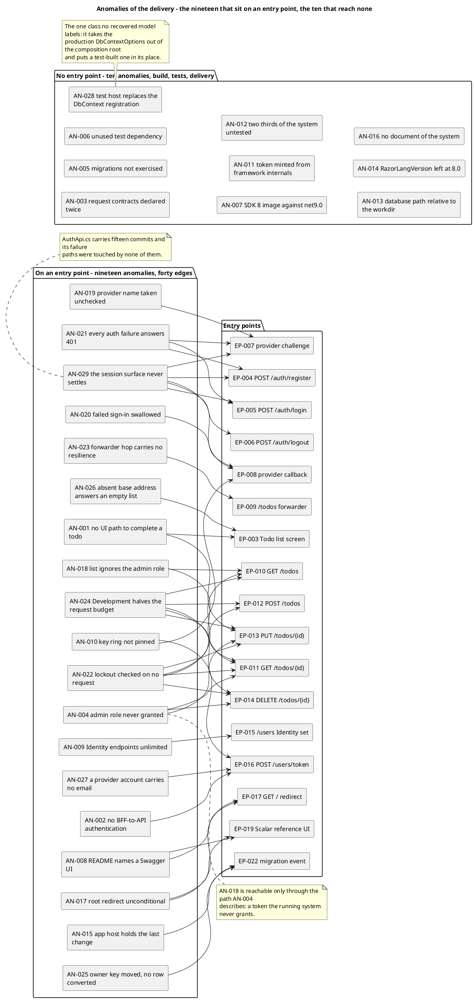

## Document Control
- Phase: Excavation
- Status: Draft — produced for the end-of-Excavation (AR) milestone review
- Milestone Target: end-of-Excavation (AR) — not yet achieved
- Iteration: 1, Cycle 1
- Owner: Software Archaeologist

## Perimeter
The delivery is a four-process .NET 9 system: a Blazor WebAssembly client running in a browser, an ASP.NET Core host that serves it and acts as its backend-for-frontend, a minimal-API REST service, and an Aspire app host that starts them and creates the database. Nothing is scheduled, nothing is consumed from a message broker and no report is produced: every entry point below is reached by an HTTP request, except the one platform event the app host raises before the API starts. The root `README.md` presents the system as `Todo.Web` and `Todo.Api` and names the app host only as the way to run them.

Two questions the reading could not settle were put to the stakeholder on 2026-11-23 and are decided. The external-provider sign-in path — the challenge EP-007, the callback EP-008 and the token exchange EP-016 — is **a recovered use case marked unreachable in the delivered configuration**: the code is complete and no provider is registered in it. The cross-owner branch of the `admin` role in EP-011, EP-013 and EP-014 is **an exceptional entity the recovered use cases do not model**: no actor in the running system can initiate it (AN-004).

```plantuml
@startuml
title Perimeter of the delivered Todo App — four processes, two stores, what it reaches

skinparam componentStyle rectangle
skinparam shadowing false
skinparam packageStyle rectangle

actor "Person with a task list" as USER

package "Process 1 — Browser" {
  component "Todo.Web.Client\nBlazor WebAssembly 9.0.8\ntwo screens: login form, todo list" as CLIENT
}

package "Process 2 — Todo.Web.Server: host and backend-for-frontend" {
  component "Razor host and session cookie\nApp.razor, /auth endpoints" as BFF
  component "External provider registration\nGitHub, Google, Microsoft, Auth0\nregistered only when configured" as EXTREG
  component "YARP IHttpForwarder\n/todos - cookie rewritten to bearer" as PROXY
}

package "Process 3 — Todo.Api: minimal-API REST service" {
  component "Todo endpoints\n/todos" as TODOS
  component "Identity endpoints and /users/token" as USERS
  component "Current-user resolution\nand ownership authorization" as AUTHZ
  component "Validation filter" as VALID
  component "Per-user rate limiter\n/todos only" as RATE
  component "EF Core 9 persistence\nTodoDbContext" as EF
  component "OpenAPI document and Scalar reference UI\nDevelopment only" as DOCS
}

package "Process 4 — TodoApp.AppHost and ServiceDefaults" {
  component "Aspire orchestration\nstarts the others, runs the migration" as APPHOST
  component "Service defaults\nhealth, discovery, OpenTelemetry" as DEF
}

package "Delivery, not running" {
  component "Todo.Api.Tests\nintegration tests over the API" as TESTS
  component "Build and package configuration" as BUILD
  component "CI pipeline" as CI
  component "Developer environment\n.devcontainer, .aspire, .vscode" as DEVENV
}

database "Todos.db\nSQLite file, 8 tables" as DB
database "In-memory SQLite\ntest host only, EnsureCreated" as TESTDB

cloud "Outside the boundary" {
  component "GitHub / Google / Microsoft / Auth0" as IDP
  component "OTLP collector and Aspire Dashboard" as OTEL
  component "nuget.org" as NUGET
  component "tomdesinto/sqliteweb image" as SQLWEB
}

USER --> CLIENT : uses in a browser
CLIENT --> BFF : /auth register, login, logout
CLIENT --> PROXY : /todos create, list, delete
BFF --> USERS : /users/token/{provider}
BFF --> IDP : challenge and callback
EXTREG --> IDP : schemes named in configuration
PROXY --> TODOS : bearer token in Authorization header
TODOS --> AUTHZ
TODOS --> VALID
TODOS --> RATE
TODOS --> EF
USERS --> EF
EF --> DB
TESTS ..> TODOS : over HTTP
TESTS --> TESTDB
APPHOST --> TODOS : starts, waits for the migration
APPHOST --> BFF : starts
APPHOST --> SQLWEB : runs with the database directory mounted
APPHOST ..> DB : dotnet ef database update
DEF ..> TODOS : telemetry
DEF ..> BFF : telemetry
DEF ..> OTEL : OTLP when an endpoint is set
BUILD ..> NUGET : restore
CI ..> BUILD
CI ..> TESTS
DEVENV ..> BUILD : names the SDK image

note right of TODOS
  Anchors: Todo.Api/Todos/TodoApi.cs:8-76
  OwnerId == caller, or the admin role claim.
  Nothing in the running system grants that role (AN-004),
  so the admin branch is an exceptional entity and not a
  recovered use case — stakeholder, 2026-11-23.
end note

note bottom of PROXY
  No service-to-service authentication between the BFF
  and the API: the API accepts a bearer token from any caller
  (AN-002). Todo.Web/Server/TodoApi.cs
end note

note bottom of IDP
  Anchors: Todo.Web/Server/Authentication/AuthenticationExtensions.cs
  A provider is registered only when
  Authentication:Schemes:<name> exists, so none is reachable
  in the delivered configuration. The sign-in path is still a
  recovered use case, marked unreachable — stakeholder, 2026-11-23.
end note

@enduml
```

### Components

| Component | Kind | Responsibility | Implemented by |
|---|---|---|---|
| Todo.Api | Subsystem | The REST service that performs every todo operation and every user and token operation | `Todo.Api/` |
| Todos endpoints | Component | CRUD over the caller's own todo rows; a row the caller does not own answers 404, unless the caller carries the `admin` role claim | `Todo.Api/Todos/TodoApi.cs:8-76` |
| Users and Identity endpoints | Component | The ASP.NET Core Identity endpoint set under `/users`, plus a token exchange for external providers | `Todo.Api/Users/UsersApi.cs:10-61` |
| Current-user resolution and authorization | Component | Resolves the caller from the database on every request, exposes it as `CurrentUser`, and fails the request when no such user exists | `Todo.Api/Authorization/CurrentUser.cs:6-13; Todo.Api/Authorization/CurrentUserExtensions.cs; Todo.Api/Authorization/CheckCurrentUserAuthHandler.cs:14-36` |
| Validation filter | Component | Rejects a request whose parameters fail data annotations with a 400 `ValidationProblemDetails` | `Todo.Api/Filters/ValidationFilter.cs` |
| Per-user rate limiter | Component | Token-bucket policy partitioned by the caller's `NameIdentifier`; applied to `/todos` only | `Todo.Api/Extensions/RateLimitExtensions.cs` |
| Persistence over SQLite | Component | `TodoDbContext` deriving from `IdentityDbContext<TodoUser>`, the entity model, and the three migrations that create and change the schema | `Todo.Api/TodoDbContext.cs:6-20; Todo.Api/Migrations/` |
| OpenAPI and API reference | Component | Emits the OpenAPI document with the bearer scheme, serves the Scalar reference UI in Development, and redirects `/` to it | `Todo.Api/Program.cs:30,49-56,58,62; Todo.Api/Extensions/OpenApiOptionsExtensions.cs` |
| HTTP logging | Component | Development-only combined request/response logging with body and header fields | `Todo.Api/Program.cs:35-42,46` |
| Todo.Web.Server | Subsystem | Serves the WebAssembly client, holds the browser session, and forwards `/todos` to the API | `Todo.Web/Server/` |
| Session and external-provider authentication | Component | Cookie schemes, the four configurable identity providers, and the Blazor authentication state | `Todo.Web/Server/Authentication/` |
| Session endpoints `/auth` | Component | register, login, logout, external challenge, external callback | `Todo.Web/Server/AuthApi.cs:10-97` |
| Forwarding proxy | Component | YARP `IHttpForwarder` that rewrites the session cookie into a bearer token for `/todos` | `Todo.Web/Server/TodoApi.cs:8-25` |
| Todo.Web.Client | Component | Blazor WebAssembly UI: login and create-user form, todo list, logout | `Todo.Web/Client/` |
| Shared contracts | Component | `TodoItem`, `UserInfo`, `ExternalUserInfo` and `AuthToken` as compiled into client and BFF | `Todo.Web/Shared/SharedClass.cs:1-31` |
| Service defaults | Component | Service discovery, HTTP resilience, liveness and readiness endpoints, OpenTelemetry | `TodoApp.ServiceDefaults/Extensions.cs:1-130` |
| AppHost orchestration | Component | Starts the API and the server, runs the EF migration, runs the sqliteweb container | `TodoApp.AppHost/Program.cs:1-28; TodoApp.AppHost/Extensions.cs:1-34` |
| Integration test suite | Component | Exercises the API over HTTP through `WebApplicationFactory`, seeding users and rows directly | `Todo.Api.Tests/` |
| Build and package configuration | Layer | Target framework, language level, central package versions, package-source pinning, solution | `Directory.Build.props; Directory.Packages.props; global.json; nuget.config; TodoApp.sln` |

### External actors and systems

| External actor or system | Reached through | Anchor |
|---|---|---|
| Person with a task list — the only human actor; owns their todo rows, is anonymous until they register or log in | Service — HTTPS to the BFF, rendered by the Blazor client | `Todo.Web/Server/App.razor:5`; `Todo.Web/Client/Components/LogInForm.razor:3-26` |
| GitHub (OAuth 2.0 provider) | Remote call — registered only when `Authentication:Schemes:GitHub` exists | `Todo.Web/Server/Authentication/AuthenticationExtensions.cs:43` |
| Google (OAuth 2.0 provider) | Remote call — registered only when `Authentication:Schemes:Google` exists | `Todo.Web/Server/Authentication/AuthenticationExtensions.cs:44` |
| Microsoft account (OAuth 2.0 provider) | Remote call — registered only when `Authentication:Schemes:Microsoft` exists | `Todo.Web/Server/Authentication/AuthenticationExtensions.cs:45` |
| Auth0 (OpenID Connect provider) | Remote call — registered only when `Authentication:Schemes:Auth0` exists; its sign-in scheme is pinned to the external cookie | `Todo.Web/Server/Authentication/AuthenticationExtensions.cs:46-47,78-92` |
| OTLP collector, viewed in the Aspire Dashboard | Remote call — OTLP exporter, enabled only when `OTEL_EXPORTER_OTLP_ENDPOINT` is non-empty | `TodoApp.ServiceDefaults/Extensions.cs:74-81` |
| nuget.org | Remote call — the only package source; every pattern maps to it | `nuget.config` |
| `tomdesinto/sqliteweb` container image | Remote call — the app host starts it with the database directory bind-mounted; excluded from the manifest | `TodoApp.AppHost/Program.cs:13-17` |
| Todos.db — the SQLite database file | Data manager — EF Core 9 SQLite provider; the store itself is described under Persistent Data | `Todo.Api/Program.cs:23-24` |

### Entry points

| ID | Entry point | Kind | Initiated by | Anchor |
|---|---|---|---|---|
| EP-001 | Application shell at `/` — renders the login form when no user is signed in, the todo list when one is, and carries the logout control | Screen | Person, anonymous or authenticated | `Todo.Web/Server/App.razor:5` |
| EP-002 | Login and create-user form — email, password, Login, Create User, and one link per configured provider | Screen | Person, anonymous | `Todo.Web/Client/Components/LogInForm.razor:3-26` |
| EP-003 | Todo list — loading spinner, new-todo input, the list with a per-item remove control | Screen | Person, authenticated | `Todo.Web/Client/Components/TodoList.razor:3-32` |
| EP-004 | POST /auth/register | Service operation | Person, anonymous | `Todo.Web/Server/AuthApi.cs:14-25` |
| EP-005 | POST /auth/login | Service operation | Person, anonymous | `Todo.Web/Server/AuthApi.cs:27-38` |
| EP-006 | POST /auth/logout | Service operation | Person, authenticated | `Todo.Web/Server/AuthApi.cs:40-52` |
| EP-007 | GET /auth/login/{provider} — issues the challenge and redirects to `/auth/signin/{provider}`; unreachable in the delivered configuration and still a recovered use case (stakeholder, 2026-11-23) | Service operation | Person, anonymous | `Todo.Web/Server/AuthApi.cs:55-62` |
| EP-008 | GET /auth/signin/{provider} — provider callback; exchanges the provider identity for a local user and a token, writes the session cookie; unreachable in the delivered configuration and still a recovered use case (stakeholder, 2026-11-23) | Service operation | External identity provider, on the person's behalf | `Todo.Web/Server/AuthApi.cs:64-97` |
| EP-009 | `/todos` forwarding proxy — any method, any sub-path; requires the session cookie and sets the bearer header | Service operation | Todo.Web.Client through the BFF | `Todo.Web/Server/TodoApi.cs:12-25` |
| EP-010 | GET /todos | Service operation | Authenticated caller holding a bearer token | `Todo.Api/Todos/TodoApi.cs:24-27` |
| EP-011 | GET /todos/{id} — admits the owner and, through a branch no running caller can enter, an `admin` role claim (AN-004, AN-018); the branch is an exceptional entity the recovered use cases do not model (stakeholder, 2026-11-23) | Service operation | Authenticated caller holding a bearer token | `Todo.Api/Todos/TodoApi.cs:29-36` |
| EP-012 | POST /todos | Service operation | Authenticated caller holding a bearer token | `Todo.Api/Todos/TodoApi.cs:38-50` |
| EP-013 | PUT /todos/{id} — admits the owner and the same unreachable `admin` branch (AN-004, AN-018); no client call reaches it (AN-001) | Service operation | Authenticated caller holding a bearer token | `Todo.Api/Todos/TodoApi.cs:52-65` |
| EP-014 | DELETE /todos/{id} — admits the owner and the same unreachable `admin` branch (AN-004, AN-018) | Service operation | Authenticated caller holding a bearer token | `Todo.Api/Todos/TodoApi.cs:67-73` |
| EP-015 | The Identity endpoint set under `/users` — register, login, refresh, confirmEmail, resendConfirmationEmail, forgotPassword, resetPassword, manage/2fa, manage/info | Service operation | Anonymous or authenticated caller | `Todo.Api/Users/UsersApi.cs:20` |
| EP-016 | POST /users/token/{provider} — finds or creates a user for a provider identity and returns a bearer token; the exchange behind the unreachable provider path and part of the same recovered use case (stakeholder, 2026-11-23) | Service operation | Todo.Web.Server (the BFF) | `Todo.Api/Users/UsersApi.cs:24-60` |
| EP-017 | GET / — redirect to `/scalar/v1` | Service operation | Any caller | `Todo.Api/Program.cs:62` |
| EP-018 | GET /openapi/v1.json — the OpenAPI document | Service operation | Any caller | `Todo.Api/Program.cs:58` |
| EP-019 | Scalar API reference UI | Screen | Any caller, Development environment only | `Todo.Api/Program.cs:49-56` |
| EP-020 | GET /health — readiness; every check must pass | Service operation | App host or operator, Development environment only | `TodoApp.ServiceDefaults/Extensions.cs:110-113` |
| EP-021 | GET /alive — liveness, tag `live` | Service operation | App host or operator, Development environment only | `TodoApp.ServiceDefaults/Extensions.cs:115-118` |
| EP-022 | `dotnet ef database update` raised by the app host before the API starts | Platform event | TodoApp.AppHost, only in run mode and only when `Todo.Api/.db` does not exist | `TodoApp.AppHost/Extensions.cs:1-21,32` |

## Technology and Size
Every project inherits `net9.0`, `Nullable=enable`, `ImplicitUsings=enable` and `LangVersion=preview` from `Directory.Build.props:4-7`; every package version is pinned in `Directory.Packages.props` and every package resolves from nuget.org alone (`nuget.config`). Counts are files present in the tree, vendored third-party assets included and marked as such. Excavation found no project and no directory the Survey pass missed; the only count that changed is `docs/`, which gains the six Excavation artifacts.

| Area | Language | Platform and frameworks, with version | Files | Anchor |
|---|---|---|---|---|
| Todo.Api | C# (minimal APIs), JSON configuration | net9.0; ASP.NET Core 9.0.8; Microsoft.AspNetCore.Identity.EntityFrameworkCore 9.0.8; Microsoft.EntityFrameworkCore.Sqlite 9.0.8; MiniValidation 0.9.2; Scalar.AspNetCore 2.6.8; Microsoft.OpenApi 1.6.22 | 23 | `Todo.Api/Todo.Api.csproj; Todo.Api/` |
| Todo.Api.Tests | C# | net9.0; xunit 2.9.3; Microsoft.NET.Test.Sdk 17.14.1; Microsoft.AspNetCore.Mvc.Testing 9.0.8; Microsoft.EntityFrameworkCore.InMemory 9.0.8; coverlet.collector 6.0.4 | 7 | `Todo.Api.Tests/Todo.Api.Tests.csproj` |
| Todo.Web/Client | C# and Razor, CSS, images | net9.0; Blazor WebAssembly 9.0.8; Microsoft.Extensions.Http 9.0.8; Bootstrap 5 distribution vendored under `wwwroot/bootstrap/` | 56 (8 authored code files, 3 authored assets, 45 vendored Bootstrap files) | `Todo.Web/Client/Todo.Web.Client.csproj; Todo.Web/Client/wwwroot/` |
| Todo.Web/Server | C# and Razor, JSON configuration | net9.0; ASP.NET Core 9.0.8; Yarp.ReverseProxy 2.3.0; Microsoft.Extensions.ServiceDiscovery.Yarp 9.5.0; AspNet.Security.OAuth.GitHub 9.4.0; Auth0.AspNetCore.Authentication 1.5.0; Microsoft.AspNetCore.Authentication.Google 9.0.8; Microsoft.AspNetCore.Authentication.MicrosoftAccount 9.0.8; `RazorLangVersion` pinned to 8.0 | 15 | `Todo.Web/Server/Todo.Web.Server.csproj` |
| Todo.Web/Shared | C# | net9.0 class library; data annotations and `System.Text.Json` | 2 | `Todo.Web/Shared/` |
| TodoApp.AppHost | C# | Aspire AppHost SDK 13.1.1 | 6 | `TodoApp.AppHost/TodoApp.AppHost.csproj` |
| TodoApp.ServiceDefaults | C# | net9.0; OpenTelemetry 1.12.0 (hosting, OTLP exporter, AspNetCore, Http, Runtime instrumentation); Microsoft.Extensions.ServiceDiscovery 9.5.0 | 2 | `TodoApp.ServiceDefaults/TodoApp.ServiceDefaults.csproj; TodoApp.ServiceDefaults/Extensions.cs` |
| Requests | HTTP request file | Plain-text requests against `http://localhost:5000` | 1 | `Requests/todo.http` |
| Repository root | XML build configuration, Markdown, plain text | Solution `TodoApp.sln`; MSBuild props; NuGet configuration; MIT `LICENSE`; `.gitignore`; SDK pin `global.json` | 8 | `TodoApp.sln; Directory.Build.props; Directory.Packages.props; global.json; nuget.config; README.md` |
| .github | YAML | GitHub Actions: `actions/checkout@v3`, `actions/setup-dotnet@v3` with no version input, so the SDK comes from `global.json` | 1 | `.github/workflows/ci.yaml:9-23` |
| .devcontainer | JSON, shell | Image `mcr.microsoft.com/dotnet/sdk:8.0`; forwards 5000 and 5001; installs `dotnet-ef` globally on create | 2 | `.devcontainer/devcontainer.json:1-11; .devcontainer/init.sh` |
| .aspire | JSON | Pins the app host for the Aspire CLI: `appHostPath` resolves to `TodoApp.AppHost/TodoApp.AppHost.csproj` | 1 | `.aspire/settings.json:1-3` |
| .vscode | JSON | Editor recommendations only: the C# extension and the REST client extension the request collection needs | 1 | `.vscode/extensions.json:1-6` |
| docs | Markdown | This process's output, not the system's own documentation: the contribution contract and the sprint-zero artifacts of six roles | 13 | `docs/CONTRIBUTING.md; docs/artifacts/` (environment, discovery, project-management, requirements and analysis---design subdirectories) |
| .iari | Markdown | The delivery owner's note | 1 | `.iari/README.md` |

## Persistent Data
The application stores nothing but relational rows. It writes no document, no upload and no log file of its own; the data-protection key ring is the one file it depends on without naming it.

| Store | Kind | Data manager | Anchor |
|---|---|---|---|
| Todos.db — `Data Source=.db/Todos.db`, relative to the API's working directory; created by the three migrations | Relational schema — tables `Todos`, `AspNetUsers`, `AspNetRoles`, `AspNetUserClaims`, `AspNetRoleClaims`, `AspNetUserLogins`, `AspNetUserRoles`, `AspNetUserTokens` | EF Core 9 SQLite provider through `TodoDbContext` deriving from `IdentityDbContext<TodoUser>`; no connection string is configured, so the fallback value applies | `Todo.Api/Program.cs:23-24; Todo.Api/TodoDbContext.cs:6-20; Todo.Api/Migrations/20221123071234_Initial.cs:16-268; Todo.Api/Migrations/TodoDbContextModelSnapshot.cs` |
| `Todos` table — `Id` INTEGER autoincrement key, `Title` TEXT required, `IsComplete` INTEGER, `OwnerId` TEXT required, index `IX_Todos_OwnerId`, foreign key to `AspNetUsers.Id` on delete cascade | Relational schema | `TodoApi.Todo` entity; the foreign key was created against `AspNetUsers.UserName` and re-pointed to `Id` by the third migration | `Todo.Api/Todos/Todo.cs:3-12; Todo.Api/Migrations/20221123071234_Initial.cs:220-247; Todo.Api/Migrations/20230714032431_ForeignKeyChange.cs` |
| `AspNetUsers` and the six Identity tables — created by `AddIdentityCore<TodoUser>().AddEntityFrameworkStores<TodoDbContext>()`; the `IsAdmin` column the first migration created was dropped by the second | Relational schema | ASP.NET Core Identity 9.0.8 over EF Core | `Todo.Api/Program.cs:17-20; Todo.Api/Migrations/20221123071234_Initial.cs:33-58; Todo.Api/Migrations/20221123165051_RemoveIsAdmin.cs:13-15` |
| In-memory SQLite database `Filename=:memory:` — schema built by `EnsureCreated`, not by the migrations; exists only while the test host runs | Relational schema (test only) | EF Core SQLite provider, opened by the test application | `Todo.Api.Tests/TodoApplication.cs:7,11-14` |
| Data-protection key ring — default ASP.NET Core key storage on the local file system; the code sets only the application discriminator `TodoApp`, so the BFF and the API share a ring only where the default storage is shared | Record file | ASP.NET Core Data Protection; it protects the external provider key on the way out and unprotects it in the API | `Todo.Web/Server/Program.cs:13; Todo.Api/Program.cs:11; Todo.Web/Server/AuthApi.cs:82-90; Todo.Api/Users/UsersApi.cs:24-34` |

## Documentation
The owner's note states what the delivery does and does not contain. Checked claim by claim against the tree: **no database script** — there is no `.sql` file, stored procedure or trigger anywhere, and the schema exists only as the three migrations and their snapshot; **no document of the system** — the only document about the system is the root `README.md`, and `docs/` holds this process's own output, so it is not the delivery's documentation; **no installation** — no Dockerfile, no compose file and no deployment manifest is in the tree, though `ContainerImageName` and `ContainerImageTag` remain in two project files from a container setup the tree no longer carries; **no authors** — nothing here can be confirmed by whoever wrote it, so every row of this inventory is anchored to the file it was read from and to no statement of intent. There is therefore no document in the delivery that describes a requirement, a design, an architecture or a test, and none that this inventory could contradict except the root `README.md`.

| Document | Useful for | How up to date | Anchor |
|---|---|---|---|
| `README.md` (repository root) | Prerequisites (.NET 9, Aspire CLI), running through the app host, running the API standalone, the register → login → token → todo request flow, the configuration schema for GitHub/Google/Microsoft/Auth0, OpenTelemetry | Contradicted by the code — it directs the reader to a Swagger UI for the standalone API, while the code maps the Scalar reference UI and redirects `/` to it (AN-008) | `README.md` (sections Prerequisites, Using the API standalone, Social authentication, OpenTelemetry); `Todo.Api/Program.cs:49-56,62` |
| `.iari/README.md` (the owner's note) | What the delivery contains and what does not exist in it; its provenance (`davidfowl/TodoApp`, commit `307a1ead`, 12 February 2026, MIT) | Current — all four "what does not exist" claims hold against the tree | `.iari/README.md` |
| `docs/CONTRIBUTING.md` (this process's contribution contract) | The label table, the branching and review rules, the code and test conventions with the file that states each one, what a review checks, where a process question goes | Current — its convention citations match the files they cite: `net9.0`/nullable/implicit/`preview` in `Directory.Build.props:4-7`, SDK `9.0.100` in `global.json:3`, nuget.org only in `nuget.config`, central versions in `Directory.Packages.props` | `docs/CONTRIBUTING.md` |
| `docs/artifacts/environment/development-case.md` (this process's Development Case) | The tailoring governing this sprint zero: inactive disciplines, the fired Deployment Model, the measurement policy, the role deltas | Current — Phase Survey, approved at the SBC milestone | `docs/artifacts/environment/development-case.md` |
| `docs/artifacts/discovery/system-inventory.md` (this artifact) | The recovered perimeter, technology, stores, history, anomalies and priorities the later phases read | Current — Phase Excavation, draft for the end-of-Excavation milestone | `docs/artifacts/discovery/system-inventory.md` |
| `Requests/todo.http` | A hand-runnable request collection: create a user, log in, create a todo, get all todos, delete a todo | Current but partial — no PUT, no read of a single todo, no external-provider call; it also carries a token placeholder to paste by hand | `Requests/todo.http` |
| No requirements, design, architecture, test or operations document is delivered | — nothing to read: every fact in this inventory is recovered from code, configuration and commit history | — | `.iari/README.md`; the tree as returned by the repository listing |

## History
Commit history is the only record of how the system reached its present shape; the tree carries none. Each row states the commits read and the period they cover. The system's own code has not changed since 2025-08-07 (`a6dea68`); the commits after it are this process's output.

Excavation added three lists the Survey reading did not have, and they change one reading. `Todo.Web/Server` was previously visible only inside the wider `Todo.Web` list; read on its own it carries thirty commits, the most of any area, and its `/auth` surface is the most-reworked code in the delivery. The two files every task operation rests on — `Todo.Api/Todos/TodoApi.cs` and `Todo.Api/Authorization/CheckCurrentUserAuthHandler.cs` — show **one commit each, and that commit is the file move (`bbd680d`)**: the listing filters on the path, so the changes these files took before they were moved into `Todo.Api/` are not in it. They are recorded as settled-as-they-stand with their earlier history unlisted, not as evidence that nothing about them ever changed.

| Area | Commits read and period | What was removed or reworked | Reading | Commits |
|---|---|---|---|---|
| Whole repository | 12 commits, 2025-08-07 to 2026-11-23; older history beyond them | Six commits are this process's output (Development Case, contribution guide, this inventory); the system code is untouched since `a6dea68` | Consolidating | `4083ab4`, `8a6edf7`, `5f444f4`, `38203f0`, `072d1ba`, `6332008`, `fe311a5`, `05ca5ab`, `307a1ea`, `a6ff858`, `d772504`, `a6dea68` |
| Todo.Api | 10 commits, 2024-11-23 to 2025-08-07 | Files moved and projects renamed (`bbd680d`, `3308193`); the OpenAPI surface replaced and then reconfigured (`1449c43`, `fdc49bb`, `69127f1`); rate-limit options moved into configuration (`993421c`); a service-to-service auth TODO added (`2d890e8`) and never done | Consolidating | `a6dea68`, `a519c10`, `69127f1`, `2d890e8`, `993421c`, `fdc49bb`, `2d0d82d`, `fb0032e`, `3308193`, `bbd680d` |
| Todo.Api/Todos — the five task operations | 1 commit, 2024-11-23 | Nothing was reworked after the move: `bbd680d` "Move files around" is the only commit the path carries, so the ownership predicate, the admin branch and the missing update path all predate the path itself. Whatever changed in them before the move is under a former path this listing does not follow, and is unlisted | Stable as it stands, with earlier history unlisted | `bbd680d` |
| Todo.Api/Authorization — caller resolution and the authorization handler | 1 commit, 2024-11-23 | As above: `bbd680d` alone. The lockout `TODO`, the `IsAdmin` role read and the requirement handler all arrived with the move; nothing has touched them since | Stable as it stands, with earlier history unlisted | `bbd680d` |
| Todo.Api/Users — Identity surface and the token exchange | 4 commits, 2024-11-23 to 2024-11-27 | The provider key made opaque end to end (`a519c10` "Protect the user id to make sure only the BFF can call the external auth API"); cleanup (`2d0d82d`, `2d890e8`, `bbd680d`) | Consolidating | `a519c10`, `2d890e8`, `2d0d82d`, `bbd680d` |
| Todo.Web.Server — session, `/auth`, forwarder | 30 commits, 2022-11-28 to 2024-11-27; older history beyond them | Razor Pages replaced by Blazor SSR (`31b28b3`); the auth client renamed (`478195d`); externally issued tokens accepted in the API (`ae45c47`); Auth0 reworked three times (`ab67f3c`, `23a6c31`, `2c4300d`); Aspire introduced (`6b9f07e`); scheme type renamed (`03640dd`); the provider key made opaque (`a519c10`) | Unstable — the most commits of any area, spanning the whole life of the delivery, and the area carrying three of the four open behavioural defects | `a519c10`, `2d890e8`, `228dc29`, `3308193`, `625f34f`, `03640dd`, `6b9f07e`, `2e54de3`, `77959e2`, `31b28b3`, `88d236b`, `7f594d3`, `478195d`, `ae45c47`, `23a6c31`, `ab67f3c`, `2c4300d`, `6b9f07e`, `bbd680d`, `82898c5`, `e15c9f7`, `3dceedd`, `76a0bac`, `7804305`, `0a81ea1`, `0a7e2bd`, `6090f8d`, `d2cfc8d`, `3be1993`, `58d28fc` |
| Todo.Web/Server/AuthApi.cs — the five session endpoints | 15 commits, 2022-11-27 to 2024-11-27 | Social sign-in introduced (`82898c5`, `cb67410`), Auth0 made to work as a provider (`23a6c31`), "Social" renamed to "External" (`3dceedd`), comments and cleanup (`0a7e2bd`), the auth client renamed (`478195d`), the provider key made opaque (`a519c10`). Every one of them touched a success path: the `// TODO: Handle the failure somehow`, the unconditional redirect and the bare `Unauthorized` are original | Unstable — the most-reworked code file in the delivery, and the one whose defects no test covers (AN-012) | `a519c10`, `228dc29`, `03640dd`, `6b9f07e`, `2e54de3`, `0a7e2bd`, `478195d`, `7804305`, `76a0bac`, `3dceedd`, `ae45c47`, `23a6c31`, `82898c5`, `e512f3e`, `cb67410` |
| Todo.Web/Client | 15 commits, 2022-11-28 to 2024-11-23; older history beyond them | The page split into multiple components (`5d8868d`); client-side validation added (`b08f906`); create-todo made to return the created item (`a989dac`); a workaround committed under that name (`b8ffb08`) and still in `TodoClient.GetTodosAsync` | Consolidating | `625f34f`, `2e54de3`, `b8ffb08`, `31b28b3`, `88d236b`, `3be1993`, `d2cfc8d`, `2441b7e`, `82898c5`, `8e8e8a1`, `da58c44`, `ee6712c`, `b08f906`, `a989dac`, `5d8868d` |
| Todo.Api.Tests | 2 commits, 2024-11-23 to 2024-11-27 | Files moved (`bbd680d`); the provider key made opaque end to end (`a519c10`) | Stable | `a519c10`, `bbd680d` |
| TodoApp.AppHost | 5 commits, 2024-11-23 to 2026-02-12 | Introduced with Aspire and renamed (`3308193`); the sqlite browser added and the migration moved into the host (`09ea52d`, `485e7d4`, `beb0011`); package and SDK upgrades (`d772504`, `307a1ea`) — it holds the most recent change in the delivery, 2026-02-12, after every other area had stopped | Unstable — not by commit count, which is low, but by recency: it is the last area still moving | `307a1ea`, `d772504`, `a6dea68`, `beb0011`, `3308193` |
| TodoApp.ServiceDefaults | 1 commit, 2024-11-23 | Only the project rename (`3308193`); nothing added or removed since | Stable | `3308193` |
| .devcontainer | 6 commits, 2022-11-13 to 2023-12-15 | Untouched since the .NET 8 RTM bump, while the target framework moved to net9.0 on 2024-11-15 (`3530e8a`); the image still names SDK 8.0 | Stable | `2e54de3`, `ee69f36`, `afdc367`, `b0f56a4`, `4f65c7b`, `993b96a` |
| .github (CI) | 4 commits, 2022-11-12 to 2024-11-23 | Restore and build split into two steps (`5af589d`); the SDK has come from `global.json` since `e1a6c71`, not from the workflow | Consolidating | `617dfee`, `5af589d`, `e1a6c71`, `7cf04b0` |
| README.md | 20 commits, 2022-12-02 to 2025-09-28; older history beyond them | Serilog added then replaced by OpenTelemetry (`764573c`, `5667455`); the external-OIDC section removed (`2c4300d`); docker-compose documented then dropped (`8e8e8a1`); clarity edits (`a6ff858`) | Consolidating | `a6ff858`, `beb0011`, `fdc49bb`, `3308193`, `c064cff`, `09ea52d`, `6b9f07e`, `2c4300d`, `764573c`, `5667455`, `8e8e8a1` |

Two areas are unstable by two different measures, and both readings are recorded because they answer different questions. The BFF carries the most commits and is still the area whose behaviour keeps being reworked; the app host carries few commits but holds the most recent one. Reading either alone would mistake one signal for the whole picture.

## Anomalies
Each anomaly is a risk: the evidence is anchored, the likelihood says how likely it is to bite, the impact how much it costs when it does. The Project Manager carries these into the Risk List by `AN-NNN`. Nineteen of them sit on an entry point and are carried below as forty `DependsOn` edges; the other ten concern the build, the tests, the pipeline or the delivery and have no entry point to hang from. None of the nineteen is a defect of a path the stakeholder put out of the perimeter: the provider sign-in path and the admin branch both stay in it as decided on 2026-11-23, so their anomalies stay live risks.

Four of the twenty-nine are the reading's own finds against a claim made upstream or a claim this inventory made in Survey, and each is recorded here rather than left for a reader to trip over. AN-024 holds that the Development configuration halves the request budget the code sets; that contradicts Supplementary Specification S2 and the Software Architecture Document's SP1 and M3, which state 100 tokens, 100 per period and no `RateLimiting` section anywhere. AN-025 holds that the third migration re-pointed the owner key without converting a row; the Design Model records that fact and attributes it to AN-005, whose subject is the test suite building its schema with `EnsureCreated` instead of the migrations. AN-029 records that the BFF's session surface is a second unstable area beside the app host AN-015 already names. AN-028 records that the test host removes the production persistence registration rather than exercising it. The corrections these imply belong to the roles that own the statements.

| ID | Anomaly | Kind | Evidence | Likelihood | Impact |
|---|---|---|---|---|---|
| AN-001 | The UI cannot mark a todo complete. The list renders a checkbox bound to nothing and wired to nothing, and the client exposes no update call, so the only update endpoint has no screen. Recovering "complete a todo" as a use case from the code finds no user-facing path to it | Suspicious coding style | `Todo.Web/Client/Components/TodoList.razor:24-27`; `Todo.Web/Client/TodoClient.cs:7-71` (six calls, none of them an update); `Todo.Api/Todos/TodoApi.cs:52-65` | likely | moderate |
| AN-002 | No service-to-service authentication between the BFF and the API. The API accepts a bearer token from any caller, and its own comment records the gap; the external-token endpoint is reachable by whoever reaches the API | Missing from the delivery | `Todo.Api/Users/UsersApi.cs:16`; `Todo.Api/Program.cs:11,14` | possible | high |
| AN-003 | The request contracts are declared twice, in two assemblies that do not reference each other, so nothing checks that they still agree: `TodoItem` in the API's `Todo.cs` and again in the shared project, and the `UserInfo`/`ExternalUserInfo` pair likewise | Suspicious coding style | `Todo.Api/Todos/Todo.cs:15-21` vs `Todo.Web/Shared/SharedClass.cs:5-11`; `Todo.Api/Users/TodoUser.cs:12-29` vs `Todo.Web/Shared/SharedClass.cs:13-29` | likely | moderate |
| AN-004 | The admin path exists only for a caller who mints its own token. The endpoints grant cross-owner access to a principal holding the `admin` role, but nothing in the running system assigns that role: no seeding exists, the app host runs only migrations, the `IsAdmin` column was dropped by migration 2, and the only code that adds the claim is the test harness | Exceptional entity | `Todo.Api/Authorization/CurrentUser.cs:12`; `Todo.Api/Todos/TodoApi.cs:33,59,69`; `TodoApp.AppHost/Extensions.cs:4-21`; `Todo.Api/Migrations/20221123165051_RemoveIsAdmin.cs`; `Todo.Api.Tests/TokenService.cs:16-19` | likely | moderate |
| AN-005 | The migrations are not exercised by the test suite. The test host builds the schema with `EnsureCreated`, so a migration that no longer matches the model fails only when the app host runs it, and the app host runs it only when `.db` is absent | Missing from the delivery | `Todo.Api.Tests/TodoApplication.cs:11-14`; `TodoApp.AppHost/Extensions.cs:9-21,28-29` | possible | moderate |
| AN-006 | A declared dependency is not used: the test project references `Microsoft.EntityFrameworkCore.InMemory` while the harness opens in-memory SQLite | Inferior quality | `Todo.Api.Tests/Todo.Api.Tests.csproj:4`; `Todo.Api.Tests/TodoApplication.cs:7` | likely | low |
| AN-007 | The developer container cannot build the solution it ships with: the image names SDK 8.0 while the build targets net9.0 and the SDK pin is 9.0.100. The Development Case records the disagreement and leaves the settlement to the Integrator | Inferior quality | `.devcontainer/devcontainer.json:2`; `Directory.Build.props:4`; `global.json:3` | likely | moderate |
| AN-008 | The README sends the reader to a Swagger UI for the standalone API; the code maps the Scalar reference UI and redirects `/` there, and no Swagger UI is mounted | Document contradicted by the code | `README.md` (Using the API standalone); `Todo.Api/Program.cs:49-56,62` | likely | low |
| AN-009 | The Identity endpoints carry no rate limit: the token-bucket policy is required on `/todos` only, so `login`, `register`, `refresh` and `forgotPassword` under `/users` are unlimited. The policy as written could not simply be moved: it partitions on the `NameIdentifier` claim, which an anonymous caller does not have, and the null-forgiving operator on that lookup hides the fact that the partition key would be null | Inferior quality | `Todo.Api/Users/UsersApi.cs:10-20` vs `Todo.Api/Todos/TodoApi.cs:19`; `Todo.Api/Extensions/RateLimitExtensions.cs:38-47` | possible | moderate |
| AN-010 | The data-protection keys are not pinned to a shared store, although an external provider key is protected with them in one process and unprotected in another. Only the application discriminator is set, so the two processes share a key ring solely through the framework's default file location — which a deployment that separates them into containers does not share | Missing from the delivery | `Todo.Web/Server/Program.cs:13`; `Todo.Api/Program.cs:11`; `Todo.Web/Server/AuthApi.cs:82-90`; `Todo.Api/Users/UsersApi.cs:24-34` (no `PersistKeysTo…` call exists in either program) | possible | moderate |
| AN-011 | The test suite mints tokens by copying framework internals: it reads `BearerTokenOptions.BearerTokenProtector` and reproduces the bearer-token ticket format from a pinned upstream file, so a framework upgrade can break the suite without any behaviour changing | Suspicious coding style | `Todo.Api.Tests/TokenService.cs:10,21,31-34`; `Todo.Api.Tests/TodoApplication.cs:79-95` | likely | moderate |
| AN-012 | Two thirds of the system carry no tests. The only test project references `Todo.Api` alone; neither the Blazor client nor the BFF that holds the session and the proxy has a test of any kind, and the three BFF flows AN-019, AN-020 and AN-021 break are exactly the untested ones | Missing from the delivery | `Todo.Api.Tests/Todo.Api.Tests.csproj:9`; the tree holds no other test project | likely | moderate |
| AN-013 | The API's database path is relative to its working directory and its directory is created by the app host alone, so the README's standalone path works only after the app host has run once | Missing from the delivery | `Todo.Api/Program.cs:23`; `TodoApp.AppHost/Extensions.cs:4-21`; `README.md` (Using the API standalone) | possible | low |
| AN-014 | The server project pins `RazorLangVersion` to 8.0 while the solution targets net9.0 and the ASP.NET Core packages are 9.0.8 — a version left behind by the RTM upgrade | Suspicious coding style | `Todo.Web/Server/Todo.Web.Server.csproj:7`; `Directory.Build.props:4`; `Directory.Packages.props` | possible | low |
| AN-015 | The orchestration layer holds the most recent change in the delivery: the app host moved three times after the last change to the API, and the whole solution was force-upgraded once (`a6dea68`), on a codebase that has otherwise been quiet since 2025-08-07. It is not the area with the most commits — the BFF has six times as many — but it is the last one still moving, which is why nothing in the delivery can be read as finally settled | Unstable area | `TodoApp.AppHost` history 2024-11-23 to 2026-02-12; `Todo.Api` history to 2025-08-07; `Todo.Web/Server` history to 2024-11-27 (see History) | likely | low |
| AN-016 | No document describes the system. There is no requirement, design, architecture or test document, so every recovered element of the next phases rests on code reading alone, and no reading can be confirmed against a stated intent | Missing from the delivery | `.iari/README.md` ("Documents. No requirements, design or architecture documents, and no manuals"); the tree holds none | likely | moderate |
| AN-017 | The API redirects `/` to the Scalar reference UI unconditionally, while that UI is mapped only in Development, so in any other environment the root path redirects to an endpoint the process does not serve | Inferior quality | `Todo.Api/Program.cs:62` against `Todo.Api/Program.cs:49-56` | likely | low |
| AN-018 | The list and the item endpoints disagree on who may see a row. `GET /todos` filters on `OwnerId` alone with no admin branch, while `GET /todos/{id}`, `PUT` and `DELETE` each admit a principal in the `admin` role, so a caller holding that role can read, change and delete a row by id but cannot see it in the list it is reached from | Suspicious coding style | `Todo.Api/Todos/TodoApi.cs:24-27` vs `Todo.Api/Todos/TodoApi.cs:29-36,52-65,67-73` | likely | moderate |
| AN-019 | The external sign-in challenge takes the provider name straight from the URL route and passes it to `Results.Challenge` as the authentication scheme list, checking it against no registered scheme. An unauthenticated caller requesting any other path segment names a scheme that does not exist, and the handler raises rather than answering a redirect or a 404 | Inferior quality | `Todo.Web/Server/AuthApi.cs:55-62`; `Todo.Web/Server/Authentication/AuthenticationExtensions.cs:39-75` | likely | low |
| AN-020 | The provider callback reports nothing when it fails. If the external ticket is absent, if the token exchange returns null, or if the cookie sign-in does not take effect, the handler still redirects to `/`, so the person is returned to the login form with no message and no way to tell a rejected provider from an unreachable API. The code's own `// TODO: Handle the failure somehow` marks it | Inferior quality | `Todo.Web/Server/AuthApi.cs:64-97` (the redirect at `:94` runs on every path); `Todo.Web/Client/TodoApp.razor:4-22` | likely | moderate |
| AN-021 | Every authentication failure answers 401 with no body. Registration answers `Unauthorized` whether the email is already taken, the password fails the Identity policy, or the API is unreachable, and the BFF discards the API's validation problem in all three cases; the client then shows one fixed string, so the person is never told what to correct | Inferior quality | `Todo.Web/Server/AuthApi.cs:14-38`; `Todo.Web/Server/AuthClient.cs:6-34`; `Todo.Web/Client/Components/LogInForm.razor:76-95` | likely | moderate |
| AN-022 | Lockout is enforced at a password sign-in and nowhere else, so an account locked out after repeated failures keeps full access on every token it already holds. The requirement handler that guards all five task operations checks only that an account row exists, and records the lockout check as a TODO it does not perform; nothing re-reads `LockoutEnd` on a request, and nothing re-checks it when a token is refreshed | Inferior quality | `Todo.Api/Authorization/CheckCurrentUserAuthHandler.cs:26-35` (the ONLY check, and its `// TODO: Check user if the user is locked out as well`); `Todo.Api/Authorization/CurrentUserExtensions.cs:22-26`; `Todo.Api/Program.cs:14`; `Todo.Api/Users/UsersApi.cs:20` | likely | moderate |
| AN-023 | The two HTTP hops out of the BFF are not equally protected. The token client is a container-built `HttpClient`, so it inherits the standard resilience handler; the `/todos` forwarder is built from the YARP forwarder with a default `ForwarderRequestConfig` and inherits nothing, so the task path neither retries nor breaks the circuit while the sign-in path does. A transient API failure is retried on one path and surfaced to the person as a silent no-op on the other | Inferior quality | `TodoApp.ServiceDefaults/Extensions.cs:32-42` (`ConfigureHttpClientDefaults` + `AddStandardResilienceHandler`); `Todo.Web/Server/Program.cs:23-26` (the token client, container-built); `Todo.Web/Server/TodoApi.cs:12-25` (`new ForwarderRequestConfig()`, no handler); `Todo.Web/Client/Components/TodoList.razor:57-76` (a failed write reports nothing) | possible | moderate |
| AN-024 | The delivered Development configuration halves the request budget the code sets. The rate-limit options are bound to a `RateLimiting` configuration section and default to 100 tokens, 100 per 10-second period and a queue of 100; `appsettings.Development.json` overrides all three to 50, and every launch profile puts both serving processes in Development — so the environment a developer measures in is throttled at half the value any other environment runs at, and a load observation taken there does not describe the system. No other environment file carries the section | Inferior quality | `Todo.Api/Extensions/RateLimitExtensions.cs:14-31` (defaults, then `.BindConfiguration("RateLimiting")`); `Todo.Api/appsettings.Development.json:8-12` (`TokenLimit` 50, `TokensPerPeriod` 50, `QueueLimit` 50); `Todo.Api/appsettings.json` (no such section); `Todo.Api/Properties/launchSettings.json:14-16,25-27` and `Todo.Web/Server/Properties/launchSettings.json:6-8,15-17` (both set `ASPNETCORE_ENVIRONMENT` to Development); contradicts Supplementary Specification S2 and Software Architecture Document SP1/M3, which state 100/100/100 as the effective values | likely | low |
| AN-025 | The third migration moved the `Todos.OwnerId` foreign key from `AspNetUsers.UserName` to `AspNetUsers.Id` and converted no row. Its three statements drop the old constraint, alter `UserName`, and add the same constraint against a different principal column; it issues no data statement, and no other migration or start-up step rewrites an existing `OwnerId`. A database written by migration 1 or 2 therefore holds user names in a column a constraint now resolves against account identifiers | Missing from the delivery | `Todo.Api/Migrations/20230714032431_ForeignKeyChange.cs:9-44` (four schema operations, no `migrationBuilder.Sql`); `Todo.Api/Migrations/20221123071234_Initial.cs` (the original key against `UserName`); `Todo.Api/Program.cs:23-24`; `TodoApp.AppHost/Extensions.cs:4-21` (the migration runs against whatever file it finds) | possible | high |
| AN-026 | The client cannot tell a prerendering pass from a failure, and answers an empty list for both. When the HTTP client has no base address the list call returns `200` with an empty list instead of issuing a request or reporting the absence; the component therefore renders an empty list rather than the spinner it has, and a genuine failure to reach the API is indistinguishable from having no tasks. The code calls itself a hack in its own comment | Suspicious coding style | `Todo.Web/Client/TodoClient.cs:33-40` (`// This is a hack from hell to avoid having to know if this is running server or client side`, then `if (client.BaseAddress is null) return (HttpStatusCode.OK, new())`); `Todo.Web/Client/Components/TodoList.razor:3-8,44-55`; `Todo.Web/Client/Program.cs:7-9` (the base address is set only in the browser host) | likely | low |
| AN-027 | An account created through the provider exchange carries no email and no password. The exchange builds the account from the posted user name alone and never sets `Email`, so a provider-created account can never sign in with a password, confirm an address, recover a password or refresh through the framework's own account endpoints — and because the schema's email index is not unique, nothing at rest would detect the same address arriving twice. The posted user name is the provider's email when it supplies one and the principal name when it does not, so the account's identity depends on what the provider chose to send | Inferior quality | `Todo.Api/Users/UsersApi.cs:40-46` (`new TodoUser() { UserName = userInfo.Username }` — no `Email` assigned); `Todo.Api/Program.cs:17-20`; `Todo.Api/Migrations/20221123071234_Initial.cs` (`EmailIndex` not unique); `Todo.Web/Server/AuthApi.cs:70-71` (email falling back to the principal name); UC-003 A4 | likely | moderate |
| AN-028 | The test host does not test the production persistence registration: it removes it. A test-only helper strips `DbContextOptions<TodoDbContext>` out of the composition root and installs a singleton it built itself, and the harness then registers a context factory in place of the API's own `AddSqlite<TodoDbContext>` call. No test therefore exercises the connection-string resolution, the `Data Source=.db/Todos.db` fallback, the scoped context lifetime or the migration-built schema — the four things a deployment depends on. The class is the one in the test assembly that no recovered model labels | Suspicious coding style | `Todo.Api.Tests/DbContextExtensions.cs:5-29` (`services.RemoveAll(typeof(DbContextOptions<TContext>))`, then `AddSingleton(dbContextOptionsBuilder.Options)`); `Todo.Api.Tests/TodoApplication.cs:44-46` (`AddDbContextFactory<TodoDbContext>()` + `AddDbContextOptions<TodoDbContext>`); `Todo.Api/Program.cs:23-24` (the registration replaced) | likely | moderate |
| AN-029 | The BFF's session surface never settles, and its failure paths were never touched at all. `AuthApi.cs` carries fifteen commits between 2022-11-27 and 2024-11-27 — social sign-in added, Auth0 made to work, a scheme type renamed, externally issued tokens accepted, the provider key made opaque — and every one of them touched a success path: the unconditional redirect, the swallowed failure and the bare `Unauthorized` are original. The file is the most-reworked code file in the delivery, and the only place where a history spanning the whole life of the delivery left three live defects (AN-019, AN-020, AN-021) untouched on a component with no test (AN-012) | Unstable area | `Todo.Web/Server/AuthApi.cs` history, 15 commits 2022-11-27 to 2024-11-27 (see History); `Todo.Web/Server/AuthApi.cs:64-97`; `Todo.Api.Tests/Todo.Api.Tests.csproj:9` | likely | moderate |

## Priorities
The delivery declares no scope, so this order was first set by where the code concentrates its weight, and it was then put to the stakeholder on 2026-11-23, who answered: "The order stands as it is: nothing matters more than it reflects, and nothing is to be left out." That answer governs, and Excavation did not reorder anything. Requirements first need the operations the system performs, and analysis needs the path a request takes through them, so order 1 to 5 is the order the recovered models were read in. The reason column names the anomalies that make an area unavoidable, so the reading order and the risk order do not diverge.

Excavation read areas 1 to 5 and the history of each, and the reading changed what some of these rows cite without changing the order. Area 3 gained an anomaly of its own — AN-029, its history, not its code, is why it ranks where it does — and area 2 gained AN-022 and area 4 gained AN-026. Areas 6, 7 and 8 were read only as far as the perimeter required; their history is recorded and their code is not re-read.

| Order | Area | Why it comes first | Anchor |
|---|---|---|---|
| 1 | Todo.Api — Todos endpoints and persistence | Every operation the system performs on its own data is here, with the ownership rule and the schema it works on; the use cases are recovered from these five endpoints, and AN-001 and AN-018 both decide what those use cases may claim — the first that no screen completes a todo, the second that the list and the item endpoints disagree on who may see a row. AN-024 qualifies every load figure measured here (the Development configuration halves the budget) and AN-025 qualifies whether a pre-existing database can be trusted (the owner key moved and no row was converted) | `Todo.Api/Todos/TodoApi.cs:8-76; Todo.Api/TodoDbContext.cs; Todo.Api/Migrations/` |
| 2 | Todo.Api — authorization, users and Identity | Who the actor is, how the caller is resolved from the database, and the token surface every request passes through; without it the ownership rule in order 1 cannot be stated. AN-004 fixes the boundary of the admin path, AN-002 and AN-010 fix what the token surface trusts, AN-022 shows the one control the guard omits (lockout), and AN-027 shows what an account created through the provider exchange does not have (an email, so no password and no recovery) | `Todo.Api/Authorization/; Todo.Api/Users/` |
| 3 | Todo.Web.Server — session, `/auth`, forwarder | The only path a browser user takes to order 1: it holds the cookie, turns a provider login into a local user, and rewrites the token. Its external-provider path is a recovered use case marked unreachable in the delivered configuration, and the three defects on it are the least defensible code in the delivery — AN-019 takes the scheme straight from the URL, AN-020 loses every failure, AN-021 collapses every cause into one 401 — on the component that carries no test (AN-012). AN-029 records why the area still ranks here from its history rather than its code: fifteen commits across the whole life of the delivery, none of them touching a failure path. AN-023 adds that this area's `/todos` hop, unlike its `/auth` hop, carries no resilience handler | `Todo.Web/Server/AuthApi.cs:10-97; Todo.Web/Server/TodoApi.cs; Todo.Web/Server/Authentication/` |
| 4 | Todo.Web.Client — the screens | Where the actor's intent is expressed and the only place the entry points become visible as what a person can do; AN-001 decides whether "complete a todo" is a recovered use case or not, AN-021 decides what the login screen can report, and AN-026 decides what the list screen can show when it has no base address | `Todo.Web/Client/Components/; Todo.Web/Client/TodoClient.cs; Todo.Web/Server/App.razor:5` |
| 5 | Todo.Api.Tests | The executable statement of the expected behaviour, endpoint by endpoint, including the admin branch the running system cannot reach (AN-004) and the endpoints with no counterpart in the UI; AN-005 and AN-011 say how far that statement can be trusted, and AN-028 says which production registration the host removes before it tests anything | `Todo.Api.Tests/TodoApiTests.cs; Todo.Api.Tests/UserApiTests.cs` |
| 6 | TodoApp.AppHost and ServiceDefaults | How the four processes run and how the schema reaches the database — the one platform event (EP-022), the telemetry boundary and the area AN-015 finds still moving; needed by Deployment, not by the use cases. EP-022 is also where AN-025 lands: the event runs the migrations against whatever database file it finds | `TodoApp.AppHost/; TodoApp.ServiceDefaults/` |
| 7 | Build and package configuration | The constraints any change must live within: `net9.0`, language `preview`, central versions, nuget.org only; AN-007 and AN-014 are the two places the build contradicts itself | `Directory.Build.props; Directory.Packages.props; global.json; nuget.config` |
| 8 | Requests, CI, dev container, Aspire and editor settings | Supporting material: a hand-run request collection, a four-step pipeline, a container whose SDK contradicts AN-007, and the CLI and editor settings that resolve to the app host | `Requests/todo.http; .github/workflows/ci.yaml; .devcontainer/; .aspire/settings.json; .vscode/extensions.json` |

## Coverage
Of 139 files in the tree (40 of its 179 entries are directories), 82 were opened and 57 are unread. The per-area Read column sums to 82 and the Files column to 139; the Commit history row is excluded from that arithmetic because it counts commits, not files.

`docs/` counts thirteen files: `docs/CONTRIBUTING.md` as this process's contribution contract, and twelve files under `docs/artifacts/` that are this process's own output. Seven of the thirteen are counted as read — `CONTRIBUTING.md`, `artifacts/environment/development-case.md`, `artifacts/discovery/system-inventory.md`, `artifacts/project-management/review-record.md`, and the three Excavation models whose recovered content this inventory was read against, `artifacts/requirements/use-case-model.md`, `artifacts/analysis---design/software-architecture-document.md` and `artifacts/analysis---design/design-model.md`. The six remaining — `iteration-plan.md`, `risk-list.md`, `iteration-assessment.md`, `vision.md`, `supplementary-specification.md` and `deployment-model.md` — are other roles' artifacts of this process, counted unread. None of the thirteen documents the delivery, which is why the Documentation section records no delivered document beyond the root `README.md` and the owner's note.

Every anchor an anomaly row or an entry-point row cites was read against the file and lines it names: the five Todo endpoints, the rate limiter, the current-user resolver, the whole `/auth` surface with its forwarder and its token client, the client's three components and its HTTP client, the Identity provider registration and its scheme and provider-name services, both programs' data-protection calls and their `appsettings` pairs, both launch profiles, the test host and its token minter and its `DbContextOptions` helper, the app host's migration extension and its resource graph, the README section the code contradicts, and the build and container manifests. No file outside the 82 was opened. Everything in `Todo.Api`, `Todo.Api.Tests`, `TodoApp.AppHost`, `TodoApp.ServiceDefaults`, `Requests`, `.aspire`, `.vscode` and `.github` has been read; the unread remainder is 45 vendored Bootstrap files, one stylesheet, two binary assets, two small files, three other roles' artifacts and three Excavation models, each named below.

| Area | Files | Read | Unread and why |
|---|---|---|---|
| Todo.Api | 23 | 23 | — |
| Todo.Api.Tests | 7 | 7 | — |
| Todo.Web/Client (authored) | 11 | 8 | `wwwroot/css/app.css` (styling, no behaviour), `wwwroot/bg.png` and `wwwroot/favicon.ico` (binary assets) |
| Todo.Web/Client/wwwroot/bootstrap | 45 | 0 | Vendored third-party Bootstrap 5 distribution: CSS, JS, source maps and its licence. No behaviour of the system; the contribution contract forbids editing it |
| Todo.Web/Server | 15 | 14 | `_Imports.razor` (import list only) |
| Todo.Web/Shared | 2 | 1 | `Todo.Web.Shared.csproj` (the source file was read; the project file carries no reference that changes the perimeter) |
| TodoApp.AppHost | 6 | 6 | — |
| TodoApp.ServiceDefaults | 2 | 2 | — |
| Requests | 1 | 1 | — |
| Repository root | 8 | 7 | `.gitignore` (ignore rules, no behaviour) |
| .github | 1 | 1 | — |
| .devcontainer | 2 | 2 | — |
| .aspire | 1 | 1 | — |
| .vscode | 1 | 1 | — |
| docs | 13 | 7 | 7 of 13 opened: `CONTRIBUTING.md`, `artifacts/environment/development-case.md`, `artifacts/discovery/system-inventory.md`, `artifacts/project-management/review-record.md`, `artifacts/requirements/use-case-model.md`, `artifacts/analysis---design/software-architecture-document.md`, `artifacts/analysis---design/design-model.md`. Unread: `artifacts/project-management/iteration-plan.md`, `risk-list.md`, `iteration-assessment.md`, `artifacts/requirements/vision.md`, `supplementary-specification.md`, `artifacts/analysis---design/deployment-model.md` — other roles' artifacts of this process, not documentation of the delivery |
| .iari | 1 | 1 | — |
| Total | 139 | 82 | 57 unread: 45 vendored Bootstrap files, `app.css`, `bg.png`, `favicon.ico`, `_Imports.razor`, `Todo.Web.Shared.csproj`, `.gitignore`, and six of the other roles' artifacts under `docs/artifacts/` |
| Commit history | — | 50 commits of the whole repository listed newest-first; older history exists beyond them, and the delivery per-area lists are recorded in History (`Todo.Api` 10, `Todo.Web` 30, `TodoApp.AppHost` 5, `README.md` 20) | The whole-repository list beyond its 50th entry is unread, so anything older than its oldest entry is unlisted; `Todo.Web/Server`, `Todo.Web/Shared` and `Requests` have no separate commit list — their changes appear inside the `Todo.Web` list. This row counts commits, not files, and is outside the 139/82/57 file arithmetic |

## Traceability
| Element | Traces From | Link Type | Traces To |
|---|---|---|---|
| EP-001 | — | — | — |
| EP-002 | — | — | — |
| EP-003 | — | — | — |
| EP-004 | — | — | — |
| EP-005 | — | — | — |
| EP-006 | — | — | — |
| EP-007 | — | — | — |
| EP-008 | — | — | — |
| EP-009 | — | — | — |
| EP-010 | — | — | — |
| EP-011 | — | — | — |
| EP-012 | — | — | — |
| EP-013 | — | — | — |
| EP-014 | — | — | — |
| EP-015 | — | — | — |
| EP-016 | — | — | — |
| EP-017 | — | — | — |
| EP-018 | — | — | — |
| EP-019 | — | — | — |
| EP-020 | — | — | — |
| EP-021 | — | — | — |
| EP-022 | — | — | — |
| AN-001 | — | DependsOn | EP-003, EP-013 |
| AN-002 | — | DependsOn | EP-016 |
| AN-003 | — | — | — |
| AN-004 | — | DependsOn | EP-011, EP-013, EP-014 |
| AN-005 | — | — | — |
| AN-006 | — | — | — |
| AN-007 | — | — | — |
| AN-008 | — | DependsOn | EP-017, EP-019 |
| AN-009 | — | DependsOn | EP-015 |
| AN-010 | — | DependsOn | EP-008, EP-016 |
| AN-011 | — | — | — |
| AN-012 | — | — | — |
| AN-013 | — | — | — |
| AN-014 | — | — | — |
| AN-015 | — | DependsOn | EP-022 |
| AN-016 | — | — | — |
| AN-017 | — | DependsOn | EP-017, EP-019 |
| AN-018 | — | DependsOn | EP-010, EP-011 |
| AN-019 | — | DependsOn | EP-007 |
| AN-020 | — | DependsOn | EP-008 |
| AN-021 | — | DependsOn | EP-004, EP-005, EP-007 |
| AN-022 | — | DependsOn | EP-010, EP-011, EP-012, EP-013, EP-014 |
| AN-023 | — | DependsOn | EP-009 |
| AN-024 | — | DependsOn | EP-010, EP-011, EP-012, EP-013, EP-014 |
| AN-025 | — | DependsOn | EP-022 |
| AN-026 | — | DependsOn | EP-003 |
| AN-027 | — | DependsOn | EP-016 |
| AN-028 | — | — | — |
| AN-029 | — | DependsOn | EP-004, EP-005, EP-006, EP-007, EP-008 |

