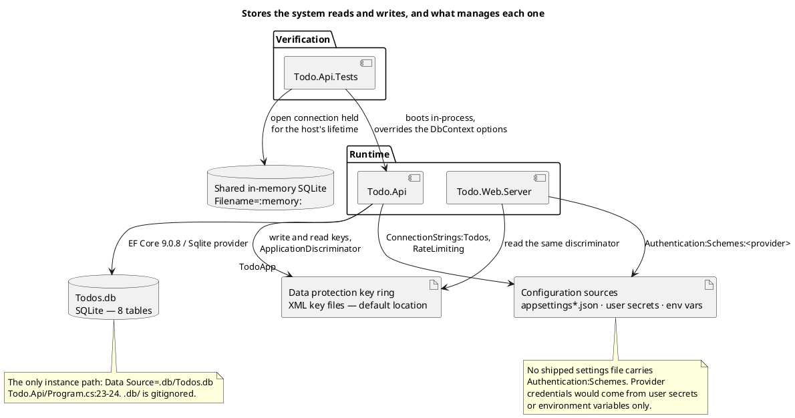
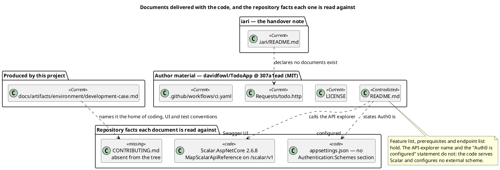

## Document Control
- Phase: Survey
- Status: Draft
- Milestone Target: end of Survey (SBC) — not yet achieved

## Perimeter
The boundary is drawn by the code, not by the README. Inside it sit seven projects of `TodoApp.sln` plus the CI workflow that builds them. The browser is outside and reaches the web server only; it never calls the API directly, because the web server proxies `/todos` through YARP and re-signs each request with the stored bearer token. Nothing is deployed anywhere (`.iari/README.md`).

Three parts of the code are outside the recovered product scope, each by stakeholder decision of 2026-11-19 and each recorded as an exclusion:

- **External identity-provider sign-in.** `AuthenticationExtensions` registers GitHub, Google, Microsoft and Auth0 only when `Authentication:Schemes:<provider>` exists in configuration; no shipped `appsettings.json` carries that section, so the four schemes are reachable in principle and inert in practice. The mechanism is out of the recovered product scope — recorded as an exclusion, specified at most as an unconfigured option in the Supplementary Specification — and no use case covers `EP-011`, `EP-020` or `EP-021`.
- **The `admin` role.** `CurrentUser.IsAdmin` reads the role claim `admin` and widens read, update and delete to any owner, but no code path grants the role and migration `RemoveIsAdmin` dropped the persisted flag. It is dead code, recorded as an exclusion, until a declared requirement names who grants the role; no use case claims cross-user access.
- **The self-service identity surface.** Seven operations the API publishes — email confirmation, confirmation reissue, password-reset request, password reset, two-factor management, account-information read and account-information update — have no caller in any delivered screen and no mail transport behind them; nothing in the delivery registers an `IEmailSender` or configures a mail server. Out of the recovered product scope, recorded as an exclusion beside the external-provider one: no use case is recovered from `EP-004`, `EP-005`, `EP-006`, `EP-007`, `EP-008`, `EP-009` or `EP-010`, and the recovered product is registration, login, logout and todo read/create/delete. The entry points stay in the perimeter with their anchors, so a later phase that needs one can recover it without re-reading the code.

`EP-003 POST /users/refresh` is published, anonymous-callable and inside the boundary, but nothing in the delivery calls it: the BFF's cookie stores `accessToken` alone (`TokenNames` names no other token), `AuthClient` carries exactly three calls — `users/register`, `users/login` and `users/token/{provider}` — and the forwarder sends whatever token the cookie holds. **No use case is recovered from `EP-003`.** It remains in the Perimeter with its anchor as the mechanism a session-extending requirement would build on, which is what AN-015 records.

All three exclusions concern what the next phases may claim, not what exists: the code anchors below stay as read.

```plantuml
@startuml
title Perimeter of the existing Todo App
skinparam componentStyle rectangle
skinparam shadowing false

actor "End user\n(browser)" as USER

package "Todo App — existing system (as delivered)" {
  component "TodoApp.AppHost\nAspire orchestration — local run" as APPHOST
  component "Todo.Web.Server\nBFF host: cookie auth, /auth, /todos forwarder" as WEBSRV
  component "Todo.Web.Client\nBlazor WebAssembly UI" as WEBUI
  component "Todo.Web.Shared\nDTO library" as SHARED
  component "Todo.Api\nMinimal-API backend" as API
  component "TodoApp.ServiceDefaults\nOpenTelemetry, health, discovery, resilience" as SVCDEF
  component "Todo.Api.Tests\nIntegration test harness (xunit)" as TESTS
}

component "SQLite Todos.db\nRelational schema" as DB
component "External identity providers\nGitHub / Google / Microsoft / Auth0\nEXCLUDED from product scope" as IDP
component "OTLP collector\nAspire dashboard" as OTLP
component "sqliteweb container\ntomdesinto/sqliteweb — dev only" as SQLITEWEB

USER --> WEBSRV : HTTPS page, /auth, /todos
WEBSRV --> WEBUI : serves the WASM bundle
WEBUI --> WEBSRV : XHR /todos, /auth
WEBSRV --> API : HTTP /users (AuthClient: register, login)
WEBSRV --> API : HTTP /todos (YARP forwarder, bearer)
WEBSRV ..> IDP : OAuth2 / OIDC redirect — registered only
API --> DB : EF Core
SQLITEWEB --> DB : bind mount of the .db directory
APPHOST --> API : starts, gated on the migration
APPHOST --> WEBSRV : starts, injects the API reference
APPHOST --> SQLITEWEB : starts
SVCDEF ..> API : shared host configuration
SVCDEF ..> WEBSRV : shared host configuration
API ..> OTLP : OTLP export
WEBSRV ..> OTLP : OTLP export
TESTS ..> API : in-process host, in-memory SQLite

note right of API
  Todo.Api/Program.cs:23-24 — EF Core Sqlite,
  connection "Todos" or Data Source=.db/Todos.db
  Todo.Api/Users/UsersApi.cs:12,20 — /users surface
  Todo.Api/Todos/TodoApi.cs:24-73 — /todos surface
  EP-003 /users/refresh is published and has no
  caller in the delivery — no use case from it
end note

note top of IDP
  Registered only when Authentication:Schemes:<provider>
  exists in configuration; no such section ships.
  Stakeholder, 2026-11-19: out of the recovered
  product scope — an exclusion, not a requirement.
end note

note bottom of WEBSRV
  EP-004 … EP-010 — the self-service identity
  operations (email confirmation, password reset,
  two-factor, account information) have no caller
  in any delivered screen and no mail transport
  behind them. Stakeholder, 2026-11-19: out of the
  recovered product scope — an exclusion beside the
  external-provider one. No use case claims them.
end note

note right of DB
  Schema exists only as EF Core migrations,
  Todo.Api/Migrations/. No SQL scripts.
end note
@enduml
```

### Components
| Component | Kind | Responsibility | Implemented by |
|---|---|---|---|
| Todo.Web.Server | Subsystem | Browser-facing host (the BFF): serves the Blazor page, owns the authentication cookie, mints it against the API's bearer token, exposes `/auth`, and forwards every `/todos` request to the API with the bearer token attached. Also the only consumer of the external identity providers. | `Todo.Web/Server/Program.cs:6-58`; `Todo.Web/Server/TodoApi.cs:9-28` |
| Todo.Web.Client | Component | Blazor WebAssembly UI assembled into the browser: one page component that switches between a login form and the todo list, and an HTTP client that speaks to the web server only. | `Todo.Web/Client/TodoApp.razor:1-44`; `Todo.Web/Client/TodoClient.cs:7-71`; `Todo.Web/Client/Program.cs:5-13` |
| Todo.Web.Shared | Component | DTO library referenced by both the client and the server: `TodoItem`, `UserInfo`, `ExternalUserInfo`, `AuthToken`. | `Todo.Web/Shared/SharedClass.cs:3-37` |
| Todo.Api | Subsystem | The backend: minimal-API hosts the `/users` identity surface and the `/todos` CRUD surface, enforces bearer authentication, per-user rate limiting and parameter validation, serves the OpenAPI document and the Scalar UI. | `Todo.Api/Program.cs:5-68` |
| Todo.Api / Users | Component | ASP.NET Core Identity user store and bearer-token issue: the stock identity endpoints, plus a custom `/users/token/{provider}` endpoint that creates or finds a user by external login. The delivered product calls two of them — registration and login. `/users/refresh` is published and called by nothing: no client redeems a refresh token, so no use case is recovered from `EP-003` (see the Perimeter text above and AN-015). The self-service operations are an exclusion (see the Perimeter exclusions). | `Todo.Api/Users/UsersApi.cs:10-64`; `Todo.Api/Users/TodoUser.cs:7-29`; `Todo.Web/Server/AuthClient.cs:3-46` |
| Todo.Api / Todos | Component | Todo read, create, update and delete, scoped to the owning user. | `Todo.Api/Todos/TodoApi.cs:8-77`; `Todo.Api/Todos/Todo.cs:1-40` |
| Todo.Api / Authorization | Component | Resolves the caller into a `CurrentUser` (claims transformation against the database) and supplies the authorization requirement that a valid token alone does not satisfy. | `Todo.Api/Authorization/CurrentUser.cs:6-15`; `Todo.Api/Authorization/CurrentUserExtensions.cs:8-35`; `Todo.Api/Authorization/CheckCurrentUserAuthHandler.cs:8-40` |
| Todo.Api / Persistence | Component | EF Core `DbContext` over ASP.NET Core Identity, the `Todo` entity with its owner foreign key, and the three migrations that define the schema. | `Todo.Api/TodoDbContext.cs:7-21`; `Todo.Api/Migrations/20221123071234_Initial.cs`; `Todo.Api/Migrations/20221123165051_RemoveIsAdmin.cs`; `Todo.Api/Migrations/20230714032431_ForeignKeyChange.cs` |
| Todo.Api / Cross-cutting | Component | Request-level mechanisms shared by the endpoints: per-user token-bucket rate limiting, parameter validation returning problem details, OpenAPI bearer-scheme metadata, HTTP logging. | `Todo.Api/Extensions/RateLimitExtensions.cs:11-71`; `Todo.Api/Filters/ValidationFilter.cs:7-58`; `Todo.Api/Extensions/OpenApiOptionsExtensions.cs:7-47` |
| TodoApp.AppHost | Subsystem | Aspire orchestration for local runs: creates the SQLite directory, runs `dotnet ef database update` before anything starts, launches the API, the web server (with the API service reference) and the sqliteweb container. | `TodoApp.AppHost/Program.cs:3-28`; `TodoApp.AppHost/Extensions.cs:3-38` |
| TodoApp.ServiceDefaults | Layer | Shared host configuration referenced by the API and the web server: OpenTelemetry traces, metrics and logs, the OTLP exporter, health checks, service discovery and the HTTP resilience handler. | `TodoApp.ServiceDefaults/Extensions.cs:16-41`; `TodoApp.ServiceDefaults/Extensions.cs:73-117` |
| Todo.Api.Tests | Component | Integration tests that boot the API in-process through `WebApplicationFactory`, replace SQLite with a shared in-memory connection, and drive the real endpoints with minted bearer tokens. | `Todo.Api.Tests/TodoApplication.cs:10-95`; `Todo.Api.Tests/TodoApiTests.cs:3-290`; `Todo.Api.Tests/UserApiTests.cs:6-170` |
| Build and verification | Component | The only executable definition of green: restore, build and test the whole solution on `ubuntu-latest` for every push and pull request. No SDK version is pinned in the workflow. | `.github/workflows/ci.yaml:1-21`; `TodoApp.sln:1-12` |

### External actors and systems
| External actor or system | Reached through | Anchor |
|---|---|---|
| End user in a browser | Remote call — HTTPS to `Todo.Web.Server` (`/`, `/auth/*`, `/todos/*`); never to the API directly | `Todo.Web/Server/App.razor:5`; `Todo.Web/Client/TodoClient.cs:8-71`; `Todo.Web/Server/Program.cs:20-37` |
| GitHub, Google, Microsoft, Auth0 — external identity providers. Excluded from the recovered product scope by stakeholder decision of 2026-11-19: the mechanism is an exclusion, specified at most as an unconfigured option | Remote call — OAuth2/OIDC authorization-code redirect, registered by scheme name and active only when `Authentication:Schemes:<provider>` is configured; no shipped configuration supplies that section | `Todo.Web/Server/Authentication/AuthenticationExtensions.cs:40-52`; `Todo.Web/Server/AuthApi.cs:55-64`; stakeholder decision, 2026-11-19 |
| OTLP collector — the Aspire dashboard locally, any endpoint named by `OTEL_EXPORTER_OTLP_ENDPOINT` | Messaging — OTLP export of logs, metrics and traces, enabled only when that setting is non-empty | `TodoApp.ServiceDefaults/Extensions.cs:73-90`; `Directory.Packages.props:37-41` |
| Container runtime (Docker/Podman) as driven by the Aspire AppHost | Service — the AppHost asks it to run the sqliteweb container | `TodoApp.AppHost/Program.cs:13-17` |
| `tomdesinto/sqliteweb` container image | File — bind mount of `Todo.Api/.db` as `/db`, opened as `Todos.db`; excluded from the published manifest | `TodoApp.AppHost/Program.cs:10-17` |
| `dotnet-ef` CLI delivered from NuGet, installed globally on the developer machine by the AppHost | Service — `dotnet tool install --global dotnet-ef`, then `dotnet ef database update --no-build` | `TodoApp.AppHost/Extensions.cs:17-33` |
| NuGet package feed (`https://api.nuget.org/v3/index.json`) | Service — restore time only; the single mapped source for all packages | `nuget.config:3-12`; `Directory.Packages.props:1-43` |

### Entry points
| ID | Entry point | Kind | Initiated by | Anchor |
|---|---|---|---|---|
| EP-001 | `POST /users/register` — create a user from email and password | Service operation | Anonymous client (API direct, or the web server's `AuthClient`) | `Todo.Api/Users/UsersApi.cs:12,20`; `Todo.Web/Server/AuthClient.cs:20-29` |
| EP-002 | `POST /users/login` — exchange credentials for a bearer token | Service operation | Anonymous client | `Todo.Api/Users/UsersApi.cs:12,20`; `Todo.Web/Server/AuthClient.cs:5-18` |
| EP-003 | `POST /users/refresh` — exchange a refresh token for a new access token. Published by the stock identity endpoints and called by nothing in the delivery: no refresh token is stored or redeemed. No use case is recovered from it (AN-015) | Service operation | Authenticated client — none exists in the delivery | `Todo.Api/Users/UsersApi.cs:12,20`; `Todo.Web/Server/Authentication/TokenNames.cs:3-6`; `Todo.Web/Server/AuthClient.cs:3-46` |
| EP-004 | `GET /users/confirmEmail` — confirm an email address from a code. Excluded from the recovered product scope by stakeholder decision of 2026-11-19, with the self-service identity surface: no use case covers it, and no mail transport exists to deliver the code | Service operation | End user, following a link | `Todo.Api/Users/UsersApi.cs:12,20`; stakeholder decision, 2026-11-19 |
| EP-005 | `POST /users/resendConfirmationEmail` — reissue the confirmation mail. Excluded with the self-service identity surface: no use case covers it | Service operation | Anonymous client | `Todo.Api/Users/UsersApi.cs:12,20`; stakeholder decision, 2026-11-19 |
| EP-006 | `POST /users/forgotPassword` — request a password-reset code. Excluded with the self-service identity surface: no use case covers it, and no mail transport exists to deliver the code | Service operation | Anonymous client | `Todo.Api/Users/UsersApi.cs:12,20`; stakeholder decision, 2026-11-19 |
| EP-007 | `POST /users/resetPassword` — set a new password with a reset code. Excluded with the self-service identity surface: no use case covers it | Service operation | Anonymous client | `Todo.Api/Users/UsersApi.cs:12,20`; stakeholder decision, 2026-11-19 |
| EP-008 | `POST /users/manage/2fa` — enable or disable two-factor authentication. Excluded with the self-service identity surface: no use case covers it | Service operation | Authenticated user | `Todo.Api/Users/UsersApi.cs:12,20`; stakeholder decision, 2026-11-19 |
| EP-009 | `GET /users/manage/info` — read the caller's account information. Excluded with the self-service identity surface: no use case covers it | Service operation | Authenticated user | `Todo.Api/Users/UsersApi.cs:12,20`; stakeholder decision, 2026-11-19 |
| EP-010 | `POST /users/manage/info` — change the caller's email or password. Excluded with the self-service identity surface: no use case covers it | Service operation | Authenticated user | `Todo.Api/Users/UsersApi.cs:12,20`; stakeholder decision, 2026-11-19 |
| EP-011 | `POST /users/token/{provider}` — exchange an externally authenticated identity for a bearer token, creating the user on first use. Excluded from the recovered product scope by stakeholder decision of 2026-11-19, with the external-provider mechanism: no use case covers it | Service operation | Web server BFF only (the provider key is data-protected with the provider name) | `Todo.Api/Users/UsersApi.cs:24-54`; `Todo.Web/Server/AuthClient.cs:31-42`; stakeholder decision, 2026-11-19 |
| EP-012 | `GET /todos` — list the caller's todos | Service operation | Authenticated user, through the forwarder | `Todo.Api/Todos/TodoApi.cs:24-27` |
| EP-013 | `GET /todos/{id}` — read one todo; 404 unless the caller owns it | Service operation | Authenticated user, through the forwarder | `Todo.Api/Todos/TodoApi.cs:29-36` |
| EP-014 | `POST /todos` — create a todo owned by the caller | Service operation | Authenticated user, through the forwarder | `Todo.Api/Todos/TodoApi.cs:38-50` |
| EP-015 | `PUT /todos/{id}` — update title and completion of an owned todo | Service operation | Authenticated user, through the forwarder | `Todo.Api/Todos/TodoApi.cs:52-65` |
| EP-016 | `DELETE /todos/{id}` — delete an owned todo | Service operation | Authenticated user, through the forwarder | `Todo.Api/Todos/TodoApi.cs:67-73` |
| EP-017 | `POST /auth/register` — register through the UI and open a session | Service operation | Browser (Blazor client) | `Todo.Web/Server/AuthApi.cs:14-25`; `Todo.Web/Client/TodoClient.cs:55-63` |
| EP-018 | `POST /auth/login` — log in through the UI and open a session | Service operation | Browser (Blazor client) | `Todo.Web/Server/AuthApi.cs:27-38`; `Todo.Web/Client/TodoClient.cs:47-53` |
| EP-019 | `POST /auth/logout` — end the cookie session | Service operation | Browser (Blazor client) | `Todo.Web/Server/AuthApi.cs:40-52`; `Todo.Web/Client/TodoClient.cs:65-69` |
| EP-020 | `GET /auth/login/{provider}` — challenge the named external provider. Excluded from the recovered product scope by stakeholder decision of 2026-11-19, with the external-provider mechanism: no use case covers it | Service operation | Browser, following the provider button rendered by the login form | `Todo.Web/Server/AuthApi.cs:55-62`; `Todo.Web/Client/Components/LogInForm.razor:34-40`; stakeholder decision, 2026-11-19 |
| EP-021 | `GET /auth/signin/{provider}` — external-login callback: resolve or create the user, obtain a token, write the cookie. Excluded from the recovered product scope by stakeholder decision of 2026-11-19, with the external-provider mechanism: no use case covers it | Service operation | External identity provider redirect | `Todo.Web/Server/AuthApi.cs:64-101`; stakeholder decision, 2026-11-19 |
| EP-022 | `/todos/{*path}` — YARP forwarder for every verb, re-signed with the stored access token | Service operation | Browser (Blazor client) | `Todo.Web/Server/TodoApi.cs:14-26` |
| EP-023 | `/` — the application page: renders the login form or the todo list for the session | Screen | End user in a browser | `Todo.Web/Server/App.razor:5-25`; `Todo.Web/Client/TodoApp.razor:3-16` |
| EP-024 | `/scalar/v1`, with `/` redirecting to it — API reference and try-it-out console | Screen | Developer, development environment only | `Todo.Api/Program.cs:49-56,62`; `Todo.Api/Properties/launchSettings.json:10-24` |
| EP-025 | `/health` and `/alive` — readiness and liveness probes | Service operation | Aspire AppHost / orchestrator, development environment only | `TodoApp.ServiceDefaults/Extensions.cs:101-117`; `Todo.Api/Program.cs:60` |
| EP-026 | `dotnet ef database update` at AppHost start — creates or migrates `Todos.db` before the API serves a request | Platform event | TodoApp.AppHost, and only when `Todo.Api/.db` does not yet exist | `TodoApp.AppHost/Program.cs:3,19-25`; `TodoApp.AppHost/Extensions.cs:5-16` |

## Technology and Size
| Area | Language | Platform and frameworks, with version | Files | Anchor |
|---|---|---|---|---|
| `Todo.Api` | C# (`LangVersion preview`, nullable enabled) | ASP.NET Core minimal APIs on `net9.0`; EF Core + `Microsoft.EntityFrameworkCore.Sqlite` 9.0.8; `Microsoft.AspNetCore.Identity.EntityFrameworkCore` 9.0.8; `Microsoft.AspNetCore.OpenApi` 9.0.8 with `Microsoft.OpenApi` 1.6.22; `Scalar.AspNetCore` 2.6.8; `MiniValidation` 0.9.2; `Microsoft.AspNetCore.Authentication.BearerToken` from the shared framework. Declares container image `todo-api:latest`. | 23 (8 source, 7 migrations, 4 configuration, csproj, launch settings, `DbContext`) | `Todo.Api/Todo.Api.csproj:1-26`; `Directory.Packages.props:7-30`; `Todo.Api/Program.cs:1-68` |
| `Todo.Api.Tests` | C# | xunit 2.9.3 with `xunit.runner.visualstudio` 3.1.3; `Microsoft.NET.Test.Sdk` 17.14.1; `Microsoft.AspNetCore.Mvc.Testing` 9.0.8; `Microsoft.EntityFrameworkCore.InMemory` 9.0.8; `coverlet.collector` 6.0.4. Targets `net9.0` through `Directory.Build.props`; reaches `Todo.Api` internals via `InternalsVisibleTo`. | 7 | `Todo.Api.Tests/Todo.Api.Tests.csproj:1-24`; `Todo.Api/Todo.Api.csproj:19-21` |
| `Todo.Web/Server` | C# + Razor components | ASP.NET Core `net9.0` web host: Blazor Server hosting `AddInteractiveWebAssemblyComponents`; `Microsoft.AspNetCore.Components.WebAssembly.Server` 9.0.8; `Yarp.ReverseProxy` 2.3.0 with `Microsoft.Extensions.ServiceDiscovery.Yarp` 9.5.0; `AspNet.Security.OAuth.GitHub` 9.4.0; `Auth0.AspNetCore.Authentication` 1.5.0; `Microsoft.AspNetCore.Authentication.Google` and `.MicrosoftAccount` 9.0.8. `RazorLangVersion` pinned to 8.0. Declares container image `todo-web-server:latest`. | 15 (8 source, 5 Razor/authentication classes, 2 settings, csproj) | `Todo.Web/Server/Todo.Web.Server.csproj:1-30`; `Todo.Web/Server/Program.cs:1-58` |
| `Todo.Web/Client` | C# + Razor components, WebAssembly | `Microsoft.NET.Sdk.BlazorWebAssembly` on `net9.0`; `Microsoft.AspNetCore.Components.WebAssembly` 9.0.8; `Microsoft.Extensions.Http` 9.0.8. Carries a vendored Bootstrap 5 distribution (44 files) plus one image and two stylesheets. | 56 (8 source, 2 pages, 46 static assets) | `Todo.Web/Client/Todo.Web.Client.csproj:1-13`; `Todo.Web/Client/Program.cs:1-13`; `Todo.Web/Client/wwwroot/bootstrap/dist` |
| `Todo.Web/Shared` | C# | `Microsoft.NET.Sdk` on `net9.0`, `SupportedPlatform browser` — the DTO library both client and server compile against. No package references. | 2 | `Todo.Web/Shared/Todo.Web.Shared.csproj:1-7`; `Todo.Web/Shared/SharedClass.cs:1-37` |
| `TodoApp.AppHost` | C# | .NET Aspire AppHost, `Aspire.AppHost.Sdk/13.1.1`; output type `Exe`, `IsAspireHost`. References the API and the web server as orchestrated projects. | 6 | `TodoApp.AppHost/TodoApp.AppHost.csproj:1-3`; `TodoApp.AppHost/Program.cs:1-28` |
| `TodoApp.ServiceDefaults` | C# | `Microsoft.NET.Sdk` on `net9.0` with `FrameworkReference Microsoft.AspNetCore.App`; OpenTelemetry 1.12.0 (`Exporter.OpenTelemetryProtocol`, `Extensions.Hosting`, `Instrumentation.AspNetCore`, `Instrumentation.Http`, `Instrumentation.Runtime`); `Microsoft.Extensions.ServiceDiscovery` 9.5.0; `Microsoft.Extensions.Http.Resilience` 9.7.0. | 2 | `TodoApp.ServiceDefaults/TodoApp.ServiceDefaults.csproj:1-23`; `TodoApp.ServiceDefaults/Extensions.cs:1-118` |
| Solution root | — | `global.json` pins SDK `9.0.100`, `rollForward latestFeature`, `allowPrerelease true`; `Directory.Build.props` sets `TargetFramework net9.0`, `Nullable enable`, `ImplicitUsings enable`, `LangVersion preview`; `nuget.config` maps all packages to `nuget.org` only; `TodoApp.sln` carries 7 projects in `src`/`tests` solution folders. | 8 | `global.json:1-8`; `Directory.Build.props:1-9`; `nuget.config:1-13`; `TodoApp.sln:1-14` |
| `.github/workflows` | YAML | GitHub Actions `CI`: `actions/checkout@v3` and `actions/setup-dotnet@v3` on `ubuntu-latest`, then `dotnet restore`, `dotnet build -c Release --no-restore`, `dotnet test -c Release --no-build` over `TodoApp.sln`, on push and pull request. `setup-dotnet` is given no `dotnet-version`, so the workflow inherits whatever SDK the runner image carries. | 1 | `.github/workflows/ci.yaml:1-21` |
| `.devcontainer` | JSON + shell | Development container from `mcr.microsoft.com/dotnet/sdk:8.0` with the C# extension, a `postCreateCommand` running `init.sh`, and ports 5000/5001 forwarded. | 2 | `.devcontainer/devcontainer.json:1-12`; `.devcontainer/init.sh` |
| `Requests` | HTTP requests | The author's request file against a standalone API on `http://localhost:5000`: register, login, then bearer-authenticated create, list and delete. | 1 | `Requests/todo.http:1-37` |
| `docs/artifacts` | Markdown | Artifacts produced by this project, not by the code's authors: the System Inventory and the Development Case. | 2 | `docs/artifacts/discovery/system-inventory.md`; `docs/artifacts/environment/development-case.md` |
| `.iari` | Markdown | The handover note: provenance, and the explicit statement of what the delivery does not contain. | 1 | `.iari/README.md:1-23` |
| `.aspire`, `.vscode` | JSON | Tool configuration only: Aspire local settings; a recommended-editor extension list. | 2 | `.aspire/settings.json`; `.vscode/extensions.json` |

Total: 7 projects of `TodoApp.sln`, 128 files counted from the repository tree (165 entries including directories), of which 46 under `Todo.Web/Client/wwwroot` are a vendored Bootstrap distribution and not project code.
## Persistent Data
The delivery contains no database scripts and no data. The only relational schema the system has is the one `Todo.Api/Migrations` builds at run time through EF Core, and the only instance of it anyone has ever run is the empty `Todo.Api/.db/Todos.db` that `gitignore` excludes from the repository (`*.db`). Eight entities, matching what `TodoDbContextModelSnapshot` declares: `Todo`, `TodoUser`, `IdentityRole`, `IdentityRoleClaim`, `IdentityUserClaim`, `IdentityUserLogin`, `IdentityUserRole`, `IdentityUserToken`. The `Todo` → `TodoUser` foreign key on `OwnerId` changed principal column between migrations 1 and 3 — from `AspNetUsers.UserName` to `AspNetUsers.Id` — and `IsAdmin` was a column for thirty-one minutes of the migration history before `RemoveIsAdmin` dropped it, which is why authority today is carried by a role claim rather than a persisted flag.

| Store | Kind | Data manager | Anchor |
|---|---|---|---|
| `Todos.db` — tables `Todos`, `AspNetUsers`, `AspNetRoles`, `AspNetUserRoles`, `AspNetUserClaims`, `AspNetRoleClaims`, `AspNetUserLogins`, `AspNetUserTokens`; indexes `IX_Todos_OwnerId`, `UserNameIndex` (unique), `EmailIndex`, `RoleNameIndex` (unique); cascade delete from `AspNetUsers` to `Todos.OwnerId` | Relational schema | EF Core 9.0.8 with `Microsoft.EntityFrameworkCore.Sqlite`, `TodoDbContext` deriving from `IdentityDbContext<TodoUser>`; connection from `ConnectionStrings:Todos`, defaulting to `Data Source=.db/Todos.db`; schema created by three migrations applied through `dotnet ef database update` | `Todo.Api/TodoDbContext.cs:7-21`; `Todo.Api/Program.cs:22-24`; `Todo.Api/Migrations/20221123071234_Initial.cs:16-330`; `Todo.Api/Migrations/20221123165051_RemoveIsAdmin.cs:13-17`; `Todo.Api/Migrations/20230714032431_ForeignKeyChange.cs:13-45`; `Todo.Api/Migrations/TodoDbContextModelSnapshot.cs:12-18`; `.gitignore:462-463` |
| `Filename=:memory:` — the same schema inside a SQLite connection the test host holds open for its lifetime | Relational schema | `TodoApplication` opens the connection and replaces the registered `DbContextOptions<TodoDbContext>` with it; `EnsureCreated` builds the schema, and Identity's password rules are relaxed for the fixtures | `Todo.Api.Tests/TodoApplication.cs:12,37-56`; `Todo.Api.Tests/DbContextExtensions.cs:5-30` |
| Data protection key ring — XML key files at the framework's default per-user location | Structured document | ASP.NET Core Data Protection, configured only with `ApplicationDiscriminator = "TodoApp"` on both hosts so a key minted by one is accepted by the other; no explicit key repository, so the default file-system location applies | `Todo.Api/Program.cs:10-11`; `Todo.Web/Server/Program.cs:12-13`; `Todo.Api/Users/UsersApi.cs:26-28`; `Todo.Web/Server/AuthApi.cs:70-72` |
| Configuration sources read at start — `appsettings.json` and `appsettings.Development.json` of both hosts, the per-project user-secret stores, environment variables | Structured document | .NET configuration: JSON providers plus `UserSecretsId` on `Todo.Api`, `Todo.Web.Server` and `TodoApp.AppHost`. Carries the connection string, the rate-limit tokens and the identity-provider credentials the code expects but no shipped file supplies | `Todo.Api/appsettings.json:1-8`; `Todo.Api/appsettings.Development.json:1-12`; `Todo.Web/Server/appsettings.json:1-9`; `Todo.Api/Todo.Api.csproj:4-6`; `Todo.Web/Server/Todo.Web.Server.csproj:3-8`; `Todo.Web/Server/Authentication/AuthenticationExtensions.cs:40-46` |
## Documentation

The delivery carries no requirements, design or architecture document written by its authors: `.iari/README.md` states this and the tree agrees. What it does carry is the upstream sample's own README, a request file, a CI workflow and the MIT licence — documents of the code as it was published, not of the system as it is installed anywhere. Each was read against the code it describes.

| Document | Useful for | How up to date | Anchor |
|---|---|---|---|
| `.iari/README.md` | The perimeter of the delivery: provenance (copy of `davidfowl/TodoApp` at commit `307a1ead` of 2026-02-12, MIT); the explicit non-existence of database scripts, requirements/design/architecture documents, manuals, a running installation, production data and reachable authors. The constraint every other row is read under. | Current | `.iari/README.md` |
| `README.md` (upstream author's) | Author's statement of the feature set and of the technical mechanisms it showcases (Blazor WebAssembly, minimal APIs, EF Core + SQLite, OpenAPI, Identity, cookie and bearer authentication, YARP forwarder, rate limiting, integration tests); prerequisites (.NET 9, Aspire CLI); how the system is started (AppHost runs web-server and API); the REST calls needed to obtain a bearer token; the configuration schema for each external identity provider and for Auth0; OpenTelemetry via the Aspire dashboard. | Contradicted by the code | `README.md`; `Todo.Api/Program.cs`; `Directory.Packages.props`; `Todo.Api/appsettings.json`; `Todo.Web/Server/appsettings.json` |
| `LICENSE` | The terms the copy is held under and its origin: MIT, "Copyright (c) 2022 David Fowler". Together with `.iari/README.md` it is the whole provenance record of the delivery. | Current | `LICENSE` |
| `Requests/todo.http` | The author's minimal happy-path request sequence against a standalone API on `http://localhost:5000`: `POST /users/register`, `POST /users/login`, then authenticated `POST /todos`, `GET /todos`, `DELETE /todos/{id}`. A cross-check on the recovered `/users` and `/todos` entry points and on the bearer scheme. | Current | `Requests/todo.http`; `Todo.Api/Users/UsersApi.cs`; `Todo.Api/Todos/TodoApi.cs` |
| `.github/workflows/ci.yaml` | The only executable statement of how the solution is verified: `dotnet restore`, `dotnet build -c Release --no-restore`, `dotnet test -c Release --no-build` on `TodoApp.sln` under `ubuntu-latest`, on push and pull request. Shows that the integration-test project is part of the build's definition of green. | Current | `.github/workflows/ci.yaml`; `TodoApp.sln` |
| `docs/artifacts/environment/development-case.md` | The tailoring governing this project: sprint zero before Inception, the recovered-element anchoring rule, the one fired OPTIONAL (Deployment Model), the inactive disciplines and the roles at work in the sprint zero. | Current | `docs/artifacts/environment/development-case.md` |

## History
Read from the repository's commits, most recent first, over the window each area's history covers. Each row states the listing it was read from and the period that listing covers; where a listing says older history exists, the row reads the most recent commits only. Every reading below rests on the commit subjects and dates listed, not on how the code looks today. Seven areas now carry a row — the five of the recovered architecture, plus the three environment and tool areas whose history the anomalies of this iteration rest on.

```plantuml
@startuml
title Where the churn sits — commits read per area, and what each period covers
skinparam shadowing false
skinparam defaultTextAlignment left

package "Todo.Web — 43 commits, 2022-11-27 to 2024-11-27" as W {
  class "Razor Pages → Blazor SSR\n(31b28b3, 2023-07-15)" as W1 <<reworked>>
  class "docker-compose → tye → Aspire\n(8e8e8a1 2022-12-02 · e61e3a1 2022-11-27 · 6b9f07e 2024-11-14)" as W2 <<removed>>
  class "social → external auth, Auth0 provider\n(82898c5 · 3dceedd · 23a6c31, 2022-12)" as W3 <<reworked>>
  class "client held together by a recorded hack\n(b8ffb08 'Added a hack to make it work', 2023-07-15)" as W4 <<unstable>>
}
package "Todo.Api — 10 commits, 2024-11-23 to 2025-08-07" as A {
  class "OpenAPI + Scalar + bearer metadata\n(1449c43 2024-11-15 · 69127f1 2024-11-27)" as A1 <<reworked>>
  class "provider key data-protected\n(a519c10, 2024-11-27)" as A2 <<reworked>>
  class "dependency sweep\n(a6dea68, 2025-08-07)" as A3 <<reworked>>
}
package "Todo.Api/Migrations — 1 commit, 2024-11-23" as M {
  class "schema frozen since 2023-07-14\n(only bbd680d 'Move files around' since)" as M1 <<stable>>
}
package "TodoApp.AppHost — 5 commits, 2024-11-23 to 2026-02-12" as H {
  class "tye → Aspire · EF migration automation\n· Aspire SDK 13.1.1" as H1 <<reworked>>
}
package "Todo.Api.Tests — 2 commits, 2024-11-23 to 2024-11-27" as T {
  class "moved, then adjusted for the\nprotected provider key" as T1 <<stable>>
}
package "Verification and environment" as E {
  class "CI — 4 commits, 2022-11-12 to 2024-11-23\none SDK intent (e1a6c71) the workflow no longer holds" as E1 <<stable>>
  class "devcontainer — 6 commits, 2022-11-13 to 2023-12-15\nnever re-based past SDK 8 (AN-005)" as E2 <<stale>>
  class "ServiceDefaults — 1 commit, 2024-11-23\narrived whole with the Aspire template" as E3 <<stable>>
  class "Requests — 5 commits, 2022-11-12 to 2024-03-26\nreworked once for the identity endpoints" as E4 <<stable>>
}

note bottom of W
  43 commits against Todo.Api's 10 over an
  overlapping window: the browser-facing half
  is where this system keeps changing.
end note
note bottom of M
  Migration content last written 2023-07-14;
  model snapshot still declares
  ProductVersion 8.0.0 against a 9.0.8 runtime.
end note
note bottom of E
  The environment outlived its own intent. e1a6c71
  (2022-11-14) is titled "Use same .NET SDK for local and
  CI builds via global.json"; the delivered workflow passes
  no dotnet-version to actions/setup-dotnet at all, and no
  listed subject records taking it out.
end note
@enduml
```

| Area | Commits read and period | What was removed or reworked | Reading | Commits |
|---|---|---|---|---|
| Repository as a whole | 50 commits, 2023-07-14 to 2026-11-19; older history exists beyond them. The 2026-11-19 entries are this project's own Development Case and System Inventory commits plus `4fcea8c` "Create README.md" | `1d4e043` "Remove tasks and launch.json" (2025-01-11) deleted the committed VS Code task and launch configuration; `a6dea68` "Update everything! (#105)" (2025-08-07) was a solution-wide dependency and formatting sweep; `307a1ea` "Upgrade Aspire SDK to 13.1.1" (2026-02-12) is the tip the delivery was copied at | Unstable | `35813a2`, `b9a5464`, `c7dfc0b`, `13adfaf`, `47acd41`, `4fcea8c` (2026-11-19); `307a1ea` (2026-02-12); `a6ff858`, `d772504` (2025-09-28); `a6dea68` (2025-08-07); `1d4e043`, `beb0011` (2025-01-11); `a519c10`, `69127f1` (2024-11-27); `2d890e8`, `993421c`, `fdc49bb`, `228dc29`, `2d0d82d`, `fb0032e`, `617dfee`, `3308193`, `c064cff`, `bbd680d`, `625f34f` (2024-11-23); `ed8e367`, `780dff8`, `5af589d`, `1449c43`, `3530e8a` (2024-11-15); `03640dd`, `485e7d4`, `09ea52d` (2024-11-14); `6b9f07e` (2024-11-14); `abd9421` (2024-03-26); `2e54de3` (2023-12-15); `7ca46be` (2023-09-17); `ea30470`, `c209f6a` (2023-07-17); `6d9f7ae`, `1ee5f48`, `77959e2`, `b8ffb08`, `31b28b3` (2023-07-15); `5e9c05b`, `182c354`, `7c18bec`, `88d236b`, `156eeb2` (2023-07-14) |
| `Todo.Web` | 43 commits, 2022-11-27 to 2024-11-27; the `Todo.Web/Client` sub-path listing covers 18 commits, 2022-11-27 to 2024-11-23 | The browser half was rebuilt repeatedly. `31b28b3` "Use Blazor SSR instead of Razor Pages" (2023-07-15) replaced the original page model, and `b8ffb08` "Added a hack to make it work" landed the same day — the page model has stood on a change its own subject calls a hack ever since. The run-time orchestration it was started under was removed twice over: `e61e3a1` "Added support for running with tye" (2022-11-27) was superseded by `8e8e8a1` "Add docker-compose project to run all apps (#41)" (2022-12-02), and both were superseded by `6b9f07e` "Aspirfy!" (2024-11-14). The identity mechanism was reworked from provider-specific to generalised: `82898c5` "Add support for social authentication (#45)" (2022-12-03), `3dceedd` "Social → External" (2022-12-18), `23a6c31` "Make auth0 work as an external auth provider" (2022-12-18), `ae45c47` "Support accepting externally issued tokens in the API" (2022-12-18), then `7f594d3` "Use the new identity endpoints!" (2023-07-14) and finally `a519c10` "Protect the user id to make sure only the BFF can call the external auth API (#100)" (2024-11-27), which closed the provider-key hole that the previous design left open | Unstable | `a519c10` (2024-11-27); `2d890e8`, `228dc29`, `3308193`, `625f34f` (2024-11-23); `03640dd`, `6b9f07e` (2024-11-14); `2e54de3` (2023-12-15); `77959e2`, `b8ffb08`, `31b28b3` (2023-07-15); `88d236b`, `7f594d3`, `34b8c87`, `58d28fc`, `3be1993`, `d2cfc8d` (2023-07-13); `6090f8d`, `0a7e2bd`, `478195d`, `0a81ea1`, `7804305` (2023-05-14); `76a0bac` (2022-12-27); `3dceedd`, `ae45c47`, `ab67f3c`, `23a6c31` (2022-12-18); `e15c9f7` (2022-12-14); `2441b7e`, `82898c5` (2022-12-03); `8e8e8a1` (2022-12-02); `da58c44`, `ee6712c`, `b08f906`, `a989dac` (2022-11-30); `3dde5f7`, `f3825df`, `5d8868d`, `9676eba`, `68f6f5f` (2022-11-28); `e512f3e`, `e61e3a1`, `cb67410` (2022-11-27). Client sub-path: `625f34f` (2024-11-23), `2e54de3` (2023-12-15), `b8ffb08`, `31b28b3` (2023-07-15), `88d236b` (2023-07-14), `3be1993`, `d2cfc8d` (2023-07-13), `2441b7e`, `82898c5` (2022-12-03), `8e8e8a1` (2022-12-02), `da58c44`, `ee6712c`, `b08f906`, `a989dac` (2022-11-30), `5d8868d`, `9676eba`, `68f6f5f` (2022-11-28), `cb67410` (2022-11-27) |
| `Todo.Api` | 10 commits, 2024-11-23 to 2025-08-07; the path did not exist under this name before `bbd680d` "Move files around" (2024-11-23) and `3308193` "TodoApi -> TodoApp" renamed the projects | The API surface itself was not redesigned in this window. What changed was its edges: `1449c43` "Use new open api and scalar" and `fdc49bb`/`69127f1` "Updates for OpenAPI" / "Add OpenAPI configuration for authentication" replaced the API explorer and added the bearer scheme to the document; `993421c` "Read rate per user rate limiter options via config" made the limiter configurable; `a519c10` data-protected the external provider key; `2d890e8` left a recorded open item — "Clean up and added comment about S2S auth", which is the `TODO: Add service to service auth between the BFF and this API` at `Todo.Api/Users/UsersApi.cs:17` | Consolidating | `a6dea68` (2025-08-07); `a519c10`, `69127f1` (2024-11-27); `2d890e8`, `993421c`, `fdc49bb` (2024-11-25); `2d0d82d`, `fb0032e`, `3308193`, `bbd680d` (2024-11-23) |
| `Todo.Api/Migrations` | 1 commit, 2024-11-23 — and that commit only moved the files | No migration has been authored since `20230714032431_ForeignKeyChange` (2023-07-14). Nothing was removed: the schema was already final when the code was reorganised around it. `TodoDbContextModelSnapshot.cs:18` still records `ProductVersion` `8.0.0` although the runtime resolves EF Core 9.0.8 — the snapshot was never regenerated after the framework moved. The start-up gate that applies this schema has never been exercised in a delivered deployment (AN-020, AN-021) | Stable | `bbd680d` (2024-11-23) |
| `TodoApp.AppHost` | 5 commits, 2024-11-23 to 2026-02-12 | Created by `3308193` "TodoApi -> TodoApp" (2024-11-23), then `beb0011` "Auto install dotnet ef" (2025-01-11) added the global tool install that precedes the migration, `a6dea68` swept the dependencies, `d772504` updated package versions and formatting (2025-09-28), and `307a1ea` moved the Aspire AppHost SDK to 13.1.1 (2026-02-12) — the newest change in the delivery. The migration gate has not been touched since the automation that introduced it: every change to this area since 2025-01-11 is a version or formatting sweep, which is why its conditional shape has never been re-examined (AN-021) | Consolidating | `307a1ea` (2026-02-12); `d772504` (2025-09-28); `a6dea68` (2025-08-07); `beb0011` (2025-01-11); `3308193` (2024-11-23) |
| `Todo.Api.Tests` | 2 commits, 2024-11-23 to 2024-11-27 | `bbd680d` moved the tests beside the API; `a519c10` adjusted them for the data-protected provider key (`CanGetATokenForExternalUser` now encrypts the id with the provider name as purpose). No test was deleted in the window. The suite covers the `/todos` and `/users` surfaces and nothing of `Todo.Web` | Stable | `a519c10` (2024-11-27); `bbd680d` (2024-11-23) |
| `.github/workflows` | 4 commits, 2022-11-12 to 2024-11-23 | The pipeline was written by `7cf04b0` "Added CI script" (2022-11-12), then `e1a6c71` "Use same .NET SDK for local and CI builds via global.json (#15)" (2022-11-14) put the CI build on the same SDK as the local one, `5af589d` "Split restore and build steps" (2024-11-15) reshaped the steps, and `617dfee` "Missed these" (2024-11-23) followed. The delivered workflow passes no `dotnet-version` to `actions/setup-dotnet`, so the intent `e1a6c71` records is not carried; no listed subject names taking it out, so when the pin stopped being honoured is not in the history this inventory read, and the fact that it is not honoured is read from the file (AN-006) | Stable | `617dfee` (2024-11-23); `5af589d` (2024-11-15); `e1a6c71` (2022-11-14); `7cf04b0` (2022-11-12) |
| `.devcontainer` | 6 commits, 2022-11-13 to 2023-12-15 | Created in a four-commit burst on 2022-11-13 (`993b96a` "Create devcontainer.json", `4f65c7b` "Waiting for 7 to ship", `b0f56a4` "Codespaces might work now", `afdc367` "Maybe this?"), fixed by `ee69f36` "Fix postCreateCommand in devcontainer.json (#57)" (2022-12-18), and last changed by `2e54de3` ".NET 8 RTM Update (#90)" (2023-12-15). Nothing was removed. The area settled on SDK 8 and every later framework move left it behind: it has not changed once in the 3 years the rest of the solution moved through .NET 8, 9 and its dependency sweeps (AN-005) | Stable | `2e54de3` (2023-12-15); `ee69f36` (2022-12-18); `afdc367`, `b0f56a4`, `4f65c7b`, `993b96a` (2022-11-13) |
| `TodoApp.ServiceDefaults` | 1 commit, 2024-11-23 | Arrived whole in `3308193` "TodoApi -> TodoApp" (2024-11-23) as the Aspire shared-host template and has not been modified since: the resilience handler, service discovery and telemetry wiring on both hosts are as the template shipped them, including the commented-out alternatives the template carries. Nothing was removed | Stable | `3308193` (2024-11-23) |
| `Requests` | 5 commits, 2022-11-12 to 2024-03-26 | A hand-run request file for the API, created by `add0a64` "Added todo.http file" (2022-11-12), reordered and extended (`2c310de`, `f7235f9`, `2ac3906`, 2022-11-25), and reworked once for the identity endpoints by `abd9421` "Fix up docs and http file for net8 identity framework (#92)" (2024-03-26). It lists register, login, create, list and delete — no update request exists in it either, which agrees with what the screens cannot do (AN-008). Nothing was removed | Stable | `abd9421` (2024-03-26); `2ac3906`, `f7235f9`, `2c310de` (2022-11-25); `add0a64` (2022-11-12) |
## Anomalies
| ID | Anomaly | Kind | Evidence | Likelihood | Impact |
|---|---|---|---|---|---|
| AN-001 | The author's README calls the API explorer "the Swagger UI" and shows a Swagger screenshot; the code serves Scalar and exposes no Swagger UI. Any recovered use case or manual that cites Swagger would cite a screen the system does not have. | Document contradicted by the code | `README.md:31,33` against `Todo.Api/Program.cs:49-53` (`app.MapScalarApiReference`) and `Directory.Packages.props:30` (`Scalar.AspNetCore` 2.6.8); the package list carries no `Swashbuckle` | likely | low |
| AN-002 | The README states "This sample has **Auth0** configured as an OIDC server", while `AuthenticationExtensions` registers a provider only when `Authentication:Schemes:<provider>` exists and no shipped configuration carries that section — all four external providers are inert as delivered. The mechanism is excluded from the recovered product scope by the stakeholder's decision of 2026-11-19: external identity-provider sign-in is out, recorded as an exclusion and specified in the Supplementary Specification as an unconfigured option. The document still overstates the delivery, and the four provider entry points still exist in the code while no use case covers them. | Document contradicted by the code | `README.md:96`; `Todo.Web/Server/Authentication/AuthenticationExtensions.cs:40-52`; `Todo.Web/Server/appsettings.json:1-9`; `Todo.Api/appsettings.json:1-8`; stakeholder decision, 2026-11-19 | likely | moderate |
| AN-003 | The Development Case names `CONTRIBUTING.md` as the home of the coding standards, the UI patterns and the test conventions, and gives it three owners. The file is not in the repository tree, so every convention it is supposed to carry is undocumented. | Missing from the delivery | `docs/artifacts/environment/development-case.md` (Templates table, rows naming `CONTRIBUTING.md`); the repository tree carries no `CONTRIBUTING.md` at any depth | likely | moderate |
| AN-004 | There are no database scripts, no schema file and no DDL anywhere: the whole relational schema exists only as three EF Core migrations and a model snapshot. Any recovered table definition, key or cascade rule must be read out of generated C# or out of a database created at run time, and no one can compare the intended schema against a declared one. | Missing from the delivery | `.iari/README.md:11-13`; `Todo.Api/Migrations/` (3 migrations, 1 snapshot, 3 designer files); no `.sql` file in the tree | likely | moderate |
| AN-005 | The development container is built from `mcr.microsoft.com/dotnet/sdk:8.0` while `global.json` demands SDK `9.0.100` and `Directory.Build.props` targets `net9.0`. Inside that container the solution cannot restore or build — the environment the delivery offers for opening the code is below the floor the code requires. Its bootstrap script only installs the EF global tool the AppHost installs again at start, so the container is maintained for tooling and has never been re-based on the framework: its last change is ".NET 8 RTM Update", 2023-12-15. | Inferior quality | `.devcontainer/devcontainer.json:2`; `global.json:3`; `Directory.Build.props:4`; `.devcontainer/init.sh:1-7`; `.devcontainer` history — 6 commits, 2022-11-13 to 2023-12-15, last `2e54de3` | likely | high |
| AN-006 | The CI workflow sets up the .NET SDK without a version, so the build uses whatever SDK the runner image happens to carry rather than the pinned `9.0.100`. Green in CI therefore does not demonstrate that the pinned SDK builds the solution, and the pin can drift silently. | Inferior quality | `.github/workflows/ci.yaml:12-13` (`actions/setup-dotnet@v3` with no `with: dotnet-version`); `global.json:1-8` | likely | moderate |
| AN-007 | The EF Core model snapshot declares `ProductVersion` `8.0.0` while the runtime resolves EF Core 9.0.8 and the migrations were all authored on the previous major version. The migration toolchain has not been regenerated against the framework the build now uses, so a future migration is generated from a stale baseline. | Suspicious coding style | `Todo.Api/Migrations/TodoDbContextModelSnapshot.cs:18`; `Directory.Packages.props:9,12-14` (EF Core packages at 9.0.8) | possible | moderate |
| AN-008 | The API can update a todo (`PUT /todos/{id}`) but the delivered UI cannot: the checkbox in the list has no binding and no click handler, and the browser-side client has no update method at all. The completion state is therefore writable only by a client outside the delivery — a capability of the API with no path to it from the product's own screens. The exposure is accepted, not repaired, without a Change Request (stakeholder, 2026-11-19). The absent screen path is disclosed in one place: the System Analyst records it beside the recovered update use case, and the Technical Writer carries it into the user documentation it produces in Construction. The Release Notes, first produced at Transition, are not its home. | Missing from the delivery | `Todo.Api/Todos/TodoApi.cs:52-65`; `Todo.Web/Client/Components/TodoList.razor:31` (`<input type="checkbox" … />`, no `@bind` or `@onchange`); `Todo.Web/Client/TodoClient.cs:7-71` (no update call); stakeholder decision, 2026-11-19 | likely | high |
| AN-009 | The browser-facing half has no automated tests at all: `Todo.Api.Tests` exercises the API in isolation, and nothing covers the cookie authentication, the `/auth` endpoints or the YARP forwarder — the code that decides who the caller is for every todo request. The area that changes most is the area nothing verifies. | Missing from the delivery | `Todo.Api.Tests/Todo.Api.Tests.csproj:6-17` (references `Todo.Api` only); repository tree has no test project under `Todo.Web`; `.github/workflows/ci.yaml:20` runs only what the solution contains | likely | high |
| AN-010 | The `admin` branch in the todo endpoints is unreachable in a delivered deployment. `CurrentUser.IsAdmin` reads the role claim `admin`, but no endpoint grants a role, `AspNetRoles`/`AspNetUserRoles` are populated by nothing in the code, and migration `RemoveIsAdmin` deliberately dropped the persisted flag; only the test harness mints that claim. The stakeholder decided on 2026-11-19 that the admin branch is dead code, recorded as an exclusion, until a declared requirement names who grants the role: no use case claims cross-user access. | Exceptional entity | `Todo.Api/Authorization/CurrentUser.cs:14`; `Todo.Api/Todos/TodoApi.cs:33,59,69`; `Todo.Api.Tests/TokenService.cs:16-21`; `Todo.Api/Users/UsersApi.cs:12-22` (identity endpoints registered: no role management); `Todo.Api/Migrations/20221123165051_RemoveIsAdmin.cs:13-17`; stakeholder decision, 2026-11-19 | likely | moderate |
| AN-011 | Rate limiting is applied per user on `/todos` only. The `/users` surface — registration, login, refresh, password reset, external token issue — carries neither the limiter nor any other throttle, so the endpoints that accept credentials are the endpoints nothing protects against repeated attempts. | Inferior quality | `Todo.Api/Todos/TodoApi.cs:26` (`RequirePerUserRateLimit`) against `Todo.Api/Users/UsersApi.cs:12-22` (no limiter on the group); `Todo.Api/Program.cs:38` (`app.UseRateLimiter()` in the pipeline, applied by no group but `/todos`) | likely | moderate |
| AN-012 | The web server reaches the API through the hardcoded absolute address `http://todoapi`, which resolves only under Aspire service discovery. Started without the AppHost — the mode the README documents for the API — the BFF has no route to the backend, and no configuration key can supply one. | Inferior quality | `Todo.Web/Server/Program.cs:26-30`; `Todo.Web/Server/TodoApi.cs:18`; `Todo.Web/Server/appsettings.json:1-9` (no API address); `README.md:24-27` | likely | moderate |
| AN-013 | The browser-facing subsystem is the unstable area of the system: 43 commits between 2022-11-27 and 2024-11-27, against 10 for the API over a shorter window, with its page model replaced once and its orchestration replaced twice. Recovery reads a moving target, and the reading is weakest exactly where the system has changed most. | Unstable area | `Todo.Web` history: 43 commits, 2022-11-27 to 2024-11-27 — `cb67410` … `a519c10`; page model replaced by `31b28b3` (2023-07-15); orchestration `e61e3a1` → `8e8e8a1` → `6b9f07e` | likely | moderate |
| AN-014 | No email transport exists anywhere in the delivery: nothing registers an `IEmailSender`, and no mail server, SMTP setting or outbound queue is configured. Four of the identity operations the API publishes — email confirmation, confirmation reissue, password-reset request and password reset — therefore have no way to deliver the code they generate. The stakeholder decided on 2026-11-19 that the whole self-service identity surface is out of the recovered product scope, recorded as an exclusion beside the external-provider one: no use case is recovered from these four operations, and the recovered product is registration, login, logout and todo read/create/delete. The absence remains a fact of the delivery for any later phase that declares password recovery as a requirement. | Missing from the delivery | `Todo.Api/Program.cs:17-20` (identity registered with stores and API endpoints only); `Todo.Api/appsettings.json:1-8` and `Todo.Api/appsettings.Development.json:1-12` (no mail settings); no `IEmailSender` implementation in the tree; `Todo.Api/Users/UsersApi.cs:12,20`; `Todo.Web/Server/AuthClient.cs:3-46` (no reset or confirmation call); stakeholder decision, 2026-11-19 | likely | moderate |
| AN-015 | A refresh token is issued by `/users/login` and `/users/refresh` is published, but nothing ever redeems one: the BFF stores only `accessToken` in the cookie, `AuthClient` carries three calls and none of them refreshes, and the forwarder sends whatever token the cookie holds. A session therefore ends at the undisclosed access-token lifetime, and the only recovery the product offers is the silent logout the client triggers on a 401. No token lifetime or clock skew is configured anywhere, so the product's session length is a framework default nobody chose. `EP-003` stays in the Perimeter with its anchor as the mechanism a session-extending requirement would build on, and the Perimeter states in one place that no use case is recovered from it. | Missing from the delivery | `Todo.Api/Users/UsersApi.cs:20` (`MapIdentityApi<TodoUser>` publishes `/login` and `/refresh`); `Todo.Web/Server/AuthApi.cs:107-128` (`StoreTokens` holds `TokenNames.AccessToken` only, at 121-123); `Todo.Web/Server/Authentication/TokenNames.cs:3-6` (only `accessToken` is named); `Todo.Web/Server/AuthClient.cs:3-46` (register, login and token/{provider}; no refresh); `Todo.Web/Server/TodoApi.cs:18-24`; `Todo.Web/Client/Components/TodoList.razor:66-73` (401 or 403 raises `OnForbidden`, which logs out) | likely | moderate |
| AN-016 | The root path redirects to `/scalar/v1` in every environment, but the Scalar UI is mapped only when the environment is Development, and the OpenAPI document is published unconditionally. Outside Development the delivery offers a redirect to an endpoint that does not exist, and exposes its API document to every caller. Which of the two — reference UI or published document — is the intended production posture is not stated by any document in the delivery. | Inferior quality | `Todo.Api/Program.cs:46-53` (`MapScalarApiReference` inside `if (app.Environment.IsDevelopment())`); `Todo.Api/Program.cs:55` (`app.MapOpenApi()` unguarded); `Todo.Api/Program.cs:59` (`app.Map("/", () => Results.Redirect("/scalar/v1"))`) | likely | low |
| AN-017 | Both hosts configure data protection with the same `ApplicationDiscriminator` and no key repository, so the key ring falls back to the framework's per-user file-system location inside each host's own file system. Both projects nevertheless declare container images and the AppHost runs them as separate services. A deployment in that shape gives each host its own keys: cookies minted by the web server become undecryptable, and the provider key the API unprotects cannot be read. The delivery contains no statement of where the key ring is meant to live. | Missing from the delivery | `Todo.Api/Program.cs:9-11`; `Todo.Web/Server/Program.cs:12-13`; `Todo.Web/Server/Todo.Web.Server.csproj:3-4` (`ContainerImageName` `todo-web-server`); `Todo.Api/Todo.Api.csproj` (`ContainerImageName` `todo-api`); `TodoApp.AppHost/Program.cs:5-10` | likely | moderate |
| AN-018 | `POST /users/token/{provider}` is anonymous: the `/users` group carries no authorization requirement, the endpoint unprotects a caller-supplied value before any identity is established, and the source itself records the missing hop (`TODO: Add service to service auth between the BFF and this API`). Any caller that can reach the port can post arbitrary input to a cryptographic unprotect, and the only barrier between a non-BFF client and token issue for an arbitrary external identity is that it cannot forge the protected value. The entry point is excluded from the recovered product scope with the provider mechanism; the exposure remains in the code. | Inferior quality | `Todo.Api/Users/UsersApi.cs:12-22` (no `RequireAuthorization` on the group); `Todo.Api/Users/UsersApi.cs:17` (the recorded TODO); `Todo.Api/Users/UsersApi.cs:36` (`protector.Unprotect(userInfo.ProviderKey)` before any user is resolved); `Todo.Web/Server/AuthClient.cs:31-42` (the intended caller) | likely | moderate |
| AN-019 | Seven identity operations the API publishes have no caller in the delivered product and no transport behind the codes two of them generate: account-information read, account-information update, two-factor management, email confirmation, confirmation reissue, password-reset request and password reset. The browser client's whole surface is register, login, logout and list/create/delete a todo, and the login form renders two buttons and a provider list. The stakeholder decided on 2026-11-19 that this self-service identity surface is out of the recovered product scope, recorded as an exclusion beside the external-provider one: no use case is recovered from `EP-004` to `EP-010`, and an operation the API publishes does not by itself make a use case — it needs an actor able to reach it. Those entry points remain in the Perimeter with their anchors. | Missing from the delivery | `Todo.Api/Users/UsersApi.cs:12,20` (`MapIdentityApi<TodoUser>`); `Todo.Web/Server/AuthClient.cs:3-46`; `Todo.Web/Server/AuthApi.cs:14-38` (only register and login reach `/users`); `Todo.Web/Client/TodoClient.cs:7-71`; `Todo.Web/Client/Components/LogInForm.razor:1-20`; stakeholder decision, 2026-11-19 | likely | moderate |
| AN-020 | The assembled system has never been run: no deployment, no production data and no users exist, and the only executable proof in the delivery boots `Todo.Api` alone in-process against an in-memory database, with the data-protection provider replaced rather than read from disk. Nothing has ever exercised the AppHost ordering, service discovery by name, the YARP forwarder, the shared key ring, the migration operation or the sqliteweb container. Every statement this inventory makes about that half is a static reading, and a first run may contradict any of them. | Missing from the delivery | `.iari/README.md:12-13`; `TodoApp.AppHost/Program.cs:3-27`; `Todo.Api.Tests/TodoApplication.cs:31-56` (`EphemeralDataProtectionProvider`, `Filename=:memory:`, `WebApplicationFactory<Program>`); `.github/workflows/ci.yaml:18-20` (`dotnet test` over the solution is the whole of what runs) | likely | high |
| AN-021 | The start-up gate that runs the schema migration closes itself before the work it guards has happened. `AddTodoDbMigration` creates `Todo.Api/.db` and only then registers `dotnet ef database update`; `Program.cs` waits on that operation only when the registration returned something. A start that stops between the two — a failed `dotnet tool install`, a failed migration, an operator stopping the AppHost — leaves the directory behind, and every later start finds it present, registers no migration and lets the API open whatever file is there: none, a partial one, or one that has missed every migration authored since. No second path applies the schema, so a migration added to the project after the first successful start is applied to no database the AppHost ever opens. | Inferior quality | `TodoApp.AppHost/Extensions.cs:7-19` (`Directory.CreateDirectory(dbDirectory)` at 13; `AddEfMigration` registered at 15 only inside that branch); `TodoApp.AppHost/Program.cs:5,19-25` (`WaitForCompletion` inside `if (migrateOperation is not null)`); `TodoApp.AppHost/Extensions.cs:26-35` (`dotnet tool install --global dotnet-ef`, then `dotnet ef database update --no-build`); `Todo.Api/Program.cs:23-24` (the API opens `Data Source=.db/Todos.db` and checks no schema version); `Todo.Api/Migrations/` (3 migrations, the schema's only definition) | likely | high |
| AN-022 | The store's location is a relative path that no file declares and no code creates a directory for. `Program.cs` falls back to `Data Source=.db/Todos.db` because neither settings file carries a `ConnectionStrings:Todos` entry, and that path resolves against the process's working directory; the AppHost's bind mount and its migration gate both assume the directory is the API project's, which holds when Aspire launches the project and is stated nowhere. SQLite creates a file but never its directory, and the only code in the delivery that creates `.db` is the AppHost's migration gate — so the API started on its own, the mode `README.md:24-27` documents, has no store until something outside it makes the directory. | Missing from the delivery | `Todo.Api/Program.cs:23-24` (`GetConnectionString("Todos") ?? "Data Source=.db/Todos.db"`); `Todo.Api/appsettings.json:1-8` and `Todo.Api/appsettings.Development.json:1-12` (no `ConnectionStrings` section); `TodoApp.AppHost/Program.cs:10-17` (bind mount of the API project's `.db` as `/db`); `TodoApp.AppHost/Extensions.cs:7-19` (the only `Directory.CreateDirectory` in the delivery); `README.md:24-27` | likely | moderate |
| AN-023 | The wire shape of every request and response is declared twice and no compiler holds the two declarations together. The two web projects share `Todo.Web.Shared`, but `Todo.Api` references `TodoApp.ServiceDefaults` and nothing else: it carries its own `TodoItem`, `UserInfo` and `ExternalUserInfo` with the same member names, and the forwarder moves the JSON as bytes without deserializing it. The shapes agree today by inspection, not by construction, so a rename or a type change on either side compiles cleanly on both and fails at run time — and no test would catch it, because the test project exercises the API against its own declaration and never through the BFF (AN-009). | Suspicious coding style | `Todo.Api/Todos/Todo.cs:14-19` (`TodoItem`); `Todo.Api/Users/TodoUser.cs:12-27` (`UserInfo`, `ExternalUserInfo`); `Todo.Web/Shared/SharedClass.cs:5-37`; `Todo.Api/Todo.Api.csproj:24-26` (the sole `ProjectReference`, to `TodoApp.ServiceDefaults`); `Todo.Web/Server/TodoApi.cs:18-25` (byte forwarding, no DTO); Software Architecture Document, ADR-011, CON-A10 | likely | moderate |
## Priorities
| Order | Area | Why it comes first | Anchor |
|---|---|---|---|
| 1 | `Todo.Api/Todos` + `Todo.Api/Users` | The system's whole purpose sits in these two endpoint groups: everything a delivered screen can do arrives as one of them. They are the most stable code in the delivery (10 commits, no redesign of the surface) and the only part with automated proof of behaviour, so a use case recovered here is the best-supported one the sprint zero can produce. Recovering them first also settles the ownership rule — every todo belongs to exactly one user — that every other reading depends on. The recovered surface is narrower than the published one: of the `/users` group the product uses registration and login only, and no use case is recovered from `POST /users/refresh` because nothing redeems a refresh token (AN-015), while the self-service identity operations are excluded (stakeholder, 2026-11-19). AN-019 is read *with* them rather than after, since it is what tells the next role which published endpoints no use case may be recovered from. | `Todo.Api/Todos/TodoApi.cs:8-77`; `Todo.Api/Users/UsersApi.cs:10-64`; `Todo.Api.Tests/TodoApiTests.cs:3-290`; `Todo.Api.Tests/UserApiTests.cs:6-170` |
| 2 | `Todo.Web/Server` — the BFF (cookie auth, `/auth`, `/todos` forwarder) | This is where identity is decided for the delivered product: the browser holds a cookie the API never sees, and the forwarder re-signs each request with a bearer token. It is also the least verified code in the system (AN-009) and the area the history shows moving most (AN-013). Reading it second means the recovered use cases for registration, login and logout are anchored before any design work treats authentication as settled, and it is the only place AN-015 can be confirmed, because the cookie the BFF writes is what fixes the session's lifetime. Its external-provider endpoints are read but excluded from recovery by the stakeholder decision of 2026-11-19. | `Todo.Web/Server/Program.cs:1-58`; `Todo.Web/Server/AuthApi.cs:12-128`; `Todo.Web/Server/TodoApi.cs:9-28`; `Todo.Web/Server/AuthClient.cs:3-46`; `Todo.Web/Server/Authentication/AuthenticationExtensions.cs:12-100` |
| 3 | `Todo.Api` cross-cutting — authorization, rate limiting, validation, OpenAPI | Four mechanisms decide what a request is allowed to do before any handler runs, and each carries a recorded gap the next phase must not paper over: the admin branch is dead code with no grant path (AN-010), the credential endpoints carry no limiter (AN-011), and validation is attached per route group by declared type. They are Supplementary Specification material, not use cases, and they must be read before the use cases that include them are written. | `Todo.Api/Authorization/CheckCurrentUserAuthHandler.cs:8-40`; `Todo.Api/Authorization/CurrentUserExtensions.cs:8-35`; `Todo.Api/Extensions/RateLimitExtensions.cs:11-71`; `Todo.Api/Filters/ValidationFilter.cs:7-58`; `Todo.Api/Extensions/OpenApiOptionsExtensions.cs:7-47` |
| 4 | `Todo.Web/Client` — the screens | The primary screens are two Razor components and their client. They are read fourth because a screen can only be recovered as a use case once the operation behind it is known, and because the visible gaps in the product are facts about this layer: completion cannot be changed from any screen (AN-008), and the client's whole reachable surface is four calls — register, login, logout, and list/create/delete a todo. Both have to be recorded before anyone treats an API endpoint as reachable by a user. | `Todo.Web/Client/Components/TodoList.razor:1-100`; `Todo.Web/Client/Components/LogInForm.razor:1-89`; `Todo.Web/Client/TodoApp.razor:1-44`; `Todo.Web/Client/TodoClient.cs:7-71` |
| 5 | `Todo.Api/Migrations` and `TodoDbContext` — the schema | The persistent structure is fully recoverable and completely stable (no authored migration since 2023-07-14), which makes it safe to read late — but it must be read before the Database Designer's stages, because the schema exists nowhere else (AN-004) and the `OwnerId` principal column changed once already. Reading it after the code that queries it means every recovered table is matched to a query that proves how it is used. | `Todo.Api/Migrations/20221123071234_Initial.cs:16-330`; `Todo.Api/Migrations/20230714032431_ForeignKeyChange.cs:13-45`; `Todo.Api/TodoDbContext.cs:7-21`; `Todo.Api/Todos/Todo.cs:1-40`; `Todo.Api/Users/TodoUser.cs:7-10` |
| 6 | `TodoApp.AppHost` + `TodoApp.ServiceDefaults` — orchestration and host configuration | The topology explains why the code is shaped as it is: two hosts, one forwarder, service discovery by name, a migration run before either host starts, and a key ring whose location no file states (AN-017). It gates the Deployment Model but no single use case, so it follows the functional areas — read too early it explains a code shape whose purpose is not yet known. | `TodoApp.AppHost/Program.cs:1-28`; `TodoApp.AppHost/Extensions.cs:3-38`; `TodoApp.ServiceDefaults/Extensions.cs:16-117` |
| 7 | `Todo.Api.Tests` | Read as evidence of current behaviour, not as a specification: it proves ownership isolation and validation problem details on `/todos`, and token issue on `/users`, and it proves nothing about the BFF, the key ring or the assembled topology (AN-020). It is the cross-check on orders 1 and 2, which is why it can only be read meaningfully after them. | `Todo.Api.Tests/TodoApiTests.cs:3-290`; `Todo.Api.Tests/UserApiTests.cs:6-170`; `Todo.Api.Tests/TodoApplication.cs:10-95` |
| 8 | Build, environment and tooling — `global.json`, `Directory.*.props`, `nuget.config`, `.github/workflows/ci.yaml`, `.devcontainer` | Lowest for behaviour, highest for the environment phase: the pins are readable, the container is below the floor (AN-005), and the CI does not honour the pin (AN-006). Read last because nothing about what the system does depends on it, but it must not be skipped — it is the only statement of how the solution is verified, and the only executable proof the delivery has. | `global.json:1-8`; `Directory.Build.props:1-9`; `Directory.Packages.props:1-43`; `nuget.config:1-13`; `.github/workflows/ci.yaml:1-21`; `.devcontainer/devcontainer.json:1-12` |
## Coverage
This pass re-opened the identity and root surfaces in full to anchor AN-014 … AN-020 — `Todo.Api/Users/UsersApi.cs`, `Todo.Api/Program.cs`, `Todo.Api/TodoDbContext.cs`, `Todo.Api/Authorization/*`, `Todo.Api/Extensions/OpenApiOptionsExtensions.cs`, both `appsettings.json` and `Todo.Api/appsettings.Development.json`, `Todo.Web/Server/{Program.cs,AuthApi.cs,AuthClient.cs,TodoApi.cs}`, the whole `Todo.Web/Server/Authentication/` folder, all three `Todo.Web/Client` sources, `Todo.Api.Tests/{TodoApplication.cs,UserApiTests.cs}`, `Directory.Packages.props`, `.github/workflows/ci.yaml` and both READMEs. It confirmed the unread set below rather than changing it: nothing excluded from the count carries an entry point, a component boundary or a data definition.

The aggregate is the sum of the Read column below and nothing else: **72 of the 132 files** in the repository tree are read, **60 are unread**, and every unread file is named with its reason in the rows. The tree holds 170 entries, 38 of them directories.

```plantuml
@startuml
title What has been opened, by area — and what has not
skinparam defaultTextAlignment left
skinparam shadowing false

package "Read (72 of 132 files)" {
  class "Todo.Api sources — 13 of 13\nProgram · DbContext · project file ·\nAuthorization 3 · Extensions 2 · Filters 1 · Users 2 · Todos 2" as API1 <<read>>
  class "Todo.Api/Migrations — 4 of 7\nthree Up/Down bodies and the model snapshot" as MIGREAD <<read>>
  class "Todo.Api settings — 3 of 3\nappsettings ×2 · launchSettings" as APISET <<read>>
  class "Todo.Web/Server — 15 of 15\nevery source, Razor component, setting" as BFF <<read>>
  class "Todo.Web/Client sources — 8 of 8\nfour sources, two components, project, settings" as UICODE <<read>>
  class "Todo.Web/Shared — 2 of 2" as SHARED <<read>>
  class "Todo.Api.Tests — 6 of 7" as TESTS <<read>>
  class "TodoApp.AppHost — 5 of 6\nTodoApp.ServiceDefaults — 2 of 2" as HOST <<read>>
  class "Solution root and sln — 8 of 8\nglobal.json · Directory.*.props ·\nnuget.config · gitignore · LICENSE · README" as ROOT <<read>>
  class ".iari · Requests · workflows — 3 of 3" as DOCS <<read>>
  class ".devcontainer — 1 of 2" as DEVC <<read>>
  class "docs/artifacts — 1 of 6\nDevelopment Case, via the artifact service" as OWN <<read>>
}
package "Unread, 60 files, each with its reason" {
  class "Todo.Web/Client/wwwroot — 47 of 48\nvendored Bootstrap 5 and source maps,\nbg.png, favicon.ico" as STATIC <<third party>>
  class "Todo.Api/Migrations — 3 generated\n*.Designer.cs snapshots" as MIG <<generated>>
  class "Todo.Api.Tests/GlobalUsings.cs — 1" as GU <<generated>>
  class "TodoApp.AppHost launchSettings — 1\n.devcontainer/init.sh — 1\n.aspire · .vscode — 2" as TOOL <<tool config>>
  class "docs/artifacts — 5\nthis inventory and the four\nproject-management artifacts" as OWN2 <<not code>>
}
note bottom of STATIC
  No entry point, component boundary or
  data definition exists in a CSS or JS bundle.
end note
note bottom of MIG
  The same model these snapshots record is
  declared by the three Up/Down bodies and by
  TodoDbContextModelSnapshot.cs, both read.
end note
note bottom of TOOL
  Launch profiles, editor preferences and a
  container bootstrap carry no behaviour any
  row of the perimeter rests on.
end note
note bottom of OWN2
  None of them describes the code; the code
  is read from source, never from a document.
end note
@enduml
```

| Area | Files | Read | Unread and why |
|---|---|---|---|
| `Todo.Api` (root, `Authorization`, `Extensions`, `Filters`, `Users`, `Todos`) | 13 | 13 | — Every C# source in the area and the project file are read in full. |
| `Todo.Api/Migrations` | 7 | 4 | The three migration `*.Designer.cs` files are unread: they are generated snapshots of the same model that `TodoDbContextModelSnapshot.cs` and the three `Up`/`Down` bodies already declare, and reading them adds no fact. Those four are read. |
| `Todo.Api/Properties` | 1 | 1 | — |
| `Todo.Api` configuration files | 2 | 2 | — |
| `Todo.Api.Tests` | 7 | 6 | `GlobalUsings.cs` is unread — generated-style using declarations with no behaviour. All six substantive files (two test classes, the host harness, the token service, the DbContext helper, the project file) are read. |
| `Todo.Web/Server` (`Authentication`, root, Razor) | 15 | 15 | — Every source, Razor component and settings file is read, including the whole `Authentication` folder — the scheme registry, the provider resolver, the authentication-state provider and the token name. |
| `Todo.Web/Client` (sources, components, project, settings) | 8 | 8 | — |
| `Todo.Web/Client/wwwroot` | 48 | 1 | 47 unread: the vendored Bootstrap 5 distribution (`bootstrap/`, 45 files including its source maps and licence) plus `bg.png` and `favicon.ico`, all third-party or presentation assets with no project behaviour. `css/app.css` is read. No entry point, component boundary or schema depends on any of them. |
| `Todo.Web/Shared` | 2 | 2 | — |
| `TodoApp.AppHost` | 6 | 5 | `Properties/launchSettings.json` is unread: it holds launch profiles for the orchestrator and no behaviour the perimeter rests on. `Program.cs`, `Extensions.cs`, both settings files and the project file are read. |
| `TodoApp.ServiceDefaults` | 2 | 2 | — |
| Solution root — `global.json`, `Directory.Build.props`, `Directory.Packages.props`, `nuget.config`, `TodoApp.sln`, `.gitignore`, `LICENSE`, `README.md` | 8 | 8 | — |
| `.github/workflows` | 1 | 1 | — |
| `.devcontainer` | 2 | 1 | `init.sh` is unread: it is a container bootstrap script, and the container image it runs inside is recorded as an anomaly (AN-005) regardless of what the script does. |
| `.iari` | 1 | 1 | — |
| `Requests` | 1 | 1 | — |
| `docs/artifacts` | 6 | 1 | Five unread: this Inventory and the four project-management artifacts (Risk List, Iteration Plan, Review Record, Iteration Assessment). None describes the code — the code is read from source, never from a document. The Development Case is read through the artifact service. |
| `.aspire`, `.vscode` | 2 | 0 | Both hold tool configuration only — the Aspire local settings and a recommended-extension list — and neither is referenced by any build, host or entry point. |

Every project of the solution, every C# source outside the generated snapshots, every Razor component, every settings file and every document in the delivery has been read. No top-level area of the tree is left neither described nor declared unread.

What the coverage does **not** establish, and no further reading can: the system has never been assembled or run (AN-020). Every row above is a static reading of source, and the behaviour of the composed topology — Aspire ordering, service discovery, the forwarder, the shared key ring, the migration operation — is inferred from code that no execution has ever confirmed.

## Traceability
| Element | Traces From | Link Type | Traces To |
|---|---|---|---|
| EP-001 | — | — | — |
| EP-002 | — | — | — |
| EP-003 | — | — | — |
| EP-004 | — | — | — |
| EP-005 | — | — | — |
| EP-006 | — | — | — |
| EP-007 | — | — | — |
| EP-008 | — | — | — |
| EP-009 | — | — | — |
| EP-010 | — | — | — |
| EP-011 | — | — | — |
| EP-012 | — | — | — |
| EP-013 | — | — | — |
| EP-014 | — | — | — |
| EP-015 | — | — | — |
| EP-016 | — | — | — |
| EP-017 | — | — | — |
| EP-018 | — | — | — |
| EP-019 | — | — | — |
| EP-020 | — | — | — |
| EP-021 | — | — | — |
| EP-022 | — | — | — |
| EP-023 | — | — | — |
| EP-024 | — | — | — |
| EP-025 | — | — | — |
| EP-026 | — | — | — |
| AN-001 | — | DependsOn | EP-024 |
| AN-002 | — | DependsOn | EP-011, EP-020, EP-021 |
| AN-003 | — | — | — |
| AN-004 | — | — | — |
| AN-005 | — | — | — |
| AN-006 | — | — | — |
| AN-007 | — | — | — |
| AN-008 | — | DependsOn | EP-015, EP-023 |
| AN-009 | — | DependsOn | EP-017, EP-018, EP-019, EP-020, EP-021, EP-022 |
| AN-010 | — | DependsOn | EP-013, EP-015, EP-016 |
| AN-011 | — | DependsOn | EP-001, EP-002, EP-003, EP-006, EP-007, EP-011 |
| AN-012 | — | DependsOn | EP-022 |
| AN-013 | — | — | — |
| AN-014 | — | DependsOn | EP-004, EP-005, EP-006, EP-007 |
| AN-015 | — | DependsOn | EP-003, EP-018, EP-022 |
| AN-016 | — | DependsOn | EP-024 |
| AN-017 | — | DependsOn | EP-011, EP-018 |
| AN-018 | — | DependsOn | EP-011 |
| AN-019 | — | DependsOn | EP-008, EP-009, EP-010 |
| AN-020 | — | DependsOn | EP-022, EP-026 |
| AN-021 | — | DependsOn | EP-026 |
| AN-022 | — | DependsOn | EP-026 |
| AN-023 | — | DependsOn | EP-012, EP-014, EP-017, EP-018, EP-022 |
