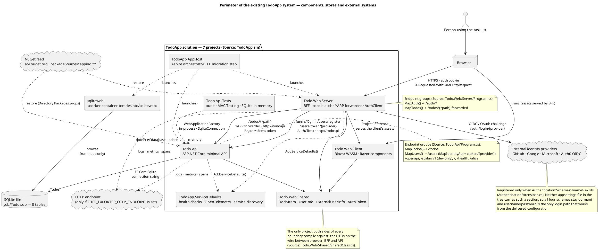
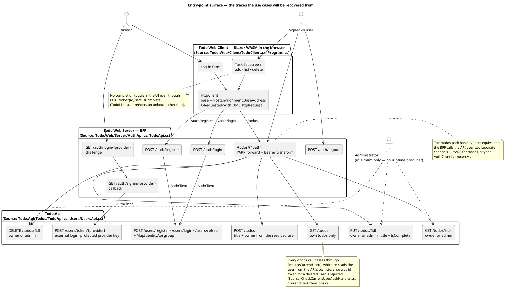

## Document Control
Phase: Survey
Status: Draft — Survey iteration 1; perimeter, technology and size, persistent data, documentation, history, anomalies, priorities and coverage read; not yet reviewed
Milestone Target: End-of-Survey (SBC) — not yet achieved

## Perimeter
The delivered system is the public sample `davidfowl/TodoApp` (MIT) at commit `307a1ead` of 2026-02-12, copied wholesale into this repository. It is a multi-process .NET 9 solution of seven projects: a Blazor WebAssembly client served by a Blazor server host acting as a backend-for-frontend, a minimal-API backend, an Aspire orchestrator, a shared service-defaults library, a shared DTO library, and an integration-test project.

| Component | What it is | Boundary the code shows |
|---|---|---|
| `Todo.Api` | ASP.NET Core minimal API; owns the data and all business rules | The only writer of the SQLite file. Authenticates with the Identity bearer scheme, then re-resolves the caller from its own store before any `/todos` handler runs. Compiles against `Todo.Web.Shared`, so the DTOs it returns are literally the client's types. `Source: Todo.Api/Program.cs`, `Todo.Api/Todos/TodoApi.cs`, `Todo.Api/Users/UsersApi.cs`, `Todo.Api/Authorization/CurrentUserExtensions.cs`, `Todo.Api/Todo.Api.csproj` |
| `Todo.Web.Server` | BFF; owns the browser session (cookie) and reaches the API over two distinct channels | Holds the access token inside the auth cookie (`TokenNames.AccessToken = "accessToken"`) and re-issues it as a Bearer header for `/todos` (`Todo.Web/Server/TodoApi.cs`); calls `/users/*` over a separately registered typed client that posts the credentials itself (`Todo.Web/Server/AuthClient.cs`, `Todo.Web/Server/Program.cs`). Also references `Todo.Web.Client`, which is how the WASM assets are served for the render mode. `Source: Todo.Web/Server/Todo.Web.Server.csproj`, `Program.cs`, `TodoApi.cs`, `AuthApi.cs`, `AuthClient.cs` |
| `Todo.Web.Client` | Blazor WebAssembly assembly running in the browser | A `Microsoft.NET.Sdk.BlazorWebAssembly` project referencing `Microsoft.AspNetCore.Components.WebAssembly`, `Microsoft.Extensions.Http` and `Todo.Web.Shared` only — no reference to the Server or the API, so every call it makes is HTTP against its own origin (`builder.HostEnvironment.BaseAddress`). It therefore reaches the BFF and never the API directly. `Source: Todo.Web/Client/Todo.Web.Client.csproj`, `Todo.Web/Client/Program.cs`, `Todo.Web/Client/TodoClient.cs` |
| `Todo.Web.Shared` | The DTO contract shared across all three tiers | Not a placeholder: it declares `TodoItem` (`Id`, `Title` `[Required]`, `IsComplete`), `UserInfo` (`Email`, `Password`, both `[Required]`), `ExternalUserInfo` (`Username`, `ProviderKey`, both `[Required]`) and `AuthToken` (a record whose single property is `Token`, serialised as `accessToken`). All three tiers reference it. `Source: Todo.Web/Shared/SharedClass.cs`, `Todo.Web/Client/Todo.Web.Client.csproj`, `Todo.Web/Server/Todo.Web.Server.csproj`, `Todo.Api/Todo.Api.csproj` |
| `TodoApp.ServiceDefaults` | Cross-cutting library: OpenTelemetry, health checks, service discovery, resilience | Referenced by the two runnable hosts, not by the client. `Source: TodoApp.ServiceDefaults/Extensions.cs`, `Todo.Web/Server/Todo.Web.Server.csproj` |
| `TodoApp.AppHost` | Aspire orchestration; also runs the EF migration before the API starts | Launches API and BFF, optionally `sqliteweb`; creates `.db/` and runs `dotnet ef database update` when the directory is absent. `Source: TodoApp.AppHost/Program.cs`, `TodoApp.AppHost/Extensions.cs` |
| `Todo.Api.Tests` | xunit integration suite | Drives `Todo.Api` in-process through `WebApplicationFactory<Program>`, replacing the provider with a real `SqliteConnection("Filename=:memory:")`, relaxing Identity password rules, installing an ephemeral data-protection provider and minting bearer tokens per request through a `DelegatingHandler`. The pinned `EntityFrameworkCore.InMemory` package is not used by the fixture. `Source: Todo.Api.Tests/TodoApplication.cs`, `Todo.Api.Tests/Todo.Api.Tests.csproj` |

Project composition and solution structure, read from the solution file rather than from the tree: the seven projects plus four solution folders (`src`, `tests`, `Solution Items`, and the two folder nodes the projects are nested into); the six tool files `ci.yaml`, `Directory.Build.props`, `Directory.Packages.props`, `global.json`, `nuget.config` and `README.md` are carried as solution items, so the build conventions travel with the solution. `Source: TodoApp.sln`.

External systems and stores, each with the anchor that proves the dependency:

| External element | Direction | Anchor |
|---|---|---|
| External identity providers — GitHub, Google, Microsoft, Auth0 | BFF → provider (OAuth2 / OIDC) | `Todo.Web/Server/Authentication/AuthenticationExtensions.cs` registers the four schemes by name, each only when its `Authentication:Schemes:<name>` section exists; the four provider packages are pinned in `Todo.Web/Server/Todo.Web.Server.csproj`. No delivered configuration supplies such a section — `Todo.Web/Server/appsettings.json` and `appsettings.Development.json` (144 bytes, logging only) hold none — so in the delivered shape the edge is dormant and only username/password login is reachable |
| SQLite database file `.db/Todos.db` | API → file | `Todo.Api/Program.cs` connection string `"Todos"` with fallback `Data Source=.db/Todos.db` |
| `tomdesinto/sqliteweb` container | AppHost → container, container → database file | `TodoApp.AppHost/Program.cs` |
| OTLP endpoint | API and BFF → collector | `TodoApp.ServiceDefaults/Extensions.cs` exports only when `OTEL_EXPORTER_OTLP_ENDPOINT` is non-empty |
| `api.nuget.org` | build → feed | `nuget.config` clears inherited sources and maps `*` to nuget.org |

The BFF-to-API connection is the one boundary that is easy to record wrongly, and both directions are anchored: `/todos` is forwarded by YARP, which rewrites the cookie-held token into an `Authorization` header, while `/users/*` is called by `AuthClient` with the credentials in the request body. The API never learns which of the two channels a request came through — there is no service-to-service authentication between them, which the code itself records as a TODO (`Todo.Api/Users/UsersApi.cs`).

The entry-point surface, recorded because every recovered use case must point back to it:

Scheduled jobs, batch processes and reports: none. `Source: TodoApp/` tree — no hosted service, no timer, no job configuration in any read manifest. The only non-request-driven behaviour is the one-shot `dotnet ef database update` the AppHost runs at startup.

## Technology and Size
| Concern | Value | Anchor |
|---|---|---|
| Framework | `net9.0`, `Nullable enable`, `ImplicitUsings enable`, `LangVersion preview` | `Directory.Build.props` |
| SDK | `9.0.100`, `rollForward: latestFeature`, `allowPrerelease: true` | `global.json` |
| Package management | Central (`ManagePackageVersionsCentrally`), 28 pins | `Directory.Packages.props` |
| Persistence | EF Core 9.0.8 + `Microsoft.EntityFrameworkCore.Sqlite` 9.0.8 | `Directory.Packages.props`, `Todo.Api/Todo.Api.csproj` |
| Identity | `Microsoft.AspNetCore.Identity.EntityFrameworkCore` 9.0.8, `AddIdentityCore<TodoUser>()` + `AddEntityFrameworkStores` + `AddApiEndpoints` | `Todo.Api/Program.cs` |
| Authentication | Bearer token scheme in the API; cookie scheme in the BFF; four external OAuth/OIDC schemes | `Todo.Api/Program.cs`, `Todo.Web/Server/Authentication/AuthenticationExtensions.cs` |
| Proxying | `Yarp.ReverseProxy` 2.3.0 with `MapForwarder` and a request transform | `Todo.Web/Server/TodoApi.cs` |
| Service discovery | `Microsoft.Extensions.ServiceDiscovery` 9.5.0 + `.Yarp` 9.5.0; the BFF resolves the base address `http://todoapi` | `Todo.Web/Server/Program.cs`, `Todo.Web/Server/Todo.Web.Server.csproj` |
| Observability | OpenTelemetry 1.12.0 (AspNetCore, Http, Runtime) + HttpLogging | `TodoApp.ServiceDefaults/Extensions.cs`, `Todo.Api/Program.cs` |
| API documentation surface | `Microsoft.AspNetCore.OpenApi` + `Scalar.AspNetCore` 2.6.8, mapped in Development only | `Todo.Api/Program.cs` |
| Validation | `MiniValidation` 0.9.2 via `WithParameterValidation`, plus `DataAnnotations` on the shared DTOs | `Todo.Api/Todos/TodoApi.cs`, `Todo.Web/Shared/SharedClass.cs` |
| Client runtime | `Microsoft.AspNetCore.Components.WebAssembly` + `Microsoft.Extensions.Http`; Blazor WASM SDK project | `Todo.Web/Client/Todo.Web.Client.csproj` |
| Tests | xunit 2.9.3, `Microsoft.AspNetCore.Mvc.Testing` 9.0.8, `coverlet.collector` 6.0.4; `EntityFrameworkCore.InMemory` 9.0.8 is pinned but the fixture substitutes a real SQLite in-memory connection, so the package is unused | `Todo.Api.Tests/Todo.Api.Tests.csproj`, `Todo.Api.Tests/TodoApplication.cs` |
| Build/CI | GitHub Actions: restore, build Release, test Release on push and pull request | `.github/workflows/ci.yaml` |

Cross-compilation surface — which project compiles against which. Read from the project files, because this graph, not the folder layout, is the real boundary between the tiers:

| Project | References | Anchor |
|---|---|---|
| `Todo.Web.Client` | `Todo.Web.Shared` | `Todo.Web/Client/Todo.Web.Client.csproj` |
| `Todo.Web.Server` | `TodoApp.ServiceDefaults`, `Todo.Web.Client`, `Todo.Web.Shared` | `Todo.Web/Server/Todo.Web.Server.csproj` |
| `Todo.Api` | `Todo.Web.Shared` (and its own EF/Identity packages) | `Todo.Api/Todo.Api.csproj` |
| `Todo.Api.Tests` | `Todo.Api` | `Todo.Api.Tests/Todo.Api.Tests.csproj` |

`Todo.Web.Shared` is therefore the single project all three tiers compile against, and the DTOs on the wire (`TodoItem`, `UserInfo`, `ExternalUserInfo`, `AuthToken`) are one set of types rather than three parallel copies. `Source: Todo.Web/Shared/SharedClass.cs`. No tier references another's implementation: the client is compiled into the server's output as assets, and the API is reached only over HTTP.

Size, by project and by what the tree shows:

| Project | Composition | Weight |
|---|---|---|
| `Todo.Api` | `Program.cs`, `TodoDbContext.cs`, `Todos/` (2), `Users/` (2), `Authorization/` (3), `Extensions/` (2), `Filters/` (1), `Migrations/` (7), 2 `appsettings`, `launchSettings.json` | The heaviest hand-written area; the only area carrying migrations |
| `Todo.Web.Server` | `Program.cs`, `AuthApi.cs`, `AuthClient.cs`, `TodoApi.cs`, `Authentication/` (5), `App.razor`, `_Imports.razor`, 2 `appsettings`, `launchSettings.json` | Second heaviest; concentrates the authentication logic and owns the only two channels to the API |
| `Todo.Web.Client` | `Program.cs`, `TodoApp.razor`, `TodoClient.cs`, `_Imports.razor`, `Components/` (2 razor), `wwwroot/` (45 vendored Bootstrap files, `css/app.css`, `bg.png`, `favicon.ico`) | Small hand-written surface behind a large vendored asset tree |
| `Todo.Web.Shared` | `SharedClass.cs` — 736 bytes holding four DTO types | Tiny by size, load-bearing by position: every tier's contract |
| `Todo.Api.Tests` | 6 C# files including the fixture, token helper and two test classes | ~16 KB of test source |
| `TodoApp.AppHost` | `Program.cs`, `Extensions.cs`, 2 `appsettings`, `launchSettings.json` | ~2.4 KB of orchestration |
| `TodoApp.ServiceDefaults` | `Extensions.cs` | ~4.5 KB |

The client's `wwwroot/bootstrap` accounts for 45 of the tree's 165 entries; it is third-party CSS/JS, not project code.

## Persistent Data
No SQL scripts, stored procedures or triggers exist. `Source: .iari/README.md` ("Database scripts. No SQL files, stored procedures or triggers. The schema exists only as code, in the migrations of the API project") — confirmed against the tree, which holds no `.sql` file.

The schema is defined by `TodoDbContext` and materialised by three EF Core migrations plus a model snapshot.

| Table | Purpose | Anchor |
|---|---|---|
| `Todos` | `Id` INTEGER identity key, `Title` TEXT required, `IsComplete` INTEGER (bool), `OwnerId` TEXT required; index on `OwnerId`; cascade delete from the owner | `Todo.Api/Migrations/TodoDbContextModelSnapshot.cs` |
| `AspNetUsers` | `TodoUser : IdentityUser` with no added properties; unique `NormalizedUserName`, index `EmailIndex` | same |
| `AspNetRoles`, `AspNetRoleClaims`, `AspNetUserClaims`, `AspNetUserLogins`, `AspNetUserRoles`, `AspNetUserTokens` | ASP.NET Core Identity's framework tables, cascade-deleted from user/role | same |

| Migration | Anchor |
|---|---|
| `20221123071234_Initial` | `Todo.Api/Migrations/20221123071234_Initial.cs` |
| `20221123165051_RemoveIsAdmin` | `Todo.Api/Migrations/20221123165051_RemoveIsAdmin.cs` |
| `20230714032431_ForeignKeyChange` | `Todo.Api/Migrations/20230714032431_ForeignKeyChange.cs` |

The relationship is configured in code, not only generated: `Todo` → `TodoUser` by `OwnerId`, principal key `Id`, `.WithMany()`. `Source: Todo.Api/TodoDbContext.cs`.

### What the store holds against what crosses the boundary

Two type sets exist and must not be confused when data is recovered:

| Type set | Where | What it carries |
|---|---|---|
| Entity — `Todo` | `Todo.Api/Todos/Todo.cs` | `Id`, `Title`, `IsComplete`, **`OwnerId`**. The ownership column exists only here; it never crosses the API boundary |
| Wire DTO — `TodoItem` | `Todo.Web/Shared/SharedClass.cs` | `Id`, `Title` (`[Required]`), `IsComplete`. No `OwnerId` — ownership is taken from the caller's resolved identity, not from the request body |
| Wire DTO — `TodoUser` | `Todo.Api/Users/TodoUser.cs` | `IdentityUser` with no added properties; the password hash and lockout state live in the framework columns of `AspNetUsers` |

The API therefore cannot be told to write a todo for someone else, and a client cannot see whose todo it is beyond the fact that `GET /todos` only returns its own.

### Data lifecycle

The database file is created and migrated **only** by the AppHost in run mode, and only when the `.db` directory does not yet exist (`if (!Directory.Exists(dbDirectory))` then `AddEfMigration`). `Source: TodoApp.AppHost/Extensions.cs`, `TodoApp.AppHost/Program.cs`. There is no migration runner inside `Todo.Api` itself, so running the API standalone leaves it pointing at a database file that nothing creates.

The integration tests take a different path to a schema: the fixture replaces the provider with a real `SqliteConnection("Filename=:memory:")` and calls `db.Database.EnsureCreated()`, so tests run against a schema generated from the current model rather than from the committed migrations. A divergence between the snapshot and the model would therefore not fail the suite. `Source: Todo.Api.Tests/TodoApplication.cs`.

The snapshot declares `ProductVersion` `8.0.0` while the package pins are 9.0.8, and the `EntityFrameworkCore.InMemory` package is pinned but unused — see Anomalies.

## Documentation
### What the owner declared, against what the tree holds

`Source: .iari/README.md` is the only file the delivery places in `.iari/`. It makes four statements; three hold against the tree, one no longer does.

| Declaration | Verdict against the tree |
|---|---|
| "Database scripts. No SQL files, stored procedures or triggers." | Holds — no `.sql` anywhere; schema lives in `Todo.Api/Migrations` |
| "Documents. No requirements, design or architecture documents, and no manuals." | [OBSOLETE] in part — true of the delivered snapshot, but the tree now also carries `docs/artifacts/environment/development-case.md` and `docs/artifacts/discovery/system-inventory.md`, both added by this sprint zero |
| "A running installation. … no production data and no users." | Holds — no deployment descriptor, no seed data, no connection string to a live store |
| "Its authors. … cannot be asked." | Holds — nothing in the tree names them beyond the MIT copyright line in `LICENSE` |

The single sentence "The only document is the `README.md` at the root of the repository" has to be read with the commits that created `docs/`: the folder did not come from the upstream sample.

### The document inventory

```plantuml
@startuml
title Documentation the delivery carries, what it covers, and where no document exists
skinparam componentStyle rectangle
skinparam shadowing false

package "Documents present" {
  component "README.md\n4509 bytes · prose only" as README
  component "Requests/todo.http\n793 bytes · 5 requests" as HTTPFILE
  component ".iari/README.md\n777 bytes · delivery statement" as IARI
  component "LICENSE\nMIT, (c) 2022 David Fowler" as LIC
  component "docs/artifacts/environment/\ndevelopment-case.md\n16418 bytes · process" as DC
  component "docs/artifacts/discovery/\nsystem-inventory.md\nthis artifact · discovery" as SI
  component "Configuration as documentation\nDirectory.Build.props · Directory.Packages.props\nglobal.json · nuget.config · ci.yaml · appsettings\naspire/settings.json · devcontainer" as CFG
  component "Code comments and TODO markers\n(nine statements · the only inline record)" as COMMENTS
}

package "System areas" {
  component "Api/Todos — CRUD over /todos" as A1
  component "Api/Users — Identity + token" as A2
  component "Server/Auth — BFF login dance" as A3
  component "Client — Blazor task list UI" as A4
  component "Persistence — 8 tables, 3 migrations" as A5
  component "Composition — AppHost, ServiceDefaults" as A6
  component "Tests — integration suite" as A7
  component "Shared — the DTO contract" as A8
}

README --> A1 : setup, /users/register and /users/login walkthrough
README --> A4 : lists the two apps, one screenshot
README --> A6 : "run TodoApp.AppHost", Aspire prerequisites
README --> A2 : bearer token response shape
README --> A3 : external providers setup, secrets, Auth0 schema
HTTPFILE --> A1 : POST, GET all, DELETE — no PUT, no GET by id
CFG --> A5 : connection string default, migration command
CFG --> A1 : rate limit and logging settings only
COMMENTS --> A3 : "TODO: Support remote logout", "Handle the failure somehow", "pick a user name"
COMMENTS --> A2 : "TODO: Add service to service auth between the BFF and this API"
COMMENTS --> A7 : "TODO: Follow up on the new errors"
DC --> A7 : names the test conventions
IARI --> A5 : no SQL scripts — schema is code
SI --> A8 : the DTOs are the contract every tier compiles against

README ..> A3 : no document of the /auth/* contracts
README ..> A7 : no document of what the suite covers
README ..> A8 : the shared DTOs are described nowhere
COMMENTS ..> A4 : completion toggle exists in API, absent in UI, unremarked

note bottom of DC
  Authored in this sprint zero (Process Engineer,
  commits 2026-11-14). It is process documentation,
  not documentation of the delivered system.
end note
note bottom of SI
  Authored in this sprint zero (Software Archaeologist).
  Discovery record, not design documentation.
end note
note bottom of COMMENTS
  CONTRIBUTING.md is cited as the coding standard by
  the Development Case but is absent from the tree.
end note
@enduml
```

| Document | Kind | Weight | What it actually covers | Anchor |
|---|---|---|---|---|
| `README.md` | prose, no structure beyond headings | 4509 bytes, 0 diagram, 0 table | The two applications, a feature list, prerequisites (.NET 9, Aspire CLI), how to run via `TodoApp.AppHost`, standalone API usage, external-provider and Auth0 configuration schemas, OpenTelemetry mention | `README.md` |
| `Requests/todo.http` | executable request file (REST Client / VS Code) | 793 bytes, 5 requests | `POST /users/register`, `POST /users/login`, `POST /todos`, `GET /todos`, `DELETE /todos/{id}` | `Requests/todo.http` |
| `.iari/README.md` | delivery statement | 777 bytes | What is and is not in the delivery | `.iari/README.md` |
| `LICENSE` | licence text | MIT, `(c) 2022 David Fowler` | Legal terms only | `LICENSE` |
| `docs/artifacts/environment/development-case.md` | process tailoring | 16418 bytes | The sprint-zero process: classification, disciplines, artifact catalogue, optional triggers, roles, version policy | committed 2026-11-14 (`37986fb`, `520a590`, `a1e2d77`, `6f554f8`, `e0bc4e6`) |
| `docs/artifacts/discovery/system-inventory.md` | discovery record | this artifact | The system as it is: perimeter, technology, data, documentation, history, anomalies, priorities, coverage | committed 2026-11-14 (this reading) |

Configuration read as documentation — the only authoritative statement of several behaviours:

| Behaviour documented only here | File |
|---|---|
| Target framework, nullable, implicit usings, `LangVersion preview` | `Directory.Build.props` |
| 28 package pins, including the only record that YARP 2.3.0 and Scalar 2.6.8 are intended | `Directory.Packages.props` |
| SDK band and prerelease policy | `global.json` |
| Package-source lockdown (`<clear />` + `*` → nuget.org) | `nuget.config` |
| CI gate: restore → build Release → test Release, on push and pull request | `.github/workflows/ci.yaml` |
| Default log levels; YARP warnings suppressed | `Todo.Api/appsettings.json`, `Todo.Web/Server/appsettings.json` |
| Rate-limit values `TokenLimit 50`, `TokensPerPeriod 50`, `QueueLimit 50` (Development only) | `Todo.Api/appsettings.Development.json` |
| `RazorLangVersion` 8.0 on the server project | `Todo.Web/Server/Todo.Web.Server.csproj` |
| AppHost path for the Aspire tooling | `.aspire/settings.json` |
| Developer environment: SDK 8.0 image, forwarded ports 5000/5001, auto-install of `dotnet-ef` | `.devcontainer/devcontainer.json`, `.devcontainer/init.sh` |
| Recommended editor extensions (C#, REST Client) | `.vscode/extensions.json` |

### Documentation carried only in code comments

These comments are the sole record of intent or of a known gap, and each is an anchor for a later reading:

| Statement | Anchor |
|---|---|
| "TODO: Add service to service auth between the BFF and this API" | `Todo.Api/Users/UsersApi.cs` |
| "TODO: Support remote logout" | `Todo.Web/Server/AuthApi.cs` |
| "TODO: Handle the failure somehow" (external login failure path) | `Todo.Web/Server/AuthApi.cs` |
| "TODO: We should have the user pick a user name to complete the external login dance" | `Todo.Web/Server/AuthApi.cs` |
| "TODO: Check user if the user is locked out as well" | `Todo.Api/Authorization/CheckCurrentUserAuthHandler.cs` |
| "This is a hack from hell to avoid having to know if this is running server or client side" | `Todo.Web/Client/TodoClient.cs` |
| "TODO: Support passing a connection string" (migration step) | `TodoApp.AppHost/Extensions.cs` |
| "TODO: Follow up on the new errors" — two field-level assertions commented out | `Todo.Api.Tests/UserApiTests.cs` |
| "Adding health checks endpoints to applications in non-development environments has security implications" | `TodoApp.ServiceDefaults/Extensions.cs` |

Five of the nine sit in the authentication area, which is why that area ranks second in Priorities.

### What has no document at all

| Undocumented | What the reader must do instead |
|---|---|
| The `/auth/*` contract of the BFF (register, login, logout, the two-step external challenge/callback) | Read `Todo.Web/Server/AuthApi.cs`; the `README.md` describes only the API's `/users` endpoints |
| The YARP forwarding rule and the cookie→Bearer token translation | Read `Todo.Web/Server/TodoApi.cs` |
| The complete `/todos` contract — `GET /todos/{id}` and `PUT /todos/{id}` appear in neither the README nor `todo.http` | Read `Todo.Api/Todos/TodoApi.cs` |
| The authorization rules (owner-only reads, owner-or-admin writes) and the fact that reads use `FindAsync` before the ownership check | Read `Todo.Api/Todos/TodoApi.cs`; `Todo.Api.Tests/TodoApiTests.cs` covers the behaviour |
| The rate-limit policy and its configuration keys | Read `Todo.Api/Extensions/RateLimitExtensions.cs` (unread) and `Todo.Api/Program.cs` |
| Which endpoints the test suite covers | Read `Todo.Api.Tests/TodoApiTests.cs`, `Todo.Api.Tests/UserApiTests.cs` |
| The database lifecycle — that only the AppHost creates and migrates `.db/Todos.db` | Read `TodoApp.AppHost/Extensions.cs` |
| The API's OpenAPI surface | No committed OpenAPI file; it is generated at runtime and exposed at `/openapi` with `/scalar/v1` in Development |
| Any ADR, architecture note, glossary, deployment instruction beyond `README.md` | Nothing exists — `.iari/README.md` declares this and the tree confirms it |

### Documentation the delivery cites but does not contain

`docs/artifacts/environment/development-case.md` lists `CONTRIBUTING.md` as "Coding standard and review conventions" with the Software Architect and Code Reviewer as owners. **`CONTRIBUTING.md` does not exist in the tree** — a direct read fails with "was not found". The Development Case's other tool references (`ci.yaml`, `Directory.Packages.props`, `global.json`, `Directory.Build.props`, `Todo.Api.Tests`, `README.md`) all resolve.

Recorded as an absence, not filled in: no coding standard exists beyond what `Directory.Build.props` enforces (nullable, implicit usings, preview language version) and what the code demonstrates.

### Artifacts produced in this sprint zero

Two documents in `docs/artifacts/` were authored in this sprint zero and are not part of the delivered sample:

| Document | Owner | Covers |
|---|---|---|
| `docs/artifacts/environment/development-case.md` | Process Engineer | The process: classification, disciplines, artifact catalogue, optional triggers, roles, version policy |
| `docs/artifacts/discovery/system-inventory.md` | Software Archaeologist | This artifact — the system as it is, with its anchors |

Neither documents the delivered system's requirements or design; both are process and discovery records, and neither is a substitute for the missing architecture description, data dictionary or API contract listed in Anomalies.

## History
Commit history read from the SCM. The whole-repository listing covers the 50 most recent commits, 2024-11-14 to 2026-11-14, and reports that older history exists.

| Area | Commits listed | Period | What the commits show |
|---|---|---|---|
| Whole repository | 50 | 2024-11-14 → 2026-11-14 (older history exists) | The listing opens on the November 2024 rework and is dominated by it: `6b9f07e` "Aspirfy!", `9d10860` (net8 merge), `09ea52d` "Perform migration in the app host in local dev scenarios", `485e7d4` "Added sqlite data browser", `03640dd` "Rename AuthenticatonSchemes to AuthenticationSchemes (#91)", `3530e8a` ".NET 9", `1449c43` "Use new open api and scalar", `5af589d`, `780dff8`, `ed8e367`, then `bbd680d` "Move files around", `3308193` "TodoApi -> TodoApp", `617dfee`, `fb0032e`, `2d0d82d`, `228dc29`, `fdc49bb`, `993421c` "Read rate per user rate limiter options via config", `2d890e8` "Clean up and added comment about S2S auth", `69127f1`, `a519c10`. After 2024-11-27 the pace collapses: `beb0011` and `1d4e043` (2025-01-11, "Auto install dotnet ef" and "Remove tasks and launch.json"), `a6dea68` (2025-08-07, "Update everything! (#105)"), `d772504` and `a6ff858` (2025-09-28), `307a1ea` (2026-02-12, "Upgrade Aspire SDK to 13.1.1") — the commit the delivery was taken at. The sprint-zero commits of 2026-11-14 sit on top: `ccf6401` (repository `README.md`) and five Development Case upserts by the Process Engineer |
| `README.md` | 20 | 2022-12-02 → 2025-09-28 | Steady low-churn documentation: rewritten at each platform move (`2e54de3` .NET 8, `6b9f07e` Aspirify!, `3308193` rename) and polished twice since (`d772504`, `a6ff858`). No README commit after 2025-09-28, so the README post-dates nothing the delivery contains |
| `Requests/` | 5 | 2022-11-12 → 2024-03-26 | Last touched by `abd9421` "Fix up docs and http file for net8 identity framework (#92)"; not touched by the .NET 9 work of November 2024 |
| `Todo.Api/Migrations` | 1 | 2024-11-23 only | The single listed commit is a path move (`bbd680d` "Move files around"), not a schema change. The migration set itself is old: `Initial` and `RemoveIsAdmin` (both 2022-11-23), `ForeignKeyChange` (2023-07-14) |
| `.devcontainer` | 6 | 2022-11-13 → 2023-12-15 | Last touched by `2e54de3` ".NET 8 RTM Update" (2023-12-15) — before the .NET 9 upgrade (`3530e8a`, 2024-11-15). No later commit, consistent with the image still pinning SDK 8.0 |

Instability, read from these commits only:

- **The authentication and BFF surface is the most volatile area.** Between 2024-11-23 and 2024-11-27 six commits target it — `fb0032e`, `2d0d82d`, `228dc29`, `fdc49bb`, `69127f1` and `a519c10` "Protect the user id to make sure only the BFF can call the external auth API (#100)" — with `2d890e8` adding the comment about the missing service-to-service auth and `993421c` making the rate limiter configurable in the same window. That is more churn in five days than any other area shows in a year, and the newest of those commits changes a trust boundary.
- **The persistence schema is consolidating.** Three migrations, all created in 2022–2023, none since; `RemoveIsAdmin` shows functionality deliberately taken out of the schema. The only schema-adjacent commit in the listing is the AppHost taking over migration in local dev (`09ea52d`), which moved *when* the schema is applied without changing *what* it is.
- **The dev environment is stale relative to the code.** Its last commit precedes the framework upgrade.
- **The sprint-zero commits carry no change to the delivered system.** `ccf6401` and the five Process Engineer commits add `README.md` and `docs/`, and this reading adds upserts of this artifact.

## Anomalies
| Anomaly | Evidence | Probability | Impact |
|---|---|---|---|
| `CONTRIBUTING.md` is cited as the coding standard but does not exist | `docs/artifacts/environment/development-case.md` names it under Tool references; a read of `CONTRIBUTING.md` returns "was not found"; the tree has no such entry | Certain — already true | Medium: the Software Architect and Code Reviewer are assigned an artifact that is not there; coding conventions must be read off the code or re-authored |
| The external-login path is advertised but dormant in the delivered configuration | `AuthenticationExtensions.cs` registers GitHub, Google, Microsoft and Auth0 each only when `Authentication:Schemes:<name>` exists; `Todo.Web/Server/appsettings.json` and `appsettings.Development.json` (144 bytes, logging keys only) supply no such section, so no scheme is registered. The `/auth/login/{provider}` and `/auth/signin/{provider}` endpoints and `POST /users/token/{provider}` nonetheless exist, and `ExternalProviders` enumerates whatever non-cookie schemes are registered | Certain in the delivered shape | Medium: a recovered use case for external login would have no working trace from the delivered configuration; the external-provider edge must be recorded as configured-at-runtime, not as a delivered capability |
| The dev container cannot build the solution | `.devcontainer/devcontainer.json` pins `mcr.microsoft.com/dotnet/sdk:8.0`; `global.json` requires `9.0.100` with `rollForward: latestFeature`. Roll-forward does not bridge a major version | High | Medium for anyone using the container; the CI path (`actions/setup-dotnet@v3`) is unaffected because it resolves the SDK from `global.json` |
| The Razor language version is pinned below the framework | `Todo.Web/Server/Todo.Web.Server.csproj` sets `<RazorLangVersion>8.0</RazorLangVersion>` while the target framework is `net9.0` | Medium | Low: builds as delivered; a Razor feature introduced after .NET 8 is unavailable in this project, and bumping it is a behaviour change, not a formatting one |
| The README's completion-toggle feature is unreachable from the UI | `PUT /todos/{id}` writes `IsComplete` (`Todo.Api/Todos/TodoApi.cs`); `Todo.Web/Client/Components/TodoList.razor` renders `<input type="checkbox" />` with no `@bind` and no handler, and `TodoClient` exposes no update call | Certain | Medium: a delivered capability has no user-facing entry point, so a use case recovered from the API would have no screen trace |
| The `admin` role is not obtainable at runtime | `CurrentUser.IsAdmin` reads `Principal.IsInRole("admin")` (`Todo.Api/Authorization/CurrentUser.cs`); `Todo.Api/Program.cs` calls `AddIdentityCore<TodoUser>()` with no role store and no role seeding; the only producer of an `admin` role claim in the tree is `Todo.Api.Tests/TokenService.cs`, a test fixture | High | Medium: the owner-or-admin branches in `GET/PUT/DELETE /todos/{id}` are exercised only by tests; whether an administrator exists in the product is undetermined by the code |
| Nothing binds an API request to the BFF | The API accepts any request carrying a valid Identity bearer token, and the BFF forwards the token it keeps in the cookie; there is no service-to-service authentication between the two, which the code records as a TODO in `Todo.Api/Users/UsersApi.cs`. `POST /users/token/{provider}` is the one endpoint with an explicit protection, a provider key | Low for a sample with no deployment; Medium if deployed beyond a single host | High if deployed: a holder of a valid token, or of the data-protection key ring both processes share under the discriminator `TodoApp`, can call the API directly, bypassing the BFF |
| The test suite never validates the committed migrations | `Todo.Api.Tests/TodoApplication.cs` builds the schema with `db.Database.EnsureCreated()` on a fresh `SqliteConnection("Filename=:memory:")`, so the model — not the three migrations in `Todo.Api/Migrations` — produces the tables every test runs against | Certain | Medium: a migration that no longer matches the model (the snapshot already reports `ProductVersion` 8.0.0 against 9.0.8 pins) passes CI green, and the first place it surfaces is a real deployment |
| The test suite asserts less than it appears to | `Todo.Api.Tests/UserApiTests.cs` comments out its field-level assertions under "TODO: Follow up on the new errors", leaving status-code-only checks; no test covers `PUT`'s `id != todo.Id` branch or the rate limiter | High | Medium: the CI gate is green but weaker than a reader would assume |
| `EntityFrameworkCore.InMemory` is pinned, referenced and never used | `Todo.Api.Tests/Todo.Api.Tests.csproj` references the package; `Todo.Api.Tests/TodoApplication.cs` overrides the options with `o.UseSqlite(_sqliteConnection)`, so every test runs against SQLite, not the in-memory provider | Certain | Low: a reader who assumes the InMemory provider will misjudge what the suite proves — it exercises real SQLite semantics, which is stronger, and it means the suite's behaviour depends on SQLite translation |
| The EF model snapshot is from the 8.0 era while the package pins are 9.0.8 | `Todo.Api/Migrations/TodoDbContextModelSnapshot.cs` declares `ProductVersion` `8.0.0`; `Directory.Packages.props` pins EF Core 9.0.8; no migration commit after 2024-11-23 | Medium | Low to Medium: the next `dotnet ef migrations add` may produce a snapshot diff unrelated to the intended change |
| Server-side prerendering returns an empty list with a success status | `Todo.Web/Client/TodoClient.cs`: when `client.BaseAddress is null` it `return (HttpStatusCode.OK, new())`, with the comment "This is a hack from hell" | Certain | Low: a first paint shows an empty task list rather than an error or a spinner |
| The Development Case's role/artifact ownership diagram is drawn as a class diagram | `docs/artifacts/environment/development-case.md` uses `class` elements and `-->` arrows to express ownership | Certain | Low: cosmetic in a process document; recorded because downstream roles read that artifact |
| `docs/` is not declared in `.iari/README.md` even though it exists | `.iari/README.md` says the only document is the root `README.md`; the tree holds `docs/artifacts/environment/development-case.md` and `docs/artifacts/discovery/system-inventory.md`, created in this sprint zero | Certain | Low: the delivery statement now under-describes the tree it sits in |
| `README.md` links a badge to a differently-named repository | The badge URL is `github.com/davidfowl/TodoApi/actions/...` while the project was renamed to `TodoApp` in `3308193` | Certain | Low: external link only |

Absences recorded as findings rather than filled in: no architecture description, no ADR, no deployment instruction, no data dictionary, no API contract document, no operational runbook, no user guide, and no author to ask (`Source: .iari/README.md`).

## Priorities
Ordered by where the code concentrates and by what the Development Case and the delivery statement make load-bearing. Each entry states why it is where it is; this order drives the Excavation reading.

| Order | Area | Why it is here |
|---|---|---|
| 1 | `Todo.Api/Todos` — the `/todos` surface | The only area carrying the system's actual domain (`Todo`, `IsComplete`, `OwnerId`), the only area with behavioural tests, and the surface the declared product purpose rests on. Five endpoints, two authorization rules, three distinct failure modes. Every endpoint is reachable through the BFF, so a use case recovered here has a trace on both sides of the boundary |
| 2 | Authentication and identity — `Todo.Api/Users`, `Todo.Api/Authorization`, `Todo.Web/Server/Auth*`, `Server/Authentication` | The most complex and most volatile area: six commits between 2024-11-23 and 2024-11-27, the newest of which changes a trust boundary (`a519c10`), and in the same window `2d890e8` records the missing service-to-service auth and `993421c` makes the rate limiter configurable. It carries two schemes, four external providers, a data-protection key shared between processes, the only explicit endpoint protection in the system (`/users/token/{provider}`), and five TODO markers naming known gaps |
| 3 | `Todo.Web.Shared` — the DTO contract | Load-bearing by position, not by size: the one project all three tiers compile against, so any change to `TodoItem`, `UserInfo`, `ExternalUserInfo` or `AuthToken` moves every boundary at once. Read with priority 1, because the `/todos` and `/users` contracts are literally these types |
| 4 | Persistence — `Todo.Api/TodoDbContext`, `Todo.Api/Migrations` | The schema is the system's ground truth and exists nowhere else. The snapshot/product-version drift, the AppHost-only migration path and the tests' `EnsureCreated()` schema all have consequences for any later change |
| 5 | Composition and deployment — `TodoApp.AppHost`, `TodoApp.ServiceDefaults` | The Development Case fired the Deployment Model on this topology. The AppHost also owns the database lifecycle, which the API does not |
| 6 | `Todo.Web.Client` | Small, but it holds the only user-facing UI, a documented defect (the prerender hack) and the missing completion toggle. Read after the API, because the client's contract is the BFF's |
| 7 | `Todo.Api.Tests` | The evidence for orders 1 and 2, but weaker than it looks — the assertions disabled in `UserApiTests.cs` are why this ranks below the code they test |
| 8 | `wwwroot/bootstrap`, tooling configs | Vendored and already read at the level they need |

Deliberately not read first: the vendored Bootstrap tree, `Properties/launchSettings.json` files, and the Razor `_Imports`/`App` plumbing — they carry no perimeter facts.

## Coverage
The tree reports 165 entries. Of these, 45 are vendored Bootstrap CSS/JS files under `Todo.Web/Client/wwwroot/bootstrap` and are excluded from the reading by kind, and one is this artifact (`docs/artifacts/discovery/system-inventory.md`).

**Files opened: 52.** Enumerated, so the next iteration does not re-read them:

`.iari/README.md`, `README.md`, `LICENSE`, `Requests/todo.http`, `Directory.Build.props`, `Directory.Packages.props`, `global.json`, `nuget.config`, `TodoApp.sln`, `.github/workflows/ci.yaml`, `.devcontainer/devcontainer.json`, `.devcontainer/init.sh`, `.aspire/settings.json`, `.vscode/extensions.json`, `docs/artifacts/environment/development-case.md`, `Todo.Api/Program.cs`, `Todo.Api/TodoDbContext.cs`, `Todo.Api/Todo.Api.csproj`, `Todo.Api/appsettings.json`, `Todo.Api/appsettings.Development.json`, `Todo.Api/Todos/Todo.cs`, `Todo.Api/Todos/TodoApi.cs`, `Todo.Api/Users/TodoUser.cs`, `Todo.Api/Users/UsersApi.cs`, `Todo.Api/Authorization/CurrentUser.cs`, `Todo.Api/Authorization/CheckCurrentUserAuthHandler.cs`, `Todo.Api/Authorization/CurrentUserExtensions.cs`, `Todo.Api/Migrations/TodoDbContextModelSnapshot.cs`, `Todo.Api.Tests/Todo.Api.Tests.csproj`, `Todo.Api.Tests/TodoApplication.cs`, `Todo.Api.Tests/TokenService.cs`, `Todo.Api.Tests/TodoApiTests.cs`, `Todo.Api.Tests/UserApiTests.cs`, `Todo.Web/Server/Program.cs`, `Todo.Web/Server/TodoApi.cs`, `Todo.Web/Server/AuthApi.cs`, `Todo.Web/Server/AuthClient.cs`, `Todo.Web/Server/Todo.Web.Server.csproj`, `Todo.Web/Server/appsettings.json`, `Todo.Web/Server/appsettings.Development.json`, `Todo.Web/Server/Authentication/AuthenticationExtensions.cs`, `Todo.Web/Server/Authentication/AuthenticationSchemes.cs`, `Todo.Web/Server/Authentication/ExternalProviders.cs`, `Todo.Web/Server/Authentication/TokenNames.cs`, `Todo.Web/Client/Program.cs`, `Todo.Web/Client/Todo.Web.Client.csproj`, `Todo.Web/Client/TodoClient.cs`, `Todo.Web/Client/Components/TodoList.razor`, `Todo.Web/Shared/SharedClass.cs`, `TodoApp.AppHost/Program.cs`, `TodoApp.AppHost/Extensions.cs`, `TodoApp.ServiceDefaults/Extensions.cs`.

**Files confirmed absent: 1** — `CONTRIBUTING.md`, cited by the Development Case.

**Areas left unread, declared rather than omitted:**

| Unread | Why it can wait |
|---|---|
| `Todo.Web/Client/TodoApp.razor`, `_Imports.razor`, `Components/LogInForm.razor`, `Todo.Web/Server/App.razor`, `_Imports.razor` | Razor markup and component plumbing; the log-in form's contract is inferable from `TodoClient` and `AuthApi` and must be confirmed in Excavation before the login use case is recovered |
| `Todo.Web/Server/Authentication/HttpAuthenticationStateProvider.cs` | The Blazor authentication-state bridge between the cookie and the component tree; needed for the login use case, not for the perimeter |
| `Todo.Api/Extensions/OpenApiOptionsExtensions.cs`, `RateLimitExtensions.cs`, `Filters/ValidationFilter.cs` | The mechanism behind `/openapi`, the rate limiter and parameter validation. The limiter's configured values are now known (`RateLimiting: TokenLimit 50, TokensPerPeriod 50, QueueLimit 50`); the policy construction and its partition key are not read |
| `Todo.Api/Migrations/2022*.cs`, `2023*.cs` (3 migration files plus 3 designer files) | The schema is read from the snapshot; the per-migration diffs matter only when reconstructing schema history |
| `Todo.Web/Shared/Todo.Web.Shared.csproj`, `TodoApp.AppHost/TodoApp.AppHost.csproj`, `TodoApp.ServiceDefaults/TodoApp.ServiceDefaults.csproj` | Manifests restating pins already read centrally; the Client, Server, Api and Tests manifests are read, so the reference graph is confirmed |
| `TodoApp.AppHost/appsettings.Development.json`, all `Properties/launchSettings.json` (`Todo.Api`, `Todo.Web.Server`, `Todo.Web.Client`, `TodoApp.AppHost`) | Local-only overrides, ports and profiles; no perimeter fact |
| `.gitignore`, `bg.png`, `favicon.ico`, `css/app.css`, all 45 Bootstrap files | Assets and ignore rules; no perimeter fact |
| `Todo.Api.Tests/DbContextExtensions.cs`, `GlobalUsings.cs` | Fixture plumbing already inferable from `TodoApplication.cs` |
| Whole-repository commits older than 2023-07-14 | Older history exists; the schema-era commits of 2022 are the candidates for the next history reading |

What this coverage does **not** claim: the `/auth/*` behaviour is described from the endpoint list, `AuthClient` and the provider registration, not from the state machine that drives the external login (unread `HttpAuthenticationStateProvider.cs` and the Razor forms); the rate-limit partition key is not read; the three remaining project manifests are unread; and no file outside the 52 opened has been looked at, so a fact about an unread file would be an assumption.

## Provenance
| Fact | Anchor |
|---|---|
| The delivery is the MIT sample `davidfowl/TodoApp` at `307a1ead`, 2026-02-12, with no authors reachable | `.iari/README.md` |
| `.iari/` holds only `README.md` at delivery | `.iari/README.md`; tree listing |
| No SQL scripts, stored procedures or triggers | `.iari/README.md`; tree listing |
| Seven projects and their names | `TodoApp.sln` |
| Four solution folders (`src`, `tests`, `Solution Items`, plus the nesting nodes); `ci.yaml`, `Directory.Build.props`, `Directory.Packages.props`, `global.json`, `nuget.config`, `README.md` carried as solution items | `TodoApp.sln` |
| `net9.0`, `Nullable enable`, `ImplicitUsings enable`, `LangVersion preview` | `Directory.Build.props` |
| SDK `9.0.100`, `rollForward: latestFeature`, `allowPrerelease: true` | `global.json` |
| 28 package pins; EF Core, Identity, YARP, Scalar, OpenTelemetry, xunit versions | `Directory.Packages.props` |
| Package source locked to nuget.org | `nuget.config` |
| CI runs restore, Release build and Release test on push and pull request | `.github/workflows/ci.yaml` |
| API composition: service defaults, data protection discriminator `TodoApp`, bearer auth, `AddIdentityCore<TodoUser>`, SQLite, current-user service, OpenAPI, rate limiting, HTTP logging, Scalar in Development | `Todo.Api/Program.cs` |
| `/todos` group requires the current user, a per-user rate limit, and parameter validation | `Todo.Api/Todos/TodoApi.cs` |
| Five `/todos` operations and their owner/admin rules | `Todo.Api/Todos/TodoApi.cs` |
| `GET /todos/{id}` reads via `FindAsync` before the ownership check | `Todo.Api/Todos/TodoApi.cs` |
| `/users` group maps `MapIdentityApi<TodoUser>` plus `POST /users/token/{provider}` | `Todo.Api/Users/UsersApi.cs` |
| External user ids are data-protected before transport | `Todo.Api/Users/UsersApi.cs`; `Todo.Web/Server/AuthApi.cs` |
| `RequireCurrentUser()` adds an authenticated-user requirement plus a handler that succeeds only when the API has resolved the caller from its own store, so a valid token for a user that no longer exists is rejected; lock-out is not checked (TODO in the handler) | `Todo.Api/Authorization/CheckCurrentUserAuthHandler.cs` |
| The caller is resolved once per request through an `IClaimsTransformation` that assigns `currentUser.Principal` and `currentUser.User` via `UserManager.FindByIdAsync` | `Todo.Api/Authorization/CurrentUserExtensions.cs` |
| `CurrentUser.IsAdmin` reads the `admin` role claim | `Todo.Api/Authorization/CurrentUser.cs` |
| The `Todo` entity carries `OwnerId`; the `TodoItem` DTO does not, so ownership never crosses the API boundary in a request or response body | `Todo.Api/Todos/Todo.cs`, `Todo.Web/Shared/SharedClass.cs` |
| `TodoUser` adds no properties to `IdentityUser` | `Todo.Api/Users/TodoUser.cs` |
| Eight tables and their columns, keys and indexes | `Todo.Api/Migrations/TodoDbContextModelSnapshot.cs` |
| Snapshot `ProductVersion` is `8.0.0` | `Todo.Api/Migrations/TodoDbContextModelSnapshot.cs` |
| Relationship `Todo.OwnerId` → `TodoUser.Id`, `.WithMany()` | `Todo.Api/TodoDbContext.cs` |
| Three migrations, their names and dates | `Todo.Api/Migrations/` file names |
| Connection string `"Todos"`, fallback `Data Source=.db/Todos.db` | `Todo.Api/Program.cs` |
| The database is created and migrated only by the AppHost, only when `.db` is absent; no migration runner exists inside the API | `TodoApp.AppHost/Extensions.cs`; `TodoApp.AppHost/Program.cs` |
| `sqliteweb` container mounting the database directory | `TodoApp.AppHost/Program.cs` |
| The project reference graph: Client → Shared; Server → ServiceDefaults, Client, Shared; Api → Shared; Tests → Api | `Todo.Web/Client/Todo.Web.Client.csproj`, `Todo.Web/Server/Todo.Web.Server.csproj`, `Todo.Api/Todo.Api.csproj`, `Todo.Api.Tests/Todo.Api.Tests.csproj` |
| `Todo.Web.Shared` holds the wire DTOs `TodoItem`, `UserInfo`, `ExternalUserInfo` and `AuthToken` (`accessToken` via `JsonPropertyName`), the last three carrying `[Required]`/validation attributes | `Todo.Web/Shared/SharedClass.cs` |
| The client is a Blazor WebAssembly SDK project with only `Components.WebAssembly`, `Extensions.Http` and the Shared reference — no Server or API reference | `Todo.Web/Client/Todo.Web.Client.csproj` |
| The server references the client project (assets for the render mode) and pins the four external-provider packages | `Todo.Web/Server/Todo.Web.Server.csproj` |
| The server pins `<RazorLangVersion>8.0</RazorLangVersion>` while targeting `net9.0` | `Todo.Web/Server/Todo.Web.Server.csproj` |
| The BFF composition: cookie auth, data protection discriminator, `TodoClient`, Razor components with WASM render mode, YARP forwarder with service discovery, `AuthClient` base address `http://todoapi` | `Todo.Web/Server/Program.cs` |
| BFF forwards `/todos/{*path}` and rewrites the cookie token into a Bearer header | `Todo.Web/Server/TodoApi.cs` |
| The BFF reaches the API over two separate channels: YARP for `/todos`, a typed `AuthClient` for `/users/*`; no service-to-service authentication exists between them | `Todo.Web/Server/TodoApi.cs`, `Todo.Web/Server/AuthClient.cs`, `Todo.Api/Users/UsersApi.cs` |
| `AuthClient` calls `users/login`, `users/register` and `users/token/{provider}`, returning the token or null on any non-success status | `Todo.Web/Server/AuthClient.cs` |
| The access token is stored in the auth cookie under the key `accessToken` | `Todo.Web/Server/Authentication/TokenNames.cs` |
| The external-login staging scheme is named `External` | `Todo.Web/Server/Authentication/AuthenticationSchemes.cs` |
| BFF auth endpoints: register, login, logout, `login/{provider}`, `signin/{provider}` | `Todo.Web/Server/AuthApi.cs` |
| Four external providers, each gated on its configuration section; no delivered `appsettings` supplies one, so the external-login edge is dormant and username/password is the only login path configured in the tree | `Todo.Web/Server/Authentication/AuthenticationExtensions.cs`; `Todo.Web/Server/appsettings.json`; `Todo.Web/Server/appsettings.Development.json`, which holds logging keys only (144 bytes) |
| All non-cookie schemes are treated as social providers for the UI | `Todo.Web/Server/Authentication/ExternalProviders.cs` |
| The client's `HttpClient` is based on `HostEnvironment.BaseAddress` and sends `X-Requested-With: XMLHttpRequest` so the cookie stack does not redirect unauthenticated requests | `Todo.Web/Client/Program.cs` |
| Client call surface: add, delete, list, login, register, logout | `Todo.Web/Client/TodoClient.cs` |
| Prerender returns `(OK, empty)` when `BaseAddress` is null — "hack from hell" | `Todo.Web/Client/TodoClient.cs` |
| Task-list UI renders an unbound checkbox; no completion toggle | `Todo.Web/Client/Components/TodoList.razor` |
| OpenTelemetry, health checks, service discovery and resilience defaults | `TodoApp.ServiceDefaults/Extensions.cs` |
| OTLP export only when `OTEL_EXPORTER_OTLP_ENDPOINT` is set | `TodoApp.ServiceDefaults/Extensions.cs` |
| Health endpoints mapped in Development only | `TodoApp.ServiceDefaults/Extensions.cs` |
| The test host replaces the provider with a real `SqliteConnection("Filename=:memory:")` and calls `UseSqlite`, relaxes Identity password rules, installs `EphemeralDataProtectionProvider`, registers a scoped `TokenService`, and mints a bearer token per request through a `DelegatingHandler` | `Todo.Api.Tests/TodoApplication.cs` |
| Tests build their schema with `EnsureCreated()` from the model, not from the committed migrations | `Todo.Api.Tests/TodoApplication.cs` |
| `EntityFrameworkCore.InMemory` is referenced but the fixture never uses it | `Todo.Api.Tests/Todo.Api.Tests.csproj`, `Todo.Api.Tests/TodoApplication.cs` |
| The `admin` role claim is added only by the test token helper | `Todo.Api.Tests/TokenService.cs` |
| Nine `[Fact]` tests over `/todos`, including owner isolation and admin override | `Todo.Api.Tests/TodoApiTests.cs` |
| Seven `[Fact]` tests over `/users`; field-level assertions commented out under a TODO | `Todo.Api.Tests/UserApiTests.cs` |
| Rate limiting is configured at `TokenLimit 50`, `TokensPerPeriod 50`, `QueueLimit 50` in Development | `Todo.Api/appsettings.Development.json` |
| README contents: feature list, prerequisites .NET 9 + Aspire CLI, run via AppHost, standalone API walkthrough, external provider and Auth0 configuration, OpenTelemetry | `README.md` |
| `README.md` is 4509 bytes, `Requests/todo.http` 793 bytes, `.iari/README.md` 777 bytes, `development-case.md` 16418 bytes, `SharedClass.cs` 736 bytes, `Todo.Api.Tests.csproj` 734 bytes, `Todo.Web.Server.csproj` 1115 bytes, `Todo.Web.Client.csproj` 331 bytes | SCM file metadata for each path |
| `Requests/todo.http` carries five requests and no `PUT` or `GET /todos/{id}` | `Requests/todo.http` |
| Badge URL names `TodoApi` while the project is `TodoApp` | `README.md`; commit `3308193` |
| `.devcontainer` pins SDK 8.0 and forwards ports 5000/5001 | `.devcontainer/devcontainer.json` |
| `dotnet-ef` installed globally by the dev container setup | `.devcontainer/init.sh` |
| AppHost path recorded for Aspire tooling | `.aspire/settings.json` |
| Editor extension recommendations | `.vscode/extensions.json` |
| MIT licence, copyright 2022 David Fowler | `LICENSE` |
| `CONTRIBUTING.md` is cited by the Development Case | `docs/artifacts/environment/development-case.md`, Tool references |
| `CONTRIBUTING.md` does not exist | read attempt returned "was not found"; tree listing |
| Development Case classification (`business-process-led = false`, `real-time-system = false`), inactive Business Modeling, fired Deployment Model, stood-down roles, Use-Case Model to be enumerated one use case per endpoint surface with auth/rate-limiting/telemetry excluded as mechanisms | `docs/artifacts/environment/development-case.md` |
| Commit history of the whole repository: 50 commits, 2024-11-14 → 2026-11-14, older history exists | `scm_list_commits` over the repository, 2026-11-14 run |
| The November 2024 rework and the post-November commits | same listing: `6b9f07e`, `9d10860`, `09ea52d`, `485e7d4`, `03640dd`, `3530e8a`, `1449c43`, `5af589d`, `780dff8`, `ed8e367`, `bbd680d`, `3308193`, `617dfee`, `fb0032e`, `2d0d82d`, `228dc29`, `fdc49bb`, `993421c`, `2d890e8`, `69127f1`, `a519c10`, `beb0011`, `1d4e043`, `a6dea68`, `d772504`, `a6ff858`, `307a1ea` |
| Six authentication-surface commits between 2024-11-23 and 2024-11-27, plus the S2S comment and the configurable rate limiter in the same window | `fb0032e`, `2d0d82d`, `228dc29`, `fdc49bb`, `69127f1`, `a519c10`; `2d890e8`, `993421c` |
| `README.md` history: 20 commits, 2022-12-02 → 2025-09-28 | `scm_list_commits` over `README.md` |
| `Requests/` history: 5 commits, 2022-11-12 → 2024-03-26 | `scm_list_commits` over `Requests` |
| `Todo.Api/Migrations` history: 1 commit, 2024-11-23, a path move | `scm_list_commits` over `Todo.Api/Migrations` |
| `.devcontainer` history: 6 commits, 2022-11-13 → 2023-12-15, last `2e54de3` | `scm_list_commits` over `.devcontainer` |
| `docs/` created by the sprint-zero commits of 2026-11-14 | whole-repository listing: `ccf6401`, `37986fb`, `520a590`, `a1e2d77`, `6f554f8`, `e0bc4e6`, and this reading's upserts |
| 165 tree entries, 45 of them vendored Bootstrap files | `scm_get_repo_tree` |
| 52 files opened in this reading | the enumeration in Coverage |
| No scheduled job, batch process or report exists; the only non-request-driven behaviour is the AppHost's one-shot `dotnet ef database update` | `TodoApp/` tree; no hosted service or job configuration in any read manifest; `TodoApp.AppHost/Extensions.cs` |
| Priorities order and Coverage declarations | This reading — no external anchor; they are the Software Archaeologist's judgement over the evidence above |

