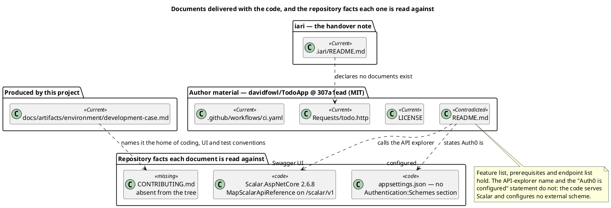

## Document Control
- Phase: Survey
- Status: Draft
- Milestone Target: end of Survey (SBC) — not yet achieved

## Perimeter

### Components
| Component | Kind | Responsibility | Implemented by |
|---|---|---|---|

### External actors and systems
| External actor or system | Reached through | Anchor |
|---|---|---|

### Entry points
| ID | Entry point | Kind | Initiated by | Anchor |
|---|---|---|---|---|

## Technology and Size
| Area | Language | Platform and frameworks, with version | Files | Anchor |
|---|---|---|---|---|

## Persistent Data
| Store | Kind | Data manager | Anchor |
|---|---|---|---|

## Documentation

The delivery carries no requirements, design or architecture document written by its authors: `.iari/README.md` states this and the tree agrees. What it does carry is the upstream sample's own README, a request file, a CI workflow and the MIT licence — documents of the code as it was published, not of the system as it is installed anywhere. Each was read against the code it describes.

| Document | Useful for | How up to date | Anchor |
|---|---|---|---|
| `.iari/README.md` | The perimeter of the delivery: provenance (copy of `davidfowl/TodoApp` at commit `307a1ead` of 2026-02-12, MIT); the explicit non-existence of database scripts, requirements/design/architecture documents, manuals, a running installation, production data and reachable authors. The constraint every other row is read under. | Current | `.iari/README.md` |
| `README.md` (upstream author's) | Author's statement of the feature set and of the technical mechanisms it showcases (Blazor WebAssembly, minimal APIs, EF Core + SQLite, OpenAPI, Identity, cookie and bearer authentication, YARP forwarder, rate limiting, integration tests); prerequisites (.NET 9, Aspire CLI); how the system is started (AppHost runs web-server and API); the REST calls needed to obtain a bearer token; the configuration schema for each external identity provider and for Auth0; OpenTelemetry via the Aspire dashboard. | Contradicted by the code | `README.md`; `Todo.Api/Program.cs`; `Directory.Packages.props`; `Todo.Api/appsettings.json`; `Todo.Web/Server/appsettings.json` |
| `LICENSE` | The terms the copy is held under and its origin: MIT, "Copyright (c) 2022 David Fowler". Together with `.iari/README.md` it is the whole provenance record of the delivery. | Current | `LICENSE` |
| `Requests/todo.http` | The author's minimal happy-path request sequence against a standalone API on `http://localhost:5000`: `POST /users/register`, `POST /users/login`, then authenticated `POST /todos`, `GET /todos`, `DELETE /todos/{id}`. A cross-check on the recovered `/users` and `/todos` entry points and on the bearer scheme. | Current | `Requests/todo.http`; `Todo.Api/Users/UsersApi.cs`; `Todo.Api/Todos/TodoApi.cs` |
| `.github/workflows/ci.yaml` | The only executable statement of how the solution is verified: `dotnet restore`, `dotnet build -c Release --no-restore`, `dotnet test -c Release --no-build` on `TodoApp.sln` under `ubuntu-latest`, on push and pull request. Shows that the integration-test project is part of the build's definition of green. | Current | `.github/workflows/ci.yaml`; `TodoApp.sln` |
| `docs/artifacts/environment/development-case.md` | The tailoring governing this project: sprint zero before Inception, the recovered-element anchoring rule, the one fired OPTIONAL (Deployment Model), the inactive disciplines and the roles at work in the sprint zero. | Current | `docs/artifacts/environment/development-case.md` |

## History
| Area | Commits read and period | What was removed or reworked | Reading | Commits |
|---|---|---|---|---|

## Anomalies
| ID | Anomaly | Kind | Evidence | Likelihood | Impact |
|---|---|---|---|---|---|

## Priorities
| Order | Area | Why it comes first | Anchor |
|---|---|---|---|

## Coverage
| Area | Files | Read | Unread and why |
|---|---|---|---|

## Traceability
| Element | Traces From | Link Type | Traces To |
|---|---|---|---|
