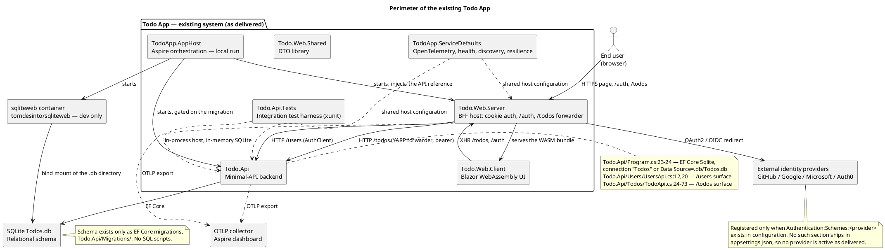
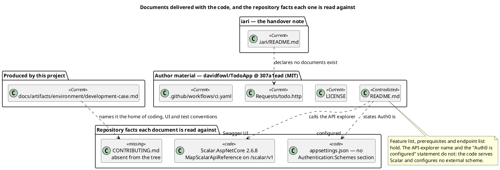

## Document Control
- Phase: Survey
- Status: Draft
- Milestone Target: end of Survey (SBC) — not yet achieved

## Perimeter
The boundary is drawn by the code, not by the README. Inside it sit seven projects of `TodoApp.sln` plus the CI workflow that builds them. The browser is outside and reaches the web server only; it never calls the API directly, because the web server proxies `/todos` through YARP and re-signs each request with the stored bearer token. Two facts bound what can be read from this perimeter: nothing is deployed anywhere (`.iari/README.md`), and no external identity provider is active as delivered — `AuthenticationExtensions` registers a provider only when `Authentication:Schemes:<provider>` exists in configuration, and no shipped `appsettings.json` carries that section, so the four provider schemes in the code are reachable in principle and inert in practice.

### Components

| Component | Kind | Responsibility | Implemented by |
|---|---|---|---|
| Todo.Web.Server | Subsystem | Browser-facing host (the BFF): serves the Blazor page, owns the authentication cookie, mints it against the API's bearer token, exposes `/auth`, and forwards every `/todos` request to the API with the bearer token attached. Also the only consumer of the external identity providers. | `Todo.Web/Server/Program.cs:6-58`; `Todo.Web/Server/TodoApi.cs:9-28` |
| Todo.Web.Client | Component | Blazor WebAssembly UI assembled into the browser: one page component that switches between a login form and the todo list, and an HTTP client that speaks to the web server only. | `Todo.Web/Client/TodoApp.razor:1-44`; `Todo.Web/Client/TodoClient.cs:7-71`; `Todo.Web/Client/Program.cs:5-13` |
| Todo.Web.Shared | Component | DTO library referenced by both the client and the server: `TodoItem`, `UserInfo`, `ExternalUserInfo`, `AuthToken`. | `Todo.Web/Shared/SharedClass.cs:3-37` |
| Todo.Api | Subsystem | The backend: minimal-API hosts the `/users` identity surface and the `/todos` CRUD surface, enforces bearer authentication, per-user rate limiting and parameter validation, serves the OpenAPI document and the Scalar UI. | `Todo.Api/Program.cs:5-68` |
| Todo.Api / Users | Component | ASP.NET Core Identity user store and bearer-token issue: the stock identity endpoints plus a custom `/users/token/{provider}` endpoint that creates or finds a user by external login. | `Todo.Api/Users/UsersApi.cs:10-64`; `Todo.Api/Users/TodoUser.cs:7-29` |
| Todo.Api / Todos | Component | Todo read, create, update and delete, scoped to the owning user; the `admin` role widens read, update and delete to any owner. | `Todo.Api/Todos/TodoApi.cs:8-77`; `Todo.Api/Todos/Todo.cs:1-40` |
| Todo.Api / Authorization | Component | Resolves the caller into a `CurrentUser` (claims transformation against the database) and supplies the authorization requirement that a valid token alone does not satisfy. | `Todo.Api/Authorization/CurrentUser.cs:6-15`; `Todo.Api/Authorization/CurrentUserExtensions.cs:8-35`; `Todo.Api/Authorization/CheckCurrentUserAuthHandler.cs:8-40` |
| Todo.Api / Persistence | Component | EF Core `DbContext` over ASP.NET Core Identity, the `Todo` entity with its owner foreign key, and the three migrations that define the schema. | `Todo.Api/TodoDbContext.cs:7-21`; `Todo.Api/Migrations/20221123071234_Initial.cs`; `Todo.Api/Migrations/20221123165051_RemoveIsAdmin.cs`; `Todo.Api/Migrations/20230714032431_ForeignKeyChange.cs` |
| Todo.Api / Cross-cutting | Component | Request-level mechanisms shared by the endpoints: per-user token-bucket rate limiting, parameter validation returning problem details, OpenAPI bearer-scheme metadata, HTTP logging. | `Todo.Api/Extensions/RateLimitExtensions.cs:11-71`; `Todo.Api/Filters/ValidationFilter.cs:7-58`; `Todo.Api/Extensions/OpenApiOptionsExtensions.cs:7-47` |
| TodoApp.AppHost | Subsystem | Aspire orchestration for local runs: creates the SQLite directory, runs `dotnet ef database update` before anything starts, launches the API, the web server (with the API service reference) and the sqliteweb container. | `TodoApp.AppHost/Program.cs:3-28`; `TodoApp.AppHost/Extensions.cs:3-38` |
| TodoApp.ServiceDefaults | Layer | Shared host configuration referenced by the API and the web server: OpenTelemetry traces, metrics and logs, the OTLP exporter, health checks, service discovery and the HTTP resilience handler. | `TodoApp.ServiceDefaults/Extensions.cs:16-41`; `TodoApp.ServiceDefaults/Extensions.cs:73-117` |
| Todo.Api.Tests | Component | Integration tests that boot the API in-process through `WebApplicationFactory`, replace SQLite with a shared in-memory connection, and drive the real endpoints with minted bearer tokens. | `Todo.Api.Tests/TodoApplication.cs:10-95`; `Todo.Api.Tests/TodoApiTests.cs:3-290`; `Todo.Api.Tests/UserApiTests.cs:6-170` |
| Build and verification | Component | The only executable definition of green: restore, build and test the whole solution on `ubuntu-latest` for every push and pull request. No SDK version is pinned in the workflow. | `.github/workflows/ci.yaml:1-21`; `TodoApp.sln:1-12` |

### External actors and systems

| External actor or system | Reached through | Anchor |
|---|---|---|
| End user in a browser | Remote call — HTTPS to `Todo.Web.Server` (`/`, `/auth/*`, `/todos/*`); never to the API directly | `Todo.Web/Server/App.razor:5`; `Todo.Web/Client/TodoClient.cs:8-71`; `Todo.Web/Server/Program.cs:20-37` |
| GitHub, Google, Microsoft, Auth0 — external identity providers | Remote call — OAuth2/OIDC authorization-code redirect, registered by scheme name and active only when `Authentication:Schemes:<provider>` is configured | `Todo.Web/Server/Authentication/AuthenticationExtensions.cs:40-52`; `Todo.Web/Server/AuthApi.cs:55-64` |
| OTLP collector — the Aspire dashboard locally, any endpoint named by `OTEL_EXPORTER_OTLP_ENDPOINT` | Messaging — OTLP export of logs, metrics and traces, enabled only when that setting is non-empty | `TodoApp.ServiceDefaults/Extensions.cs:73-90`; `Directory.Packages.props:37-41` |
| Container runtime (Docker/Podman) as driven by the Aspire AppHost | Service — the AppHost asks it to run the sqliteweb container | `TodoApp.AppHost/Program.cs:13-17` |
| `tomdesinto/sqliteweb` container image | File — bind mount of `Todo.Api/.db` as `/db`, opened as `Todos.db`; excluded from the published manifest | `TodoApp.AppHost/Program.cs:10-17` |
| `dotnet-ef` CLI delivered from NuGet, installed globally on the developer machine by the AppHost | Service — `dotnet tool install --global dotnet-ef`, then `dotnet ef database update --no-build` | `TodoApp.AppHost/Extensions.cs:17-33` |
| NuGet package feed (`https://api.nuget.org/v3/index.json`) | Service — restore time only; the single mapped source for all packages | `nuget.config:3-12`; `Directory.Packages.props:1-43` |

### Entry points

| ID | Entry point | Kind | Initiated by | Anchor |
|---|---|---|---|---|
| EP-001 | `POST /users/register` — create a user from email and password | Service operation | Anonymous client (API direct, or the web server's `AuthClient`) | `Todo.Api/Users/UsersApi.cs:12,20`; `Todo.Web/Server/AuthClient.cs:20-29` |
| EP-002 | `POST /users/login` — exchange credentials for a bearer token | Service operation | Anonymous client | `Todo.Api/Users/UsersApi.cs:12,20`; `Todo.Web/Server/AuthClient.cs:5-18` |
| EP-003 | `POST /users/refresh` — exchange a refresh token for a new access token | Service operation | Authenticated client | `Todo.Api/Users/UsersApi.cs:12,20` |
| EP-004 | `GET /users/confirmEmail` — confirm an email address from a code | Service operation | End user, following a link | `Todo.Api/Users/UsersApi.cs:12,20` |
| EP-005 | `POST /users/resendConfirmationEmail` — reissue the confirmation mail | Service operation | Anonymous client | `Todo.Api/Users/UsersApi.cs:12,20` |
| EP-006 | `POST /users/forgotPassword` — request a password-reset code | Service operation | Anonymous client | `Todo.Api/Users/UsersApi.cs:12,20` |
| EP-007 | `POST /users/resetPassword` — set a new password with a reset code | Service operation | Anonymous client | `Todo.Api/Users/UsersApi.cs:12,20` |
| EP-008 | `POST /users/manage/2fa` — enable or disable two-factor authentication | Service operation | Authenticated user | `Todo.Api/Users/UsersApi.cs:12,20` |
| EP-009 | `GET /users/manage/info` — read the caller's account information | Service operation | Authenticated user | `Todo.Api/Users/UsersApi.cs:12,20` |
| EP-010 | `POST /users/manage/info` — change the caller's email or password | Service operation | Authenticated user | `Todo.Api/Users/UsersApi.cs:12,20` |
| EP-011 | `POST /users/token/{provider}` — exchange an externally authenticated identity for a bearer token, creating the user on first use | Service operation | Web server BFF only (the provider key is data-protected with the provider name) | `Todo.Api/Users/UsersApi.cs:24-54`; `Todo.Web/Server/AuthClient.cs:31-42` |
| EP-012 | `GET /todos` — list the caller's todos | Service operation | Authenticated user, through the forwarder | `Todo.Api/Todos/TodoApi.cs:24-27` |
| EP-013 | `GET /todos/{id}` — read one todo; 404 unless the caller owns it or is `admin` | Service operation | Authenticated user, through the forwarder | `Todo.Api/Todos/TodoApi.cs:29-36` |
| EP-014 | `POST /todos` — create a todo owned by the caller | Service operation | Authenticated user, through the forwarder | `Todo.Api/Todos/TodoApi.cs:38-50` |
| EP-015 | `PUT /todos/{id}` — update title and completion of an owned todo | Service operation | Authenticated user, through the forwarder | `Todo.Api/Todos/TodoApi.cs:52-65` |
| EP-016 | `DELETE /todos/{id}` — delete an owned todo | Service operation | Authenticated user, through the forwarder | `Todo.Api/Todos/TodoApi.cs:67-73` |
| EP-017 | `POST /auth/register` — register through the UI and open a session | Service operation | Browser (Blazor client) | `Todo.Web/Server/AuthApi.cs:14-25`; `Todo.Web/Client/TodoClient.cs:55-63` |
| EP-018 | `POST /auth/login` — log in through the UI and open a session | Service operation | Browser (Blazor client) | `Todo.Web/Server/AuthApi.cs:27-38`; `Todo.Web/Client/TodoClient.cs:47-53` |
| EP-019 | `POST /auth/logout` — end the cookie session | Service operation | Browser (Blazor client) | `Todo.Web/Server/AuthApi.cs:40-52`; `Todo.Web/Client/TodoClient.cs:65-69` |
| EP-020 | `GET /auth/login/{provider}` — challenge the named external provider | Service operation | Browser, following the provider button rendered by the login form | `Todo.Web/Server/AuthApi.cs:55-62`; `Todo.Web/Client/Components/LogInForm.razor:34-40` |
| EP-021 | `GET /auth/signin/{provider}` — external-login callback: resolve or create the user, obtain a token, write the cookie | Service operation | External identity provider redirect | `Todo.Web/Server/AuthApi.cs:64-101` |
| EP-022 | `/todos/{*path}` — YARP forwarder for every verb, re-signed with the stored access token | Service operation | Browser (Blazor client) | `Todo.Web/Server/TodoApi.cs:14-26` |
| EP-023 | `/` — the application page: renders the login form or the todo list for the session | Screen | End user in a browser | `Todo.Web/Server/App.razor:5-25`; `Todo.Web/Client/TodoApp.razor:3-16` |
| EP-024 | `/scalar/v1`, with `/` redirecting to it — API reference and try-it-out console | Screen | Developer, development environment only | `Todo.Api/Program.cs:49-56,62`; `Todo.Api/Properties/launchSettings.json:10-24` |
| EP-025 | `/health` and `/alive` — readiness and liveness probes | Service operation | Aspire AppHost / orchestrator, development environment only | `TodoApp.ServiceDefaults/Extensions.cs:101-117`; `Todo.Api/Program.cs:60` |
| EP-026 | `dotnet ef database update` at AppHost start — creates or migrates `Todos.db` before the API serves a request | Platform event | TodoApp.AppHost, and only when `Todo.Api/.db` does not yet exist | `TodoApp.AppHost/Program.cs:3,19-25`; `TodoApp.AppHost/Extensions.cs:5-16` |

## Technology and Size
| Area | Language | Platform and frameworks, with version | Files | Anchor |
|---|---|---|---|---|

## Persistent Data
| Store | Kind | Data manager | Anchor |
|---|---|---|---|

## Documentation

The delivery carries no requirements, design or architecture document written by its authors: `.iari/README.md` states this and the tree agrees. What it does carry is the upstream sample's own README, a request file, a CI workflow and the MIT licence — documents of the code as it was published, not of the system as it is installed anywhere. Each was read against the code it describes.

| Document | Useful for | How up to date | Anchor |
|---|---|---|---|
| `.iari/README.md` | The perimeter of the delivery: provenance (copy of `davidfowl/TodoApp` at commit `307a1ead` of 2026-02-12, MIT); the explicit non-existence of database scripts, requirements/design/architecture documents, manuals, a running installation, production data and reachable authors. The constraint every other row is read under. | Current | `.iari/README.md` |
| `README.md` (upstream author's) | Author's statement of the feature set and of the technical mechanisms it showcases (Blazor WebAssembly, minimal APIs, EF Core + SQLite, OpenAPI, Identity, cookie and bearer authentication, YARP forwarder, rate limiting, integration tests); prerequisites (.NET 9, Aspire CLI); how the system is started (AppHost runs web-server and API); the REST calls needed to obtain a bearer token; the configuration schema for each external identity provider and for Auth0; OpenTelemetry via the Aspire dashboard. | Contradicted by the code | `README.md`; `Todo.Api/Program.cs`; `Directory.Packages.props`; `Todo.Api/appsettings.json`; `Todo.Web/Server/appsettings.json` |
| `LICENSE` | The terms the copy is held under and its origin: MIT, "Copyright (c) 2022 David Fowler". Together with `.iari/README.md` it is the whole provenance record of the delivery. | Current | `LICENSE` |
| `Requests/todo.http` | The author's minimal happy-path request sequence against a standalone API on `http://localhost:5000`: `POST /users/register`, `POST /users/login`, then authenticated `POST /todos`, `GET /todos`, `DELETE /todos/{id}`. A cross-check on the recovered `/users` and `/todos` entry points and on the bearer scheme. | Current | `Requests/todo.http`; `Todo.Api/Users/UsersApi.cs`; `Todo.Api/Todos/TodoApi.cs` |
| `.github/workflows/ci.yaml` | The only executable statement of how the solution is verified: `dotnet restore`, `dotnet build -c Release --no-restore`, `dotnet test -c Release --no-build` on `TodoApp.sln` under `ubuntu-latest`, on push and pull request. Shows that the integration-test project is part of the build's definition of green. | Current | `.github/workflows/ci.yaml`; `TodoApp.sln` |
| `docs/artifacts/environment/development-case.md` | The tailoring governing this project: sprint zero before Inception, the recovered-element anchoring rule, the one fired OPTIONAL (Deployment Model), the inactive disciplines and the roles at work in the sprint zero. | Current | `docs/artifacts/environment/development-case.md` |

## History
| Area | Commits read and period | What was removed or reworked | Reading | Commits |
|---|---|---|---|---|

## Anomalies
| ID | Anomaly | Kind | Evidence | Likelihood | Impact |
|---|---|---|---|---|---|

## Priorities
| Order | Area | Why it comes first | Anchor |
|---|---|---|---|

## Coverage
| Area | Files | Read | Unread and why |
|---|---|---|---|

## Traceability
| Element | Traces From | Link Type | Traces To |
|---|---|---|---|
