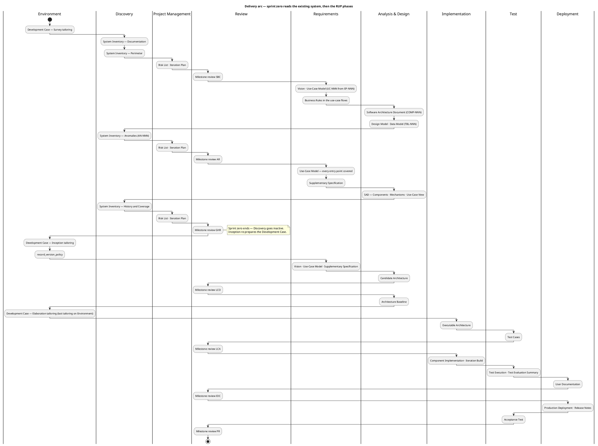
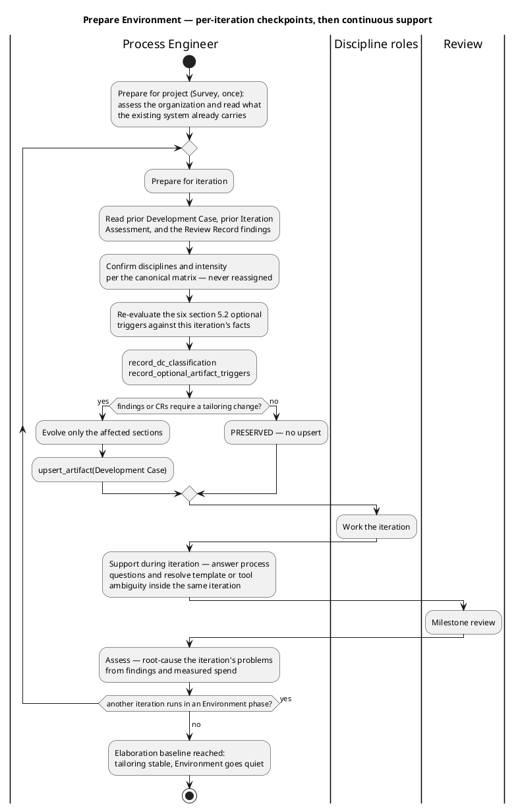

## Document Control

- Phase: Survey
- Status: Draft — issued for the end-of-Survey milestone review
- Milestone Target: end of Survey (SBC) — not yet achieved
- Owner: Process Engineer
- Date: 2026-11-19

## Tailoring Overview

This Development Case is an **override delta** over the IARI DC baseline. The 26-role roster, the 16 CORE artifacts, the 6 OPTIONAL artifacts, primary ownership and the intensity matrix are taken as given and are not repeated here. Only what this project does differently is recorded.

Four facts drive every tailoring decision below.

1. **The project is built on an existing system.** The repository is a copy of the public sample `davidfowl/TodoApp` (MIT), taken at commit `307a1ead` of 12 February 2026. Per `.iari/README.md`: nobody here wrote it, there are no database scripts (the schema exists only as EF Core migrations), no requirements/design/architecture documents, no manuals, no running installation, no production data and no users, and the original authors cannot be asked. Consequences: the sprint zero (Discovery — Survey, Excavation, Consolidation) runs before Inception and is the only source of truth about the system; recovered elements cite the anchor they were read from; and where neither the code nor its migration history speaks, the answer is unknown and is recorded as such rather than invented.
2. **The recovered stack is fixed and modern.** `.NET 9` (`global.json` SDK `9.0.100`, `rollForward latestFeature`, `allowPrerelease true`; `Directory.Build.props` `TargetFramework net9.0`, `LangVersion preview`), .NET Aspire AppHost orchestrating the services, a Blazor WebAssembly client hosted by a Blazor Server host, a minimal-API backend, EF Core on SQLite with ASP.NET Core Identity, a YARP HTTP forwarder between web host and API, rate limiting, OpenTelemetry, and xunit integration tests against the API through `Microsoft.AspNetCore.Mvc.Testing`. The existing system is not re-platformed by this project.
3. **The project is not business-process-led and not a real-time system.** The system is a personal todo list over a relational store behind an authenticated REST API: no organisational process crosses roles, no business rules beyond ownership and validation, no hard deadlines, no event-driven or reactive behaviour. Business Modeling is inactive; no capsule/protocol work is performed.
4. **One OPTIONAL artifact is triggered.** Deployment is genuinely multi-node (an Aspire-orchestrated API service, a web-server service and a SQLite viewer container, joined by service discovery and a reverse-proxy forwarder) and is non-trivial across environments. See section 5.

The delivery arc the plan follows — the sprint zero first, then the RUP phases:

### Decision record

| ID | Decision | Basis |
|---|---|---|
| DC-D1 | Discovery runs as the sprint zero (Survey, Excavation, Consolidation) before Inception. The System Inventory is the artifact everything in the sprint zero hangs from, and it is the only artifact outside the CORE + OPTIONAL universe. | Fact 1. No document describes the system; the code and its history are the only witnesses. |
| DC-D2 | Business Modeling is **inactive**, including its milestone-review participant. `business-process-led = false`. | Fact 3. |
| DC-D3 | No capsule, protocol or signal modelling. `real-time-system = false`. | Fact 3. |
| DC-D4 | Recovered elements are anchored, not guessed. A recovered use case cites the entry point that performs it (`Source: EP-NNN`); a recovered element that is neither declared nor read from code is not created. Where the perimeter ends and the code is silent, the System Inventory records the gap as an open question against the Archaeologist. | Fact 1 — the authors cannot be asked. |
| DC-D5 | `Deployment Model` is triggered; the other five OPTIONAL artifacts are not. | Section 5. |
| DC-D6 | The version policy is recorded from the repository's own pins (framework, SDK and the centrally managed package versions) — no version is invented and nothing is upgraded as part of this project. | Fact 2, `global.json`, `Directory.Build.props`, `Directory.Packages.props`. |
| DC-D7 | Artifacts are evolved in place, never regenerated: a role reads its own artifact and the sections it depends on, and upserts section-scoped. | Cost of re-reading the artifact surface, not size of the code, dominates agent spend in this process. |

## Disciplines and Intensity

Every active discipline runs at the intensity the canonical matrix assigns in each phase. **No deviation is proposed and none is self-granted.**

- **Inactive: Business Modeling.** `business-process-led = false` (Fact 3). The Business Process Analyst does not work; the Business Reviewer is not convened at the LCO and LCA milestone reviews; its artifact contribution (Glossary, Use-Case Model) is not produced by that role.
- **Inactive: capsule work.** `real-time-system = false`, so no Capsule Designer activity in any phase and no capsule/protocol/signal content in the Design Model.
- **Discovery** is active in the sprint zero only (Survey, Excavation, Consolidation — Critical, per the matrix). It is inactive from Inception onwards: once the system has been read, the recovered artifacts carry it forward.
- **Environment** runs in Survey, Inception and Elaboration. After the Elaboration architecture baseline the tailoring is stable and Environment stops being scheduled — a later re-tailoring happens only if a Change Request expands scope.
- **Requirements, Analysis & Design, Implementation, Test, Deployment, Configuration & Change Management, Project Management** are active in every phase at the matrix intensity.

## Artifacts and Templates

Scope per discipline. "CORE" means the artifact named in the baseline catalog, produced as the baseline requires; the entries below record only what this project adds, narrows or omits.

| Discipline | Sprint zero | RUP phases | Tailoring note |
|---|---|---|---|
| Discovery | System Inventory — documentation, perimeter, anomalies, history and coverage | — | The sprint zero's single artifact. Mints `EP-NNN` and `AN-NNN`; every recovered use case and recovered risk traces back to one of them. |
| Requirements | — | Vision, Use-Case Model, Supplementary Specification (CORE) | Excavation recovers use cases from entry points; Consolidation completes coverage so that every entry point of the perimeter has a use case or an explicit recorded exclusion. Requirements in Inception onwards evolve the recovered set; this project has no declared scope to add that the code does not already perform. |
| Analysis & Design | — | Software Architecture Document, Design Model (CORE); **Deployment Model (triggered)** | The persistent schema is recovered **into the Design Model** by the Database Designer's persistent-data stages — the Data Model is not produced (section 5). Analysis classes and design classes describe the recovered structure; they do not redesign it. |
| Implementation | — | Implementation Model (in the SCM) | No Implementation Model is authored in the sprint zero: the existing code is cited by path from the System Inventory. The Implementation Model enters at Inception with the Integrator's build-environment work and describes the integrated result from Elaboration on. |
| Test | — | Test Case, Test Evaluation Summary (CORE) | No Test Plan (section 5); the Iteration Plan carries per-iteration test scope. The existing `Todo.Api.Tests` integration suite is recovered as part of the system's behaviour at Excavation; no test case is authored before Elaboration. |
| Deployment | — | Release Notes, User Documentation (CORE); **Deployment Model (triggered)** | The Deployment Model is the artifact this project leans on: the recovery must explain the AppHost topology, service discovery and the forwarder, and the target environment is defined against it. |
| Configuration & Change Management | — | Change Request (CORE) | No ledger entry is opened in the sprint zero; the Change Control Manager does not work there, and a stakeholder's order reaches its owner through the Work Order. |
| Project Management | Iteration Plan, Risk List, Iteration Assessment | same (CORE) | The Risk List is the earliest place the sprint zero's unknowns are scored — in particular what the perimeter could not establish. |
| Environment | Development Case | Development Case | This document. Re-prepared at each iteration of Survey, Inception and Elaboration; preserved otherwise. |

**Templates.** Each artifact is written to the canonical section skeleton published with its name by the artifact service — that skeleton is the template, and no project-specific section is added to it. Artifact *content* guidance (coding standards, UI patterns, test conventions) is not duplicated in this document; it lives in the files owned by the discipline leads:

| Guideline content | File | Owner |
|---|---|---|
| Coding standards, design conventions, architectural rules | `CONTRIBUTING.md` | Software Architect |
| UI patterns and component conventions | `CONTRIBUTING.md` | User Interface Designer |
| Test conventions and coverage expectations | `CONTRIBUTING.md` | Test Designer |
| Build, restore, test and CI execution | `.github/workflows/ci.yaml` | Integrator |
| SDK pin, target framework, language and nullable settings | `global.json`, `Directory.Build.props` | Integrator |
| Centrally managed package versions and package sources | `Directory.Packages.props`, `nuget.config` | Software Architect (versions), Integrator (feeds) |

## Optional Artifact Triggers

Evaluated against this project's facts. Re-evaluated at every iteration; the recorded set is replaced, never appended to.

| OPTIONAL artifact | Verdict | Basis |
|---|---|---|
| Glossary | NOT TRIGGERED | The vocabulary is ordinary product English — user, todo, title, complete — plus technology names (.NET, Aspire, EF Core, YARP) that the platform documentation defines. No specialist, regulated, legal, medical or financial term needs a stakeholder-validated definition. |
| Architectural Proof-of-Concept | NOT TRIGGERED | The trigger requires the Elaboration phase and a technical risk needing empirical validation. Neither holds now: the phase is Survey and no Risk List exists yet. Re-evaluated at Elaboration against the scored technical risks. |
| Data Model | NOT TRIGGERED | Not >10 entities: `TodoDbContextModelSnapshot` yields 8 — `Todo`, `TodoUser`, `IdentityRole`, `IdentityRoleClaim`, `IdentityUserClaim`, `IdentityUserLogin`, `IdentityUserRole`, `IdentityUserToken`. Not data-centric: the system is a two-aggregate CRUD application over SQLite, not a warehouse or analytical store. No data migration in scope: the three EF Core migrations are schema evolution in code and `.iari/README.md` records that there is no production data to migrate. The relational schema, its keys, indexes and cascade rules are recovered **inline in the Design Model** by the Database Designer's persistent-data stages. |
| Deployment Model | **TRIGGERED** | Distributed / multi-node topology: `TodoApp.AppHost/Program.cs` orchestrates a `todoapi` service, a `todo-web-server` service and a `sqliteweb` container, wired through Aspire service discovery, with the container explicitly excluded from the manifest and the API gated on a migration operation; the Blazor client reaches the API through a YARP forwarder rather than a direct route. Non-trivial across environments: each project carries its own `appsettings.json` and `appsettings.Development.json`, and `Todo.Api.csproj` declares a container image name and tag. |
| User-Interface Prototype | NOT TRIGGERED | UI complexity is low and the UI already exists in code (`TodoList.razor`, `LogInForm.razor` over Bootstrap). There is no UX-critical interaction and nothing for a stakeholder to validate before implementation — the UI is recovered, not designed. |
| Test Plan | NOT TRIGGERED | No formal delivery, regulatory audit or contractual test reporting applies. Per-iteration test scope is defined by the Iteration Plan, and the Test Evaluation Summary reports the outcome. |

## Roles and Ownership

Roster, primary artifact ownership and the ownership rule are per the IARI DC baseline and are **not restated or modified** here. Recorded below: which roles the project's trigger decisions silence, which roles are at work in the sprint zero, and who owns each referenced tool configuration.

| Delta | Roles affected | Effect |
|---|---|---|
| `business-process-led = false` | Business Process Analyst, Business Reviewer | Not active in any phase. Responsibilities are not redistributed: no business-modeling artifact is produced, so none needs an owner. The LCO and LCA milestone reviews convene without the Business Reviewer. |
| `real-time-system = false` | Capsule Designer | No capsule, protocol or signal work in any phase. |
| Sprint zero scope | Software Archaeologist (all stages), Process Engineer, Project Manager, System Analyst, Software Architect, Designer, Database Designer, Reviewer, Management Reviewer, Review Coordinator | These are the roles at work before Inception. Implementation, Test, Deployment and Change Control have no sprint-zero stage. |

```plantuml
@startuml
title Sprint zero and RUP — who produces what, and the tool configuration each owner is referenced by
hide empty members

package "Environment" {
  class "Development Case" as DC <<artifact>>
  class "ProcessEngineer" as PE <<role>>
}
package "Discovery" {
  class "System Inventory" as SI <<artifact>>
  class "SoftwareArchaeologist" as SA <<role>>
}
package "Requirements" {
  class "Vision" as VIS <<artifact>>
  class "Use-Case Model" as UCM <<artifact>>
  class "Supplementary Specification" as SS <<artifact>>
  class "SystemAnalyst" as SysA <<role>>
  class "RequirementsSpecifier" as RS <<role>>
}
package "Analysis & Design" {
  class "Software Architecture Document" as SAD <<artifact>>
  class "Design Model" as DM <<artifact>>
  class "Deployment Model" as DEP <<artifact>>
  class "SoftwareArchitect" as Arch <<role>>
  class "Designer" as Des <<role>>
  class "DatabaseDesigner" as DbD <<role>>
  class "UserInterfaceDesigner" as UID <<role>>
}
package "Implementation" {
  class "Implementation Model" as IM <<artifact>>
  class "Integrator" as Int <<role>>
  class "Implementer" as Imp <<role>>
  class "CodeReviewer" as CR <<role>>
}
package "Test" {
  class "Test Case" as TC <<artifact>>
  class "Test Evaluation Summary" as TES <<artifact>>
  class "TestDesigner" as TD <<role>>
  class "Tester" as Tst <<role>>
  class "TestManager" as TM <<role>>
}
package "Project Management" {
  class "Iteration Plan" as IP <<artifact>>
  class "Risk List" as RL <<artifact>>
  class "Iteration Assessment" as IASS <<artifact>>
  class "ProjectManager" as PM <<role>>
}
package "Configuration & Change Management" {
  class "Change Request" as CRQ <<artifact>>
  class "ChangeControlManager" as CCM <<role>>
  class "ConfigurationManager" as CM <<role>>
}
package "Review" {
  class "Review Record" as RR <<artifact>>
  class "Reviewer" as Rev <<role>>
  class "ManagementReviewer" as MR <<role>>
  class "ReviewCoordinator" as RC <<role>>
}
package "Referenced tool configuration — path and owner" {
  class ".github/workflows/ci.yaml" as CI <<reference>>
  class "global.json · Directory.Build.props · Directory.Packages.props · nuget.config" as BUILD <<reference>>
  class "CONTRIBUTING.md" as CONTRIB <<reference>>
}

SA ..> SI : produces
SysA ..> VIS : produces
SysA ..> UCM : produces
RS ..> UCM : detail
RS ..> SS : produces
Arch ..> SAD : produces
Arch ..> DEP : produces
Des ..> DM : produces
DbD ..> DM : persistent data
UID ..> DM : boundaries
Imp ..> IM : produces
Int ..> IM : produces
CR ..> RR : findings
TD ..> TC : produces
Tst ..> TC : executes
TM ..> TES : produces
PM ..> IP : produces
PM ..> RL : produces
PM ..> IASS : produces
CCM ..> CRQ : produces
Rev ..> RR : findings
MR ..> RR : findings
RC ..> RR : findings

Int ..> CI : reference owner
Int ..> BUILD : reference owner
Arch ..> CONTRIB : reference owner
Des ..> CONTRIB : contributes
TD ..> CONTRIB : contributes

note bottom of DEP
  The one FIRED optional: multi-node topology.
  AppHost runs todoapi + todo-web-server +
  a sqliteweb container; service discovery and
  a YARP forwarder sit between client and API.
end note

note bottom of SI
  Sprint zero artifact. EP-NNN and AN-NNN are
  minted here; recovered UCs cite EP-NNN and
  recovered risks cite AN-NNN.
end note
@enduml
```

**Co-owned artifacts.** The Design Model is written by three roles: the Designer owns classes, packages and use-case realizations; the Database Designer owns the persistent-data sections; the User Interface Designer owns boundary classes and the navigation map. Each upserts **its own section only** and never the whole document. The Software Architecture Document is owned solely by the Software Architect.

## Guidelines and Procedures

### Measurement policy

Two quantities are measured in this process, and only two. This project states what it does with them:

| Measured | Decision it drives | Who reads it |
|---|---|---|
| Tokens consumed, per iteration and per role | Whether the next iteration **evolves or preserves** an artifact, and whether the surface a role must re-read is trimmed. A role whose spend is dominated by re-reading artifacts it did not change is producing no delta. | Process Engineer (tailoring decisions), Project Manager (Iteration Plan) |
| Elapsed time, split into agent time and time waiting for a human | Whether a discipline is starved inside its phase and whether a milestone is blocked on a stakeholder decision rather than on work. | Process Engineer, Project Manager, Review Coordinator |

The two clocks are never added. No token budget is declared for this project: no role sets one, measured spend is recorded as observed, and no velocity or per-iteration forecast is quoted. A human gate is carried as a risk, bounded at a ceiling of 14 days before the process suspends — it is never forecast in a plan.

### Process preparation and support

- A process question is answered inside the iteration that raises it. A question that blocks work is escalated in the turn it is identified — to the Process Engineer when the process is ambiguous, and to the stakeholder via a required-input escalation when the answer is a scope or risk decision that no role may take.
- A tailoring change is made only when a finding or a Change Request demands it. Otherwise the Development Case is preserved and not re-upserted.

### Use-case enumeration for a recovered system

Enumeration follows the baseline rule and is not redefined here. Applied to this project: one use case per entry point recorded in the System Inventory (`EP-NNN`), with multi-actor interaction on the same process kept as one use case carrying several scenarios. Authentication, registration, token refresh, rate limiting, proxying and telemetry are cross-cutting mechanisms — they are Supplementary Specification constraints, never use cases, and each use case that depends on them includes them.

### Environment constraints

- The development container must provide an SDK that satisfies `global.json` (`9.0.100`, `rollForward latestFeature`, prerelease allowed) and must build `net9.0`. An image below that floor cannot restore or build the solution.
- The `.NET Aspire` workload and CLI are prerequisites of running the system locally (`README.md`); a build-environment check that ignores this verifies less than the solution needs.
- `LangVersion` is `preview` and `Nullable` is enabled solution-wide through `Directory.Build.props`. Code that builds outside those settings is not representative of the build.
- Package versions are centrally managed: a project file declares a package without a version, and adding one locally defeats `Directory.Packages.props`. Restore uses `nuget.org` only, per the package-source mapping in `nuget.config`.
- The version policy recorded for this project is authoritative over the registry's latest: no package and no framework is upgraded as a side effect of any task.
