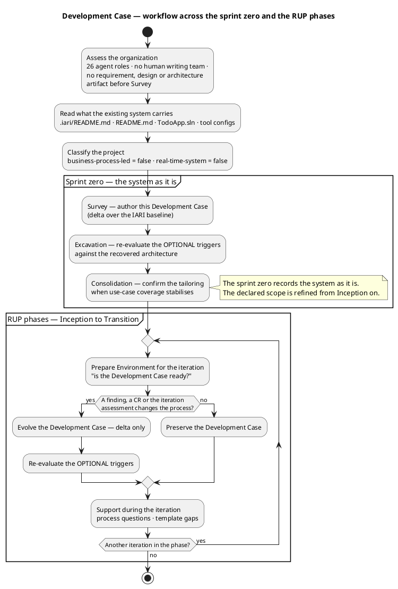
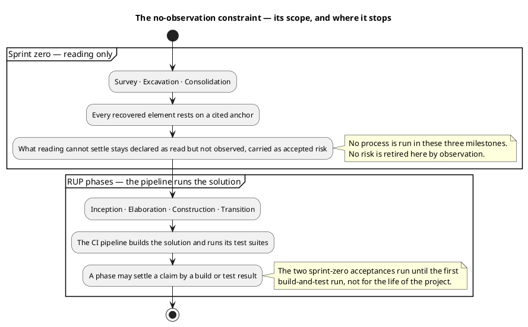

## Document Control
Phase: Survey
Status: Revised — governs the Survey milestone of the sprint zero
Milestone Target: End-of-Survey (SBC) — not yet achieved
## Tailoring Overview
This is a **delta document**. It records only what this project does differently from the IARI Development Case baseline. The role roster, the artifact catalogue and the intensity matrix are the baseline's and are not restated here.

The project is a delivered, working system — the public sample `davidfowl/TodoApp` (MIT), taken at commit `307a1ead` of 12 February 2026 — onto which the stakeholder's declared scope is applied. That fact drives every tailoring decision below: the sprint zero reads what exists before RUP starts, and the process must be light enough that recovering a system already in the repository costs less than rewriting it.

### Organization baseline (Survey assessment, 2026-11-14)

| Finding | Consequence for this tailoring |
|---|---|
| 26 agent roles are available; there is no human writing team, only human gates | Roles execute rather than coordinate; no ceremony whose value is human communication is retained |
| The existing system carries a CI workflow, central package management and a test project | These are tool references, not work items — each is owned by its role and cited by path |
| No running installation, no production data, no users (`Source: .iari/README.md`) | No migration, no backward-compatibility obligation, no deployment history to preserve |
| The sprint zero is read-only — no process is run in Survey, Excavation or Consolidation, by the stakeholder's decision of 2026-11-14 | In those three milestones no risk is retired, no claim verified and no pin confirmed by observation. Every recovered element rests on reading, and what reading cannot settle stays declared as read but not observed, carried as accepted risk until the RUP phases start |
| The repository's pipeline builds the solution and runs its test suites once the RUP phases start | From Inception on, a build or test result is available evidence: a phase may settle a claim by one and a risk may be retired by one. The sprint-zero read-only property stops at Consolidation |
| The authors cannot be consulted (`Source: .iari/README.md`) | Every recovered element cites the file and lines it was read from; nothing is attributed to intent |

### Classification

| DC baseline trigger | Verdict | Basis |
|---|---|---|
| §4 business-process-led | false | The system is a single-user task list behind an identity boundary. No business process is modelled, no organisational workflow is enacted, no business rules exist beyond per-owner access. `Todos` carries `Title`, `IsComplete`, `OwnerId` — nothing that encodes a policy. |
| §10 real-time-system | false | Request/response only. No hard deadline, no concurrent event-driven or reactive behaviour. Rate limiting and OpenTelemetry are mechanisms, not timing guarantees. |

## Disciplines and Intensity
All active disciplines run at the **canonical matrix intensities** — no deviation is claimed and none is required. Deltas:

- **Business Modeling — INACTIVE for the whole project.** `business-process-led = false` (§4). No business use case model, business object model or business rules artifact is produced; the Business Process Analyst and the Business Reviewer do not work. Business rules that the code enforces are recovered as use-case preconditions by the System Analyst in Excavation — that is a Requirements and Analysis & Design activity, not a Business Modeling one.
- **Discovery — ACTIVE, sprint zero only** (Survey Critical, Excavation High, Consolidation Low). It concludes before Inception; nothing after Consolidation reads the System Inventory as a live artifact.
- **Environment — Survey High, Inception High, Elaboration Medium.** Per the baseline, the tailoring is stable after the Elaboration baseline. No Environment work is planned in Construction or Transition; a process question raised there is answered here as support, without an iteration-level DC revision unless a finding or CR requires one.

**The read-only property is the sprint zero's, and it stops at Consolidation.** In Survey, Excavation and Consolidation no process is run: no stage there validates anything by executing the system and no risk is retired by observation, so what reading cannot settle stays declared as read but not observed and carried as accepted risk. That moves no intensity level, because the levels are the matrix's and the reading-based activities they cover are the work — Analysis & Design stays Critical in Excavation on recovered reading.

**From Inception on the pipeline runs the solution.** The repository's CI pipeline builds it and executes its test suites, so from Inception a stage may settle a claim by a build or test result and a risk may be retired by one. Test intensity is the matrix's on that basis. The sprint-zero read-only property is not carried past Consolidation, and no artifact of this tailoring states it over the RUP phases.

## Artifacts and Templates

The CORE catalogue is the baseline's. This section records only the project's conventions and the sprint-zero artifact's role.

| Artifact | Project convention |
|---|---|
| System Inventory | The one artifact of the sprint zero. Reads the perimeter (projects, endpoints, tables, dependencies), the anomalies and their priorities, and the coverage of the reading. Everything recovered later cites it. |
| Use-Case Model | Enumerated in Excavation **one use case per endpoint surface that performs a distinct user-observable outcome**, read from `Todo.Api/Program.cs` (`MapTodos()`, `MapUsers()`) and the web client. Multi-actor on the same declared process is one use case with several scenarios. Authentication, identity, rate limiting, logging and telemetry are **not** use cases — they are Supplementary Specification entries included by the use cases that depend on them. |
| Supplementary Specification | Recovers the constraints the code already enforces: SQLite single-file persistence, bearer and cookie authentication, ASP.NET Core Identity user management, rate limiting, OpenTelemetry, and the absence of any migration path that is not an EF Core migration in `Todo.Api`. |
| Design Model | Carries the persistent-data design as **sections of this artifact**, not a separate Data Model (see Optional Artifact Triggers). Class and package structure is read from the solution projects; the design does not re-invent a layering the code does not have. |
| Software Architecture Document | Records the recovered architecture with its mechanisms. Deployment is a section of this document, plus the Deployment Model below. |
| Implementation Model | Lives in the SCM — read by the Software Archaeologist, never upserted. |
| Iteration Plan / Iteration Assessment | The plan instantiates the process this case tailors; it never schedules work the phase does not run. |
| Everything else | The baseline template, unmodified. |

## Optional Artifact Triggers
Every verdict below is an auditable claim against the §5.2 condition. Re-evaluated each iteration; the recorded set is authoritative.

| Optional artifact | Verdict | Condition and evidence |
|---|---|---|
| Data Model | **NOT FIRED** | The condition needs a data-centric system, more than 10 entities, or data migration in scope. Eight tables exist (`Source: Todo.Api/Migrations/TodoDbContextModelSnapshot.cs`) — `Todos` and `AspNetUsers` plus six ASP.NET Core Identity tables generated from the framework, which carry no project design decision. No migration is in scope: no production data and no users exist (`Source: .iari/README.md`). The persistent-data design belongs in the Design Model. |
| Deployment Model | **FIRED** | Multi-process topology: `Todo.Api`, `Todo.Web.Server` (BFF), `Todo.Web.Client` (Blazor WASM in the browser) and `TodoApp.AppHost`, with YARP request forwarding and service discovery between them (`Source: TodoApp.sln`, `README.md`). That is a distributed topology, not a single-node deployment summarised in a SAD section. Owner: Software Architect. |
| Architectural Proof-of-Concept | **NOT FIRED in the sprint zero; re-evaluated in Elaboration** | The condition is Elaboration phase *and* a scored technical risk needing empirical validation. In the sprint zero it cannot fire: no risk is scored yet (`Risk List` is produced in the same iteration by the Project Manager, after this artifact) and no process is run there to validate anything against. In Elaboration the condition is evaluated on its own terms — the CI pipeline builds the solution and runs its test suites, so a candidate whose validation is a build or a test run fires it. A candidate no available evidence can settle does not fire it, and where one fires, the mechanism of validation is stated in the trigger itself, not assumed. |
| User-Interface Prototype | **NOT FIRED** | Requires UX-critical design or UI complexity needing stakeholder validation before implementation. A working Blazor UI already exists in `Todo.Web` — it is the baseline, and no new UI is declared this cycle. Should the declared scope add or redesign a screen, re-evaluate. |
| Test Plan | **NOT FIRED** | Requires formal delivery, regulatory audit or contractual test reporting. None applies: the delivery is MIT-licensed sample code with no audit obligation. Per-iteration test scope is defined in the Iteration Plan. |
| Glossary | **NOT FIRED** | Requires specialist domain vocabulary needing stakeholder-validated definitions. The domain vocabulary is `Todo`, `IsComplete`, `Owner` — common words whose meaning is fixed by the recovered schema. |

Deployment Model is the only fired optional. It is also the one whose trigger does not depend on observation: the topology is read from the solution file and the forwarder configuration.
## Roles and Ownership
Primary ownership is the baseline's and is unchanged. The diagram shows which role works on which artifact in which stage of the sprint zero; that is a work assignment, not an ownership relation, and the authoritative statement of ownership is the sentence above plus the contributor bullets below.

```plantuml
@startuml
title Roles at work in the sprint zero, by the stage each works in
skinparam shadowing false
skinparam componentStyle rectangle

package "Survey" {
  component "Process Engineer" as PE
  component "Software Archaeologist" as ARCHY
  component "Project Manager" as PM
  component "Reviewer\nManagement Reviewer\nReview Coordinator" as REV
}

package "Excavation and Consolidation" {
  component "Software Architect" as SWA
  component "Designer" as DES
  component "Database Designer" as DBD
  component "System Analyst" as SYSA
}

package "Stood down by this tailoring" #LightGray {
  component "Business Process Analyst" as BPA
  component "Business Reviewer" as BREV
  component "Capsule Designer" as CAP
}

package "Artifacts carrying the sprint zero" {
  artifact "Development Case" as DC
  artifact "System Inventory" as SI
  artifact "Risk List" as RL
  artifact "Iteration Plan" as IP
  artifact "Software Architecture Document" as SAD
  artifact "Deployment Model" as DEPM
  artifact "Design Model" as DM
  artifact "Use-Case Model" as UCM
  artifact "Supplementary Specification" as SS
  artifact "Vision" as VIS
}

PE ..> DC : works on, Survey
ARCHY ..> SI : works on, Survey
PM ..> RL : works on, Survey
PM ..> IP : works on, Survey
SWA ..> SAD : works on, Excavation
SWA ..> DEPM : works on, Excavation
DES ..> DM : works on, Excavation
DBD ..> DM : contributes persistent-data sections
SYSA ..> UCM : works on, Excavation
SYSA ..> SS : works on, Excavation
SYSA ..> VIS : works on, Excavation

note right of BPA
  business-process-led = false.
  Business Modeling is inactive: no
  business use case model, no business
  object model, no business rules beyond
  those the code enforces.
end note
note right of BREV
  Reads the same classification: the gate
  loses one lens, Reviewer and Management
  Reviewer remain.
end note
note right of CAP
  real-time-system = false: request/response
  only, no hard deadline and no concurrent
  event-driven behaviour.
end note
note bottom of DBD
  Data Model NOT FIRED. The persistent data is
  recovered into the Design Model as sections of
  a co-owned artifact; only their author edits them.
end note
note top of DC
  The arrows are work assignments by stage, not
  ownership. Ownership is the baseline's and is
  stated in the text below.
end note
@enduml
```

- **Stood down:** Business Process Analyst and Business Reviewer (§4 business-process-led = false), Capsule Designer (§10 real-time-system = false). No gate summons them; the LCO and LCA review sequences lose one lens and Reviewer, Management Reviewer and Review Coordinator remain.
- **Project-specific contributors:** the Database Designer contributes the persistent-data sections of the Design Model in Excavation, Consolidation and later phases (Data Model not fired). The contribution is a section of a co-owned artifact and only its author edits it. This is the project's only contributor assignment beyond the baseline's.
- **Recovery ownership:** every element recovered from the code cites `Source: <path>` (and lines) where a declared element cites its `FR-NNN`/`NFR-NNN`. Recovered elements carry no upstream arrow; the anchor is their source.

## Guidelines and Procedures
Configuration content lives in the files that hold it, owned by the roles that author them — never restated here.

| Configuration | Path | Owner from here on |
|---|---|---|
| Continuous integration pipeline | `.github/workflows/ci.yaml` | Integrator |
| Runtime and package pins (central package management) | `Directory.Packages.props`, `global.json` | Software Architect |
| Compiler-enforced conventions (`net9.0`, `Nullable enable`, `ImplicitUsings enable`, `LangVersion preview`) | `Directory.Build.props` | Software Architect |
| Integration-test conventions (xunit, `Microsoft.AspNetCore.Mvc.Testing`, `coverlet`) | `Todo.Api.Tests`, `Directory.Packages.props` | Test Designer |
| Environment bootstrap and external-provider secrets | `README.md` | Integrator |

### Version policy

**The baseline is the policy.** The delivered tree already fixes the versions this project builds against: `net9.0` and `LangVersion preview` in `Directory.Build.props`, and 30 centrally-managed package pins in `Directory.Packages.props` (`Source: Directory.Packages.props`, re-counted). Those values are the project's version policy and every role treats them as authoritative over any registry `latest`. No stakeholder-declared framework target, pin or LTS-only rule stands outside them, and none is invented in their place.

Raising a framework, language or package version is a baseline change: it alters `Directory.Packages.props` or `Directory.Build.props`, is owned by the Software Architect, and enters as a Change Request — never as an unrecorded edit inside another role's turn. A version a role needs and the baseline does not pin is put to the Software Architect, who supplies the value the pin takes.

**No written coding standard exists in this repository, and none is assumed.** The conventions that bind an Implementer and a Code Reviewer are the compiler-enforced ones in `Directory.Build.props` and the central pins in `Directory.Packages.props`; a Code Reviewer reviews against those plus the Software Architecture Document's mechanisms, and against no style guide. A written standard, if the project wants one, is authored by the Software Architect under a Change Request and this table gains its path at that point. R006 records the absence.

### Measurement policy

The baseline measures two quantities and this project takes no third: tokens consumed, and elapsed time split into agent time and time waiting for a human. What follows is what each one is read *for* here — a metric with no decision behind it is not tracked.

| Quantity | Decision it enables | Who reads it |
|---|---|---|
| Tokens consumed per iteration | Whether the next iteration's artifact surface is read as widely as the last. Corrective iterations re-read artifacts they already hold; when spend rises while a milestone does not pass, the surface read is the lever — narrow which artifacts an iteration opens, never narrow declared scope | Process Engineer, at the iteration checkpoint |
| Elapsed agent time per iteration | How the iteration's own work is sequenced, not how long the project takes. A stage that dominates agent time is split or its input prepared earlier | Process Engineer and Project Manager |
| Human queue time — each stakeholder gate | Whether a gate is about to breach R026's 14-day ceiling. At the ceiling the process suspends and nothing is auto-filled; the answer is escalated, never inferred | Project Manager; the Review Coordinator when booking a gate |

Three rules bind these. **The two clocks are never added** — agent time and queue time answer different questions, and a total answers neither. **No figure is quoted as a velocity**: per-iteration figures are not recorded, and a forecast exists only from the measured actuals of a closed phase. **No budget is assumed**: the project declares none, so no role cuts, defers or re-scopes work to fit an estimate.

A phase whose spend keeps rising without its milestone passing is a schedule slip and is reported as one. Nothing in this policy authorises narrowing the declared scope to meet a figure.

