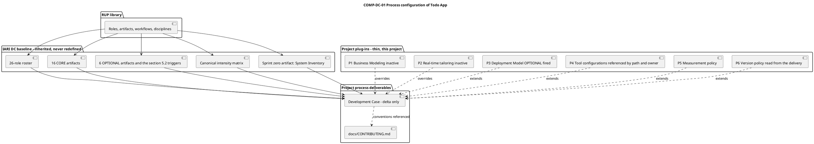
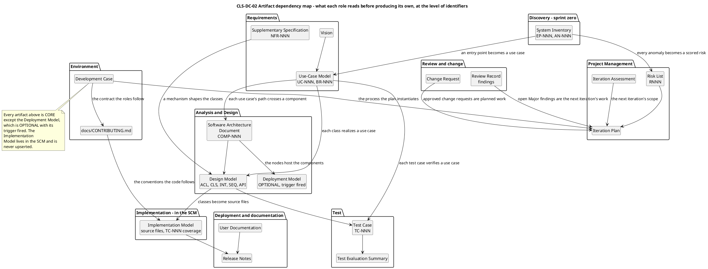
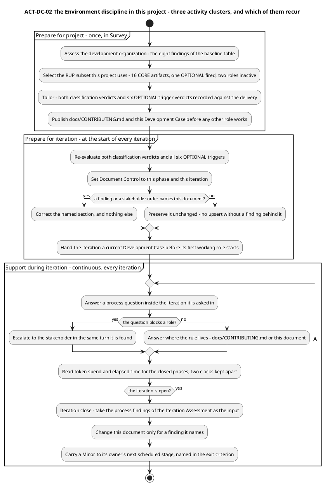

## Document Control
- Phase: Consolidation
- Status: Draft — made current for the end-of-Consolidation (GHR) milestone review
- Milestone Target: end-of-Consolidation (GHR) — not yet achieved
- Iteration: 1, Cycle 1
- Owner: Process Engineer
- Baseline: IARI DC baseline (26-role roster, 16 CORE artifacts, 6 OPTIONAL artifacts, canonical intensity matrix). This document carries **deltas only**; anything it does not state follows the baseline unchanged.
- Recorded decisions: business-process-led = false, real-time-system = false, OPTIONAL triggers fired = Deployment Model, version pin = framework `.NET` 9.0.100
## Tailoring Overview
This project is built on an existing system: a copy of the public sample `davidfowl/TodoApp` (MIT licence, commit `307a1ead`, 12 February 2026). The delivery therefore runs a **sprint zero** that reads the system as it stands — Survey, Excavation, Consolidation — before the RUP phases, and only from Inception is the declared change worked. Nothing declared is worked in the sprint zero; what the sprint zero produces is the recovered system, and its elements cite the anchor they were read from.

### Organization baseline

| Finding | Evidence in the delivery |
|---|---|
| Runtime platform is fixed by the code in hand | `global.json` (SDK 9.0.100, `rollForward: latestFeature`, `allowPrerelease`), `Directory.Build.props` (`net9.0`, nullable, implicit usings, `LangVersion: preview`), `Directory.Packages.props` (central package management) |
| Architecture is a four-process system | `Todo.Web/Client` (Blazor WebAssembly), `Todo.Web/Server` (host + YARP `IHttpForwarder` proxy), `Todo.Api` (minimal APIs, EF Core 9 over SQLite), `TodoApp.AppHost` (Aspire orchestration) |
| Tests are integration tests over the API | `Todo.Api.Tests/` — `TodoApiTests.cs`, `UserApiTests.cs`, xunit 2.9.3, `Microsoft.AspNetCore.Mvc.Testing` |
| No document of the system survives | The delivery carries a root `README.md` (how to run it) and nothing else: no requirements, design, architecture or test document |
| The schema exists only as code | Three EF Core migrations under `Todo.Api/Migrations/`; no SQL script, procedure or trigger anywhere in the tree |
| No installation, no data, no authors | The system is not deployed; there are no production data and no users; the people who wrote it cannot be asked |
| No defined process of its own | No plan, no review record, no change record. The project starts at *defined-process-by-adoption*: IARI supplies the process, and guideline content lives in files the roles write, not in prose re-stated here |
| Contribution contract | `docs/CONTRIBUTING.md`, owned by the Process Engineer. The root `README.md` documents how to run the system and is not a contribution guide (no labels, no branch rules, no review process) |

No role is added, merged or removed: the roles that work in each iteration are exactly those the inherited process names for the phase, plus the reviewing roles of its milestone.

### Classification verdicts

- **Business-process-led = false** (DC §4). No business process is being automated, redesigned or measured: the system is a personal task list with per-user ownership. There is no workflow, no approval chain, no organizational role model and no process artifact in the delivery. `Todo` carries an `OwnerId` foreign key to the Identity user; the API surface is `Todos` and `Users`. Business Modeling is therefore inactive for the whole project, and the `BusinessProcessAnalyst` does not work. Re-evaluated for Consolidation on the recovered system and unchanged.
- **Real-time-system = false** (DC §10). No hard deadline, no concurrent event-driven state machine, no timer, broker or reactive pipeline. Interaction is request/response CRUD over HTTP, with a browser client re-rendering on request and EF Core persisting on demand. The real-time tailoring is inactive, and the `CapsuleDesigner` does not work. Re-evaluated for Consolidation and unchanged.

### Shape of the process configuration

All changes this project makes to the baseline are **thin plug-ins**: they substitute content or add guidance without altering the process structure. No structural plug-in is applied — no discipline, role, workflow or artifact relationship of the baseline is changed.

### Delta this phase carries

Consolidation is the sprint zero's third and last phase, and the only one whose intensity rises in Requirements while Analysis & Design falls from Critical to Medium: the reading is done, the set is being completed and counted.

| What this phase changes | Where it is carried | Why |
|---|---|---|
| Document Control names Consolidation, iteration 1, Cycle 1, target end-of-Consolidation (GHR) | Document Control | Prepare Environment for an Iteration — the document is current before the phase's first working role starts |
| ACT-DC-01 names Project Management in every phase partition, beside every other discipline the canonical matrix schedules in that phase | Disciplines and Intensity | Closes `Development Case#F4`: the diagram's per-phase discipline list now matches the intensity table it annotates |
| The six OPTIONAL triggers re-evaluated; both classification verdicts re-evaluated | Optional Artifact Triggers, Tailoring Overview | Prepare Environment for an Iteration — re-evaluated every iteration, never carried forward unread |
| The version policy the delivery fixes recorded as `framework` `.NET` `9.0.100` | Roles and Ownership | Governs over any registry `latest`; resolving a version is the Software Architect's work, not this document's |
| ACT-DC-02 added: the discipline's three activity clusters | Guidelines and Procedures | The section now states which Environment activities recur and which run once |

No tailoring decision of the baseline changes: no role is added, merged, removed or reassigned, no CORE artifact is omitted, and no intensity deviates from the canonical matrix.

## Disciplines and Intensity
Every active discipline runs at the intensity the canonical matrix fixes for its phase. **No deviation is requested and no intensity level is assigned by this document.**

### Inactive disciplines and inactive periods

| Discipline | Status in this project |
|---|---|
| Business Modeling | Inactive for the whole project — `business-process-led = false` (see Classification verdicts). The glossary and use-case-model work the Business Process Analyst would contribute is carried by Requirements. |
| Discovery | Active in the sprint zero only (Survey, Excavation, Consolidation, at Critical). It has no intensity from Inception on. |
| Environment | **Active in every phase**, per the canonical matrix: High in Survey and Inception, Medium in Elaboration, Low in Excavation, Consolidation, Construction and Transition. It opens each phase as that phase's first discipline, so the Development Case is current for the phase before the first working role of that iteration starts. No phase is one the process skips it in. |
| Requirements, Analysis & Design, Implementation, Test, Deployment, Configuration & Change Management, Project Management | Active in all phases, per canonical matrix. |

### Phase role schedule

ACT-DC-01 is the role schedule. Every phase partition names every discipline the canonical matrix schedules in that phase, at the intensity the matrix gives it, with the roles that run its stage there. A discipline is absent from a partition for exactly one of two reasons, both stated in the table above: Business Modeling is inactive for the whole project, and Discovery has no intensity from Inception on. Project Management appears in every partition because the matrix gives it an intensity in every phase.

```plantuml
@startuml
title ACT-DC-01 Delivery workflow - every phase opened by Environment, every phase drawn with every discipline the canonical matrix schedules in it

start
partition "Sprint zero - the existing system is read; no declared scope is worked" {
  :Survey (SBC) - Environment High - ProcessEngineer;
  :Survey (SBC) - Discovery Critical - SoftwareArchaeologist;
  :Survey (SBC) - Project Management Medium - ProjectManager;
  :SBC milestone review - Reviewer, Management Reviewer, Review Coordinator;
  :Excavation (AR) - Environment Low - ProcessEngineer;
  :Excavation (AR) - Requirements High - SystemAnalyst;
  :Excavation (AR) - Analysis and Design Critical - SoftwareArchitect, Designer, DatabaseDesigner;
  :Excavation (AR) - Discovery Critical - SoftwareArchaeologist;
  :Excavation (AR) - Project Management Medium - ProjectManager;
  :AR milestone review - Reviewer, Management Reviewer, Review Coordinator;
  :Consolidation (GHR) - Environment Low - ProcessEngineer;
  :Consolidation (GHR) - Requirements High - SystemAnalyst;
  :Consolidation (GHR) - Analysis and Design Medium - SoftwareArchitect, Designer, DatabaseDesigner;
  :Consolidation (GHR) - Discovery Critical - SoftwareArchaeologist;
  :Consolidation (GHR) - Project Management Medium - ProjectManager;
  :GHR milestone review - Reviewer, Management Reviewer, Review Coordinator;
}
partition "Inception (LCO) - the declared change is worked from here on" {
  :Environment High - ProcessEngineer;
  :Requirements Critical - SystemAnalyst;
  :Project Management High - ProjectManager;
  :Analysis and Design Medium - SoftwareArchitect;
  :Implementation Medium - Integrator;
  :Test Low - TestManager;
  :Deployment Low - DeploymentManager;
  :Configuration and Change Management Medium - ConfigurationManager, ChangeControlManager;
  :LCO milestone review - Reviewer, Business Reviewer, Management Reviewer, Review Coordinator;
}
partition "Elaboration (LCA)" {
  repeat
    :Environment Medium - ProcessEngineer;
    :Requirements High - SystemAnalyst, RequirementsSpecifier, UserInterfaceDesigner;
    :Analysis and Design Critical - SoftwareArchitect, Designer, DatabaseDesigner;
    :Implementation Medium - Implementer, CodeReviewer, Integrator;
    :Test Medium - TestManager, TestDesigner, Tester;
    :Deployment Low - DeploymentManager;
    :Configuration and Change Management Medium - ConfigurationManager, ChangeControlManager;
    :Project Management Medium - ProjectManager;
    :LCA milestone review - Reviewer, Business Reviewer, Management Reviewer, Review Coordinator;
  repeat while (architecture baseline sanctioned?) is (no) not (yes)
}
partition "Construction (IOC)" {
  repeat
    :Environment Low - ProcessEngineer;
    :Requirements Medium - SystemAnalyst, RequirementsSpecifier;
    :Analysis and Design High - Designer, DatabaseDesigner, UserInterfaceDesigner;
    :Implementation Critical - Implementer, CodeReviewer, Integrator;
    :Test Critical - TestDesigner, Tester, TestAnalyst, TestManager;
    :Deployment Medium - TechnicalWriter;
    :Configuration and Change Management High - ConfigurationManager, ChangeControlManager;
    :Project Management High - ProjectManager;
    :IOC milestone review - Reviewer, Management Reviewer, Review Coordinator;
  repeat while (iteration scope complete?) is (no) not (yes)
}
partition "Transition (PR)" {
  :Environment Low - ProcessEngineer;
  :Deployment Critical - DeploymentManager, TechnicalWriter;
  :Test High - TestDesigner, Tester, TestAnalyst, TestManager;
  :Project Management Medium - ProjectManager;
  :Implementation Medium - Implementer, CodeReviewer, Integrator;
  :Requirements Low, Analysis and Design Low - SystemAnalyst, Designer, DatabaseDesigner, SoftwareArchitect;
  :Configuration and Change Management Medium - ConfigurationManager, ChangeControlManager;
  :PR milestone review - Reviewer, Management Reviewer, Review Coordinator;
}
stop
@enduml
```

## Artifacts and Templates
All 16 CORE artifacts are produced; none is omitted and none changes owner. The one OPTIONAL artifact whose trigger fires is the **Deployment Model** (see Optional Artifact Triggers). The sprint zero's System Inventory is produced in Survey and deepened through Excavation and Consolidation.

### Rules of production

| Rule | Application in this project |
|---|---|
| Templates | The project authors no templates. Each artifact is written to its canonical section skeleton; this document adds no section to any of them. |
| Guideline content | Lives in `docs/CONTRIBUTING.md` and in the convention files the roles own (see Guidelines and Procedures). The Development Case references those files and does not duplicate their content. |
| Implementation Model | Written as code in the SCM, never upserted. The repository is the implementation: `Todo.Api/`, `Todo.Web/`, `TodoApp.AppHost/`, `TodoApp.ServiceDefaults/`, `Todo.Api.Tests/`. |
| Data Model | The `Data Model` OPTIONAL is not triggered; persistent data is written in the Design Model's persistent-data sections, owned by the `DatabaseDesigner`, anchored on `Todo.Api/TodoDbContext.cs` and the three migrations. |
| Recovered artifacts | In the sprint zero the existing system's architecture, use cases, data and deployment are recovered into the Software Architecture Document, Use-Case Model, Supplementary Specification, Design Model and Deployment Model. Each recovered element cites the anchor it was read from — `Source: <path>` and lines, `Source: EP-NNN` for a recovered use case. |
| Declared artifacts | From Inception on, each element cites the declared identifier it comes from (`FR-NNN`, `NFR-NNN`, `CON-NNN`, `AC-NNN`, `BG-NNN`, `RNNN`). |
| Trace edges | One edge, one author: written in the Traceability row of its concrete end, with the other end in `Traces From` and `Traces To` holding only `DependsOn`. This project's Development Case declares no traced element and so carries no trace table. |
| Co-owned artifacts | Design Model (Designer, DatabaseDesigner, UserInterfaceDesigner); Use-Case Model and Supplementary Specification (SystemAnalyst, RequirementsSpecifier, UserInterfaceDesigner); Review Record (Reviewer, CodeReviewer, ManagementReviewer, BusinessReviewer, ReviewCoordinator, plus the ConfigurationManager's baseline record). A role updates its own section through the `section` parameter and never rewrites the document. |

### What this phase adds to the existing set

Consolidation completes the sprint zero's recovered set. No artifact in the project is created by this phase, and no recovered element is reopened — the stakeholder confirmed the eleven use cases, the four stated exclusions, the twenty-two components and the eight entity types as the model of the existing system on 2026-11-23 and no finding reopens it.

| Artifact | Owner | What Consolidation completes |
|---|---|---|
| Use-Case Model | System Analyst | The set completed: every use case specified to the depth the recovered behaviour supports, every entry point carried or its exclusion stated |
| Supplementary Specification | System Analyst | The cross-cutting mechanisms stated as one list, each with the anchor it was read from and the use cases that depend on it |
| Software Architecture Document | Software Architect | The component view completed against the Use-Case View; every use case's path crosses a named component |
| Design Model | Designer, Database Designer | The design model completed with the persistent-data sections, entities, keys, associations and enforced rules |
| System Inventory | Software Archaeologist | The coverage counted: every file read or named with the reason it was not, the headline reproducing from the per-area table |
| Risk List, Iteration Plan, Iteration Assessment | Project Manager | The register rescored where this phase changed a fact, the plan and the phase's assessment |
| Review Record | Reviewer, plus the five contributing lenses | This milestone's findings, resolutions and actions |

CLS-DC-02 is the dependency map the order above follows: which artifact each role reads before producing its own.

## Optional Artifact Triggers
Evaluated against the delivery as it stands and re-evaluated at the start of every iteration; a trigger that has fired stays fired for the rest of the project. Re-evaluated for Consolidation iteration 1 — five verdicts unchanged, one trigger fired.

| Optional artifact | §5.2 condition | Verdict | Evidence |
|---|---|---|---|
| Glossary | Domain uses specialist vocabulary requiring stakeholder-validated definitions | NOT FIRED | The vocabulary is *todo*, *user*, *owner*, *token* — plain English names for records an actor owns. No regulated, legal, medical or financial term is in play, and the system's authors cannot be asked to validate a definition. |
| Architectural Proof-of-Concept | Elaboration + at least one technical risk requiring empirical validation | NOT FIRED | The trigger needs a phase that has not started and a technical risk with an untried mechanism. Neither holds: no phase before Elaboration runs this artifact, and the architecture already runs as it stands — `TodoApp.AppHost` boots the API, the server host and the database. Re-evaluated every iteration. |
| Data Model | Data-centric system, OR more than 10 entities, OR data migration in scope | NOT FIRED | Eight persisted entity types: the seven ASP.NET Core Identity tables of `IdentityDbContext<TodoUser>` plus `Todo`. Below the >10 threshold. No data migration is in scope — there is no production data, and the three migrations are the schema's only history. Persistent data is written in the Design Model. |
| Deployment Model | Distributed / multi-node topology, OR non-trivial multi-environment setup | **FIRED** | The topology is genuinely distributed: a browser-hosted Blazor WebAssembly client, a server host, a separate REST API process, a SQLite database, and a reverse-proxy hop (YARP `IHttpForwarder`) from the server to the API. `TodoApp.AppHost` orchestrates the processes, and each of `Todo.Api`, `Todo.Web/Server`, `Todo.Web/Client`, `TodoApp.AppHost` carries its own `appsettings.json` / `appsettings.Development.json` pair. |
| User-Interface Prototype | UX-critical, or UI complexity requiring stakeholder validation before implementation | NOT FIRED | The UI is recovered from the existing Blazor components (`TodoList.razor`, `LogInForm.razor`); no UX-critical decision waits on stakeholder validation before implementation. |
| Test Plan | Formal delivery, regulatory audit, contractual test reporting | NOT FIRED | No regulator, contract or audit consumes test reporting. Per-iteration test scope is set by the Iteration Plan and reported in the Test Evaluation Summary. |
## Roles and Ownership
Ownership, the two role deltas, the six contributors to the Review Record and every tool configuration this project references, in one view. Nothing of the baseline's ownership moves; every path named in this section belongs to the role beside it, and its content and its state are that role's.

```plantuml
@startuml
title CLS-DC-01 Role-artifact ownership, the lenses of the Review Record, and the tool references of this project

skinparam classAttributeIconSize 0

package "Environment" {
  class "ProcessEngineer" as PE
  class "docs/CONTRIBUTING.md" as CG
}
package "Sprint zero" {
  class "SoftwareArchaeologist" as SWA
  class "ProjectManager" as PM
}
package "Requirements" {
  class "SystemAnalyst" as SYA
  class "RequirementsSpecifier" as RS
  class "UserInterfaceDesigner" as UID
}
package "Analysis and Design" {
  class "SoftwareArchitect" as ARC
  class "Designer" as DES
  class "DatabaseDesigner" as DBD
}
package "Implementation" {
  class "Implementer" as IMPL
  class "CodeReviewer" as CRV
  class "Integrator" as IGR
}
package "Test" {
  class "TestManager" as TM
  class "TestDesigner" as TD
  class "TestAnalyst" as TA
  class "Tester" as TS
}
package "Deployment and Documentation" {
  class "DeploymentManager" as DM
  class "TechnicalWriter" as TW
}
package "Configuration and Change Management" {
  class "ConfigurationManager" as CFM
  class "ChangeControlManager" as CCM
}
package "Review Record lenses" {
  class "Reviewer" as RV
  class "BusinessReviewer" as BRV
  class "ManagementReviewer" as MRV
  class "ReviewCoordinator" as RCO
}
package "INACTIVE in this project" {
  class "BusinessProcessAnalyst" as BPA <<inactive: business-process-led = false>>
  class "CapsuleDesigner" as CPD <<inactive: real-time-system = false>>
}
package "Artifacts" {
  class "Development Case" as DC
  class "System Inventory" as SI
  class "Risk List, Iteration Plan, Iteration Assessment" as PLN
  class "Vision, Use-Case Model" as UCM
  class "Supplementary Specification" as SS
  class "Software Architecture Document" as SAD
  class "Design Model" as DMO
  class "Deployment Model" as DPM <<OPTIONAL trigger fired>>
  class "Implementation Model (in the SCM)" as IM
  class "Test Case" as TC
  class "Test Evaluation Summary" as TES
  class "User Documentation, Release Notes" as UDRN
  class "Review Record" as RR
  class "Change Request" as CRQ
}
package "Tool configurations referenced by path" {
  class ".github/workflows/ci.yaml" as CI
  class "Directory.Build.props and package pinning files" as BUILD
  class ".devcontainer and .aspire and .vscode" as ENVD
  class "Requests/todo.http" as REQH
}

PE --> DC : owns
PE --> CG : owns
SWA --> SI : owns
PM --> PLN : owns
SYA --> UCM : owns
SYA --> SS : owns
RS --> SS : owns
UID --> UCM : storyboards
ARC --> SAD : owns
ARC --> DPM : owns
DES --> DMO : owns
DBD --> DMO : persistent data
IMPL --> IM : owns
IGR --> IM : builds
TM --> TES : owns
TD --> TC : owns
TS --> TC : executes
DM --> DPM : owns
DM --> UDRN : owns
TW --> UDRN : owns
CCM --> CRQ : owns
RV --> RR : owns
RV --> DC : reviews
CRV --> RR : code-review block
MRV --> RR : management-review block
BRV --> RR : business-review block
RCO --> RR : ledger and actions block
CFM --> RR : baseline record
IGR ..> CI : references
IGR ..> BUILD : references
IGR ..> ENVD : references
IMPL ..> BUILD : references
TS ..> REQH : references

note bottom of RR
  Six contributors, one block each: the Reviewer owns the
  document and its findings, the Code Reviewer contributes the
  code-review lens, the Management Reviewer, the Business
  Reviewer and the Review Coordinator each write their own
  block, and the Configuration Manager records the baseline.
end note
@enduml
```

### Tool and configuration references

Each item is a reference to a file and its owning role. Its content and its state are the owning role's, and this document neither records nor verifies them.

| Configuration | Path | Owning role |
|---|---|---|
| CI pipeline | `.github/workflows/ci.yaml` | Integrator |
| Solution and build properties | `TodoApp.sln`, `Directory.Build.props` | Integrator (build), Software Architect (what the compiler enforces) |
| Package and version pinning | `Directory.Packages.props`, `global.json`, `nuget.config` | Software Architect |
| Developer environment | `.devcontainer/devcontainer.json`, `.devcontainer/init.sh`, `.aspire/settings.json`, `.vscode/extensions.json` | Process Engineer (onboarding), Integrator (build environment) |
| Request collection | `Requests/todo.http` | Tester |

**Version policy.** The delivery fixes its runtime platform and this document formalizes it as the policy that governs over any registry `latest`: framework `.NET`, pinned `9.0.100`, read from `global.json` (SDK `9.0.100`, `rollForward: latestFeature`, `allowPrerelease: true`), `Directory.Build.props` (`TargetFramework` `net9.0` for every project) and `Directory.Packages.props` (central package management, every version pinned there). No stakeholder-declared enterprise policy overrides it and none is invented: the pin records what the code in hand already fixes. Resolving a version against a package feed is the Software Architect's work, not this document's, and no version is verified here.

The one contradiction the files carry is stated where it stands and belongs to a build decision this document does not make: `.devcontainer/devcontainer.json` names the image `mcr.microsoft.com/dotnet/sdk:8.0` while the target is `net9.0`. Settling it is the Integrator's; the pin above is the target, and `docs/CONTRIBUTING.md` §3 cites both files as they are written.

### Role deltas

Deltas over the 26-role roster — two roles do not work, and nothing else changes:

- **BusinessProcessAnalyst — does not work.** `business-process-led = false`; the inherited process runs this role only when the Development Case records a business-process-led project.
- **CapsuleDesigner — does not work.** `real-time-system = false`; the capsule tailoring applies only to a system with hard deadlines or concurrent event-driven behaviour.

The other 24 roles work as the inherited process schedules them. No role is added, merged or renamed, and no CORE artifact's primary ownership is reassigned. Co-owned artifacts keep the contributor sets the baseline gives them — in this project: Design Model (Designer, DatabaseDesigner, UserInterfaceDesigner), Supplementary Specification and Use-Case Model (SystemAnalyst, RequirementsSpecifier, UserInterfaceDesigner), and the Review Record (Reviewer, CodeReviewer, ManagementReviewer, BusinessReviewer, ReviewCoordinator, plus the ConfigurationManager's baseline record). Each of the six writes its own block and closes only the findings its own lens recorded; the Reviewer holds the document.

## Guidelines and Procedures
### Guideline ownership

Guideline content is written by the discipline expert who owns the practice, in the file that carries it. This document names the owner and the file; it does not restate the rule.

| Guideline | Author | Where it lives |
|---|---|---|
| Coding conventions — nullable reference types, implicit usings, language version, target framework | Software Architect | `Directory.Build.props` |
| Dependency and version conventions | Software Architect | `Directory.Packages.props`, `global.json`, `nuget.config` |
| Test conventions — framework, naming, integration-test harness | Test Manager | `Todo.Api.Tests/` |
| Persistent-data conventions — model configuration, migration naming | DatabaseDesigner | `Todo.Api/TodoDbContext.cs`, `Todo.Api/Migrations/` |
| UI conventions — component structure, styling | UserInterfaceDesigner | `Todo.Web/Client/Components/` |
| Contribution procedure — how a change is requested, its labels, branch and review rules | Process Engineer | `docs/CONTRIBUTING.md` |

### Measurement policy

Two quantities are measured and no others: tokens consumed, and elapsed time split into agent time and time waiting for a human. What *this project* does with them:

| Quantity | Read by | Decision it enables |
|---|---|---|
| Token spend per role per iteration | Process Engineer, at iteration close | Whether a fired OPTIONAL artifact and its re-read cost still pay for the risk it retires — the input to keeping or withdrawing it. |
| Token spend per role per iteration | Project Manager, in the Iteration Plan | How the next iteration's work is split across roles. |
| Elapsed time, agent part | Project Manager | How much of an iteration is machine work, and therefore how the iteration's exit criteria are sequenced. |
| Elapsed time, human-queue part | Project Manager | Whether a human gate is a schedule risk the Risk List must carry. |
| Elapsed time, human-queue part | Process Engineer | Whether a review gate queues so long that its structure should change. |

No velocity, no derived forecast and no invented figure is reported from these numbers. No token budget is declared for this project; none is set here.

### The contribution contract

`docs/CONTRIBUTING.md` is the project's contract for whoever contributes — a person or a role. It carries one section, "Working with IARI", in five parts: how a change is requested and with which labels, the branching and deployment rules and where their owners state them, the code and test conventions the kept code follows (each citing the file that states it), what a review checks, and where a process question goes. Its label table is the label table of the process, character for character; a label written differently reaches no role. It is published and it holds over any other guide in the repository for how a change is requested, labelled and reviewed.

**The delivery's own guide.** The only document the existing system carries is the root `README.md`, and it is documentation of how to build and run the system: prerequisites, database, running the application, social-auth configuration, OpenTelemetry. It states no label, no branch rule and no review rule. It is therefore not a contribution guide, nothing in it is replaced by `docs/CONTRIBUTING.md`, and it stays word for word and is not edited. No stakeholder decision about an owner's contribution guide is pending.

**One disagreement in the sources.** `.devcontainer/devcontainer.json` names the image `mcr.microsoft.com/dotnet/sdk:8.0` while `Directory.Build.props` targets `net9.0` and `global.json` pins SDK `9.0.100`. `docs/CONTRIBUTING.md` §3 cites both as they are written. Settling which holds is the `Integrator`'s build-environment decision, not a process tailoring decision, and this document records none of it.

### Process rule this phase adds

**A document that reports another artifact's state re-derives it from that artifact in the same turn the artifact changes — and until that turn, the state is not written.** Five findings of one class were recorded against the Iteration Plan across four Excavation iterations (`Iteration Plan#F3`, `#F6`, `#F4`, `#F9`, `#F10`): a table cell or diagram node asserting a fact its own artifact had already changed. Three of the five were corrected in single passes once the whole table — not the cell a finding named — was re-read.

The rule is written here because it is a process rule and not a project-management one, and it governs every section of this document as much as any table: the Disciplines and Intensity diagram states each phase's disciplines and is therefore re-derived from the canonical matrix whenever a phase's intensity is read again, and the Roles and Ownership and Optional Artifact Triggers sections state decisions that are re-derived from their recorded values at each re-evaluation rather than carried by memory of the previous iteration.

The rule's one limit is stated with it: a cell that asserts a gate's answer cannot be right before the gate is answered, and is corrected by the first turn after the answer. `Iteration Plan#F10` was that case, and it is the reason the rule is written as a same-turn obligation rather than as an error to be avoided.

### Cadence of this document

| When | What happens |
|---|---|
| Before each iteration | Both classification verdicts and all six OPTIONAL triggers are re-evaluated; Document Control names the phase and the iteration; every section a finding or a stakeholder order names is corrected. This document is current before the phase's first working role starts. A trigger that has fired is not un-fired by a later reading. |
| During each iteration | A process question is answered inside the iteration it is asked in. A blocking one — an approval whose approver is unstated, a template that cannot be applied — is escalated to the stakeholder in the same turn it is found, never carried to the next iteration. |
| After each iteration | The process findings of the Iteration Assessment are the input. A change to this document names the finding it answers; a change with no finding behind it is not made. |
| To request a change to this document | Through the `Change Control Manager`, who carries it as a change request with `nature:enhancement` or `nature:refactoring`. The label table is in `docs/CONTRIBUTING.md`. |

### Discipline workflow

ACT-DC-02 is what the Environment discipline itself does — one cluster that runs once, one that runs at the start of every iteration, one that runs continuously. The three activity clusters the RUP names, in this project's form.

