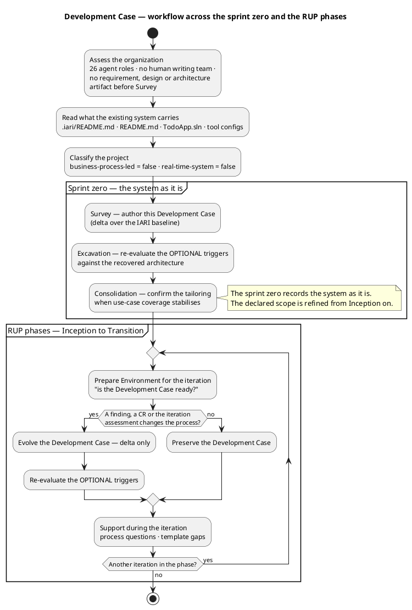

## Document Control
Phase: Survey
Status: Revised — governs the Survey milestone of the sprint zero
Milestone Target: End-of-Survey (SBC) — not yet achieved

## Tailoring Overview
This is a **delta document**. It records only what this project does differently from the IARI Development Case baseline. The role roster, the artifact catalogue and the intensity matrix are the baseline's and are not restated here.

The project is a delivered, working system — the public sample `davidfowl/TodoApp` (MIT), taken at commit `307a1ead` of 12 February 2026 — onto which the stakeholder's declared scope is applied. That fact drives every tailoring decision below: the sprint zero reads what exists before RUP starts, and the process must be light enough that recovering a system already in the repository costs less than rewriting it.

### Organization baseline (Survey assessment, 2026-11-14)

| Finding | Consequence for this tailoring |
|---|---|
| 26 agent roles are available; there is no human writing team, only human gates | Roles execute rather than coordinate; no ceremony whose value is human communication is retained |
| The existing system carries a CI workflow, central package management and a test project | These are tool references, not work items — each is owned by its role and cited by path |
| No running installation, no production data, no users (`Source: .iari/README.md`) | No migration, no backward-compatibility obligation, no deployment history to preserve |
| The system is not run in any phase, by the stakeholder's decision of 2026-11-14 | No risk is retired, no claim verified and no pin confirmed by observation. Every recovered element rests on reading, and what reading cannot settle stays declared as read but not observed, carried as accepted risk |
| The authors cannot be consulted (`Source: .iari/README.md`) | Every recovered element cites the file and lines it was read from; nothing is attributed to intent |

### Classification

| DC baseline trigger | Verdict | Basis |
|---|---|---|
| §4 business-process-led | false | The system is a single-user task list behind an identity boundary. No business process is modelled, no organisational workflow is enacted, no business rules exist beyond per-owner access. `Todos` carries `Title`, `IsComplete`, `OwnerId` — nothing that encodes a policy. |
| §10 real-time-system | false | Request/response only. No hard deadline, no concurrent event-driven or reactive behaviour. Rate limiting and OpenTelemetry are mechanisms, not timing guarantees. |

## Disciplines and Intensity
All active disciplines run at the **canonical matrix intensities** — no deviation is claimed and none is required. Deltas:

- **Business Modeling — INACTIVE for the whole project.** `business-process-led = false` (§4). No business use case model, business object model or business rules artifact is produced; the Business Process Analyst and the Business Reviewer do not work. Business rules that the code enforces are recovered as use-case preconditions by the System Analyst in Excavation — that is a Requirements and Analysis & Design activity, not a Business Modeling one.
- **Discovery — ACTIVE, sprint zero only** (Survey Critical, Excavation High, Consolidation Low). It concludes before Inception; nothing after Consolidation reads the System Inventory as a live artifact.
- **Environment — Survey High, Inception High, Elaboration Medium.** Per the baseline, the tailoring is stable after the Elaboration baseline. No Environment work is planned in Construction or Transition; a process question raised there is answered here as support, without an iteration-level DC revision unless a finding or CR requires one.

**No intensity changes because the system is never run.** The stakeholder's decision of 2026-11-14 removes one class of activity from every discipline — no stage validates anything by executing the system, and no risk is disposed of by observation. It does not move a single intensity level, because the levels are the matrix's and the reading-based activities they cover remain the work: Analysis & Design stays Critical in Excavation on recovered reading, and Test stays at its matrix level with execution confined to what the repository's own test project can run.

## Artifacts and Templates

The CORE catalogue is the baseline's. This section records only the project's conventions and the sprint-zero artifact's role.

| Artifact | Project convention |
|---|---|
| System Inventory | The one artifact of the sprint zero. Reads the perimeter (projects, endpoints, tables, dependencies), the anomalies and their priorities, and the coverage of the reading. Everything recovered later cites it. |
| Use-Case Model | Enumerated in Excavation **one use case per endpoint surface that performs a distinct user-observable outcome**, read from `Todo.Api/Program.cs` (`MapTodos()`, `MapUsers()`) and the web client. Multi-actor on the same declared process is one use case with several scenarios. Authentication, identity, rate limiting, logging and telemetry are **not** use cases — they are Supplementary Specification entries included by the use cases that depend on them. |
| Supplementary Specification | Recovers the constraints the code already enforces: SQLite single-file persistence, bearer and cookie authentication, ASP.NET Core Identity user management, rate limiting, OpenTelemetry, and the absence of any migration path that is not an EF Core migration in `Todo.Api`. |
| Design Model | Carries the persistent-data design as **sections of this artifact**, not a separate Data Model (see Optional Artifact Triggers). Class and package structure is read from the solution projects; the design does not re-invent a layering the code does not have. |
| Software Architecture Document | Records the recovered architecture with its mechanisms. Deployment is a section of this document, plus the Deployment Model below. |
| Implementation Model | Lives in the SCM — read by the Software Archaeologist, never upserted. |
| Iteration Plan / Iteration Assessment | The plan instantiates the process this case tailors; it never schedules work the phase does not run. |
| Everything else | The baseline template, unmodified. |

## Optional Artifact Triggers

Every verdict below is an auditable claim against the §5.2 condition. Re-evaluated each iteration; the recorded set is authoritative.

| Optional artifact | Verdict | Condition and evidence |
|---|---|---|
| Data Model | **NOT FIRED** | The condition needs a data-centric system, more than 10 entities, or data migration in scope. Eight tables exist (`Source: Todo.Api/Migrations/TodoDbContextModelSnapshot.cs`) — `Todos` and `AspNetUsers` plus six ASP.NET Core Identity tables generated from the framework, which carry no project design decision. No migration is in scope: no production data and no users exist (`Source: .iari/README.md`). The persistent-data design belongs in the Design Model. |
| Deployment Model | **FIRED** | Multi-process topology: `Todo.Api`, `Todo.Web.Server` (BFF), `Todo.Web.Client` (Blazor WASM in the browser) and `TodoApp.AppHost`, with YARP request forwarding and service discovery between them (`Source: TodoApp.sln`, `README.md`). That is a distributed topology, not a single-node deployment summarised in a SAD section. Owner: Software Architect. |
| Architectural Proof-of-Concept | **NOT FIRED in the sprint zero; re-evaluated in Elaboration** | The condition is Elaboration phase *and* a scored technical risk needing empirical validation. In the sprint zero no risk is scored yet (`Risk List` is produced in the same iteration by the Project Manager, after this artifact). The trigger is re-evaluated in Elaboration against the scored Risk List, where the candidates are plausibly the SQLite connection behaviour under the BFF's forwarded requests and the WASM/BFF/API auth propagation. |
| User-Interface Prototype | **NOT FIRED** | Requires UX-critical design or UI complexity needing stakeholder validation before implementation. A working Blazor UI already exists in `Todo.Web` — it is the baseline, and no new UI is declared this cycle. Should the declared scope add or redesign a screen, re-evaluate. |
| Test Plan | **NOT FIRED** | Requires formal delivery, regulatory audit or contractual test reporting. None applies: the delivery is MIT-licensed sample code with no audit obligation. Per-iteration test scope is defined in the Iteration Plan. |
| Glossary | **NOT FIRED** | Requires specialist domain vocabulary needing stakeholder-validated definitions. The domain vocabulary is `Todo`, `IsComplete`, `Owner` — common words whose meaning is fixed by the recovered schema. |

## Roles and Ownership
Primary ownership is the baseline's and is unchanged. The diagram shows which role works on which artifact in which stage of the sprint zero; that is a work assignment, not an ownership relation, and the authoritative statement of ownership is the sentence above plus the contributor bullets below.

```plantuml
@startuml
title Roles at work in the sprint zero, by the stage each works in
skinparam shadowing false
skinparam componentStyle rectangle

package "Survey" {
  component "Process Engineer" as PE
  component "Software Archaeologist" as ARCHY
  component "Project Manager" as PM
  component "Reviewer\nManagement Reviewer\nReview Coordinator" as REV
}

package "Excavation and Consolidation" {
  component "Software Architect" as SWA
  component "Designer" as DES
  component "Database Designer" as DBD
  component "System Analyst" as SYSA
}

package "Stood down by this tailoring" #LightGray {
  component "Business Process Analyst" as BPA
  component "Business Reviewer" as BREV
  component "Capsule Designer" as CAP
}

package "Artifacts carrying the sprint zero" {
  artifact "Development Case" as DC
  artifact "System Inventory" as SI
  artifact "Risk List" as RL
  artifact "Iteration Plan" as IP
  artifact "Software Architecture Document" as SAD
  artifact "Deployment Model" as DEPM
  artifact "Design Model" as DM
  artifact "Use-Case Model" as UCM
  artifact "Supplementary Specification" as SS
  artifact "Vision" as VIS
}

PE ..> DC : works on, Survey
ARCHY ..> SI : works on, Survey
PM ..> RL : works on, Survey
PM ..> IP : works on, Survey
SWA ..> SAD : works on, Excavation
SWA ..> DEPM : works on, Excavation
DES ..> DM : works on, Excavation
DBD ..> DM : contributes persistent-data sections
SYSA ..> UCM : works on, Excavation
SYSA ..> SS : works on, Excavation
SYSA ..> VIS : works on, Excavation

note right of BPA
  business-process-led = false.
  Business Modeling is inactive: no
  business use case model, no business
  object model, no business rules beyond
  those the code enforces.
end note
note right of BREV
  Reads the same classification: the gate
  loses one lens, Reviewer and Management
  Reviewer remain.
end note
note right of CAP
  real-time-system = false: request/response
  only, no hard deadline and no concurrent
  event-driven behaviour.
end note
note bottom of DBD
  Data Model NOT FIRED. The persistent data is
  recovered into the Design Model as sections of
  a co-owned artifact; only their author edits them.
end note
note top of DC
  The arrows are work assignments by stage, not
  ownership. Ownership is the baseline's and is
  stated in the text below.
end note
@enduml
```

- **Stood down:** Business Process Analyst and Business Reviewer (§4 business-process-led = false), Capsule Designer (§10 real-time-system = false). No gate summons them; the LCO and LCA review sequences lose one lens and Reviewer, Management Reviewer and Review Coordinator remain.
- **Project-specific contributors:** the Database Designer contributes the persistent-data sections of the Design Model in Excavation, Consolidation and later phases (Data Model not fired). The contribution is a section of a co-owned artifact and only its author edits it. This is the project's only contributor assignment beyond the baseline's.
- **Recovery ownership:** every element recovered from the code cites `Source: <path>` (and lines) where a declared element cites its `FR-NNN`/`NFR-NNN`. Recovered elements carry no upstream arrow; the anchor is their source.

## Guidelines and Procedures
### Tool references

Configuration content lives in the files that hold it, owned by the roles that author them — never restated here.

| Configuration | Path | Owner from here on |
|---|---|---|
| Build verification on push and pull request | `.github/workflows/ci.yaml` | Integrator |
| Runtime and package pins (central package management) | `Directory.Packages.props`, `global.json` | Software Architect |
| Compiler-enforced conventions (`net9.0`, `Nullable enable`, `ImplicitUsings enable`, `LangVersion preview`) | `Directory.Build.props` | Software Architect |
| Integration-test conventions (xunit, `Microsoft.AspNetCore.Mvc.Testing`, `coverlet`) | `Todo.Api.Tests`, `Directory.Packages.props` | Test Designer |
| Environment bootstrap (prerequisites, `TodoApp.AppHost`, `dotnet user-secrets` for external providers) | `README.md` | Integrator |

**No written coding standard exists in this repository, and none is assumed.** The conventions that bind an Implementer and a Code Reviewer are the compiler-enforced ones in `Directory.Build.props` and the central pins in `Directory.Packages.props`; a Code Reviewer reviews against those plus the Software Architecture Document's mechanisms, and against no style guide. A written standard, if the project wants one, is authored by the Software Architect under a Change Request — it does not appear here until it exists in the tree. The absence is carried as R006.

### Version policy

The stakeholder declared no version constraint in this cycle, and none was invented: the policy is the one the delivery already fixes, read from its own files.

| Pin | Value | Source |
|---|---|---|
| Framework target | `net9.0` | `Directory.Build.props` |
| SDK | `9.0.100`, `rollForward: latestFeature` | `global.json` |
| Package set | Seven package pins: EF Core SQLite, Identity EF Core, MVC Testing (all 9.0.8), YARP 2.3.0, Scalar 2.6.8, xunit 2.9.3, and the OpenTelemetry 1.12.0 set | `Directory.Packages.props` |

Nine pins are recorded via `record_version_policy` — the two framework pins above and the seven package pins — and that recorded set is authoritative for every technical role. `Directory.Packages.props` declares thirty `PackageVersion` elements in total; a package it pins but this policy does not name is pinned by the file and by nothing else.

Three consequences hold from now on:

- The Software Architect anchors the SAD to this policy; the registry's "latest" never overrides a pin.
- `net9.0` is an STS line. The delivery fixes it, so it stands; moving to an LTS line is a baseline change and enters through a Change Request, never by an Implementer's judgement.
- The pins are confirmed against the files the policy cites — `Directory.Build.props`, `global.json`, `Directory.Packages.props` — when the Software Architect anchors the SAD. A pin a file contradicts is corrected here, against the file. No pin is confirmed by running the system: it is not installed anywhere in this project and is not run in any phase.

### Process procedures

- **Sprint zero sequencing.** Survey (this artifact, then the System Inventory, then Risk List and Iteration Plan), then Excavation and Consolidation. The declared scope is refined from Inception on; a declared requirement that nothing refines before Inception is not yet a gap.
- **Iteration preparation.** Each iteration opens with the Development Case readiness check — the tailoring, the artifact scope and the tool references current before development starts. This is a recurring step, not an Inception one-off.
- **Support during the iteration.** A process question, an ambiguous template or a missing convention is answered here, in-cycle. A blocking process issue is escalated immediately as `REQUIRES_USER_INPUT`; it is never left to resolve itself over two iterations.
- **Assessment-driven change.** A tailoring change is made only against evidence — a finding, a Change Request, or an Iteration Assessment entry naming the problem. Changes are recorded as deltas in this artifact with the evidence that caused them.
- **Escalation of scope.** This case fixes process, not scope. A gap or contradiction in the declared scope goes to the stakeholder through the role that found it; it is never resolved by a tailoring decision here.

### Measurement policy

This project tracks the two quantities the process produces — **tokens** and **elapsed time**, the latter split into agent time and human queue time. Each has a named decision it enables; a quantity with no decision behind it is not collected.

| Quantity | Decision it enables | Reader |
|---|---|---|
| Tokens per discipline per iteration | Whether a live artifact's surface is worth reading again next iteration or should be replaced so it is read once — on an existing system the cost is dominated by re-reading, not by writing | Process Engineer, at iteration close |
| Agent time per stage | Whether a stage's scope is too large for one turn and should be split in the next Iteration Plan | Process Engineer and Project Manager |
| Human queue time at each gate | Whether gates should be batched into fewer points in the phase | Project Manager |

No token budget is declared for this project. Where none is declared, measured spend is recorded and no declared scope is cut to fit an estimate. Measured actuals are quoted only for closed phases, and the two clocks are reported apart and never summed.

