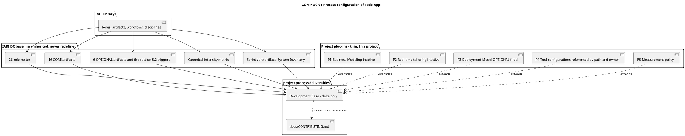
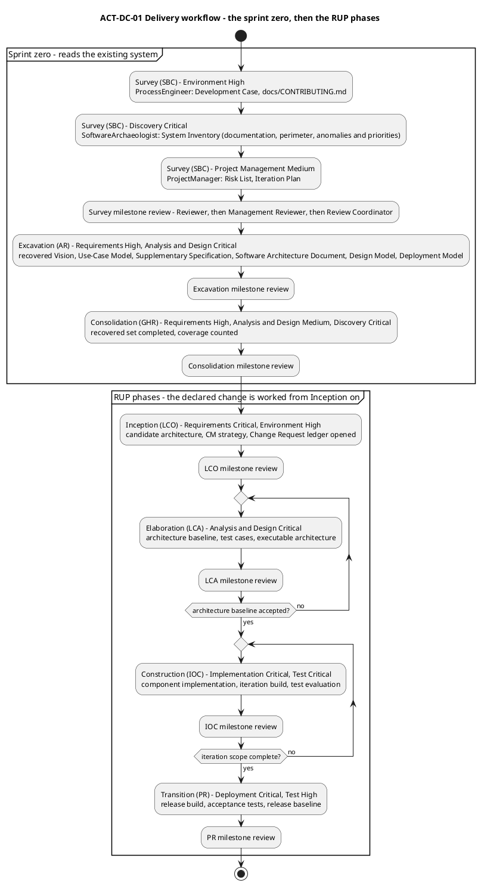

## Document Control

- Phase: Survey
- Status: Draft — produced for the end-of-Survey (SBC) milestone review
- Milestone Target: end-of-Survey (SBC) — not yet achieved
- Iteration: 1, Cycle 1
- Owner: Process Engineer
- Baseline: IARI DC baseline (26-role roster, 16 CORE artifacts, 6 OPTIONAL artifacts, canonical intensity matrix). This document carries **deltas only**; anything it does not state follows the baseline unchanged.

## Tailoring Overview

This project is built on an existing system: a copy of the public sample `davidfowl/TodoApp` (MIT licence, commit `307a1ead`, 12 February 2026). The delivery therefore runs a **sprint zero** that reads the system as it stands — Survey, Excavation, Consolidation — before the RUP phases, and only from Inception is the declared change worked. Nothing declared is worked in the sprint zero; what the sprint zero produces is the recovered system, and its elements cite the anchor they were read from.

### Organization baseline

| Finding | Evidence in the delivery |
|---|---|
| Runtime platform is fixed by the code in hand | `global.json` (SDK 9.0.100, `rollForward: latestFeature`, `allowPrerelease`), `Directory.Build.props` (`net9.0`, nullable, implicit usings, `LangVersion: preview`), `Directory.Packages.props` (central package management) |
| Architecture is a four-process system | `Todo.Web/Client` (Blazor WebAssembly), `Todo.Web/Server` (host + YARP `IHttpForwarder` proxy), `Todo.Api` (minimal APIs, EF Core 9 over SQLite), `TodoApp.AppHost` (Aspire orchestration) |
| Tests are integration tests over the API | `Todo.Api.Tests/` — `TodoApiTests.cs`, `UserApiTests.cs`, xunit 2.9.3, `Microsoft.AspNetCore.Mvc.Testing` |
| No document of the system survives | The delivery carries a root `README.md` (how to run it) and nothing else: no requirements, design, architecture or test document |
| The schema exists only as code | Three EF Core migrations under `Todo.Api/Migrations/`; no SQL script, procedure or trigger anywhere in the tree |
| No installation, no data, no authors | The system is not deployed; there are no production data and no users; the people who wrote it cannot be asked |
| No defined process of its own | No plan, no review record, no change record. The project starts at *defined-process-by-adoption*: IARI supplies the process, and guideline content lives in files the roles write, not in prose re-stated here |
| Contribution contract | `docs/CONTRIBUTING.md`, owned by the Process Engineer. The root `README.md` documents how to run the system and is not a contribution guide (no labels, no branch rules, no review process) |

Working roles per iteration are the sets the inherited process names for each phase (Survey 3 working roles, Excavation 6, Consolidation 4, Inception 5, Elaboration 10, Construction 10, Transition 8, plus the reviewing roles of each milestone). No role is added, merged or removed.

### Classification verdicts

- **Business-process-led = false** (DC §4). No business process is being automated, redesigned or measured: the system is a personal task list with per-user ownership. There is no workflow, no approval chain, no organizational role model and no process artifact in the delivery. `Todo` carries an `OwnerId` foreign key to the Identity user; the API surface is `Todos` and `Users`. Business Modeling is therefore inactive for the whole project, and the `BusinessProcessAnalyst` does not work.
- **Real-time-system = false** (DC §10). No hard deadline, no concurrent event-driven state machine, no timer, broker or reactive pipeline. Interaction is request/response CRUD over HTTP, with a browser client re-rendering on request and EF Core persisting on demand. The real-time tailoring is inactive, and the `CapsuleDesigner` does not work.

### Shape of the process configuration

All changes this project makes to the baseline are **thin plug-ins**: they substitute content or add guidance without altering the process structure. No structural plug-in is applied — no discipline, role, workflow or artifact relationship of the baseline is changed.

## Disciplines and Intensity

Every active discipline runs at the intensity the canonical matrix fixes for its phase. **No deviation is requested and no intensity level is assigned by this document.**

Inactive disciplines and inactive periods:

| Discipline | Status in this project |
|---|---|
| Business Modeling | Inactive for the whole project — `business-process-led = false` (see Classification verdicts). The glossary and use-case-model work the Business Process Analyst would contribute is carried by Requirements. |
| Discovery | Active in the sprint zero only (Survey, Excavation, Consolidation, Critical). It does not run from Inception on. |
| Environment | Active in Survey, Inception and Elaboration. After the Elaboration (LCA) baseline the tailoring is stable and the discipline does not run again; the Development Case is then maintained only where an iteration assessment or a change request requires it. |
| Requirements, Analysis & Design, Implementation, Test, Deployment, Configuration & Change Management, Project Management | Active in all phases, per canonical matrix. |

## Artifacts and Templates

All 16 CORE artifacts are produced; none is omitted and none changes owner. The one OPTIONAL artifact whose trigger fires is the **Deployment Model** (see Optional Artifact Triggers).

| Rule | Application in this project |
|---|---|
| Templates | The project authors no templates. Each artifact is written to its canonical section skeleton; this document adds no section to any of them. |
| Guideline content | Lives in `docs/CONTRIBUTING.md` and in the convention files the roles own (see Guidelines and Procedures). The Development Case references those files and does not duplicate their content. |
| Implementation Model | Written as code in the SCM, never upserted. The repository is the implementation: `Todo.Api/`, `Todo.Web/`, `TodoApp.AppHost/`, `TodoApp.ServiceDefaults/`, `Todo.Api.Tests/`. |
| Persistent data | The `Data Model` OPTIONAL is not triggered; persistent data is described in the Design Model's persistent-data sections, owned by the `DatabaseDesigner`, anchored on `Todo.Api/TodoDbContext.cs` and the three migrations. |
| Recovered artifacts | In Excavation and Consolidation, the existing system's architecture, use cases and data are recovered into the Software Architecture Document, Use-Case Model, Supplementary Specification and Design Model. Each recovered element cites the anchor it was read from (`Source: <path>` and lines; `Source: EP-NNN` for a recovered use case). |
| Declared artifacts | From Inception on, each element cites the declared identifier it comes from (`FR-NNN`, `NFR-NNN`, `CON-NNN`, `AC-NNN`, `BG-NNN`, `RNNN`). |
| Trace edges | One edge, one author: written in the Traceability row of its concrete end. This project's Development Case carries no trace table — it declares no traced element. |

## Optional Artifact Triggers

Evaluated against the delivery as it stands. Re-evaluated at the start of every iteration; a trigger that has fired stays fired for the rest of the project.

| Optional artifact | §5.2 condition | Verdict | Evidence |
|---|---|---|---|
| Glossary | Domain uses specialist vocabulary requiring stakeholder-validated definitions | NOT FIRED | The vocabulary is *todo*, *user*, *owner*, *token* — plain English names for records an actor owns. No regulated, legal, medical or financial term is in play, and the system's authors cannot be asked to validate a definition. |
| Architectural Proof-of-Concept | Elaboration + at least one technical risk requiring empirical validation | NOT FIRED | No technical risk in the delivery requires empirical validation of an untried mechanism: the architecture already runs as it stands (`TodoApp.AppHost` boots the API, the server host and the database) and the declared change is worked on top of it. Re-evaluated every iteration once the Risk List exists. |
| Data Model | Data-centric system, OR more than 10 entities, OR data migration in scope | NOT FIRED | Eight persisted entity types: the seven ASP.NET Core Identity tables of `IdentityDbContext<TodoUser>` plus `Todo`. Below the >10 threshold. No data migration is in scope — there is no production data, and the three migrations are the schema's only history. Persistent data is written in the Design Model. |
| Deployment Model | Distributed / multi-node topology, OR non-trivial multi-environment setup | FIRED | The topology is genuinely distributed: a browser-hosted Blazor WebAssembly client, a server host, a separate REST API process, a SQLite database, and a reverse-proxy hop (YARP `IHttpForwarder`) from the server to the API. `TodoApp.AppHost` orchestrates the processes, and each of `Todo.Api`, `Todo.Web/Server`, `Todo.Web/Client`, `TodoApp.AppHost` carries its own `appsettings.json` / `appsettings.Development.json` pair. |
| User-Interface Prototype | UX-critical, or UI complexity requiring stakeholder validation before implementation | NOT FIRED | The UI is recovered from the existing Blazor components (`TodoList.razor`, `LogInForm.razor`); no UX-critical decision waits on stakeholder validation before implementation. |
| Test Plan | Formal delivery, regulatory audit, contractual test reporting | NOT FIRED | No regulator, contract or audit consumes test reporting. Per-iteration test scope is set by the Iteration Plan and reported in the Test Evaluation Summary. |

## Roles and Ownership

Deltas over the 26-role roster — two roles do not work, and nothing else changes:

- **BusinessProcessAnalyst — does not work.** `business-process-led = false`; the inherited process runs this role only when the Development Case records a business-process-led project.
- **CapsuleDesigner — does not work.** `real-time-system = false`; the capsule tailoring applies only to a system with hard deadlines or concurrent event-driven behaviour.

The other 24 roles work as the inherited process schedules them. No role is added, merged or renamed, and no CORE artifact's primary ownership is reassigned. Co-owned artifacts keep the contributor sets the baseline gives them — in this project: Design Model (Designer, DatabaseDesigner, UserInterfaceDesigner), Supplementary Specification and Use-Case Model (SystemAnalyst, RequirementsSpecifier, UserInterfaceDesigner), Review Record (Reviewer, CodeReviewer, plus the Configuration Manager's baseline record).

```plantuml
@startuml
title CLS-DC-01 Role-artifact ownership and the tool references of this project

skinparam classAttributeIconSize 0

package "Environment" {
  class "ProcessEngineer" as PE
  class "docs/CONTRIBUTING.md" as CG
}
package "Sprint zero" {
  class "SoftwareArchaeologist" as SWA
  class "ProjectManager" as PM
}
package "Requirements" {
  class "SystemAnalyst" as SYA
  class "RequirementsSpecifier" as RS
  class "UserInterfaceDesigner" as UID
}
package "Analysis and Design" {
  class "SoftwareArchitect" as ARC
  class "Designer" as DES
  class "DatabaseDesigner" as DBD
}
package "Implementation" {
  class "Implementer" as IMPL
  class "CodeReviewer" as CRV
  class "Integrator" as IGR
}
package "Test" {
  class "TestManager" as TM
  class "TestDesigner" as TD
  class "TestAnalyst" as TA
  class "Tester" as TS
}
package "Deployment and Documentation" {
  class "DeploymentManager" as DM
  class "TechnicalWriter" as TW
}
package "Configuration and Change Management" {
  class "ConfigurationManager" as CFM
  class "ChangeControlManager" as CCM
}
package "Review" {
  class "Reviewer" as RV
  class "BusinessReviewer" as BRV
  class "ManagementReviewer" as MRV
  class "ReviewCoordinator" as RCO
}
package "INACTIVE in this project" {
  class "BusinessProcessAnalyst" as BPA <<inactive: business-process-led = false>>
  class "CapsuleDesigner" as CPD <<inactive: real-time-system = false>>
}
package "Artifacts" {
  class "Development Case" as DC
  class "System Inventory" as SI
  class "Risk List, Iteration Plan, Iteration Assessment" as PLN
  class "Vision, Use-Case Model" as UCM
  class "Supplementary Specification" as SS
  class "Software Architecture Document" as SAD
  class "Design Model" as DMO
  class "Deployment Model" as DPM <<OPTIONAL trigger fired>>
  class "Implementation Model (in the SCM)" as IM
  class "Test Case" as TC
  class "Test Evaluation Summary" as TES
  class "User Documentation, Release Notes" as UDRN
  class "Review Record" as RR
  class "Change Request" as CRQ
}
package "Tool configurations referenced by path" {
  class ".github/workflows/ci.yaml" as CI
  class "Directory.Build.props and package pinning files" as BUILD
  class ".devcontainer and .aspire and .vscode" as ENVD
  class "Requests/todo.http" as REQH
}

PE --> DC : owns
PE --> CG : owns
SWA --> SI : owns
PM --> PLN : owns
SYA --> UCM : owns
SYA --> SS : owns
RS --> SS : owns
UID --> UCM : storyboards
ARC --> SAD : owns
ARC --> DPM : owns
DES --> DMO : owns
DBD --> DMO : persistent data
IMPL --> IM : owns
CRV --> RR : records
IGR --> IM : builds
TM --> TES : owns
TD --> TC : owns
TS --> TC : executes
DM --> DPM : owns
DM --> UDRN : owns
TW --> UDRN : owns
CFM --> RR : baseline record
CCM --> CRQ : owns
RV --> RR : owns
RV --> DC : reviews
IGR ..> CI : references
IGR ..> BUILD : references
IGR ..> ENVD : references
IMPL ..> BUILD : references
TS ..> REQH : references
@enduml
```

### Tool and configuration references

Each item is a reference to a file and its owning role. Its content and its state are the owning role's, and this document neither records nor verifies them.

| Configuration | Path | Owning role |
|---|---|---|
| CI pipeline | `.github/workflows/ci.yaml` | Integrator |
| Solution and build properties | `TodoApp.sln`, `Directory.Build.props` | Integrator (build), Software Architect (what the compiler enforces) |
| Package and version pinning | `Directory.Packages.props`, `global.json`, `nuget.config` | Software Architect, anchored in the Software Architecture Document |
| Developer environment | `.devcontainer/devcontainer.json`, `.devcontainer/init.sh`, `.aspire/settings.json`, `.vscode/extensions.json` | Process Engineer (onboarding), Integrator (build environment) |
| Request collection | `Requests/todo.http` | Tester |

The enterprise version policy is recorded with the process and is anchored by the Software Architect in the Software Architecture Document. It governs over the registry's *latest* for every package the delivery adds.

## Guidelines and Procedures
### Guideline ownership

Guideline content is written by the discipline expert who owns the practice, in the file that carries it. This document names the owner and the file; it does not restate the rule.

| Guideline | Author | Where it lives |
|---|---|---|
| Coding conventions — nullable reference types, implicit usings, language version, target framework | Software Architect | `Directory.Build.props` |
| Dependency and version conventions | Software Architect | `Directory.Packages.props`, `global.json`, `nuget.config` |
| Test conventions — framework, naming, integration-test harness | Test Manager | `Todo.Api.Tests/` |
| Persistent-data conventions — model configuration, migration naming | DatabaseDesigner | `Todo.Api/TodoDbContext.cs`, `Todo.Api/Migrations/` |
| UI conventions — component structure, styling | UserInterfaceDesigner | `Todo.Web/Client/Components/` |
| Contribution procedure — how a change is requested, its labels, branch and review rules | Process Engineer | `docs/CONTRIBUTING.md` |

### Measurement policy

Two quantities are measured and no others: tokens consumed, and elapsed time split into agent time and time waiting for a human. What *this project* does with them:

| Quantity | Read by | Decision it enables |
|---|---|---|
| Token spend per role per iteration | Process Engineer, at iteration close | Whether a fired OPTIONAL artifact and its re-read cost still pay for the risk it retires — the input to keeping or withdrawing it. |
| Token spend per role per iteration | Project Manager, in the Iteration Plan | How the next iteration's work is split across roles. |
| Elapsed time, agent part | Project Manager | How much of an iteration is machine work, and therefore how the iteration's exit criteria are sequenced. |
| Elapsed time, human-queue part | Project Manager | Whether a human gate is a schedule risk the Risk List must carry. |
| Elapsed time, human-queue part | Process Engineer | Whether a review gate queues so long that its structure should change. |

No velocity, no derived forecast and no invented figure is reported from these numbers. No token budget is declared for this project; none is set here.

### Process evolution and support

- **Before each iteration:** the optional triggers and both classification verdicts are re-evaluated and the Development Case made current before the first working role of that iteration starts. A trigger that has fired is not un-fired by a later reading.
- **During each iteration:** process questions are answered inside the same iteration. A blocking one — an approval whose approver is unstated, a template that cannot be applied — is escalated to the stakeholder in the same turn it is found.
- **After each iteration:** the process findings of the Iteration Assessment are the input. A change to this document names the finding it answers; a change with no finding behind it is not made.
- **How a change to this document is requested:** through the `Change Control Manager`, who carries it as a change request with `nature:enhancement` or `nature:refactoring`. The label table is in `docs/CONTRIBUTING.md`.

### The contribution contract

`docs/CONTRIBUTING.md` is the project's contract for whoever contributes — a person or a role. It carries one section, "Working with IARI", in five parts: how a change is requested and with which labels, the branching and deployment rules and where their owners state them, the code and test conventions the kept code follows (each citing the file that states it), what a review checks, and where a process question goes. Its label table is the label table of the process, character for character; a label written differently reaches no role. It is published and it holds over any other guide in the repository for how a change is requested, labelled and reviewed.

**The delivery's own guide.** The only document the existing system carries is the root `README.md`, and it is documentation of how to build and run the system: prerequisites, database, running the application, social-auth configuration, OpenTelemetry. It states no label, no branch rule and no review rule. It is therefore not a contribution guide, nothing in it is replaced by `docs/CONTRIBUTING.md`, and it stays word for word and is not edited. No stakeholder decision about an owner's contribution guide is pending.

**One disagreement in the sources.** `.devcontainer/devcontainer.json` names the image `mcr.microsoft.com/dotnet/sdk:8.0` while `Directory.Build.props` targets `net9.0` and `global.json` pins SDK `9.0.100`. `docs/CONTRIBUTING.md` cites both as they are written. Settling which holds is the `Integrator`'s build-environment decision, not a process tailoring decision, and this document records none of it.

