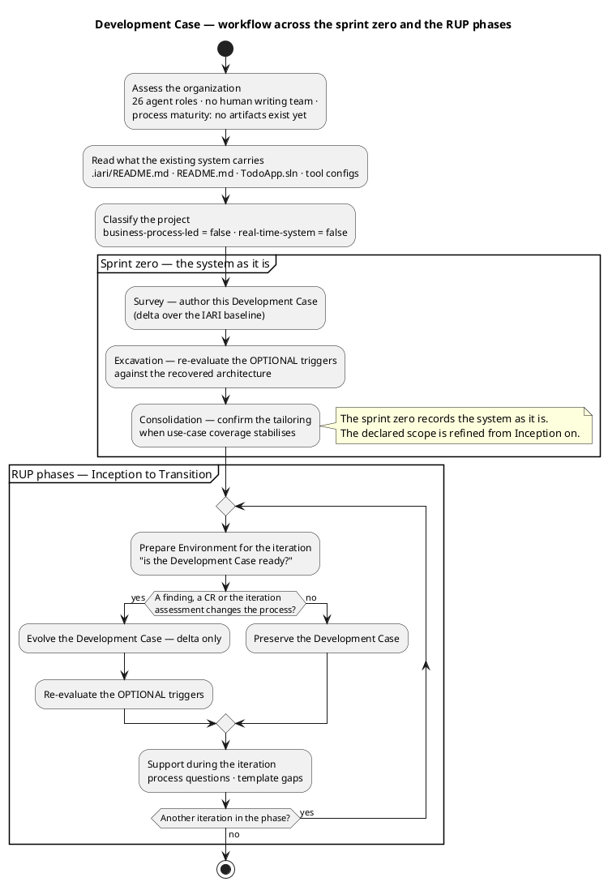

## Document Control

Phase: Survey
Status: Draft — governs the Survey milestone of the sprint zero
Milestone Target: End-of-Survey (SBC) — not yet achieved

## Tailoring Overview

This is a **delta document**. It records only what this project does differently from the IARI Development Case baseline. The role roster, the artifact catalogue and the intensity matrix are the baseline's and are not restated here.

The project is a delivered, working system — the public sample `davidfowl/TodoApp` (MIT), taken at commit `307a1ead` of 12 February 2026 — onto which the stakeholder's declared scope is applied. That fact drives every tailoring decision below: the sprint zero reads what exists before RUP starts, and the process must be light enough that recovering a system already in the repository costs less than rewriting it.

### Organization baseline (Survey assessment, 2026-11-14)

| Finding | Consequence for this tailoring |
|---|---|
| 26 agent roles are available; there is no human writing team, only human gates | Roles execute rather than coordinate; no ceremony whose value is human communication is retained |
| Process maturity is nil: the repository holds no requirement, design or architecture document, and `.iari/` holds one file | The first iteration is a recovery iteration; the sprint zero carries the process weight, not Inception |
| The existing system carries a CI workflow, central package management and a test project | These are tool references, not work items — each is owned by its role and cited by path |
| No running installation, no production data, no users (`Source: .iari/README.md`) | No migration, no backward-compatibility obligation, no deployment history to preserve |
| The authors cannot be consulted (`Source: .iari/README.md`) | Every recovered element cites the file and lines it was read from; nothing is attributed to intent |

### Classification

| DC baseline trigger | Verdict | Basis |
|---|---|---|
| §4 business-process-led | false | The system is a single-user task list behind an identity boundary. No business process is modelled, no organisational workflow is enacted, no business rules exist beyond per-owner access. `Todos` carries `Title`, `IsComplete`, `OwnerId` — nothing that encodes a policy. |
| §10 real-time-system | false | Request/response only. No hard deadline, no concurrent event-driven or reactive behaviour. Rate limiting and OpenTelemetry are mechanisms, not timing guarantees. |

## Disciplines and Intensity

All active disciplines run at the **canonical matrix intensities** — no deviation is claimed and none is required. Deltas:

- **Business Modeling — INACTIVE for the whole project.** `business-process-led = false` (§4). No business use case model, business object model or business rules artifact is produced; the Business Process Analyst and the Business Reviewer do not work. Business rules that the code enforces are recovered as use-case preconditions by the System Analyst in Excavation — that is an Analysis & Design and Requirements activity, not a Business Modeling one.
- **Discovery — ACTIVE, sprint zero only** (Survey Critical, Excavation High, Consolidation Low). It concludes before Inception; nothing after Consolidation reads the System Inventory as a live artifact.
- **Environment — Survey High, Inception High, Elaboration Medium.** Per the baseline, the tailoring is stable after the Elaboration baseline. No Environment work is planned in Construction or Transition; a process question raised there is answered here as support, without an iteration-level DC revision unless a finding or CR requires one.

## Artifacts and Templates

The CORE catalogue is the baseline's. This section records only the project's conventions and the sprint-zero artifact's role.

| Artifact | Project convention |
|---|---|
| System Inventory | The one artifact of the sprint zero. Reads the perimeter (projects, endpoints, tables, dependencies), the anomalies and their priorities, and the coverage of the reading. Everything recovered later cites it. |
| Use-Case Model | Enumerated in Excavation **one use case per endpoint surface that performs a distinct user-observable outcome**, read from `Todo.Api/Program.cs` (`MapTodos()`, `MapUsers()`) and the web client. Multi-actor on the same declared process is one use case with several scenarios. Authentication, identity, rate limiting, logging and telemetry are **not** use cases — they are Supplementary Specification entries included by the use cases that depend on them. |
| Supplementary Specification | Recovers the constraints the code already enforces: SQLite single-file persistence, bearer and cookie authentication, ASP.NET Core Identity user management, rate limiting, OpenTelemetry, and the absence of any migration path that is not an EF Core migration in `Todo.Api`. |
| Design Model | Carries the persistent-data design as **sections of this artifact**, not a separate Data Model (see Optional Artifact Triggers). Class and package structure is read from the solution projects; the design does not re-invent a layering the code does not have. |
| Software Architecture Document | Records the recovered architecture with its mechanisms. Deployment is a section of this document, plus the Deployment Model below. |
| Implementation Model | Lives in the SCM — read by the Software Archaeologist, never upserted. |
| Iteration Plan / Iteration Assessment | The plan instantiates the process this case tailors; it never schedules work the phase does not run. |
| Everything else | The baseline template, unmodified. |

## Optional Artifact Triggers

Every verdict below is an auditable claim against the §5.2 condition. Re-evaluated each iteration; the recorded set is authoritative.

| Optional artifact | Verdict | Condition and evidence |
|---|---|---|
| Data Model | **NOT FIRED** | The condition needs a data-centric system, more than 10 entities, or data migration in scope. Eight tables exist (`Source: Todo.Api/Migrations/TodoDbContextModelSnapshot.cs`) — `Todos` and `AspNetUsers` plus six ASP.NET Core Identity tables generated from the framework, which carry no project design decision. No migration is in scope: no production data and no users exist (`Source: .iari/README.md`). The persistent-data design belongs in the Design Model. |
| Deployment Model | **FIRED** | Multi-process topology: `Todo.Api`, `Todo.Web.Server` (BFF), `Todo.Web.Client` (Blazor WASM in the browser) and `TodoApp.AppHost`, with YARP request forwarding and service discovery between them (`Source: TodoApp.sln`, `README.md`). That is a distributed topology, not a single-node deployment summarised in a SAD section. Owner: Software Architect. |
| Architectural Proof-of-Concept | **NOT FIRED in the sprint zero; re-evaluated in Elaboration** | The condition is Elaboration phase *and* a scored technical risk needing empirical validation. In the sprint zero no risk is scored yet (`Risk List` is produced in the same iteration by the Project Manager, after this artifact). The trigger is re-evaluated in Elaboration against the scored Risk List, where the candidates are plausibly the SQLite connection behaviour under the BFF's forwarded requests and the WASM/BFF/API auth propagation. |
| User-Interface Prototype | **NOT FIRED** | Requires UX-critical design or UI complexity needing stakeholder validation before implementation. A working Blazor UI already exists in `Todo.Web` — it is the baseline, and no new UI is declared this cycle. Should the declared scope add or redesign a screen, re-evaluate. |
| Test Plan | **NOT FIRED** | Requires formal delivery, regulatory audit or contractual test reporting. None applies: the delivery is MIT-licensed sample code with no audit obligation. Per-iteration test scope is defined in the Iteration Plan. |
| Glossary | **NOT FIRED** | Requires specialist domain vocabulary needing stakeholder-validated definitions. The domain vocabulary is `Todo`, `IsComplete`, `Owner` — common words whose meaning is fixed by the recovered schema. |

## Roles and Ownership

Primary ownership is the baseline's and is unchanged. This section records only the roles this tailoring stands down and the roles that carry the sprint zero.

```plantuml
@startuml
title Roles at work in the sprint zero, and the roles this tailoring stands down
skinparam classAttributeIconSize 0

package "Survey" {
  class "ProcessEngineer" as PE
  class "SoftwareArchaeologist" as ARCHY
  class "ProjectManager" as PM
}

package "Excavation and Consolidation" {
  class "SoftwareArchitect" as SWA
  class "Designer" as DES
  class "DatabaseDesigner" as DBD
  class "SystemAnalyst" as SYSA
}

package "Stood down by this tailoring" {
  class "BusinessProcessAnalyst" as BPA
  class "BusinessReviewer" as BREV
  class "CapsuleDesigner" as CAP
}

package "Artifacts handed forward" {
  class "Development Case" as DC
  class "System Inventory" as SI
  class "Risk List" as RL
  class "Iteration Plan" as IP
  class "Software Architecture Document" as SAD
  class "Design Model" as DM
  class "Deployment Model" as DEPM
  class "Use-Case Model" as UCM
  class "Supplementary Specification" as SS
  class "Vision" as VIS
}

PE --> DC : owns
ARCHY --> SI : owns
PM --> RL : owns
PM --> IP : owns
SWA --> SAD : owns
SWA --> DEPM : owns
DES --> DM : owns
DBD --> DM : contributes the persistent-data sections
SYSA --> UCM : owns
SYSA --> SS : owns
SYSA --> VIS : owns

note right of BPA
  business-process-led = false
  Business Modeling is inactive:
  no business use case, no business
  object model, no business rules
  beyond those the code enforces
end note

note right of BREV
  reads the same classification:
  the gate loses one lens,
  Reviewer and ManagementReviewer remain
end note

note right of CAP
  real-time-system = false:
  request/response only, no hard
  deadline and no concurrent
  event-driven behaviour
end note

note bottom of DBD
  Data Model NOT FIRED — the persistent
  data is recovered into the Design Model
end note
@enduml
```

- **Stood down:** Business Process Analyst and Business Reviewer (§4 false), Capsule Designer (§10 false).
- **Project-specific contributors:** the Database Designer contributes the persistent-data sections of the Design Model in Excavation (Data Model not fired) — the contribution is a section of a co-owned artifact, and only its author edits it.
- **Recovery ownership:** every element recovered from the code cites `Source: <path>` (and lines) where a declared element cites its `FR-NNN`/`NFR-NNN`. Recovered elements carry no upstream arrow; the anchor is their source.

## Guidelines and Procedures
### Tool references

Configuration content lives in the files that hold it, owned by the roles that author them — never restated here.

| Configuration | Path | Owner from here on |
|---|---|---|
| CI (restore, build, test on push and pull request) | `.github/workflows/ci.yaml` | Integrator |
| Runtime and package pins (central package management) | `Directory.Packages.props`, `global.json`, `Directory.Build.props` | Software Architect |
| Compiler-enforced conventions (`net9.0`, `Nullable enable`, `ImplicitUsings enable`, `LangVersion preview`) | `Directory.Build.props` | Software Architect |
| Coding standard and review conventions | `CONTRIBUTING.md` | Software Architect, with the Code Reviewer |
| Integration-test conventions (xunit, `Microsoft.AspNetCore.Mvc.Testing`, `coverlet`) | `Todo.Api.Tests`, `Directory.Packages.props` | Test Designer |
| Environment bootstrap | `README.md` (prerequisites, `TodoApp.AppHost`, `dotnet user-secrets` for external providers) | Integrator |

### Version policy

The stakeholder declared no version constraint in this cycle, and the delivery carries its own pins: framework target `net9.0` with SDK `9.0.100` (`Source: global.json`, `Directory.Build.props`), and package versions fixed centrally in `Directory.Packages.props`. The formal version policy is recorded in **Inception**, once the System Inventory has read what the system actually runs on — not in Survey, where the reading is not yet complete.

Until then the pins in the repository are the working baseline and the registry's "latest" never overrides them: a package is not bumped because a newer version exists. Moving off `net9.0` to an LTS line, or off any pinned package, is a change to the delivered baseline and enters through a Change Request, not through an Implementer's judgement.

### Process procedures

- **Sprint zero sequencing.** Survey (this artifact, then the System Inventory, then Risk List and Iteration Plan), then Excavation and Consolidation. The declared scope is refined from Inception on; a declared requirement that nothing refines before Inception is not yet a gap.
- **Iteration preparation.** Each iteration opens with the Development Case readiness check — the tailoring, the artifact scope and the tool references current before development starts. This is a recurring step, not an Inception one-off.
- **Support during the iteration.** A process question, an ambiguous template or a missing convention is answered here, in-cycle. A blocking process issue is escalated immediately as `REQUIRES_USER_INPUT`; it is never left to resolve itself over two iterations.
- **Assessment-driven change.** A tailoring change is made only against evidence — a finding, a Change Request, or an Iteration Assessment entry naming the problem. Changes are recorded as deltas in this artifact with the evidence that caused them.
- **Escalation of scope.** This case fixes process, not scope. A gap or contradiction in the declared scope goes to the stakeholder through the role that found it; it is never resolved by a tailoring decision here.

