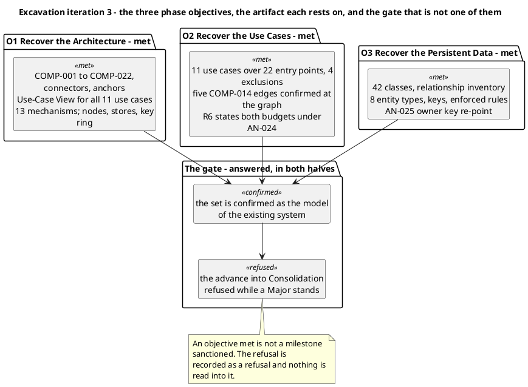
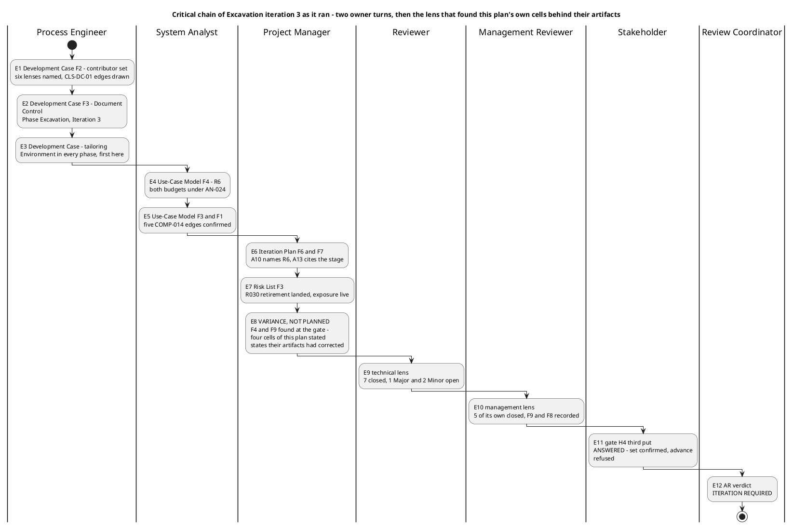
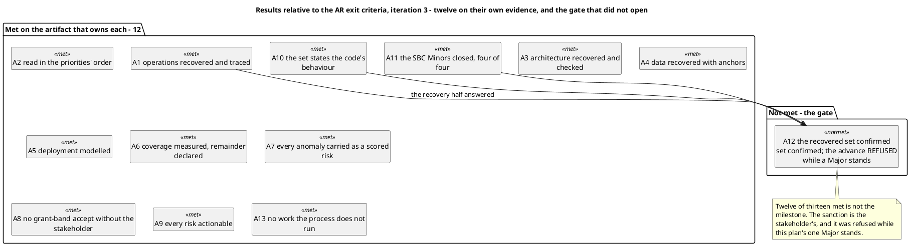
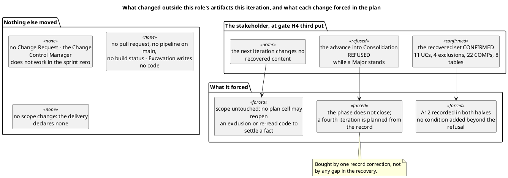
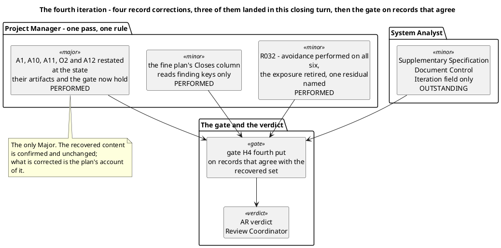

## Document Control
- Phase: Excavation
- Status: Assessed. The milestone verdict is the Review Coordinator's — AR: no further iteration required — and this record assesses iteration 4 against it. It declares no milestone of its own.
- Milestone Target: end-of-Excavation (AR). Gate H4's fourth put was answered Yes on 2026-11-23 and the Review Coordinator sanctioned the advance into Consolidation. Consolidation is the next phase.
- Iteration: 4, Cycle 1
- Owner: Project Manager

## Iteration Objectives Reached
The phase planned three objectives. All three are met on the artifacts that carry them. What the phase has not obtained is the milestone: the recovered set was confirmed by the stakeholder for the first time, and the sanction to advance was refused while one Major stands — and that Major is this plan's own text, not the recovery.

| # | Phase objective | Owner | Planned | Standing after iteration 3's review |
|---|---|---|---|---|
| O1 | Recover the Architecture | Software Architect | The Software Architecture Document records components, connectors, mechanisms, technology and deployment as the code shows them; the topology is modelled | **Met** — 22 components with anchors and connectors, the Use-Case View naming the components each of the eleven use cases' path crosses, 13 mechanisms, and the Deployment Model's nodes, stores, environment mapping and key-ring requirement. The three Majors recorded against these artifacts at iteration 1 are closed and verified, and neither artifact carried an open finding from any lens at this gate |
| O2 | Recover the Use Cases | System Analyst | One use case per entry-point path, each tracing to its `EP-NNN`, with every entry point either carried or its exclusion stated | **Met** — carriage intact at 11 use cases over 22 entry points with four exclusions stated, and both Majors that held this objective in iteration 2 closed and verified at the artifact: the five `COMP-014 → UC-006` to `UC-010` edges confirmed in the registered graph, and R6 stating both budgets under `AN-024` against `RateLimitExtensions.cs:14-31` and `appsettings.Development.json:8-12`. Neither correction added, removed, merged or reclassified a use case |
| O3 | Recover the Persistent Data | Designer, Database Designer | The Design Model carries the domain model, packages and classes, and the persistent data with entities, keys, associations and enforced rules | **Met** — 42 classes, the relationship inventory, the eight entity types, the owner key's re-point under `AN-025` and "What the code does not hold", each anchored to `TodoDbContext.cs:11-17` and the three migrations. No lens recorded a finding against this objective in any of the three iterations |

The recovery converged this iteration: seven findings closed, every one verified at the graph, the file or the peer artifact, and no artifact's recovered content now carries an open finding from any lens. What did not converge is this plan's own record of it. The one Major open at the gate — `Iteration Plan#F4` and `#F9` — is that four cells of this plan's criteria and objectives tables and one of its gate rows stated, as present fact, states their own artifacts had already superseded. Twelve of the thirteen criteria held on the artifact that owns each while the plan said three of them failed.
## Adherence to Plan
Iteration 3's fine plan was eleven items: three Development Case corrections in the Environment stage, two on the Use-Case Model, two on this plan and the register, two review lenses, the stakeholder gate and the verdict. Nine ran, one was answered, one ruled.

| # | Work item | Owner | Planned | Actual | Variance and root cause |
|---|---|---|---|---|---|
| 1 | Development Case — every lens writing into the Review Record named, CLS-DC-01 edges drawn | Process Engineer | In the Environment stage, first | Landed — `Development Case#F2` closed by the Management Reviewer at this gate on the re-read text | None. The stage the plan recorded in iteration 2 existed and the role worked in it |
| 2 | Development Case — the four Document Control fields brought forward | Process Engineer | Same turn | Landed — `Development Case#F3` closed by the technical lens | None |
| 3 | Development Case — Environment stated as running in every phase and first in Excavation | Process Engineer | Same turn | Landed — the tailoring now states the baseline the stakeholder restated | None |
| 4 | Use-Case Model — R6 states both budgets under `AN-024` | System Analyst | First correction of the artifact | Landed — `Use-Case Model#F4` closed on the diagram's own text | None |
| 5 | Use-Case Model — five `COMP-014` edges re-registered as confirmed | System Analyst | Same turn | Landed — `Use-Case Model#F3` and `#F1` closed on a graph query returning five confirmed edges | None |
| 6 | Iteration Plan — A10's cell names R6; A13's cell cites the Environment stage | Project Manager | This turn | Landed in part — `Iteration Plan#F6` and `#F7` closed by the Management Reviewer | The cells were widened at the point each finding named and not re-derived as a set. Four neighbouring cells in the same two tables stayed one pass behind. That is `Iteration Plan#F4` and `#F9`, and it is mine |
| 7 | Risk List — `R030`'s strategy cell restated | Project Manager | This turn | Landed — `Risk List#F3` (Management Reviewer) closed on the corrected strategy cell | The same cell's neighbours in the same table were not re-read: `R032` still reported an unmitigated exposure whose action had landed. That is `Risk List#F3` (technical lens) |
| 8 | Technical lens — the corrections re-read against their anchors | Reviewer | After item 7 | Ran — 7 closures, 1 Major and 2 Minor recorded | It found the defect class the previous gate had just closed, one artifact over — at this plan's own table |
| 9 | Management lens — A1 to A13 re-taken on the evidence each cites | Management Reviewer | After item 8 | Ran — 5 of its own findings closed, `#F9` and `#F8` recorded, gate H4 put a third time | — |
| 10 | Gate H4, third put | Stakeholder | After item 9 | **Answered** — the recovered set confirmed, the sanction refused while a Major stands | Queue time 7 min 11 s, reported apart below |
| 11 | AR milestone verdict | Review Coordinator | After item 10 | **Iteration required** — 0 Critical, 2 Major entries over 1 defect, 3 Minor | — |

**The variance this iteration owns.** The plan and the register were corrected at the points two findings named, and the rest of each table was left as it stood. The result is the defect class the previous gate had recorded against the same artifact: a cell that asserts another artifact's state must be re-read when that artifact moves. It has now been recorded in four consecutive passes — `Iteration Plan#F3`, `#F6`, `#F4`, `#F9` — and each was found by the lens that recorded it. The process caught it every time; it has not prevented the recurrence, and the rule now enters the plan as the plan's own, not as a reviewer's finding.

This is a record defect and not a delivery defect. No recovered content was wrong, nothing was re-read from code to settle a disagreement, and the stakeholder's own statement at the gate is that the next iteration changes none of it.

**Measured actuals, two currencies, never added.** These are what the system recorded for this iteration. The phase has not closed, so no phase actual exists and no per-iteration figure is quoted as a velocity.

| Measure | Iteration 1 | Iteration 2 | Iteration 3 | What it is |
|---|---|---|---|---|
| Agent time — the system working | 1 h 19 min 41 s | 41 min 21 s | 27 min 53 s | Elapsed agent time, queue subtracted, end-of-iteration approval gate excluded |
| Stakeholder queue — a person deciding when to sit down | 2 min 27 s | 7 h 08 min 04 s | 7 min 11 s | Waiting, not working. Reported apart from agent time and never added to it |
| Tokens | 43,561,437 | 20,675,161 | 14,424,767 | Agent spend; the unit in which agent work is denominated |
| Agent invocations | 16 | 16 | 17 | — |
| Stakeholder interactions recorded | — | 18 | 18 | — |
| Artifacts in the project | 12 | 12 | 12 | None created or retired |

The forecast recorded in the previous Iteration Assessment is settled by measurement, not by argument: it stated that iteration 3 would cost less in tokens and less in elapsed agent time than iteration 2, on the basis that its work was eight one-turn corrections against iteration 2's sixteen items. Measured: 14.4 million tokens against 20.7 million, and 27 minutes 53 seconds against 41 minutes 21 seconds. The forecast's own caveat — that no measured pair had yet compared a narrow pass with a broad one — is now closed: this is that pair, and the narrow pass cost about two-thirds of the broad one in both agent currencies.

The queue fell from 7 h 08 min to 7 min 11 s on the same count of recorded interactions, 18 in each iteration. The count of questions did not fall; the moment they were asked did. `R022`'s mitigation — ask in the turn the question is found — is the mechanism, and it is measured here for the first time.

No figure is projected for the phase as a whole: Excavation has not closed, so no phase actual exists. The project declares no token budget, so there is no box to fit; no figure is proposed for the stakeholder to accept and no declared work is cut or deferred to meet an estimate.

**Parallelism and schedule.** The iteration count stands at three and a fourth is required — for one record correction, not for recovery. No role is added or duplicated: four owner turns, three of them one table. Adding a role would add contention over the same artifact surface and buy no clock.

## Use Cases and Scenarios Implemented
None implemented, and none was to be. Excavation writes no code; the Implementation discipline does not work in the sprint zero, and `Test Plan` is NOT FIRED. What this iteration certified is a recovered set whose membership held unchanged across all three iterations.

| Recovered element | Count | State at this assessment |
|---|---|---|
| Use cases | 11 — `UC-001` to `UC-011` | Each traces to the `EP-NNN` whose code performs it. **Confirmed by the stakeholder** on 2026-11-23 as the operations the existing system performs |
| Use cases with two scenarios | 5 — `UC-001`, `UC-002`, `UC-006`, `UC-007`, `UC-008` | A screen route and a direct API route to the same operation, differing only in how the caller authenticated. One use case with two scenarios, never one per actor |
| Actors | 3 — `ACT-001`, `ACT-002`, `ACT-003` | Signed-in person, external provider, API caller |
| Components | 22 — `COMP-001` to `COMP-022` | Each with its anchor and connectors; the Use-Case View names the components each use case's path crosses. `COMP-014`'s five `Realizes` edges confirmed |
| Persistent entity types | 8 | The three migrations and `TodoDbContext.cs:11-17`; the owner key's re-point under `AN-025` |
| Stated exclusions | 4 | External-provider sign-in recovered and unreachable; the `admin` branch an exceptional entity; `EP-020`/`EP-021` and `EP-022` not use cases. **No exclusion re-opened** |
| Open qualification on the count | 0 | Both qualifiers that stood at iteration 2 are closed; the count of eleven goes to Consolidation with nothing outstanding against it |

| Handoff to Consolidation | State at this assessment |
|---|---|
| The eleven use cases, each with its `EP-NNN` and anchor, and the four exclusions with the ruling behind each | Delivered and confirmed by the stakeholder; no open finding |
| The 22 components and the Use-Case View that ties them to the use cases | Delivered; no open finding |
| The eight entity types, keys, associations and enforced rules | Delivered; not faulted in any iteration |
| The 32 scored, owned risks | Delivered; one strategy cell to restate (`Risk List#F3`) |
| Coverage: 84 files read of 139, the remainder named with its reason | Delivered; both lenses recomputed the arithmetic and it reproduces |
| What remains unrecovered | Named for Consolidation: the areas below priorities 1 to 5, and every use case the deeper reading of areas 6 to 8 may produce |
| What Consolidation must not re-open | The four exclusions, on the stakeholder's statement that the recovered set is wrong in nothing and missing nothing |

## Results Relative to Evaluation Criteria

| # | Criterion | State | Evidence, and the finding that bears on it |
|---|---|---|---|
| A1 | The operations the system performs are recovered as use cases | **Met** | Use-Case Model — Use-Case Survey: `UC-001` to `UC-011` each with its `EP-NNN`, and "Not recovered, and why" accounting for `EP-020`, `EP-021`, `EP-022` and the `admin` branch. A query of `COMP-014` upstream returns five `Realizes` edges — `UC-006` to `UC-010` — none SUSPECT. `Use-Case Model#F3` and `#F1` closed |
| A2 | The recovered use cases are read from the priorities the reading ordered first | Met | System Inventory — Priorities, areas 1 to 5; the eleven use cases trace to `EP-NNN` in each. The criterion claims nothing about priorities 6 to 8 |
| A3 | The architecture is recovered and checked against the use cases | Met | Software Architecture Document — Logical View and Use-Case View; SP1, M3 and the bounded-load row read 50 / 50 / 50 under `AN-024`. `Software Architecture Document#F1` closed |
| A4 | The data is recovered with its anchors | Met | Design Model — persisted domain classes, the relationship inventory, "What the code does not hold", anchored to `TodoDbContext.cs:11-17` and the three migrations. `Design Model#F1` closed |
| A5 | The deployment is modelled | Met | Deployment Model — Deployment Topology, Nodes and Connectors, Environment Mapping; the Rate limiting row reads 50 / 50 / 50 for Development. `Deployment Model#F1` closed |
| A6 | The coverage is measured and the remainder declared | Met | System Inventory — Coverage: 84 read and 55 unread of 139; both lenses recomputed the per-area sums and the headline reproduces |
| A7 | Every anomaly the recovery surfaced is carried as a scored risk | Met | Risk List — Risk Register: 29 `Refines` edges from `AN-NNN`, plus `R022`, `R031` and `R032` with their separate origins stated |
| A8 | No accepted risk above Moderate lacks the stakeholder's grant | Met — 2026-11-23 | Risk List — the grant table: four grants at 4 × 3 = 12 on `R004`, `R011`, `R012` and `R016`, each in the stakeholder's own words. No risk this iteration placed in the grant band took the accept strategy |
| A9 | Every risk is actionable | Met | Risk List — Risk Mitigation and Contingency: every row names a strategy, an owner, an action, a contingency and a warning sign. `R032` now states its avoidance as performed and its residual named |
| A10 | The recovery states what the code does, not what it was meant to do | **Met — certified on the recovered set** | All four artifacts its own test names hold. Supplementary Specification M3, S2, P1, R8 under `AN-024` and R4 under `AN-023`; Software Architecture Document SP1, M3 and the bounded-load row; Deployment Model's Rate limiting row and narrowed preamble; and the Use-Case Model's R6, which now reads "In force: 50 tokens, 50 per 10 s, queue 50. Code defaults: 100 tokens, 100 per 10 s, queue 100" under `AN-024`, its note citing `RateLimitExtensions.cs:14-31` and `appsettings.Development.json:8-12`. `Use-Case Model#F4` closed |
| A11 | The Minors the SBC review left open are closed | **Met — four of four** | `Iteration Plan#F2` and `#F3` and `System Inventory#F3` closed in iteration 1. `Development Case#F2` closed this gate — the contributor set names all six lenses and CLS-DC-01 draws the edges into the Review Record; `Development Case#F3` closed — Document Control reads Phase: Excavation, Iteration 3. Both were performed in the Environment stage the plan records. The criterion stands as written; no carry to Inception is recorded |
| A12 | The recovered set is confirmed by the stakeholder | **Not met — the set confirmed, the sanction refused** | Gate H4 was put for the third time on 2026-11-23. Both halves are recorded as given: the set is confirmed as the model of the existing system — eleven use cases, four exclusions, twenty-two components, eight tables, nothing wrong or missing, no exclusion re-opened; and the sanction to advance past AR is refused while a Major stands. The criterion is the gate and the gate opens on the sanction; no condition is added beyond the refusal |
| A13 | The plan names no work the process does not run | Met | The milestone sequence, coarse roadmap and Resources record Environment as this phase's first discipline; fine-plan items 1 to 3 sit against the Process Engineer under it. Every other item belongs to a stage the process runs in Excavation. `Iteration Plan#F7` closed |

**Twelve met on the artifact that owns each; A12 not met.** No criterion is certified on another's answer, and no finding is waived by a criterion's state. The milestone stays open on one Major of this plan's own and on the stakeholder's refusal; neither is a defect in the recovery, and no artifact of the recovered set carries an open finding from any lens.
## Test Results
No test was executed in this iteration and none was planned. The Test discipline works from Elaboration, no test case is written before a use case is specified, and the Development Case records `Test Plan` NOT FIRED. No Test Evaluation Summary exists in Excavation. This section rests on the review, and nothing below is presented as a test result.

| Detector that operated | What it found | What it decided |
|---|---|---|
| Technical lens (Reviewer) | 3 of its own findings closed, 1 Major and 2 Minor recorded — `Iteration Plan#F4`, `Risk List#F3`, `Supplementary Specification#F3` | That the recovered set holds and the plan's record of it does not: twelve of the thirteen criteria hold on the artifact that owns each while the plan says three fail |
| Management lens (Management Reviewer) | 5 of its own findings closed, `Iteration Plan#F9` and `#F8` recorded; A1 to A13 re-taken; gate H4 put a third time | That the only Major is one owner pass over five cells; the gate answered on both halves |
| Review Coordinator | 39 cumulative entries over twelve artifacts, 34 closed by their recording lens, 5 open — 0 Critical, 2 Major entries covering 1 defect, 3 Minor | AR: iteration required. No escalation to change control — no systemic process failure, and the Change Control Manager does not work in the sprint zero |

| Review measure | Value | The decision it enables |
|---|---|---|
| Review coverage | 10 of 10 reviewed artifacts read by both executed lenses; 12 artifacts read for findings | Whether any artifact advanced unwatched. None did |
| Finding entries, cumulative | 39 — 34 closed, 5 open | Whether the correction converges. It does: 16 open at iteration 1's gate, 8 at iteration 2's, 5 at this one |
| Open entries by severity | 0 Critical, 2 Major entries over 1 defect, 3 Minor | Whether a stakeholder decision is needed to unblock. It is not: no Critical, every remaining defect one its owner corrects |
| Artifacts carrying an open Major | 1 — the Iteration Plan | Where the next iteration's work concentrates: this role's own record, and one table's cells |
| Defect density by discipline, open entries | Project Management 5 over 2 artifacts, Requirements 1, Environment 0, Analysis & Design 0, Discovery 0 | That the recovery disciplines are clear and the residual is administrative |
| Duplicate subjects reached by both lenses | 1 — the five cells of this iteration's tables | That the Major is a real defect, not one lens's reading |
| Defect removal efficiency | Not computable | No test execution has run in the sprint zero; no ratio is invented |
| Rework effort | Not measured per finding | No per-finding token or elapsed attribution exists. The iteration's spend is recorded whole in Adherence to Plan |

Three test-related risks carry into Consolidation, registered rather than recorded as findings: `R012` (the BFF and the client carry no test of any kind, and the three defective `/auth` flows are exactly the untested ones — granted at exposure 12), `R005` (the test host builds the schema with `EnsureCreated`) and `R011` (the suite reproduces the bearer-token ticket format from framework internals — granted at exposure 12). None is retired by this phase and none can be: writing tests is work no phase before Elaboration runs.

## External Changes

| Change | Effect on this iteration | Handled by |
|---|---|---|
| The stakeholder confirmed the recovered set as the model of the existing system, and refused the sanction while a Major stands | `A12`'s recovery half is answered in the affirmative and recorded as given; the milestone does not close and a fourth iteration is required | Iteration Plan — the milestone sequence and the next iteration's fine plan; this record's Rework Required |
| The stakeholder stated that the next iteration changes no recovered content and that the three Minors are corrected by their owners | No plan cell may re-open an exclusion, add or drop a use case, or re-read code to settle a fact. The work is four owner turns over the plan's cells, the register and one metadata field | Iteration Plan — fine plan items 1 to 4; Risk List |
| The stakeholder stated that no exclusion is re-opened and nothing is wrong or missing | The four exclusions stand as recorded; Consolidation receives them as closed, not as open questions | This record's handoff table |
| `R004`, `R011`, `R012` and `R016` remain accepted at exposure 12 on the stakeholder's answers of 2026-11-23 | No risk in the Significant or High band lacks a grant; no new grant was required | Risk List — the four-row grant table |
| No scope change reached the project and no Change Request was opened | Nothing said adds, removes or reorders declared work; the delivery declares no scope | This record; the Review Record's ledger |
| No SCM condition arose | The repository carries no IARI pipeline on `main`, no branch of this process and no open pull request. Establishing the pipeline is the Integrator's Inception work item | Not reported as passing or failing |

## Rework Required
A fourth Excavation iteration is required, and it is one correction pass over records: four owner turns, no recovered content, no code, no test. Three are mine and were performed in this record's own closing turn; one is the System Analyst's.

| # | Action | Artifact | Owner | Closes | State |
|---|---|---|---|---|---|
| 1 | Restate the five cells at the state their evidence supports: A1 "Met" with the five `COMP-014` edges confirmed and requoted from a fresh query; A10 "Met — certified on the recovered set" with R6 named as the fourth artifact and its current wording under `AN-024`; A11 "Met — four of four"; O2 met on its own terms; A12 recording the third put in both halves — the set confirmed, the sanction refused while a Major stands | Iteration Plan | Project Manager | `Iteration Plan#F4`, `Iteration Plan#F9` | **Performed in this closing turn**; awaits the lens re-read |
| 2 | Name finding keys only in the fine plan's Closes column; drop the moment | Iteration Plan | Project Manager, same pass | `Iteration Plan#F8` | **Performed** |
| 3 | Restate `R032`: the avoidance performed on all six citing artifacts, R6 named with its wording under `AN-024`, the exposure recorded as retired, the one residual — the four artifacts re-read in a single pass — named as the contingency | Risk List | Project Manager | `Risk List#F3` | **Performed** |
| 4 | Set the Document Control Iteration field to the iteration the content belongs to | Supplementary Specification | System Analyst | `Supplementary Specification#F3` | Outstanding — the only correction left before the gate |
| 5 | Put gate H4 once, on records that agree with the recovered set, and record the answer as given | — | Project Manager puts it; the stakeholder answers | `A12`, and the milestone | After action 4 |

### What the next iteration changes, and what it does not

| Lever | Decision | Reason |
|---|---|---|
| Iteration count | **Increased by one** — a fourth Excavation iteration | The lever this project has. One record correction is required and declared work is never cut to fit a plan |
| Declared scope | **Unchanged** — no use case, component, table, risk or exclusion is dropped | The stakeholder confirmed the set and stated that no exclusion is re-opened and nothing is wrong or missing |
| Agent parallelism | **Unchanged** — no role is added, duplicated or promoted | Four owner turns, three of them one table. More agents would add contention over the same artifact surface and buy no clock |
| Agent role assignment | **Unchanged** — Environment keeps the stage it now holds, first in the phase; every other item sits under the stage the process runs | The stage exists in the plan and the process baseline; nothing this iteration found fault with it |
| The plan's own rule | **Added** — a cell that asserts another artifact's state is re-derived from that artifact in the same turn the artifact changes | Four consecutive passes recorded the same defect class against this plan. The lenses caught each one; the plan must stop producing them |

No figure is projected for the phase: Excavation has not closed, so no phase actual exists. What can be said of the next iteration is a claim about the work and not a measurement — four record corrections against this iteration's eleven items: `[ASSUMPTION — requires validation: the next iteration costs less in tokens and less agent time than this one; the basis is four corrections over existing sections against eleven items, and the only measured comparator is this iteration's 14,424,767 tokens and 27 min 53 s against iteration 2's 20,675,161 and 41 min 21 s — a broader corrective pass, not a narrower one]`.

### Lessons carried into the next iteration

1. **A cell that asserts another artifact's state is re-read when that artifact moves, not at the next milestone.** Four consecutive passes recorded this class against this plan — `#F3`, `#F6`, `#F4`, `#F9`. The lenses caught every one; the plan kept producing them. Widening the one cell a finding names is not enough: the table is corrected as a table.
2. **An objective met and a milestone sanctioned are two different facts.** All three phase objectives were met at this iteration's close and twelve of thirteen criteria held on the artifacts that own them; the sanction was still refused. A plan that reports its own objectives as the milestone's state reports the wrong thing.
3. **The queue falls when the question is asked in the turn it is found, and not when fewer questions are asked.** 18 recorded interactions in both this iteration and the last; 7 h 08 min of queue then, 7 min 11 s now. `R022`'s mitigation is measured, and the mitigation is timing, not restraint.
4. **A forecast about work shape can be tested by the next measured pair, and should be stated so it can be.** The previous record predicted a narrower pass costs less in both agent currencies and marked it as an assumption for want of a comparator. This iteration supplied one: two-thirds the tokens and two-thirds the agent time. The assumption is retired by measurement, not by argument.

