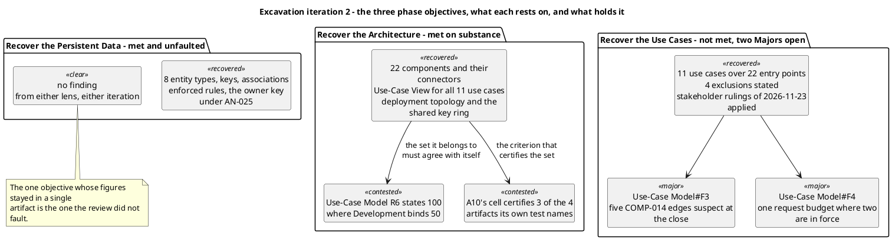
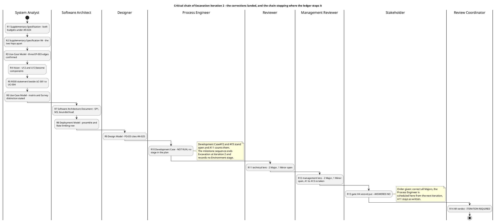
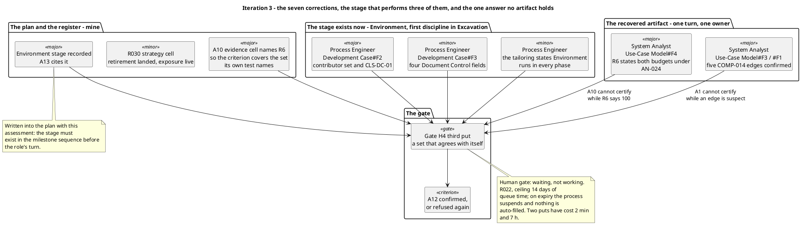

## Document Control
- Phase: Excavation
- Status: Assessed. The milestone verdict is the Review Coordinator's — AR: iteration required — and this record assesses iteration 2 given that verdict; it declares no milestone of its own.
- Milestone Target: end-of-Excavation (AR) — not achieved; iteration 3 required
- Iteration: 2, Cycle 1
- Owner: Project Manager

## Iteration Objectives Reached
The phase planned three objectives. They are assessed against the review that has just ruled, on the artifact each rests on — never on an adjacent artifact's answer. Two are met on the artifacts that carry them; the third is met in substance and blocked from certification by one of its own artifacts.

| # | Phase objective | Satisfied when | Owner | Standing after the review |
|---|---|---|---|---|
| 1 | Recover the Architecture | The Software Architecture Document records the components and connectors and the mechanisms, technology and deployment as the code shows them; the deployment topology is modelled | Software Architect | **Met on its own artifacts** — 22 components with anchors and their connectors, the Use-Case View naming the components each of the eleven use-cases' path crosses, 13 mechanisms, and the Deployment Model's nodes, connectors, environment mapping and key-ring requirement. The three Majors recorded against these artifacts at iteration 1 — `Software Architecture Document#F1`, `Deployment Model#F1` and the copy inherited between them — are closed and verified at SP1, M3, the bounded-load row and the Rate limiting row. It is not certified under A10 only because that criterion is decided on the recovered set as a whole and the Use-Case Model's rules diagram still states one request budget where two are in force |
| 2 | Recover the Use Cases | The Use-Case Model carries one use case per entry-point path, each tracing to the `EP-NNN` it was read from, and accounts for every entry point it does not carry | System Analyst | **Not met** — the carriage is intact: 11 use cases over 22 entry points, four exclusions stated, and three of iteration 1's Majors against this artifact closed (`Vision#F1`, `Use-Case Model#F1`, `#F2`). Two Majors stand at the close: `Use-Case Model#F3` (five `COMP-014 → UC-006` to `UC-010` edges still marked suspect) and `Use-Case Model#F4` (R6 states 100 where `appsettings.Development.json:8-12` binds 50). Neither is a coverage gap and neither adds or removes a use case; both are the confirmation and the transcription of facts the artifact already holds elsewhere |
| 3 | Recover the Persistent Data | The Design Model carries the domain model, the packages and classes, and the persistent data with its entities, keys, associations and enforced rules | Designer, Database Designer | **Met** — 42 classes, the relationship inventory, the eight entity types, the owner key's re-point by the third migration (`AN-025`) and "What the code does not hold", each anchored to `TodoDbContext.cs:11-17` and the three migrations. `Design Model#F1` was a citation on one diagram and is closed. Neither lens recorded a finding against this objective in either iteration |

The two objectives this phase cannot yet close turn on one artifact and one criterion, not on the reading. The recovery read the code correctly in iteration 1 — both contradicted facts were in the System Inventory as `AN-024` and `AN-023` — and iteration 2 corrected five of the six artifacts that cited them. What remains is one diagram, one evidence cell and one stage.

## Adherence to Plan
Iteration 2's fine plan was sixteen items: nine corrections in the recovered artifacts, two Development Case items, two review lenses, one plan-and-register turn, the stakeholder gate and the verdict. Twelve of the fourteen agent items landed. The two that did not are the same role's, and the reason is not that the role failed: the plan recorded the exposure as `R031`, scored it, owned it — and recorded no stage in its own milestone sequence for that role to work in. That is the variance this iteration's own review named as `Iteration Plan#F7`, and it is mine.

| # | Work item | Owner | Planned | Actual | Variance and root cause |
|---|---|---|---|---|---|
| 1 | Supplementary Specification — M3, S2, P1, R8 state both budgets with their sources, under `AN-024` | System Analyst | Not started | Landed — `Supplementary Specification#F1` closed by the lens that recorded it | None. The fact was settled once, in the artifact that owns it |
| 2 | Supplementary Specification — R4 as the two hops stated apart, under `AN-023` | System Analyst | Not started | Landed — `Supplementary Specification#F2` closed | None |
| 3 | Use-Case Model — the three `EP-003` edges re-registered, the screen-versus-operation reading stated | System Analyst | Not started | Landed — `Use-Case Model#F1` closed; the graph reports the edges OK | None. The same act was not performed on the two `COMP-014` edge sets, which is `#F3` |
| 4 | Vision — `U12` and `U13` become components, cross-referenced to M8 and M9 | System Analyst | Not started | Landed — both lenses' `Vision#F1` closed; eleven ellipses only | None |
| 5 | `R030`'s statement beside UC-001 to UC-004, citing `AN-029` | System Analyst | Not started | Landed — `Risk List#F2` (Management Reviewer) closed on it | The register's own strategy cell was not restated with it, which is `Risk List#F3` |
| 6 | Use-Case Model — the matrix-versus-Survey distinction stated once, the edges relabelled | System Analyst | Not started | Landed — `Use-Case Model#F2` closed | None |
| 7 | Software Architecture Document — SP1, M3 and the bounded-load row, under `AN-024` | Software Architect | Not started | Landed — `Software Architecture Document#F1` closed | None. Corrected against the settled Supplementary Specification rather than re-read from code, as `R032`'s action orders |
| 8 | Deployment Model — preamble narrowed, Rate limiting row corrected | Software Architect | Not started | Landed — `Deployment Model#F1` closed | None |
| 9 | Design Model — the `PD-D3` citation changed from `AN-005` to `AN-025` | Designer | Not started | Landed — `Design Model#F1` closed | None |
| 10 | Development Case — every lens named in the contributor set, the three missing edges drawn in CLS-DC-01 | Process Engineer | Not started, on the stakeholder's order alone | **Did not run** — `Development Case#F2` stands open and A11 counts it | The plan placed the item against the role in the text of a work item and recorded Environment as running at no intensity in Excavation; it recorded the exposure as `R031` and gave it no row in the milestone sequence. A recorded exposure with no scheduled stage reproduces itself: this is the second iteration it has held |
| 11 | Development Case — the four Document Control fields brought to the phase the document governs | Process Engineer | Not started | **Did not run** — `Development Case#F3` was recorded by the Reviewer at this gate | Same cause as item 10; it is one turn with it |
| 12 | Technical lens — the eight Majors re-read against their anchors | Reviewer | Not started | Ran — 6 findings closed, 2 Major and 1 Minor recorded | The lens found the same class of defect it had just closed one artifact over — the failure mode reached the criterion's evidence cell |
| 13 | Management lens — A1 to A13 re-taken on the evidence each cites | Management Reviewer | Not started | Ran — 5 of its own findings closed, 2 Major and 1 Minor recorded, the gate re-put | — |
| 14 | Iteration Plan and Risk List — criteria and strategies stated as the evidence establishes them | Project Manager | Done in iteration 1's closing turn | Landed in iteration 1 — `Iteration Plan#F3`, `#F4`, `#F5` and `Risk List#F2` (Reviewer) closed | The criteria were restated and the evidence cells were not re-derived to match, which is `Iteration Plan#F6` |
| 15 | Gate H4 re-put, once | Stakeholder | Queued | **Answered No** — the sanction was refused a second time and the Majors ordered corrected | Queue time 7 h 08 min 04 s, reported apart below |
| 16 | AR milestone verdict | Review Coordinator | Not started | **Iteration required** — 0 Critical, 5 Major entries over 4 distinct defects, 3 Minor | — |

**Measured actuals, two currencies, never added.** These are what the system recorded for this iteration. The phase has not closed, so no phase actual exists and no per-iteration figure is quoted as a velocity.

| Measure | Iteration 1 | Iteration 2 | What it is |
|---|---|---|---|
| Agent time — the system working | 1 h 19 min 41 s | 41 min 21 s | Elapsed agent time, queue subtracted, end-of-iteration approval gate excluded |
| Stakeholder queue — a person deciding when to sit down | 2 min 27 s | 7 h 08 min 04 s | Waiting, not working. Reported apart from agent time and never added to it |
| Tokens | 43,561,437 | 20,675,161 | Agent spend; the unit in which agent work is denominated |
| Agent invocations | 16 | 16 | — |
| Stakeholder interactions recorded | — | 18 | — |
| Artifacts in the project | 12 | 12 | No artifact was created or retired this iteration |

The forecast the previous Iteration Assessment made — that a corrective pass costs less in tokens and less in elapsed agent time than the cold reading that preceded it — is borne out by measurement, not by argument: 20.7 million tokens against 43.6 million, and 41 minutes against 80. The 18 interactions produced a queue of seven hours, so the gate's cost is not the count of questions put to the stakeholder between them; R022's mitigation is to ask in the turn the question is found, and its contingency is to bound the gate, not to ask less. No forecast is stated for iteration 3: two iteration figures are not a rate, and the phase holds no actual. What can be said of iteration 3 is a claim about the work and not a measurement — eight actions, five of them a sentence or a cell in an existing section, against sixteen items that each re-read a section to correct it: `[ASSUMPTION — requires validation: the comparison is the Project Manager's reading of the two iterations' work; iteration 2's 20.7 million tokens against iteration 1's 43.6 million is the only measured pair bearing on it, and it compares a cold reading with a broad corrective pass, not with a narrow one]`.

The project declares no token budget, so there is no box to fit: no figure is proposed for the stakeholder to accept, and no declared work is cut or deferred to meet an estimate.

## Use Cases and Scenarios Implemented
None implemented, and none was to be. Excavation writes no code; the Implementation discipline does not work in the sprint zero, and `Test Plan` is NOT FIRED. What this iteration delivered is a recovered set whose membership is unchanged from iteration 1 — no use case was added, removed, merged or reclassified, and none of the four exclusions was re-opened — with the text around it corrected in five artifacts.

| Recovered element | Count | What it rests on |
|---|---|---|
| Use cases | 11 — `UC-001` to `UC-011` | Each traces to the `EP-NNN` whose code performs it; the four exclusions are stated with their reasons |
| Use cases with two scenarios | 5 — `UC-001`, `UC-002`, `UC-006`, `UC-007`, `UC-008` | A screen route and a direct API route to the same operation, differing only in how the caller authenticated. One use case with two scenarios, never one use case per actor |
| Actors | ACT-001 the signed-in person, ACT-002 the external provider, ACT-003 the API caller | — |
| Components | 22 — `COMP-001` to `COMP-022` | Each recovered with its anchor and its connectors; the Use-Case View names the components each use case's path crosses |
| Persistent entity types | 8 | The three migrations and `TodoDbContext.cs:11-17`; the owner key's re-point recorded with its migration (`AN-025`) |
| Stated exclusions | 4 | External-provider sign-in recovered and unreachable; the `admin` branch an exceptional entity; the health endpoints and the migration event not use cases |

The two open Majors bear on the count's qualification and not on its membership: `Use-Case Model#F3` leaves five `COMP-014` edges unconfirmed, so the shared rate-limit mechanism is not yet certified for `UC-006` to `UC-010`; `Use-Case Model#F4` states one request budget where two are in force. Until both are corrected the count of eleven is carried to the stakeholder with its qualification open.

| Handoff to Consolidation | State at this assessment |
|---|---|
| The eleven use cases, each with its `EP-NNN` and its anchor | Delivered; five `COMP-014` edge confirmations open |
| The four exclusions and the ruling behind each | Delivered; not re-opened by either refusal |
| The 22 components and the Use-Case View that ties them to the use cases | Delivered; no open finding |
| The eight entity types, the keys, the associations and the enforced rules | Delivered; not faulted in either iteration |
| The 32 scored, owned risks | Delivered; one strategy cell to restate (`Risk List#F3`) |
| Coverage: 84 files read of 139, the remainder named | Delivered; both lenses recomputed the arithmetic and it reproduces |
| What remains unrecovered | Named for Consolidation: the areas below priorities 1 to 5, and every use case the deeper reading of areas 6 to 8 may produce |

## Results Relative to Evaluation Criteria
One line per criterion the Iteration Plan carries, each decided on the evidence the artifact it cites records.

| # | Criterion | State | Evidence, and the finding that bears on it |
|---|---|---|---|
| A1 | The operations the system performs are recovered as use cases | **Not met** — open Major | Use-Case Model — Use-Case Survey: `UC-001` to `UC-011` each with its `EP-NNN`, and "Not recovered, and why" accounting for `EP-020`, `EP-021`, `EP-022` and the `admin` branch. Carriage is intact. `Use-Case Model#F3`: five `COMP-014 → UC-006` to `UC-010` `Realizes` edges are still marked suspect in the registered graph at the close |
| A2 | The recovered use cases are read from the priorities the reading ordered first | Met | System Inventory — Priorities, areas 1 to 5; the eleven use cases trace to `EP-NNN` in each. `Iteration Plan#F4` closed this iteration on the narrowed wording, which claims nothing about priorities 6 to 8 |
| A3 | The architecture is recovered and checked against the use cases | Met | Software Architecture Document — Logical View and Use-Case View. `Software Architecture Document#F1` closed: SP1, M3 and the Quality view's bounded-load row state 50 / 50 / 50 as the bound in force under `AN-024` |
| A4 | The data is recovered with its anchors | Met | Design Model — persisted domain classes, the relationship inventory and "What the code does not hold", anchored to `TodoDbContext.cs:11-17` and the three migrations. `Design Model#F1` closed |
| A5 | The deployment is modelled | Met | Deployment Model — Deployment Topology, Nodes and Connectors, Environment Mapping. `Deployment Model#F1` closed: the preamble is narrowed to what the files hold and the Rate limiting row reads 50 / 50 / 50 for Development |
| A6 | The coverage is measured and the remainder declared | Met | System Inventory — Coverage: 84 read and 55 unread of 139; both lenses recomputed the per-area sums and the headline reproduces |
| A7 | Every anomaly the recovery surfaced is carried as a scored risk | Met | Risk List — Risk Register: 29 `Refines` edges from `AN-NNN`, plus `R022`, `R031` and `R032` with their separate origins stated; every anomaly-derived score reproduces from the one published mapping |
| A8 | No accepted risk above Moderate lacks the stakeholder's grant | Met | Risk List — the grant table: four grants at 4 × 3 = 12 on `R004`, `R011`, `R012` and `R016`, each in the stakeholder's own words. No risk this iteration placed in the grant band took the accept strategy, so no second grant was sought and none is assumed |
| A9 | Every risk is actionable | Met | Risk List — Risk Mitigation and Contingency: all 32 rows name a strategy, an owner, an action, a contingency and a warning sign. `Risk List#F2` (Management Reviewer) closed. `Risk List#F3` is a transcription in one strategy cell and the criterion's subject, actionability, is not in question |
| A10 | The recovery states what the code does, not what it was meant to do | **Not met** — open Major | Two artifacts of the recovered set are not yet certified. `Use-Case Model#F4`: the rules diagram's R6 reads "100 tokens, 100 per 10 s, queue 100, 429" and cites no `AN-024`, while the same artifact's gate diagram states both values and `Todo.Api/appsettings.Development.json:8-12` binds 50 — one artifact carrying two answers to one question. `Iteration Plan#F6`: A10's evidence cell names the Supplementary Specification, the Software Architecture Document and the Deployment Model and stops, while its own test names the recovered set, of which the Use-Case Model is a member. Supplementary Specification M3, S2, P1, R8 and R4, the Software Architecture Document's SP1, M3 and bounded-load row, and the Deployment Model's Rate limiting row are all verified corrected under `AN-024` and `AN-023` |
| A11 | The Minors the SBC review left open are closed | **Not met** — two of four this pass | `Development Case#F2` and `Development Case#F3` both stand: the contributor set still omits the Management Reviewer, the Business Reviewer and the Review Coordinator, CLS-DC-01 draws no edge from them, and Document Control is a phase behind. `Iteration Plan#F2`, `Iteration Plan#F3` and `System Inventory#F3` remain closed from iteration 1. The criterion stays as written on the stakeholder's order of 2026-11-23; no carry to Inception is recorded |
| A12 | The recovered set is confirmed by the stakeholder | **Not met — refused** | Gate H4 was put for the second time and answered **No**. The answer is recorded as given and nothing in it is written as a confirmation it did not contain. The criterion turns on the stakeholder's answer alone and no artifact holds it; it is re-put after iteration 3's actions land |
| A13 | The plan names no work the process does not run | **Not met** — open Major | `Iteration Plan#F7`: the plan's A13 evidence cell states "the Development Case records Environment as High in Survey and Inception and inactive here", and the milestone sequence ends Excavation at iteration 2, so it names no stage for the two Development Case items. The stakeholder's answer of this milestone makes Environment the phase's first discipline; the sequence must record it and the cell must cite it |

**Eight met, five not met.** No criterion is certified on another criterion's answer and no finding is waived by a criterion's state. The three that moved backwards since iteration 1 — A1, A10 and A13 — moved because the review read them harder, not because the artifacts regressed: A1 and A10 turn on two defects iteration 1's ledger had not found, and A13 on the order the stakeholder gave at this gate.

## Test Results
No test was executed in this iteration and none was planned. The Test discipline works from Elaboration, no test case is written before a use case is specified, and the Development Case records `Test Plan` NOT FIRED. No Test Evaluation Summary exists in Excavation. This section therefore rests on the review, and nothing below is presented as a test result.

| Detector that operated | What it found | What it decided |
|---|---|---|
| Technical lens (Reviewer) | 6 findings closed, 2 Major and 1 Minor recorded — `Use-Case Model#F3`, `#F4`, `Development Case#F3` | The count the stakeholder is asked to sanction still carries an unconfirmed mechanism and a contradicted budget |
| Management lens (Management Reviewer) | 5 of its own findings closed, 2 Major and 1 Minor recorded — `Iteration Plan#F6`, `#F7`, `Risk List#F3`; A1 to A13 re-taken; gate H4 re-put | A10 and A13 not certifiable; A11 unmet; the sanction refused and the Development Case ordered corrected in this phase |
| Review Coordinator | 35 cumulative entries over ten artifacts, 27 closed by their recording lens, 8 open — 0 Critical, 5 Major entries covering 4 distinct defects, 3 Minor | AR: iteration required. No escalation to change control: no systemic process failure, every finding anchored, and every remaining finding now has an owner with a stage in the phase |

| Review measure | Value | The decision it enables |
|---|---|---|
| Artifacts under review | 10 of 10 read by both executed lenses; 9 received an explicit no-finding statement | Whether any artifact advanced unwatched. None did |
| Finding entries, cumulative | 35 — 27 closed, 8 open | Whether the correction converges. It does: 16 open at the previous gate, 8 at this one, over two artifacts rather than seven |
| Open entries by severity | 0 Critical, 5 Major entries over 4 distinct defects, 3 Minor | Whether a stakeholder decision is needed to unblock. It is not: no Critical means every remaining defect is one its owner corrects |
| Artifacts carrying an open Major | 2 — the Use-Case Model and the Iteration Plan | Where the next iteration's work concentrates. One artifact is another role's, one is mine |
| Duplicate subjects reached by both lenses | 2 — the five `COMP-014` edges, and the request budget read at the artifact and at the criterion | Whether a Major is a real defect. Two lenses reaching one defect independently without seeing each other's key is the signature of a real one, and it is |
| Defect removal efficiency | Not computable | No test execution has run in the sprint zero; no ratio is invented |
| Rework effort | Not measured per finding | No per-finding token or elapsed-time attribution exists. The iteration's own spend is recorded whole in Adherence to Plan |

Three test-related risks carry into Consolidation, registered rather than recorded as findings: `R012` (the BFF and the client carry no test of any kind, and the three defective `/auth` flows are exactly the untested ones — granted at exposure 12), `R005` (the test host builds the schema with `EnsureCreated`) and `R011` (the suite reproduces the bearer-token ticket format from framework internals — granted at exposure 12). None is retired by this phase and none can be: writing tests is work no phase before Elaboration runs.

## External Changes
| Change | Effect on this iteration | Handled by |
|---|---|---|
| The stakeholder refused the AR sanction for the second time, on 0 Critical, 4 Major defects over 2 artifacts and 3 Minor | The milestone does not close on this iteration's evidence. A12 is not met and iteration 3 opens, planned from the Review Record | Iteration Plan — the milestone sequence and iteration 3's fine plan; this record's Rework Required |
| The stakeholder refused the recommended carry and ordered the Development Case corrected now, before the milestone closes | `A11` stays as written and no carry to Inception is recorded. The two Minors are corrected in this phase | Iteration Plan — iteration 3, Environment stage; the Review Record's action table |
| The stakeholder restated the process baseline: **Environment runs in every phase, and in Excavation it is the first discipline, with the Process Engineer's stage** | The stage the two Minors needed now exists in the process, not on an order. The Development Case must be brought to that baseline, and the plan must record the stage — the answer also settles A13's evidence | Iteration Plan — Resources and Evaluation Criteria, written with this assessment; Development Case, iteration 3 |
| The stakeholder made no statement about the recovered set's membership | The eleven use cases, the four exclusions, the 22 components and the eight entity types stand as recorded; nothing was added, removed or re-opened | This record; the Iteration Plan's scope statement |
| `R004`, `R011`, `R012` and `R016` remain accepted at exposure 12 on the stakeholder's own answers of 2026-11-23 | No risk in the Significant or High band lacks a grant, and no new grant was required: no risk this phase added takes the accept strategy in the grant band | Risk List — the four-row grant table |
| No scope change reached the project and no Change Request was opened | Nothing the stakeholder said adds, removes or reorders declared work; the delivery declares no scope. The Change Control Manager does not work in the sprint zero, so the answers reach their owners through the Review Record and their Work Orders | This record; the Review Record's ledger |
| No SCM condition arose | The repository carries no IARI pipeline on `main`, no branch of this process and no open pull request. Establishing the pipeline is the Integrator's Inception work item, and `R007` waits on it | Not reported as passing or failing |

## Rework Required
Iteration 3 is required, and this section is what it performs. Eight actions remain, in the Review Coordinator's order: three are the Project Manager's and are written into the Iteration Plan and the Risk List with this assessment, two are the System Analyst's on the Use-Case Model, and three are the Process Engineer's in the Environment stage the stakeholder has now created.

| # | Action | Artifact | Owner | Closes | Due point |
|---|---|---|---|---|---|
| 1 | Record the Environment stage in the milestone sequence as the phase's first discipline, place the two Development Case items against the Process Engineer in iteration 3, and restate A13's evidence cell to cite that stage | Iteration Plan | Project Manager | `Iteration Plan#F7` | Written with this assessment — the stage exists before the role's turn |
| 2 | State both budgets in R6 under `AN-024` — code defaults 100 / 100 per 10 s / queue 100 from `RateLimitExtensions.cs:14-31`, Development override 50 / 50 / 50 from `appsettings.Development.json:8-12` as the value in force | Use-Case Model | System Analyst | `Use-Case Model#F4` | Iteration 3, first among the artifact corrections |
| 3 | Re-register the five `COMP-014 → UC-006` to `UC-010` edges as confirmed, each checked against `TodoApi.cs:19-20`, and record beside the gate diagram why a throttling mechanism gates an operation without being it | Use-Case Model | System Analyst | `Use-Case Model#F3`, `Use-Case Model#F1` | Same turn as action 2 |
| 4 | Name the Use-Case Model's R6 in A10's evidence cell, so the criterion is certified on all four artifacts its test covers | Iteration Plan | Project Manager | `Iteration Plan#F6` | After action 2 lands — the cell cannot certify what is not yet correct |
| 5 | Name every lens writing into the Review Record — Reviewer, Management Reviewer, Business Reviewer, Review Coordinator, CodeReviewer, plus the Configuration Manager's baseline record — and draw the corresponding edges in CLS-DC-01 | Development Case | Process Engineer | `Development Case#F2` — **A11 counts this** | Iteration 3, in the Environment stage action 1 records |
| 6 | Bring the four Document Control fields forward to the phase the document governs | Development Case | Process Engineer | `Development Case#F3` — **A11 counts this** | Same turn as action 5 |
| 7 | State in the Development Case that Environment runs in every phase, and in Excavation as its first discipline, so the tailoring matches the baseline the rest of the document is read against | Development Case | Process Engineer | The tailoring statement the stakeholder ordered corrected alongside the two Minors | Same turn as actions 5 and 6 |
| 8 | Restate R030's strategy cell: the retirement has landed in the Use-Case Model under `AN-029`, and the exposure stays live because `AN-012` stands and no test covers the surface | Risk List | Project Manager | `Risk List#F3` | Written with this assessment |
| 9 | Put gate H4 once, on the set the actions above leave, and record the answer as given | — | Project Manager puts it; the stakeholder answers | `A12` | After actions 2, 3, 5, 6 and 7 land |

### What iteration 3 changes, and what it does not

| Lever | Decision | Reason |
|---|---|---|
| Iteration count | **Increased by one** — Excavation iteration 3, planned from this record | The lever this project has, and the one the stakeholder placed the Environment turn in: "so the phase closes in one iteration". Declared work is never cut to fit a plan |
| Declared scope | **Unchanged** — no use case, component, table, risk or exclusion is dropped | The delivery declares no scope and the recovery records the system as it is. Nothing in this record is a scope decision the stakeholder made or could be asked to make |
| Agent parallelism | **Unchanged** — no role is added, duplicated or promoted | Seven corrections across three owners, all one turn each. Adding roles would add contention over the same artifact surface and buy no clock |
| Agent role assignment | **One change**: the Process Engineer now holds a stage in this phase — the Environment discipline, first in the phase, on the stakeholder's restatement of the process baseline | This is a tailoring correction the stakeholder ordered, not a deviation this role grants. It is recorded in the plan's Resources and milestone sequence and must be brought to the Development Case baseline in the same iteration |
| Gate H4 | **Put a third time, once**, after the seven corrections land | The two puts so far were made on sets that did not agree with themselves. The stakeholder answered No twice for the same reason: the set was not yet correct |

No figure is projected for iteration 3: the phase has not closed, so no phase actual exists, and two iteration figures are not quoted as a rate. What is recorded is what this iteration cost, in the two currencies, apart.

### Lessons carried into iteration 3

1. **A plan that names an exposure without scheduling its owner reproduces the exposure.** `R031` was recorded, scored, owned and given a warning sign in iteration 1; it materialized in both iterations because the milestone sequence had no row for the role. The remedy was never a better warning — it was a stage.
2. **Restating a criterion's test does not widen its evidence to match.** A10 was restated this cycle to "the recovered set" while its evidence cell stayed at three artifacts. When a criterion's test changes scope, its evidence cell is re-derived from the new scope, not edited in place.
3. **A fact corrected in one artifact is not settled across the set.** Four of iteration 2's Major entries were two code facts re-transcribed. The fact must be settled once, in the artifact that owns it, and the others corrected against it — which is `R032`'s action and the reason five of this iteration's nine corrections were one turn each.
4. **A gate answers with what it is given.** H4 has been put twice on sets that did not agree with themselves and refused twice. The queue cost rose from two minutes to seven hours, and no answer changed because the question was asked earlier. Ask once, on a set that agrees.
