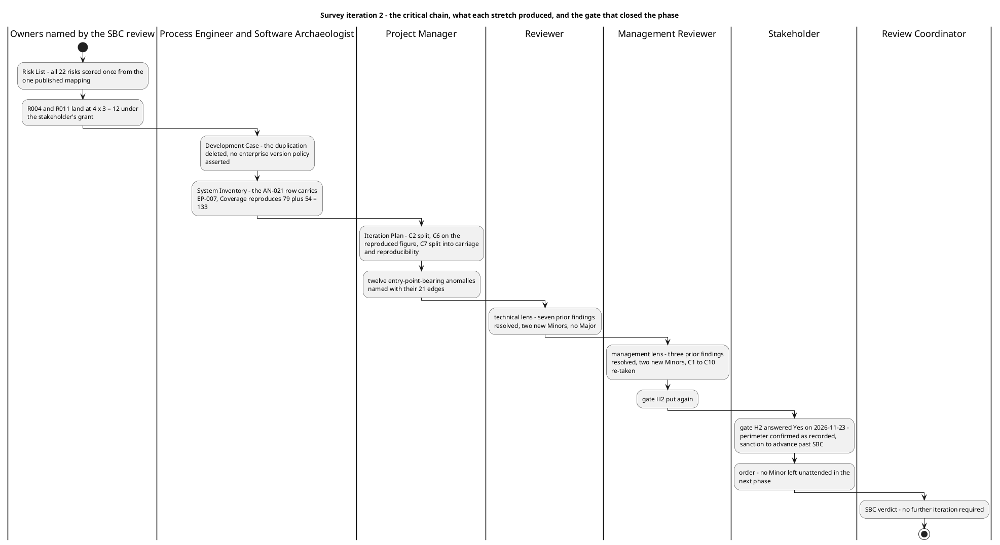
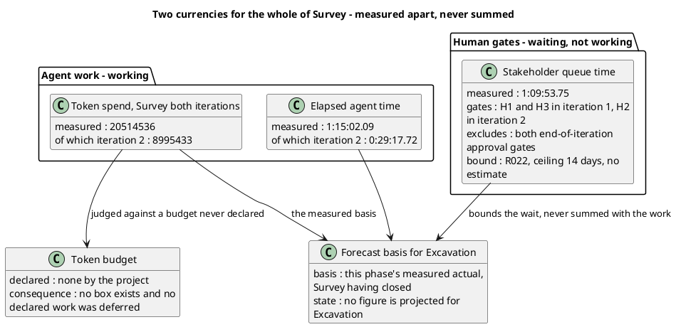
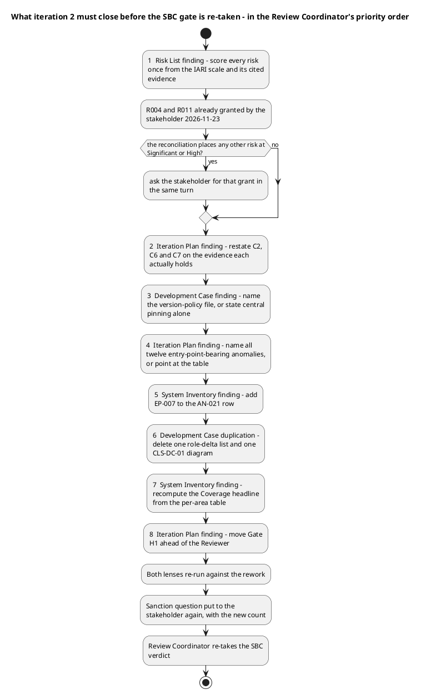

## Document Control
- Phase: Survey
- Status: Assessed. The milestone verdict is the Review Coordinator's and is recorded in the Review Record; this record assesses the iteration given that verdict and declares no milestone of its own.
- Milestone Target: end-of-Survey (SBC) — verdict issued by the Review Coordinator
- Iteration: 2, Cycle 1
- Owner: Project Manager
## Iteration Objectives Reached
Nine objectives were planned across the phase — six for the phase, three for its second iteration — and nine were delivered. The iteration-1 review left ten findings open against four artifacts; all ten are resolved by the lenses that recorded them, and the four that remain open are Minors below the milestone's hold. Objective delivery and milestone exit are separate questions and this record answers them separately: the verdict on the milestone is the Review Coordinator's, recorded in the Review Record.

```plantuml
@startuml
title The phase's nine objectives - what each delivered, and the two Minors that sit inside two of them
skinparam shadowing false
skinparam classAttributeIconSize 0
hide empty members
skinparam wrapWidth 240

package "O1 to O6, planned for the phase" {
  class "O1 tailoring exists" as O1 {
    verdict : Met
    settled : version policy no longer asserted
    open : Development Case F2 Minor
  }
  class "O2 perimeter read and stated" as O2 {
    verdict : Met
    evidence : four processes, 22 entry points anchored
  }
  class "O3 unread remainder declared" as O3 {
    verdict : Met
    evidence : 79 read, 54 unread of 133, reproduces
  }
  class "O4 anomalies carried as scored risks" as O4 {
    verdict : Met
    evidence : 21 anomalies, 22 risks, one mapping
  }
  class "O5 priorities ordered, answer recorded" as O5 {
    verdict : Met
    evidence : eight areas, answer of 2026-11-23
  }
  class "O6 plan exists" as O6 {
    verdict : Met
    evidence : milestone sequence, nine work items
  }
}

package "O7 to O9, planned for iteration 2" {
  class "O7 every finding reworked" as O7 {
    verdict : Met
    evidence : ten iteration-1 findings resolved
  }
  class "O8 criteria rest on their own evidence" as O8 {
    verdict : Met
    evidence : C2 split, C6 reproduced, C7 split
  }
  class "O9 the perimeter put again" as O9 {
    verdict : Met
    evidence : gate H2 answered Yes 2026-11-23
  }
}

class "Phase outcome at this record" as PH {
  open Critical : 0
  open Major : 0
  open Minor : 4
  exit criteria met : 12 of 12
}

O1 --> PH
O2 --> PH
O3 --> PH
O4 --> PH
O5 --> PH
O6 --> PH
O7 --> PH
O8 --> PH
O9 --> PH
@enduml
```

| # | Objective | Owner | Verdict | Basis |
|---|---|---|---|---|
| O1 | The tailoring that governs the sprint zero exists | Process Engineer | Met | Development Case records `business-process-led = false`, `real-time-system = false`, one OPTIONAL fired (Deployment Model) with its §5.2 condition and five NOT FIRED each justified. `Development Case#F1` (Reviewer) — the unsourced enterprise version policy that directed the Software Architect at a policy existing nowhere — is resolved, and the section now asserts no policy and cites only `Directory.Packages.props`, `global.json` and `nuget.config`. One Minor remains (`Development Case#F2`, Management Reviewer) on the lens list of the Review Record |
| O2 | The existing system is read and its perimeter stated | Software Archaeologist | Met | System Inventory records four processes, 19 components, 9 external systems, 5 stores and `EP-001`…`EP-022`, each with kind, initiator and anchor. `System Inventory#F1` (Reviewer) is resolved: the `AN-021` row carries `EP-004`, `EP-005` and `EP-007`, matching the diagram and the registered edges |
| O3 | The unread remainder is declared rather than left implicit | Software Archaeologist | Met | Coverage declares 133 files, 79 read and 54 unread, and the figure reproduces from its own per-area table — the `Read` column sums to 79 and the `Files` column to 133. `System Inventory#F2` (Reviewer) is resolved on that recomputation; every unread file is named with the reason it was not read and none carries a perimeter fact |
| O4 | The anomalies the reading found are carried as scored, actionable risks | Project Manager | Met | 21 anomalies map to 22 risks, each with strategy, owner, action, contingency and warning sign. `Risk List#F1` under both lenses is resolved: one published word-to-score mapping, all 21 anomaly-derived rows reproduce from it, no inventory word scores differently in different rows, and `R004` and `R011` land at 4 × 3 = 12 rather than below the grant band |
| O5 | The reading's priorities are ordered and the stakeholder's answer recorded | Software Archaeologist | Met | Eight areas carry an order and a reason, and the 2026-11-23 answer — the order stands as it is, nothing matters more than it reflects, nothing left out — is quoted in Priorities |
| O6 | The project's plan for the rest of the sprint zero and the RUP phases exists | Project Manager | Met | Iteration Plan carries the milestone sequence for the sprint zero and the seven RUP phases, the iteration-2 critical chain, nine fine-plan work items with owners and twelve exit criteria |
| O7 | Every finding the SBC review recorded against an artifact is reworked by the artifact's owner | Owners the Review Record names | Met | Ten iteration-1 findings — five Major, five Minor — are resolved by the lens that recorded each, verified against the corrected section. The Review Coordinator's consolidated ledger records 0 open Critical and 0 open Major from either executed lens |
| O8 | The exit criteria rest on the evidence each criterion actually has | Project Manager | Met | `Iteration Plan#F1` (Management Reviewer) is resolved: C2 is split into the answered membership and priority questions and the confirmation the stakeholder had not then given, C6 cites the coverage figure the System Inventory reproduces from its own table, and C7 is split into carriage and reproducibility, each decided on the artifact it cites |
| O9 | The perimeter as recorded is put to the stakeholder again | Project Manager puts it; the stakeholder answers | Met — 2026-11-23 | Gate H2 answered Yes: the four-process perimeter with its 22 entry points, 21 anchored anomalies and eight priority areas confirmed as recorded, and the sanction to advance past SBC into Excavation granted, with the order that the Minor findings be addressed in the next phase. This is the objective the phase's first iteration could not close and the reason Survey ran a second |

### The three phase objectives as the work order states them

| Phase objective | Where the plan carries it | Verdict |
|---|---|---|
| Confirm the System Boundary | O2 with C1, C2a, C2b, C3 | Met — the perimeter is stated with anchors and confirmed by the stakeholder at gate H2 on 2026-11-23 |
| Tailor Development Process | O1 | Met — two disciplines inactive behind their recorded conditions, one OPTIONAL fired, five NOT FIRED justified, measurement policy stated; the unsourced version policy removed |
| Identify Critical Risks | O4 with C7a, C7b, C8, C9 | Met — 21 anomalies carried as 22 scored, owned risks on one reproducible mapping, four Significant acceptances each under the stakeholder's own grant |

No objective was missed and none was deferred. Every one of the four Minors still open sits on content the milestone approves: none states an objective unmet, and the stakeholder's order of 2026-11-23 assigns each to its owner in Excavation's first iteration.

## Adherence to Plan
The plan for iteration 2 was a strictly sequential chain of nine work items — the rework the SBC review ordered, the two lenses, the re-taken gate and the verdict — and it ran as planned: every item reached its close in the planned order, gate H2 was answered inside the iteration rather than queued behind the verdict, and the reconciliation placed no risk in the grant band that the stakeholder had not already granted. The phase's divergence sits in its first iteration, whose review returned six open Major findings and a refused sanction, and it is what this second iteration existed to repair.

### Two currencies, measured apart

| Currency | Scope | Measured | What decision it enables |
|---|---|---|---|
| Token spend | Survey, whole phase — iterations 1 and 2 | 20514536 | The measured basis Excavation's plan is built from now that Survey has closed. 8995433 of it is iteration 2's own spend |
| Elapsed agent time | The same stretch | 1:15:02.09 | The clock figure quoted beside the spend, never added to it. Iteration 2 alone: 0:29:17.72 |
| Stakeholder queue time | Human gates H1 and H3 in iteration 1, H2 in iteration 2 | 1:09:53.75 | Whether the human gates, not the agent work, dominate this phase's wall clock. Excludes both end-of-iteration approval gates, neither of which is measured |

The two are reported side by side and never summed: the third row is waiting, not working. No token budget exists — the project declares none — so no spend is judged against a box and no declared work was deferred to fit one.

The queue time is within twenty minutes of the agent time across a whole phase that took two iterations: what lengthens a phase here is a gate waiting for an answer, not an agent working. That is the single most useful measurement this phase produced, and it is why the two Significant acceptances were put to the stakeholder inside the iteration rather than held behind the score reconciliation. One gate was used twice — H2 was refused at the iteration-1 review and answered at the re-take, and each pass is a queue cycle the plan cannot compress by adding roles.

### What the plan got right, and what it got wrong about itself

| Planned | Outcome | Variance | Root cause | Adjustment forced in iteration 2 |
|---|---|---|---|---|
| Nine work items, sequential, each owned | All nine reached Complete in the planned order | None | — | None. The chain is not re-planned: no item is split, added or reordered |
| Gate H1 answered inside the iteration | Its four questions were answered 2026-11-23 | None on perimeter membership, the priority order or `R012`/`R016` | — | None. H1 is met and recorded in the Iteration Plan's gate table |
| The perimeter sanction treated as answered by gate H1 | It was put separately at the review and refused; the plan now records it as gate H2, not met | The milestone slipped for want of a sanction the plan assumed it already had | The plan treated the two perimeter-membership answers as if they were the perimeter confirmation, and wrote C2 as met on them | `Iteration Plan#F1` (Management Reviewer): C2 restated as C2a (answered) and C2b (not met) — corrected in the Iteration Plan this iteration |
| Review closes the iteration when exit criteria pass | Review returned 6 open Major, verdict iteration required | Milestone slips to an iteration the phase did not plan | Two causes, both inside the artifacts: scores that do not reproduce from their stated inputs, and exit criteria certified on evidence that does not state them | Iteration 2 is planned from this record. No new scope enters it: every item is a correction to content already written |
| Risk List scores the anomalies for sequencing | The register holds 22 risks, all owned and scored | 13 of 21 scores contradict the inventory's likelihood and impact; `R004` and `R011` sat below the grant band only because of it | Every anomaly was scored afresh from its evidence without reconciling against the inventory's own column, and with no single mapping from the inventory's words to the IARI scale | `Risk List#F1`: score each risk once, or declare the score the Project Manager's own reading. The two named risks now carry the stakeholder's conditional grants of 2026-11-23; only the arithmetic is owed |
| Hand the entry-point-bearing anomalies to Excavation | A count of twelve was stated and a list of seven named | Five constraints on priorities 6 and 8 were not handed over | The count was written first and the list enumerated from memory rather than from the System Inventory's Anomalies table | `Iteration Plan#F1` (Reviewer): all twelve now named in a table with what each forbids — corrected in the Iteration Plan this iteration |
| Coverage figure quoted as C6's evidence | The figure is quoted | The headline does not reproduce from the per-area table it sits beside | The headline was authored, not summed from the table | `System Inventory#F2`: recompute; then C6 cites the settled figure. C6 is restated in the Iteration Plan this iteration as met in substance with its evidence unreconciled |

No work item is reopened by this assessment: an item marked Complete that delivered defective content is a finding against its artifact, which is where the reviews recorded it, not an unfinished item of the chain. The three corrections the Project Manager could make without the reconciliation — the anomaly handoff, the split of C2, and the restatement of C6 — are already written into the Iteration Plan this iteration; the remaining open items are the reconciliation of the scores and the two artifacts the other owners hold.

### What the iteration-1 plan got right, and what it got wrong about itself

| Planned | Outcome | Variance | Root cause | Adjustment forced |
|---|---|---|---|---|
| Nine work items, sequential, each owned | All nine reached Complete in the planned order | None | — | None. The chain was not re-planned: no item split, added or reordered |
| Gate H1 answered inside the iteration | Its four questions were answered 2026-11-23 | None on perimeter membership, the priority order or `R012`/`R016` | — | None. H1 is met and recorded in the Iteration Plan's gate table |
| The perimeter sanction treated as answered by gate H1 | It was put separately and refused; recorded as gate H2 and re-taken | An iteration the phase did not plan | The plan treated the two perimeter-membership answers as if they were the perimeter confirmation, and wrote C2 as met on them | `Iteration Plan#F1` (Management Reviewer): C2 split into C2a and C2b — resolved; C2b met at the re-take on 2026-11-23 |
| Review closes the iteration when exit criteria pass | The iteration-1 review returned six open Major findings | Milestone slipped one iteration | Two causes inside the artifacts: scores that did not reproduce from their stated inputs, and criteria certified on evidence that did not state them | Iteration 2 planned from that record with no new scope; both causes closed this iteration |
| Risk List scores the anomalies for sequencing | 22 risks, all owned and scored | 13 of 21 scores contradicted the inventory's own likelihood and impact; `R004` and `R011` sat below the grant band only because of it | Each anomaly was scored afresh with no single mapping from the inventory's words to the IARI scale | `Risk List#F1` under both lenses — resolved: one published mapping, every score reproduces, both risks at exposure 12 under the stakeholder's grant |
| Hand the entry-point-bearing anomalies to Excavation | A count of twelve was stated and seven named | Five constraints on priorities 6 and 8 were not handed over | The count was written first and the list enumerated from memory rather than from the Anomalies table | `Iteration Plan#F1` (Reviewer) — resolved: all twelve named with the 21 edges |
| Coverage figure quoted as C6's evidence | The figure is quoted | The headline did not reproduce from the table beside it | The headline was authored, not summed | `System Inventory#F2` — resolved; C6 now cites the reproduced 133 / 79 / 54 |

### What this iteration got wrong about itself

| Planned | Outcome | Variance | Root cause | Adjustment |
|---|---|---|---|---|
| Nine work items close the review's findings | Ten prior findings closed; two new Minors recorded against the Development Case and the Iteration Plan | Four Minors open at the close of the phase, none above Minor | The rework corrected content but left two status statements stale: the Development Case's lens list and the Iteration Plan's C2b evidence cell | Both addressed in this turn for the Iteration Plan; `Development Case#F2` and `System Inventory#F3` remain with their owners, ordered into Excavation's first iteration on the stakeholder's instruction of 2026-11-23 |
| Gate H2 answered inside the iteration | Answered Yes 2026-11-23 | None | — | None. The re-take cost one queue cycle and no agent time beyond the lenses already planned |
| The reconciliation might place a further risk in the grant band | It placed none beyond the four already granted | None | The one mapping reproduced the four at exposure 12 and left the remaining ten Significant-band risks avoided rather than accepted | None. No second questionnaire was needed and none was put |

No work item is reopened by this assessment: an item marked Complete that delivered defective content is a finding against its artifact, which is where the reviews recorded it. The phase's declared scope is untouched — nothing the stakeholder said in two iterations adds, removes or reorders declared work, because Survey reads the system as it is and the declared change is worked from Inception.

## Use Cases and Scenarios Implemented
None, correctly. Survey recovers no use case: the 22 entry points are recorded as entry points in the System Inventory, and it is Excavation that recovers them into `UC-NNN` in the reading order of the Priorities section. No use-case realization, no scenario and no test case exists at this point, and none is missing — no artifact of this phase produces one.

What the phase hands forward is the material those use cases are recovered from, and it is now complete:

| Handoff to Excavation | State at the close of Survey |
|---|---|
| Entry points | `EP-001` … `EP-022`, each with kind, initiator and anchor — the source every recovered use case cites |
| Anomalies constraining a recovered use case | `AN-001`, `AN-002`, `AN-004`, `AN-008`, `AN-009`, `AN-010`, `AN-015`, `AN-017`, `AN-018`, `AN-019`, `AN-020`, `AN-021` — twelve, each named in the Iteration Plan's handoff table with what it forbids a recovered use case to claim, and with the 21 edges the System Inventory records |
| Anomalies carried as risks instead | `AN-003`, `AN-005`, `AN-006`, `AN-007`, `AN-011`, `AN-012`, `AN-013`, `AN-014`, `AN-016` — nine, concerning the build, the tests and the delivery rather than a path a use case is recovered from |
| Stakeholder rulings Excavation must honour | The external-provider sign-in path is a recovered use case marked unreachable in the delivered configuration; the cross-owner `admin` branch is an exceptional entity and not a recovered use case (`R004`) |
| Reading order | The eight priority areas as ordered in the System Inventory's Priorities, confirmed by the stakeholder on 2026-11-23 with nothing left out |
| Risks whose action the System Analyst or Designer performs | `R001`, `R019`, `R020`, `R021` (System Analyst); `R003`, `R018` (Designer); `R002`, `R009`, `R010`, `R017` (Software Architect) — from the Risk List |

The one defect this handoff carried out of iteration 1 — a stated count of twelve against a list of seven, dropping the five constraints on priorities 6 and 8 — is closed: `Iteration Plan#F1` (Reviewer) is resolved and all twelve are named with their edges. Excavation reads a constraint list that is complete against the System Inventory rather than against a recalled count.
## Results Relative to Evaluation Criteria
One line per criterion the Iteration Plan carries. Every line is met, and each is certified only on evidence the artifact it cites records — not on a reviewer's narrative and not on this record's own assertion.

| # | Criterion | Result | Evidence that decides it |
|---|---|---|---|
| C1 | The perimeter is stated | Met | System Inventory — Perimeter: four processes, 19 components, 9 external systems, 5 stores, each anchored |
| C2a | The perimeter-membership questions and the priority order are answered by the stakeholder | Met — 2026-11-23 | Three answers: the external-provider path is a recovered use case marked unreachable in the delivered configuration; the admin branch is an exceptional entity and not a recovered use case; the priority order stands as it is with nothing left out |
| C2b | The perimeter as recorded is confirmed by the stakeholder | Met — 2026-11-23 | Gate H2 answered Yes: the four-process perimeter with its 22 entry points, 21 anchored anomalies and eight priority areas confirmed as recorded, the sanction to advance past SBC into Excavation granted, with the order that the Minor findings be addressed in the next phase. Refused at the iteration-1 review, answered at the re-take |
| C3 | The entry points are enumerated | Met | System Inventory — Entry points: `EP-001` … `EP-022`, each with kind, initiator and anchor |
| C4 | The priorities are ordered | Met | System Inventory — Priorities: eight areas, each with its reason |
| C5 | The priority order is confirmed by the stakeholder | Met — 2026-11-23 | The answer: the order stands as it is, nothing matters more than it reflects, nothing left out |
| C6 | The unread areas are declared, and the declared figure reproduces | Met | System Inventory — Coverage: 133 files, 79 read, 54 unread; the per-area `Read` column sums to 79 and its `Files` column to 133. `System Inventory#F2` resolved on that recomputation |
| C7a | Every anomaly is carried as a risk, none dropped | Met | Risk List — 21 `Refines` edges from `AN-NNN`, plus `R022` whose separate origin is stated |
| C7b | Every score reproduces from its stated inputs | Met | Risk List — Risk Classification publishes one mapping; all 21 anomaly-derived rows reproduce from it and no inventory word scores differently in different rows. `Risk List#F1` resolved under both lenses |
| C8 | Every accepted risk above Moderate carries the stakeholder's grant | Met — 2026-11-23 | Four grants at the reconciled exposure 12 — `R004`, `R011`, `R012`, `R016` — each in the stakeholder's own words and recorded verbatim; the other ten Significant-band risks are avoided, which is the Project Manager's authority at any band |
| C9 | No risk is left unactionable | Met | Risk List — Risk Mitigation and Contingency: strategy, action, owner, contingency and warning sign on all 22 rows |
| C10 | The plan names no work the process does not run | Met | Iteration Plan — Plan and Milestones: every iteration-2 work item is an SBC review action against a Survey artifact or the re-taken gate, and every role listed in Resources belongs to a stage the IARI DEVELOPMENT PROCESS runs in Survey |

Twelve of twelve are met. The criterion that decided this phase's iteration count is C2b: a perimeter confirmation is not the reviewers' or the Project Manager's to infer, and until the stakeholder answered it the milestone could not close however complete the artifacts were.

No open finding bears on a criterion. The four Minors carried into Excavation — `Development Case#F2` (Management Reviewer), `Iteration Plan#F2` (Management Reviewer), `Iteration Plan#F3` (Reviewer) and `System Inventory#F3` (Reviewer) — are corrections to status statements and one lens list; no line above depends on their subject and no downstream role is misdirected by them.
## Test Results
No test was executed in this iteration and none was planned. The Test discipline works from Elaboration, no test case is written before a use case is recovered, and the Development Case records `Test Plan` NOT FIRED. This is not a gap: no artifact Survey produces carries a test obligation, and the Review Record's own "Not findings" lists the Test Plan's absence as the Development Case's verified verdict rather than a delivery gap.

There is no Test Evaluation Summary in this phase, because the Test Manager does not work in Survey. This assessment therefore rests on the Review Record — both executed lenses and the Review Coordinator's consolidated ledger — and on the artifacts themselves. No result below is derived from a test execution and none is presented as if one had occurred.

| Detector that operated in this iteration | What it found | What it decided |
|---|---|---|
| Technical lens (Reviewer) | Seven iteration-1 findings resolved; two new Minors recorded | No Critical, no Major; the four artifacts approved from this lens |
| Management lens (Management Reviewer) | Three iteration-1 findings resolved; two new Minors recorded; C1 to C10 re-taken | Sanction question put and answered Yes |
| Review Coordinator | Fourteen findings over two iterations; ten closed, four open, all Minor | Consolidated count: 0 open Critical, 0 open Major |

The only defect detector that has operated in this phase is the milestone review. Because no test execution has run, no defect-removal efficiency can be computed at this gate and none is claimed in its place.

Three test-related risks carry forward, each already registered rather than a finding against this iteration:

- `R012` — the BFF and the Blazor client carry no test of any kind, and the three defective `/auth` flows are exactly the untested ones. Accepted by the stakeholder for the sprint zero; the mitigation is test coverage of the BFF session, the `/auth` flows and the client's todo flow from Elaboration, where the Test discipline first works.
- `R005` — the test host builds the schema with `EnsureCreated`, so a migration that no longer matches the model is planned over undetected. The Test Manager's action is a migration-applies check in the architecture test scope at Elaboration.
- `R011` — the suite reproduces the bearer-token ticket format from framework internals, so a framework upgrade breaks it with no behaviour changing. Accepted with mitigation and contingency, granted by the stakeholder at the reconciled exposure 12; its contingency is taken only if a deliberate upgrade lands before the release.

None of the three is retired by this phase, and none can be: writing tests is work no phase before Elaboration runs.
## External Changes
| Change | Effect on this iteration | Handled by |
|---|---|---|
| The stakeholder answered gate H2 on 2026-11-23 — the perimeter confirmed as recorded and the sanction to advance past SBC into Excavation granted | The criterion that held the milestone (C2b) is met and the phase's second iteration is the one that closes what the first could not | Iteration Plan — gate H2 row and criterion C2b; this record |
| The stakeholder ordered that the Minor findings be addressed in the next phase rather than left unattended | Four Minors are assigned into Excavation's first iteration; none is closed by this iteration and none is deferred | Review Record — the Review Coordinator's carried actions; this record's Rework Required |
| No further risk acceptance was required | Item 1's reconciliation placed no risk in the Significant or High band beyond the four already granted, so no second questionnaire was put | Risk List — the grant band and the four acceptance rows |
| `R004` and `R011` moved from a conditional grant to an unconditional acceptance at the reconciled exposure 12 | No risk the register can place at Significant or High lacks the stakeholder's own answer | Risk List — the two rows; criterion C8 |
| No scope change reached the project in this iteration | Nothing the stakeholder said adds, removes or reorders declared work. The declared change is worked from Inception; Survey reads the system as it is | This record; the Iteration Plan's scope statement |
| No Change Request was opened | The Change Control Manager does not work in the sprint zero and no ledger exists before Inception; the stakeholder's order reached its owners through the Review Record and their Work Order, which is the route the sprint zero provides | Review Record — both lenses and the coordinator record the same disposition |
| No SCM condition arose | The repository carries no IARI pipeline on `main`, no branch of this process and no open pull request, so no build could be red and no pull request disposed. Establishing the pipeline is the Integrator's Inception work item | Not reported as passing or failing |

Nothing in this iteration changes what the system is asked to do. The two iterations' stakeholder answers are risk decisions, perimeter confirmations and orders about artifact content — none is a scope change.
## Rework Required
Iteration 2 exists for one purpose: to close what this iteration's review left open, so the SBC gate can be re-taken. It carries no new scope — every item below is a correction to content already written, inside artifacts the sprint zero already owns. The order is the Review Coordinator's priority order, by consequence rather than by artifact.

| # | Rework | Artifact | Owner | Closes | Why it ranks here |
|---|---|---|---|---|---|
| 1 | Score each of the 21 risks once from the IARI scale and its cited evidence — or delete the inventory's likelihood/impact as a scoring claim and declare the score the Project Manager's own reading. Re-derive the grant band from the reconciled exposures. `R004` and `R011` already hold the stakeholder's grant of 2026-11-23; any other risk the reconciliation places at Significant or High is put to the stakeholder in the same turn | Risk List | Project Manager | `Risk List#F1` (Reviewer), `Risk List#F1` (Management Reviewer) | The defect reaches a grant the project has already taken. The two risks it named now carry the stakeholder's answer, so only the arithmetic is still owed |
| 2 | Restate C2 as two criteria — the answered perimeter-membership and priority questions, and the confirmation of the recorded perimeter which is not met; cite the settled coverage figure for C6; split C7 into carriage and reproducibility | Iteration Plan | Project Manager | `Iteration Plan#F1` (Management Reviewer) | It is the evidence column the milestone verdict reads, and it records a confirmation the stakeholder refused |
| 3 | Name the file recording the version policy, or replace the claim with central pinning in `Directory.Packages.props` and nuget.org as the only configured source | Development Case | Process Engineer | `Development Case#F1` (Reviewer) | It directs the Software Architect at a policy that exists nowhere, and Excavation is the next phase |
| 4 | Name all twelve entry-point-bearing anomalies, or drop the enumeration and point at the System Inventory's Anomalies table | Iteration Plan | Project Manager | `Iteration Plan#F1` (Reviewer) | Five constraints on the areas ranked sixth and eighth are not handed to Excavation |
| 5 | Add `EP-007` to the `AN-021` Traceability row | System Inventory | Software Archaeologist | `System Inventory#F1` (Reviewer) | One trace edge; the artifact and the tree already hold the truth |
| 6 | Delete the duplicated role-delta list and the duplicated CLS-DC-01 diagram — the stakeholder's order of 2026-11-23 | Development Case | Process Engineer | `Development Case#F1` (Management Reviewer), `Development Case#F2` (Reviewer) | The order is the stakeholder's: executed before the un-ordered Minors, not deferred behind them |
| 7 | Recompute the Coverage headline from the per-area table; settle whether the `docs/` rows count as read | System Inventory | Software Archaeologist | `System Inventory#F2` (Reviewer) | Contained in one artifact; it becomes C6's evidence once settled |
| 8 | Move Gate H1 ahead of the Reviewer in the critical-chain diagram | Iteration Plan | Project Manager | `Iteration Plan#F2` (Reviewer) | Contained in one artifact; no role builds on the wrong content |

Two dependencies order the work and are not negotiable: item 1 precedes item 2, because the reconciled scores are C7's evidence; and item 7 precedes item 2's C6 line, because the recomputed figure is what that line cites. Each finding closes only when its recording lens re-reads the corrected artifact and resolves it — a correction stated in a plan does not close a finding, and the same defect recorded under two lenses closes twice.

Item 1 is now narrower than the Review Coordinator ordered it. The coordinator held the `R004` and `R011` acceptance behind the reconciliation; the stakeholder answered both on 2026-11-23, so no gate is left waiting on that queue. What item 1 still owes is the arithmetic, and the instruction to ask stands only for a risk the reconciliation newly places in the grant band.

