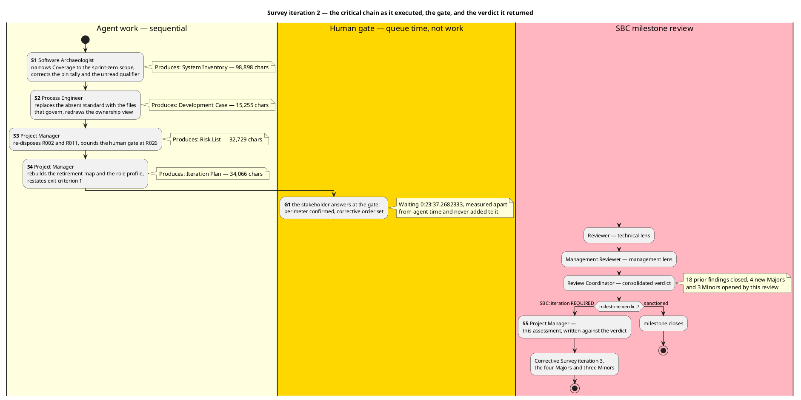
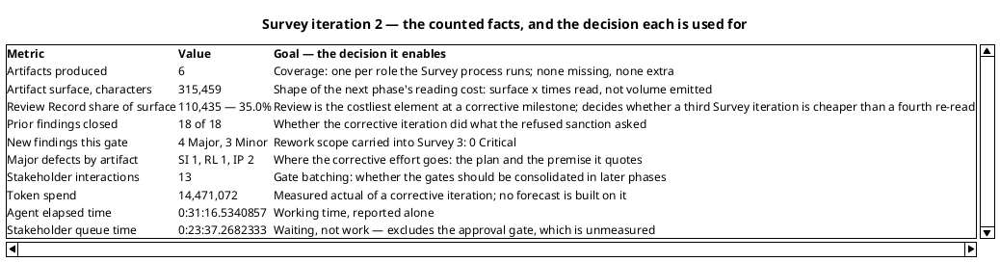
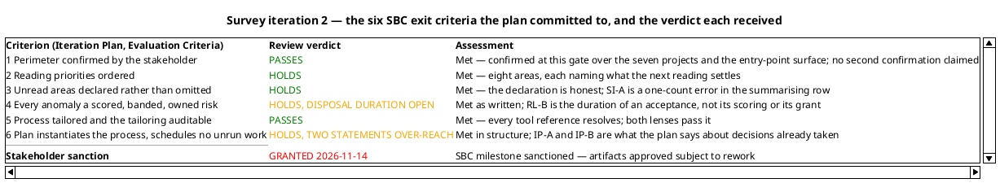
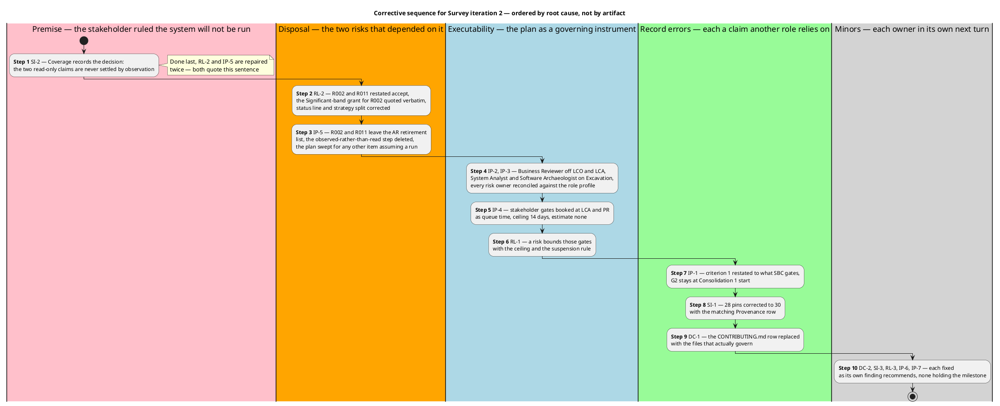

## Document Control
Phase: Survey
Status: Draft — Survey iteration 2 closed against the Review Coordinator's verdict of SBC: iteration required; three Majors and three Minors corrected, four Majors and three Minors carried into Survey 3
Milestone Target: End-of-Survey (SBC) — not yet achieved; the stakeholder sanctioned advancing past it and the milestone's artifacts carry rework
## Iteration Objectives Reached
Survey iteration 2 planned three objectives. **One was achieved outright and two were achieved in substance while a defect remained open against their evidence.** The Review Coordinator's verdict is **SBC: iteration required** — the stakeholder granted the sanction and, in the same answer, ordered the four Majors and three Minors corrected before Excavation reads the artifacts.

| # | Planned objective | Verdict | Evidence and the defect that decides it |
|---|---|---|---|
| 1 | Confirm the System Boundary | **ACHIEVED** | The stakeholder confirmed the perimeter at this gate — the seven projects, the entry-point surface, the stores and the external systems — and stated that nothing is missing from it. The confirmation is the milestone's own evidence and the criterion now carries the process wording. The System Inventory's Coverage closing statement still states the no-observation constraint over the whole lifecycle (SI-B), which is a defect in the record that carries the confirmation, not in the confirmation |
| 2 | Tailor Development Process | **ACHIEVED** | The `CONTRIBUTING.md` row is replaced by five tool references, each a path in the tree, with the statement that no written coding standard exists and none is assumed. The Development Case is the only artifact at this gate with no open finding from either lens, and both pass exit criterion 5 |
| 3 | Identify Critical Risks | **ACHIEVED AS CLASSIFICATION, OPEN AS DISPOSAL DURATION** | 26 risks, all recomputed by the technical lens, none misbanded; distribution 2 High, 8 Significant, 12 Moderate, 3 Minor, 1 Low; both High-band risks avoided; 0 Critical-band defects. What fails is the **duration** of an acceptance (RL-B): R002 and R011 are recorded as open-ended to the end of the project when the stakeholder granted them until the RUP phases start |

Objective 3 carried a defect the iteration believed closed. Iteration 1 closed RL-2 by making R002 and R011 `accept` instead of `avoid`; that correction was right about the strategy and wrong about its horizon, and the horizon is what the register now gets wrong. It is a new defect in corrected text, not a failed correction — the same shape as the two Majors the plan carried.
## Adherence to Plan
**All seven fine-plan work items were executed and every one produced its artifact; the iteration still did not close.** The gap is narrower than iteration 1's and sits in a different place: not in whether the work was done, but in whether what it wrote states no more than the stakeholder decided.

| Planned work item | Owner | Produced | Executed |
|---|---|---|---|
| Narrow the Coverage closing statement to the sprint-zero scope | Software Archaeologist | System Inventory — Coverage | Yes — and its reach beyond the sprint zero is SI-B, the Major the review opened |
| Re-dispose R002 and R011, quote R002's grant, bound the human gate | Project Manager | Risk List — 26 risks, R026 added | Yes — and the horizon of the acceptance is RL-B, the Major the review opened |
| Rebuild the retirement map and sweep the plan for any work item assuming a run | Project Manager | Iteration Plan — Plan and Milestones | Yes — and the sweep closed a path that exists from Inception on (IP-B) |
| Reconcile the role profile against every risk owner | Project Manager | Iteration Plan — Resources | Yes — no defect; every risk owner is at work in the milestone that carries its risk |
| Restate exit criterion 1 and report each criterion's state | Project Manager | Iteration Plan — Evaluation Criteria | Partially — the criterion stopped claiming an unevidenced confirmation, then under-stated the confirmation obtained at this gate (IP-A) |
| Correct the pin tally to 30 and replace the absent-standard reference | Software Archaeologist, Process Engineer | System Inventory, Development Case | Yes — the Development Case is clean; Coverage's Provenance row miscounts by one (SI-A, Minor) |
| Write the assessment against the gate's verdict | Project Manager | This artifact | Yes |

### Variance — the exit criteria had no owning work item

The fine plan assigned an owner to every **product** and to none of the **exit criteria**. No work item owned "is the tailoring auditable" (criterion 5) and none owned "does the plan instantiate the process" (criterion 6) — yet those are the two criteria that failed, and the six plan defects (IP-1 to IP-6) sit exactly there. The plan's own per-criterion column read "Met pending the gate" for all six uniformly, which is the same omission one level up: a status asserted rather than evidenced.

Root cause: the fine plan was built by enumerating the artifacts Survey produces, and an exit criterion is satisfied by a property *of* an artifact, not by the artifact's existence. Artifact-shaped work items cannot own a property-shaped criterion.

**Adjustment for iteration 2:** every open Major defect enters the corrective fine plan as its own work item with its own owner, and each of the six exit criteria names the work item that evidences it. No criterion is marked met in the plan; it is marked with the artifact and the fact that will evidence it.

### Adherence on measurement discipline — no variance

No work item carried a size, no token budget was declared, no project start date was named, and the gantt bars are flagged as the renderer's unit step rather than durations. Both lenses confirmed this independently and neither raised it. No correction is owed and none is made.

### The two clocks — measured, reported apart, never summed

| Clock | Measured | What it is | What it decides |
|---|---|---|---|
| Agent work — tokens | 14,471,072 | The iteration's measured actual across 9 agent invocations | The measured actual replaces every assumed share in the plans after SBC |
| Agent work — elapsed | 0:31:16.5340857 | Working time across those invocations | The working span of a corrective sprint-zero iteration, against iteration 1's 0:49:10 |
| Stakeholder queue time | 0:23:37.2682333 | **Waiting, not work.** 13 user interactions | Whether gates should be batched into fewer points in later phases |

The two clocks are never added and one is never converted into the other. The queue figure **excludes the end-of-iteration approval gate**, which is not measured.

Two facts about this iteration's cost, recorded because the next plan rests on them. The corrective iteration spent **fewer tokens than iteration 1** (14,471,072 against 16,116,804) and **less agent time** (0:31:16 against 0:49:10) while carrying a larger artifact surface into review: re-reading a baseline already established is cheaper than establishing it. And the stakeholder's queue time **quadrupled** (0:23:37 against 0:06:04), because this gate asked for a sanction and a corrective order rather than three factual dispositions. A corrective iteration's cost shape is the inverse of a construction iteration's — agent spend falls, human queue time rises.

### Variance — a correction can over-reach its own decision

Iteration 1's variance was that the fine plan assigned an owner to every product and none to an exit criterion. Iteration 2 repaired that: the six criteria each name the work item that evidences them. The variance of this iteration is the level below it.

Each of the four Majors is a statement that reaches past a decision the stakeholder had already taken, written **by the act of correcting the previous defect**. Iteration 1's finding was that three artifacts treated observation as available; the correction ruled observation out for the whole lifecycle. Iteration 1's finding was that the register avoided two risks by an action that was ruled out; the correction made them accepted with no horizon. Iteration 1's finding was that criterion 1 claimed a confirmation SBC never asks for; the correction deferred it to a gate that does not exist — and then the stakeholder gave the confirmation at this gate, leaving the criterion understating a met condition.

Root cause: each correction was written against the finding's text rather than against the decision the finding pointed at. A finding names a defect; the stakeholder's answer names the scope of the decision. A correction that satisfies the finding while ignoring that scope writes the same class of defect with the opposite sign.

**Adjustment for Survey 3:** every correction is written against the stakeholder's answer, not against the finding's recommendation. The four Majors are ordered by the stakeholder — the premise, then the statements that quote it, then the deleted gate — so no correction is written twice, and the three Minors wait for their owners' next turn behind them.

## Use Cases and Scenarios Implemented
**None — and this is the phase's definition, not a shortfall.**

The Survey process runs no use-case work: the Use-Case Model is recovered in Excavation and completed in Consolidation. This iteration's product is the corrected reading the recovery will be built from, and the perimeter it establishes — now confirmed by the stakeholder — is the anchor set every recovered use case will cite. No use case, use-case realization, class or source file was produced or modified, so nothing is implemented and nothing is testable at this point.

Three capabilities are already known to enter the recovery as code that exists and is unreachable or dormant, and none will be recovered as a use case: the owner-or-admin branches (R007), external login (R008), and `PUT /todos/{id}` whose missing screen is itself the use-case finding (R009). The stakeholder disposed of the first two on 2026-11-14.
## Results Relative to Evaluation Criteria
One line per criterion the Iteration Plan carried, each pointing at the evidence that decides it. All six hold on their evidence; the milestone's artifacts do not all hold, and the difference is what Rework Required records.

| # | Criterion | Result | Evidence |
|---|---|---|---|
| 1 | The perimeter of the existing system is confirmed by the stakeholder | **Met** | The stakeholder confirmed the perimeter at this gate over the seven projects, the entry-point surface, the stores and the external systems, and stated that nothing is missing from it. The three scope answers are cited as dispositions of three facts, not as the confirmation |
| 2 | The reading priorities are ordered | **Met** | System Inventory, Priorities — eight areas ordered, each naming the question the next reading must settle. Neither lens raised a finding |
| 3 | Unread areas declared rather than omitted | **Met** | System Inventory, Coverage — the declared-unread groups are real and the two read-only statements are honest. SI-A is a one-count error in the Provenance row; SI-B is the reach of the closing sentence, not the declaration |
| 4 | Every anomaly is a classified risk, and every strategy can execute | **Met as written** | Risk List — 26 risks, every magnitude the band of its own exposure, every one owned with a strategy that executes without a run in the sprint zero. RL-B is the period an acceptance runs for, which the criterion does not state |
| 5 | The process is tailored and the tailoring is auditable | **Met** | Development Case — five tool references, each a path in the tree, and the statement that no written standard exists and none is assumed. Both lenses pass the artifact with no open finding |
| 6 | The plan instantiates the process and schedules no work the phase does not run | **Met in structure** | Every role named in a milestone row is at work in it, no gate staffs a stood-down role, four gates are booked for the four stakeholder judgements. IP-A (a deleted gate still booked, a met criterion reported as deferred) and IP-B (a retirement path closed project-wide) are statements about decisions already taken |

Criterion 6 passed as the process asks it and failed the management lens's test of reach. Both readings are correct about different moments: the iteration-1 defect it repaired was a criterion claiming an unevidenced confirmation, and that repair did not know the stakeholder would give the confirmation at this gate. The criterion then understated a met condition. That is recorded as a new defect, not a reopened one.
## Test Results
**No test was executed and none could be.** The Survey process runs no Test discipline, no source file was written or modified in this iteration, no test case exists, and no build pipeline for this project exists yet — the Review Record records that no pull request exists, so no check result could be read.

| Measure | Value | Why it is not reported as a defect rate |
|---|---|---|
| Test cases executed | 0 | No code exists to test in Survey |
| Test pass rate | Not computable | A rate over zero is not a rate |
| Defect removal efficiency | **Not computable** | Review is the only detection activity that has occurred; there is no test phase against which to ratio it |
| Build status | Not applicable for IARI | The pipeline does not exist yet. This says nothing about the repository's own `ci.yaml` |

The defects of this iteration were found by **review**, and the detection yield that matters at this milestone is anchor verification: the technical lens re-counted the package pins from `Directory.Packages.props`, checked five tool-reference paths against the tree, and confirmed twenty anchors opened across the two iterations. Direct verification found what reading the artifact alone did not — which is the argument for keeping anchor verification mandatory at AR and GHR.

The first build-and-test run this project will have occurs from Inception on, when the pipeline builds the solution and runs its suites. That run is the evidence path the plan now places at Elaboration for R011 and the observable statements of R002; nothing in this iteration could produce it, and no risk is declared retired by it.
## External Changes
Three things arrived from outside the team, and each changed a premise of the plan.

| # | External event | Source | Effect on the plan |
|---|---|---|---|
| 1 | **Sanction granted** on SBC iteration 2, with the perimeter confirmed at this milestone and the instruction that there be no second confirmation at Consolidation's start | Stakeholder, at the gate | The perimeter became this milestone's evidence (criterion 1 restored to the process wording) and the confirmation gate was deleted from the roadmap, the gantt and the Resources gate list, leaving four |
| 2 | **The earlier no-run sentence was narrowed by the stakeholder**: it applied to Survey, Excavation and Consolidation only. The system will be built and its tests run once the RUP phases start; the two read-only risks are accepted **until then**, not for the life of the project | Stakeholder, at the gate | Observation returns as a retirement path from Inception on. The register's two acceptances were bounded to the sprint zero, the plan's no-run property was scoped to the sprint zero, and R011 together with the observable half of R002 were placed at LCA where the first build-and-test run produces the evidence |
| 3 | **The corrective order was set**: the System Inventory sentence first, then the Risk List and Iteration Plan statements that quote it, then the deleted gate; the three Minors in each owner's next turn | Stakeholder, at the gate | Fixes the sequence of Survey 3's fine plan so one overstatement is not narrowed three times |

Event 2 is this iteration's largest external change and it corrects a premise the iteration inherited. Iteration 1 recorded "the system will not be run" as a project-wide constraint; the stakeholder had said it about the sprint zero. The constraint had propagated into three artifacts before the correction arrived, which is why undoing it took one Major in each.

The Business Reviewer lens does not appear above because it is inactive by tailoring: `business-process-led = false` stands that role down for the whole project, and this gate ran two lenses instead of three. Its absence is a recorded tailoring decision, not a defect.
## Rework Required
**One more iteration inside Survey, at schedule cost.** The iteration-count lever is the plan's own stated remedy for a milestone whose exit criteria do not pass: declared scope is not narrowed, no agent role is added in parallel, and no criterion is re-interpreted to fit what was produced. No Change Request is required — all 15 defects are corrections inside an artifact its owner already holds.

| Step | Defect | Owner | Holds the milestone | Correction | State |
|---|---|---|---|---|---|
| 1 | SI-2 | Software Archaeologist | Yes | Coverage's closing sentence records the stakeholder's decision in their own terms; the declarations themselves stay unchanged | With its owner |
| 2 | RL-2 | Project Manager | Yes | R002 and R011 restated `accept`; the stakeholder's grant quoted verbatim as R002's Significant-band acceptance; a contingency for a reading-only claim proving wrong outside this project; Document Control and the strategy split corrected | Corrected — Risk List, Risk Register and Risk Mitigation and Contingency |
| 3 | IP-5 | Project Manager | Yes | R002 and R011 leave the AR retirement row; the "observed rather than read" step deleted; the plan swept for any other work item assuming the system can be run | Corrected — Iteration Plan, Plan and Milestones |
| 4 | IP-2, IP-3 | Project Manager | Yes | Business Reviewer removed from every gate row; System Analyst and Software Archaeologist added to the Excavation profile; every risk owner reconciled against the role profile | Corrected — Iteration Plan, Plan and Milestones and Resources |
| 5 | IP-4 | Project Manager | Yes | A stakeholder gate booked at LCA for the baseline's acceptability and at PR for project acceptance — the event at which ownership passes. Queue time, ceiling 14 days, estimate none | Corrected — Iteration Plan, Plan and Milestones |
| 6 | RL-1 | Project Manager | Yes | A risk bounds those gates at the 14-day ceiling with the suspension rule | Corrected — R026 in the Risk List; the plan cites it |
| 7 | IP-1, IP-6 | Project Manager | Yes / No | Criterion 1 restated to what SBC gates, with G2 cited as the confirmation point; each criterion's state evidenced rather than uniformly reported. **G2 does not move** — Excavation deepens the perimeter, so confirming it earlier confirms an incomplete record | Corrected — Iteration Plan, Evaluation Criteria |
| 8 | SI-1, SI-3 | Software Archaeologist | Yes / No | 28 pins corrected to 30 in both places and in the Provenance row; the stale "(unread)" qualifier dropped | With its owner |
| 9 | DC-1, DC-2 | Process Engineer | Yes / No | The `CONTRIBUTING.md` row replaced with `Directory.Build.props` and `Directory.Packages.props`, owner Software Architect, stating that no written coding standard exists; the ownership view redrawn | With its owner |
| 10 | RL-3 | Project Manager | No | R018's mitigation splits supplying the values from recording them: the Software Architect establishes both threshold sets from the code and supplies them, the System Analyst records them in the Supplementary Specification | Corrected — Risk List, Risk Mitigation and Contingency |

### Constraints carried into every later iteration

| Constraint | Consequence for the plan | Where it now binds |
|---|---|---|
| The system is never run in any phase | No risk may be retired by observation, and no exit criterion may require it | Risk List strategies, the AR exit case, Coverage's settlement statement |
| Observation is unavailable, so evidence is reading plus anchor verification | Anchor verification stays a mandatory review activity, not a sampling choice | AR and GHR milestones; the 17-anchor/1-false-anchor yield is its justification |
| Two lenses, not three, judge every milestone | No Business-lens finding will ever cover a defect; the remaining lenses carry the full load | Every milestone review from SBC onward |
| A human gate is bounded in the Risk List, never forecast in the plan | Gates are queue time with a 14-day ceiling, estimate none, process suspends rather than assuming | R026, and the LCA and PR gates the plan books |
| No milestone may retire more than the artifact it produces | Every one of the 26 risks is accounted for exactly once: 17 by a milestone artifact, 1 by its bound, 8 on the Risk List's acceptance | Iteration Plan, Plan and Milestones |

### What this iteration leaves the next one

A verified perimeter — 16 of 17 anchors confirmed, and the stakeholder states nothing is missing from it — a correctly scoped set of four stakeholder dispositions, and a risk register whose 24 of 26 disposals hold. The next iteration does not re-derive any of it: it carries the corrected plan and register into the gate, and the three defects still with their own owners (SI-2, SI-1 with SI-3, DC-1 with DC-2) are theirs to close before the milestone is sanctioned.

