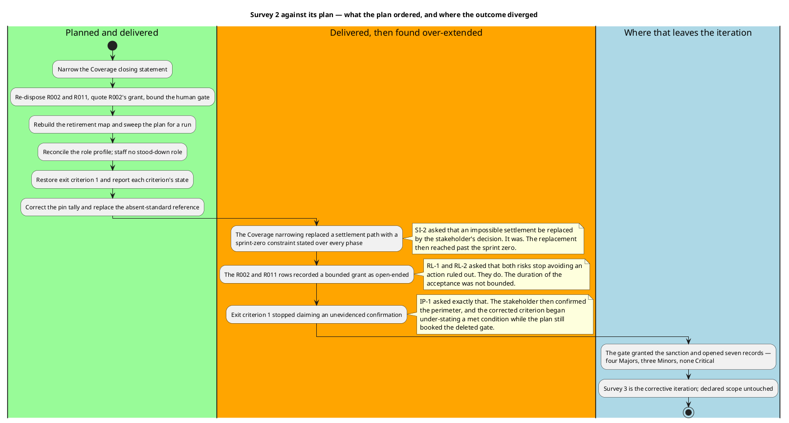

## Document Control

Phase: Survey
Status: Draft — assessment of Survey 2 against the SBC gate's verdict, with Survey 3's corrective scope recorded. Written after the reviewers ruled, not before.
Milestone Target: End-of-Survey (SBC) — not yet achieved

## Iteration Objectives Reached

Survey 2's objective was the one the gate set: close the ten Majors that withheld the sanction and produce the four artifacts the SBC milestone gates on. The gate returned a mixed result — the sanction was granted and eighteen prior findings were closed, while seven new records opened against the same artifacts.

| Objective set for Survey 2 | Outcome | Basis |
|---|---|---|
| The ten Majors of the refused sanction are closed | **Met** — all ten closed Resolved, each verified against the correct text and, where the finding concerned a file, against the file | Management Reviewer lens, closure ledger |
| The perimeter is confirmed by the stakeholder | **Met** — confirmed at the SBC gate of 2026-11-14 over the seven projects, the entry-point surface, the stores and the external systems | The stakeholder's answer of 2026-11-14 |
| Every anomaly of the System Inventory is a scored risk whose strategy can execute | **Met** — 26 risks, 18 avoided and 8 accepted, every magnitude the band of its own exposure | Risk List, Risk Classification |
| The plan is executable as a governing instrument | **Partially met** — the retirement map, the role profile and the gate list were rebuilt; the gate then found criterion 1 deferring to a gate the stakeholder had deleted, and the plan stating the no-run constraint project-wide | Iteration Plan, findings IP-A and IP-B |
| No artifact states a decision over more of the lifecycle than the stakeholder took | **Not met** — three artifacts stated the sprint-zero constraint over the whole lifecycle | Findings SI-B, RL-B, IP-B |

The milestone itself is not closed and this assessment does not close it. The stakeholder sanctioned advancing past SBC; the artifacts carry rework that must land before Excavation reads them.

## Adherence to Plan

Survey 2 followed its fine plan and added nothing to it. The divergence is in outcome, not in execution: the plan was built from the previous gate's findings and those findings were all corrected, but three of the corrections replaced an under-statement with an over-statement.

Three of the seven new records were created by a later stakeholder decision rather than by a failed correction — IP-A exists because the confirmation arrived after the criterion was rewritten. The remaining four are corrections the previous gate could not have caught, because the content they concern was written to satisfy its findings.

No work item was added mid-iteration and none carried a size, no token budget was set, and no calendar date was projected. The iteration lever — one more iteration in the same phase, at schedule cost, with declared scope untouched — is what Survey 3 is.

## Use Cases and Scenarios Implemented

None, and correctly so. Survey runs no implementation discipline: the process assigns Environment, Discovery and Project Management to this phase, and the sprint zero records the system as it is. No use case is recovered before Excavation, so no scenario was implemented, executed or tested in Survey 1, 2 or 3.

The recovered use cases arrive at Excavation — R005 declares which of them cannot be recovered until `HttpAuthenticationStateProvider.cs` is opened, and R009 declares that the completion capability has no screen reaching it. Both are the System Inventory's contribution to the Use-Case Model, not this phase's.

## Results Relative to Evaluation Criteria

The six SBC exit criteria are the gate's, and the gate ruled on them. Recorded here against the evidence, not against the author's claim.

| # | Criterion | Result at the gate | Where it stands after Survey 3 |
|---|---|---|---|
| 1 | The perimeter of the existing system is confirmed by the stakeholder | **Met in substance, mis-recorded** — the confirmation was given; the artifact recorded it as unobtainable and booked a gate the stakeholder had deleted | Corrected — the criterion carries the process wording and the confirmation is its evidence; the gate G2 is gone from the roadmap, the gantt and the gate list |
| 2 | The reading priorities are ordered | **Met** | Unchanged |
| 3 | The unread areas are declared rather than omitted | **Met** — the declaration held; one Minor on the Provenance arithmetic | The declaration stands; the Minor is its owner's |
| 4 | Every anomaly is a classified risk whose strategy can execute | **Met on scoring, failed on duration** — 26 risks correctly banded, and one acceptance recorded as running to the end of the project | Corrected — every acceptance bounded, the two that depend on observation running only until the RUP phases start |
| 5 | The process is tailored and the tailoring is auditable | **Met** — no open record against the Development Case from either lens, and every cited reference resolves | Unchanged |
| 6 | The plan instantiates the process, sequences by risk, schedules no work the phase does not run | **Failed** — a deleted gate and a project-wide no-run property | Corrected — four gates, and observation restored as a retirement path from Inception on, with the evidence's producer named |

Criterion 4's failure is worth stating precisely because it was not a scoring failure. Every magnitude was the band of its own exposure and both lenses concurred; what failed was the period an acceptance was recorded as running for. Under a plan that treats an acceptance as permanent, the risks it covers are carried to PR unexamined; under the corrected record, two of them are settled by the first build-and-test run and the rest are visibly carried.

## Test Results

No test was executed in this phase and none could be. The system is not installed anywhere and nothing here runs it: Survey, Excavation and Consolidation record the system by reading its source and configuration. This is a constraint of the phase, not a gap in the work — and it is bounded, because from Inception on the pipeline builds the solution and runs its test suites.

The absence has a cost that the Risk List carries rather than conceals. Two High-band risks — R001, that no automated test covers the BFF, and R009, that a delivered API capability has no screen — are both statements about what the suite does not verify, and both are retired by an artifact rather than by a run. R011 and the observable half of R002 are the two conditions a first build-and-test run settles, and both are placed at LCA where the Tester executes and the Test Manager records the result. No risk is declared retired by a run that has not happened.

## External Changes

None. The stakeholder gave one answer during this milestone — confirming the perimeter, deleting the second confirmation at Consolidation's start, and narrowing the no-run constraint to the sprint zero — and that answer is absorbed into the System Inventory, the Risk List and this plan. No change to declared scope, no change to the phase sequence, and no Change Request arises from it: each of the three corrections narrows content back to a decision already taken.

Two facts about the project's surroundings did not change and were re-verified: the repository carries no pull request in any state, and no branch carries work, so nothing is withheld from review on those grounds. Survey produces no source code, so an empty pull-request set is the correct shape for this milestone.

## Rework Required

The corrective scope of Survey 3, in the order the stakeholder set: the premise first, then the statements that quote it, then the deleted gate, the Minors in each owner's next turn.

| # | Rework | Owner | Closes | State |
|---|---|---|---|---|
| 1 | Narrow the Coverage closing statement to Survey, Excavation and Consolidation; drop "for the life of this project", "in any phase" and the prohibition on later milestones | Software Archaeologist | SI-B (Major) | With its owner |
| 2 | Restate R002 and R011 as accepted until the RUP phases start, bound the acceptance in Document Control, and correct the Risk Classification premise that stated the no-run constraint project-wide | Project Manager | RL-B (Major) | Applied — Risk Classification, Document Control, Risk Register, Risk Mitigation |
| 3 | Scope the no-run property to the sprint zero, state that the pipeline builds and tests from Inception on, and re-examine the retirement map for what a run settles | Project Manager | IP-B (Major) | Applied — Plan and Milestones |
| 4 | Restore exit criterion 1 to the process wording, evidence it with the confirmation of 2026-11-14, and delete G2 from the roadmap, the gantt and the gate list | Project Manager | IP-A (Major) | Applied — Evaluation Criteria, Resources, Plan and Milestones |
| 5 | Cite the pins in `Directory.Packages.props` instead of a version policy the Development Case does not contain | Project Manager | RL-A (Minor) | Applied — Risk Mitigation and Contingency |
| 6 | Move R006 and R025 to the Survey 2 row and restate the accounting as 15 + 2 + 1 + 8 = 26 | Project Manager | IP-C (Minor) | Applied — Plan and Milestones |
| 7 | Restate the Provenance row to the four files Coverage names | Software Archaeologist | SI-A (Minor) | With its owner |

Item 1 is the premise and is not this iteration's to apply. Both the register and the plan now state the sprint-zero scope, so when the Coverage sentence is narrowed the three artifacts agree; if it is not, the System Inventory alone carries the over-statement and the other two no longer quote it.

Nothing in this table asks the stakeholder a question. Each is a correction inside an artifact its owner holds: no scope change, no baseline change, nothing for the Change Board.

**Rework the phase carries rather than this iteration:** the two iterations' spend is measured at phase close, not per iteration, so no figure is quoted here and none is projected. Corrective iterations reduce agent work relative to new content and increase human queue time at the gates, and the gate's actual queue time is reported when it closes, apart from agent time — the two clocks are never added.
