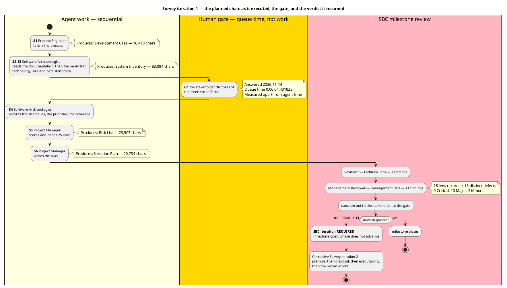
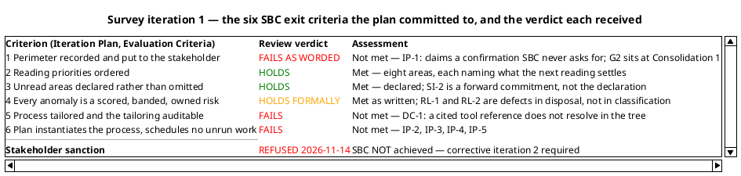
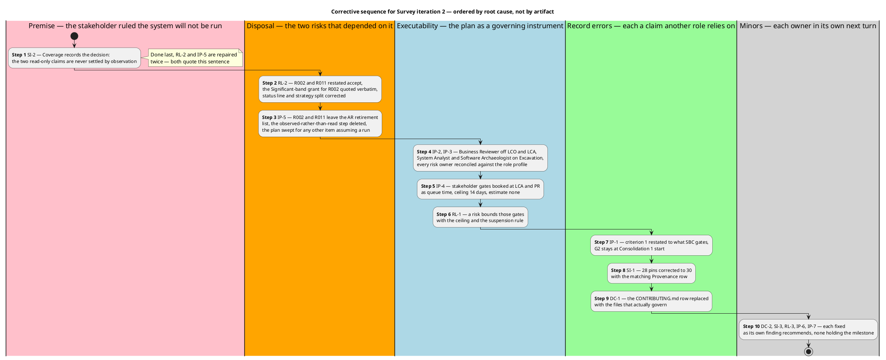

## Document Control

Phase: Survey
Status: Draft — iteration 1 closed against the Review Coordinator's verdict; SBC not achieved, corrective Survey iteration 2 required
Milestone Target: End-of-Survey (SBC) — not achieved; milestone open, phase does not advance

## Iteration Objectives Reached

Survey iteration 1 planned three objectives. **Two were achieved in substance and one was not achieved.** The milestone the iteration worked toward was not reached: the Review Coordinator's verdict is **iteration required**, and the stakeholder withheld the sanction on 2026-11-14.

| # | Planned objective | Verdict | Evidence and the defect that decides it |
|---|---|---|---|
| 1 | Confirm the System Boundary | **NOT ACHIEVED** | The perimeter is recorded and anchored per element — 17 anchors opened by hand, 16 confirmed — and the stakeholder states nothing is missing from it. The **confirmation was withheld**: the sanction was refused on 2026-11-14, and G2, the gate that actually confirms the perimeter, sits at Consolidation 1's start and has not occurred. The objective's own wording was also unsound (IP-1): it claimed a confirmation SBC never obtains |
| 2 | Tailor Development Process | **ACHIEVED IN SUBSTANCE, OPEN ON AUDITABILITY** | The tailoring holds: classification derived from the code, all six OPTIONAL verdicts audited against their own §5.2 conditions and each holding, disciplines at canonical intensity with no self-granted deviation, stood-down roles consistent. The **auditability** limb fails — DC-1: the Tool references table cites `CONTRIBUTING.md`, which is not in the tree, so the process authority a reader audits does not resolve |
| 3 | Identify Critical Risks | **ACHIEVED AS CLASSIFICATION, OPEN AS CONTROL** | 25 risks, each scored, its magnitude the band of its own exposure — all 25 recomputed by the technical lens, none misbanded; no High or Significant risk rests on an acceptance nobody granted; 0 Critical-band defects. Two **disposals cannot execute** (RL-2: R002 and R011 avoid by running the system, which is ruled out) and **no risk bounds the human gate** the plan relies on (RL-1) |

The two High-band risks are avoided, not accepted — R001 (16) by the Test Case at LCA, R009 (15) by the Use-Case Model at GHR — so no High risk in this register depends on anyone's grace. That is the part of objective 3 that worked, and it is why the register is a control instrument with two broken rows rather than a catalogue.

## Adherence to Plan

**All seven fine-plan work items were executed and every one produced its artifact. The iteration still failed its exit criteria.** That gap is the central fact of this iteration and the only variance worth a root cause.

| Planned work item | Owner | Produced | Executed |
|---|---|---|---|
| Tailor the process for this project | Process Engineer | Development Case | Yes — 16,418 chars |
| Read the documentation the delivery carries | Software Archaeologist | System Inventory — Documentation | Yes |
| Read the perimeter, technology and size, persistent data, history | Software Archaeologist | System Inventory — those sections | Yes |
| Dispose of the three scope facts (G1) | Stakeholder | Three decisions recorded | Yes — answered 2026-11-14, queue time 0:06:04.401833 |
| Record the anomalies and order the priorities | Software Archaeologist | System Inventory — Anomalies, Priorities, Coverage | Yes — 83,084 chars, the iteration's largest artifact |
| Score and classify the risks | Project Manager | Risk List | Yes — 25 risks, 25,903 chars |
| Write this plan | Project Manager | Iteration Plan | Yes — 20,734 chars |

### Variance — the exit criteria had no owning work item

The fine plan assigned an owner to every **product** and to none of the **exit criteria**. No work item owned "is the tailoring auditable" (criterion 5) and none owned "does the plan instantiate the process" (criterion 6) — yet those are the two criteria that failed, and the six plan defects (IP-1 to IP-6) sit exactly there. The plan's own per-criterion column read "Met pending the gate" for all six uniformly, which is the same omission one level up: a status asserted rather than evidenced.

Root cause: the fine plan was built by enumerating the artifacts Survey produces, and an exit criterion is satisfied by a property *of* an artifact, not by the artifact's existence. Artifact-shaped work items cannot own a property-shaped criterion.

**Adjustment for iteration 2:** every open Major defect enters the corrective fine plan as its own work item with its own owner, and each of the six exit criteria names the work item that evidences it. No criterion is marked met in the plan; it is marked with the artifact and the fact that will evidence it.

### Adherence on measurement discipline — no variance

The plan stated no size for any work item, declared no token budget, named no project start date, and flagged its gantt bars as the renderer's unit step rather than durations. Both lenses confirmed this independently and neither raised it as a defect. No correction is owed here and none is made.

### The two clocks — measured, reported apart, never summed

| Clock | Measured | What it is | What it decides |
|---|---|---|---|
| Agent work — tokens | 16,116,804 | The phase's measured actual. First closed figure the plan may forecast from | Replaces every assumed share in the plans after SBC |
| Agent work — elapsed | 0:49:10.4046839 | Working time across 9 agent invocations | The working span of a sprint-zero iteration, for comparison with the next |
| Stakeholder queue time | 0:06:04.401833 | **Waiting, not work.** 12 user interactions, 4 consequential questions | Whether gates should be batched into fewer points in later phases |

The two clocks are never added and one is never converted into the other. The queue figure **excludes the end-of-iteration approval gate**, which is not measured; the stakeholder's sanction of 2026-11-14 is therefore outside both figures and no duration is attributed to it.

The iteration carried a five-artifact surface of **254,781 characters**, of which the Review Record is 108,642 — the review is the largest single document of the iteration, 42,6% of the surface. That is the cost shape the IARI model predicts and it is recorded here because it is what the next phase's forecast must be built on: re-reading the artifact surface dominates, not emitting it.

## Use Cases and Scenarios Implemented

**None — and this is the phase's definition, not a shortfall.**

The Survey process runs no use-case work: the Use-Case Model is recovered in Excavation and completed in Consolidation. This iteration's product is the reading the recovery will be built from, and the perimeter it establishes is the anchor set every recovered use case will cite. No use case, use-case realization, class or source file was produced or modified in this iteration, so nothing is implemented and nothing is testable at this point.

Three capabilities are already known to enter the recovery as code that exists and is unreachable or dormant, and none of them will be recovered as a use case: the owner-or-admin branches (R007), external login (R008), and `PUT /todos/{id}` whose missing screen is itself the use-case finding (R009). The stakeholder disposed of the first two on 2026-11-14.

## Results Relative to Evaluation Criteria

One line per criterion the Iteration Plan carried, each pointing at the evidence that decides it. Four of six hold on their evidence; two fail, and the milestone does not close on four.

| # | Criterion | Result | Evidence |
|---|---|---|---|
| 1 | Perimeter recorded with an anchor per element, priorities ordered, unread areas declared | **Not met as written** | The perimeter is anchored and verified (System Inventory, Perimeter; 16 of 17 anchors confirmed). The criterion as worded demanded a stakeholder confirmation no SBC event obtains, and it was refused. The *record* meets the intent; the *wording* makes an unsatisfiable claim (IP-1). G2 at Consolidation 1's start is where confirmation occurs |
| 2 | Reading priorities ordered | **Met** | System Inventory, Priorities — eight areas ordered, each naming the question the next reading must settle. Both lenses accepted it without a finding |
| 3 | Unread areas declared rather than omitted | **Met** | System Inventory, Coverage — the declared-unread groups are real and the two read-only statements are honest. The finding against this section (SI-2) is the forward sentence naming *how* they are settled, not the declaration itself |
| 4 | Every anomaly is a classified risk | **Met as written** | Risk List — 25 risks, every magnitude the band of its own exposure, every one owned with a strategy. What fails is execution of two strategies (RL-2) and the missing gate bound (RL-1), both disposals rather than classification |
| 5 | The process is tailored and the tailoring is auditable | **Not met** | DC-1: `CONTRIBUTING.md` is cited and absent, so two roles are pointed at a document that does not exist and a reader cannot distinguish a broken link from a standard nobody wrote. The tailoring itself is sound and all six OPTIONAL verdicts hold |
| 6 | The plan instantiates the process and schedules no work the phase does not run | **Not met** | IP-2 (a stood-down role staffed at LCO and LCA), IP-3 (Excavation assigned work with its risk owners absent from its profile), IP-4 (LCA and PR stakeholder gates unbooked), IP-5 (AR retires two risks by an activity the stakeholder has ruled out) |

Criterion 6 is the one that decides the gate, and its four defects are not accuracy defects: each is a defect in whether the plan can be executed as a governing instrument. They are recorded with their correction in Rework Required.

## Test Results

**No test was executed and none could be.** The Survey process runs no Test discipline, no source file was written or modified in this iteration, no test case exists, and the repository carries no IARI build pipeline — the Review Record's own check of `scm_list_pull_requests` returned none, so there is also no pull request whose checks could be read. This is not a gap in the iteration's work; it is the shape of a phase whose product is a reading.

| Measure | Value | Why it is not reported as a defect rate |
|---|---|---|
| Test cases executed | 0 | No code exists to test in Survey |
| Test pass rate | Not computable | A rate over zero is not a rate |
| Defect removal efficiency | **Not computable** | Review is the only detection activity that has occurred; there is no test phase against which to ratio it |
| Build status | Not applicable for IARI | The pipeline does not exist in the repository yet. This says nothing about the repository's own `ci.yaml` |

The defects of this iteration were found by **review**, not by execution: 18 lens records, 15 distinct defects, 10 Major. The detection yield that matters at this milestone is anchor verification — 17 source files opened by hand, 16 confirming and 1 false anchor (the package-pin tally). Direct verification found a defect invisible to a reading of the artifact alone, which is the argument for keeping it as a mandatory review activity at AR and GHR rather than a one-off.

## External Changes

Three events arrived from outside the team in this iteration, all on **2026-11-14**, and each changed a premise of the plan.

| # | External event | Source | Effect on the plan |
|---|---|---|---|
| 1 | Three scope dispositions: the `admin` branches are unreachable and role provisioning stays out of scope; external login is a configured-at-runtime edge with no use case recovered this cycle, to be revisited if credentials are supplied; the BFF-to-API trust gap is a known limitation of the single-host baseline carried as R012 | Stakeholder, answering G1 | Retired three scope markers at the source of truth and closed R007, R008 and R012 with quoted grants. No plan change — the answers confirmed the reading |
| 2 | **The system will not be run in any phase** — not installed anywhere, nobody runs it here; the two statements marked read but not observed stay declared as such, with their risk | Stakeholder, at the gate | **Invalidated the retirement path three artifacts depended on.** R002 and R011 were avoided by running the system (RL-2), the AR milestone retired them the same way (IP-5), and Coverage named that settlement path (SI-2). The AR exit case, as planned, cannot be evidenced |
| 3 | Sanction on SBC **refused** | Stakeholder, at the gate | The milestone does not close and the phase does not advance. Corrective Survey iteration 2 is required |

Event 2 is the iteration's largest variance and it was not a review finding in origin: it is a **constraint the process never obtained until the gate asked**. Nothing in the plan or the register had tested the assumption that observation was available; it was inherited from the fact that the code exists. The constraint now binds every later iteration — see the constraint table under Rework Required.

The Business (BusinessReviewer) lens does not appear in the events above because it is inactive by tailoring: `business-process-led = false` stands it down for the whole project, and this gate ran two lenses instead of three. Its absence is a recorded tailoring decision, not a defect, and no finding is raised against it.

## Rework Required

**One more iteration inside Survey, at schedule cost.** The iteration-count lever is the plan's own stated remedy for a milestone whose exit criteria do not pass: declared scope is not narrowed, no agent role is added in parallel, and no criterion is re-interpreted to fit what was produced. No Change Request is required — all 15 defects are corrections inside an artifact its owner already holds.

| Step | Defect | Owner | Holds the milestone | Correction |
|---|---|---|---|---|
| 1 | SI-2 | Software Archaeologist | Yes | Coverage's closing sentence records the stakeholder's decision in their own terms; the declarations themselves stay unchanged |
| 2 | RL-2 | Project Manager | Yes | R002 and R011 restated `accept`; the stakeholder's grant quoted verbatim as R002's Significant-band acceptance; a contingency for a reading-only claim proving wrong outside this project; Document Control and the strategy split corrected |
| 3 | IP-5 | Project Manager | Yes | R002 and R011 leave the AR retirement row; the "observed rather than read" step deleted; the plan swept for any other work item assuming the system can be run |
| 4 | IP-2, IP-3 | Project Manager | Yes | Business Reviewer removed from LCO and LCA; System Analyst and Software Archaeologist added to the Excavation profile; every risk owner reconciled against the role profile |
| 5 | IP-4 | Project Manager | Yes | A stakeholder gate booked at LCA for the baseline's acceptability and at PR for project acceptance — the event at which ownership passes. Queue time, ceiling 14 days, estimate none |
| 6 | RL-1 | Project Manager | Yes | A risk bounds those gates at the 14-day ceiling with the suspension rule, or the plan's claim that one exists is deleted |
| 7 | IP-1 | Project Manager | Yes | Criterion 1 restated to what SBC gates, with G2 cited as the confirmation point. **G2 does not move** — Excavation deepens the perimeter, so confirming it earlier confirms an incomplete record |
| 8 | SI-1 | Software Archaeologist | Yes | 28 pins corrected to 30 in both places and in the Provenance row. No pin value changes |
| 9 | DC-1 | Process Engineer | Yes | The `CONTRIBUTING.md` row replaced with `Directory.Build.props` and `Directory.Packages.props`, owner Software Architect, stating that no written coding standard exists |
| 10 | DC-2, SI-3, RL-3, IP-6, IP-7 | Process Engineer, Software Archaeologist, Project Manager | No | The five Minors, each in its owner's next turn |

### Constraints carried into every later iteration

| Constraint | Consequence for the plan | Where it now binds |
|---|---|---|
| The system is never run in any phase | No risk may be retired by observation, and no exit criterion may require it | Risk List strategies, the AR exit case, Coverage's settlement statement |
| Observation is unavailable, so evidence is reading plus anchor verification | Anchor verification stays a mandatory review activity, not a sampling choice | AR and GHR milestones; the 17-anchor/1-false-anchor yield is its justification |
| Two lenses, not three, judge every milestone | No Business-lens finding will ever cover a defect; the remaining lenses carry the full load | Every milestone review from SBC onward |
| A human gate is bounded in the Risk List, never forecast in the plan | Gates are queue time with a 14-day ceiling, estimate none, process suspends rather than assuming | RL-1 and the LCA and PR gates booked by IP-4 |

### What this iteration leaves the next one

A verified perimeter — 16 of 17 anchors confirmed, and the stakeholder states nothing is missing from it — a correctly scoped set of four stakeholder dispositions, and a risk register whose 23 of 25 disposals hold and whose two that do not are named. The next iteration corrects nine artifact statements against that product; it does not re-derive it.

**DEFERRED: Risk List — its two Majors (RL-1, RL-2) and one Minor (RL-3) are corrected as steps 2 and 6 of the corrective sequence in Survey iteration 2, not by rewriting the register inside its own closure record.**
**DEFERRED: Iteration Plan — its five Majors (IP-1 to IP-5) and two Minors (IP-6, IP-7) are corrected as steps 3, 4, 5, 7 and 10 of the same sequence, together with the fine-plan adjustment recorded under Adherence to Plan.**
