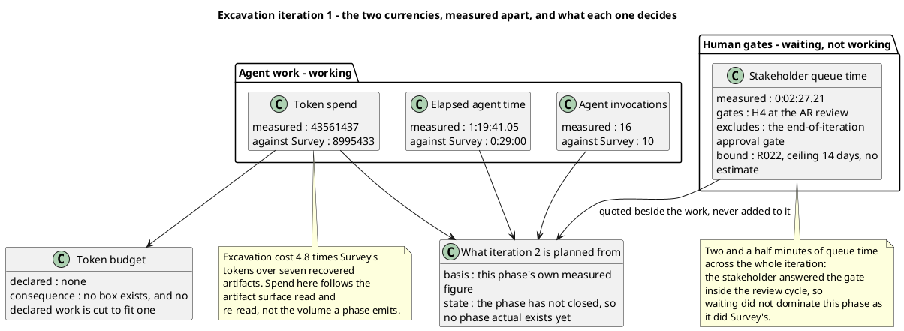

## Document Control
- Phase: Excavation
- Status: Assessed. The milestone verdict is the Review Coordinator's — AR: iteration required — and this record assesses the iteration given that verdict; it declares no milestone of its own.
- Milestone Target: end-of-Excavation (AR) — not achieved; iteration 2 required
- Iteration: 1, Cycle 1
- Owner: Project Manager

## Iteration Objectives Reached
Nine objectives were planned for this iteration and three phase objectives were planned for the phase; they are answered together below, because the phase objectives are what the nine exist to deliver. Four of the nine are met on the artifact that carries their evidence, two are met on carriage or existence while a Major stands against them, one is met clean, and two are not met — one because a Minor its owner the phase does not schedule, one because the stakeholder withheld the confirmation.

The verdict this answers is not this record's: **the Review Coordinator returned AR: iteration required**, on 0 Critical, 8 Major and 8 Minor findings open at the gate. Nothing below re-decides that.

```plantuml
@startuml
title Excavation iteration 1 - the nine planned objectives, what each delivered, and the findings still open against it
skinparam shadowing false
skinparam classAttributeIconSize 0
hide empty members
skinparam wrapWidth 250

package "Met on the artifact that carries the evidence" {
  class "O5 design and persistent data" as O5 {
    verdict : Met
    evidence : 42 classes, 8 tables, keys and rules
    open : Design Model Minor F1
  }
  class "O6 anomalies carried as risks" as O6 {
    verdict : Met on carriage
    evidence : 29 anomalies, 31 risks, one mapping
    open : Risk List Major F2 - R030 read as retired
  }
  class "O7 the plan exists at both levels" as O7 {
    verdict : Met on existence
    evidence : coarse roadmap plus 14 work items
    open : Iteration Plan Major F3
  }
  class "O1 use cases recovered" as O1 {
    verdict : Met
    evidence : 11 use cases over 22 entry points
    open : Use-Case Model Major F1, Vision Major F1
  }
}

package "Not met as written" {
  class "O2 supplementary constraints" as O2 {
    verdict : Not met
    cause : two Majors - the rate budget and R4
  }
  class "O3 architecture recovered" as O3 {
    verdict : Partially met
    cause : 22 components, one mechanism value wrong
  }
  class "O4 deployment modelled" as O4 {
    verdict : Partially met
    cause : the one setting that differs, backwards
  }
  class "O8 the four SBC Minors closed" as O8 {
    verdict : Not met - 3 of 4
    cause : Development Case F2 has no scheduled owner
  }
  class "O9 the set put to the stakeholder" as O9 {
    verdict : Not met - refused
    cause : gate H4 answered No
  }
}

class "AR milestone" as AR {
  verdict : iteration required
  open : 0 Critical, 8 Major, 8 Minor
  criterion A11 : 3 of 4
}

O1 --> AR
O2 --> AR
O3 --> AR
O4 --> AR
O5 --> AR
O6 --> AR
O7 --> AR
O8 --> AR
O9 --> AR

note bottom of O8
  O8 is the only objective whose owner the phase does not
  schedule: Environment runs at no intensity in Excavation.
  It is carried as R031 and it is why iteration 2 exists.
end note
note bottom of O9
  A refusal is not a defect the team repairs. The stakeholder
  withheld a confirmation and ordered every Major corrected.
end note
@enduml
```



### The three phase objectives the Work Order states

| Phase objective | Where the plan carries it | Verdict | Basis |
|---|---|---|---|
| Recover the Use Cases | O1 with A1; O2 with A10; the Vision's count | **Partially met** | Eleven use cases over 22 entry points, each tracing to its `EP-NNN`, with four exclusions stated — that part holds and A1 is met on it. But `Supplementary Specification#F1` and `#F2` state two mechanism facts the code contradicts, `Vision#F1` puts thirteen use cases to the stakeholder where the model recovers eleven, and `Use-Case Model#F1` leaves three `EP-003` edges suspect at the phase close. The operations are recovered; the material that describes them is wrong in three places |
| Recover the Architecture | O3 with A3; O4 with A5 | **Partially met** | 22 components with their connectors, the mechanisms, the use-case view and the deployment view all exist and rest on anchors, and the Use-Case View names the components each of the eleven use cases crosses. One mechanism value is stated wrong in the Software Architecture Document and again in the Deployment Model, and the Deployment Model's environment table — the only statement in the delivery of what differs between environments — concludes that one setting separates them when two do (`Software Architecture Document#F1`, `Deployment Model#F1`) |
| Recover the Persistent Data | O5 with A4 | **Met** | Eight persisted entity types, the keys, the associations, the enforced rules and the owner key's re-point by the third migration are recorded against `TodoDbContext.cs:11-17` and the three migrations, and "What the code does not hold" states what the schema does not guarantee. `Design Model#F1` is a one-sentence citation defect on a diagram, not a defect in the data. This is the objective the iteration delivered clean |

The asymmetry is the iteration's own lesson: the architecture and the data were read from the same code by the same pass and only the data survived the review intact, because the architecture's figures were transcribed into two further artifacts while the data's figures stayed in one.

### The nine iteration objectives

| # | Objective | Owner | Verdict | Basis |
|---|---|---|---|---|
| O1 | The operations the system performs are recovered as use cases | System Analyst | **Met** — with a trace Major open | The Use-Case Model carries `UC-001` to `UC-011`, each tracing to the `EP-NNN` whose code performs it, and accounts for `EP-020`, `EP-021`, `EP-022` and the `admin` branch as exclusions with their reasons. `Use-Case Model#F1` records three `EP-003` edges still marked suspect in the registered graph: the rows assert them, the graph has not confirmed them |
| O2 | What the system must satisfy beyond its behaviour is stated | System Analyst | **Not met** | The Supplementary Specification carries the mechanisms, constraints and quality statements with their anchors, and two of its statements are contradicted by the code. `Supplementary Specification#F1` — M3, S2, P1 and R8 state 100 / 100 / 100 as effective and deny that a `RateLimiting` section exists, against `Todo.Api/appsettings.Development.json:8-12` at 50 / 50 / 50. `Supplementary Specification#F2` — R4 denies a resilience handler that `TodoApp.ServiceDefaults/Extensions.cs:32-42` installs on every container-built client |
| O3 | The architecture the delivery already has is recovered, not invented | Software Architect | **Partially met** | The Software Architecture Document records 22 components and connectors and the mechanisms, technology and deployment, each anchored. `Software Architecture Document#F1` holds the same rate-limit figure as O2's defect and cites no `AN-024`, and it is the copy the Deployment Model inherits |
| O4 | The topology the delivery runs in is stated | Software Architect | **Partially met** | The Deployment Model exists — the phase's fired OPTIONAL — and records the processes, the nodes, the stores, the ports and what must be shared (`AN-010`, `AN-013`). `Deployment Model#F1` states its preamble and its Rate limiting row backwards: the artifact whose purpose is to say what differs between environments concludes that one setting does, and the second is the one that does |
| O5 | The design and the persistent data are recovered | Designer, Database Designer | **Met** | 42 classes with their anchors, the domain model, the packages, the relationship inventory, the entities, the owner key and its re-point, the enforced rules and what the schema does not hold. `Design Model#F1` cites `AN-005` where it means `AN-025` in one diagram — a contained defect on a citation, not on the recovered data |
| O6 | The anomalies the recovery surfaced are carried as scored, owned risks | Project Manager | **Met on carriage; one row not truthful** | 29 anomalies map to 31 risks with no silent omission, every anomaly-derived score reproduces from the one published mapping, and the four Significant-band acceptances carry the stakeholder's own answer. `Risk List#F2` (Management Reviewer) records that `R030` was read as avoided while its retirement action was performed in no artifact — a strategy asserting a retirement that did not happen. Corrected in this turn |
| O7 | The plan for this phase and the milestones ahead exists | Project Manager | **Met on existence** | Both levels are present: the coarse roadmap with its milestone sequence and the fine plan with fourteen work items and their owners. `Iteration Plan#F3` (Management Reviewer) records that A10 was certified on the System Inventory's identification of a contradiction rather than on the recovered set the criterion governs. Corrected in this turn |
| O8 | The Minors the SBC review left open are closed, not carried again | The owner each finding names | **Not met — 3 of 4** | `Iteration Plan#F2`, `Iteration Plan#F3` and `System Inventory#F3` are corrected in their artifacts and closed by their lenses. `Development Case#F2` stands: "Roles and Ownership" still omits the Management Reviewer, the Business Reviewer and the Review Coordinator, and CLS-DC-01 draws no edge from them. Its owner, the Process Engineer, has no stage in Excavation because Environment runs at no intensity here. Carried as `R031`, which has materialized |
| O9 | The recovered set is put to the stakeholder for confirmation | Project Manager puts it; the stakeholder answers | **Not met — refused** | Gate H4 was put at the AR review and answered No, with the order "We must correct all major findings." The refusal is not a defect the team repairs and not a finding against an artifact: a sanction withheld cannot be written as granted, and this record does not write it so |

### What the iteration established that no finding touches

Two things were delivered that the review did not fault and that iteration 2 does not revisit.

**The reading order held.** The recovery followed the System Inventory's priority order 1 to 5 — the API's todo operations, its authorization, the BFF, the screens, the tests — and every use case, component and table traces to an anchor in an area that order put first. No area was skipped and none was read out of order.

**Every recovered element cites what it was read from.** 22 entry points, 11 use cases, 22 components and 8 tables each carry a file and line reference. That is what makes the eight Majors cheap to correct: each is a sentence in an artifact whose subject is already anchored, not a recovered fact that has to be found again.

## Adherence to Plan
The plan was a fourteen-item sequential chain — the recovery, then the anomalies, then the two lenses, then the gate, then the verdict — with the Process Engineer's single item running on the stakeholder's order rather than on a discipline stage. The chain ran in the planned order and every item reached its planned state. What the plan got wrong was not its sequence: it was item 10, whose owner the phase does not schedule, and which was recorded as outstanding rather than closed.

```plantuml
@startuml
title Critical chain of Excavation iteration 1 - what each stretch produced, and where the chain stopped
skinparam shadowing false
skinparam wrapWidth 240

|Project Manager|
start
:R1 Risk List
31 risks, one published mapping,
four granted acceptances;
:R2 Iteration Plan
coarse roadmap, 14 work items, A1 to A13;
|System Analyst|
:R3 Vision, Use-Case Model, Supplementary Specification
11 use cases over 22 entry points;
:R4 the recovery's own findings
R019 R020 R021 R023 R028 R030;
|Software Architect|
:R5 Software Architecture Document
22 components, 13 mechanisms;
:R6 Deployment Model
the fired OPTIONAL;
|Designer and Database Designer|
:R7 Design Model
42 classes;
:R8 persistent data
8 tables, keys, rules, the owner key;
|Software Archaeologist|
:R9 System Inventory
29 anomalies, coverage 84 of 139;
|Process Engineer|
:R10 Development Case
NOT STARTED - no stage in this phase
note right
  R031 materializes here. A11 counts this item
  and the phase cannot close without it.
end note
|Reviewer|
:R11 technical lens
6 Major, 5 Minor recorded;
|Management Reviewer|
:R12 management lens
2 Major, 4 Minor recorded, A1 to A13 re-taken;
|Stakeholder|
:R13 gate H4
ANSWERED NO
note right
  Not met. Queue time 0:02:27.21.
  Bound as R022, ceiling 14 days.
end note
|Review Coordinator|
:R14 AR verdict
ITERATION REQUIRED
stop
@enduml
```

| # | Work item | Owner | Planned state | Actual state | Variance and root cause |
|---|---|---|---|---|---|
| 1 | Risk List — the recovery's anomalies as scored, owned risks; the grants verbatim | Project Manager | Complete | Delivered; `Risk List#F2` and `#F4` recorded against it | `R030` read as avoided while its retirement action landed in no artifact, and `R024`'s premise named an artifact that already holds the correct fact. Both are mine and both are corrected in this turn |
| 2 | Iteration Plan — the coarse roadmap, the fine plan and its two carried Minors | Project Manager | Complete | Delivered; `Iteration Plan#F3`, `#F4`, `#F5` recorded against it | A10 was certified on the System Inventory's word rather than on the recovered set; A2 cited a clause its evidence does not carry; A12 stated a state the answer superseded. All three are mine and corrected in this turn |
| 3 | Vision, Use-Case Model, Supplementary Specification | System Analyst | Complete | Delivered; 4 Majors, 3 Minors recorded | Three Majors are one cause: a code fact the phase had already recorded as `AN-024` was contradicted in three artifacts, one of them twice. The fourth is the Vision's count |
| 4 | The recovery's own failure statements written into the flows | System Analyst | Complete | Delivered | `R030`'s statement was assigned to this stretch by the plan's own risk-sequencing diagram and was written nowhere. That is the gap it was supposed to close |
| 5 | Software Architecture Document | Software Architect | Complete | Delivered; `#F1` recorded | Read the rate-limit figure from the Supplementary Specification and reproduced it. The artifact records `AN-023` at P6 correctly and declined to edit an artifact it does not own — the right division of ownership, executed on the wrong side of one fact |
| 6 | Deployment Model | Software Architect | Complete | Delivered; `#F1` recorded | Inherited item 5's copy. The environment table is the artifact's whole purpose and it states the differing setting backwards |
| 7 | Design Model — the domain model and the classes | Designer | Complete | Delivered; `#F1` recorded | One diagram cites `AN-005` where the subject is `AN-025`. Contained |
| 8 | Persistent data | Database Designer | Complete | Delivered; no finding from either lens | The one item the review did not fault |
| 9 | System Inventory — anomalies, history and coverage; `System Inventory#F3` | Software Archaeologist | Complete | Delivered; `#F3` closed, then `#F4` recorded | Coverage arithmetic and the anomaly count reproduce; the fourth finding is a Minor on the history section |
| 10 | Development Case — `Development Case#F2`, the contributor set | Process Engineer | Not started, on order alone | **Not started.** `#F2` stands and `#F3` was recorded at this gate | The item was planned as a dependency of the lenses, and it was recorded as unresolved. The plan named the exposure — `R031` — and did not resolve it, because the phase gives its owner no stage. Recording an exposure is not retiring it |
| 11 | Technical lens | Reviewer | Not started | 11 findings: 6 Major, 5 Minor | — |
| 12 | Management lens | Management Reviewer | Not started | 6 findings: 2 Major, 4 Minor; A1 to A13 re-taken | — |
| 13 | Gate H4 | Stakeholder | Queued | **Answered No** | Queue time 0:02:27.21 — the gate was answered inside the review cycle, not behind it |
| 14 | AR verdict | Review Coordinator | Not started | **Iteration required** | — |

### Two currencies, measured apart

| Currency | Scope | Measured | What decision it enables |
|---|---|---|---|
| Token spend | Excavation iteration 1, whole iteration | 43,561,437 | The figure iteration 2 is planned from, beside Survey's 8,995,433 for a closed phase. Excavation cost 4.84 times Survey's tokens over seven recovered artifacts |
| Elapsed agent time | The same stretch | 1:19:41.05 | The clock quoted beside the spend, never added to it. Survey's closed phase measured 0:29:00 |
| Agent invocations | The same stretch | 16 | Whether the chain branched. Sixteen invocations for one sequential chain over twelve artifacts is more than one pass per artifact and fewer than two, which is what a recovery read twice by its own owners and never revised against its own anomalies looks like |
| Stakeholder queue time | Gate H4 | 0:02:27.21 | Whether waiting, not working, dominates the wall clock. Here it did not: the gate was answered inside the review cycle. Excludes the end-of-iteration approval gate, which is not measured |
| Artifacts under review | Ten of the twelve in the project | 12 artifacts, 10 reviewed | The surface every later phase re-reads, and what the phase's cost is dominated by |

The two clocks are reported side by side and never summed: the last row of the human table is waiting, not working. No token budget exists — the project declares none — so no spend is judged against a box, no figure is proposed for the stakeholder to accept, and no declared work was cut or deferred to fit one.



### What this iteration got wrong about itself

| Planned | Outcome | Variance | Root cause | Adjustment iteration 2 carries |
|---|---|---|---|---|
| Item 10 would run before the lenses ruled, so A11 would read four of four | It did not run; A11 reads three of four | The AR milestone needs an iteration the phase did not plan | The plan assigned an exit criterion to a role the phase does not schedule, and recorded the exposure rather than giving the role a stage. `R031` named the consequence exactly and the plan still did not act on it | Iteration 2 plans the Process Engineer's item explicitly, as work the phase runs on the stakeholder's order, and re-takes A11 after it lands |
| The recovery's own anomalies would be written into the flows (item 4) | Five of six were; `R030`'s statement was not | A Significant risk was read as retired with its retirement unperformed | The item was planned as one stretch over six risks, and its completion was assessed over the five that landed. A stretch that closes five of six is not complete | `R030` is restated as not yet retired in this turn, and iteration 2 either writes the statement beside the session flows or keeps the risk open |
| A10 would be certified on the recovered set | It was certified on the System Inventory's identification of the same contradiction | A criterion met on an adjacent answer, which is the defect a prior phase's lesson names | The criterion's own test is about the recovered set; its evidence cell cited the artifact that spotted the problem rather than the three that carry it | A10 is restated to name the three artifacts and reads not met until they are corrected |
| Two independent lenses would catch what one missed | Both found the same defect independently, and classified it the same way at the artifact level | No variance: the double read worked | A real defect shows up twice; a lens artefact does not. This one did | None. The finding was real, the correction is cheap, and the duplication cost one lens read |
| The recovered set was ready to put to the stakeholder | It was put, and refused | The gate was answered but not satisfied | Three of the eight Majors are one wrong figure, and one is a count the Vision states differently from the model. What the stakeholder was asked to sanction was not yet coherent with itself | Gate H4 is re-put only after the eight Majors land, so the sanction is asked for once and on a set that agrees with itself |

## Use Cases and Scenarios Implemented
None implemented — correctly. Excavation recovers what the existing system performs; it writes no code, and the Implementation discipline does not work in the sprint zero. The work item "recovery" produces a use-case model, not a realization. What the iteration did deliver is the recovered set itself, and it is the material every later realization, test case and design is written against.

| Recovered element | Count this iteration | What it rests on |
|---|---|---|
| Use cases | 11 — `UC-001` to `UC-011` | Each traces to the `EP-NNN` whose code performs it; the four exclusions are stated with their reasons |
| Use cases with two scenarios | 5 — `UC-001`, `UC-002`, `UC-006`, `UC-007`, `UC-008` | A screen route and a direct API route to the same operation, differing only in how the caller authenticated. One use case with two scenarios, never one use case per actor |
| Actors | ACT-001 the signed-in person, ACT-002 the external provider, ACT-003 the API caller | — |
| Components | 22 — `COMP-001` to `COMP-022` | Each recovered with its anchor and its connectors, and the Use-Case View names the components each use case's path crosses |
| Persistent entity types | 8 | The three migrations and `TodoDbContext.cs:11-17`; the owner key's re-point is recorded with its migration |
| Stated exclusions | 4 | External-provider sign-in recovered and unreachable; the `admin` branch an exceptional entity; the health endpoints and the migration event not use cases |

Two defects bear on this section and neither is a defect in the recovered set's membership: `Use-Case Model#F1` — three `EP-003` edges registered but still marked suspect, so the confirmation that would qualify the count is open; `Vision#F1` — the Vision's Features diagram draws thirteen, two of them the mechanisms the model excludes. The Use-Case Model is authoritative for the set and states eleven. The Vision must agree with it before the count goes to the stakeholder again.

| Handoff to Consolidation | State at this assessment |
|---|---|
| The eleven use cases, each with its `EP-NNN` and its anchor | Delivered; the three `EP-003` edge confirmations open |
| The four exclusions and the ruling behind each | Delivered and confirmed by the stakeholder at gate H4's material — the exclusions were not what the refusal was about |
| The 22 components and the use-case view that ties them to the use cases | Delivered; one mechanism value to correct |
| The eight tables, the keys, the associations and the enforced rules | Delivered, not faulted |
| The 29 anomalies as 31 scored, owned risks | Delivered; one strategy statement to correct |
| Coverage: 84 files read of 139, the remainder named | Delivered, arithmetic reproduces |
| What remains unrecovered | Named for Consolidation: the areas below priorities 1 to 5, and every use case the deeper reading of areas 6 to 8 may produce |

## Results Relative to Evaluation Criteria
One row per criterion the Iteration Plan carries. The State column is this assessment's reading of the evidence the cited artifact actually records — it is not a re-certification, and where a criterion was recorded Met on an answer its own test does not reach, the row says so and names the finding that says it.

| # | Criterion | State | Evidence, and the finding that bears on it |
|---|---|---|---|
| A1 | The operations the system performs are recovered as use cases | **Met** | Use-Case Model — Use-Case Survey: `UC-001` to `UC-011` each with its `EP-NNN`; "Not recovered, and why" accounts for `EP-020`, `EP-021`, `EP-022` and the `admin` branch of `EP-011`, `EP-013`, `EP-014`. Carriage is not in doubt. `Use-Case Model#F1` records that three `EP-003` edges sit unconfirmed in the graph — a trace defect, not a coverage gap |
| A2 | The recovered set reaches the priorities the reading ordered | **Met** — with an unsupported clause recorded | System Inventory — Priorities orders areas 1 to 5, confirmed by the stakeholder on 2026-11-23; the Use-Case Model recovers from each. `Iteration Plan#F4` (Management Reviewer, Minor) records that the evidence cell certified a clause its artifact does not carry: "Not recovered, and why" names permanent exclusions, not work deferred to Consolidation, and priorities 6 to 8 carry no statement. Corrected in this turn by narrowing the criterion to what its evidence establishes |
| A3 | The architecture is recovered and checked against the use cases | **Not certifiable while its own Major stands** | Software Architecture Document — Logical View (`COMP-001` to `COMP-022` with connectors) and Use-Case View, which names the components each of the eleven use cases' path crosses. `Software Architecture Document#F1` states the request budget at 100 where the measured environment runs 50: the artifact exists and is anchored, and its own Major holds the certification |
| A4 | The data is recovered with its anchors | **Met** | Design Model — persisted domain classes (`DM-D1`, `CLS-001`, `CLS-007`, `CLS-006`), the relationship inventory and "What the code does not hold", anchored to `TodoDbContext.cs:11-17` and the three migrations; `AN-025` recorded against the owner key. `Design Model#F1` is a citation on a diagram, not on the data |
| A5 | The deployment is modelled | **Not certifiable while its own Major stands** | Deployment Model — the fired OPTIONAL exists; Deployment Topology, Nodes and Connectors, and Environment Mapping state the processes, the stores, the ports, the shared key ring (`AN-010`) and the database directory (`AN-013`). `Deployment Model#F1`: the environment table states the one setting that differs backwards, which is the artifact's central claim |
| A6 | The coverage is measured and the remainder declared | **Met** | System Inventory — Coverage: 84 opened and 55 unread of 139; the per-area `Read` column sums to 84 and its `Files` column to 139; every unread file named by category |
| A7 | Every anomaly the recovery surfaced is carried as a scored risk | **Met** | Risk List — Risk Register: 29 `Refines` edges from `AN-NNN`, plus `R022` and `R031` with their separate origins stated; all 29 anomaly-derived rows reproduce from the published mapping |
| A8 | No accepted risk above Moderate lacks the stakeholder's grant | **Met — 2026-11-23** | Risk List — the grant table: four grants at 4 × 3 = 12 on `R004`, `R011`, `R012` and `R016`, each in the stakeholder's own words. The sixteen Significant-band risks that do not accept are avoided, which is the Project Manager's authority at any band |
| A9 | Every risk is actionable | **Met** | Risk List — Risk Mitigation and Contingency: all 31 rows carry a strategy, an action, an owner, a contingency and a warning sign. `Risk List#F2` (Management Reviewer, Major) records that one row's strategy asserted a retirement its action did not perform — the row is corrected in this turn and the criterion's subject, actionability, was never in question |
| A10 | The recovery states what the code does, not what it was meant to do | **Not met** | Three artifacts state the value the phase's own reading contradicts: `Supplementary Specification#F1` (M3, S2, P1, R8), `Software Architecture Document#F1` (SP1, M3, the bounded-load row) and `Deployment Model#F1` (the preamble and the Rate limiting row), all against `Todo.Api/appsettings.Development.json:8-12`; and `Supplementary Specification#F2` denies a handler the code installs. The criterion was recorded Met on the System Inventory having identified the contradiction — `Iteration Plan#F3` (Management Reviewer, Major) — which is an adjacent artifact's answer, not this criterion's evidence. The four contradictions that were carried correctly — `AN-008`, `AN-024`, `AN-025`, `AN-018` — do not offset four statements that carry them wrongly |
| A11 | The Minors the SBC review left open are closed | **Not met — 3 of 4** | `Iteration Plan#F2` — C2b reads on the gate H2 answer; `Iteration Plan#F3` — the State column states each row's actual outcome; `System Inventory#F3` — Document Control names the iteration. `Development Case#F2` stands: "Roles and Ownership" still reads "Reviewer, CodeReviewer, plus the Configuration Manager's baseline record" and CLS-DC-01 draws no edge into the Review Record from the three lenses that write there. Carried as `R031`, which has materialized |
| A12 | The recovered set is confirmed by the stakeholder | **Not met — refused** | Gate H4 was put and answered No, on 0 Critical and 8 Major open. The answer is recorded as given; nothing in it is written as a confirmation. This criterion turns on the stakeholder's answer alone and no artifact can hold it |
| A13 | The plan names no work the process does not run | **Met** | Iteration Plan — every work item is an Excavation stage or a Minor closure the stakeholder ordered on 2026-11-23; the Process Engineer's single item is recorded as that order, not as a discipline stage. The Development Case records Environment at no intensity in Excavation, which is why the item needed the order at all |

**Seven met, two not certifiable while their own Major stands, two not met as written, two not met.** No criterion is certified here on another criterion's answer, and no finding is waived by a criterion's state. The count that decides the iteration is A11: the phase planned one iteration and needs a second, because one Minor's owner has no stage in it.

### Defects by criterion — which failure the review actually found

| Criterion the failure sits under | Open Majors | The cause they share |
|---|---|---|
| A10 — the recovery states what the code does | 4 — `Supplementary Specification#F1`, `#F2`, `Software Architecture Document#F1`, `Deployment Model#F1` | A code fact the phase had already recorded was contradicted in the artifacts that describe it. Two are an omission of a resilience handler; two are an omission of an override the System Inventory had already named `AN-024` |
| A3 — the architecture is recovered and checked | 1 — `Vision#F1` | The Vision draws thirteen use-case ellipses where the model recovers eleven, and two of the thirteen are mechanisms the model excludes with reasons |
| A1 — the operations are recovered and trace | 1 — `Use-Case Model#F1` | Three edges registered and left suspect: the artifact asserts what the graph has not confirmed |
| A9 — every risk is actionable | 1 — `Risk List#F2` (Management Reviewer) | A strategy asserted a retirement no artifact performed |
| A plan criterion certified on the wrong evidence | 1 — `Iteration Plan#F3` (Management Reviewer) | A10 met on the inventory's word |
| No criterion — an exposure with no artifact-shaped remedy | — | `R031`: an exit criterion whose owner the phase does not schedule. Four of the eight Majors were avoidable inside this iteration; this one was not |

## Test Results
No test was executed in this iteration and none was planned. The Test discipline works from Elaboration, no test case is written before a use case is specified, and the Development Case records `Test Plan` NOT FIRED. No Test Evaluation Summary exists in Excavation, because the Test Manager does not work in this phase — this assessment therefore rests on the Review Record and on the artifacts, and no result below is derived from a test execution or presented as if one had occurred.

| Detector that operated | What it found | What it decided |
|---|---|---|
| Technical lens (Reviewer) | 11 findings — 6 Major, 5 Minor — over ten artifacts | The recovered figures the phase would put to the stakeholder are wrong in three artifacts by one cause |
| Management lens (Management Reviewer) | 6 findings — 2 Major, 4 Minor — and A1 to A13 re-taken | A11 not met and A12 refused; the sanction question put and refused |
| Review Coordinator | 29 findings over ten artifacts; 13 closed by their recording lens, 16 open — 0 Critical, 8 Major, 8 Minor | AR: iteration required. No escalation to change control: no systemic process failure, every finding anchored, the rework inside the artifacts their owners hold |

The only defect detector that has operated in this phase is the milestone review. Because no test execution has run, no defect-removal efficiency can be computed at this gate and none is claimed in its place.

| Review measure | Value | What decision it enables |
|---|---|---|
| Artifacts under review | 10 of 10 that were review subjects; the Iteration Assessment and the Review Record are not subjects at their own milestone | Whether any artifact advanced unwatched. None did |
| Findings recorded | 29 — 8 Major, 21 Minor | Whether the recovery's defects are concentrated or diffuse. They are concentrated: one anomaly accounts for three Majors |
| Findings open at the gate | 16 — 0 Critical, 8 Major, 8 Minor | Whether the milestone can close. No Critical means no decision was needed from the stakeholder to unblock the work; the eight Majors are corrections their owners make |
| Duplicate defects found by two lenses | 1 subject — the rate limiter, reached by both lenses through different criteria | Whether a Major is a real defect or a lens artefact. Found twice and classified the same way at the artifact level: real |
| Lens severity disagreement | 1 — `Vision#F1`, Major from the technical lens and Minor from the management lens | What to count at the gate. The gate reads the higher: a use-case count is what the stakeholder is asked to sanction and a supporting artifact states a different one beside it |
| Defect density by discipline | Requirements 6 (5 Major, 1 Minor); Analysis and Design 3 (2 Major, 1 Minor); Project Management 5 (3 Major, 2 Minor); Environment 2 (0 Major, 2 Minor); Discovery 0 | Where the rework goes. Requirements carries five of the eight Majors, and four of those are one fact transcribed wrongly |
| Defect removal efficiency | Not computable | No test execution has run. No ratio is invented |

Three test-related risks carry forward into Consolidation, each already registered rather than a finding against this iteration:

- `R012` — the BFF and the Blazor client carry no test of any kind, and the three defective `/auth` flows are exactly the untested ones. Accepted by the stakeholder for the sprint zero; coverage starts in Elaboration, where the Test discipline first works.
- `R005` — the test host builds the schema with `EnsureCreated`, so a migration that no longer matches the model is planned over undetected.
- `R011` — the suite reproduces the bearer-token ticket format from framework internals, so an upgrade breaks it with no behaviour changing. Accepted, granted at exposure 12.

None of the three is retired by this phase, and none can be: writing tests is work no phase before Elaboration runs.

## External Changes
| Change | Effect on this iteration | Handled by |
|---|---|---|
| The stakeholder refused the AR sanction at gate H4 on 2026-11-23, with the order "We must correct all major findings." | The milestone does not close on this iteration's evidence and the phase opens a second iteration. The refusal is recorded as given; no confirmation is recorded that the answer did not contain | Iteration Plan — the A12 row; this record's Rework Required |
| The stakeholder confirmed nothing new about the perimeter, the use cases or the data | The recovered set stands as recorded; the four exclusions and the 11-use-case set were not what the refusal was about, and they are not re-opened | This record; the Iteration Plan's gate table |
| The earlier 2026-11-23 answers stand — the provider sign-in an unreachable recovered use case, the `admin` branch an exceptional entity, the priority order as it is with nothing left out | The recovered set's membership is unchanged by this gate | Use-Case Model — the exclusions; System Inventory — Perimeter and Priorities |
| `R004`, `R011`, `R012` and `R016` remain accepted at exposure 12 on the stakeholder's own answers | No risk in the Significant or High band lacks a grant, and no new grant was required: no risk this phase added takes the accept strategy in the grant band | Risk List — the four-row grant table |
| No new risk acceptance was sought or granted at this gate | The eight Majors are corrections, not exposures the stakeholder must carry; the one exposure the phase could not retire, `R031`, avoids | Risk List — `R031` |
| No scope change reached the project | Nothing the stakeholder said adds, removes or reorders declared work. The delivery declares no scope and the recovery records the system as it is | This record; the Iteration Plan's scope statement |
| No Change Request was opened | The Change Control Manager does not work in the sprint zero and no ledger exists before Inception; the stakeholder's order reaches its owners through the Review Record and their Work Order, which is the route the sprint zero provides | Review Record — the coordinator's ledger |
| No SCM condition arose | The repository carries no IARI pipeline on `main`, no branch of this process and no open pull request, so no build could be red and no pull request disposed. Establishing the pipeline is the Integrator's Inception work item | Not reported as passing or failing |

## Rework Required
Iteration 2 is required, and this section is its rework list. Eight Majors hold the milestone and eight Minors do not; none of the sixteen needs a stakeholder decision, and each Major is a correction its owner makes inside the phase. The order below is the Review Coordinator's priority, not a new one.

```plantuml
@startuml
title What holds the AR milestone - the eight open Majors, the one anomaly three of them share, and the exposure no owner in this phase can close
skinparam shadowing false
skinparam classAttributeIconSize 0
hide empty members
hide circle
skinparam wrapWidth 250

package "One anomaly, three artifacts - corrected together" {
  class "Supplementary Specification F1" as F1 <<Major>> {
    M3, S2, P1, R8 read 100
    AN-024 uncited
  }
  class "Software Architecture Document F1" as F2 <<Major>> {
    SP1, M3, the bounded-load row
  }
  class "Deployment Model F1" as F3 <<Major>> {
    the one setting that differs, backwards
  }
}
package "Independent Majors - five" {
  class "Supplementary Specification F2" as F4 <<Major>> {
    R4 denies the standard handler
  }
  class "Use-Case Model F1" as F5 <<Major>> {
    three EP-003 edges still suspect
  }
  class "Vision F1" as F6 <<Major>> {
    thirteen ellipses beside eleven
  }
  class "Risk List Management F2" as F7 <<Major>> {
    R030 read as retired, action unperformed
  }
  class "Iteration Plan Management F3" as F8 <<Major>> {
    A10 certified on the inventory's word
  }
}
class "AN-024" as AN {
  the Development configuration
  halves the request budget
}
class "R031" as R31 {
  A11 counts an artifact whose owner
  the phase does not schedule
}
class "Second Excavation iteration" as IT2 {
  planned from the Review Record
}

AN --> F1 : contradicted
AN --> F2 : contradicted
AN --> F3 : contradicted
F1 --> IT2
F2 --> IT2
F3 --> IT2
F4 --> IT2
F5 --> IT2
F6 --> IT2
F7 --> IT2
F8 --> IT2
R31 --> IT2 : the reason the phase needs it

note bottom of AN
  The System Inventory records the fact as AN-024 and the
  Risk List carries it as R025, both written in this phase.
  The defect is three artifacts asserting the value their own
  phase's reading contradicts.
end note
note bottom of R31
  The Process Engineer has no stage in Excavation because
  Environment runs at no intensity in this phase. The finding
  is not waived and the criterion is not marked met.
end note
@enduml
```



### Iteration 2's work, in the order it takes it

| Priority | Finding | Artifact | Owner | What iteration 2 does | Closes |
|---|---|---|---|---|---|
| 1 | `Supplementary Specification#F1` | Supplementary Specification — M3, S2, P1, R8 | System Analyst | State both values with their sources — the code defaults from `RateLimitExtensions.cs:14-31` and the Development override from `appsettings.Development.json:8-12` — and cite `AN-024` | The root of three Majors |
| 2 | `Software Architecture Document#F1` | Software Architecture Document — SP1, M3, the Quality view's bounded-load row | Software Architect | The same correction, read from the settled Supplementary Specification, citing `AN-024` | The copy the Deployment Model inherits |
| 3 | `Deployment Model#F1` | Deployment Model — the environment preamble and the Rate limiting row | Software Architect | Narrow the preamble to what is true; Development reads 50 / 50 / 50 and any other environment the code defaults | The delivery's only statement of what differs between environments |
| 4 | `Supplementary Specification#F2` | Supplementary Specification — R4 | System Analyst | Rewrite as the two hops stated apart, citing `TodoApp.ServiceDefaults/Extensions.cs:32-42`, `Todo.Web/Server/Program.cs:23-26` and `Todo.Web/Server/TodoApi.cs:12-25`; cite `AN-023` | — |
| 5 | `Use-Case Model#F1` | Use-Case Model — Traceability, `EP-003` edges | System Analyst | Re-register the three edges as confirmed, and state in the Use-Case Survey why a screen entry point and the forwarded operation are both named | The qualification on the 11-use-case count |
| 6 | `Vision#F1` | Vision — the Features diagram | System Analyst | Remove `U12` and `U13`; keep the two rows as platform mechanisms cross-referenced to Supplementary Specification M8 and M9 | The count the stakeholder is asked to sanction |
| 7 | `Risk List#F2` (Management Reviewer) | Risk List — `R030` | System Analyst, then Project Manager | Write `R030`'s statement beside UC-001 to UC-004 citing `AN-029`, or keep the risk open — the register is corrected in this turn to read the retirement as not performed | A Significant exposure read as retired |
| 8 | `Iteration Plan#F3` (Management Reviewer) | Iteration Plan — Evaluation Criteria, A10 | Project Manager | Restate A10 to name the three artifacts; it reads not met until they are corrected — done in this turn | The plan's own certification |
| 9 | `Development Case#F2` (Management Reviewer) | Development Case — Roles and Ownership, CLS-DC-01 | Process Engineer | Name every lens that writes into the Review Record and draw the three missing edges | **A11 — the criterion that holds the phase** |
| 10 | `Development Case#F3` (Reviewer) | Development Case — Document Control | Process Engineer | Bring the four metadata fields to the phase the document governs | — |
| 11 | `Use-Case Model#F2` | Use-Case Model — Actors and the actor-goal matrix | System Analyst | State the matrix-versus-Survey distinction once and relabel the edges | — |
| 12 | `Risk List#F2` (Reviewer) | Risk List — `R024`'s premise and mitigation | Project Manager | Restate the premise and point the mitigation at the artifact that still carries the error — done in this turn | — |
| 13 | `Design Model#F1` | Design Model — the `PD-D3` migration-history diagram | Designer | Change the citation from `AN-005` to `AN-025` | — |
| 14 | `Iteration Plan#F4`, `#F5` | Iteration Plan — A2's evidence cell, A12's state | Project Manager | Narrow A2 to what its evidence carries; set A12 to the answer as given — both done in this turn | — |

**Corrected in this turn, by this role.** Priorities 8, 12 and 14 are the Project Manager's own: this assessment cannot record a criterion reading not met beside a plan certifying it met, and it cannot record a risk as retired that the iteration did not retire. The three are written into the Iteration Plan and the Risk List now. A correction written is not a finding closed: each closes only when the lens that recorded it re-reads the corrected section and resolves its own key.

**Iteration 2 is not a schedule failure; refusing to correct the Majors would be.** Four of the eight Majors were avoidable inside iteration 1 had the artifacts been checked against the anomalies the same phase had already recorded — `AN-024` was in the System Inventory and `R025` in the register while three documents asserted the opposite. The eighth, the Vision's use-case count, is two ellipses. The exposure that was not avoidable inside the iteration is `R031`, and it is not a defect of the work: it is a criterion assigned to a role the phase does not schedule.

### What iteration 2 changes, and what it does not

| Lever | Decision | Reason |
|---|---|---|
| Iteration count | **Increased by one** — Excavation iteration 2, planned from this record | The lever this project has. Declared work is never cut to fit a plan, and the phase's declared work is the recovery of the whole system |
| Declared scope | **Unchanged** — no use case, component, table or risk is dropped | The delivery declares no scope and the recovery records the system as it is. Nothing here is a scope decision the stakeholder made or could be asked to make |
| Agent parallelism | **Unchanged** — no role is added and none is duplicated | The recovery is one reading of one tree. Two roles reading it in parallel would reconcile their readings at a cost greater than reading it twice, and four of the eight Majors are corrections to sentences rather than work a second reader would avoid |
| Agent role assignment | **One role given a stage it did not have**: the Process Engineer, on the stakeholder's standing order | `Development Case#F2` is the only finding whose owner the phase does not reach. It is recorded as work the phase runs on the stakeholder's order, not as a discipline stage — the Development Case records Environment at no intensity in Excavation and this plan does not override it |
| Gate H4 | **Re-put once**, after priorities 1 to 8 land | The stakeholder is asked to sanction the recovered set once, on a set that agrees with itself. A gate re-put before the corrections land asks the same question twice and gets the same answer |

No figure is projected for iteration 2: the phase has not closed, so no measured phase actual exists, and an iteration figure is not recorded as a velocity. What is recorded is what this iteration cost, in the two currencies, apart.

**Lessons carried into iteration 2.**

1. A criterion assigned to a role the phase does not schedule does not get done, however well the exposure is documented. Naming a risk is not retiring it, and a plan that records a dependency without giving the dependency an owner has recorded a hope.
2. A recovered fact transcribed into a second artifact is a new chance to get it wrong. The one objective that survived the review clean — the persistent data — is the one whose figures stayed in a single artifact.
3. A stretch that closes five of six assigned actions is not complete. `R030`'s statement was planned, assigned and skipped, and the register read the risk as retired because the item around it closed.
4. A milestone gate answers with what it is given. The sanction was sought before the recovered set agreed with itself, and the answer was no — the gate was not wrong, the set it was asked about was.
