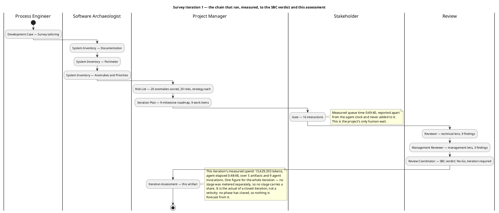
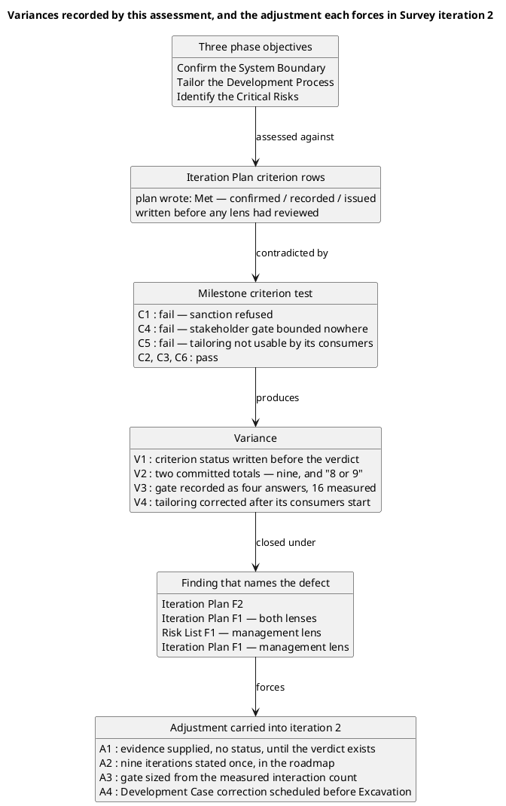

## Document Control
- Phase: Survey
- Status: Draft — iteration 1 close record, written after the milestone verdict
- Milestone Target: end of Survey (SBC) — not achieved; the Review Coordinator's verdict of 2026-11-19 requires a second Survey iteration

## Iteration Objectives Reached

Survey iteration 1 was planned against three objectives. The Review Coordinator's SBC verdict of 2026-11-19 is **No-Go, iteration required**, and three of six exit criteria fail (C1, C4, C5). Measured against that verdict: **none of the three objectives is met**, although the artifact each one names was produced and its substance survived the technical lens.

| # | Objective planned for this phase | What the iteration produced | Outcome | Evidence |
|---|---|---|---|---|
| 1 | Confirm the System Boundary | System Inventory — Perimeter: seven projects plus the CI workflow, the external systems reached, 26 entry points, and the three stakeholder exclusions, each row anchored | **Not met** — the perimeter drew no correction, but the confirmation it needs was refused | Management lens, stakeholder sanction "No", 2026-11-19; criterion C1 |
| 2 | Tailor the Development Process | Development Case: DC-D1…DC-D7, six optional verdicts with one fired (Deployment Model) and five not fired | **Not met** — issued, but the two sprint-zero phases that consume it cannot work under it | Development Case#F1; Iteration Plan#F1 (management lens); criterion C5 |
| 3 | Identify the Critical Risks | Risk List: 20 anomalies → 20 risks, magnitude as the band of probability × impact, strategy each; the three High ones accepted by the stakeholder verbatim | **Not met** — the register is scored but not executable where it lands, and the project's binding constraint is bounded nowhere in it | Risk List#F1 (both lenses), Risk List#F2 (management lens); criterion C4 |

**The distinction this table records.** "Not met" here is the milestone criterion test, not a claim that nothing was produced. Every one of the three artifacts exists, and the technical lens confirmed its substance: thirteen anchors were opened against their claims and twelve confirm them; the perimeter is drawn from code; each of the 20 risks traces to its anomaly; the three High acceptances are recorded verbatim; the one fired optional genuinely holds. What failed is that the confirmation was refused (objective 1), that a referenced convention source is absent so the tailoring is unworkable by its consumers (objective 2), and that the register's avoidance actions name roles absent from the phase that must perform them while the stakeholder gate carries no score at all (objective 3). Those are corrections of content, not a failure to do the work.

The Iteration Plan's own objective table carried six rows. Rows 1, 2 and 4 correspond to the three objectives above; rows 3 (anomalies and priorities), 5 (this plan) and 6 (settle the Excavation scope and the budget position) were obligations the plan took on and all three were delivered — 20 anomalies with evidence and eight ordered recovery areas, the plan itself, and four stakeholder answers recorded verbatim.

## Adherence to Plan

The plan carried nine work items. All nine were executed in the sequence it fixed; none slipped, none was added, none was cut. Items 1–7 completed before the gate, item 8 is the milestone review the reviewers ran, item 9 is this artifact.

| Order | Work item | Owner | Planned exit condition | Outcome |
|---|---|---|---|---|
| 1 | Development Case — Survey tailoring | Process Engineer | Tailoring issued: inactive disciplines, fired optionals, referenced tool configuration | Issued — 1 open Major, 1 open Minor |
| 2 | System Inventory — Documentation | Software Archaeologist | Each document's usefulness and currency recorded with its anchor | Issued |
| 3 | System Inventory — Perimeter | Software Archaeologist | Components, external systems and 26 entry points drawn, each anchored | Issued — 1 open Major |
| 4 | System Inventory — Anomalies and Priorities | Software Archaeologist | Twenty anomalies with evidence; the eight areas ordered for Excavation | Issued — 1 open Minor |
| 5 | Risk List — score, strategy, escalate | Project Manager | Every anomaly a classified risk; the three High acceptances answered | Issued — 3 open Major |
| 6 | Iteration Plan — this iteration's artifact | Project Manager | Coarse roadmap and fine plan issued | Issued — 2 open Major, 3 open Minor |
| 7 | Stakeholder gate | Stakeholder | Four decisions answered | Answered — the fourth answer refused the advance |
| 8 | SBC milestone review | Reviewer, Management Reviewer, Review Coordinator | A verdict on the SBC milestone | No-Go, iteration required |
| 9 | Iteration Assessment | Project Manager | Written after the verdict | This artifact |

### Measured spend

The iteration's two clocks, reported apart and never added. Neither is a forecast and neither is a velocity: no phase has closed, so this is the project's first measured actual and nothing is derived from it beyond being recorded.

| Clock | Measured | What it counts | Ceiling |
|---|---|---|---|
| Agent work — tokens | 13,629,333 | The whole iteration: 9 agent invocations over 5 artifacts | None — measured, not bounded; the project declares no token budget |
| Agent work — elapsed | 0:48:48 | The same work, other clock | None |
| Human gate — queue time | 0:49:40 | Waiting for the stakeholder, not working | 14 days, then the process suspends; the actual is reported here and nowhere converted |

The gate's queue time exceeds the agent elapsed time. That is the shape of this iteration: the six agent stretches cost less clock than the wait for one answer that turned out to be a refusal.

### Measurement, and what each figure decides

| Metric | Primitive measure | Goal — the decision it enables |
|---|---|---|
| Artifact surface | 5 artifacts, 162,463 characters (Development Case 23,617 · System Inventory 68,646 · Risk List 22,274 · Iteration Plan 24,728 · Review Record 72,198) | Sizes the re-reading the next iteration's roles face. Spend here scales with live artifact surface × times read, not with what an iteration emits — the Review Record alone is 44% of the surface, and every owner must read it to close a finding |
| Agent invocations | 9 | Tests whether the plan's stage count matched the process: nine work items, nine invocations, no stage duplicated and none missing |
| Stakeholder interactions | 16 | Sizes the human gate. The plan enumerated four answers; 16 interactions were measured — the gate is wider than the plan modelled it, which is the defect Risk List#F1 (management lens) records |
| Token spend | 13,629,333 | The only cost figure the project has. It is the baseline a closed phase will be forecast from; it is not a per-iteration rate and no rate is computed from one sample |
| Agent elapsed | 0:48:48 | Same purpose on the other clock |
| Stakeholder queue time | 0:49:40 | Whether the gate or the work dominates the iteration; the actual against the 14-day ceiling |

No metric here is reported without a decision behind it. Defect counts, page counts and defect density are deliberately absent: no lens measured page count, and a density on an unmeasured denominator would be invented.

### Variances, their root cause, and the adjustment each forces

Seven variances, one per open Major finding. Each is written with its correction in the same breath, so none is left open for the next iteration's reviewers to find.

| # | Variance | Root cause | Adjustment forced in iteration 2 |
|---|---|---|---|
| V1 | The plan marked all six exit criteria "Met" before any lens had run, while the same section disclaimed the verdict | The plan was issued as a complete document with a status column it had no standing to fill | Criterion rows carry the evidence supplied and no status word; the verdict stays the Review Coordinator's |
| V2 | The plan committed to two totals — nine in the roadmap, "8 or 9" in the Evaluation Criteria | The Excavation scope decision of 2026-11-19 was read into the roadmap but the older sentence was left standing | Nine is stated once, in the roadmap; the "8 or 9" sentence is deleted, not reconciled in a second place |
| V3 | The gate was recorded as four answers; 16 stakeholder interactions were measured, and no risk in the register bounds the wait | The register was built from the Inventory's twenty anomalies only, and the gate is not an anomaly | The gate becomes a risk of its own with probability, impact, magnitude, mitigation, the 14-day ceiling as its trigger indicator and a contingency, cross-referenced from the plan by that `RNNN` |
| V4 | The tailoring's correction was scheduled for Inception, after Excavation and Consolidation have consumed it | The plan treated issuance as sufficiency for exit criterion 5 | A Development Case correction work item enters the sprint-zero plan, owned by the Process Engineer, sequenced after the correction is specified and before Excavation opens |
| V5 | Six avoidance actions in Excavation name the Requirements Specifier, and R014 also names the Change Control Manager — neither works in the sprint zero | The actions were written from the artifact each belongs to rather than from the phase's roster | All six actions are re-owned to the System Analyst for Excavation; the Software Architect parts stay in Excavation; R014's control part moves to Inception |
| V6 | R008's mitigation homes the gap at the Release Notes, which the process first produces in Transition, not Construction | The mitigation was written against the artifact that would carry the disclosure rather than the stage that produces it there | R008's Construction part is re-homed to the User Documentation the Technical Writer produces in Construction, with the Release Notes part stated against Transition; AN-008 in the System Inventory must name the same home in the same iteration |
| V7 | The Development Case points the coding, UI and test conventions at `CONTRIBUTING.md`, which is not in the repository | The tailoring inherited the sample repository's convention pointer without checking that the file survived into the delivery | The Templates rows are re-pointed at files that exist, and the three convention families are recorded as undocumented until a requirement or Change Request puts a convention file in scope |

**V4 and V7 close in a fixed order.** The Development Case correction *specifies* the new home for the convention pointer; the plan *schedules* it. Either alone is insufficient — a re-pointed table with no work item before Excavation, or a work item for a correction nobody has specified. The Process Engineer's correction comes first.

**V5 and V6 are the same defect in two forms**: an action is assigned where the role or the artifact does not exist in the phase named. Both are the Risk List's, both are mine, and iteration 2 corrects both in the register itself rather than in a note beside it.

## Use Cases and Scenarios Implemented

**None.** Survey recovers no use case: no `UC-NNN` has been minted, the Use-Case Model does not exist, and the Use Cases and Scenarios Addressed section of the Iteration Plan was correctly empty. Use cases are recovered from entry points in Excavation and completed in Consolidation.

What the iteration did produce is the input the recovery is built on, and its adequacy is what the milestone review tested:

| Recovery input produced | What it fixes for Excavation | Milestone effect |
|---|---|---|
| 26 entry points, each with an anchor | The set a use case may be recovered from | Held — anchors verified, and the set is unaffected by the refusal |
| `EP-004` … `EP-011`, `EP-020`, `EP-021` excluded by the three stakeholder decisions of 2026-11-19 | Which entry points no use case may come from | Held — the exclusions stand, unaltered by any finding |
| Priorities, orders 1–8 | The order Excavation reads in, with orders 1–6 inside one iteration | Held — criterion C2 passed both lenses |
| `AN-001` … `AN-020` | The anomalies each recovered element must not reproduce | Held — every anomaly is a scored risk; the defect is in their owning roles, not in the reading |

The one recovery question iteration 2 must settle before Excavation reads the perimeter: whether a use case may be recovered from EP-003. The Perimeter says the product uses token refresh and AN-015 says nothing redeems a refresh token (System Inventory#F2). A role reading the first recovers a use case with no caller; a role reading the second recovers none.

## Results Relative to Evaluation Criteria

One line per criterion the Iteration Plan carried, assessed against the Review Coordinator's verdict — not re-judged here.

| # | Criterion | Evidence the iteration supplied | Result given the verdict |
|---|---|---|---|
| C1 | The perimeter of the existing system is confirmed by the stakeholder | System Inventory — Perimeter; the confirmation requested of 2026-11-19 | **Not met** — the sanction was refused; no correction to the perimeter was asked for |
| C2 | The priorities are ordered for the remaining recovery | System Inventory — Priorities, eight areas with reason and anchor | **Met** — substantiated by both executing lenses |
| C3 | The unread areas are declared with the reason each is unread | System Inventory — Coverage, per-area rows | **Met** — substantiated by both lenses; the aggregate does not reconcile (Minor, System Inventory#F1) and does not carry the criterion |
| C4 | Every anomaly is a classified risk with a strategy, and the High ones carry the stakeholder's acceptance | Risk List — 20 scored, magnitudes as bands, three High acceptances verbatim | **Not met** — the gate is bounded nowhere (Risk List#F1, management lens) and six actions name absent roles (Risk List#F1, technical lens) |
| C5 | The tailoring governing the sprint zero is issued and its trigger decisions are recorded | Development Case — DC-D1…DC-D7, six optional verdicts | **Not met** — issued, but its consumers cannot work under it (Development Case#F1, Iteration Plan#F1 management lens) |
| C6 | The plan carries the cross-iteration roadmap and this iteration's fine plan, with no forecast invented before a measured actual exists | Iteration Plan — nine-milestone roadmap, nine work items, no token and no elapsed figure | **Met** — substantiated by both lenses; the two-total defect (Major) and three Minor findings do not carry the criterion |

**Three met, three not met.** Where a criterion passed one lens and failed the other, the stricter test governs and the criterion is not met — that is variance V4's and V3's record. Every failing criterion is attributable to an open Major finding in the Review Record's ledger, not to a judgement rendered here.

## Test Results

**No test was executed. There is no Test Case, no Test Evaluation Summary and no build.** The Test discipline has no Survey stage, the phase produces no code, and `scm_get_build_status("main")` reports that no IARI pipeline file exists in the repository — correct for an iteration that builds nothing. The Implementation and Test disciplines open in Inception and Elaboration respectively.

Two consequences recorded so no later reader mistakes them for a gap:

- **The denominator is zero, not small.** No defect-removal-efficiency figure is computable at this milestone, and none is estimated. The first review-versus-test comparison becomes available when Construction test execution exists.
- **The delivery's own test project is not a result of this iteration.** `Todo.Api.Tests` is read as inventory, not executed as verification; it covers `Todo.Api` only and is the cross-check for recovery priority areas 1, 2 and 7, which is Excavation's to run.

## External Changes

All five external events of this iteration are the stakeholder's own decisions of 2026-11-19. Three were inputs to the iteration, two were its output; one of the latter is the refusal that produces iteration 2.

| Event | When | What it changed |
|---|---|---|
| External identity-provider sign-in excluded from the recovered product scope | 2026-11-19, input | `EP-011`, `EP-020`, `EP-021` carry no use case; the mechanism stays in the Supplementary Specification as an unconfigured option |
| The `admin` role recorded as dead code | 2026-11-19, input | No use case may claim cross-user access; no grant path is designed |
| The self-service identity surface excluded | 2026-11-19, input | `EP-004` … `EP-010` carry no use case; recorded beside the provider exclusion |
| R008, R009 and R020 accepted as High exposures | 2026-11-19, output | Three acceptances recorded verbatim; each carries its mitigation and its contingency in the Risk List |
| Perimeter confirmation asked and refused; order given: "All major findings must be corrected" | 2026-11-19, output | Criterion C1 fails; the milestone does not close; iteration 2 is planned from the Review Record, not from this plan |
| The Excavation split declined; no token budget declared | 2026-11-19, output | The sprint zero stays single-pass, priorities 1–6 in one Excavation iteration; spend is measured at each close and never bounded by an invented box |

No change reached the project from outside the stakeholder. There is no vendor, no regulator and no customer organisation in this project's environment: the delivery is a fixed copy of a public sample at `307a1ead` with no reachable authors, and the only human in the process is the stakeholder.

## Rework Required

Twelve findings are open at this close: **0 Critical, 7 Major, 5 Minor**. No artifact is cleared for consumption. Eight of the twelve are mine.

| Owner | Findings | Open | What closes each | Holds the milestone |
|---|---|---|---|---|
| Project Manager (me) | Risk List#F1 (technical), Risk List#F1 (management), Risk List#F2 (management), Iteration Plan#F1 (technical), Iteration Plan#F1 (management), Iteration Plan#F2, Iteration Plan#F3, Iteration Plan#F4 | 8 — 5 Major, 3 Minor | V3, V5, V6, V2, V4, V1 in that order; then the role table reconciled with the assignment profile and the day lengths removed from the gantt bars | Yes, on the five Major |
| Process Engineer | Development Case#F1, Development Case#F2 | 2 — 1 Major, 1 Minor | V7 — Templates rows re-pointed at files that exist, three convention families recorded as undocumented; then the stale "no Risk List exists yet" clause dropped from the PoC trigger row | Yes, on the Major |
| Software Archaeologist | System Inventory#F2, System Inventory#F1 | 2 — 1 Major, 1 Minor | The `/users` Perimeter row restated to agree with AN-015 with one statement on EP-003; then the Coverage aggregate recomputed or dropped for the per-area rows | Yes, on the Major |

**These corrections are Survey iteration 2's plan, and they are not executed here.** This artifact is the iteration-1 close record; reworking the artifacts inside it would leave the record asserting a state that did not exist when the verdict was issued. The Review Coordinator fixed every deadline as "Survey iteration 2", and two of the seven Majors cannot be closed out of order — the Development Case correction is specified before the plan schedules it (V4/V7).

**Two things iteration 2 must not do.** It must not add agent parallelism to close the findings faster: the seven Majors are content corrections on four artifacts by three owners, and coordinating more roles across the same four artifacts would raise contention without shortening the chain. It must not narrow the recovered perimeter to make a criterion pass: the stakeholder asked for no change to the perimeter and the exclusions are theirs, so the only honest route to C1 is the corrected artifact set and the sanction asked again.

**On what the phase has to show for this iteration.** The material the recovery rests on is substantially in place — a perimeter drawn from code with an anchor behind each of 26 entry points, 20 anomalies each a scored risk, three High acceptances held verbatim, one genuinely fired optional and one genuinely failed. What the iteration does not have is a sanctioned milestone: seven claims inside that material are wrong, and the stakeholder's order is that all seven be corrected before the sanction is put again. No milestone, iteration or phase is declared complete by this artifact.
