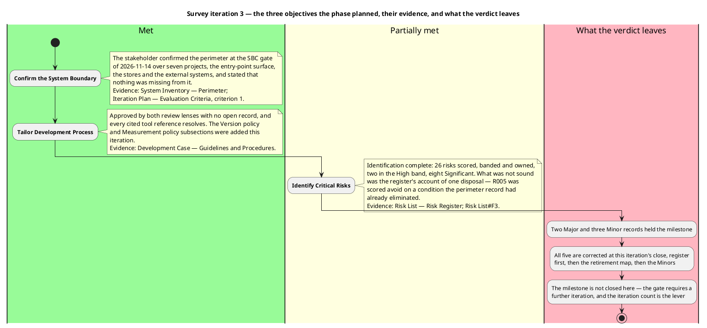
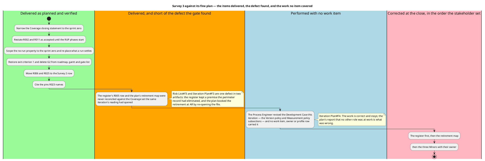
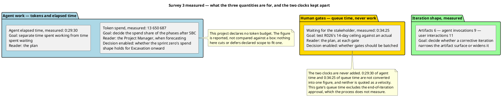

## Document Control

Phase: Survey
Status: Draft — assessment of Survey 3 against the SBC gate's ruling of iteration required. Written after the reviewers ruled and after this iteration's corrections were applied, not before.
Milestone Target: End-of-Survey (SBC) — not achieved; the gate requires a further iteration in this phase

## Iteration Objectives Reached

Survey 3 was the corrective iteration the Survey 2 gate's verdict required. The phase's three objectives are the milestone's, and this iteration's work was the closure of the records that withheld them. The ruling this assessment is written against is **SBC — iteration required**: the milestone did not close.

| Objective set for the phase | Outcome | Basis |
|---|---|---|
| Confirm the System Boundary | **Met** — the perimeter is recorded with an anchor per element and the stakeholder confirmed it at the SBC gate of 2026-11-14, stating that nothing is missing from it. No lens contests a perimeter element, and no record of this iteration or the two before it re-opens the confirmation | System Inventory, Perimeter; this plan's exit criterion 1; the stakeholder's answer of 2026-11-14 |
| Tailor Development Process | **Met** — the Development Case is approved by both review lenses with no open record, every cited tool reference resolves, and the two subsections the previous review found absent — the Version policy and the Measurement policy — are in the artifact. The role that wrote them was missing from this plan's own report of who worked, which is the plan's defect and not the tailoring's | Development Case, Guidelines and Procedures; Iteration Plan#F4 |
| Identify Critical Risks | **Met on identification, defective on record** — all 26 risks are scored, banded, owned and dispositioned, two in the High band and eight in the Significant band; neither lens misbanded a risk or contested a score in three events. What the gate found is that one Significant-band row disposed of its risk by naming work already performed: R005 was scored `avoid` on the reading of a file the perimeter record states was opened at the previous iteration, and this plan then booked that retirement at Excavation. The identification was sound; the account of one disposal was not | Risk List, Risk Register — the R005 row; Risk List#F3; Iteration Plan#F3 |

The verdict's shape is worth stating because it is the input to the next plan: the milestone's substance did not move backwards. Both lenses approved two of the three artifacts outright, the perimeter's confirmation stood, no Critical record existed at any point in three holds, and 25 lens records were closed across the three iterations against the text and, where a record turned on a file, against the file. What withheld the milestone is a single defect carried by two artifacts — one risk's retirement account — and it is the class of defect that a corrective iteration can close and a schedule cannot.

## Adherence to Plan

The fine plan carried eight work items and this iteration performed seven of them and one piece of work no item covered. Two divergences follow, and both are now recorded in the plan rather than left for the next gate to find.

| Work item as planned | What happened | Variance |
|---|---|---|
| Narrow the Coverage closing statement to the sprint zero | Delivered, and verified by both lenses against the corrected sentence | None |
| Restate R002 and R011 as accepted until the RUP phases start, and bound the acceptance in Document Control | Delivered; every acceptance in the register now names its horizon | None |
| Scope the no-run property to the sprint zero and re-examine the retirement map for what a run settles | Delivered — R011 and the observable statements of R002 sit at LCA with the evidence's producer named | The re-examination stopped at what a build and test run settles. It did not reach what the same iteration's own reading had already settled, which is where R005's retirement belonged |
| Restore exit criterion 1 and delete G2 from the roadmap, the gantt and the gate list | Delivered — four gates remain, each a decision the stakeholder gives | None |
| Cite the pins in `Directory.Packages.props` instead of a version policy the Development Case does not contain | The citation was repaired, and the replacement named a file the change does not touch — the property lives in the project file | New defect, `Risk List#F4`; corrected at this close |
| Move R006 and R025 from the LCO row to Survey 2 — SBC | Delivered, and the accounting was restated | None |
| Restate the Provenance row to the four files Coverage names | Performed by its owner and verified — the row agrees with the enumeration at 53 + 4 = 57 | The plan kept the item in its work-item table and reported the record as outstanding after it was met — `Iteration Plan#F10`; the row is gone from the table at this close |
| Write the assessment against the gate's verdict | This artifact | None |
| **No work item covered** the Process Engineer's revision of the Development Case — the Version policy and Measurement policy subsections — while Resources stated no other role was at work | The work was performed, is correct, and changes no roadmap row, gate or criterion | `Iteration Plan#F4`; the work item and the profile row are added at this close |
| **No work item covered** reconciling the register's R005 row against the Coverage set the same iteration opened | The register held a premise the perimeter record had eliminated, and the plan built a retirement on it | `Risk List#F3` and `Iteration Plan#F3`, one defect in two artifacts; corrected at this close, register first |

The variance root cause is one habit, not three accidents. Each of this iteration's corrections was written against the finding that ordered it and verified against that finding's text; none was verified against the *other* artifacts the same iteration changed. R005 is the case that cost the milestone: the reading's own Provenance record settled it, and the register and the plan were both edited in the same iteration without either being read against that record. The adjustment this forces is stated under Rework Required, and it is procedural rather than structural — every cross-artifact correction in the next iteration is tested against the artifact that carries its premise, not only against the finding that ordered it.

No work item carried a size, no token budget was set, and no calendar date was projected. The lever used to absorb the shortfall is the one this plan publishes: one more iteration in the same phase, at schedule cost, with declared scope untouched. No agent role was added in parallel and no declared scope was narrowed.

## Use Cases and Scenarios Implemented

None, and correctly so. Survey runs no implementation discipline: the process assigns Environment, Discovery and Project Management to this phase, and the sprint zero records the system as it is. No use case is recovered before Excavation, so no scenario was implemented, executed or tested in Survey 1, 2 or 3.

Two facts about what Excavation will recover changed this iteration. The login and logout scenarios are recoverable from the delivered code together with the Provenance record of `HttpAuthenticationStateProvider.cs` — the file that blocked them was opened at Survey 2, so no reading work remains between them and the Use-Case Model. And R009 still stands: the completion capability is recovered from the API with the statement that no screen reaches it, so the Use-Case Model carries that gap rather than claiming a screen that cannot reach it.

## Results Relative to Evaluation Criteria

The six SBC exit criteria are the gate's, and the gate ruled on them. Recorded here against the evidence, one line per criterion.

| # | Criterion | Result given the verdict | Evidence |
|---|---|---|---|
| 1 | The perimeter of the existing system is confirmed by the stakeholder | **Met** — not among the records the gate opened, and no lens contested a perimeter element | System Inventory, Perimeter; the stakeholder's confirmation of 2026-11-14 |
| 2 | The reading priorities are ordered | **Met** — eight areas ordered, each naming what the next reading must settle | System Inventory, Priorities |
| 3 | The unread areas are declared rather than omitted | **Met** — the declaration holds, and the Provenance row now agrees with the enumeration the Coverage section publishes at 53 + 4 = 57 | System Inventory, Coverage and Provenance; `Iteration Plan#F10` corrected at this close |
| 4 | Every anomaly is a classified risk whose strategy can execute | **Not met at the gate, met on correction** — 26 risks correctly banded, and one Significant-band strategy named work already performed; R005's row and R023's file are restated at this close | Risk List, Risk Register and Risk Mitigation and Contingency; `Risk List#F3`, `Risk List#F4` |
| 5 | The process is tailored and the tailoring is auditable | **Met** — approved by both lenses, no open record, every cited reference resolving, and both policies present | Development Case, Guidelines and Procedures |
| 6 | The plan instantiates the process, sequences by risk, schedules no work the phase does not run | **Not met at the gate, met on correction** — the retirement map booked a met retirement as pending and the profile omitted a role that worked; both corrected, with the accounting restated as 14 + 3 + 1 + 8 = 26 | Iteration Plan, Plan and Milestones and Resources; `Iteration Plan#F3`, `Iteration Plan#F4` |

Criterion 4's failure was again not a scoring failure. Every magnitude was the band of its own exposure and neither lens dissented from a score; what failed was whether the artifact a strategy named still had work to do. The distinction matters for the next iteration: a misbanded score is a judgement a reviewer may contest without failing the milestone, while a strategy attached to completed work is a defect of record that does fail it — because the plan's claim that its risks retired rests on exactly that row.

## Test Results

No test was executed in this phase and none could be. Nothing here runs the system: Survey, Excavation and Consolidation record it by reading its source and configuration, and that constraint is the stakeholder's own ruling of 2026-11-14. It is bounded — from Inception on the pipeline builds the solution and runs its test suites, and the first such run is what settles the statements reading cannot.

The absence has a cost the Risk List carries rather than conceals. R001 (nothing automated tests the BFF) and R009 (a delivered API capability with no screen) are statements about what the suite does not verify, and both are retired by an artifact the process writes rather than by a run. R011 and the observable statements of R002 are the two conditions a first build-and-test run settles, and both are placed at LCA where the Tester executes and the Test Manager records the result. No risk is recorded as retired by a run that has not happened.

Neither a build status nor a test count is reported here because none was observed: Survey produces no source code, the repository carries no pull request in any state, and no branch carries work. The milestone's evidence is artifact evidence.

## External Changes

One external event this iteration: the stakeholder's answer at the SBC gate, which set the corrective order for the two Majors and added nothing to them — "Nothing to add. Close it as you describe: the Risk List row first, then the retirement map." That answer is absorbed: the register's row was restated first, then the plan's retirement map, as ordered.

No change to declared scope, no change to the phase sequence, and no Change Request arises from this iteration. Each of the five corrections moves content in an artifact its owner already holds, back toward a decision the stakeholder has already taken.

## Rework Required

The five records this gate opened, and what this iteration did with each. The correction is applied in the artifact; the ruling on it belongs to the lens that recorded it, at the next review.

| Record | Artifact | Severity | Correction applied at this close |
|---|---|---|---|
| `Risk List#F3` — R005 scored `avoid` on a condition the perimeter record states was already eliminated, and its unread clause no longer matched Coverage's declaration set | Risk List | Major | R005 restated as the anomaly at the first reading with its retirement at Survey 2 — SBC by the Provenance record the second reading wrote; band 4×3=12, owner and exposure unchanged; the "six files are declared unread" clause replaced by the declaration set Coverage now carries; the register's opening sentence made exact about R025 entering from a review finding |
| `Iteration Plan#F3` — the retirement map, the disposal table and the Excavation 1 profile booked R005's retirement at AR by re-opening a file opened at Survey 2 | Iteration Plan | Major | R005 moved into the "Retired at Survey 2 — SBC" group; the accounting restated as 14 + 3 + 1 + 8 = 26; R005 dropped from the AR step of the retirement diagram and from the Excavation 1 risk-owner column, where the System Analyst's AR work is now R017 alone |
| `Risk List#F4` — R023's mitigation routed the change to `Directory.Packages.props` while `<RazorLangVersion>` lives in the project file | Risk List | Minor | R023 now names `Todo.Web/Server/Todo.Web.Server.csproj` as the file the change sets, and the central pin file as the file a framework or package change touches |
| `Iteration Plan#F4` — Resources reported no role but two at work, while the Process Engineer revised the Development Case | Iteration Plan | Minor | The Development Case revision is now a work item with the Process Engineer as owner, and the Process Engineer sits on this iteration's role profile with the Version policy and Measurement policy named as what it produced |
| `Iteration Plan#F10` — exit criterion 3's state column reported the Provenance record as outstanding after it was met | Iteration Plan | Minor | Criterion 3's state restated to record that the Provenance row agrees with the enumeration Coverage publishes; the "Restate the Provenance row" work item removed from the fine plan |

**The adjustment the next iteration inherits.** Another Survey iteration is required, and it is the iteration-count lever applied as this plan publishes it: one more iteration inside the same phase, at schedule cost, with declared scope untouched. Its scope is not another sweep of the artifact surface — it is the ruling of the next review on these five corrections, and nothing else is planned for it. If a lens records a further defect, it is corrected in the register first and the plan second, exactly as ordered here, and every cross-artifact correction is read against the artifact that carries its premise before it is persisted.

Two things this iteration does not owe and must not be recorded as owed. No risk is re-scored: R005's exposure was real and was retired by an artifact the process ran, and the defect was where the register recorded the retirement, not the number. And no new Stakeholder question is outstanding: the three scope facts were answered on 2026-11-14, the perimeter is confirmed, and the corrective order for this iteration's two Majors was given at this gate.

### Measurement, and the decision each figure enables

Each figure is reported because a decision turns on it. None is a velocity, and none is compared against a budget — this project declares no token budget, and no declared scope was cut or deferred to fit one.

| Measured | Figure | Goal — the decision it enables |
|---|---|---|
| Token spend, this iteration | 13 650 687 | Whether the sprint zero's spend shape carries into Excavation. Cost in this process scales with the live-artifact surface read each phase, not with what a phase emits — so a corrective iteration that reads a 112 362-character Review Record and six artifacts to change four sections is the shape to expect, and the forecast for Excavation is built from it rather than from an assumed share |
| Agent elapsed time | 0:29:30 | Separates time spent working from time spent waiting, so a slow iteration is not misread as slow agents |
| Waiting for the stakeholder | 0:34:25 of queue time | Tests R026's 14-day ceiling against an actual, and decides whether gates should be batched into fewer points in later phases. This is queue time, not work, and it excludes the end-of-iteration approval, which the process does not measure |
| Artifacts, agent invocations, user interactions | 6 / 9 / 11 | Whether a corrective iteration narrows the artifact surface or widens it. Nine invocations against six artifacts describes a corrective iteration: the surface is read far more than it is written, which is why the next iteration's scope is a ruling on five corrections rather than a new sweep |

| Artifact surface read this iteration | Characters |
|---|---|
| Review Record | 112 362 |
| System Inventory | 109 134 |
| Iteration Plan | 40 037 |
| Risk List | 35 504 |
| Development Case | 19 681 |
| Iteration Assessment | 11 810 |

The two clocks are never added. 0:29:30 of agent time and 0:34:25 of queue time are reported side by side because they answer different questions — one is work, the other is waiting — and neither is converted into the other.

