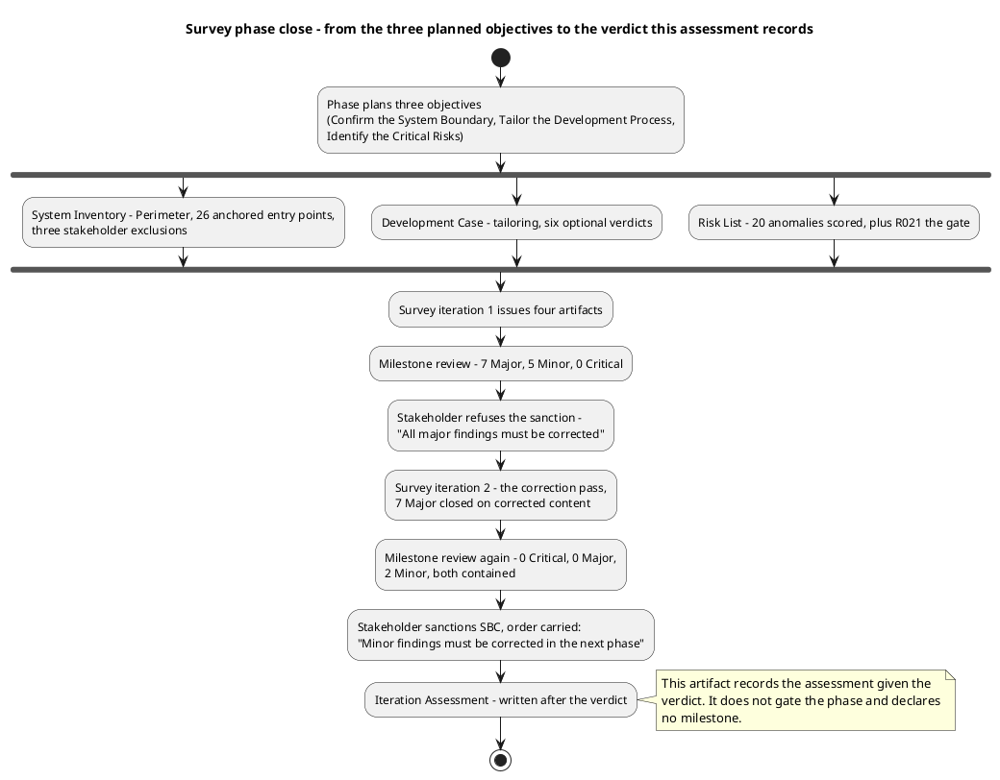
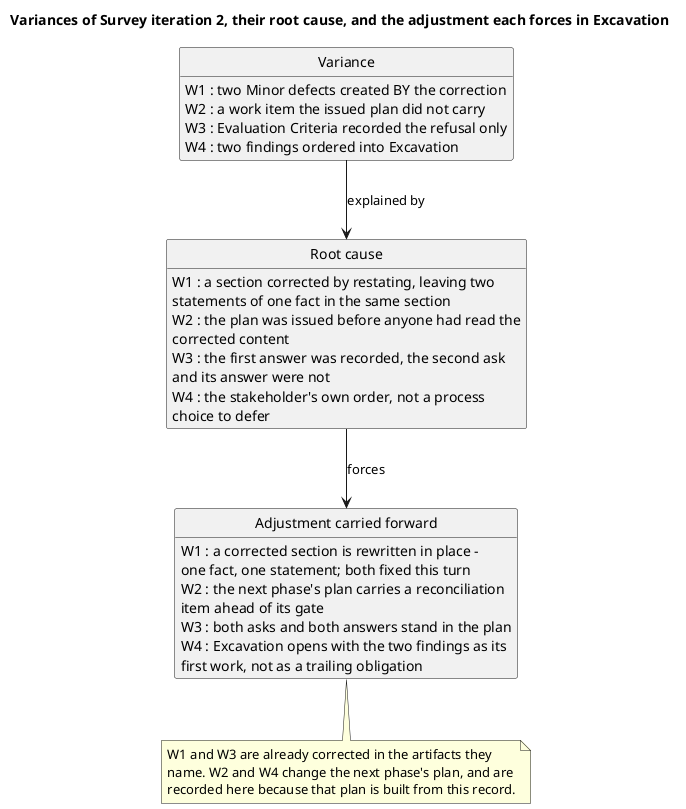

## Document Control
- Phase: Survey
- Status: Draft — Survey iteration 2 close record, written after the Review Coordinator's milestone verdict
- Milestone Target: end of Survey (SBC)

## Iteration Objectives Reached

Survey iteration 2 was the correction pass the first SBC milestone review required. The ReviewCoordinator's verdict on the corrected content is **SBC — no further iteration required**, and the stakeholder granted the sanction that had been refused at the previous milestone review. Assessed against that verdict, **all three objectives planned for this phase are met.**

| # | Objective planned for this phase | What the iteration produced | Outcome | Evidence |
|---|---|---|---|---|
| 1 | Confirm the System Boundary | System Inventory — Perimeter unchanged by both corrections: seven projects plus the CI workflow, the external systems reached, 26 anchored entry points, three stakeholder exclusions | **Met** — the perimeter was confirmed on the second ask and the sanction granted | Stakeholder sanction "Yes", 2026-11-19; Review Record, "Exit criteria substantiated by both executing lenses 6 of 6" |
| 2 | Tailor the Development Process | Development Case: `DC-D1`…`DC-D7`, six optional verdicts, one fired (Deployment Model); `Development Case#F1` and `#F2` corrected — the convention pointers re-pointed at files that exist, three families recorded Undocumented with no fallback asserted | **Met** — no finding open against the tailoring, and its consumers can work under it | Review Record, Reviewer lens Development Case table: every checklist item Pass |
| 3 | Identify the Critical Risks | Risk List: 20 anomalies each a scored risk, plus `R021` the project's own gate — 21 risks, magnitude as the band of probability × impact, every action naming a role at work in the phase it lands in, four High/Significant acceptances recorded verbatim | **Met** — every anomaly the reading recorded is a classified risk, and every acceptance rests on the stakeholder's own answer | Review Record, Risk List checklist: 6 of 7 items Pass, the seventh a contained Minor |

**What the verdict rests on, and where it came from.** Seven Major findings were open at the previous milestone review and the stakeholder refused the sanction with the order that all seven be corrected. They are corrected, each on content the lens that raised it re-read: `Development Case#F1`, `System Inventory#F1` and `#F2`, `Risk List#F1` (both lenses), `Risk List#F2` (management lens), `Iteration Plan#F1` (both lenses), `#F2`, `#F3`, `#F4`. This iteration closed 12 of the 14 findings on record and left 2 open, both Minor and both contained.

## Adherence to Plan
The plan committed seven work items when the iteration opened. All seven were executed in the sequence it fixed; none slipped and none was cut. An eighth correction — the two contained defects this iteration's own rework created — was covered by no work item, because the plan was issued before anyone had read the corrected content. It is recorded as variance W2 and is now item 5 of the plan.

| Order | Work item | Owner | Planned exit condition | Outcome |
|---|---|---|---|---|
| 1 | Development Case — sprint-zero correction | Process Engineer | Templates rows cite files present in the repository; three convention families recorded undocumented; stale PoC clause gone | Met — `Development Case#F1`, `#F2` closed |
| 2 | System Inventory — perimeter row and coverage aggregate | Software Archaeologist | The `/users` row agrees with `AN-015` with one statement on `EP-003`; the aggregate reconciles or is dropped for the per-area rows | Met — `System Inventory#F2`, `#F1` closed; aggregate restated as the sum of the Read column, 72 of 132 |
| 3 | Risk List — re-own, score the gate, re-home `R008` | Project Manager | Every action names a role at work in its phase; the gate scored as `R021` with acceptance verbatim; `R008` homed at the producing stage | Met — 3 Major closed; one contained Minor left open |
| 4 | Iteration Plan — this correction pass | Project Manager | One committed total stated once; tailoring correction scheduled first; evidence wording in the Evaluation Criteria; profile reconciled with the roster; no day length on any bar | Met — 5 findings closed; one contained Minor left open |
| 5 | Risk List and Iteration Plan — the two contained defects found in the corrected content | Project Manager | The trailing `R021` block gone, its answer standing once in the acceptance table; the opening block of Plan and Milestones gone | Added and executed this iteration — the corrections are in the artifacts; closure rests with the Reviewer lens |
| 6 | SBC milestone review | Reviewer → Management Reviewer → Review Coordinator | Both lenses re-run; each finding resolved by the lens that raised it or re-recorded under its key | Executed — verdict SBC, no further iteration required |
| 7 | Stakeholder gate — sanction of SBC | Stakeholder | The refused sanction put again and answered | Executed — "Yes", 2026-11-19, with a carried order on the two Minor findings |
| 8 | Iteration Assessment | Project Manager | Written after the verdict | This artifact |

### Measured spend

The iteration's two clocks, reported apart and never added. No phase had closed when this iteration began, so iteration 1's figures and this iteration's are the project's first measured actuals; the Survey phase total below is their sum **within each clock separately** and is the basis every later forecast is built from.

| Clock | Iteration 1 | Iteration 2 | Survey phase, measured | What it counts |
|---|---|---|---|---|
| Agent work — tokens | 13,629,333 | 7,733,371 | **21,362,704** | The whole phase: 6 artifacts, 2 milestone reviews, 2 agent passes |
| Agent work — elapsed | 0:48:48 | 0:23:32 | **1:12:20** | The same work, on the other clock |
| Human gate — queue time | 0:49:40 | 0:19:53 | **1:09:33** | Waiting for the stakeholder, not working; excludes the end-of-iteration approval gate, which the system does not measure |

The project declares no token budget: there is no box, no ceiling, and no declared scope is cut or deferred to fit one. No per-iteration rate is computed from these figures and none is quoted — two iterations of a phase are a phase total, not a velocity. The human clock is a measured actual against `R021`'s 14-day ceiling, reported apart and never converted into the agent clock or added to it.

### Measurement, and what each figure decides

| Metric | Primitive measure | Goal — the decision it enables |
|---|---|---|
| Artifact surface | 6 artifacts, 254,752 characters (System Inventory 71,134 · Review Record 76,870 · Iteration Plan 32,015 · Development Case 26,485 · Risk List 26,433 · Iteration Assessment 21,815) | Sizes the re-reading every role in Excavation faces before it can cite anything. Spend here scales with live-artifact surface × times read, not with what an iteration emits — the Review Record alone is 30% of it, and each of three owners had to read it to close a finding |
| Artifact count | 6 | Whether the phase produced the set SBC requires. Survey's floor is the Development Case, the System Inventory and the three management artifacts plus this record; nothing beyond them was produced |
| Agent invocations | 9, against 8 planned work items | Tests whether the plan's stage count matched the process. The excess is the Review Coordinator's consolidation stage, which runs after the two reviewer lenses and is work the plan's item 6 implied without counting. No stage was duplicated and none missing |
| Stakeholder interactions | 11 | Sizes the human gate. Down from 16 in iteration 1 — the correction pass asked only what was still open. The gate is carried as `R021`, and the ceiling is 14 days of queue time |
| Token spend | 7,733,371 this iteration; 21,362,704 for the phase | The only cost figure the project has, and now the measured actual every later phase is forecast from. The correction pass cost 57% of the pass that issued the artifacts — recorded as an observation of one pair, not a rate |
| Agent elapsed | 0:23:32 this iteration; 1:12:20 for the phase | Same purpose on the other clock |
| Stakeholder queue time | 0:19:53 this iteration; 1:09:33 for the phase | Whether the gate or the work dominates the phase. Measured: the gate was 48% of the elapsed wall clock across the phase and never reached a fraction of its ceiling |

Defect counts, page counts and defect density are deliberately absent: no lens measured page count, and a density on an unmeasured denominator would be invented. Defect-removal efficiency is absent for the same reason — the denominator is zero, not small.

### Variances, their root cause, and the adjustment each forces

| # | Variance | Root cause | Adjustment forced in Excavation |
|---|---|---|---|
| W1 | The correction pass created two defects it did not have before: `Risk List#F2` — the trailing "offered for acceptance" block contradicting the acceptance table three paragraphs above it — and `Iteration Plan#F5` — the opening block of Plan and Milestones duplicating its own Measure and forecast subsection | A section corrected by appending an answer beside the question rather than rewriting the statement, and a section re-issued with its new subsection written twice | A corrected section is rewritten in place: one fact, one statement, its answer at the place the other answers sit. Both are corrected in this turn; closure rests with the Reviewer lens |
| W2 | The plan as issued carried no work item for defects the correction itself would create, so two corrections were executed outside any planned item | The plan was issued before the corrected content existed to be read — an ordering the plan could not have avoided, only planned around | Excavation's plan carries a reconciliation item ahead of its gate, so defects in its own rework are planned work rather than an unplanned tail |
| W3 | The Evaluation Criteria recorded only the refused sanction of the first ask; the second ask and its "Yes" were missing, so the plan read as though criterion 1 still failed | The plan was corrected against the findings before the second ask was made, and was not re-read after it was answered | Both asks and both answers stand in the plan. Any answer that changes a criterion's evidence is written into the artifact in the round it is given, never carried in conversation |
| W4 | Two Minor findings are ordered into the next phase by the stakeholder: "Minor findings must be corrected in the next phase; they cannot be left unresolved" | The stakeholder set the deadline; this is not the process deferring a Minor finding to the owner's next turn | Excavation opens with those two corrections as its first work items, not as a trailing obligation. Neither may be carried past Excavation |

**No variance is recorded without its correction.** W1 and W3 are corrected in the artifacts they name within this turn. W2 and W4 change the next phase's plan, and the plan is built from this record — that is why they are written here rather than left for a reviewer to find.

**What this iteration did not do, and why.** It did not add agent roles to close findings faster: the seven Majors were content corrections on four artifacts by three owners, and more roles on the same four artifacts would have raised contention without shortening the chain. It did not narrow the recovered perimeter to make a criterion pass: the perimeter was confirmed as drawn and no exclusion was reopened — `System Inventory#F2` corrected an internal contradiction in the Perimeter's own wording and altered no boundary. It did not repair `R008`'s accepted gap into scope: the exposure was accepted and is disclosed, not fixed, and a completion control still requires a Change Request the stakeholder approves.

## Use Cases and Scenarios Implemented

**None.** Survey recovers no use case: no `UC-NNN` has been minted, the Use-Case Model does not exist, and the Use Cases and Scenarios Addressed section of the Iteration Plan is correctly empty. Use cases are recovered from entry points in Excavation and completed in Consolidation.

What the iteration hands the recovery is the input it is built on, and this is what the milestone review tested:

| Recovery input | What it fixes for Excavation | Milestone effect |
|---|---|---|
| 26 entry points, each with an anchor | The set a use case may be recovered from | Held — anchors re-opened this iteration and confirmed; the set is unchanged by either correction |
| `EP-011`, `EP-020`, `EP-021` and `EP-004` … `EP-010` excluded by the three stakeholder decisions of 2026-11-19 | Which entry points no use case may come from | Held — each exclusion traced to the answer that made it, and no use case claimed from an excluded entry point |
| Priorities, orders 1–8, with orders 1–6 inside the single Excavation iteration | The order Excavation reads in | Held — criterion 2 substantiated by both lenses; the single-pass choice is the stakeholder's of 2026-11-19 |
| `AN-001` … `AN-020` | The anomalies each recovered element must not reproduce | Held — every anomaly is a scored risk and every risk names a role at work in its phase |
| `EP-003` settled: the `/users` Perimeter row states once that the product reaches registration and login, and no use case is recovered from `EP-003` | Whether a role recovers a use case with no caller | Held — `System Inventory#F2` removed the contradiction; a role reading Perimeter or `AN-015` now reaches the same conclusion |

## Results Relative to Evaluation Criteria

One line per criterion the Iteration Plan carried, assessed against the Review Coordinator's verdict — not re-judged here. Both executing lenses substantiated all six; the Business Reviewer is inactive until LCO and did not rule.

| # | Criterion | Evidence the iteration supplied | Result given the verdict |
|---|---|---|---|
| C1 | The perimeter of the existing system is confirmed by the stakeholder | System Inventory — Perimeter; the sanction asked twice and granted on 2026-11-19 | **Met** — confirmed as drawn; no boundary, entry point or exclusion moved by either correction |
| C2 | The priorities are ordered for the remaining recovery | System Inventory — Priorities, eight areas each with its reason and anchor | **Met** — substantiated by both executing lenses |
| C3 | The unread areas are declared with the reason each is unread | System Inventory — Coverage, per-area rows naming every unread area; aggregate 72 of 132 read, 60 unread, stated as the sum of the Read column | **Met** — the aggregate now reconciles with its own rows |
| C4 | Every anomaly the reading recorded is a classified risk with a strategy, and the High ones carry the stakeholder's acceptance | Risk List — 20 anomalies scored plus `R021`, magnitude as the band of P × I, four acceptances verbatim with their dates | **Met** — the sole open item is a contained Minor in the section's wording, and no acceptance is in doubt |
| C5 | The tailoring governing the sprint zero is issued and usable by the phases that work under it | Development Case — the decision record, six optional verdicts with one fired, Templates rows citing files that exist | **Met** — 0 findings open against the tailoring |
| C6 | The plan carries the cross-iteration roadmap and this iteration's fine plan, with no forecast invented before a measured actual exists | Iteration Plan — 10 iterations stated once with its arithmetic, eight work items with owners, no size and no day length on any bar; both stakeholder asks and answers recorded | **Met** — single-valued, no invented forecast, and the criterion-1 evidence now reads as granted |

**Six met, none not met.** No criterion rests on a judgement rendered here: each rests on a finding the lenses closed or on the verdict the Review Coordinator issued. Where this assessment and iteration 1's differ, the difference is the corrected content, not a re-reading of the same evidence.

## Test Results

**No test was executed and no build exists.** Survey produces no code and the Test discipline has no Survey stage. `scm_get_build_status("main")` reports that IARI's pipeline file `ci.yml` does not exist in the repository, so there is no IARI build to report — a statement about the IARI pipeline only, and nothing about the repository's other pipelines. No test count, pass rate or defect count is cited anywhere in this artifact, because none was measured.

Two consequences recorded so no later reader mistakes them for a gap:

- **The denominator is zero, not small.** Defect-removal efficiency compares defects found in review against defects found in test. No test execution exists, so the figure stays not computable and is not estimated. The first comparison becomes available when Construction test execution exists.
- **The repository's own test project is inventory, not evidence.** `Todo.Api.Tests` was read as the cross-check on recovery priorities 1, 2 and 7; it covers `Todo.Api` only, carries no test of the BFF, and was not executed by this iteration. That the BFF is untested is `R009`, accepted by the stakeholder with its first coverage planned in the first Elaboration iteration.

## External Changes

Every external event of this iteration is the stakeholder's own. Three were answered in this round, and each is recorded verbatim in the artifact it binds.

| Event | When | What it changed |
|---|---|---|
| `R021` accepted at Significant (12) — the stakeholder gate, with its mitigation in force on all seven roadmap milestones and its 14-day ceiling as contingency | 2026-11-19, output | The project's own binding constraint is now bounded in the register, not only described in the plan. The acceptance is the stakeholder's; it was not self-granted |
| SBC sanction granted — "Yes" — on a ledger of 0 Critical and 0 Major open from both executing lenses | 2026-11-19, output | Criterion 1 is met and the milestone's advance is sanctioned. The perimeter stands as the System Inventory records it: seven projects plus the CI workflow, 26 entry points, three exclusions |
| Order carried out of the milestone: "Minor findings must be corrected in the next phase; they cannot be left unresolved" | 2026-11-19, output | The two remaining Minor findings become Excavation's first work items. They cannot be carried past it, and a Minor is normally its owner's next turn — the order removes the option of deferral |

No change reached the project from outside the stakeholder. There is no vendor, no regulator and no customer organisation in this project's environment: the delivery is a fixed copy of a public sample at `307a1ead` with no reachable authors, and the stakeholder is the only human in the process.

## Rework Required

**Two findings remain open at this close, both Minor, both mine, both contained.** Twelve of the fourteen findings on record are closed. Neither open finding holds the milestone and neither is consumed by another role: no other role builds on the duplicated passage or on the pending-sounding `R021` block, and no SBC criterion depends on either.

| Finding | Lens | Severity | What closed it | State at this close |
|---|---|---|---|---|
| `Risk List#F2` | Reviewer | Minor | The trailing "R021 — offered for acceptance" block deleted; the answer stands once, in the acceptance table where the other three grants sit, and the register row keeps the mitigation, trigger and contingency | Corrected in this turn — closure awaits the Reviewer lens |
| `Iteration Plan#F5` | Reviewer | Minor | The duplicated opening block of Plan and Milestones deleted; the matter stays once in Measure and forecast, where "the ten iterations above" refers to the roadmap | Corrected in this turn — closure awaits the Reviewer lens |

**Why they were corrected now rather than in Excavation.** The Review Coordinator fixed Excavation as their deadline under the stakeholder's order, not because the process chose to defer them. They are contained defects in artifacts I own, both were executable in this turn, and leaving corrected artifacts carrying a known contradiction into a milestone sanction invites exactly the defect class the previous milestone review recorded — content issued before its upstream settled.

**What the next iteration inherits, and what it must not do.**

| Carried into Excavation | Owned by | Constraint |
|---|---|---|
| Closure of `Risk List#F2` and `Iteration Plan#F5` by the Reviewer lens, on reading the corrected content against the finding | Reviewer | The only lens that may close them. A defect still standing is re-recorded under its `findingKey` and stays open |
| `R008` disclosure beside the recovered update use case — the completion gap the product has and the stakeholder accepted | System Analyst | Disclosed, never repaired into scope without a Change Request |
| First coverage of the BFF, before any change to it is accepted | Test Designer, Tester | Lands in the first Elaboration iteration; the acceptance is `R009`'s, not a deferral |
| Every recovered BFF element marked a static reading where execution has not confirmed it | System Analyst, Software Architect | Under `R020`, no statement about the composed system is evidence until the first assembled run in Elaboration |

**Two things Excavation must not do.** It must not add agent parallelism to close findings faster: the sprint zero's work is content recovery on four artifacts by three owners, and more roles over the same surface raise contention without shortening the chain. It must not narrow the recovered perimeter or reopen an exclusion to make a criterion pass: the perimeter is the stakeholder's, confirmed on 2026-11-19, and the three exclusions are theirs.

**On what the phase has to show.** A perimeter drawn from code with an anchor behind each of 26 entry points and three exclusions traced to the stakeholder's answers; 20 anomalies, each a scored risk, with every action owned by a role at work in the phase it lands in; four acceptances held verbatim, none self-granted; one tailoring issued with its optional verdicts and no open finding; a plan single-valued in its total, honest about having no forecast before its first measured actual, and now carrying that measured actual. The milestone verdict and the sanction are the Review Coordinator's and the stakeholder's. This artifact records the assessment given that verdict; it declares no milestone and does not gate the phase.
