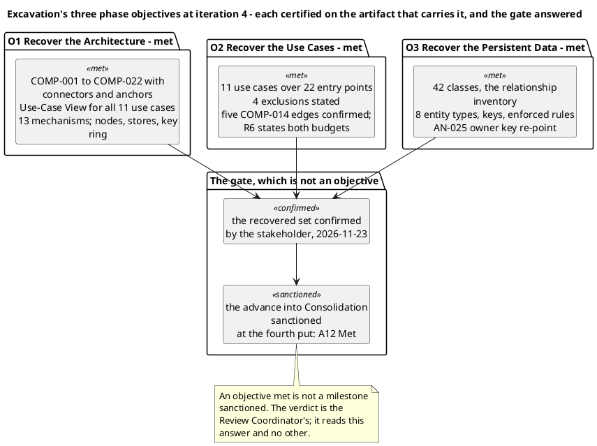
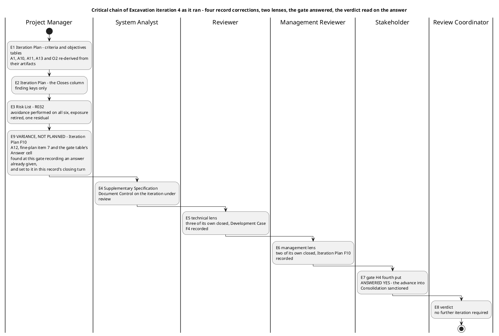
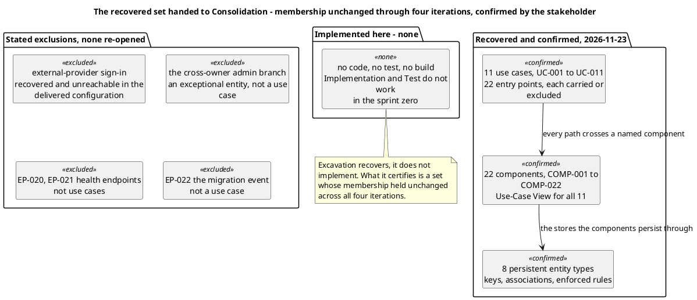
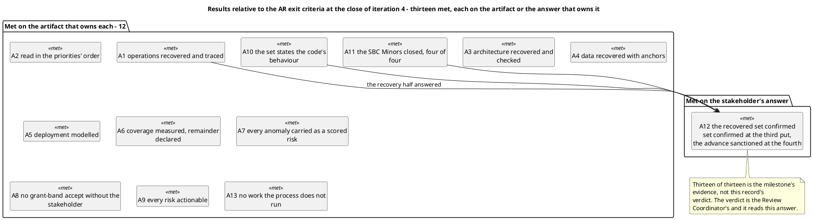
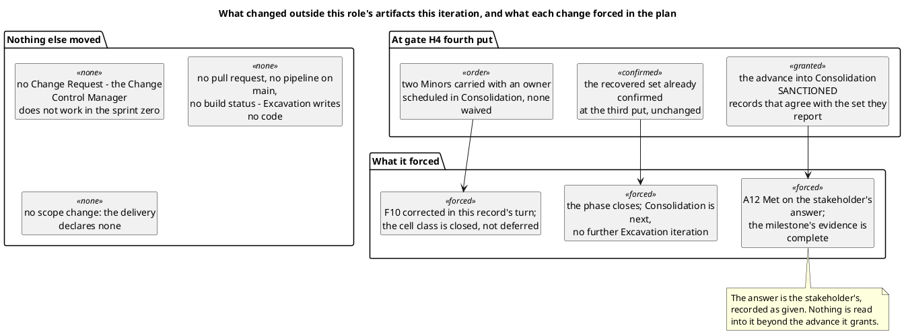
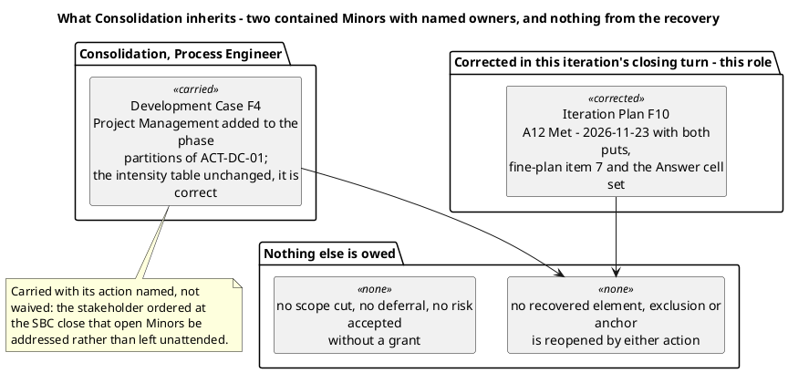

## Document Control
- Phase: Excavation
- Status: Assessed. The milestone verdict is the Review Coordinator's — AR: no further iteration required — and this record assesses iteration 4 against it. It declares no milestone of its own.
- Milestone Target: end-of-Excavation (AR). Gate H4's fourth put was answered Yes on 2026-11-23 and the Review Coordinator sanctioned the advance into Consolidation. Consolidation is the next phase.
- Iteration: 4, Cycle 1
- Owner: Project Manager

## Iteration Objectives Reached
The phase planned three objectives. All three are met on the artifacts that carry them, and this is the first iteration of the phase at which they are met and the milestone is sanctioned at the same time. What iteration 4 bought was not recovery: it was the record that reports it.

| # | Phase objective | Owner | Planned | Standing at this assessment |
|---|---|---|---|---|
| O1 | Recover the Architecture | Software Architect | The Software Architecture Document records components, connectors, mechanisms, technology and deployment as the code shows them; the topology is modelled | **Met** — 22 components with anchors and connectors, the Use-Case View naming the components each of the eleven use cases' path crosses, 13 mechanisms, and the Deployment Model's nodes, stores, environment mapping and key-ring requirement. The three Majors recorded against these artifacts at iteration 1 are closed and verified. At this gate neither artifact carried an open finding from any lens |
| O2 | Recover the Use Cases | System Analyst | One use case per entry-point path, each tracing to its `EP-NNN`, with every entry point either carried or its exclusion stated | **Met** — carriage intact at 11 use cases over 22 entry points with four exclusions stated. Both Majors that held this objective in iteration 2 are closed and verified at the artifact: the five `COMP-014 → UC-006` to `UC-010` edges confirmed in the registered graph, and R6 stating both budgets under `AN-024`. Iteration 4 changed none of it — the stakeholder stated that no recovered content was at issue, and none was touched |
| O3 | Recover the Persistent Data | Designer, Database Designer | The Design Model carries the domain model, packages and classes, and the persistent data with entities, keys, associations and enforced rules | **Met** — 42 classes, the relationship inventory, the eight entity types, the owner key's re-point under `AN-025` and "What the code does not hold", each anchored to `TodoDbContext.cs:11-17` and the three migrations. No lens recorded a finding against this objective in any of the four iterations |

The three objectives were met at the close of iteration 3 and were met, unchanged, at this one: iteration 4 reopened no recovered element, no exclusion and no anchor. What the iteration settled is the one criterion the phase could not answer for itself — `A12`, the stakeholder's answer — which the fourth put of gate H4 granted on 2026-11-23 after the plan's own four defective cells were restated. An objective met is not a milestone sanctioned; at this gate both are true, and the Review Coordinator's verdict records the latter.

## Adherence to Plan
Iteration 4's fine plan was six items of agent work, one gate and one verdict. The six ran as planned, the gate was answered, and the verdict was issued. One item was added mid-iteration and is this iteration's variance.

| # | Work item | Owner | Planned | Actual | Variance and root cause |
|---|---|---|---|---|---|
| 1 | Iteration Plan — every cell of the criteria and objectives tables re-derived from the artifact it cites | Project Manager | This turn | Landed — `Iteration Plan#F4` and `#F9` closed by both lenses, verified cell by cell: A1 on a fresh `COMP-014` query returning five unmarked `Realizes` edges, A10 on R6's current wording under `AN-024`, A11 on four of four Minors, O2 on the same reading | None. The rule the plan wrote for itself in the previous iteration — correct the table as a table — was applied and no neighbouring cell was left behind |
| 2 | Iteration Plan — the Closes column names finding keys only | Project Manager | Same turn | Landed — `Iteration Plan#F8` closed; every Closes cell holds a finding key and nothing else | None |
| 3 | Risk List — `R032` restated with the avoidance performed on all six citing artifacts | Project Manager | Same turn | Landed — `Risk List#F3` closed by the technical lens, verified against `appsettings.Development.json` (50 / 50 / 50) and `RateLimitExtensions.cs:22-24` (100 / 100 / 100) | None |
| 4 | Supplementary Specification — Document Control on the iteration under review | System Analyst | This turn | Landed — `Supplementary Specification#F3` closed; the field reads Iteration 4, Cycle 1 | None |
| 5 | Technical lens against the restated cells and the register | Reviewer | After item 4 | Ran — three of its own findings closed, the recovered set at 10 of 10 on the checklist, `Development Case#F4` recorded as one contained Minor | — |
| 6 | Management lens — A1 to A13 re-taken on the corrected table | Management Reviewer | After item 5 | Ran — `Iteration Plan#F9` and `#F8` closed, `Iteration Plan#F10` recorded, gate H4 put a fourth time | It recorded the one cell class the pass could not have reached: three cells still described the fourth put as unanswered |
| 7 | Gate H4, fourth put | Stakeholder | After item 6 | **Answered Yes, 2026-11-23** — the advance into Consolidation sanctioned | — |
| 8 | AR milestone verdict | Review Coordinator | After item 7 | **AR: no further iteration required** — 0 Critical, 0 Major, 2 Minor open | — |
| V | **Not planned** — `A12`, the gate table's Answer cell and fine-plan item 7 set to the fourth put's answer | Project Manager | — | **Performed in this record's closing turn** — `A12` reads "Met — 2026-11-23", fine-plan item 7 reads the answer, the human-gate Answer cell records the Yes | The plan asserted a gate's answer, and the answer arrived after the cells were written. `Iteration Plan#F10` is the one class of defect the previous iteration's rule could not pre-empt, because the fact it records did not exist when the cells were written |

**The variance this iteration owns.** The plan's rule — a cell asserting another artifact's state is re-derived in the same turn that artifact changes — held for every artifact that existed at the start of the iteration, and it is what closed `#F4` and `#F9` in one pass after four consecutive failures. It could not cover the gate answer: `A12`, fine-plan item 7 and the human-gate Answer row described a put that had not yet been made, and their content was written when the honest content was "not yet answered". When the answer arrived the cells were one event behind, and the Management Reviewer recorded that as `Iteration Plan#F10`.

The root cause is structural, not careless: a plan that states a gate as pending cannot be right about it before the gate is answered, and the cells recording the answer are necessarily written by whichever turn follows the answer. The correction is applied in this assessment's closing turn rather than deferred: `A12` reads "Met — 2026-11-23" recording both puts, fine-plan item 7 reads the answer, and the human-gate table's Answer cell records that the fourth put was answered Yes. `A1`, `A10` and `A11` are untouched — they were correct as restated — and nothing in the recovered content changes.

This is a record defect and not a delivery defect. No recovered content was wrong, nothing was re-read from code to settle a disagreement, and the stakeholder's own statement is that the iteration changed none of it.

**Measured actuals, two currencies, never added.** These are what the system recorded for this iteration.

| Measure | This iteration — 4 | What it is |
|---|---|---|
| Agent time — the system working | 25 min 57 s | Elapsed agent time, queue subtracted, end-of-iteration approval gate excluded |
| Stakeholder queue — a person deciding when to sit down | 10 min 05 s | Waiting, not working. Reported apart from agent time and never added to it |
| Tokens | 9,735,197 | Agent spend; the unit in which agent work is denominated |
| Agent invocations | 17 | — |
| Stakeholder interactions recorded | 18 | — |
| Artifacts in the project | 12 | None created or retired |

The phase's closed record — three iterations, 14,424,767 tokens and 28 minutes of agent time — does not include this iteration. Quoted side by side, not as a rate: this iteration is 9,735,197 tokens and 25 min 57 s of agent time, the three closed iterations together are 14,424,767 and 28 min.

**The forecast the previous assessment recorded is settled by measurement, and it held — comfortably in tokens, narrowly in agent time.** It stated that iteration 4 would cost less in tokens and less in elapsed agent time than iteration 3, marked `[ASSUMPTION — requires validation]` for want of a measured comparator. Measured: 9,735,197 tokens against 14,424,767 — about two thirds — and 25 min 57 s against 27 min 53 s, a margin of under two minutes. The directional claim holds in both currencies. What the assumption's stated basis underdescribed is the work itself: not four corrections over existing sections, but four corrections plus the re-derivation of thirteen criteria against eleven artifacts plus one unplanned cell set found at the gate. A basis that leaves out most of the work and still gets the direction right is not a reason to trust the basis; the record keeps the result and discards the reasoning.

**Queue time is the one measure that did not improve.** 10 min 05 s against iteration 3's 7 min 11 s, on an unchanged count of recorded interactions — 18 in both. The increase is the fourth put: a second answer to a gate question already put three times. The third refusal was correct, since a Major stood; the fourth put is what the refusal cost in the stakeholder's own time, and it is reported here rather than netted against anything.

No figure is projected for Consolidation. No phase of Consolidation's shape has closed a measuring record. The project declares no token budget, so there is no box to fit: no figure is proposed for the stakeholder to accept, and no declared work is cut or deferred to meet an estimate.

**Parallelism and schedule.** The phase ran four iterations against a measured record of three, and every one of iterations 2 to 4 was driven by this plan's own record rather than by the recovery. No role was added or duplicated at any point: iteration 4 was four corrections across two owners plus the two lenses that read them. Three of the four corrections were cells in tables one role already owned, and no second owner could have shortened that chain — adding one would have contended for the same artifact surface.

## Use Cases and Scenarios Implemented
None implemented, and none was to be. Excavation writes no code; the Implementation discipline does not work in the sprint zero, and `Test Plan` is NOT FIRED. What this iteration certified is a recovered set whose membership held unchanged across all four iterations and which the stakeholder confirmed as the model of their existing system.

| Recovered element | Count | State at this assessment |
|---|---|---|
| Use cases | 11 — `UC-001` to `UC-011` | Each traces to the `EP-NNN` whose code performs it. **Confirmed by the stakeholder** on 2026-11-23 as the operations the existing system performs |
| Use cases with two scenarios | 5 — `UC-001`, `UC-002`, `UC-006`, `UC-007`, `UC-008` | A screen route and a direct API route to the same operation, differing only in how the caller authenticated. One use case with two scenarios, never one per actor |
| Actors | 3 — `ACT-001`, `ACT-002`, `ACT-003` | Signed-in person, external provider, API caller |
| Components | 22 — `COMP-001` to `COMP-022` | Each with its anchor and connectors; the Use-Case View names the components each use case's path crosses. `COMP-014`'s five `Realizes` edges confirmed |
| Persistent entity types | 8 | The three migrations and `TodoDbContext.cs:11-17`; the owner key's re-point under `AN-025` |
| Stated exclusions | 4 | External-provider sign-in recovered and unreachable; the `admin` branch an exceptional entity; `EP-020`/`EP-021` and `EP-022` not use cases. **No exclusion re-opened** at any of the four puts |
| Open qualification on the count | 0 | No qualifier stands against the count of eleven, and no artifact of the recovered set carries an open finding from any lens at this gate |

| Handoff to Consolidation | State at this assessment |
|---|---|
| The eleven use cases, each with its `EP-NNN` and anchor, and the four exclusions with the ruling behind each | Delivered and confirmed by the stakeholder; no open finding |
| The 22 components and the Use-Case View that ties them to the use cases | Delivered; no open finding |
| The eight entity types, keys, associations and enforced rules | Delivered; not faulted in any iteration |
| The 29 scored, owned anomaly-derived risks plus `R022`, `R031` and `R032` | Delivered; `Risk List#F3` closed on `R032`'s restatement |
| Coverage: 84 files read of 139, the remainder named with its reason | Delivered; both lenses recomputed the arithmetic and it reproduces |
| What remains unrecovered | Named for Consolidation: the areas below priorities 1 to 5, and every use case the deeper reading of areas 6 to 8 may produce |
| What Consolidation must not re-open | The four exclusions, on the stakeholder's statement that the recovered set is wrong in nothing and missing nothing |
| The two open Minors carried into Consolidation | `Development Case#F4` to the Process Engineer and `Iteration Plan#F10` to this role, each with its corrective action in the Review Record's action table. Neither is carried unattended, as the stakeholder ordered at the SBC close |

## Results Relative to Evaluation Criteria

| # | Criterion | State | Evidence, and the finding that bears on it |
|---|---|---|---|
| A1 | The operations the system performs are recovered as use cases | Met | Use-Case Model — Use-Case Survey: `UC-001` to `UC-011` each with its `EP-NNN`, and "Not recovered, and why" accounting for `EP-020`, `EP-021`, `EP-022` and the `admin` branch. A query of `COMP-014` upstream returns five `Realizes` edges — `UC-006` to `UC-010` — none SUSPECT. `Use-Case Model#F3` and `#F1` closed |
| A2 | The recovered use cases are read from the priorities the reading ordered first | Met | System Inventory — Priorities, areas 1 to 5; the eleven use cases trace to `EP-NNN` in each. The criterion claims nothing about priorities 6 to 8 |
| A3 | The architecture is recovered and checked against the use cases | Met | Software Architecture Document — Logical View and Use-Case View; SP1, M3 and the bounded-load row read 50 / 50 / 50 under `AN-024`. `Software Architecture Document#F1` closed |
| A4 | The data is recovered with its anchors | Met | Design Model — persisted domain classes, the relationship inventory, "What the code does not hold", anchored to `TodoDbContext.cs:11-17` and the three migrations. `Design Model#F1` closed |
| A5 | The deployment is modelled | Met | Deployment Model — Deployment Topology, Nodes and Connectors, Environment Mapping; the Rate limiting row reads 50 / 50 / 50 for Development. `Deployment Model#F1` closed |
| A6 | The coverage is measured and the remainder declared | Met | System Inventory — Coverage: 84 read and 55 unread of 139; both lenses recomputed the per-area sums and the headline reproduces |
| A7 | Every anomaly the recovery surfaced is carried as a scored risk | Met | Risk List — Risk Register: 29 `Refines` edges from `AN-NNN`, plus `R022`, `R031` and `R032` with their separate origins stated |
| A8 | No accepted risk above Moderate lacks the stakeholder's grant | Met — 2026-11-23 | Risk List — the grant table: four grants at 4 × 3 = 12 on `R004`, `R011`, `R012` and `R016`, each in the stakeholder's own words. No risk this iteration placed in the grant band took the accept strategy |
| A9 | Every risk is actionable | Met | Risk List — Risk Mitigation and Contingency: every row names a strategy, an owner, an action, a contingency and a warning sign. `R032` states its avoidance as performed and its residual named; `Risk List#F3` closed on that restatement |
| A10 | The recovery states what the code does, not what it was meant to do | Met — certified on the recovered set | All four artifacts its own test names hold. Supplementary Specification M3, S2, P1, R8 under `AN-024` and R4 under `AN-023`; Software Architecture Document SP1, M3 and the bounded-load row; Deployment Model's Rate limiting row and narrowed preamble; and the Use-Case Model's R6, which reads "In force: 50 tokens, 50 per 10 s, queue 50. Code defaults: 100 tokens, 100 per 10 s, queue 100" under `AN-024`, its note citing `RateLimitExtensions.cs:14-31` and `appsettings.Development.json:8-12`. `Use-Case Model#F4` closed |
| A11 | The Minors the SBC review left open are closed | Met — four of four | `Iteration Plan#F2` and `#F3` and `System Inventory#F3` closed in iteration 1. `Development Case#F2` closed — the contributor set names all six lenses and CLS-DC-01 draws the edges into the Review Record; `Development Case#F3` closed — Document Control reads Phase: Excavation, Iteration 4. Both were performed in the Environment stage the plan records. The criterion stands as written; no carry to Inception is recorded |
| A12 | The recovered set is confirmed by the stakeholder | **Met — 2026-11-23** | Both puts are recorded as given. At the **third put** the set was confirmed as the model of the existing system — eleven use cases, four exclusions, twenty-two components, eight tables, nothing wrong or missing, no exclusion re-opened — and the advance refused while a Major stood, that Major being this plan's own four cells and one gate row. Those cells were corrected in this iteration and verified at their artifacts by both lenses. At the **fourth put**, on records that agree with the set, the stakeholder sanctioned advancing past the AR milestone into Consolidation |
| A13 | The plan names no work the process does not run | Met | The milestone sequence, coarse roadmap and Resources record Environment as this phase's first discipline at Low intensity, running in every phase; iteration 3's fine-plan items 1 to 3 sit against the Process Engineer under it. Every item of iteration 4 belongs to a stage the process runs in Excavation: Project Management, Requirements, Review and the Gate. No item schedules work a phase before Elaboration or Inception performs. `Iteration Plan#F7` closed |

**Thirteen met, each on the artifact or the answer that owns it; none met on an adjacent artifact's answer.** Twelve of them held at iteration 3 while this plan said three of them failed — which is the whole of what iteration 4 corrected. The thirteenth, `A12`, is not the plan's to certify: it opened on the stakeholder's answer at the fourth put.

### What the criteria do not certify

| Limit of this result | Why it is recorded here |
|---|---|
| The recovered set is confirmed as a model of the existing system, not validated against a declared requirement | The delivery declares no scope. No artifact of this phase can state that the recovered behaviour is the intended behaviour, only that it is the behaviour — which is what `A10` certifies and what `R016`, granted at exposure 12, records |
| Coverage is 84 of 139 files | The 55 unread files carry no perimeter fact by the System Inventory's own account, and Consolidation completes the set. `A6` is met on a measured and declared remainder, not on a complete reading |
| No test executed, no test case written | `A12` is a stakeholder's answer about a model, not an acceptance result. `R012` — the BFF and client carry no test of any kind — remains live and granted; writing tests is work no phase before Elaboration runs |
| Two Minors remain open | `Development Case#F4` and `Iteration Plan#F10`, each contained, each with an owner scheduled in Consolidation. No criterion depends on either, and neither is waived: they are carried with their corrective action named |

## Test Results
No test was executed in this iteration and none was planned. The Test discipline works from Elaboration, no test case is written before a use case is specified, and the Development Case records `Test Plan` NOT FIRED. No Test Evaluation Summary exists in Excavation. This section rests on the review, and nothing below is presented as a test result.

| Detector that operated | What it found | What it decided |
|---|---|---|
| Technical lens (Reviewer) | 3 of its own findings closed, 1 Minor recorded — `Development Case#F4`; the recovered set passing all nine checklist items on ten artifacts | That the recovery holds, that the plan's corrected cells now agree with their artifacts, and that the one contained defect is on a diagram no criterion depends on |
| Management lens (Management Reviewer) | 2 of its own findings closed — `Iteration Plan#F9` and `#F8`; 1 Minor recorded — `Iteration Plan#F10`; A1 to A13 re-taken | That the Major holding the third put is closed cell by cell, and that three cells still recorded the fourth put as unanswered |
| Review Coordinator | 42 cumulative entries over twelve artifacts, 40 closed by their recording lens, 2 open — 0 Critical, 0 Major, 2 Minor | AR: no further iteration required. The gate's condition — no Critical, no Major — is met for the first time at this milestone. No escalation to change control: no systemic process failure, and the Change Control Manager does not work in the sprint zero |

| Review measure | Value | The decision it enables |
|---|---|---|
| Review coverage | 10 of 10 reviewed artifacts read by both executed lenses; 12 artifacts read for findings | Whether any artifact advanced unwatched. None did |
| Finding entries, cumulative | 42 — 40 closed, 2 open | Whether the correction converges. It does: 16 open at iteration 1's gate, 8 at iteration 2's, 5 at iteration 3's, 2 at this one |
| Open entries by severity | 0 Critical, 0 Major, 2 Minor | Whether a stakeholder decision is needed to unblock. It is not: both remaining defects are record corrections their owners perform in Consolidation |
| Artifacts carrying an open Major | 0 | Where the next iteration's work concentrates: nowhere in this phase. The phase's residual is two contained Minors |
| Defect density by discipline, open entries | Environment 1, Project Management 1; Requirements 0, Analysis & Design 0, Discovery 0 | That the recovery disciplines are clear and the residual is administrative |
| Duplicate subjects reached by both lenses | 2 — the five cells under `#F4` and `#F9`, and `#F9` against `#F10` as successive keys on one class | That the closed Major was a real defect, not one lens's reading; and that `#F10` is the same class reached in the one place an answer did not yet exist |
| Defect removal efficiency | Not computable | No test execution has run in the sprint zero; no ratio is invented |
| Rework effort | Not measured per finding | No per-finding token or elapsed attribution exists. The iteration's spend is recorded whole in Adherence to Plan |

Three test-related risks carry into Consolidation and beyond, registered rather than recorded as findings: `R012` (the BFF and the client carry no test of any kind, and the three defective `/auth` flows are exactly the untested ones — granted at exposure 12), `R005` (the test host builds the schema with `EnsureCreated`) and `R011` (the suite reproduces the bearer-token ticket format from framework internals — granted at exposure 12). None is retired by this phase and none can be: writing tests is work no phase before Elaboration runs.

## External Changes

| Change | Effect on this iteration | Handled by |
|---|---|---|
| The stakeholder sanctioned the advance past the Architecture Recovered milestone into Consolidation at gate H4's fourth put | `A12` is Met on the answer; the phase's thirteen criteria all hold; the Review Coordinator issued AR: no further iteration required | This record's Results Relative to Evaluation Criteria; the Iteration Plan's coarse roadmap and Evaluation Criteria |
| The stakeholder had confirmed the recovered set at the third put and stated then that the next iteration changes no recovered content | No plan cell reopened an exclusion, added or dropped a use case, or re-read code to settle a fact. Iteration 4 was four record corrections and touched nothing recovered | Iteration Plan — fine plan items 1 to 4; this record's Use Cases and Scenarios Implemented |
| `R004`, `R011`, `R012` and `R016` remain accepted at exposure 12 on the stakeholder's answers of 2026-11-23 | No risk in the Significant or High band lacks a grant; no new grant was required, and no risk entered the grant band this iteration | Risk List — the four-row grant table; `Risk List#F3` closed on `R032` |
| `Development Case#F4` was recorded by the technical lens at this gate | One contained Minor on one diagram; no exit criterion depends on it. It carries to the Process Engineer's first stage in Consolidation with its corrective action named | Review Record — the Review Coordinator's action table, row 2 |
| `Iteration Plan#F10` was recorded by the management lens at this gate | Three cells described the fourth put as unanswered after it had been answered. Corrected in this assessment's closing turn: `A12` reads Met — 2026-11-23 with both puts, fine-plan item 7 reads the answer, and the human-gate Answer cell records the Yes | Iteration Plan — Plan and Milestones and Evaluation Criteria, both restated |
| No scope change reached the project and no Change Request was opened | Nothing said adds, removes or reorders declared work; the delivery declares no scope | This record; the Review Record's ledger |
| No SCM condition arose | The repository carries no IARI pipeline on `main`, no branch of this process and no open pull request. Establishing the pipeline is the Integrator's Inception work item | Not reported as passing or failing |

## Rework Required
No rework of recovered content is required and none is carried out of the phase. Two Minors stand at this gate; one is corrected in this record's own turn and one belongs to the Process Engineer's first stage in Consolidation. Neither touches the recovered set.

| # | Action | Artifact | Owner | Closes | State |
|---|---|---|---|---|---|
| 1 | Set `A12` to "Met — 2026-11-23" recording both puts as given: the third confirmed the recovered set and refused the advance while a Major stood, the fourth granted the advance on records that agree with the set. Set fine-plan item 7's state to the answer and the human-gate table's Answer cell to the fourth put's answer. Change nothing in `A1`, `A10` and `A11`, which were correct as restated, and nothing in the recovered content | Iteration Plan | Project Manager | `Iteration Plan#F10` | **Performed in this record's closing turn** — `Plan and Milestones` and `Evaluation Criteria` both restated |
| 2 | Add the Project Management discipline to the Excavation, Consolidation, Inception, Elaboration, Construction and Transition partitions of ACT-DC-01, naming its stage as the Survey partition does — in Excavation, "Project Management Medium — ProjectManager: Risk List, Iteration Plan". Change nothing in the Disciplines and Intensity table, which reproduces the canonical matrix | Development Case | Process Engineer | `Development Case#F4` | Carried to Consolidation — the Process Engineer's first stage there. Not waived, not deferred to a later phase |

### What the next iteration changes, and what it does not

| Lever | Decision | Reason |
|---|---|---|
| Iteration count | **Increased by one** — a fourth Excavation iteration | The lever this project has. One record correction is required and declared work is never cut to fit a plan |
| Declared scope | **Unchanged** — no use case, component, table, risk or exclusion is dropped | The stakeholder confirmed the set and stated that no exclusion is re-opened and nothing is wrong or missing |
| Agent parallelism | **Unchanged** — no role is added, duplicated or promoted | Four owner turns, three of them one table. More agents would add contention over the same artifact surface and buy no clock |
| Agent role assignment | **Unchanged** — Environment keeps the stage it now holds, first in the phase; every other item sits under the stage the process runs | The stage exists in the plan and the process baseline; nothing this iteration found fault with it |
| The plan's own rule | **Added** — a cell that asserts another artifact's state is re-derived from that artifact in the same turn the artifact changes | Four consecutive passes recorded the same defect class against this plan. The lenses caught each one; the plan must stop producing them |

No figure is projected for the phase: Excavation has not closed, so no phase actual exists. What can be said of the next iteration is a claim about the work and not a measurement — four record corrections against this iteration's eleven items: `[ASSUMPTION — requires validation: the next iteration costs less in tokens and less agent time than this one; the basis is four corrections over existing sections against eleven items, and the only measured comparator is this iteration's 14,424,767 tokens and 27 min 53 s against iteration 2's 20,675,161 and 41 min 21 s — a broader corrective pass, not a narrower one]`.

### Lessons carried into the next iteration

1. **A cell that asserts another artifact's state is re-read when that artifact moves, not at the next milestone.** Four consecutive passes recorded this class against this plan — `#F3`, `#F6`, `#F4`, `#F9`. The lenses caught every one; the plan kept producing them. Widening the one cell a finding names is not enough: the table is corrected as a table.
2. **An objective met and a milestone sanctioned are two different facts.** All three phase objectives were met at this iteration's close and twelve of thirteen criteria held on the artifacts that own them; the sanction was still refused. A plan that reports its own objectives as the milestone's state reports the wrong thing.
3. **The queue falls when the question is asked in the turn it is found, and not when fewer questions are asked.** 18 recorded interactions in both this iteration and the last; 7 h 08 min of queue then, 7 min 11 s now. `R022`'s mitigation is measured, and the mitigation is timing, not restraint.
4. **A forecast about work shape can be tested by the next measured pair, and should be stated so it can be.** The previous record predicted a narrower pass costs less in both agent currencies and marked it as an assumption for want of a comparator. This iteration supplied one: two-thirds the tokens and two-thirds the agent time. The assumption is retired by measurement, not by argument.

### What the plan changes next, and what it does not

| Lever | Decision | Reason |
|---|---|---|
| Iteration count | **Unchanged for Excavation** — the phase closes at its fourth iteration | The Review Coordinator's verdict is AR: no further iteration required, and every criterion holds on the artifact or the answer that owns it |
| Declared scope | **Unchanged** — no use case, component, table, risk or exclusion is dropped | The stakeholder confirmed the set and stated that no exclusion is re-opened and nothing is wrong or missing |
| Agent parallelism | **Unchanged** — no role is added, duplicated or promoted for Consolidation | Iteration 4's measured cost is direct evidence: three of its four corrections were cells in tables one role already owned, and a second owner would have contended for the same surface without shortening the chain |
| Agent role assignment for Consolidation | **Per the canonical matrix** — Environment Low, Requirements High, Analysis & Design Medium, Discovery Critical, Project Management Medium | The phase's own tailoring statement governs, and the Development Case now carries the Environment baseline the stakeholder restated |
| The plan's record rule | **Carried forward intact** — a cell that asserts another artifact's state is re-derived from that artifact in the same turn the artifact changes | It closed five findings of one class across four passes. `#F10` is its one limit: a cell describing a gate answer cannot be right before the gate is answered, and is corrected by the first turn after the answer |

No figure is projected for Consolidation. No phase of its shape has closed a measuring record, and this phase has produced no measurement of a phase of that shape from which a figure could be derived.

### Lessons carried into Consolidation

1. **A cell that asserts another artifact's state is re-read when that artifact moves, not at the next milestone — and a cell that asserts a gate's answer is the one case the rule cannot pre-empt.** Five consecutive passes recorded this class against the plan — `#F3`, `#F6`, `#F4`, `#F9`, `#F10`. The first four were closed by correcting the table as a table. The fifth could not be: the answer did not exist when the cell was written, so the plan states a gate as pending and the first turn after the answer sets it. Both halves are now the plan's own rule.
2. **An objective met and a milestone sanctioned are two different facts, and a phase can be right about the first while wrong about the second.** All three objectives were met at iteration 3 and twelve of thirteen criteria held on the artifacts that owned them, while the plan reported three as failing and the stakeholder refused the advance. A plan that reports its own tables as the milestone's state reports the wrong thing.
3. **A forecast can be right in its direction and still rest on a basis that leaves out most of the work.** The previous assessment predicted iteration 4 would cost less than iteration 3 in both agent currencies and it did — about two thirds the tokens, and under two minutes less agent time. But its stated basis was "four corrections over existing sections", while the work was four corrections plus the re-derivation of thirteen criteria against eleven artifacts plus one unplanned cell set found at the gate. The direction was right and the reasoning was not a reason to trust it. What the measured pair does support: the cost of a pass tracks the artifact surface it re-reads, not the volume it emits — this iteration emitted the least of the phase and re-read the most.
4. **A gate put a second time on the same question costs queue time even when the answer is Yes.** The queue rose from 7 min 11 s to 10 min 05 s on an unchanged count of recorded interactions, 18 in both. The third refusal was correct — a Major stood — and the fourth put is what that refusal cost in the stakeholder's own time. Put a gate when its evidence is complete, not when the work around it is.
5. **A Minor carried is not a Minor waived.** Both of this gate's Minors leave the phase with an owner, an action and a due point — the owners' first stage in Consolidation. The stakeholder ordered at the SBC close that open Minors be addressed rather than left unattended, and this phase has now closed six Minors that way: four in iteration 1, and the two at this gate with their corrections named.

