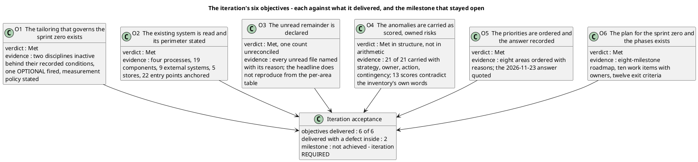
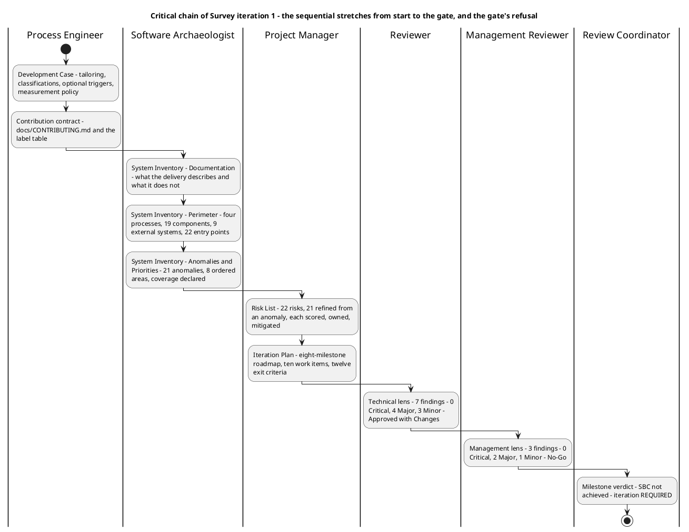
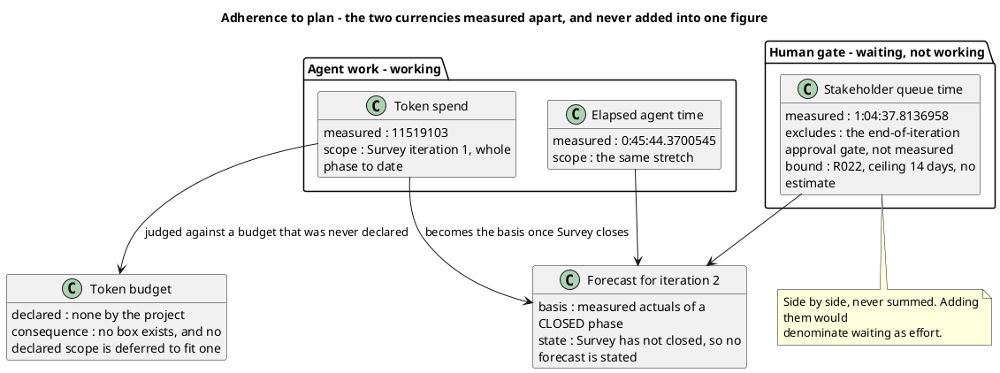
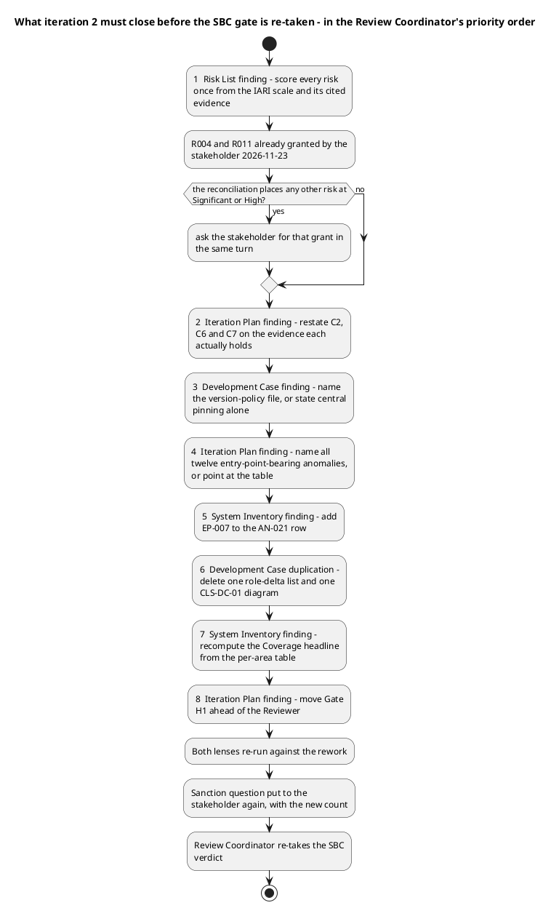

## Document Control
- Phase: Survey
- Status: Assessed. The milestone is NOT achieved — the Review Coordinator's verdict is SBC iteration REQUIRED and the stakeholder refused the sanction on 2026-11-23.
- Milestone Target: end-of-Survey (SBC) — not achieved; iteration 2 is planned from this record
- Iteration: 1, Cycle 1
- Owner: Project Manager

## Iteration Objectives Reached
Six objectives were planned; six were delivered; two of the six carry a defect inside them that keeps the milestone open. Objective delivery and milestone exit are separate questions and this record answers them separately.

| # | Objective | Owner | Verdict | Basis |
|---|---|---|---|---|
| O1 | The tailoring that governs the sprint zero exists | Process Engineer | Met | Development Case records `business-process-led = false` and `real-time-system = false`, one OPTIONAL fired (Deployment Model) with its §5.2 condition, five NOT FIRED each justified, and the measurement policy. `Development Case#F1` (Reviewer) finds an unsourced assertion inside it, which is a defect of the content, not a missing objective |
| O2 | The existing system is read and its perimeter stated | Software Archaeologist | Met | System Inventory records four processes, 19 components, 9 external systems, 5 stores and `EP-001`…`EP-022`, each with kind, initiator and anchor. No finding is raised against any anchor the reviewers opened |
| O3 | The unread remainder is declared rather than left implicit | Software Archaeologist | Met, one count unreconciled | Coverage names every unread file and its reason. `System Inventory#F2` records that the headline count does not reproduce from the per-area table |
| O4 | The anomalies are carried as scored, actionable risks | Project Manager | Met in structure, not in arithmetic | All 21 anomalies map to `R001`…`R021` with strategy, owner, action, contingency and warning sign. `Risk List#F1` records 13 scores that contradict the inventory's own likelihood and impact |
| O5 | The reading's priorities are ordered and the stakeholder's answer recorded | Software Archaeologist | Met | Eight areas carry an order and a reason; the 2026-11-23 answer is quoted in Priorities |
| O6 | The project's plan for the sprint zero and the RUP phases exists | Project Manager | Met | Iteration Plan carries the eight-milestone coarse roadmap — the seven phases plus the re-taken SBC — ten fine-plan work items with owners, and twelve exit criteria |

No objective was missed and no objective was deferred. The iteration did what it planned to do; what it produced is not yet certifiable, and that is the finding this record carries into iteration 2.

## Adherence to Plan
The plan was a strictly sequential chain of nine work items plus the human gates, and it ran as planned: every work item reached Complete, the review came last, and gate H1 was answered inside the iteration rather than queued behind the review. The divergence is in the last two gates — the review returned six open Major findings, so the milestone review closed with a verdict of iteration required, and gate H2, the perimeter sanction put at that review, was answered No.

### Two currencies, measured apart

| Currency | Scope | Measured | What decision it enables |
|---|---|---|---|
| Token spend | Survey iteration 1, whole phase to date | 11519103 | The measured basis iteration 2 is forecast from once Survey closes — not yet available, because Survey has not closed |
| Elapsed agent time | The same stretch | 0:45:44.3700545 | The clock figure quoted beside the spend, never added to it |
| Stakeholder queue time | Human gates in this iteration | 1:04:37.8136958 | Whether the human gates, not the agent work, dominate this phase's wall clock. Excludes the end-of-iteration approval gate, which is not measured |

The two are reported side by side and never summed: the third row is waiting, not working, and adding it to the first two would denominate queue time as effort. No token budget exists — the project declares none — so no spend is judged against a box and no declared work was deferred to fit one. Stakeholder queue time is the larger of the two clocks in this iteration, and that is the fact iteration 2 is planned around: what lengthens a phase here is a gate waiting for an answer, not an agent working. It is also why the `R004` and `R011` grants were put in this iteration rather than held behind the score reconciliation.

### What the plan got right, and what it got wrong about itself

| Planned | Outcome | Variance | Root cause | Adjustment forced in iteration 2 |
|---|---|---|---|---|
| Nine work items, sequential, each owned | All nine reached Complete in the planned order | None | — | None. The chain is not re-planned: no item is split, added or reordered |
| Gate H1 answered inside the iteration | Its four questions were answered 2026-11-23 | None on perimeter membership, the priority order or `R012`/`R016` | — | None. H1 is met and recorded in the Iteration Plan's gate table |
| The perimeter sanction treated as answered by gate H1 | It was put separately at the review and refused; the plan now records it as gate H2, not met | The milestone slipped for want of a sanction the plan assumed it already had | The plan treated the two perimeter-membership answers as if they were the perimeter confirmation, and wrote C2 as met on them | `Iteration Plan#F1` (Management Reviewer): C2 restated as C2a (answered) and C2b (not met) — corrected in the Iteration Plan this iteration |
| Review closes the iteration when exit criteria pass | Review returned 6 open Major, verdict iteration required | Milestone slips to an iteration the phase did not plan | Two causes, both inside the artifacts: scores that do not reproduce from their stated inputs, and exit criteria certified on evidence that does not state them | Iteration 2 is planned from this record. No new scope enters it: every item is a correction to content already written |
| Risk List scores the anomalies for sequencing | The register holds 22 risks, all owned and scored | 13 of 21 scores contradict the inventory's likelihood and impact; `R004` and `R011` sat below the grant band only because of it | Every anomaly was scored afresh from its evidence without reconciling against the inventory's own column, and with no single mapping from the inventory's words to the IARI scale | `Risk List#F1`: score each risk once, or declare the score the Project Manager's own reading. The two named risks now carry the stakeholder's conditional grants of 2026-11-23; only the arithmetic is owed |
| Hand the entry-point-bearing anomalies to Excavation | A count of twelve was stated and a list of seven named | Five constraints on priorities 6 and 8 were not handed over | The count was written first and the list enumerated from memory rather than from the System Inventory's Anomalies table | `Iteration Plan#F1` (Reviewer): all twelve now named in a table with what each forbids — corrected in the Iteration Plan this iteration |
| Coverage figure quoted as C6's evidence | The figure is quoted | The headline does not reproduce from the per-area table it sits beside | The headline was authored, not summed from the table | `System Inventory#F2`: recompute; then C6 cites the settled figure. C6 is restated in the Iteration Plan this iteration as met in substance with its evidence unreconciled |

No work item is reopened by this assessment: an item marked Complete that delivered defective content is a finding against its artifact, which is where the reviews recorded it, not an unfinished item of the chain. The three corrections the Project Manager could make without the reconciliation — the anomaly handoff, the split of C2, and the restatement of C6 — are already written into the Iteration Plan this iteration; the remaining open items are the reconciliation of the scores and the two artifacts the other owners hold.

## Use Cases and Scenarios Implemented
None, correctly. Survey recovers no use case: the 22 entry points are recorded as entry points in the System Inventory, and Excavation recovers them into `UC-NNN`. What this iteration produced is the material those use cases are recovered from, and what it hands forward is constrained by the anomalies that sit on an entry point.

| Handoff to Excavation | State after this iteration |
|---|---|
| Entry points | `EP-001` … `EP-022`, each with kind, initiator and anchor — the source every recovered use case cites |
| Anomalies constraining a recovered use case | `AN-001`, `AN-002`, `AN-004`, `AN-008`, `AN-009`, `AN-010`, `AN-015`, `AN-017`, `AN-018`, `AN-019`, `AN-020`, `AN-021` — twelve, each now named in the Iteration Plan's handoff table with what it forbids a recovered use case to claim |
| Stakeholder rulings Excavation must honour | The external-provider sign-in path is a recovered use case marked unreachable in the delivered configuration; the cross-owner `admin` branch is an exceptional entity and not a recovered use case (`R004`) |
| Risks whose action the System Analyst or Designer performs | `R001`, `R004`, `R018`, `R019`, `R020`, `R021` (System Analyst); `R003`, `R018` (Designer) — from the Risk List |

`Iteration Plan#F1` (Reviewer) recorded that the plan stated a count of twelve and named seven, dropping `AN-008`, `AN-009`, `AN-010`, `AN-015` and `AN-017` — the ones constraining the reference-UI, Identity, key-ring and app-host reading, priorities 6 and 8 of the order Excavation reads in. The Iteration Plan is corrected in this iteration: all twelve are named there, each with the claim it forbids. The correction is recorded here because it is the iteration's own variance, not because it remains open.

No use-case realization, no scenario and no test case exists at this point, and none is missing: no artifact of this phase produces one.

## Results Relative to Evaluation Criteria
One line per criterion the Iteration Plan carries, restated at the level the evidence supports. Where a criterion was written as one and the evidence settles only part of it, it is split rather than certified whole.

| # | Criterion | Result | Evidence that decides it |
|---|---|---|---|
| C1 | The perimeter is stated | Met | System Inventory — Perimeter: four processes, 19 components, 9 external systems, 5 stores, each anchored |
| C2a | The perimeter-membership questions and the priority order are answered by the stakeholder | Met — 2026-11-23 | Three answers: the external-provider path is a recovered use case marked unreachable in the delivered configuration; the admin branch is an exceptional entity and not a recovered use case; the priority order stands as it is with nothing left out |
| C2b | The perimeter as recorded is confirmed by the stakeholder, and the sanction to advance past SBC given | Not met | Asked at the SBC review whether they confirm the perimeter as recorded and sanction advancing past SBC, the stakeholder answered No on 2026-11-23. C2a's three answers do not confirm the recorded perimeter |
| C3 | The entry points are enumerated | Met | System Inventory — Entry points: `EP-001` … `EP-022`, each with kind, initiator and anchor |
| C4 | The priorities are ordered | Met | System Inventory — Priorities: eight areas, each with its reason |
| C5 | The priority order is confirmed by the stakeholder | Met — 2026-11-23 | The answer: the order stands as it is, nothing matters more than it reflects, nothing left out |
| C6 | The unread areas are declared, and the declared figure reproduces | Met in substance, evidence not reconciled | Every unread file is named with its reason. The headline count beside it does not reproduce from the per-area table — `System Inventory#F2`. The criterion cites the recomputed figure once the Software Archaeologist settles it |
| C7a | Every anomaly is carried as a risk, none dropped | Met | Risk List — 21 `Refines` edges from `AN-NNN`, plus `R022` whose separate origin is stated |
| C7b | Every score reproduces from its stated inputs | Not met | `Risk List#F1` (Reviewer): 13 of 21 rows score differently from the inventory's likelihood and impact for the same anomaly, and the same inventory word scores differently in different rows |
| C8 | Every accepted risk above Moderate carries the stakeholder's grant | Met — 2026-11-23 | No risk the register can place at Significant or High is accepted on the Project Manager's authority. `R012` and `R016` carry their own grants at exposure 12. `R004` and `R011`, whose cited evidence gives exposure 12 while the register records 4 and 8, each carry the stakeholder's Yes of 2026-11-23, conditional on the reconciled score landing at 9 to 12 or above. `R001` and `R007` are avoided, which needs no grant |
| C9 | No risk is left unactionable | Met | Risk List — Risk Mitigation and Contingency: strategy, action, owner, contingency and warning sign on every row |
| C10 | The plan names no work the process does not run | Met | Every one of the ten work items is a stage the IARI Development PROCESS runs in Survey, a reviewing role of that process, or the stakeholder's gate |

Eight of the twelve lines are Met outright and one — C6 — is met in substance with its evidence unreconciled. Three are not: C2b, C7b, and the outstanding half of C6. C2b is the gate's own condition, and it failed: a perimeter confirmation is not the reviewers' or the Project Manager's to infer, and it was refused. C7b leaves the register's magnitudes unreproducible. Neither is a decision the Project Manager may take on the stakeholder's behalf, and neither is repairable by asserting it is met.

C8 moved to Met during this iteration, on the stakeholder's answers of 2026-11-23 and on nothing else. Until those answers arrived the register accepted `R004` and `R011` on the Project Manager's own authority while their cited evidence placed them in the band only the stakeholder may grant — which is the defect `Risk List#F1` records. The grant closes the acceptance question, not the arithmetic: whether either risk lands in that band is still owed by rework item 1, and C7b stays not met until it is paid.

## Test Results
No test was executed and none was planned for this iteration. The Test discipline works from Elaboration, no test case is written before a use case is recovered, and the Development Case records `Test Plan` NOT FIRED. This is not a gap: no artifact Survey produces carries a test obligation, and the Review Record's own "Not findings" lists the Test Plan's absence as the Development Case's verified verdict rather than a delivery gap.

There is also no Test Evaluation Summary in this phase, because the Test Manager does not work in Survey. This assessment therefore rests on the Review Record alone — both executed lenses and the coordinator's consolidated ledger — and on the artifacts themselves. No result is derived from a test execution, and none is presented as if one had occurred.

Three consequences follow for the next plan, and each is already a registered risk rather than a finding against this iteration:

- `R012` — the BFF and the Blazor client carry no test of any kind, and the three defective `/auth` flows are exactly the untested ones. Accepted by the stakeholder on 2026-11-23 for the sprint zero; the mitigation is test coverage of the BFF session, the `/auth` flows and the client's todo flow from Elaboration.
- `R005` — the test host builds the schema with `EnsureCreated`, so a migration that no longer matches the model is planned over undetected. The Test Manager's action is a migration-applies check in the architecture test scope.
- `R011` — the suite reproduces the bearer-token ticket format from framework internals, so a framework upgrade breaks it with no behaviour changing. Accepted with mitigation and contingency, and the stakeholder granted it on 2026-11-23 for the band the reconciliation may place it in. Whether that band is Significant or Moderate is still owed by the reconciliation.

Because no test execution has run, no defect-removal efficiency can be computed at this gate and none is claimed in its place. The only defect detector that has operated is the milestone review.

## External Changes
| Change | Effect on this iteration | Handled by |
|---|---|---|
| The stakeholder answered gate H1 inside the iteration on 2026-11-23 — the external-provider path and the admin branch ruled on, the priority order confirmed, `R012` and `R016` accepted | `R022` did not bite on H1: the answers arrived ahead of the review and the 14-day ceiling was never approached | Iteration Plan — gate H1 row; Risk List — `R004`, `R012`, `R016`, `R022` |
| The stakeholder answered the perimeter-sanction question No at the SBC review on 2026-11-23 | The milestone is not achieved and the phase needs an iteration it did not plan | This record; the Review Record's Management Reviewer and Review Coordinator lenses |
| The stakeholder granted `R004` and `R011` on 2026-11-23, conditionally on each reconciled score landing at exposure 9 to 12 or above | The register can record an acceptance at the Significant band for either risk, so no risk it can place there lacks the stakeholder's answer; criterion C8 moved to Met | Risk List — the grants block and the two rows; Iteration Plan — criterion C8 |
| The stakeholder ordered the Development Case duplication corrected | A Minor is lifted above the ordinary Minor queue, because an order is not declined | `Development Case#F1` (Management Reviewer) — rework item 6, executed before the un-ordered Minors |
| The stakeholder stated that the major findings must be corrected | No artifact and no new defect is named — every one of the six open Major findings already requires rework | The Review Record's ledger. No duplicate finding minted; no Change Request opened, because the Change Control Manager does not work in the sprint zero and the order reached its owners through the Review Record |
| No SCM condition arose | The repository carries no IARI pipeline, no branch of this process and no open pull request, so no build could be red and no pull request disposed | Not reported as passing or failing |

No scope change reached the project in this iteration. Nothing the stakeholder said adds, removes or reorders declared work; the declared change is worked from Inception and Survey reads the system as it is. The two grants of 2026-11-23 are risk decisions, not scope: neither changes what the system is asked to do.

## Rework Required
Iteration 2 exists for one purpose: to close what this iteration's review left open, so the SBC gate can be re-taken. It carries no new scope — every item below is a correction to content already written, inside artifacts the sprint zero already owns. The order is the Review Coordinator's priority order, by consequence rather than by artifact.

| # | Rework | Artifact | Owner | Closes | Why it ranks here |
|---|---|---|---|---|---|
| 1 | Score each of the 21 risks once from the IARI scale and its cited evidence — or delete the inventory's likelihood/impact as a scoring claim and declare the score the Project Manager's own reading. Re-derive the grant band from the reconciled exposures. `R004` and `R011` already hold the stakeholder's grant of 2026-11-23; any other risk the reconciliation places at Significant or High is put to the stakeholder in the same turn | Risk List | Project Manager | `Risk List#F1` (Reviewer), `Risk List#F1` (Management Reviewer) | The defect reaches a grant the project has already taken. The two risks it named now carry the stakeholder's answer, so only the arithmetic is still owed |
| 2 | Restate C2 as two criteria — the answered perimeter-membership and priority questions, and the confirmation of the recorded perimeter which is not met; cite the settled coverage figure for C6; split C7 into carriage and reproducibility | Iteration Plan | Project Manager | `Iteration Plan#F1` (Management Reviewer) | It is the evidence column the milestone verdict reads, and it records a confirmation the stakeholder refused |
| 3 | Name the file recording the version policy, or replace the claim with central pinning in `Directory.Packages.props` and nuget.org as the only configured source | Development Case | Process Engineer | `Development Case#F1` (Reviewer) | It directs the Software Architect at a policy that exists nowhere, and Excavation is the next phase |
| 4 | Name all twelve entry-point-bearing anomalies, or drop the enumeration and point at the System Inventory's Anomalies table | Iteration Plan | Project Manager | `Iteration Plan#F1` (Reviewer) | Five constraints on the areas ranked sixth and eighth are not handed to Excavation |
| 5 | Add `EP-007` to the `AN-021` Traceability row | System Inventory | Software Archaeologist | `System Inventory#F1` (Reviewer) | One trace edge; the artifact and the tree already hold the truth |
| 6 | Delete the duplicated role-delta list and the duplicated CLS-DC-01 diagram — the stakeholder's order of 2026-11-23 | Development Case | Process Engineer | `Development Case#F1` (Management Reviewer), `Development Case#F2` (Reviewer) | The order is the stakeholder's: executed before the un-ordered Minors, not deferred behind them |
| 7 | Recompute the Coverage headline from the per-area table; settle whether the `docs/` rows count as read | System Inventory | Software Archaeologist | `System Inventory#F2` (Reviewer) | Contained in one artifact; it becomes C6's evidence once settled |
| 8 | Move Gate H1 ahead of the Reviewer in the critical-chain diagram | Iteration Plan | Project Manager | `Iteration Plan#F2` (Reviewer) | Contained in one artifact; no role builds on the wrong content |

Two dependencies order the work and are not negotiable: item 1 precedes item 2, because the reconciled scores are C7's evidence; and item 7 precedes item 2's C6 line, because the recomputed figure is what that line cites. Each finding closes only when its recording lens re-reads the corrected artifact and resolves it — a correction stated in a plan does not close a finding, and the same defect recorded under two lenses closes twice.

Item 1 is now narrower than the Review Coordinator ordered it. The coordinator held the `R004` and `R011` acceptance behind the reconciliation; the stakeholder answered both on 2026-11-23, so no gate is left waiting on that queue. What item 1 still owes is the arithmetic, and the instruction to ask stands only for a risk the reconciliation newly places in the grant band.

