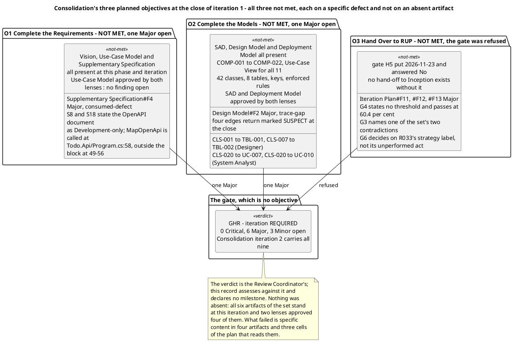
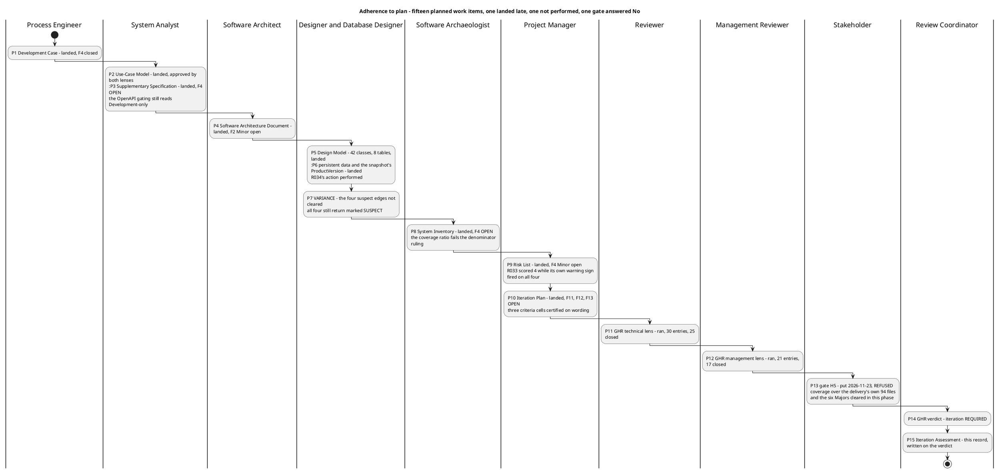
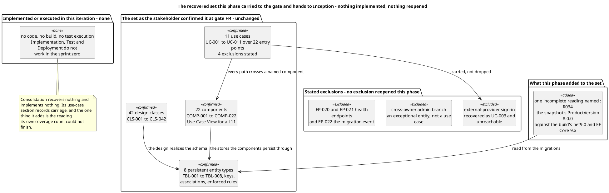
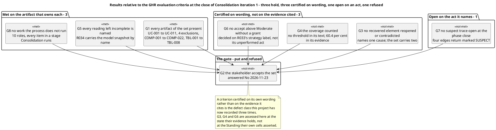
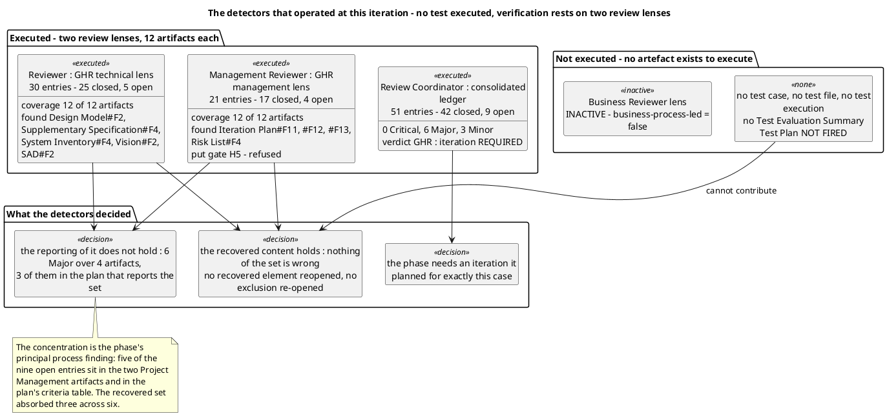
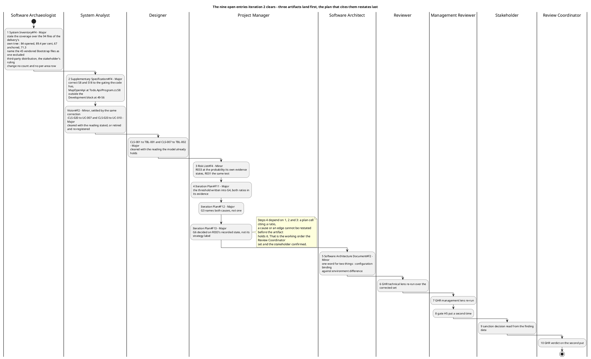

## Document Control
- Phase: Consolidation
- Status: Assessed. The milestone verdict is the Review Coordinator's — GHR: iteration REQUIRED — and this record assesses iteration 1 against it. It declares no milestone of its own.
- Milestone Target: end-of-Consolidation (GHR) — **not achieved**. Gate H5 was put on 2026-11-23 and answered No. Consolidation iteration 2 is planned from the Review Record.
- Iteration: 1, Cycle 1
- Owner: Project Manager

## Iteration Objectives Reached
The phase planned three objectives. **None is met.** This is not because an artifact is missing — all six artifacts of the recovered set stand at this phase and iteration, and two lenses approved four of them — but because four artifacts carry a Major defect no consumer may build on, and the hand-off the third objective names was refused at the gate.

| # | Objective | Owner | Standing | Evidence, and the defect that holds it |
|---|---|---|---|---|
| O1 | Complete the Requirements | System Analyst | **Not met** | Every requirements artifact is present and the Use-Case Model is approved by both lenses with no finding open. `Supplementary Specification#F4` holds the objective: S8 and S18 state the OpenAPI document among the Development-only surfaces while `Todo.Api/Program.cs:58` maps it outside that block, so the requirements artifact states a diagnostic surface as absent that an operating instance publishes. The Deployment Manager and the Technical Writer read this artifact to write a runbook and a release note |
| O2 | Complete the Models | Software Architect, Designer, Database Designer | **Not met** | The Software Architecture Document, the Design Model and the Deployment Model are all present with their content anchored; both lenses approved the SAD and the Deployment Model. `Design Model#F2` holds the objective: four trace edges the model's own Traceability table declares return marked SUSPECT at the phase close, two against the Designer and two against the System Analyst. A suspect edge is a link no owner has confirmed, and the model is the artifact Inception will read |
| O3 | Hand Over to RUP | Project Manager | **Not met** | Gate H5 was put on 2026-11-23 and the sanction was refused: the stakeholder does not accept a hand-off with Majors open and ordered the six cleared in this phase. The plan that carries the hand-off failed three of the criteria the verdict is read on — `Iteration Plan#F11`, `#F12`, `#F13` |

**Two of the three failed on a defect of content, not of delivery.** O1 and O2 each delivered every artifact they name, on time, anchored, and each carries one Major. That distinction decides the next iteration's work: nothing of the set is re-read and nothing is re-recovered, six specific corrections are made.

**The objectives that held are recorded as holding only in part, and the partial is named.** The Use-Case Model, the SAD and the Deployment Model carry no open finding from either lens. The Supplementary Specification, the Design Model, the System Inventory and the Iteration Plan carry one Major each; the Risk List, the Vision and the SAD carry one Minor each.

## Adherence to Plan
The iteration's fine plan was fifteen items: ten agent work items across five disciplines, two review lenses, one gate, one verdict and this assessment. Twelve landed as planned, one was assigned and not performed, one landed in an artifact whose content then failed the gate, and the gate was answered No.

| # | Planned work item | Owner | Planned | Actual | Variance and root cause |
|---|---|---|---|---|---|
| 1 | Development Case made current for Consolidation | Process Engineer | This iteration | Landed — `Development Case#F4` closed and verified by both lenses: ACT-DC-01 names Project Management in every phase partition at the canonical intensity | None |
| 2 | Use-Case Model completed: `UC-001` to `UC-011`, four exclusions stated | System Analyst | This iteration | Landed — approved by both lenses; no finding open | None |
| 3 | Supplementary Specification: mechanisms stated with anchors | System Analyst | This iteration | Present and anchored, but `Supplementary Specification#F4` records a consumed defect at S8 and S18 | **Variance.** The work item asked for the mechanisms to be **stated**; it did not ask them to be **checked against the code**. A carriage requirement was met by carriage. Root cause: the plan's own item specified presence, so a wrong statement satisfied it |
| 4 | Software Architecture Document: components, mechanisms, use-case view | Software Architect | This iteration | Landed — approved by both lenses; `SAD#F2` is a contained Minor on one word used for two things | Contained; no criterion turns on it |
| 5 | Design Model: domain model, packages and classes | Designer | This iteration | Landed — 42 classes, the relationship inventory | None |
| 6 | Design Model persistent data: entities, keys, associations, enforced rules, and the snapshot's product version | Database Designer | This iteration | **Landed.** The persistent-data section records `HasAnnotation("ProductVersion", "8.0.0")` against the build's `net9.0` and its EF Core 9.x packages, with the file as its anchor. `R034`'s action is performed and no file of the delivery was changed | None |
| 7 | Clear the four suspect edges at their own ends | Designer (2), System Analyst (2) | This iteration | **Not performed.** All four return marked SUSPECT. The Design Model states the evidence for each; neither owner performed the clearance | **The iteration's principal variance.** Root cause: the plan assigned an act that only an artifact's owner may perform, to owners who each also held a different artifact to deliver, and the clearance was the last thing in each owner's turn. The item was assigned and could not fail — nothing in the plan's own exit criteria tested whether the act had been done, so `G7` was written "Open" and the phase ran without closing it. `R033` is the exposure and it fired |
| 8 | System Inventory: coverage counted, every unread file named with its reason | Software Archaeologist | This iteration | Landed — 84 opened, 55 unread, each named with its reason, the arithmetic reproducing from the per-area table. `System Inventory#F4` records the denominator | **Variance.** The reading is sound and the figure is the wrong figure for a gate to read. Root cause: the count was taken over the whole tree because no denominator had been ruled on; the stakeholder ruled it in the same answer that refused the sanction |
| 9 | Risk List: the register at Consolidation, `R033` and `R034` carried | Project Manager | This iteration | Landed — 34 risks, 29 `Refines` edges, four grants at exposure 12, `R033` at exposure 16 and `R034` at 12. `Risk List#F4` is a contained Minor | **Variance on one attribute.** `R033` states probability 4 while its own strategy and warning sign state the event has fired on all four instances. Root cause: the published mapping was applied to the inventory's anomalies and not to the register's own firing exposures |
| 10 | Iteration Plan: coarse roadmap, fine plan, GHR exit criteria | Project Manager | This iteration | Landed, and three of its eight criteria cells failed at the gate — `#F11`, `#F12`, `#F13` | **Variance.** `G4` states no threshold, `G3` names one of the set's two contradictions, `G6` decides on a strategy label rather than on the act the strategy requires. Root cause, and it is one cause: the three cells were written from each artifact's own text without the phase's bar in front of the writer. The same class this project has now recorded five times against this plan |
| 11 | GHR technical lens | Reviewer | After item 10 | Ran — 12 artifacts read, 30 entries recorded, 25 closed, 5 open | — |
| 12 | GHR management lens, and the gate put | Management Reviewer | After item 11 | Ran — 12 artifacts read, 21 entries recorded, 17 closed, 4 open. Gate H5 put | — |
| 13 | Gate H5 — the complete set accepted as the starting point | Stakeholder | After item 12 | **Put 2026-11-23 and answered No** — the sanction refused, the coverage denominator ruled, the six Majors ordered cleared in this phase | — |
| 14 | GHR milestone verdict | Review Coordinator | After item 13 | **GHR: iteration REQUIRED** — 0 Critical, 6 Major, 3 Minor open | — |
| 15 | Iteration Assessment | Project Manager | This turn | This record | — |

### What the variances have in common

Four of the five variances share one root cause, and it is this role's: **the plan asked for a thing to be present and tested whether it was present.** Item 3 asked the mechanisms to be stated; item 8 asked the coverage to be counted; item 9 asked the register to be carried; item 10 asked the criteria to be written. Each was done, each satisfied the item's wording, and four of them failed the gate on content. The one variance that is not of this class is item 7 — an act assigned to two owners and tested by no criterion of the plan's own, which is the mirror failure: an item that could not fail.

The corrective rule is recorded in Rework Required below and applies to iteration 2's plan: **an item whose deliverable is a figure or a claim carries the bar it will be judged on, written into the item, not only into the criterion it feeds.**

### Measured actuals — two currencies, never added

These are what the system recorded for this iteration.

| Measure | This iteration — 1 | What it is |
|---|---|---|
| Agent time — the system working | 1 h 29 min 52 s | Elapsed agent time, queue subtracted, end-of-iteration approval gate excluded |
| Stakeholder queue — a person deciding when to sit down | 10 h 02 min 56 s | Waiting, not working. Reported apart from agent time and never added to it |
| Tokens | 53,291,791 | Agent spend; the unit in which agent work is denominated |
| Agent invocations | 15 | — |
| Stakeholder interactions recorded | 19 | — |
| Artifacts in the project | 12 | None created or retired |
| Artifact surface the iteration carried | 765,437 characters over 12 artifacts | The live surface each turn re-reads; not an output measure |

**The queue is the one measure that dominated this iteration, and it is not a work measure.** 10 h 02 min of queue against 1 h 29 min of agent time. The gate was put once and refused; one refusal, one question, one answer — the queue is the stakeholder's own time to reach the question, and it is reported here beside agent time and never netted into it.

**Token spend is recorded whole and is not divided.** 53,291,791 tokens over 15 agent invocations and 12 artifacts. No per-iteration velocity is quoted, no per-artifact attribution is invented, and no figure is derived by division: the record is per iteration, and a rate computed from it would be a measure this system does not make.

**The one thing the measured figure supports is the shape of the cost, and it contradicts an intuition.** This iteration emitted less new content than either closed Excavation iteration and spent more than all four Excavation iterations together as that phase's record states them. The cost tracks the surface re-read — 12 artifacts and 765,437 characters, every one of them read by two lenses and again by the register and the plan that report on them — not the volume produced. That is why adding agent roles here would buy no clock and cost more: more readers over the same surface.

### What this record does and does not project

**No figure is projected for Consolidation iteration 2.** The phase has not closed, so no phase actual of its shape exists, and a number obtained by scaling this iteration's would be a velocity this system does not measure. What can be said is a claim about the work and is marked as such:

`[ASSUMPTION — requires validation: iteration 2 costs in the same order as this iteration in tokens and less than it in agent time; the basis is nine corrective acts over existing sections in six artifacts against this iteration's fifteen items across twelve, and the only measured comparator is this iteration's own record against Excavation's — a narrower pass over a larger surface, which on the Excavation evidence costs roughly two thirds. The basis underdescribes the work, as Excavation's did: iteration 2 re-reads the same 765,437-character surface and every one of its nine corrections must be re-derived from the artifact it corrects]`

**The project declares no token budget.** There is therefore no box to fit: no figure is proposed for the stakeholder to accept, no declared work is cut, deferred or trimmed to meet an estimate, and no calendar date is projected from any figure in this record. Declared scope is not a lever here in any case — the delivery declares none, and the recovered set is fixed by the stakeholder's confirmation.

**The lever this phase will use is another iteration, planned from the Review Record.** Not more agents — the six Major corrections sit in six artifacts owned by five roles, and a second owner on any of them would contend for the same surface. Not less scope — the stakeholder ordered all six cleared in this phase and no ranking among them. Iteration 2 is planned, bounded, and carries exactly the nine open entries.

## Use Cases and Scenarios Implemented
None implemented, and none was to be. Consolidation recovers nothing and adds nothing to the recovered set; the Implementation and Test disciplines do not work in the sprint zero. What this phase carried to the gate is the set the stakeholder confirmed at gate H4, complete, plus the one reading its own coverage count could not finish.

| Element | Count | State at this assessment |
|---|---|---|
| Use cases carried | 11 — `UC-001` to `UC-011` | Each traced to the `EP-NNN` whose code performs it. The Use-Case Model is approved by both lenses and carries no open finding — this is the one artifact of the set the gate did not fault |
| Use cases with two scenarios | 5 — `UC-001`, `UC-002`, `UC-006`, `UC-007`, `UC-008` | A screen route and a direct API route to the same operation. One use case with two scenarios, never one per actor |
| Components | 22 — `COMP-001` to `COMP-022` | Use-Case View names the components each of the eleven paths crosses. `SAD#F2` is a contained Minor and no criterion turns on it |
| Persistent entity types | 8 — `TBL-001` to `TBL-008` | Keys, referential actions and the enforced-rule surface anchored to `TodoDbContext.cs:11-17` and the three migrations |
| Design classes | 42 — `CLS-001` to `CLS-042` | Anchored to file and lines. Four of the model's trace edges are the open Major `Design Model#F2` |
| Exclusions reopened | 0 | The stakeholder stated on 2026-11-23 that nothing in the recovered set is wrong or missing and no exclusion is re-opened. This phase reopened none |
| Use cases implemented or tested | 0 | No code and no test is written in the sprint zero. `Test Plan` is NOT FIRED |
| Scenarios executed | 0 | No test case exists before a use case is specified, and the Test discipline works from Elaboration |

**The one thing this phase adds to what Inception inherits** is a named incomplete reading: the model snapshot declares an EF Core `ProductVersion` of `8.0.0` while the build targets `net9.0` and resolves the EF Core packages at 9.x. `R034` carries it with an owner, an action performed and a contingency, so no role scaffolds a migration against the snapshot unread. The incompatibility is not corrected — the snapshot is the delivery's file and this process records the system as it is.

## Results Relative to Evaluation Criteria
The plan carried eight GHR criteria. **Three are met on the artifact that owns each, three were certified in the plan's own cells on their wording rather than on the evidence they cite, one is open on the act it names, and one is the gate, which was put and refused.**

| # | Criterion | State | Evidence, and the finding that bears on it |
|---|---|---|---|
| G1 | Every artifact of the recovered set is present at this phase | **Met** | Each artifact's Document Control names Phase Consolidation, Iteration 1, Cycle 1. The System Analyst's carries `UC-001` to `UC-011` with four exclusions; the Architect's `COMP-001` to `COMP-022`; the Designer's `CLS-001` to `CLS-042` and `TBL-001` to `TBL-008`; the Deployment Model is present under the one optional trigger the Development Case reports fired. Both lenses confirmed presence. The criterion asks presence and presence is what it got |
| G2 | The stakeholder accepts the complete set as the starting point of the declared change | **Not met — the gate was put and refused** | Gate H5 was put on 2026-11-23 and answered No: no hand-off with Majors open, the six cleared in this phase, coverage counted over the delivery's own files. The stakeholder stated that nothing in the recovered set is wrong — the eleven use cases, four exclusions, twenty-two components and eight tables stand as confirmed — and refused the advance on the six Major findings. `R022` bounds such a gate at a ceiling of 14 days of queue time; the refusal was given, so nothing expired |
| G3 | No recovered element is reopened or contradicted | **Not met** | The plan's cell certified this on `R033`'s four suspect edges as "the one way this criterion could fail". The set carries a second contradiction: `Supplementary Specification` S8 and S18 place the OpenAPI document among the Development-only surfaces, while `SAD` M12 and the Deployment Model's Environment Mapping place it outside the Development block, as `Todo.Api/Program.cs:58` does. That is the unnamed second cause `Iteration Plan#F12` records. The recovered element list itself — eleven use cases, four exclusions, twenty-two components, eight tables — is unchanged, but the word **contradicted** in the criterion's own text is what fails |
| G4 | The coverage is counted and the remainder declared | **Not met** | The criterion's text states no threshold, so it passed on 84 of 139 — 60.4 per cent — against the 80 per cent bar a Consolidation coverage count is required to reach. Every unopened file is named with its reason and the arithmetic reproduces, so the reading is sound; the figure the gate read uses a denominator that includes 45 vendored Bootstrap files the stakeholder ruled are not their system. Over the delivery's own 94 files the ratio is 84 opened (89.4 per cent) and 67 anchored (71.3 per cent), and neither figure appears in any artifact. `Iteration Plan#F11`, `System Inventory#F4` |
| G5 | Every reading this phase leaves incomplete is named | **Met** | The System Inventory names the model snapshot as the one reading it hands forward incomplete; the Design Model's persistent-data section records the `ProductVersion` `8.0.0` against the build's `net9.0` and its EF Core 9.x packages with the file as its anchor; `R034` carries the exposure with a named owner, an action performed and a contingency. Nothing was left to be discovered |
| G6 | Every open anomaly is a scored risk, and no accept above Moderate lacks a grant | **Not met** | The plan's cell certified this by reading `R033`'s strategy label — "avoids, which is this role's authority at any band" — as a performed act. The register records the same risk as avoidance **not performed**, its warning sign **firing on all four**, and its probability at 4 while its own evidence states the event has already occurred. A High-band exposure therefore sits live at the gate with neither a performed avoidance nor a grant. That is `Iteration Plan#F13`, and `Risk List#F4` records the probability. The rest of the criterion holds: 29 `Refines` edges from `AN-001` to `AN-029`, one published mapping, four grants at 4 × 3 = 12 each in the stakeholder's own words, and no risk above Moderate accepted on this role's authority |
| G7 | No suspect trace is open at the phase close | **Not met** | The graph returns four, each read at its own end this iteration and none cleared: `CLS-001` → `TBL-001` and `CLS-007` → `TBL-002` (`Specifies`) marked for the Designer; `CLS-020` → `UC-007` and `CLS-020` → `UC-010` (`Realizes`) marked for the System Analyst. This is the plan's one criterion that was correctly recorded open rather than certified on the owners' behalf — the recording was right and the act behind it was not performed. `Design Model#F2`, `R033` |
| G8 | The plan names no work the process does not run | **Met** | Decided on the plan's own table. Every work item belongs to Environment, Requirements, Analysis & Design, Discovery, Project Management, the review lenses, the gate or the verdict. No item schedules implementation, build, test-design or configuration-management work, and the ten-role resource profile names each role's reason for standing down where it stands down |

**Three of eight criteria were certified on their own wording.** `G3`, `G4` and `G6` each read "Standing" in the plan's table while the evidence in the same row did not support it: a criterion with no threshold in its text cannot fail on a ratio, a criterion naming one cause cannot fail on the second, and a criterion resting on a strategy label does not test the act the strategy requires. The lenses caught all three at the gate and the phase holds on them. This is the class this project has now recorded five times against this plan — a cell asserting another artifact's state without re-deriving it — reached this time inside the criteria rather than in the tables they cite.

**Three criteria hold and one of them is the plan's own vindication.** `G7` was recorded "Open — the phase's live criterion" and `G2` was recorded as a gate not put, with no answer assumed. Recording a criterion as failing on evidence no act had produced is exactly what the opposite failure would have concealed, and it is why the verdict at this milestone is a required iteration and not a sanction on wrong evidence.

## Test Results
No test was executed in this iteration and none was planned. The Test discipline works from Elaboration, no test case is written before a use case is specified, the Development Case records `Test Plan` NOT FIRED, and no Test Evaluation Summary exists in the sprint zero. This section rests on the review, and nothing below is presented as a test result.

| Detector that operated | What it found | What it decided |
|---|---|---|
| GHR technical lens (Reviewer) | 12 artifacts read, 30 entries recorded, 25 closed, 5 open — `Design Model#F2` and `Supplementary Specification#F4` and `System Inventory#F4` Major, `Vision#F2` and `SAD#F2` Minor. `Development Case#F4` closed and verified | That the recovered content holds and the defects are in specific statements and one denominator |
| GHR management lens (Management Reviewer) | 12 artifacts read, 21 entries recorded, 17 closed, 4 open — `Iteration Plan#F11`, `#F12`, `#F13` Major, `Risk List#F4` Minor. Gate H5 put and answered No | That three of the plan's eight criteria were certified on wording, and that a hand-off with Majors open is refused |
| Review Coordinator | 51 cumulative entries over 12 artifacts, 42 closed by their recording lens, 9 open — 0 Critical, 6 Major, 3 Minor | **GHR: iteration REQUIRED.** No escalation: nothing is Critical, no deadline has passed, and every open entry's owner holds a stage in Consolidation iteration 2. No change request, because the Change Control Manager does not work in the sprint zero |

| Review measure | Value | The goal it serves — the decision it enables |
|---|---|---|
| Review coverage | 12 of 12 artifacts read by both executed lenses — 100 % | Decide whether any artifact of the set reached the gate unwatched, and so whether the gate's silence on an artifact means it was sound. None did |
| Open entries by severity | 0 Critical, 6 Major, 3 Minor | Decide whether the milestone can close and whether anything needs the stakeholder. It cannot, and nothing does beyond the gate already put |
| Artifacts carrying an open Major | 4 — Supplementary Specification, Design Model, System Inventory, Iteration Plan | Decide where iteration 2's work concentrates, and so the shape of its plan. Six acts across four artifacts and six owners |
| Defect concentration by discipline | Project Management 4 entries, Requirements 2, Analysis & Design 2, Discovery 1, Environment 0 | Decide which discipline's practice needs the correction, not which artifact is weak. The planning artifacts absorbed more than the recovered content |
| Duplicate subjects reached by both lenses | 3 — the four suspect edges (`Design Model#F2` and `Design Model#F2` via `G6`), the OpenAPI gating (`Supplementary Specification#F4`, `Vision#F2`, `Iteration Plan#F12`), the coverage ratio (`System Inventory#F4`, `Iteration Plan#F11`) | Decide whether a subject is one defect or several. Three subjects, eight entries, deliberately kept apart because each entry needs its own act — and one dependency pair: `#F11` cannot close before `#F4` |
| Findings overdue at the close | 0 of 9 | Decide whether review debt leaves the milestone unattended. It does not — every open entry is scheduled in Consolidation iteration 2, which is the condition the stakeholder set at the SBC close |
| Defect removal efficiency — review against test | **Not measurable** | No test execution has run in the sprint zero, so no ratio exists. Recorded as unmeasured, not as zero, and no figure is invented for it |
| Rework effort per finding | **Not measurable** | The process measures tokens and elapsed time per iteration, and no per-finding attribution exists. The iteration's spend is recorded whole in Adherence to Plan; no hour or day figure is derived from it |

**Three test-related risks carry into Inception and beyond, registered rather than recorded as findings.** `R012` — the BFF and the client carry no test of any kind, and the three defective `/auth` flows are exactly the untested ones, granted at exposure 12. `R005` — the test host builds the schema with `EnsureCreated`, so a migration that no longer matches the model is planned over undetected. `R011` — the suite reproduces the bearer-token ticket format from framework internals, granted at exposure 12. None is retired by this phase, and none can be: writing tests is work no phase before Elaboration runs.

## External Changes
The two movements outside this role's artifacts are the gate's refusal and the Review Coordinator's verdict. Everything else in the iteration is internal to the set.

```plantuml
@startuml
title What moved outside this role's artifacts this iteration, and what each movement forced in the record
skinparam shadowing false
skinparam wrapWidth 240
hide circle
hide empty members

package "At gate H5, 2026-11-23" {
  class "sanction REFUSED - no hand-off with Majors open" as S1 <<refused>>
  class "coverage counted over the delivery's own files,\nnot the 45 vendored Bootstrap files" as S2 <<ruling>>
  class "all six Majors cleared in this phase,\nnot deferred to Inception" as S3 <<order>>
  class "no ranking among the six - clear all six" as S4 <<order>>
}

package "At the Review Coordinator's verdict" {
  class "GHR : iteration REQUIRED\n0 Critical, 6 Major, 3 Minor" as R1 <<verdict>>
  class "Consolidation iteration 2 planned from the Review Record,\nworking order confirmed: coverage and the OpenAPI gating first,\nthe plan's cells last" as R2 <<order>>
}

package "What it forced in this record" {
  class "O3 Hand Over to RUP assessed NOT MET" as F1 <<forced>>
  class "the phase's exit criteria assessed at the state\ntheir evidence holds, not the Standing asserted" as F2 <<forced>>
  class "nine corrective acts named with owners and a working order\nas iteration 2's plan basis" as F3 <<forced>>
}

package "Nothing else moved" {
  class "no Change Request - the Change Control Manager\ndoes not work in the sprint zero" as N1 <<none>>
  class "no pull request, no pipeline on main, no build status\nno code written in this phase" as N2 <<none>>
  class "no scope change - the delivery declares none,\nand the recovered set is unchanged" as N3 <<none>>
}

S1 --> F1
S1 --> F2
R1 --> F2
R2 --> F3
S2 --> F3
note bottom of N3
  The stakeholder stated that nothing in the recovered set is wrong:
  the 11 use cases, 4 exclusions, 22 components and eight tables stand
  as confirmed. This phase reopened none of them.
end note
@enduml
```

| Change | Effect on this iteration | Handled by |
|---|---|---|
| Gate H5 was put on 2026-11-23 and the sanction **refused** | `G2` is not met and O3 — Hand Over to RUP — is not met. No hand-off to Inception exists. The phase's milestone target is not achieved | This record's Iteration Objectives Reached and Results Relative to Evaluation Criteria; the plan's coarse roadmap, which carries further iterations only on a Review Record finding |
| The stakeholder ruled the coverage denominator: count over the delivery's own files, not the 45 vendored Bootstrap files | `G4` is not met on the figure it was read on. The ratio that meets the bar — 84 of 94, 89.4 per cent — must be stated in the System Inventory and cited by the criterion. No count and no per-area row changes: the arithmetic reproduces | `System Inventory#F4`, then `Iteration Plan#F11` |
| The stakeholder ordered all six Majors cleared in this phase, with no ranking among them and none deferred to Inception | Iteration 2 is not optional and its scope is fixed at nine entries. Nothing may be carried forward as Inception's first work | Rework Required, below; the plan for iteration 2 |
| The stakeholder confirmed that nothing in the recovered set is wrong and no exclusion is re-opened | No use case, component, table or exclusion is re-read, re-recovered or dropped. The correction set touches only reporting, one gating statement and one denominator | Use Cases and Scenarios Implemented; the plan for iteration 2 |
| The Review Coordinator issued **GHR: iteration REQUIRED** with 0 Critical, 6 Major, 3 Minor open, and confirmed the working order — coverage and the OpenAPI gating first, the plan's cells last | This record assesses against that verdict and declares no milestone. The nine entries and their order are iteration 2's plan basis; three of the nine depend on three others and cannot lead | This record; Rework Required |
| No Change Request reached the project and none was opened | Nothing said adds, removes or reorders declared work; the delivery declares no scope, and the recovered set is the stakeholder's | This record; the Review Record's ledger |
| No SCM condition arose | The repository carries no IARI pipeline on `main`, no branch of this process, no pull request and no build to report on. No code is written in the sprint zero. Establishing the pipeline is the Integrator's Inception work item | Not reported as passing or failing |

## Rework Required
Nine open findings, no Critical, six Major, three Minor. All nine are corrections their owners make inside this phase, and the stakeholder ordered all six cleared here with no ranking among them. **This is what iteration 2 is for, and its plan is written from this table.**

| # | Entry | Artifact | Owner | Severity | The act that closes it |
|---|---|---|---|---|---|
| 1 | `System Inventory#F4` | System Inventory | Software Archaeologist | Major | State the ratio over the 94 files of the delivery's own tree beside the 139-file count, and name the 45 vendored Bootstrap files as the one excluded third-party distribution the stakeholder ruled out |
| 2 | `Supplementary Specification#F4` | Supplementary Specification | System Analyst | Major | Correct S8 and S18 to the gating the code has: the reference UI and both health endpoints Development-only, the OpenAPI document mapped unconditionally at `Todo.Api/Program.cs:58` |
| 3 | `Design Model#F2` | Design Model | Designer (2 edges), System Analyst (2 edges) | Major | Clear the four suspect edges at the end the graph marks, each stating the reading that keeps it — or retire and re-register it with the link type its evidence supports |
| 4 | `Iteration Plan#F11` | Iteration Plan | Project Manager | Major | Write the threshold into `G4`'s text and cite both ratios, the denominator named. Cannot precede entry 1 |
| 5 | `Iteration Plan#F12` | Iteration Plan | Project Manager | Major | Name the second cause in `G3`'s evidence cell and list both corrections in iteration 2's items. Cannot precede entry 2 |
| 6 | `Iteration Plan#F13` | Iteration Plan | Project Manager | Major | Restate `G6`'s evidence cell at `R033`'s recorded state — avoidance unperformed, warning sign firing, four edges marked — and decide the criterion on that state. Cannot precede entry 3 |
| 7 | `Risk List#F4` | Risk List | Project Manager | Minor | Restate `R033`'s probability at the band its own evidence states, carrying exposure 20; apply the same test to `R031` |
| 8 | `Vision#F2` | Vision | System Analyst | Minor | Settle the Constraints row with entry 2 — one correction closes both |
| 9 | `SAD#F2` | Software Architecture Document | Software Architect | Minor | Say *configuration binding* where the Deployment View means one binding, so the count cannot be read against the Deployment Model's two environment differences |

**Nothing here touches the recovered set.** Every one of the nine is a statement about the system's gating, a denominator, a trace edge or a criterion's evidence. No use case, component, table, exclusion or anchor is reopened — which is why the stakeholder's confirmation of the set is unaffected by any act on this list.

### What the next iteration changes, and what it does not

| Lever | Decision | Reason |
|---|---|---|
| Iteration count | **Increased by one** — Consolidation iteration 2 | The lever this project has, and the one the Review Record names. The stakeholder refused a hand-off with Majors open and ordered the six cleared in this phase |
| Declared scope | **Unchanged** — no use case, component, table, exclusion or risk is dropped | The delivery declares no scope to cut, and the stakeholder confirmed the recovered set is wrong in nothing and missing nothing |
| Agent parallelism | **Unchanged** — no role is added, duplicated or promoted; the ten-role profile stands | Six Major corrections sit in six artifacts owned by five roles, and three of them depend on three others. A second owner on any would contend for the same surface without shortening a chain whose length is the dependency, not the headcount. The measured cost of this iteration is the same evidence from the other side: 53,291,791 tokens over 15 invocations on 12 artifacts is the price of the surface, and more readers make that price larger |
| Agent role assignment | **Unchanged** — Environment first at Low, then Requirements High, Analysis & Design Medium, Discovery Critical, Project Management Medium, then the three lenses | Every entry's owner already holds a stage in this phase. The order the Review Coordinator set — Discovery and Requirements first, the plan's cells last — is a dependency order inside that profile and requires no role to be added or moved |
| The plan's record rule | **Extended** — an item whose deliverable is a figure or a claim carries the bar it will be judged on, written into the item itself | Three of this iteration's five variances sit in items that asked for presence and were satisfied by presence. Correcting the criteria without correcting the items that feed them would reproduce the defect one level down |

### Lessons carried into iteration 2

1. **An item that asks for presence is satisfied by presence, and the gate then fails it on content.** Items 3, 8, 9 and 10 of this iteration's plan asked the mechanisms to be stated, the coverage to be counted, the register to be carried and the criteria to be written. All four were done; four Major findings and one Minor came from them. The bar belongs in the item, not only in the criterion the item feeds.
2. **An act only an owner can perform must be tested by the plan, or the plan cannot fail on it.** The four suspect edges were assigned to the two roles the graph marks and no criterion of this plan's own asked whether the clearance had happened — so `G7` was written "Open", the phase ran, and `R033` fired. Recording a criterion honestly is right; assigning an act with no test behind it is what let the iteration end with the act undone.
3. **A criterion with no threshold in its text cannot fail on a ratio.** `G4` read "the coverage is counted and the remainder declared" and passed at 60.4 per cent against an 80 per cent bar that appeared nowhere in its wording. A criterion tested only by what it says will certify what it says.
4. **A strategy label is not a performed action, and a High-band exposure at a gate is not discharged by naming its strategy.** `G6` read `R033`'s "Avoid" as the act the strategy requires while the register recorded the avoidance unperformed and its warning sign firing. This is the class `R031` and `Iteration Plan#F7` cost the project three iterations to learn, reached this time inside a criterion.
5. **A reading can be thorough and its headline figure wrong for the decision it feeds.** The System Inventory named every unopened file with its reason and its arithmetic reproduces; the number it published understated what it did, because the denominator counted a vendored distribution as the delivery. The correction is one sentence, and the wrong remedy would have been to order more of the tree opened — nothing was hidden.
6. **Two currencies, and the queue is the one that dominated.** 1 h 29 min of agent time against 10 h 02 min of stakeholder queue, on 19 recorded interactions. The gate was put once and refused once. Queue falls when the question is well-evidenced, not when fewer questions are asked — and the corollary this iteration adds: a gate put on cells that certify on their own wording buys a refusal.
