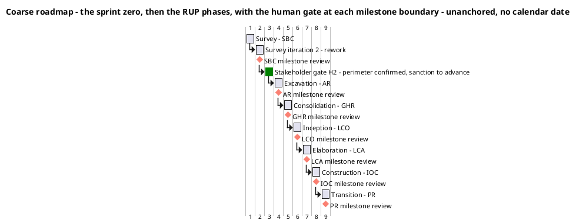

## Document Control
- Phase: Survey
- Status: Draft — iteration 1 assessed; six Major findings open, so the SBC milestone is not achieved
- Milestone Target: end-of-Survey (SBC) — not achieved; iteration 2 planned from the Iteration Assessment
- Iteration: 1, Cycle 1 (the plan is re-issued as iteration 2's on the Review Record's open findings)
- Owner: Project Manager

## Iteration Objectives

This iteration reads the existing system and states what the project inherits. It is the whole of Survey (SBC), the first of the sprint zero's three phases; nothing declared by the stakeholder is worked here.

| # | Objective | Satisfied when | Owner |
|---|---|---|---|
| O1 | The tailoring that governs the sprint zero exists | Development Case records the inactive disciplines, the fired OPTIONAL, the measurement policy and the role deltas | Process Engineer |
| O2 | The existing system is read and its perimeter stated | System Inventory records the process boundary, the entry points, the technology, the stores and the documentation | Software Archaeologist |
| O3 | The unread remainder is declared rather than left implicit | System Inventory's Coverage states which files were not opened and why | Software Archaeologist |
| O4 | The anomalies the reading found are carried as scored, actionable risks | Risk List holds one risk per anomaly, each with probability, impact, magnitude, strategy and owner | Project Manager |
| O5 | The reading's priorities are ordered and the stakeholder's answer recorded | System Inventory's Priorities carries the order and the 2026-11-23 answer | Software Archaeologist |
| O6 | The project's plan for the rest of the sprint zero and the RUP phases exists | This artifact carries the milestone sequence and this iteration's work items with owners | Project Manager |

## Plan and Milestones

No bar carries an absolute date or a projected calendar span: no phase has closed, so nothing measured exists to project one from. The one-day length is the diagram's sequencing device, not a duration claimed for the work. The chain is strictly sequential — each milestone's review precedes the next phase, because the next phase reads what the review sanctioned. Survey carries two iterations because its first left six Major findings open: the Review Coordinator's verdict is iteration REQUIRED, so the rework precedes the re-taken SBC review rather than following the sanction.

## Resources

The roles are the 26-role roster of the IARI DC baseline, minus the two the Development Case records as not working in this project. No role is added, merged or renamed.

| Role | Discipline | Works in this iteration | Why |
|---|---|---|---|
| Process Engineer | Environment | Yes | The tailoring must exist before Discovery reads against it |
| Software Archaeologist | Discovery | Yes | The reading is the iteration's own product |
| Project Manager | Project Management | Yes | Risk List and Iteration Plan |
| Reviewer | Review | Yes | Milestone review, first lens |
| Management Reviewer | Review | Yes | Milestone review, second lens |
| Review Coordinator | Review | Yes | Milestone verdict |
| System Analyst | Requirements | No — Excavation | Survey produces no Vision and no Use-Case Model |
| Requirements Specifier | Requirements | No — Elaboration | — |
| Software Architect | Analysis & Design | No — Excavation | No architecture is recovered before Excavation |
| Designer | Analysis & Design | No — Excavation | — |
| Database Designer | Analysis & Design | No — Excavation | Persistent data is described in the Design Model, from Excavation |
| User Interface Designer | Analysis & Design | No — Elaboration | — |
| Implementer | Implementation | No — Inception | No code is written in the sprint zero |
| Integrator | Implementation | No — Inception | The build environment is set up in Inception; R007 waits on it |
| Code Reviewer | Implementation | No — Elaboration | — |
| Test Manager | Test | No — Inception | No Test Plan is triggered |
| Test Designer / Tester / Test Analyst | Test | No — Elaboration | No test case is written before a use case is recovered |
| Deployment Manager | Deployment | No — Inception | The Deployment Model is fired but recovered in Consolidation |
| Technical Writer | Deployment | No — Construction | — |
| Configuration Manager | Configuration & Change Management | No — Inception | No baseline exists yet |
| Change Control Manager | Configuration & Change Management | No — Inception | The Change Request ledger is opened at LCO |
| Business Reviewer | Review | No — from LCO | Survey's milestone review runs Reviewer, Management Reviewer, Review Coordinator |
| Business Process Analyst | Business Modeling | No — inactive | `business-process-led = false` |
| Capsule Designer | Analysis & Design | No — inactive | `real-time-system = false` |

The stakeholder is not an agent role: they are the only human in the process, and their work in this iteration is gate H1 alone.

## Use Cases and Scenarios Addressed
None. Survey is the sprint zero's first phase and recovers no use case: the 22 entry points are recorded as entry points in the System Inventory, and it is Excavation that recovers them into Use-Case Model use cases — `UC-NNN` from `EP-NNN` — in the reading order of the Priorities section. No use case, no scenario and no use-case realization is planned in this iteration.

What this iteration does hand forward is the material those use cases are recovered from: `EP-001` … `EP-022`, and the twelve anomalies that sit on an entry point and constrain what a recovered use case may claim. Each is named here as the System Inventory's Anomalies table records it, and that table remains Excavation's constraint list:

| Anomaly | Constrains | What a recovered use case may not claim |
|---|---|---|
| `AN-001` | `EP-003`, `EP-013` | That a user-facing path completes a todo: the list's checkbox is bound to nothing and the client makes no update call |
| `AN-002` | `EP-016` | That the BFF-to-API hop is authenticated: the API accepts a bearer token from any caller |
| `AN-004` | `EP-011`, `EP-013`, `EP-014` | That the `admin` branch is live functionality: nothing in the running system grants the role, and the stakeholder ruled it an exceptional entity on 2026-11-23 |
| `AN-008` | — | That the API mounts a Swagger UI: the README names one, the code mounts the Scalar reference UI |
| `AN-009` | `EP-004`, `EP-005`, `EP-007` | That the Identity endpoints are rate-limited: the token-bucket policy covers `/todos` only |
| `AN-010` | — | That the BFF and the API share a data-protection key ring: only the application discriminator is set |
| `AN-015` | — | That the orchestration is settled: the app host is the only part of the delivery still moving |
| `AN-017` | `EP-001` | That the root redirect is served in every environment: the Scalar UI it targets is mapped in Development only |
| `AN-018` | `EP-010`, `EP-011` | That the list and item endpoints state one visibility rule: `GET /todos` filters on the owner alone while the item endpoints admit an `admin` principal |
| `AN-019` | `EP-007` | That the challenge validates the provider name: it is taken straight from the route and checked against no registered scheme |
| `AN-020` | `EP-008` | That the callback has a failure flow: every path redirects to `/`, so a rejected provider, a null exchange and a failed cookie sign-in are indistinguishable |
| `AN-021` | `EP-004`, `EP-005`, `EP-007` | That a failure's cause reaches the person: every authentication failure answers 401 with no body |

Twelve anomalies, twelve rows. Five of them — `AN-008`, `AN-009`, `AN-010`, `AN-015`, `AN-017` — constrain the reference-UI, Identity, key-ring and app-host reading, which is priorities 6 and 8 of the order Excavation reads in.

## Evaluation Criteria
The exit criteria for this iteration's milestone (SBC). They are the criteria the reading's own decisions imply plus the ones the phase declares; none is invented beyond what the phase must establish to hand off to Excavation. Where a criterion was written as one and the evidence settles only part of it, it is split rather than certified whole — `Iteration Plan#F1` (Management Reviewer).

| # | Criterion | Met when | State | Evidence |
|---|---|---|---|---|
| C1 | The perimeter is stated | The delivery's processes, components, external systems and stores are recorded with anchors | Met | System Inventory — Perimeter |
| C2a | The perimeter-membership questions and the priority order are answered by the stakeholder | The external-provider path and the admin branch are ruled in or out, and the priority order accepted, in the stakeholder's own words | Met — 2026-11-23 | Three answers: the external-provider path is a recovered use case marked unreachable in the delivered configuration; the admin branch is an exceptional entity and not a recovered use case; the order stands as it is with nothing left out |
| C2b | The perimeter as recorded is confirmed by the stakeholder | Gate answered: the four-process perimeter accepted as the System Inventory states it | Not met | Asked at the SBC review whether they confirm the perimeter as recorded and sanction advancing past SBC, the stakeholder answered No on 2026-11-23. C2a's three answers do not confirm the recorded perimeter |
| C3 | The entry points are enumerated | Every entry point by which the system is reached is listed with its kind, initiator and anchor | Met | System Inventory — Entry points, EP-001…EP-022 |
| C4 | The priorities are ordered | The eight areas carry an order and a reason | Met | System Inventory — Priorities |
| C5 | The priority order is confirmed by the stakeholder | Gate H1 answered: the order accepted | Met — 2026-11-23 | "The order stands as it is: nothing matters more than it reflects, and nothing is to be left out" |
| C6 | The unread areas are declared, and the declared figure reproduces | Every unread file is named with the reason it was not read, and the headline count is the sum of the per-area table | Met in substance, evidence not yet reconciled | `System Inventory#F2`: the unread files are named and the reasons stated, while the headline count does not reproduce from the table. The criterion cites the recomputed figure once the Software Archaeologist settles it |
| C7a | Every anomaly is carried as a risk, none dropped | 21 anomalies map to 22 risks with no silent omission | Met | Risk List — Risk Register, 21 `Refines` edges from `AN-NNN`, plus `R022` whose separate origin is stated |
| C7b | Every score reproduces from its stated inputs | Each probability and impact derives once from the IARI scale and the evidence cited, and the magnitude is the band of their product | Not met | `Risk List#F1` (Reviewer): 13 of 21 rows score differently from the inventory's stated likelihood and impact for the same anomaly, and the same inventory word scores differently in different rows. The reconciliation is the Project Manager's first rework item |
| C8 | Every accepted risk above Moderate carries the stakeholder's grant | No risk the register can place at Significant or High is accepted on the Project Manager's authority | Met — 2026-11-23 | Four grants, none self-granted. `R012` and `R016` at their recorded exposure 12, accepted 2026-11-23. `R004` and `R011`, whose cited evidence gives exposure 12 while the register records 4 and 8, each accepted by the stakeholder 2026-11-23, conditionally on the reconciled score landing at 9 to 12 or above — the Risk List records both answers verbatim. `R001` and `R007` are avoided, which needs no grant |
| C9 | No risk is left unactionable | Every risk names a strategy, an owner, an action and a contingency or warning sign | Met | Risk List — Risk Mitigation and Contingency |
| C10 | The plan names no work the process does not run | The milestone sequence is recorded and each work item belongs to a stage the IARI DEVELOPMENT PROCESS runs in its phase | Met | This artifact — Plan and Milestones |

The gate is decided by the criteria that remain open. `C2b` is the gate's own condition: a perimeter confirmation is not the reviewers' or the Project Manager's to infer, and it was refused on 2026-11-23. `C7b` leaves the register's magnitudes unreproducible. `C6` is met in substance and owes its figure. No criterion above is certified on an answer that does not state it.

C8 moved to Met inside this iteration, on the stakeholder's own answers of 2026-11-23 and on nothing else.

