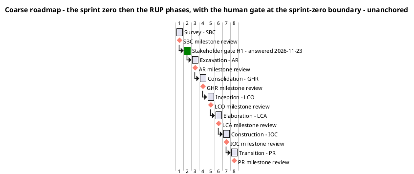
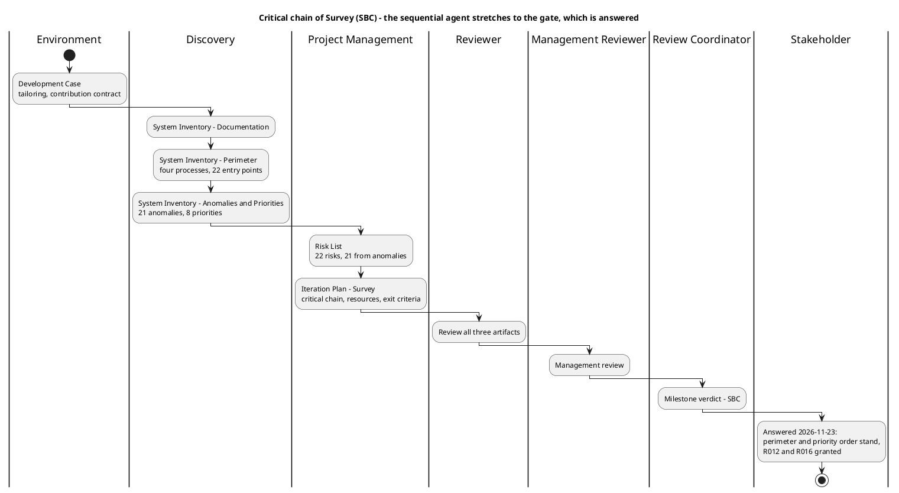

## Document Control

- Phase: Survey
- Status: Draft — produced for the end-of-Survey (SBC) milestone review
- Milestone Target: end-of-Survey (SBC) — not yet achieved
- Iteration: 1, Cycle 1
- Owner: Project Manager

## Iteration Objectives

This iteration reads the existing system and states what the project inherits. It is the whole of Survey (SBC), the first of the sprint zero's three phases; nothing declared by the stakeholder is worked here.

| # | Objective | Satisfied when | Owner |
|---|---|---|---|
| O1 | The tailoring that governs the sprint zero exists | Development Case records the inactive disciplines, the fired OPTIONAL, the measurement policy and the role deltas | Process Engineer |
| O2 | The existing system is read and its perimeter stated | System Inventory records the process boundary, the entry points, the technology, the stores and the documentation | Software Archaeologist |
| O3 | The unread remainder is declared rather than left implicit | System Inventory's Coverage states which files were not opened and why | Software Archaeologist |
| O4 | The anomalies the reading found are carried as scored, actionable risks | Risk List holds one risk per anomaly, each with probability, impact, magnitude, strategy and owner | Project Manager |
| O5 | The reading's priorities are ordered and the stakeholder's answer recorded | System Inventory's Priorities carries the order and the 2026-11-23 answer | Software Archaeologist |
| O6 | The project's plan for the rest of the sprint zero and the RUP phases exists | This artifact carries the milestone sequence and this iteration's work items with owners | Project Manager |

## Plan and Milestones
### Coarse roadmap — the milestone sequence

The sequence is the sprint zero reading the delivery, then the RUP phases working the declared change. Survey is the phase this iteration closes. No milestone below is achieved, and no iteration beyond this one is planned in fine detail.

The bars carry no absolute date and no projected calendar span: no phase has run, so there is nothing measured to project one from. The one-day length is the diagram's sequencing device, not a duration claimed for the work.

| Order | Phase | Milestone | Discipline intensity | What the milestone is judged on |
|---|---|---|---|---|
| 1 | Survey | SBC | Environment High, Discovery Critical, Project Management Medium | The perimeter and its priorities are stated and the anomalies carried as risks — this iteration |
| 2 | Excavation | AR | Requirements High, Analysis & Design Critical, Discovery Critical, Project Management Medium | The recovered use-case model, architecture, design and deployment rest on anchors and cover the reading's priorities 1 to 5 |
| 3 | Consolidation | GHR | Requirements High, Analysis & Design Medium, Discovery Critical, Project Management Medium | Coverage is counted and declared; every recovered use case, the Supplementary Specification and the fired Deployment Model are complete |
| 4 | Inception | LCO | Requirements Critical, Environment High, Project Management High, Analysis & Design Medium, Implementation Medium, Test Low, Deployment Low, CM Medium | The declared change is scoped, a candidate architecture exists, the CM strategy is set and the Change Request ledger is opened |
| 5 | Elaboration | LCA | Analysis & Design Critical, Requirements High, Implementation Medium, Test Medium, Environment Medium, Project Management Medium, CM Medium, Deployment Low | The architecture baseline is accepted and an executable architecture is built |
| 6 | Construction | IOC | Implementation Critical, Test Critical, Requirements Medium, Analysis & Design High, Project Management High, Deployment Medium, CM High, Business Modeling Low | The declared scope is implemented and its test evaluation is recorded |
| 7 | Transition | PR | Deployment Critical, Test High, Project Management Medium, Implementation Medium, Requirements Low, Analysis & Design Low, CM Medium | The release build is baselined and acceptance-tested; the Change Requests are closed |

Elaboration and Construction repeat no further than their own exit condition, which is stated in the table above: the architecture baseline accepted, and the declared scope implemented. No count of iterations is forecast for them — a count invented before a single phase has closed would be a figure with no measured basis.

### This iteration's fine plan

The work items are the stages the IARI DEVELOPMENT PROCESS runs in Survey, in its order, each owned by its role. Two items carry no size at all: nothing in this project has been measured yet, and no token budget is declared for it, so there is no figure to quote and none is invented. An iteration ends when its exit criteria pass.

| # | Work item | Owner | Depends on | State | Forecast spend |
|---|---|---|---|---|---|
| 1 | Development Case — tailoring, classifications, optional triggers, measurement policy | Process Engineer | — | Complete | not recorded |
| 2 | Contribution contract — `docs/CONTRIBUTING.md`, label table, convention anchors | Process Engineer | 1 | Complete | not recorded |
| 3 | System Inventory — Documentation: what the delivery describes and what it does not | Software Archaeologist | 1 | Complete | not recorded |
| 4 | System Inventory — Perimeter: processes, components, external systems, 22 entry points | Software Archaeologist | 3 | Complete | not recorded |
| 5 | System Inventory — Anomalies and Priorities: 21 anchored anomalies, 8 ordered areas, coverage counted | Software Archaeologist | 3 | Complete | not recorded |
| 6 | Risk List — 22 risks scored, classified and mitigated | Project Manager | 5 | Complete | not recorded |
| 7 | Iteration Plan — coarse roadmap, this iteration's work items, exit criteria | Project Manager | 6 | Complete | not recorded |
| 8 | Milestone review SBC — Reviewer, then Management Reviewer, then Review Coordinator | Reviewer / Management Reviewer / Review Coordinator | 2, 4, 5, 6, 7 | Not started | not recorded |
| 9 | Stakeholder gate H1 — perimeter and priority order confirmed; R012 and R016 granted | Stakeholder | 8 | Answered 2026-11-23 | queued in days; no estimate |

Two currencies, never summed: items 1 to 8 are agent work, measured in tokens and elapsed agent time, and nothing has been measured yet, so their forecast column is empty rather than filled with a guess. Item 9 is a human gate — waiting, not working — quoted only in days of queue time and bounded in the Risk List as R022 with a ceiling of 14 days and no estimate.

The chain is sequential end to end: Discovery cannot read a tailoring that does not exist, Risk is scored on what Discovery found, and the review judges what Project Management wrote. Adding roles to this chain would buy no clock and would add contention over the same artifacts.

| Human gate | Who | What the iteration waits for | Bound | Answer |
|---|---|---|---|---|
| H1 | Stakeholder | The perimeter of the four-process delivery confirmed, the eight-area priority order confirmed, and the two Significant-risk acceptances (R012, R016) granted or refused | R022 — ceiling 14 days, escalates to the process suspending rather than auto-filling | Answered 2026-11-23: the order stands as it is — nothing matters more than it reflects and nothing is to be left out; R012 accepted, R016 accepted |

## Resources

The roles are the 26-role roster of the IARI DC baseline, minus the two the Development Case records as not working in this project. No role is added, merged or renamed.

| Role | Discipline | Works in this iteration | Why |
|---|---|---|---|
| Process Engineer | Environment | Yes | The tailoring must exist before Discovery reads against it |
| Software Archaeologist | Discovery | Yes | The reading is the iteration's own product |
| Project Manager | Project Management | Yes | Risk List and Iteration Plan |
| Reviewer | Review | Yes | Milestone review, first lens |
| Management Reviewer | Review | Yes | Milestone review, second lens |
| Review Coordinator | Review | Yes | Milestone verdict |
| System Analyst | Requirements | No — Excavation | Survey produces no Vision and no Use-Case Model |
| Requirements Specifier | Requirements | No — Elaboration | — |
| Software Architect | Analysis & Design | No — Excavation | No architecture is recovered before Excavation |
| Designer | Analysis & Design | No — Excavation | — |
| Database Designer | Analysis & Design | No — Excavation | Persistent data is described in the Design Model, from Excavation |
| User Interface Designer | Analysis & Design | No — Elaboration | — |
| Implementer | Implementation | No — Inception | No code is written in the sprint zero |
| Integrator | Implementation | No — Inception | The build environment is set up in Inception; R007 waits on it |
| Code Reviewer | Implementation | No — Elaboration | — |
| Test Manager | Test | No — Inception | No Test Plan is triggered |
| Test Designer / Tester / Test Analyst | Test | No — Elaboration | No test case is written before a use case is recovered |
| Deployment Manager | Deployment | No — Inception | The Deployment Model is fired but recovered in Consolidation |
| Technical Writer | Deployment | No — Construction | — |
| Configuration Manager | Configuration & Change Management | No — Inception | No baseline exists yet |
| Change Control Manager | Configuration & Change Management | No — Inception | The Change Request ledger is opened at LCO |
| Business Reviewer | Review | No — from LCO | Survey's milestone review runs Reviewer, Management Reviewer, Review Coordinator |
| Business Process Analyst | Business Modeling | No — inactive | `business-process-led = false` |
| Capsule Designer | Analysis & Design | No — inactive | `real-time-system = false` |

The stakeholder is not an agent role: they are the only human in the process, and their work in this iteration is gate H1 alone.

## Use Cases and Scenarios Addressed

None. Survey is the sprint zero's first phase and recovers no use case: the 22 entry points are recorded as entry points in the System Inventory, and it is Excavation that recovers them into Use-Case Model use cases — `UC-NNN` from `EP-NNN` — in the reading order of the Priorities section. No use case, no scenario and no use-case realization is planned in this iteration.

What this iteration does hand forward is the material those use cases are recovered from: `EP-001` … `EP-022`, and the 12 anomalies that sit on an entry point and constrain what a recovered use case may claim — `AN-001` on `EP-003`/`EP-013`, `AN-002` on `EP-016`, `AN-004` on `EP-011`/`EP-013`/`EP-014`, `AN-018` on `EP-010`/`EP-011`, `AN-019` on `EP-007`, `AN-020` on `EP-008`, `AN-021` on `EP-004`/`EP-005`/`EP-007`.

## Evaluation Criteria
The exit criteria for this iteration's milestone (SBC). They are the criteria the reading's own decisions imply plus the ones the phase declares; none is invented beyond what the phase must establish to hand off to Excavation.

| # | Criterion | Met when | State | Evidence |
|---|---|---|---|---|
| C1 | The perimeter is stated | The delivery's processes, components, external systems and stores are recorded with anchors | Met | System Inventory — Perimeter |
| C2 | The perimeter is confirmed by the stakeholder | Gate H1 answered: the four-process perimeter accepted as stated | Met — 2026-11-23 | H1 answered; the stakeholder confirmed the reading's scope stands and nothing is to be left out |
| C3 | The entry points are enumerated | Every entry point by which the system is reached is listed with its kind, initiator and anchor | Met | System Inventory — Entry points, EP-001…EP-022 |
| C4 | The priorities are ordered | The eight areas carry an order and a reason | Met | System Inventory — Priorities |
| C5 | The priority order is confirmed by the stakeholder | Gate H1 answered: the order accepted | Met — 2026-11-23 | "The order stands as it is: nothing matters more than it reflects, and nothing is to be left out" |
| C6 | The unread areas are declared | Every unread file is named with the reason it was not read | Met | System Inventory — Coverage, 52 files unread of 129 |
| C7 | Every anomaly is carried as a scored risk or retired with its reason | 21 anomalies map to 21 risks, none unscored, none silently dropped | Met | Risk List — Risk Register, 21 `Refines` edges from `AN-NNN` |
| C8 | Every accepted risk above Moderate carries the stakeholder's grant | R012 and R016 answered by the stakeholder | Met — 2026-11-23 | Risk List — R012 and R016, both answered "Yes" |
| C9 | No risk is left unactionable | Every risk names a strategy, an owner, an action and a contingency or warning sign | Met | Risk List — Risk Mitigation and Contingency |
| C10 | The plan for the rest of the sprint zero exists and names no work the process does not run | The milestone sequence is recorded and each work item belongs to a stage the IARI DEVELOPMENT PROCESS runs in its phase | Met | This artifact — Plan and Milestones |

Gate H1 is answered and C2, C5 and C8 are met on the stakeholder's own words. What remains is the milestone review itself (work item 8): the reviewers' verdict is not the Project Manager's to state, and no criterion above depends on it.

