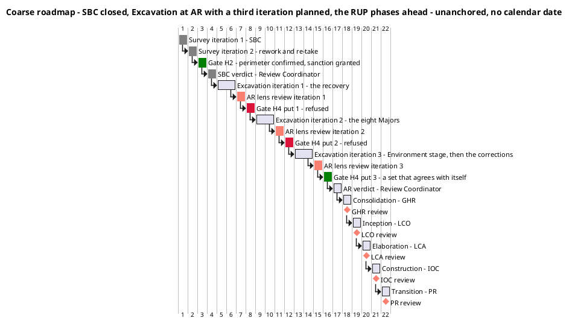
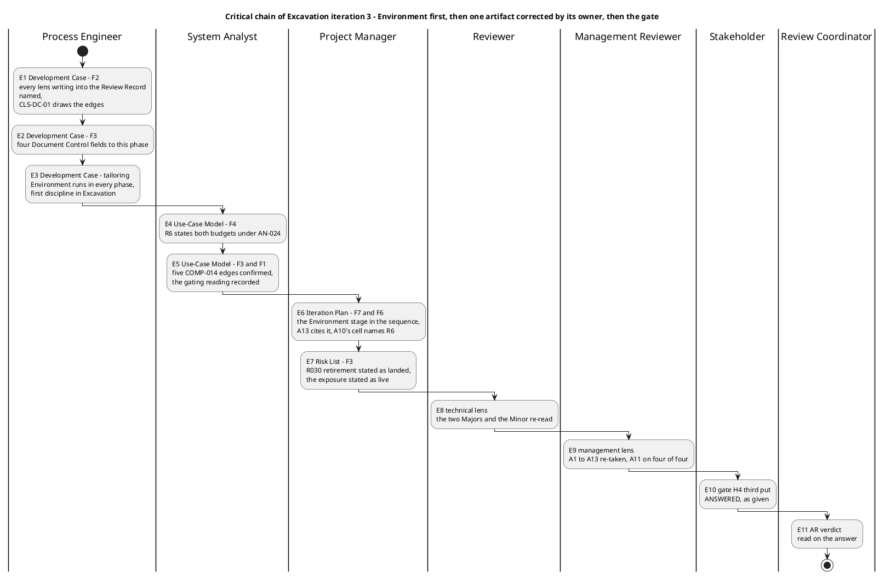
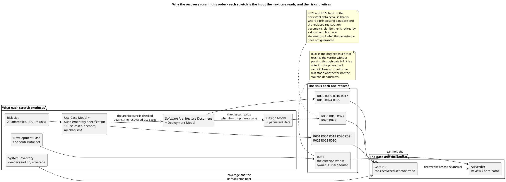
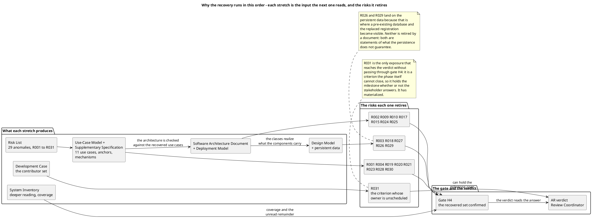
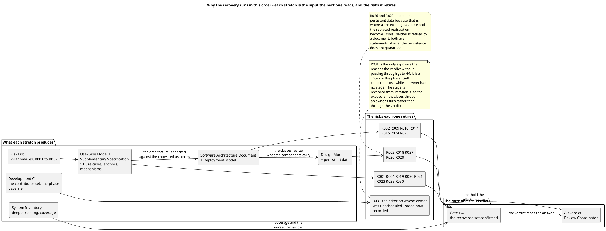
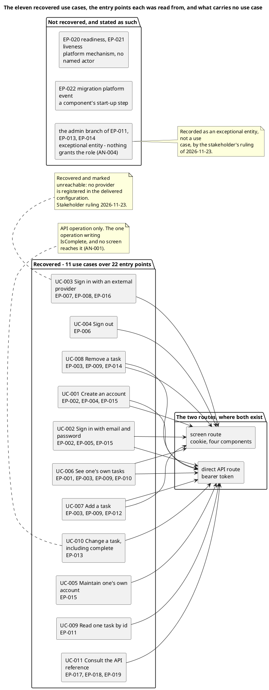
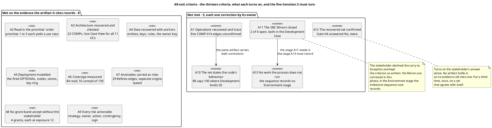

## Document Control
- Phase: Excavation
- Status: Iteration 2 assessed and closed; the AR verdict is the Review Coordinator's — iteration required — and iteration 3 is planned from the Review Record
- Milestone Target: end-of-Excavation (AR) — not achieved; iteration 3 required
- Iteration: 2, Cycle 1 — iteration 3 planned from the Review Record
- Owner: Project Manager
## Iteration Objectives
Excavation recovers what the existing system is into the models the rest of the project works from. It is the sprint zero's second phase: the SBC milestone is passed, and nothing the stakeholder declares is worked here — the delivery declares no scope, so every element this phase writes is read from code and cites its anchor.

The phase planned three objectives. The standing column states each one's outcome as the AR review found it after iteration 2, not as its owner reported it, and names the finding that holds it short where one does.

| # | Objective | Satisfied when | Owner | Standing after iteration 2's review |
|---|---|---|---|---|
| O1 | Recover the Architecture | The Software Architecture Document records the components and connectors and the mechanisms, technology and deployment as the code shows them, and the deployment topology is modelled | Software Architect | **Met on its own artifacts** — `COMP-001` to `COMP-022` with their connectors and anchors, the Use-Case View, 13 mechanisms, and the Deployment Model's nodes, stores, environment mapping and key-ring requirement. `Software Architecture Document#F1` and `Deployment Model#F1` are closed and verified. It is not certified under A10 only because that criterion is decided on the recovered set as a whole and the Use-Case Model's rules diagram states one budget where two are in force |
| O2 | Recover the Use Cases | The Use-Case Model carries one use case per entry-point path, each tracing to the `EP-NNN` it was read from, and accounts for every entry point it does not carry | System Analyst | **Not met** — carriage is intact: 11 use cases over 22 entry points, four exclusions stated, three Majors from iteration 1 closed. Two Majors stand: `Use-Case Model#F3` (five `COMP-014` edges suspect at the close) and `Use-Case Model#F4` (R6 states 100 where `appsettings.Development.json:8-12` binds 50). Neither adds or removes a use case |
| O3 | Recover the Persistent Data | The Design Model carries the domain model, the packages and classes, and the persistent data with its entities, keys, associations and enforced rules | Designer, Database Designer | **Met** — 42 classes, the relationship inventory, the eight entity types, the owner key's re-point under `AN-025` and "What the code does not hold", each anchored. `Design Model#F1` closed. Neither lens recorded a finding against this objective in either iteration |

O2's two Majors are one artifact's confirmation and transcription, not a reading: both contradicted facts were in the System Inventory as `AN-024` before any artifact restated them. They are corrected in iteration 3, and A11's two Development Case Minors are corrected in the same iteration in the Environment stage the stakeholder's answer of 2026-11-23 puts first in this phase. Declared work is never cut to avoid the iteration it costs.
## Plan and Milestones
The plan is two-level. The **coarse roadmap** fixes the milestone sequence, the intensity each phase runs at and which risks each milestone confronts. The **fine plan** is the current iteration's work items with their owners, bounded to Excavation. What a completed iteration delivered and what it cost is recorded in the Iteration Assessment, not here.

### Coarse roadmap — the milestone sequence

No bar carries an absolute date or a projected calendar span. The one-day and two-day lengths are the diagram's sequencing device, not durations claimed for the work: the phases that have closed are measured in the Iteration Assessment, in the two currencies — tokens and agent time, apart from stakeholder queue time — never as a span. Each human gate sits ahead of the verdict it feeds, because the verdict reads the answer.

| Order | Phase | Milestone | Discipline intensity | Risks this milestone confronts | What the milestone is judged on |
|---|---|---|---|---|---|
| 1 | Survey | SBC — passed | Environment High, Discovery Critical, Project Management Medium | Carried R001 to R021 into the register; R016, R012, R004 and R011 granted for the sprint zero. SBC retires none of the reading's risks — it makes them owned | The perimeter and its priorities stated, and the anomalies carried as scored risks. Met at the re-take on 2026-11-23 |
| 2 | Excavation | AR — iterations 1 and 2 assessed, iteration 3 required | Environment Low, Requirements High, Analysis & Design Critical, Discovery Critical, Project Management Medium | R001, R004, R019, R020, R021, R023, R028, R030 (System Analyst); R002, R009, R010, R017, R024, R025, R015 (Software Architect); R003, R018, R027 (Designer); R026, R029 (Database Designer); R031 and R032 (the plan's own exposures, both materialized) | The recovered use cases, architecture, design and deployment rest on anchors and state the code's behaviour; the coverage is measured; the stakeholder confirms the recovery at gate H4. **Iterations 1 and 2 did not close it: A1, A10, A11, A13 unmet, H4 refused twice.** What remains is two corrections in one artifact and three in one tailoring document, each one turn by its owner |
| 3 | Consolidation | GHR | Environment Low, Requirements High, Analysis & Design Medium, Discovery Critical, Project Management Medium | Completes R003 and R010 where the recovered set is closed; confirms R015's volatility statement against the orchestration as it stands; R030's statement is read again if the session surface moves | Every use case, the Supplementary Specification and the Glossary trigger are complete; the coverage is final |
| 4 | Inception | LCO | Environment High, Requirements Critical, Project Management High, Analysis & Design Medium, Implementation Medium, Test Low, Deployment Low, CM Medium | R007, R013, R014 (Integrator, Build Environment Setup); the Change Request ledger opens and every later gate depends on it | The declared change is scoped, a candidate architecture exists, the CM strategy is set, the Change Request ledger is opened |
| 5 | Elaboration | LCA | Environment Medium, Analysis & Design Critical, Requirements High, Implementation Medium, Test Medium, Project Management Medium, CM Medium, Deployment Low | R012, R011, R005 (Test Manager and Test Designer); R006, R029 (the test project is next touched here) | The architecture baseline is accepted and an executable architecture is built |
| 6 | Construction | IOC | Environment Low, Implementation Critical, Test Critical, Requirements Medium, Analysis & Design High, Project Management High, Deployment Medium, CM High, Business Modeling Low | Completes R012's coverage of the client's todo flow; R008 (Technical Writer, User Documentation); R027 and R024 corrected in the implementation they constrain | The declared scope is implemented and its test evaluation is recorded |
| 7 | Transition | PR | Environment Low, Deployment Critical, Test High, Project Management Medium, Implementation Medium, Requirements Low, Analysis & Design Low, CM Medium | Closes what remains: R011's contingency is taken only if a deliberate upgrade lands before the release; R026 becomes a release-blocking conversion if a pre-existing database is in the release's path | The release build is baselined and acceptance-tested; the Change Requests are closed |

**Environment runs in every phase.** On the stakeholder's answer at the AR re-take of 2026-11-23 the phase is the first discipline of Excavation, at Low intensity, and the Process Engineer holds the stage that carries `Development Case#F2`, `#F3` and the tailoring statement the same answer ordered corrected. That is the baseline this roadmap records and the Development Case is brought to it in iteration 3, not the other way round.

Sequencing is driven by the Risk List, not by convenience. The risks whose actions the System Analyst performs land in Excavation because it is the one that writes the recovered use-case model; the architecture risks land beside them because the SAD is recovered from the same code. R007 — the build that cannot build the tree — waits for Inception because that is the first phase the Integrator works, and no plan here schedules it earlier.

### This iteration's fine plan

Every item is one of the eight actions the Review Record's coordinator lens ordered, with the owner its recording lens assigned. No item is new scope, none belongs to another phase, and each is a correction to a section that already exists.

| # | Work item | Stage | Owner | Depends on | Closes |
|---|---|---|---|---|---|
| 1 | Development Case — name every lens that writes into the Review Record (Reviewer, Management Reviewer, Business Reviewer, Review Coordinator, CodeReviewer, plus the Configuration Manager's baseline record) and draw the corresponding edges in CLS-DC-01 | Environment | Process Engineer | — | `Development Case#F2` — **A11 counts this** |
| 2 | Development Case — the four Document Control fields brought to the phase and iteration the document governs | Environment | Process Engineer | — | `Development Case#F3` — **A11 counts this** |
| 3 | Development Case — the tailoring states that Environment runs in every phase, and in Excavation as its first discipline | Environment | Process Engineer | 1, 2 | The tailoring statement the stakeholder ordered corrected alongside the two Minors |
| 4 | Use-Case Model — the rules diagram's R6 states both budgets under `AN-024`: the code defaults 100 / 100 per 10 s / queue 100 from `RateLimitExtensions.cs:14-31`, and the Development override 50 / 50 / 50 from `appsettings.Development.json:8-12` as the value in force | Requirements | System Analyst | — | `Use-Case Model#F4` |
| 5 | Use-Case Model — the five `COMP-014 → UC-006` to `UC-010` edges re-registered as confirmed, each checked against `TodoApi.cs:19-20`, with the reading recorded beside the gate diagram that a throttling mechanism gates an operation without being it | Requirements | System Analyst | — | `Use-Case Model#F3`, `Use-Case Model#F1` |
| 6 | Iteration Plan — A10's evidence cell names the Use-Case Model's R6, so the criterion is certified on all four artifacts its test covers; A13's evidence cell cites the Environment stage | Project Management | Project Manager | 4 — the cell cannot certify what is not yet correct | `Iteration Plan#F6`, `Iteration Plan#F7` — **written in this turn** |
| 7 | Risk List — `R030`'s strategy cell restated: the retirement has landed in the Use-Case Model under `AN-029`, and the exposure stays live because `AN-012` stands and no test covers the surface | Project Management | Project Manager | 5 | `Risk List#F3` — **written in this turn** |
| 8 | Technical lens re-run against the corrected artifacts | Review | Reviewer | 1 to 7 | — |
| 9 | Management lens — A1 to A13 re-taken on the evidence each cites | Review | Management Reviewer | 8 | — |
| 10 | Gate H4, third put — the recovered set confirmed or not, on a set that agrees with itself | Gate | Stakeholder | 9 | `A12` |
| 11 | AR milestone verdict | Review | Review Coordinator | 10 | — |

**Two currencies, never summed.** Items 1 to 9 and 11 are agent work, quoted in tokens and measured elapsed agent time. Item 10 is a human gate — waiting, not working — quoted only in days of queue time.

**Nothing is added and nothing is cut.** The iteration count rises by one because the set was put to the stakeholder twice before it agreed with itself; declared work is untouched and no agent role is added or duplicated. The one resource change — the Process Engineer holding the Environment stage — is the stakeholder's own restatement of the process baseline at the AR re-take of 2026-11-23, not a deviation this role grants. `R031`'s contingency is the mechanism that opened this iteration, as the register predicted: the correction did not land, A11 read two of four, and the phase opened a third iteration planned from the Review Record.

### Risk-driven sequencing of this iteration

The order is the System Inventory's Priorities order 1 to 5 — the API's todo operations, its authorization, the BFF, the screens and the tests — and the roles follow it: the use-case model is recovered from the endpoints first, because the architecture and the design are read through the operations it names. Nothing in this order is deferred to protect a figure, because no figure exists to protect.

### Risk-driven sequencing of both iterations

The order is the System Inventory's Priorities order 1 to 5 — the API's todo operations, its authorization, the BFF, the screens and the tests — and the roles follow it: the use-case model is recovered from the endpoints first, because the architecture and the design are read through the operations it names. Nothing in this order is deferred to protect a figure, because no figure exists to protect.

### Measured actuals and the forecast

| Measured actual | Value |
|---|---|
| Survey — agent time, whole phase (closed) | 29 min |
| Survey — stakeholder queue | 5 min |
| Survey — tokens | 8,995,433 |
| Survey — agent runs | 10 |
| Excavation iteration 1 — agent time | 1:19:41.05 |
| Excavation iteration 1 — stakeholder queue | 0:02:27.21 |
| Excavation iteration 1 — tokens | 43,561,437 |
| Excavation iteration 2 — agent time | 0:41:20.67 |
| Excavation iteration 2 — stakeholder queue | 7:08:04.38 |
| Excavation iteration 2 — tokens | 20,675,161 |
| Excavation iteration 2 — agent invocations | 16 |
| Excavation iteration 2 — stakeholder interactions recorded | 18 |

The forecast made in iteration 1's assessment — that a corrective pass costs less in tokens and less in elapsed agent time than the cold reading that preceded it — is borne out by measurement: 20.7 million tokens against 43.6 million, and 41 minutes against 80. That comparison is between a cold reading of a 139-file tree and a broad corrective pass over seven artifacts; it says nothing measured about a narrow pass of eight one-turn corrections.

`[ASSUMPTION — requires validation: iteration 3 costs less in tokens and in elapsed agent time than iteration 2. The basis is the work item count and shape — eight actions, five of them a sentence or a cell in an existing section — against iteration 2's sixteen items, seven of which re-read a section to correct it. The only measured pair bearing on it is iteration 2's 20,675,161 tokens against iteration 1's 43,561,437, which compares a broad correction with a cold reading, not a narrow one]`

No figure is projected for the phase as a whole: Excavation has not closed, so no phase actual exists, and a phase's cost is the sum of iterations that are not measured until it closes.

The project declares no token budget, so there is no box to fit: no figure is proposed for the stakeholder to accept, and no declared work is cut or deferred to meet an estimate.

The chain is sequential at its load-bearing points: the two artifact corrections precede the lenses that re-read them, and the gate follows the lenses. Adding agent roles to this chain would buy no clock and would add contention over the same artifact surface — eight corrections across three owners, one turn each, is not work a fourth owner shortens.

| Human gate | Who | What the iteration waits for | Bound | Answer |
|---|---|---|---|---|
| H4 | Stakeholder | The recovered set confirmed: the 11 use cases as the operations the existing system performs, the architecture as the components it already has, and the data as it is stored — each as an interpretation of code with its anchor, since the delivery states no intent to check them against | `R022` — ceiling 14 days of queue time; on expiry the process suspends and nothing is auto-filled | **Put twice, refused twice** — at the iteration-1 and iteration-2 reviews, with the order that every Major be corrected and, at the second, that the Development Case be corrected in this phase with A11 as written. Put a third time, once, after items 1 to 7 land. Queue cost so far: 2 min 27 s and 7 h 08 min 04 s, reported apart from agent time |

### This iteration's fine plan — iteration 3

Every item is one of the eight actions the Review Record's coordinator lens ordered, with the owner its recording lens assigned. No item is new scope, none belongs to another phase, and each is a correction to a section that already exists.

| # | Work item | Stage | Owner | Depends on | Closes |
|---|---|---|---|---|---|
| 1 | Development Case — name every lens that writes into the Review Record (Reviewer, Management Reviewer, Business Reviewer, Review Coordinator, CodeReviewer, plus the Configuration Manager's baseline record) and draw the corresponding edges in CLS-DC-01 | Environment | Process Engineer | — | `Development Case#F2` — **A11 counts this** |
| 2 | Development Case — the four Document Control fields brought to the phase and iteration the document governs | Environment | Process Engineer | — | `Development Case#F3` — **A11 counts this** |
| 3 | Development Case — the tailoring states that Environment runs in every phase, and in Excavation as its first discipline | Environment | Process Engineer | 1, 2 | The tailoring statement the stakeholder ordered corrected alongside the two Minors |
| 4 | Use-Case Model — the rules diagram's R6 states both budgets under `AN-024`: the code defaults 100 / 100 per 10 s / queue 100 from `RateLimitExtensions.cs:14-31`, and the Development override 50 / 50 / 50 from `appsettings.Development.json:8-12` as the value in force | Requirements | System Analyst | — | `Use-Case Model#F4` |
| 5 | Use-Case Model — the five `COMP-014 → UC-006` to `UC-010` edges re-registered as confirmed, each checked against `TodoApi.cs:19-20`, with the reading recorded beside the gate diagram that a throttling mechanism gates an operation without being it | Requirements | System Analyst | — | `Use-Case Model#F3`, `Use-Case Model#F1` |
| 6 | Iteration Plan — A10's evidence cell names the Use-Case Model's R6, so the criterion is certified on all four artifacts its test covers; A13's evidence cell cites the Environment stage | Project Management | Project Manager | 4 — the cell cannot certify what is not yet correct | `Iteration Plan#F6`, `Iteration Plan#F7` — **written in this turn** |
| 7 | Risk List — `R030`'s strategy cell restated: the retirement has landed in the Use-Case Model under `AN-029`, and the exposure stays live because `AN-012` stands and no test covers the surface | Project Management | Project Manager | 5 | `Risk List#F3` — **written in this turn** |
| 8 | Technical lens re-run against the corrected artifacts | Review | Reviewer | 1 to 7 | — |
| 9 | Management lens — A1 to A13 re-taken on the evidence each cites | Review | Management Reviewer | 8 | — |
| 10 | Gate H4, third put — the recovered set confirmed or not, on a set that agrees with itself | — | Stakeholder | 9 | `A12` |
| 11 | AR milestone verdict | Review | Review Coordinator | 10 | — |

**Two currencies, never summed.** Items 1 to 9 and 11 are agent work, quoted in tokens and measured elapsed agent time. Item 10 is a human gate — waiting, not working — quoted only in days of queue time.

**Nothing is added and nothing is cut.** The iteration count rises by one because the set was put to the stakeholder twice before it agreed with itself; declared work is untouched, no agent role is added or duplicated, and the one resource change — the Process Engineer holding the Environment stage — is the stakeholder's own restatement of the process baseline, not a deviation this role grants. R031's contingency is the mechanism that opened this iteration, exactly as the register predicted: the correction did not land, A11 read two of four, and the phase opened a third iteration planned from the Review Record.

### Iterations 1 and 2 — what they delivered, measured

| Iteration | What it produced | Agent time | Stakeholder queue | Tokens | Verdict it received |
|---|---|---|---|---|---|
| Excavation 1 — the recovery | The recovered set: 11 use cases over 22 entry points, 22 components, 8 entity types, the Deployment Model, the System Inventory deepened, 32 risks on one mapping | 1 h 19 min 41 s | 2 min 27 s | 43,561,437 | AR: iteration required — 0 Critical, 8 Major, 8 Minor; H4 refused |
| Excavation 2 — the eight Majors | Nine corrections across five artifacts; 35 cumulative finding entries, 27 closed | 41 min 21 s | 7 h 08 min 04 s | 20,675,161 | AR: iteration required — 0 Critical, 4 Major defects over 2 artifacts, 3 Minor; H4 refused |

Both figures are per iteration, and neither is quoted as a velocity: iterations inside a phase are not compared as rates, and the phase has not closed, so it holds no actual.

### Risk-driven sequencing of the phase

The order is the System Inventory's Priorities order 1 to 5 — the API's todo operations, its authorization, the BFF, the screens and the tests — and the roles follow it: the use-case model is recovered from the endpoints first, because the architecture and the design are read through the operations it names. Nothing in this order is deferred to protect a figure, because no figure exists to protect.

## Resources
The roles are the 26-role roster of the IARI DC baseline, minus the two the Development Case records as not working in this project. No role is added, merged or renamed.

**Environment runs in every phase.** The stakeholder restated the baseline at the AR re-take of 2026-11-23: the process runs Environment in every phase, and in Excavation it is the phase's first discipline, at Low intensity, with the Process Engineer's stage. Iteration 3 records that stage and the role works in it — the two Minors the SBC review left open and the tailoring statement the same answer ordered corrected are corrected there.

| Role | Discipline | Iterations 1–2 | Iteration 3 | Why |
|---|---|---|---|---|
| Process Engineer | Environment | **Did not run** — no stage recorded in the plan | **Yes — the phase's first discipline, at Low** | Corrects `Development Case#F2` (the contributor set and CLS-DC-01), `Development Case#F3` (Document Control), and states the phase baseline: Environment runs in every phase, first in Excavation. A11 counts the first two |
| System Analyst | Requirements | Yes | Yes | Corrects the two Majors in the Use-Case Model: R6's request budget under `AN-024`, and the five `COMP-014` edge confirmations |
| Project Manager | Project Management | Yes | Yes | Records the Environment stage and cites it in A13; names the Use-Case Model's R6 in A10's evidence cell; restates `R030`'s strategy cell |
| Reviewer | Review | Yes | Yes | Technical lens on the corrected artifacts |
| Management Reviewer | Review | Yes | Yes | Management lens — A1 to A13 re-taken, including A11 on four of four |
| Review Coordinator | Review | Yes | Yes | AR milestone verdict, read on the answer gate H4 returns |
| Software Architect | Analysis & Design | Yes | No | Both its Majors are closed; no finding remains against the Software Architecture Document or the Deployment Model |
| Designer | Analysis & Design | Yes | No | `Design Model#F1` closed; no finding remains |
| Database Designer | Analysis & Design | Yes | No | No finding was recorded against the persistent data in either iteration |
| Software Archaeologist | Discovery | Yes | No | The System Inventory has no open finding; both lenses recomputed its coverage and it reproduces |
| Requirements Specifier | Requirements | No — Elaboration | No — Elaboration | Use-case detail and NFR thresholds are written against a declared scope; the delivery declares none |
| User Interface Designer | Analysis & Design | No — Elaboration | No — Elaboration | Storyboards and the navigation map follow the use-case specification |
| Capsule Designer | Analysis & Design | No — inactive | No — inactive | `real-time-system = false` |
| Business Process Analyst | Business Modeling | No — inactive | No — inactive | `business-process-led = false` |
| Implementer | Implementation | No — Inception | No — Inception | No code is written in the sprint zero |
| Integrator | Implementation | No — Inception | No — Inception | The build environment is set up in Inception; `R007` waits on it |
| Code Reviewer | Implementation | No — Elaboration | No — Elaboration | — |
| Test Manager | Test | No — Inception | No — Inception | No Test Plan is triggered |
| Test Designer / Tester / Test Analyst | Test | No — Elaboration | No — Elaboration | No test case is written before a use case is specified |
| Deployment Manager | Deployment | No — Inception | No — Inception | The Deployment Model is recovered here; the deployment plan is Inception's |
| Technical Writer | Deployment | No — Construction | No — Construction | — |
| Configuration Manager | Configuration & Change Management | No — Inception | No — Inception | No baseline exists yet |
| Change Control Manager | Configuration & Change Management | No — Inception | No — Inception | The Change Request ledger is opened at LCO |

The stakeholder is not an agent role: they are the only human in the process, and their work is gate H4 — put twice, refused twice, and put once more after iteration 3's corrections land.

The Process Engineer's presence is the one resource change iteration 3 makes, and it is the smallest one that exists: three turns on one document, from the discipline the phase now runs first. The alternative — assigning the correction to a role that already has a stage — is not open: the artifact's owner is fixed, and a role editing another's artifact is the defect ownership exists to prevent.
## Use Cases and Scenarios Addressed
Eleven use cases, recovered from the 22 entry points the System Inventory records. Every use case traces to the `EP-NNN` whose code performs it, and no use case is recovered from an intent the code does not carry. Every anomaly cited below is cited for the fact the System Inventory's Anomalies table gives it.

| Use case | Primary actor | Recovered from | What the recovery may not claim, and where that is carried |
|---|---|---|---|
| `UC-001` Create an account | ACT-001, ACT-003 | `EP-002`, `EP-004`, `EP-015` | That a refusal names its cause: the API answers validation problems and the BFF discards them, so every authentication failure reaches the person as one 401 with no body (`AN-021`, `AN-020`) |
| `UC-002` Sign in with email and password | ACT-001, ACT-003 | `EP-002`, `EP-005`, `EP-015` | That a failed sign-in distinguishes a wrong password from a locked or absent account — one 401 covers all three (`AN-021`) — and that lockout ends the access a token already holds: the guard checks it at sign-in alone (`AN-022`) |
| `UC-003` Sign in with an external provider | ACT-001, with ACT-002 authenticating | `EP-007`, `EP-008`, `EP-016` | That it is reachable: no provider is registered in the delivered configuration. Recovered and marked unreachable, per the stakeholder's ruling of 2026-11-23. Also that a callback reports its outcome — it redirects to `/` on every path (`AN-020`) — and that the scheme is checked: it is taken straight from the route (`AN-019`) |
| `UC-004` Sign out | ACT-001 | `EP-006` | That the provider's own session ends: one call signs the local cookie scheme out and nothing else (`Todo.Web/Server/AuthApi.cs:40-52`) |
| `UC-005` Maintain one's own account | ACT-003 | `EP-015` | That a screen reaches it: the client's six operations contain no account-maintenance call, so the framework's endpoint set is mapped with no UI path to it (`Todo.Web/Client/TodoClient.cs:7-71`) |
| `UC-006` See one's own tasks | ACT-001, ACT-003 | `EP-001`, `EP-003`, `EP-009`, `EP-010` | That the list honours the `admin` role: it filters on the owner alone while the item endpoints admit the role, so the four statements disagree (`AN-018`). Also that an unreachable API is distinguishable from an empty list — an absent base address answers `200` and no rows (`AN-026`) |
| `UC-007` Add a task | ACT-001, ACT-003 | `EP-003`, `EP-009`, `EP-012` | That a create body can set a row complete: the insert copies the title alone, so `IsComplete` is created false whatever the body says (`Todo.Api/Todos/TodoApi.cs:38-50`) |
| `UC-008` Remove a task | ACT-001, ACT-003 | `EP-003`, `EP-009`, `EP-014` | That another person's row is distinguished from one that does not exist: the delete filters on the owner and answers 404 either way, never 403 (`Todo.Api/Todos/TodoApi.cs:67-73`) |
| `UC-009` Read one task by id | ACT-003 | `EP-011` | That a screen reaches it: none does. An API operation only. Its `admin` branch is the exceptional entity `AN-004` records — nothing in the running system grants the role |
| `UC-010` Change a task, including marking it complete | ACT-003 | `EP-013` | That a user-facing path completes a task: the client makes no update call and the list's checkbox is bound to nothing, so the only operation writing `IsComplete` has no screen (`AN-001`) |
| `UC-011` Consult the API reference | ACT-003 | `EP-017`, `EP-018`, `EP-019` | That a Swagger UI is mounted, as the README states — the code mounts the Scalar reference UI (`AN-008`) — or that the root redirect resolves outside Development, where that UI is not mapped (`AN-017`) |

Three entry-point groups carry no use case and the Use-Case Model says why: `EP-020` and `EP-021` are a platform mechanism with no actor the delivery names, `EP-022` is a component's start-up step, and the `admin` branch of `EP-011`, `EP-013` and `EP-014` is an exceptional entity no running caller can enter — the stakeholder's ruling of 2026-11-23, recorded in the System Inventory's Perimeter and in `AN-004`.

**Scenarios.** Five of the eleven carry two scenarios rather than one: `UC-001`, `UC-002`, `UC-006`, `UC-007` and `UC-008` have a screen route and a direct API route. They are one use case with two scenarios, never one use case per actor: the two routes reach the same operation and differ only in how the caller authenticated.

## Evaluation Criteria
The exit criteria for this iteration's milestone (AR). Each is decided on the evidence the artifact it cites records, never on an adjacent artifact's answer: a criterion about the recovered set is certified on the recovered set, and one about a role's artifact is certified on that artifact's text. An evidence cell names only sections the cited artifact carries.

| # | Criterion | Met when | State | Evidence |
|---|---|---|---|---|
| A1 | The operations the system performs are recovered as use cases | Every use case traces to the entry point whose code performs it, and every entry point is either carried or its exclusion stated | **Not met — open Major** | Use-Case Model — Use-Case Survey: `UC-001` to `UC-011`, each with its `EP-NNN` list; "Not recovered, and why" accounts for `EP-020`, `EP-021`, `EP-022` and the `admin` branch of `EP-011`, `EP-013`, `EP-014`. Carriage is intact. `Use-Case Model#F3` (`trace-gap`): five `COMP-014 → UC-006` to `UC-010` `Realizes` edges are still marked suspect in the registered graph at the close, so the shared rate-limit mechanism is unconfirmed for five of the eleven use cases |
| A2 | The recovered use cases are read from the priorities the reading ordered first | Priorities 1 to 5 of the System Inventory each yield at least one recovered use case, and the recovery follows the order the stakeholder confirmed on 2026-11-23 | Met | System Inventory — Priorities: areas 1 to 5, the API's todo operations, its authorization, the BFF, the screens and the tests. The eleven use cases trace to `EP-NNN` in each of those five areas. The criterion claims nothing about priorities 6 to 8, and no deferred-set statement is required of any artifact for this row to hold |
| A3 | The architecture is recovered and checked against the use cases | The Software Architecture Document's components carry the paths the recovered use cases take, and every use case is reachable through a component it names | Met | Software Architecture Document — Logical View (`COMP-001` to `COMP-022` with their connectors) and Use-Case View, which names the components each of the eleven use cases' confirmed path crosses. `Software Architecture Document#F1` closed: SP1, M3 and the Quality view's bounded-load row state 50 / 50 / 50 as the bound in force under `AN-024` |
| A4 | The data is recovered with its anchors | The persistent entities, keys, associations and enforced rules are recorded, each with the file it was read from | Met | Design Model — persisted domain classes (`DM-D1`, `CLS-001` `Todo`, `CLS-007` `TodoUser`, `CLS-006` `TodoDbContext`), the relationship inventory, and "What the code does not hold", each anchored to `TodoDbContext.cs:11-17` and the three migrations; `AN-025` recorded against the owner key. `Design Model#F1` closed |
| A5 | The deployment is modelled | The fired OPTIONAL exists and records the processes, the stores and what must be shared between them | Met | Deployment Model — `get_optional_artifact_triggers` reports its trigger fired; Deployment Topology, Nodes and Connectors, and Environment Mapping state the processes, the stores, the ports, the shared key ring (`AN-010`) and the database directory (`AN-013`). `Deployment Model#F1` closed: the preamble is narrowed to what the files hold and the Rate limiting row reads 50 / 50 / 50 for Development |
| A6 | The coverage is measured and the remainder declared | Every file is either read or named with the reason it was not, and the headline figure reproduces from the per-area table | Met | System Inventory — Coverage: 84 opened and 55 unread of 139, the per-area Read column summing to 84 and its Files column to 139, every unread file named by category with none carrying a perimeter fact. Both lenses recomputed the arithmetic at this milestone and it reproduces |
| A7 | Every anomaly the recovery surfaced is carried as a scored risk | No anomaly maps to no risk, and every score reproduces from the one published mapping | Met | Risk List — Risk Register: 29 `Refines` edges from `AN-NNN`, plus `R022`, `R031` and `R032`, whose separate origins are stated in the register; every anomaly-derived row reproduces from the mapping in Risk Classification |
| A8 | No accepted risk above Moderate lacks the stakeholder's grant | No risk the register places at Significant or High is accepted on the Project Manager's authority | Met — 2026-11-23 | Risk List — the grant table under Risk Register: four grants on `R004`, `R011`, `R012` and `R016`, each at 4 × 3 = 12, recorded verbatim. No risk this iteration placed in the grant band takes the accept strategy, so no second grant was needed and none is assumed |
| A9 | Every risk is actionable | Every risk names a strategy, an owner, an action, a contingency and a warning sign | Met | Risk List — Risk Mitigation and Contingency: every row names a strategy, an owner, an action, a contingency and a warning sign. `Risk List#F2` (Management Reviewer) closed on `R030`'s corrected strategy. `Risk List#F3` is a transcription in that same cell and the criterion's subject, actionability, is not in question |
| A10 | The recovery states what the code does, not what it was meant to do | No artifact in the recovered set states a behaviour the code contradicts, and where code and document disagree the code is recorded and the contradiction identified against its anchor | **Not met — open Major** | Decided on all four artifacts the criterion's own test names. **Supplementary Specification** M3, S2, P1 and R8 state the code defaults (100 tokens, 100 per 10 s, queue 100) and the Development override (50 / 50 / 50) as two values in force, citing `AN-024`; R4 states the two outbound hops apart, the token hop inheriting the standard resilience handler and the forwarder hop nothing, citing `AN-023` — verified. **Software Architecture Document** SP1, M3 and the Quality view's "Availability — bounded load" row state 50 / 50 / 50 as the bound in force — verified. **Deployment Model** Environment Mapping's preamble is narrowed to what is true and its Rate limiting row reads 50 / 50 / 50 for Development — verified. **Use-Case Model** is the fourth and does not yet hold: its rules diagram's R6 reads "The per-user token bucket, /todos only: 100 tokens, 100 per 10 s, queue 100, 429" and cites no `AN-024`, while the same artifact's shared gate diagram states both values and `Todo.Api/appsettings.Development.json:8-12` binds 50. One artifact carries two answers to one question. `Use-Case Model#F4`; `Iteration Plan#F6` recorded that A10's cell certified three of the four |
| A11 | The Minors the SBC review left open are closed | Each of the four is corrected in the artifact that carries it | **Not met — two of four open** | Corrected: `Iteration Plan#F2` (C2b no longer exists; A1 to A13 replace it), `Iteration Plan#F3` (the State column states each row's actual outcome), `System Inventory#F3` (Document Control names the iteration its content belongs to). Open: `Development Case#F2` — "Roles and Ownership" still reads "Reviewer, CodeReviewer, plus the Configuration Manager's baseline record", and CLS-DC-01 draws no edge into the Review Record from the Management Reviewer, the Business Reviewer or the Review Coordinator; `Development Case#F3` — Document Control still reads Phase: Survey. Both are the Process Engineer's, and the stage exists: on the stakeholder's answer of 2026-11-23 Environment runs in every phase and is Excavation's first discipline, with that role's stage in iteration 3. The criterion is not carried to Inception and not restated |
| A12 | The recovered set is confirmed by the stakeholder | Gate H4 answered Yes: the 11 use cases, the architecture and the data accepted as the models of the existing system | **Not met — refused** | Gate H4 was put for the second time and answered **No**, with the order that every Major be corrected and that the Development Case be corrected in this phase. The answer is recorded as given and nothing in it is recorded as a confirmation it did not contain. The criterion turns on the stakeholder's answer alone; no artifact holds it, so no evidence cell cites one. It is put a third time, once, after iteration 3's actions land |
| A13 | The plan names no work the process does not run | The milestone sequence is recorded and each work item belongs to a stage the IARI DEVELOPMENT PROCESS runs in Excavation | **Not met — open Major** | The fine plan's items are each a corrective action against an artifact an Excavation role owns, and the milestone sequence now records the **Environment** discipline as this phase's first stage: the Process Engineer holds iteration 3's items 1 to 3 under that stage, on the stakeholder's restatement of 2026-11-23 that the process runs Environment in every phase and in Excavation as its first discipline. `Iteration Plan#F7` recorded that the sequence ended Excavation at iteration 2 and cited no stage; the sequence is corrected in this section's sibling, and this cell now cites the stage rather than an order. The criterion reads not met until the stage's work is performed |

**Eight met, five not met.** No criterion is certified on another criterion's answer and no finding is waived by a criterion's state. A1 and A10 turn on one artifact and one turn by its owner; A11 and A13 turn on one stage, now recorded; A12 turns on the stakeholder's answer alone.

Three criteria are not this plan's to certify:

- **A11** turns on an artifact this role does not own. It reads two of four at this pass — a third of the four having closed at the previous pass — and is neither waived nor restated: the stakeholder declined that recommendation by name.
- **A12** turns on the stakeholder's answer, which was refused a second time.
- **A1** and **A10** turn on the Use-Case Model, whose two Major defects are its owner's to correct and whose evidence this cell records without anticipating the correction.

The nine criteria that rest on a role's artifact are certified on that artifact's own text, re-read at this milestone. The three that moved from met to not met — A1, A10 and A13 — moved because the review read them harder and because the stakeholder's order changed what A13 requires, not because an artifact regressed.
