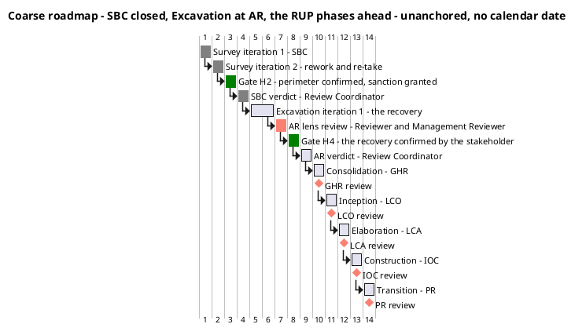
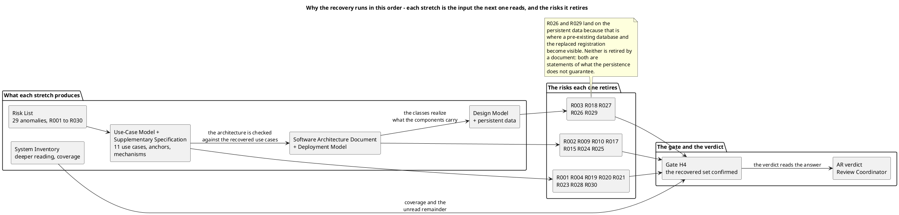
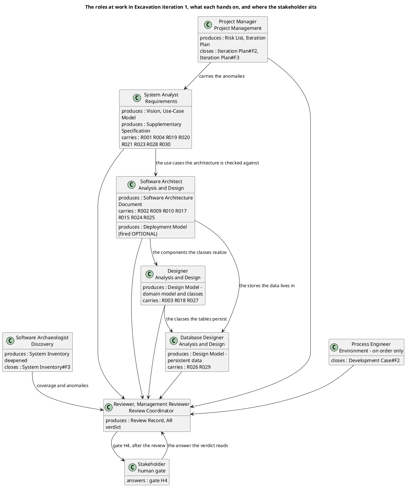

## Document Control
- Phase: Excavation
- Status: Iteration 1 in progress; the AR milestone verdict is the Review Coordinator's and is not this plan's to declare
- Milestone Target: end-of-Excavation (AR) — not yet achieved
- Iteration: 1, Cycle 1
- Owner: Project Manager

## Iteration Objectives
Excavation recovers what the existing system is into the models the rest of the project works from. It is the sprint zero's second phase: the SBC milestone is passed, and nothing the stakeholder declares is worked here — the delivery declares no scope, so every element this iteration writes is read from code and cites its anchor.

| # | Objective | Satisfied when | Owner |
|---|---|---|---|
| O1 | The operations the system performs are recovered as use cases | The Use-Case Model carries one use case per entry-point path, each tracing to the `EP-NNN` it was read from, and accounts for every entry point it does not carry | System Analyst |
| O2 | What the system must satisfy beyond its behaviour is stated | The Supplementary Specification carries the mechanisms, constraints and quality statements read from the code, with the anchor each was read from | System Analyst |
| O3 | The architecture the delivery already has is recovered, not invented | The Software Architecture Document records the components and connectors and the mechanisms, technology and deployment as the code shows them | Software Architect |
| O4 | The topology the delivery runs in is stated | The Deployment Model — the phase's fired OPTIONAL — records the processes, the stores and what must be shared between them | Software Architect |
| O5 | The design and the persistent data are recovered | The Design Model carries the domain model, the packages and classes, and the persistent data with its entities, keys, associations and enforced rules | Designer, Database Designer |
| O6 | The anomalies the recovery surfaced are carried as scored, owned risks | The Risk List holds one risk per anomaly of the System Inventory, each with probability, impact, magnitude, strategy and owner | Project Manager |
| O7 | The plan for this phase and the milestones ahead exists | This artifact carries the coarse roadmap and this iteration's work items with owners | Project Manager |
| O8 | The Minors the SBC review left open are closed, not carried again | Each of the four is corrected in the artifact that carries it, by its owner | The owner each finding names |
| O9 | The recovered set is put to the stakeholder for confirmation | Gate H4 answered: the recovered use cases, architecture and data accepted as the models of the existing system, or not | Project Manager puts it; the stakeholder answers |

## Plan and Milestones
The plan is two-level. The **coarse roadmap** fixes the milestone sequence, the intensity each phase runs at and which risks each milestone confronts. The **fine plan** is this iteration's work items with their owners, bounded to Excavation.

### Coarse roadmap — the milestone sequence

No bar carries an absolute date or a projected calendar span, and no bar's length is a duration claimed for the work: the one-day and two-day lengths are the diagram's sequencing device. The phase that has closed is measured in the Iteration Assessment, in the two currencies — tokens and agent time, apart from stakeholder queue time — never as a span. Each human gate sits ahead of the verdict it feeds, because the verdict reads the answer.

| Order | Phase | Milestone | Discipline intensity | Risks this milestone confronts | What the milestone is judged on |
|---|---|---|---|---|---|
| 1 | Survey | SBC — passed | Environment High, Discovery Critical, Project Management Medium | Carried R001 to R021 into the register; R016, R012, R004 and R011 granted for the sprint zero. SBC retires none of the reading's risks — it makes them owned | The perimeter and its priorities stated, and the anomalies carried as scored risks. Met at the re-take on 2026-11-23 |
| 2 | Excavation | AR — this iteration | Requirements High, Analysis & Design Critical, Discovery Critical, Project Management Medium | R001, R004, R019, R020, R021, R023, R028, R030 (System Analyst, Use-Case Model); R002, R009, R010, R017, R024, R025, R015 (Software Architect, SAD and the Deployment Model); R003, R018, R027 (Designer, Design Model); R026, R029 (Database Designer, persistent data) | The recovered use cases, architecture, design and deployment rest on anchors; the recovered set covers the reading's priorities 1 to 5; the coverage is measured; the stakeholder confirms the recovery at gate H4 |
| 3 | Consolidation | GHR | Requirements High, Analysis & Design Medium, Discovery Critical, Project Management Medium | Completes R003 and R010 where the recovered set is closed; confirms R015's volatility statement against the orchestration as it stands; R030 re-read if the session surface moves again | Every use case, the Supplementary Specification and the Glossary trigger are complete; the coverage is final |
| 4 | Inception | LCO | Requirements Critical, Environment High, Project Management High, Analysis & Design Medium, Implementation Medium, Test Low, Deployment Low, CM Medium | R007, R013, R014 (Integrator, Build Environment Setup); R022 opens the Change Request ledger every later gate depends on | The declared change is scoped, a candidate architecture exists, the CM strategy is set, the Change Request ledger is opened |
| 5 | Elaboration | LCA | Analysis & Design Critical, Requirements High, Implementation Medium, Test Medium, Environment Medium, Project Management Medium, CM Medium, Deployment Low | R012, R011, R005 (Test Manager and Test Designer); R006, R029 (the test project is next touched here) | The architecture baseline is accepted and an executable architecture is built |
| 6 | Construction | IOC | Implementation Critical, Test Critical, Requirements Medium, Analysis & Design High, Project Management High, Deployment Medium, CM High, Business Modeling Low | Completes R012's coverage of the client's todo flow; R008 (Technical Writer, User Documentation); R027 and R024 corrected in the implementation they constrain | The declared scope is implemented and its test evaluation is recorded |
| 7 | Transition | PR | Deployment Critical, Test High, Project Management Medium, Implementation Medium, Requirements Low, Analysis & Design Low, CM Medium | Closes what remains: R011's contingency is taken only if a deliberate upgrade lands before the release; R026 becomes a release-blocking conversion if a pre-existing database is in the release's path | The release build is baselined and acceptance-tested; the Change Requests are closed |

Sequencing is driven by the Risk List, not by convenience. The risks whose actions the System Analyst performs land in this iteration because it is the one that writes the recovered use-case model; the architecture risks land beside them because the SAD is recovered from the same code. R007 — the build that cannot build the tree — waits for Inception because that is the first phase the Integrator works, and no plan here schedules it earlier.

### This iteration's fine plan

The work items are the stages the IARI DEVELOPMENT PROCESS runs in Excavation, plus the four Minors the SBC review left open, which the stakeholder ordered closed in this phase rather than left unattended. No work item adds a stage the process does not run and none belongs to another phase. The State column states each row's actual outcome against the artifact it names — no row reads complete whose correction is not in the artifact.

| # | Work item | Owner | Depends on | State |
|---|---|---|---|---|
| 1 | Risk List — carry the recovery's anomalies as scored, owned risks; record the acceptance grants verbatim | Project Manager | — | Complete — 29 anomalies carried as `R001` to `R030`, with `R022`'s separate origin stated; the eight Excavation added (`R023` to `R030`) each restate no prior risk; the four Significant-band acceptances hold the stakeholder's own answer of 2026-11-23 |
| 2 | Iteration Plan — the coarse roadmap, this fine plan, and `Iteration Plan#F2` with `Iteration Plan#F3` | Project Manager | 1 | Complete — this section and Evaluation Criteria; the State column states each row's actual outcome, and the criteria table records no answer the stakeholder did not give |
| 3 | Vision, Use-Case Model, Supplementary Specification — recover the operations, the actors and the constraints | System Analyst | 1 | Complete — 11 use cases from 22 entry points, each tracing to its `EP-NNN`; `UC-003` marked unreachable and `UC-009`, `UC-010` API-only, per the stakeholder's rulings of 2026-11-23 |
| 4 | The recovery's own failure statements written into the flows | System Analyst | 3 | Complete — `R019`, `R020`, `R021`, `R023` and `R028` are recorded as the flows the code performs, each anchored, not as intended behaviour |
| 5 | Software Architecture Document — the views, the mechanisms, then the deployment | Software Architect | 3 | Complete — 22 components recovered with their anchors; SP1 and M3 state the limiter, M9 the migration event, P6 the two hops' unequal protection, and the disagreement with Supplementary Specification R4 is recorded rather than reconciled |
| 6 | Deployment Model — the phase's fired OPTIONAL | Software Architect | 5 | Complete — `get_optional_artifact_triggers` reports the trigger fired; the one-machine placement, the nodes and connectors, the environment mapping and the key-ring requirement (`AN-010`) are stated |
| 7 | Design Model — the domain model and the classes | Designer | 3 | Complete — 42 classes recovered with their anchors; the two contract declarations recorded against one element and the list's absent error path recorded at `AN-026` |
| 8 | Persistent data — entities, keys, associations, enforced rules | Database Designer | 7 | Complete — the entities, the owner key and its re-point by the third migration, what the migrations enforce, and "What the code does not hold" |
| 9 | System Inventory — anomalies, then history and coverage; and `System Inventory#F3` | Software Archaeologist | 1 | Complete — 29 anomalies anchored, 20 history listings, coverage 84 read of 139; Document Control now reads Excavation iteration 1, the iteration its content belongs to |
| 10 | Development Case — `Development Case#F2`, the contributor set | Process Engineer | — | **Not started** — "Roles and Ownership" still reads "Reviewer, CodeReviewer, plus the Configuration Manager's baseline record", and CLS-DC-01 draws no edge into the Review Record from the Management Reviewer, the Business Reviewer or the Review Coordinator. Environment runs at no intensity in Excavation, so this runs on the stakeholder's order of 2026-11-23 alone |
| 11 | Technical lens re-run against the recovered set | Reviewer | 3, 4, 5, 6, 7, 8, 9, 10 | Not started — the lens this iteration's artifacts are reviewed by |
| 12 | Management lens — the AR exit criteria re-taken on the evidence each cites | Management Reviewer | 11 | Not started |
| 13 | Gate H4 — the recovered set confirmed by the stakeholder | Stakeholder | 12 | Queued — a human gate, quoted in days of queue time; no estimate |
| 14 | AR milestone verdict — read on the answer gate H4 returns | Review Coordinator | 13 | Not started |

**Item 10 is the one work item this iteration carries open, and it is a schedule question, not a status note.** It is the only item that runs on the stakeholder's order rather than on a discipline stage, because Environment has no intensity in Excavation; and A11 in Evaluation Criteria counts it, so its artifact is a milestone exit criterion while its owner is a role the phase does not otherwise schedule. If it lands before the technical lens returns, A11 reads Met on four of four and nothing else in this iteration depends on it. If it does not, A11 reads three of four and the AR milestone cannot close on this iteration's evidence — and the remedy is a second Excavation iteration, planned from the Review Record once the lenses have ruled, not more roles in this one. That is the trade this plan makes: another iteration protects what the phase declared, and no declared work is dropped to avoid one.

**Two currencies, never summed.** Items 1 to 12 and 14 are agent work, quoted in tokens and measured elapsed agent time. Item 13 is a human gate — waiting, not working — quoted only in days of queue time.

| Measured actual of the closed phase | Value |
|---|---|
| Survey — agent time | 29 min |
| Survey — stakeholder queue | 5 min |
| Survey — tokens | 8,995,433 |
| Survey — agent runs | 10 |
| Survey — artifacts | 6 |

That is the one measured actual this project holds, and it is per phase, not per iteration: no per-iteration figure is recorded and none is quoted as a velocity. Excavation has no measured actual yet — it has not closed — so no forecast figure is stated and none is invented. What can be said is the basis on which a forecast is made once this phase closes: Excavation recovered seven artifacts from the same 139-file tree Survey read, each citing an anchor, so what it cost is a question only its own measurement answers. `[ASSUMPTION — requires validation: the relative size of Excavation's reading surface against Survey's is the Project Manager's reading of the two phases' work, not a measurement]`.

The project declares no token budget, so there is no box to fit: no figure is proposed for the stakeholder to accept, and no declared work is cut or deferred to meet an estimate.

The chain is sequential at its load-bearing points: the architecture, the design and the persistent data are read through the use-case model that precedes them, and the lenses judge what the owners wrote. Adding agent roles to this chain would buy no clock and would add contention over the same artifact surface — the recovery is one reading of one tree, and two roles reading it in parallel would reconcile their readings at a cost greater than reading it twice.

| Human gate | Who | What the iteration waits for | Bound | Answer |
|---|---|---|---|---|
| H4 | Stakeholder | The recovered set confirmed: the 11 use cases as the operations the existing system performs, the architecture as the components it already has, and the data as it is stored — each as an interpretation of code with its anchor, since the delivery states no intent to check them against | `R022` — ceiling 14 days of queue time; on expiry the process suspends and nothing is auto-filled | Not yet asked. It is put after this iteration's review, so the stakeholder is asked only what the reviewers have settled |

### Risk-driven sequencing of this iteration

The order is the System Inventory's Priorities order 1 to 5 — the API's todo operations, its authorization, the BFF, the screens and the tests — and the roles follow it: the use-case model is recovered from the endpoints first, because the architecture and the design are read through the operations it names. Nothing in this order is deferred to protect a figure, because no figure exists to protect.

## Resources
The roles are the 26-role roster of the IARI DC baseline, minus the two the Development Case records as not working in this project. No role is added, merged or renamed.

| Role | Discipline | Works in this iteration | Why |
|---|---|---|---|
| System Analyst | Requirements | Yes | Recovers the use cases, the actors and the supplementary constraints |
| Software Architect | Analysis & Design | Yes | Recovers the architecture, its mechanisms and the deployment |
| Designer | Analysis & Design | Yes | Recovers the domain model and the classes |
| Database Designer | Analysis & Design | Yes | Recovers the persistent data, its keys and the rules the schema enforces |
| Software Archaeologist | Discovery | Yes | Deepens the System Inventory and closes `System Inventory#F3` |
| Project Manager | Project Management | Yes | Carries the anomalies as risks, plans the phase and closes `Iteration Plan#F2` and `#F3` |
| Reviewer | Review | Yes | Technical lens on the recovered set |
| Management Reviewer | Review | Yes | Management lens on the AR exit criteria |
| Review Coordinator | Review | Yes | AR milestone verdict |
| Process Engineer | Environment | On order only | Environment runs at no intensity in Excavation. The Process Engineer works here for one reason: `Development Case#F2`, a Minor the stakeholder ordered closed in the next phase. Not a discipline stage |
| Requirements Specifier | Requirements | No — Elaboration | Use-case detail and NFR thresholds are written against a declared scope; the delivery declares none |
| User Interface Designer | Analysis & Design | No — Elaboration | Storyboards and the navigation map follow the use-case specification |
| Capsule Designer | Analysis & Design | No — inactive | `real-time-system = false` |
| Business Process Analyst | Business Modeling | No — inactive | `business-process-led = false` |
| Implementer | Implementation | No — Inception | No code is written in the sprint zero |
| Integrator | Implementation | No — Inception | The build environment is set up in Inception; R007 waits on it |
| Code Reviewer | Implementation | No — Elaboration | — |
| Test Manager | Test | No — Inception | No Test Plan is triggered |
| Test Designer / Tester / Test Analyst | Test | No — Elaboration | No test case is written before a use case is specified |
| Deployment Manager | Deployment | No — Inception | The Deployment Model is recovered here; the deployment plan is Inception's |
| Technical Writer | Deployment | No — Construction | — |
| Configuration Manager | Configuration & Change Management | No — Inception | No baseline exists yet |
| Change Control Manager | Configuration & Change Management | No — Inception | The Change Request ledger is opened at LCO |
| Business Reviewer | Review | No — from LCO | Excavation's milestone review runs Reviewer, Management Reviewer, Review Coordinator |

The stakeholder is not an agent role: they are the only human in the process, and their work in this iteration is gate H4 alone.

### Agent role profile across the phase

## Use Cases and Scenarios Addressed
Eleven use cases, recovered from the 22 entry points the System Inventory records. Every use case traces to the `EP-NNN` whose code performs it, and no use case is recovered from an intent the code does not carry.

| Use case | Primary actor | Recovered from | What the recovery may not claim |
|---|---|---|---|
| `UC-001` Create an account | ACT-001, ACT-003 | `EP-002`, `EP-004`, `EP-015` | That the client's field rules guard registration: the create control does not submit, so none of them runs (`AN-021`) |
| `UC-002` Sign in with email and password | ACT-001, ACT-003 | `EP-002`, `EP-005`, `EP-015` | That a failed sign-in names its cause: every authentication failure answers 401 with no body (`AN-021`) |
| `UC-003` Sign in with an external provider | ACT-001, with ACT-002 authenticating | `EP-007`, `EP-008`, `EP-016` | That it is reachable: no provider is registered in the delivered configuration. Recovered and marked unreachable, per the stakeholder's ruling of 2026-11-23 |
| `UC-004` Sign out | ACT-001 | `EP-006` | That the provider's own session ends: only the local cookie is cleared (`AN-029`) |
| `UC-005` Maintain one's own account | ACT-003 | `EP-015` | That a screen reaches it: no client call does (`AN-009`, `AN-027`) |
| `UC-006` See one's own tasks | ACT-001, ACT-003 | `EP-001`, `EP-003`, `EP-009`, `EP-010` | That the list shows a row to a caller in the `admin` role: it filters on the owner alone (`AN-018`, `AN-026`) |
| `UC-007` Add a task | ACT-001, ACT-003 | `EP-003`, `EP-009`, `EP-012` | That a create body can set a row complete: `IsComplete` is created false whatever the body says (`AN-023`) |
| `UC-008` Remove a task | ACT-001, ACT-003 | `EP-003`, `EP-009`, `EP-014` | That another person's row is distinguished from one that does not exist: both answer 404 (`AN-004`) |
| `UC-009` Read one task by id | ACT-003 | `EP-011` | That a screen reaches it: none does. An API operation only |
| `UC-010` Change a task, including marking it complete | ACT-003 | `EP-013` | That a user-facing path completes a task: the only operation writing `IsComplete` has no screen (`AN-001`) |
| `UC-011` Consult the API reference | ACT-003 | `EP-017`, `EP-018`, `EP-019` | That a Swagger UI is mounted, or that the root redirect resolves outside Development (`AN-008`, `AN-017`) |

Three entry-point groups carry no use case and the Use-Case Model says why: `EP-020` and `EP-021` are a platform mechanism with no actor the delivery names, `EP-022` is a component's start-up step, and the `admin` branch of `EP-011`, `EP-013` and `EP-014` is an exceptional entity no running caller can enter — the stakeholder's ruling of 2026-11-23, recorded in the System Inventory's Perimeter.

**Scenarios.** Five of the eleven carry two scenarios rather than one: `UC-001`, `UC-002`, `UC-006`, `UC-007` and `UC-008` have a screen route and a direct API route. They are one use case with two scenarios, never one use case per actor: the two routes reach the same operation and differ only in how the caller authenticated.

## Evaluation Criteria
The exit criteria for this iteration's milestone (AR). Each is decided on the evidence the artifact it cites actually records; none is certified on an adjacent artifact's answer, and each evidence cell names a section the cited artifact actually carries.

| # | Criterion | Met when | State | Evidence |
|---|---|---|---|---|
| A1 | The operations the system performs are recovered as use cases | Every use case traces to the entry point whose code performs it, and every entry point is either carried or its exclusion stated | Met | Use-Case Model — Use-Case Survey: `UC-001` to `UC-011`, each with its `EP-NNN` list; "Not recovered, and why" accounts for `EP-020`, `EP-021`, `EP-022` and the `admin` branch of `EP-011`, `EP-013`, `EP-014` |
| A2 | The recovered set reaches the priorities the reading ordered | The use cases are recovered from priorities 1 to 5 of the System Inventory, and what is left unrecovered is named for Consolidation | Met | System Inventory — Priorities: orders the areas 1 to 5 as the API's todo operations, its authorization, the BFF, the screens and the tests, on the stakeholder's answer of 2026-11-23 that the order stands; the Use-Case Model recovers from each and states in "Not recovered, and why" what this phase does not carry |
| A3 | The architecture is recovered and checked against the use cases | The Software Architecture Document's components carry the paths the recovered use cases take, and every use case is reachable through a component it names | Met | Software Architecture Document — Logical View (COMP-001 to COMP-022 with their connectors) and Use-Case View, which names the components each of the eleven use cases' confirmed path crosses, including the seven not diagrammed; Traceability carries a `Realizes` row per component |
| A4 | The data is recovered with its anchors | The persistent entities, keys, associations and enforced rules are recorded, each with the file it was read from | Met | Design Model — persisted domain classes (DM-D1, CLS-001 `Todo`, CLS-007 `TodoUser`, CLS-006 `TodoDbContext`), the relationship inventory, and "What the code does not hold" — each anchored to `TodoDbContext.cs:11-17` and the three migrations; `AN-025` recorded against the owner key as the fact it is |
| A5 | The deployment is modelled | The fired OPTIONAL exists and records the processes, the stores and what must be shared between them | Met | Deployment Model — `get_optional_artifact_triggers` reports its trigger fired; Deployment Topology, Nodes and Connectors, and Environment Mapping state the processes, the stores, the ports, and the shared key ring (`AN-010`) and database directory (`AN-013`) |
| A6 | The coverage is measured and the remainder declared | Every file is either read or named with the reason it was not, and the headline figure reproduces from the per-area table | Met | System Inventory — Coverage: 84 opened and 55 unread of 139, the per-area Read column summing to 84 and its Files column to 139, and every unread file named by category with none carrying a perimeter fact |
| A7 | Every anomaly the recovery surfaced is carried as a scored risk | 29 anomalies map to 30 risks with no silent omission, and every score reproduces from the one published mapping | Met | Risk List — Risk Register: 29 `Refines` edges from `AN-NNN`, plus `R022` whose separate origin is stated in the register; all 29 anomaly-derived rows reproduce from the mapping in Risk Classification |
| A8 | No accepted risk above Moderate lacks the stakeholder's grant | No risk the register places at Significant or High is accepted on the Project Manager's authority | Met — 2026-11-23 | Risk List — the grant table under Risk Register: four grants on `R004`, `R011`, `R012` and `R016`, each at 4 × 3 = 12, recorded verbatim. The 19 Significant-band risks that do not accept are avoided, which is the Project Manager's authority at any band |
| A9 | Every risk is actionable | Every risk names a strategy, an owner, an action, a contingency and a warning sign | Met | Risk List — Risk Mitigation and Contingency, all 30 rows |
| A10 | The recovery states what the code does, not what it was meant to do | Where the code contradicts a document or itself, the code is recorded and the contradiction identified against its anchor | Met | Use-Case Model — the recovered flows; and the four contradictions carried as facts: `AN-008` the README's Swagger UI against the Scalar UI, `AN-024` the Development override against the code's defaults, `AN-025` the unconverted owner key, `AN-018` the list and item endpoints disagreeing |
| A11 | The Minors the SBC review left open are closed | Each of the four is corrected in the artifact that carries it | **Not met — three of four** | `Iteration Plan#F2` — C2b now reads Met on gate H2's answer, in this table's predecessor row and the fine plan; `Iteration Plan#F3` — the State column now states each row's actual outcome; `System Inventory#F3` — Document Control names the iteration its content belongs to. `Development Case#F2` **stands**: "Roles and Ownership" still reads "Reviewer, CodeReviewer, plus the Configuration Manager's baseline record" and CLS-DC-01 draws no edge into the Review Record from the Management Reviewer, the Business Reviewer or the Review Coordinator. Owner: Process Engineer |
| A12 | The recovered set is confirmed by the stakeholder | Gate H4 answered: the 11 use cases, the architecture and the data accepted as the models of the existing system | Not yet asked — the gate follows this review | Gate H4 is put after the lenses have ruled, so the stakeholder is asked only what the review has settled |
| A13 | The plan names no work the process does not run | The milestone sequence is recorded and each work item belongs to a stage the IARI DEVELOPMENT PROCESS runs in Excavation | Met | This artifact — every work item is an Excavation stage or a Minor closure the stakeholder ordered on 2026-11-23. The Process Engineer's single item is recorded as that order, not as a discipline stage, and Development Case names Environment as High in Survey and Inception and inactive in Excavation |

Two criteria are not met, and neither is this plan's to certify:

- **A11** turns on an artifact this role does not own. The Process Engineer's correction is outstanding, and until it lands the criterion reads three of four. It is not waived, and no row of the fine plan is marked complete on it.
- **A12** turns on the stakeholder's answer, which is the gate the phase waits on.

The other eleven rest on artifacts this iteration produced, each certified on the evidence that artifact records. No criterion is met on another criterion's answer, and no evidence cell cites a section its artifact does not carry.

