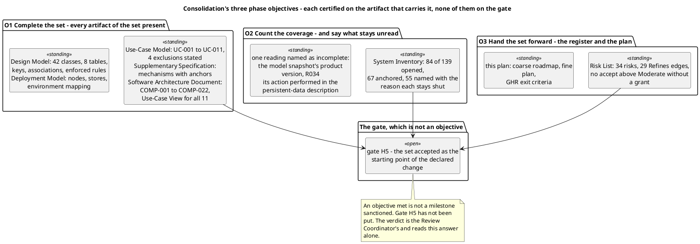
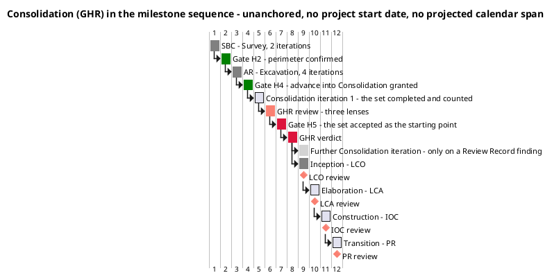
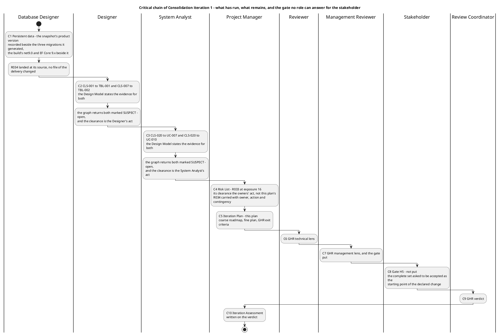
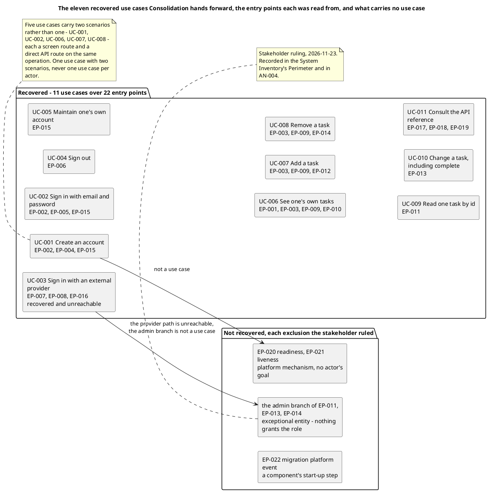
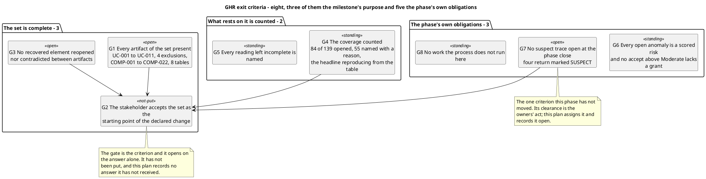

## Document Control
- Phase: Consolidation
- Status: Draft — the plan for this phase's current iteration, produced for the end-of-Consolidation (GHR) milestone review
- Milestone Target: end-of-Consolidation (GHR) — not yet achieved
- Iteration: 1, Cycle 1
- Owner: Project Manager

## Iteration Objectives
Consolidation is the sprint zero's third and last phase. It does not recover anything: the recovered set — eleven use cases, four stated exclusions, twenty-two components, eight tables — was confirmed by the stakeholder as the model of the existing system at gate H4's third put and the advance into this phase was sanctioned at the fourth. What this phase does is **complete that set, count what rests on it, and hand it forward as the starting point of the declared change**. Nothing the stakeholder declares is worked here.

The phase's objectives, and each one's standing on the artifact that carries it:

| # | Objective | Satisfied when | Owner | Standing |
|---|---|---|---|---|
| O1 | Complete the set the stakeholder confirmed | Every artifact of the recovered set stands at this phase, each element anchored to the file it was read from, and no recovered element has been reopened | System Analyst, Software Architect, Designer, Database Designer | **Standing, not certified** — the six artifacts are present at this phase and iteration. This plan does not certify its own phase's artifacts; that is the lenses' work at the GHR review |
| O2 | Count the coverage and declare what stays unread | Every file of the tree is either opened or named with the reason it was not, the headline figure reproduces from the per-area table, and any reading left incomplete is named | Software Archaeologist | **Standing** — the coverage reads 84 opened and 55 unread of 139, and the one reading handed forward incomplete is named: the model snapshot's product version, carried as `R034` |
| O3 | Leave the phase a register and a plan, not a set of notes | Every open anomaly is a scored risk with an owner and an action, no accepted risk above Moderate lacks the stakeholder's grant, and every work item of this phase belongs to a stage the process runs here | Project Manager | **Standing** — 34 risks, 29 `Refines` edges, four grants at exposure 12, and the two exposures this phase adds (`R033`, `R034`) carried with owners that this plan schedules |

The stakeholder confirmed the recovered content at gate H4 and sanctioned the advance into this phase. Nothing in this phase reopens it, and the objectives above add nothing to it: they complete, count and hand forward.

### What the two exposures this phase adds now stand at

`R034`'s action is performed: the persistent-data description records the snapshot's `ProductVersion` `8.0.0` against the build's `net9.0` and its EF Core 9.x packages, so no role scaffolds a migration against it unread. The incompatibility itself is not corrected — the snapshot is the delivery's file and this process records the system as it is.

`R033`'s action is not performed. The graph returns all four edges still marked `SUSPECT`, so the one criterion this phase can still fail on is `G7`, and it fails on an act only the Designer and the System Analyst may perform.

## Plan and Milestones
The plan is two-level. The **coarse roadmap** fixes the milestone sequence across the project and what each milestone is judged on. The **fine plan** is this iteration's work items with their owners, bounded to Consolidation. What a completed iteration delivered and what it cost belongs in the Iteration Assessment, not here.

### Coarse roadmap — the milestone sequence

No bar carries an absolute date or a projected calendar span. The one-day lengths are the diagram's sequencing device, not durations claimed for the work: spend is measured in the two currencies — tokens and agent time, kept apart from stakeholder queue time — and never as a span. `Crimson` marks the two stretches not yet reached: gate H5, which has not been put, and the GHR verdict that reads it. `LightGray` marks the further iteration this phase carries only if its Review Record leaves findings open; it is not planned work and nothing is scheduled behind it.

| Order | Phase | Milestone | Discipline intensity | Risks this milestone confronts | What the milestone is judged on |
|---|---|---|---|---|---|
| 1 | Survey | SBC — passed at the re-take, 2 iterations | Environment High, Discovery Critical, Project Management Medium | R001 to R021 carried into the register; R016, R012, R004 and R011 granted for the sprint zero | The perimeter and its priorities stated and the anomalies carried as scored risks |
| 2 | Excavation | AR — passed at gate H4's fourth put, 4 iterations | Environment Low, Requirements High, Analysis & Design Critical, Discovery Critical, Project Management Medium | R001, R004, R019, R020, R021, R023, R028, R030 (System Analyst); R002, R009, R010, R017, R024, R025, R015 (Software Architect); R003, R018, R027 (Designer); R026, R029 (Database Designer); R031 and R032 (the plan's own) | The set recovered on anchors, the coverage measured, and the stakeholder's confirmation of the recovered content as the model of their system |
| 3 | Consolidation | **GHR — this phase, iteration 1** | Environment Low, Requirements High, Analysis & Design Medium, Discovery Critical, Project Management Medium | R033 (four suspect edges, each clearable only by the role the graph marks, both scheduled here); R034 (the snapshot's product version, recorded where it is read); R003, R010, R018, R024, R025, R027 confirmed against the completed set; R030's statement read again only if the session surface moved, and it has not | **The complete set present and anchored, the coverage counted, and the stakeholder's acceptance of the set as the starting point for the declared change** |
| 4 | Inception | LCO | Environment High, Requirements Critical, Project Management High, Analysis & Design Medium, Implementation Medium, Test Low, Deployment Low, CM Medium | R007, R013, R014 (Integrator, Build Environment Setup); R016's grant expires with the sprint zero and the declared change becomes the thing to check against | The declared change is scoped, a candidate architecture exists, the CM strategy is set, the Change Request ledger is opened |
| 5 | Elaboration | LCA | Environment Medium, Analysis & Design Critical, Requirements High, Implementation Medium, Test Medium, Project Management Medium, CM Medium, Deployment Low | R012, R011, R005 (Test Manager and Test Designer); R006, R029 (the test project is next touched here) | The architecture baseline is accepted and an executable architecture is built |
| 6 | Construction | IOC | Environment Low, Implementation Critical, Test Critical, Requirements Medium, Analysis & Design High, Project Management High, Deployment Medium, CM High, Business Modeling Low | Completes R012's coverage of the client's todo flow; R008 (Technical Writer); R027 and R024 corrected in the implementation they constrain | The declared scope is implemented and its test evaluation is recorded |
| 7 | Transition | PR | Environment Low, Deployment Critical, Test High, Project Management Medium, Implementation Medium, Requirements Low, Analysis & Design Low, CM Medium | R011's contingency is taken only if a deliberate upgrade lands before the release; R026 becomes a release-blocking conversion if a pre-existing database is in the release's path | The release build is baselined and acceptance-tested; the Change Requests are closed |

**Sequencing is driven by the Risk List, not by convenience.** Each sequential stretch in this phase exists for one risk's mechanism rather than a technical preference: `R034` is written before any role reads the persistence description, and `R033`'s four edges sit with the owners the graph marks so they are read before the lenses that would otherwise record an uncleared edge as a Major. Item 6 is done and item 7 is not, so that second ordering has been held and not yet discharged — which is why `R033` is carried in the High band and open, not noted.

No plan here schedules work a later phase performs — the build risks (`R007`, `R013`, `R014`) wait for Inception because that is the first phase the Integrator works, and the test risks (`R005`, `R011`, `R012`) wait for Elaboration and Construction because no test case exists before a use case is specified.

### This iteration's fine plan

Every item below belongs to a stage the IARI process runs in Consolidation: Environment, Requirements, Analysis & Design, Discovery, Project Management, and the milestone review's three lenses. Nothing is scheduled that a later phase performs. Two items decide whether the milestone can be certified, and they sit in different states: the Database Designer's record of the snapshot's product version has landed, and the clearing of the four suspect edges has not.

**One rule governs every state cell.** A state cell is re-derived from the artifact it describes in the turn this plan is written, never carried from the turn before. It is the rule the previous phase's iteration count taught, and it is the rule item 6 is corrected under below.

| # | Work item | Discipline / stage | Owner | State | Closes |
|---|---|---|---|---|---|
| 1 | Development Case made current for Consolidation; ACT-DC-01's phase partitions each name every discipline the canonical matrix schedules in them, Project Management included | Environment — Development Case | Process Engineer | Done — ACT-DC-01 names Project Management in every phase it draws, at the intensity the matrix gives it, Survey through Transition | `Development Case#F4` |
| 2 | Use-Case Model completed: `UC-001` to `UC-011` specified, the four exclusions stated, the statement of the session surface's instability beside `UC-001` to `UC-004` | Requirements — Use-Case Model | System Analyst | Present at this phase and iteration | `R030` |
| 3 | Supplementary Specification: the cross-cutting mechanisms stated as one list, each with its anchor and the use cases that depend on it | Requirements — Supplementary Specification | System Analyst | Present at this phase and iteration | `R024`, `R025` |
| 4 | Software Architecture Document: component view completed against the Use-Case View, every use case's path crossing a named component; mechanisms and use-case view | Analysis & Design — SAD Components, Mechanisms and Use-Case View | Software Architect | Present at this phase and iteration | `R002`, `R009`, `R010`, `R017`, `R025` |
| 5 | Design Model: domain model, packages and classes, the relationship inventory | Analysis & Design — Domain Model, Packages and Classes | Designer | Present at this phase and iteration | `R003`, `R018`, `R027` |
| 6 | Design Model persistent data: entities, keys and associations, the enforced rules, and the snapshot's product version recorded with the build's version beside it | Analysis & Design — Persistent Data | Database Designer | **Done — landed this iteration.** The persistent-data section states `HasAnnotation("ProductVersion", "8.0.0")` for `TodoDbContextModelSnapshot` against the build's `net9.0` and its EF Core 9.x packages, with the file as its anchor, and states that nothing in the delivery reconciles the two. No file of the delivery was changed | `R026`, `R029`, `R034` |
| 7 | Clear the four suspect edges, each at its own end: `CLS-001` → `TBL-001` and `CLS-007` → `TBL-002` (Designer); `CLS-020` → `UC-007` and `CLS-020` → `UC-010` (System Analyst). Each owner states why the edge still holds; an edge that does not is retired and re-registered with the link type its evidence supports | Analysis & Design + Requirements — the owner's own stage | Designer, System Analyst | **Open — all four return marked `SUSPECT`.** The Design Model states the evidence for each and records that only its owner, or the System Analyst as steward of the trace repository, may clear one; both owners hold a stage in this iteration. The clearance itself has not been performed on any of the four, and no role but the marked one may perform it | **`R033`** |
| 8 | System Inventory: the coverage counted, every unread file named with its reason, any reading left incomplete named | Discovery — System Inventory | Software Archaeologist | Present at this phase and iteration | — |
| 9 | Risk List: the register at Consolidation, `R033` and `R034` carried, no accept above Moderate without a grant | Project Management — Risk List | Project Manager | Done — this phase's register | `Risk List#F3` |
| 10 | Iteration Plan: this plan — coarse roadmap, fine plan, GHR exit criteria | Project Management — Iteration Plan | Project Manager | Done — this document | `Iteration Plan#F10` |
| 11 | GHR technical lens | Review | Reviewer | Not yet run | — |
| 12 | GHR management lens, and the gate put | Review | Management Reviewer | Not yet run | — |
| 13 | Gate H5 — the complete set accepted by the stakeholder as the starting point of the declared change | Gate | Stakeholder | **Not put. No answer exists** | `G2` |
| 14 | GHR milestone verdict | Review | Review Coordinator | Not yet run | The milestone |
| 15 | Iteration Assessment, written on the verdict | Project Management — Iteration Assessment | Project Manager | Not yet written — it cannot describe an iteration still under review | — |

**Item 7 is the one that decides whether this phase can close, and this plan can assign it but not perform it.** An edge is cleared by the role that owns its far end. The graph marks two for the Designer and two for the System Analyst; neither the Project Manager nor either lens may clear an edge it does not own, and a suspect left open at the phase close is a Major finding against the artifact that carries it — which would make the milestone need an iteration this phase did not plan. That exposure is `R033`, carried at 4 × 4 = 16 in the High band, and it is avoided rather than accepted: `R033` is firing, not hypothetical.

**`Iteration Plan#F10`, carried from Excavation.** That finding named three cells of the Excavation plan — `A12`, fine-plan item 7's state, and the human-gate table's Answer cell — and ordered them set to the fourth put's answer. Those cells belonged to the iteration that closed when this phase opened. This plan replaces them with GHR's criteria and GHR's gate, and it carries the answer they were to record where the record survives: the coarse roadmap's row 2, and `O1`'s row in the objectives table. The recovered content is not involved.

**Two currencies, never summed.** Items 1 to 12 and 14 are agent work, quoted in tokens and measured elapsed agent time. Item 13 is a human gate — waiting, not working — quoted only in queue time. Item 15 is written after the verdict and costs agent work.

**Nothing is added and nothing is cut.** No recovered element changes, no declared work exists in this phase to cut, and no agent role is duplicated: the roles that hold an open item are the roles the process schedules here for their own disciplines.

### Measured actuals and what this plan is sized from

Measured, not estimated, and quoted as the closed phases deliver them. Agent work and stakeholder queue are two clocks and are never added.

| Closed phase | Iterations | Agent time | Stakeholder queue | Tokens | Agent runs | Artifacts |
|---|---|---|---|---|---|---|
| Survey | 2 | 29 min | 5 min | 8,995,433 | 10 | 6 |
| Excavation (at 3 iterations) | 3 | 28 min | 7 min | 14,424,767 | 17 | 12 |
| Excavation (at close) | 4 | 26 min | 10 min | 9,735,197 | 17 | 12 |

The two Excavation rows are the same phase measured at two iteration counts; the four-iteration row is the record it closed on, and it is the one that carries forward. No per-iteration figure is quoted and none is derived: the record is per phase, and a number obtained by dividing it would be a velocity this system does not measure.

**Consolidation carries no figure of its own.** No phase of its shape has closed, so there is nothing comparable to size it from, and its own spend is being incurred now and closes only when its exit criteria pass. The project declares no token budget, so there is no box to fit: no figure is proposed for the stakeholder to accept, no declared work is cut or deferred to meet an estimate, and no calendar date is projected from any of the figures above.

The chain is sequential at its load-bearing points and parallelism would buy no clock: items 6 and 7 are two owners clearing two different exposures before the same lenses read them, and adding a third owner to that pair would add contention over one artifact surface rather than shorten it. If this phase needs more than one iteration, the lever is **another iteration planned from the Review Record** — not more agents, and not less scope.

| Human gate | Who | What the iteration waits for | Bound | Answer |
|---|---|---|---|---|
| H5 | Stakeholder | The complete recovered set — eleven use cases, four stated exclusions, twenty-two components, eight tables — accepted as the starting point for the declared change | `R022` — ceiling 14 days of queue time; on expiry the process suspends and nothing is auto-filled | **Not put. No answer exists, and none is assumed.** The sprint zero's three earlier gates were put five times in all and answered on the fifth; the four puts at gate H4 cost a measured 10 min of queue time across the phase, reported apart from agent time and never added to it |

## Resources
The roles are the 26-role roster of the IARI DC baseline, minus the two the Development Case records as not working in this project. No role is added, merged or renamed.

| Role | Discipline | Works this iteration | Stage it holds here, and why |
|---|---|---|---|
| Process Engineer | Environment | Yes | Development Case, at Low intensity as the phase's first discipline. ACT-DC-01 names Project Management in every one of its seven phase partitions, at the intensity the canonical matrix gives it, so `Development Case#F4` is closed |
| System Analyst | Requirements | Yes | Use-Case Model and Supplementary Specification; and two of the four suspect edges, `CLS-020` → `UC-007` and `CLS-020` → `UC-010`, which are its end to clear |
| Software Architect | Analysis & Design | Yes | Software Architecture Document — components, mechanisms and the use-case view, at Medium intensity |
| Designer | Analysis & Design | Yes | Design Model — domain model and package classes; and two of the four suspect edges, `CLS-001` → `TBL-001` and `CLS-007` → `TBL-002`, which are its end to clear |
| Database Designer | Analysis & Design | Yes | Design Model's persistent data — entities, keys and associations, the enforced rules, and the snapshot's product version that `R034` records |
| Software Archaeologist | Discovery | Yes | System Inventory, at Critical intensity: the coverage counted and every unread file named |
| Project Manager | Project Management | Yes | Risk List and Iteration Plan, and the Iteration Assessment after the verdict |
| Reviewer | Review | Yes | GHR technical lens |
| Management Reviewer | Review | Yes | GHR management lens, and the gate put |
| Review Coordinator | Review | Yes | GHR milestone verdict |
| Requirements Specifier | Requirements | No — Elaboration | Use-case detail and NFR thresholds are written against a declared scope; the delivery declares none, and this phase completes the recovered set rather than specifying a new one |
| User Interface Designer | Analysis & Design | No — Elaboration | Storyboards and the navigation map follow a use-case specification |
| Business Process Analyst | Business Modeling | No — inactive | `business-process-led = false` |
| Capsule Designer | Analysis & Design | No — inactive | `real-time-system = false` |
| Integrator | Implementation | No — Inception | No build environment is set up in the sprint zero; `R007` waits on Inception |
| Implementer, Code Reviewer | Implementation | No — Elaboration | No code is written in the sprint zero |
| Test Manager, Test Designer, Tester, Test Analyst | Test | No — Inception at the earliest | No Test Plan is triggered and no test case is written before a use case is specified |
| Deployment Manager, Technical Writer | Deployment | No — Inception, Construction | The Deployment Model is recovered, not planned; user documentation follows an implementation |
| Configuration Manager, Change Control Manager | Configuration & Change Management | No — Inception | No baseline exists and the Change Request ledger is opened at LCO |

The stakeholder is not an agent role: they are the only human in the process, and their work is gate H5.

**The profile is ten roles, and it is the shape of the phase rather than a cost decision.** Three of them — the Designer, the System Analyst and the Database Designer — hold a stage here for one reason: the exposures this phase adds are in their artifacts and only they may close them. A profile with the record-keepers alone would leave `R033` to be recorded as a Major at the lens, which is the defect `R031` cost this project two iterations to learn.
## Use Cases and Scenarios Addressed
Consolidation recovers no use case and adds none. What this phase does is complete the set the stakeholder confirmed and hand it to Inception as that phase's baseline. The set below is the complete recovered model — every use case with the entry points it was read from, and every entry-point group that carries none, with the reason.

**This is the baseline Inception starts from.** No use case in it is qualified: every row's recovery is certified on the Use-Case Model, and the four exclusions are the stakeholder's own rulings of 2026-11-23.

| Use case | Primary actor | Recovered from | Scenarios | What the recovery may not claim, and where that is carried |
|---|---|---|---|---|
| `UC-001` Create an account | ACT-001, ACT-003 | `EP-002`, `EP-004`, `EP-015` | Screen route, direct API route | That a refusal names its cause: every authentication failure reaches the person as one 401 with no body (`AN-021`, `AN-020`) |
| `UC-002` Sign in with email and password | ACT-001, ACT-003 | `EP-002`, `EP-005`, `EP-015` | Screen route, direct API route | That a failed sign-in distinguishes a wrong password from a locked or absent account, and that lockout ends the access a token already holds (`AN-021`, `AN-022`) |
| `UC-003` Sign in with an external provider | ACT-001, with ACT-002 authenticating | `EP-007`, `EP-008`, `EP-016` | Screen route | That it is reachable: no provider is registered in the delivered configuration. Also that the callback reports its outcome (`AN-020`) or checks the scheme (`AN-019`) |
| `UC-004` Sign out | ACT-001 | `EP-006` | Screen route | That the provider's own session ends: one call signs the local cookie scheme out and nothing else |
| `UC-005` Maintain one's own account | ACT-003 | `EP-015` | Direct API route | That a screen reaches it: the client's six operations contain no account-maintenance call |
| `UC-006` See one's own tasks | ACT-001, ACT-003 | `EP-001`, `EP-003`, `EP-009`, `EP-010` | Screen route, direct API route | That the list honours the `admin` role (`AN-018`), or that an unreachable API is distinguishable from an empty list (`AN-026`) |
| `UC-007` Add a task | ACT-001, ACT-003 | `EP-003`, `EP-009`, `EP-012` | Screen route, direct API route | That a create body can set a row complete: the insert copies the title alone |
| `UC-008` Remove a task | ACT-001, ACT-003 | `EP-003`, `EP-009`, `EP-014` | Screen route, direct API route | That another person's row is distinguished from one that does not exist: both answer 404 |
| `UC-009` Read one task by id | ACT-003 | `EP-011` | Direct API route | That a screen reaches it: none does. Its `admin` branch is the exceptional entity `AN-004` records |
| `UC-010` Change a task, including marking it complete | ACT-003 | `EP-013` | Direct API route | That a user-facing path completes a task: the client makes no update call (`AN-001`) |
| `UC-011` Consult the API reference | ACT-003 | `EP-017`, `EP-018`, `EP-019` | Direct API route | That a Swagger UI is mounted as the README states (`AN-008`), or that the root redirect resolves outside Development (`AN-017`) |

Three entry-point groups carry no use case and the Use-Case Model says why: `EP-020` and `EP-021` are a platform mechanism with no actor the delivery names, `EP-022` is a component's start-up step, and the `admin` branch of `EP-011`, `EP-013` and `EP-014` is an exceptional entity no running caller can enter — the stakeholder's ruling of 2026-11-23, recorded in the System Inventory's Perimeter and in `AN-004`. The provider sign-in path is the fourth exclusion and is carried, not dropped: `UC-003` exists and is marked unreachable in the delivered configuration.

## Evaluation Criteria
The exit criteria for Consolidation's milestone (GHR). Each is decided on the evidence the artifact it cites records. The three families below are the milestone's purpose and nothing beyond it is added to them: the set is **complete**, what rests on it is **counted**, and the stakeholder **accepts it as the starting point**. A criterion about an artifact is certified on that artifact's own text, never on an adjacent artifact's answer.

| # | Criterion | Met when | State | Evidence |
|---|---|---|---|---|
| G1 | Every artifact of the recovered set is present at this phase | The Use-Case Model, the Supplementary Specification, the Software Architecture Document, the Design Model and the Deployment Model each stand at this phase and iteration, with every element anchored to the file it was read from | Standing — not certified | Each artifact's Document Control names Phase Consolidation, Iteration 1, Cycle 1. The Designer's model carries `CLS-001` to `CLS-042` and `TBL-001` to `TBL-008`; the Architect's carries `COMP-001` to `COMP-022`; the System Analyst's carries `UC-001` to `UC-011` with the four exclusions. The Deployment Model is present under the one optional trigger the Development Case reports fired. What this criterion needs is the lenses reading each, not this plan asserting it |
| G2 | The stakeholder accepts the complete set as the starting point of the declared change | Gate H5 answered Yes | **Not put — no answer exists** | Nothing. The gate has not been put, and no answer is assumed while it is open. `R022` bounds it at a ceiling of 14 days of queue time, with the process suspending rather than auto-filling on expiry |
| G3 | No recovered element is reopened or contradicted | The eleven use cases, four exclusions, twenty-two components and eight tables stand as confirmed, and no artifact states a fact another contradicts | Open | The recovered content is unchanged since the confirmation at gate H4. `R033`'s four suspect edges are the one way this criterion could fail: an edge marked suspect is a link no owner has confirmed. `R034`'s fact is now recorded in the persistent-data description, so the snapshot's product version no longer stands as an uncontradicted reading |
| G4 | The coverage is counted and the remainder declared | Every file is either opened or named with the reason it was not, and the headline figure reproduces from the per-area table | Standing | System Inventory — Coverage: 84 opened and 55 unread of 139, with each unread file named by category. The 55 are 45 vendored Bootstrap files, six carrying no perimeter fact, and four that are other roles' artifacts of this process |
| G5 | Every reading this phase leaves incomplete is named | Where the count found a reading the phase could not complete, it is handed forward by name rather than left to be discovered | Standing | The Inventory names the model snapshot as that reading; the persistent-data description now records the version it declares against the build's, and `R034` carries the exposure with a named owner and action |
| G6 | Every open anomaly is a scored risk, and no accept above Moderate lacks a grant | No anomaly maps to no risk, every score reproduces from the one published mapping, and no risk in the High or Significant band is accepted on the Project Manager's authority | Standing | Risk List — 29 `Refines` edges from `AN-001` to `AN-029`; `R022`, `R031`, `R032`, `R033` and `R034` with their origins stated; four grants at 4 × 3 = 12. `R033` sits at exposure 16 and avoids, which is this role's authority at any band |
| G7 | No suspect trace is open at the phase close | Every edge the graph returns marked SUSPECT has been cleared by the role that owns its far end, with the reading stated, or retired and re-registered | **Open — the phase's live criterion** | The graph returns four, each read at its own end this iteration and none cleared: `CLS-001` → `TBL-001` (`Specifies`) and `CLS-007` → `TBL-002` (`Specifies`) marked for the Designer; `CLS-020` → `UC-007` and `CLS-020` → `UC-010` (`Realizes`) marked for the System Analyst. The Design Model states the evidence for all four, so the clearance needs no re-reading of the code. Both roles hold a stage in this phase. This plan records the criterion as open and does not certify it on the owners' behalf |
| G8 | The plan names no work the process does not run | Every work item belongs to a stage the IARI process runs in Consolidation, and no item schedules work a later phase performs | Standing | Decided on this plan's own table above. Every item belongs to Environment, Requirements, Analysis & Design, Discovery, Project Management, the Review lenses, the gate or the verdict. No item schedules implementation, build, test-design or configuration-management work: those belong to Inception, Elaboration and Construction |

**One criterion is the gate and it opens on the answer alone.** `G2` has not been put, and this plan records no answer it has not received. The sprint zero's gates were put five times in all and answered on the fifth; that record is carried in the coarse roadmap and in `O1`'s row, and none of it is read for more than it says.

**One criterion is open on work this plan can only assign, not perform.** `G7` fails while any of the four edges stands suspect, and no role but its owner can clear one. `R033` is carried at exposure 16 rather than noted for exactly that reason: a suspect left open at phase close is a Major against the artifact that holds it, and the milestone would then need an iteration this phase did not plan. The lever on that outcome is another iteration planned from the Review Record — never more agents on the same four edges, which would add contention over one artifact surface and shorten nothing.
