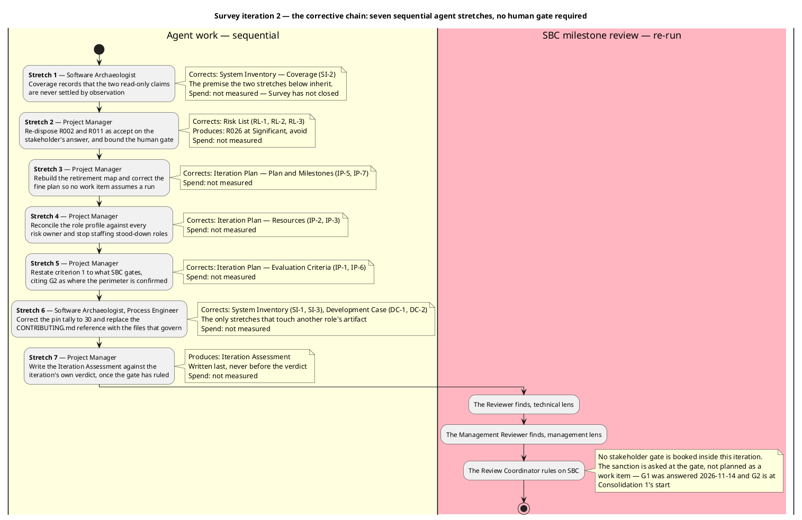
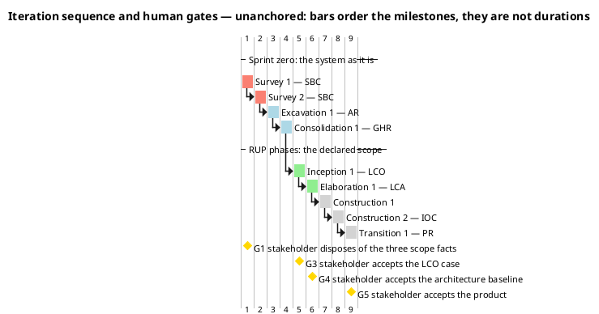
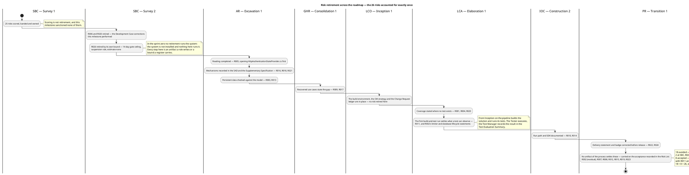

## Document Control
Phase: Survey
Status: Draft — Survey iteration 2, corrective. Coarse roadmap with the risk retirement and the four stakeholder gates per milestone; this iteration's fine plan, each exit criterion naming the work item that evidences it; the next iteration's corrective fine plan; the agent role profile with every risk owner reconciled against the register; the six SBC exit criteria with a per-criterion state. The two Majors and the Minor this gate opened on this artifact are corrected in place. The System Inventory's Coverage sentence they quote is with its owner, and the register's matching correction is made.
Milestone Target: End-of-Survey (SBC) — not yet achieved
## Iteration Objectives
Survey iteration 2 is corrective. Survey iteration 1 produced the reading, the tailoring and the register, and the SBC gate returned them with ten Majors open and the stakeholder's sanction withheld. This iteration has one objective with five parts, and no new artifact among them: it corrects stated claims against the product iteration 1 verified.

1. **Re-dispose the two risks whose strategy cannot execute.** R002 and R011 are accepted, not avoided, on the stakeholder's answer of 2026-11-14 that the system will not be run in any phase; R002's Significant-band grant is quoted verbatim. Owner: Project Manager.
2. **Bound the human gate.** A risk carries the 14-day queue-time ceiling and the suspension rule, so the plan's claim that a gate is bounded rests on a register entry that exists. Owner: Project Manager.
3. **Make the plan executable as a governing instrument.** No stood-down role on any gate, every risk owner at work in the milestone that carries its risk, and a stakeholder gate booked at each milestone whose exit condition is the stakeholder's acceptance. Owner: Project Manager.
4. **Remove every forward commitment that assumes the system can be run.** No milestone, work item or mitigation in the plan or the register rests on observation. Owner: Project Manager.
5. **Restate criterion 1 to the condition SBC actually gates.** The perimeter is recorded and put to the stakeholder here; it is confirmed at G2, at Consolidation 1's start, because Excavation deepens the record. Owner: Project Manager.

Three Majors are owned by other roles, and each is a correction inside its own artifact: **SI-2** — Coverage's closing statement, which is the premise parts 1 and 4 inherit; **SI-1** — the package-pin tally, read by the Software Architect when anchoring the SAD; **DC-1** — the absent coding standard, which points the Code Reviewer, a lens of the next milestone review, at a file the repository does not contain. They and their Minors (SI-3, DC-2) are carried in this plan as the same iteration's work because a milestone does not close with them open.

The chain is sequential for the same reason as iteration 1's: each stretch consumes the one before it. The premise correction comes first because the register and the plan both quote the sentence it corrects; the record errors come last because no other correction depends on them. Stretch 7 is the Iteration Assessment, which is written against the verdict and does not gate the phase.

No stretch carries a spend figure. Survey has not closed, so no measured actual exists and no forecast is invented in its place.

## Plan and Milestones
Two levels live in this section: the coarse cross-iteration roadmap and the fine plan for this iteration.

### Coarse roadmap — the milestone sequence and the risk each milestone retires

Nine iterations: two in Survey, then one per phase except Construction, which takes two. Survey takes more than one because the first iteration's exit criteria did not pass — the iteration-count lever, at schedule cost, with declared scope untouched. The sprint zero still carries three milestones of the nine because the architecture, the data model and the use cases are **recovered from a working system** rather than designed from nothing: the phase in which architectural risk is retired is Excavation inside the sprint zero, and Elaboration's LCA becomes a baseline-confirmation iteration rather than a from-scratch architecture baseline. The justification is the Risk List, not preference: R003 (migrations unvalidated) and R005 (unread files block the login scenarios) are both Significant, and both are retired by reading the existing system — work the sprint zero runs and Elaboration does not.

| # | Iteration | Milestone | What the milestone gates | Risks whose retirement this milestone carries | Reviewers, in order |
|---|---|---|---|---|---|
| 1 | Survey 1 | SBC — not reached | The reading, the tailoring and the register produced; the milestone returned them with ten Majors open and the sanction withheld | The 25 risks then known, each scored, banded and owned — scoring is not retirement | Reviewer, Management Reviewer, Review Coordinator |
| 2 | Survey 2 | SBC | The perimeter is recorded with an anchor per element and confirmed by the stakeholder, the reading priorities are ordered, the unread areas are declared, every anomaly is a scored risk whose strategy can execute, and the plan is executable as a governing instrument | R006, R025 — retired by the Development Case corrections this milestone performed; R026 — by its own bound, the 14-day gate ceiling and the suspension rule | Reviewer, Management Reviewer, Review Coordinator |
| 3 | Excavation 1 | AR | The recovered architecture, the Design Model with its persistent-data sections and the first recovered use cases are baselined | R003, R005, R013, R016, R018, R021 | Reviewer, Management Reviewer, Review Coordinator |
| 4 | Consolidation 1 | GHR | Every use case is recovered, the Supplementary Specification carries the mechanisms, and the tailoring is confirmed | R009, R017 | Reviewer, Management Reviewer, Review Coordinator |
| 5 | Inception 1 | LCO | The Vision, the use-case model of the declared scope, the candidate architecture, the build environment, the Change Request ledger and the CM strategy are in place; the business case is accepted by the stakeholder (G3) | — | Reviewer, Management Reviewer, Review Coordinator |
| 6 | Elaboration 1 | LCA | The architecture baseline is executed and tested; the Test Manager's plan and the Test Designer's cases exist; the deployment plan is written; the baseline is accepted by the stakeholder (G4) | R001, R004, R020 — and the first build-and-test run, which settles R011 and the runtime statements R002 carries | Reviewer, Management Reviewer, Review Coordinator |
| 7 | Construction 1 | — | The first construction increment: component implementation, iteration build, test execution, technical documentation | — | Reviewer, Management Reviewer, Review Coordinator |
| 8 | Construction 2 | IOC | The declared scope is implemented and tested against the recovered and declared acceptance criteria | R010, R014 | Reviewer, Management Reviewer, Review Coordinator |
| 9 | Transition 1 | PR | Production deployment, acceptance testing, release notes, the closure of the Change Request ledger, and the customer taking ownership of the product (G5) | R022, R024 | Reviewer, Management Reviewer, Review Coordinator |

The Business Reviewer is not a lens of any gate in this table. The Development Case declares Business Modeling inactive (`business-process-led = false`) and stands that role down for the whole project; Reviewer, Management Reviewer and Review Coordinator are the three lenses that remain.

### Fine plan — this iteration's work items and their owners

| Work item | Owner | Produces | Predecessor | Evidences which exit criterion |
|---|---|---|---|---|
| Narrow the Coverage closing statement to the sprint-zero scope | Software Archaeologist | System Inventory — Coverage (SI-2) | — | 3 — unread areas declared, each carried as a risk |
| Re-dispose R002 and R011, quote R002's grant, and bound the human gate | Project Manager | Risk List (RL-1, RL-2, RL-3, R026) | Coverage corrected | 4 — every anomaly a classified risk whose strategy can execute |
| Rebuild the retirement map and sweep the plan for any work item assuming a run | Project Manager | Iteration Plan — Plan and Milestones (IP-5, IP-7) | Risk List corrected | 6 — no work the phase does not run |
| Reconcile the role profile against every risk owner; staff no stood-down role | Project Manager | Iteration Plan — Resources (IP-2, IP-3) | Retirement map corrected | 6 — the plan instantiates the process |
| Restore exit criterion 1 to the process wording and report each criterion's state | Project Manager | Iteration Plan — Evaluation Criteria (IP-1, IP-6, IP-8) | Role profile reconciled | 1 — the perimeter confirmed by the stakeholder |
| Correct the pin tally to 30 and replace the absent-standard reference | Software Archaeologist, Process Engineer | System Inventory (SI-1, SI-3), Development Case (DC-1, DC-2) | — | 1 and 5 — the perimeter's size facts, the tailoring's auditability |
| Write the assessment against the gate's verdict | Project Manager | Iteration Assessment | The verdict | — the record, not a criterion |

No work item carries a size. This system measures two things only: agent work in tokens and elapsed time, and human gates in days of queue time. An empty size is correct; a figure in hours, days or person-anything would describe a unit this project cannot produce.

Each exit criterion names the work item that evidences it. That is the variance iteration 1 recorded and did not repair: the fine plan was built by enumerating artifacts, and an exit criterion is a property of an artifact rather than its existence, so an artifact-shaped work item could not own it.

### Spend — the two clocks, reported apart and never added

| Clock | Position at plan time | What it decides |
|---|---|---|
| Agent work — tokens and elapsed time | Survey 1's and Survey 2's measured actuals are recorded in the Iteration Assessment; no later iteration has closed, so no forecast of it exists and none is invented | The measured actual replaces every assumed share in the plans after SBC |
| Human queue time — gates G1, G3, G4, G5 | G1 answered on 2026-11-14; each gate's queue duration is measured by the process and reported, never estimated | Whether gates should be batched into fewer points in later phases |

This project declares **no token budget**. None is set here, none is proposed for the stakeholder to accept, and no declared scope is cut or deferred to fit an estimate. An iteration ends when its exit criteria pass — and Survey 1's did not, which is why Survey 2 exists, and Survey 2's gate returned four Majors, which is why Survey 3 exists.

### All 26 risks accounted for, each exactly once

| Disposal | Count | Risks |
|---|---|---|
| Retired by a milestone artifact, at the milestone named in the table above | 15 | R001, R003, R004, R005, R009, R010, R013, R014, R016, R017, R018, R020, R021, R022, R024 |
| Retired at Survey 2 — SBC, by the Development Case corrections this milestone performed | 2 | R006, R025 |
| Retired by its own bound, at Survey 2's SBC | 1 | R026 |
| Carried on the acceptance recorded in the Risk List | 8 | R002, R007, R008, R011, R012, R015, R019, R023 |

Fifteen plus two plus one plus eight is twenty-six, and it agrees with the register's 18 avoided and 8 accepted. R002 is the only accepted risk in the Significant band, and its acceptance is the stakeholder's answer of 2026-11-14, quoted verbatim in the Risk List.

### Next iteration's fine plan — the corrective work this gate left open

Four Majors and three Minors arrived with the SBC verdict. Each is a correction inside an artifact its owner already holds: no new question for the stakeholder, no scope change, no Change Request. They are sequenced by the stakeholder's order — the premise first, then the statements that quote it, then the deleted gate, the Minors in each owner's next turn.

| Work item | Owner | Produces | Order | Holds the milestone |
|---|---|---|---|---|
| Narrow the Coverage closing statement to Survey, Excavation and Consolidation; drop "for the life of this project", "in any phase" and the prohibition on later milestones | Software Archaeologist | System Inventory — Coverage | 1 | Yes |
| Restate R002 and R011 as accepted until the RUP phases start, and bound the acceptance in Document Control to the sprint zero | Project Manager | Risk List — Document Control, Risk Register, Risk Mitigation and Contingency | 2 | Yes |
| Scope the no-run property to the sprint zero and state that from Inception on the pipeline builds and tests, naming the evidence's producer | Project Manager | Iteration Plan — Plan and Milestones | 3 | Yes |
| Restore exit criterion 1 to the process wording and evidence it with the confirmation of 2026-11-14 | Project Manager | Iteration Plan — Evaluation Criteria | 4 | Yes |
| Restate the Provenance row to the four files Coverage names | Software Archaeologist | System Inventory — Coverage | Owner's next turn | No |
| Cite the pins in `Directory.Packages.props` instead of a version policy the Development Case does not contain | Project Manager | Risk List — Risk Mitigation and Contingency | Owner's next turn | No |
| Move R006 and R025 from the LCO row to Survey 2 — SBC and restate the accounting | Project Manager | Iteration Plan — Plan and Milestones | Owner's next turn | No |

### What the first build-and-test run settles, and what it cannot

The acceptance on R002 and R011 runs **until the RUP phases start**, not to the end of the project. From Inception on the pipeline builds the solution and runs its test suites, so a build or test result is a retirement path from that point and the retirement map must show it.

| Of the eight carried on acceptance | Path from Inception on | Where, and who produces the evidence |
|---|---|---|
| R011 — rate-limiter partition key | **Settled.** Whether the bucket is per-user or global is a property of the request pipeline, and a test that sends two authenticated calls and reads the 429 boundary observes it | Elaboration 1 — LCA. The Test Designer writes the case, the Tester executes it, the Test Manager records the result in the Test Evaluation Summary |
| R002 — the runtime statements of the sprint-zero reading | **Partly settled.** Two of its four statements — the limiter's partition under the real pipeline, and the database lifecycle beyond the AppHost guard — are observable by the same execution. The prerender path and the external-login dance are not: no planned test reaches the client's first paint, and external login needs credentials no environment supplies | Elaboration 1 — LCA for the two observable statements; the remaining two stay accepted, and the row keeps its band |
| R007, R008, R012, R015, R019, R023 | **Not settled.** Each names a condition no test the process runs can observe: an unreachable role, dormant providers with no credentials, a trust boundary between two hosts, a first-paint behaviour with no browser-level test, and a language-version pin whose raising nothing plans | Carried on the acceptance, with the register's contingency standing |

No risk in this table is declared retired by a run that has not happened. The two that will be are placed at the milestone whose execution produces the evidence, and the evidence's producer is named.

Four properties of this roadmap are load-bearing:

- **Sequencing follows the risk bands, not the phase names.** Both High-band risks are retired before Construction: R001 (nothing tests the BFF) at LCA, R009 (a delivered API capability with no screen) at GHR. Of the eight Significant risks, five are retired by AR and GHR — inside the sprint zero — because that is where their evidence lives; R004 is retired at LCA, R026 is bounded by its own ceiling, and R002 is carried on the stakeholder's grant. No risk above the Moderate band is carried into Construction or Transition.
- **No retirement in the sprint zero runs the system, and observation returns as a path from Inception on.** In Survey, Excavation and Consolidation every step above is an artifact a role writes or a bound a register carries, because the system is not installed and nothing here runs it. From Inception on the pipeline builds the solution and runs its test suites, so a later phase retires a risk by a build or test result; the Tester produces that evidence and the Test Manager records it. R011 and the observable half of R002 are placed at LCA on that basis, and no other accepted risk is claimed for it.
- **Every milestone whose exit condition is the stakeholder's judgement has a gate at which it is obtained.** G1 at Survey 1's SBC disposed of the three scope facts; G3 at LCO accepts the business case; G4 at LCA accepts the architecture baseline; G5 at PR accepts the product, where ownership transfers. The perimeter needs no gate of its own: the stakeholder confirmed it at the SBC gate of 2026-11-14, and an element Excavation finds outside the perimeter is put to them at that point.
- **The lever is iteration count — never parallel agent roles, never declared scope.** A milestone whose exit criteria do not pass is followed by one more iteration inside that phase at schedule cost. Declared scope is reduced only by a Change Request the stakeholder decides.

## Resources
The team is the agent roster the process assigns, not a staffed organisation. The profile below is read from the IARI Development Process and the Development Case's tailoring — no role here does work the process does not run in this phase, and every role named as a risk owner in a milestone row is at work in that milestone.

### Excavation 1 — AR

The process runs four disciplines in Excavation, and every one of them has its role on this iteration's profile. The two that Analysis & Design does not cover are the two that carry risk owners.

| Role | Discipline and intensity | Stage in this iteration | Produces | Risks owned |
|---|---|---|---|---|
| Software Architect | Analysis & Design, Critical | Software Architecture Document — Components and Connectors · Mechanisms, Technology and Deployment | Software Architecture Document | R007, R011, R012, R016, R018, R021, R023 |
| Designer | Analysis & Design, Critical | Design Model — Domain Model · Packages and Classes | Design Model | R015, R019 |
| Database Designer | Analysis & Design, Critical | Persistent Data — Entities, Keys and Associations · Enforced Rules | Design Model — persistent-data sections (Data Model not fired) | R003, R013 |
| System Analyst | Requirements, High | Use-Case Model · Business Rules in the Use-Case Flows · Vision | Use-Case Model, Vision | R005, R017 |
| Software Archaeologist | Discovery, High | System Inventory — Anomalies · History and Coverage | System Inventory | R002 |
| Project Manager | Project Management, Low | Risk List · Iteration Plan | Risk List, Iteration Plan, Iteration Assessment | R026 |

### Consolidation 1 — GHR

| Role | Discipline and intensity | Stage in this iteration | Produces | Risks owned |
|---|---|---|---|---|
| System Analyst | Requirements, High | Use-Case Model · Supplementary Specification | Use-Case Model, Supplementary Specification, Vision | R008, R009, R017 |
| Software Architect | Analysis & Design, Medium | Software Architecture Document — Components · Mechanisms and Use-Case View | Software Architecture Document | R023 |
| Designer | Analysis & Design, Medium | Design Model — Domain Model · Packages and Classes | Design Model | R015, R019 |
| Database Designer | Analysis & Design, Medium | Persistent Data — Entities, Keys and Associations · Enforced Rules | Design Model — persistent-data sections | — |
| Software Archaeologist | Discovery, Low | System Inventory | System Inventory | — |
| Project Manager | Project Management, Low | Risk List · Iteration Plan | Risk List, Iteration Plan, Iteration Assessment | R026 |

### Later iterations — roles at work, recorded so the roadmap is executable

Inception adds the Integrator (Build Environment Setup; R010, R014), the Change Control Manager (Change Request ledger), the Configuration Manager (CM strategy), the Test Manager (Test Plan not fired; Test Evaluation Summary; R004, R020) and the Deployment Manager. Elaboration adds the Test Designer (Test Case; **R001**), the Tester — who produces the build-and-test evidence that settles R011 and the observable statements of R002 — the Test Analyst, the Code Reviewer and the User Interface Designer. Construction adds the Implementer and, for the Technical Writer, R022 and R024. Transition is deployment and acceptance closure.

**Every one of the 26 risks has its owner at work in the milestone whose row retires it.** The two roles whose first appearance is later than their risk's entry are the Test Manager, at work from LCA, and the Integrator, at work from IOC — and neither risk is one that AR or GHR claims as retired.

**Stood down for the whole project**, per the Development Case classification: Business Process Analyst and Business Reviewer (`business-process-led = false`), Capsule Designer (`real-time-system = false`). They execute no stage in any iteration and sit on no gate.

**Human gates.** The only human in this system is the stakeholder, and the plan books four gates for them: G1 (the three scope facts, answered 2026-11-14), G3 (accepts the LCO case), G4 (accepts the architecture baseline), G5 (accepts the product, where ownership transfers). A gate is bounded in the Risk List at R026, never forecast in the plan: ceiling 14 days of queue time, after which the process suspends rather than filling the gap with an assumption; estimate none; the actual measured and reported apart from agent time.

The perimeter is not one of those gates. The stakeholder confirmed it at the SBC gate of 2026-11-14 — the confirmation Survey 2's exit criterion 1 records — so no plan event re-opens it; an element Excavation finds outside the perimeter goes back to the stakeholder at the point it is found.

### This iteration — Survey 2, SBC

| Role | Discipline and intensity | Stage in this iteration | Produces | Risks owned |
|---|---|---|---|---|
| Process Engineer | Environment, High | Development Case | Development Case — the Tool references correction and the ownership view (DC-1, DC-2) | R006, R025 |
| Software Archaeologist | Discovery, Critical | System Inventory — Documentation · Perimeter · Anomalies and Priorities · Coverage | System Inventory — Coverage corrected (SI-2), the pin tally (SI-1), the unread qualifier (SI-3) | R002 |
| Project Manager | Project Management, Low | Risk List · Iteration Plan | Risk List (RL-1, RL-2, RL-3), Iteration Plan (IP-1 to IP-9), and the assessment written after the verdict | R026 |
| Reviewer | Review lens | SBC milestone review, technical | Findings on the artifacts reviewed | — |
| Management Reviewer | Review lens | SBC milestone review, management | Findings on the artifacts reviewed | — |
| Review Coordinator | Review lens | SBC milestone review | The SBC verdict | — |

The Review Coordinator decides whether the milestone closes. It does not decide the Iteration Assessment — the Project Manager writes that against the verdict.

R005 and R011 have owners who first sit at AR — the System Analyst and the Software Architect. This iteration restates their strategy in the Risk List; it changes no owner, and no milestone row here claims either as retired.

## Use Cases and Scenarios Addressed

None, and that is the phase's definition rather than a gap in the plan.

The process runs no use-case work in Survey. The Use-Case Model is recovered in Excavation and completed in Consolidation, one use case per endpoint surface performing a distinct user-observable outcome, with authentication, rate limiting, logging and telemetry excluded as mechanisms and carried in the Supplementary Specification instead. On this project the requirements are recovered from a working system, so the phase that would otherwise analyse a declared scope instead reads what exists.

Two consequences for the iterations that do carry use cases, recorded here because they are sequencing decisions rather than recovery decisions:

- The `/todos` use cases are recovered before the authentication ones (System Inventory, Priorities), but the authentication scenarios of every `/todos` use case enter the Supplementary Specification as included constraints, not as separate use cases.
- Three capabilities are recovered as code that exists and is unreachable or dormant, and no use case is recovered for any of them: the owner-or-admin branches (R007), external login (R008), and `PUT /todos/{id}`'s missing screen (R009 — recovered as a use case that states no screen reaches it).

## Evaluation Criteria
The exit criteria for this iteration are the SBC milestone's. They are the stakeholder's and the process's, not criteria this plan invents, and each states a condition this iteration can satisfy without a sanction it cannot obtain. Each is marked with the artifact and the fact that will evidence it — no criterion is marked met here, because the gate rules on the evidence, not the author.

| # | Criterion | How it is evidenced | State at plan time | Defect carried in at SBC I1 |
|---|---|---|---|---|
| 1 | The perimeter of the existing system is recorded with an anchor per element, the reading priorities are ordered, and the three facts whose disposition is the stakeholder's have been put to the stakeholder and answered | System Inventory, Perimeter — seven projects, the entry-point surface, the stores and the external systems, each anchored; the three scope facts answered 2026-11-14 and recorded verbatim | Recorded and put; confirmation deferred to G2 | IP-1 — restated this iteration to what SBC gates |
| 2 | The reading priorities are ordered | System Inventory, Priorities — eight areas ordered, each naming what the next reading must settle | Evidenced; nothing changed this iteration | — |
| 3 | The unread areas are declared rather than omitted | System Inventory, Coverage — the declared-unread groups and the statements marked as read but not observed, each carried as a risk rather than as an open question | Depends on SI-2; with the Software Archaeologist | SI-2 is that owner's Major, and this criterion cannot be marked met until it lands |
| 4 | Every anomaly is a classified risk, and every strategy can execute | Risk List — 26 risks, each scored for probability and impact, its magnitude the band of their product, each given a strategy, an owner, a mitigation and, where accepted, a contingency; no strategy resting on running the system | Corrected this iteration — RL-1, RL-2, RL-3 and R026 | RL-1 and RL-2 — closed by the corrected register |
| 5 | The process is tailored and the tailoring is auditable | Development Case — classification, disciplines and intensities, the OPTIONAL trigger verdicts with the evidence for each, the tool references, the version policy | Depends on DC-1; with the Process Engineer | DC-1 — the `CONTRIBUTING.md` row, corrected this iteration; whether the result is auditable is the gate's judgement |
| 6 | The plan instantiates the process, sequences by risk, and schedules no work the phase does not run | This artifact — the roadmap names only the roles and artifacts the process assigns to each phase, each milestone carries its risk retirement, every risk owner is at work in the milestone that carries its risk, and the fine plan names only the roles Survey runs | Corrected this iteration — IP-2, IP-3, IP-4, IP-5, IP-7 | IP-2 to IP-5 — closed by the corrected roadmap and role profile |

### Where the perimeter is confirmed

Criterion 1 stops at recorded-and-put. The perimeter is **confirmed** at **G2, at Consolidation 1's start** — not at SBC. Excavation deepens the perimeter before Consolidation: the Design Model, the persistent-data sections and the first recovered use cases add elements the Survey reading has not seen. Confirming the perimeter before that reading would confirm an incomplete record, so G2 is placed where the record is complete rather than where it is most convenient.

The three answers of 2026-11-14 are cited in this criterion because they dispose of three specific facts — the `admin` role's unreachability, the dormancy of the external identity providers, and the BFF-to-API trust boundary. They are not the stakeholder's confirmation of the perimeter, and no criterion here claims they are.

### What can still fail

Criterion 5 is the one most likely to fail at this gate: whether the tailoring is auditable is a judgement the reviewing lenses make, and a process authority whose references do not resolve is not auditable. The `CONTRIBUTING.md` row is corrected in this iteration — the Process Engineer replaces it with `Directory.Build.props` and `Directory.Packages.props` and states that no written coding standard exists — so the correction is not deferred to LCO. Whether the corrected authority is now auditable is the gate's call, not the author's.

The other way this iteration does not close is the perimeter's adequacy: if a reviewing lens finds the record under-evidenced — most likely for the files the reading declared unread, or for the statements marked read rather than observed — the iteration does not close, and the remedy is a further Survey iteration that opens those files. That is the iteration-count lever, and it protects the accuracy of the perimeter at schedule cost. It is never answered by adding agent roles in parallel, and never by narrowing what counts as the perimeter.

**Not an exit criterion:** the risk scores are judgements, and a reviewer may disagree with a score without failing the milestone. What must hold is that every anomaly is classified, that every magnitude is the band of its own exposure, and that no High or Significant risk rests on an acceptance nobody granted.

```plantuml
@startuml
title The six SBC exit criteria — what each gates, and where this iteration can take it
skinparam shadowing false
skinparam componentStyle rectangle

package "Corrected by this iteration — the gate still rules" #PaleGreen {
  component "1  Perimeter recorded with an anchor per element,\npriorities ordered, three facts put and answered" as C1
  component "4  Every anomaly a classified risk whose\nstrategy can execute" as C4
  component "6  The plan instantiates the process and\nschedules no work the phase does not run" as C6
}

package "Evidenced, unchanged" #PaleGreen {
  component "2  Priorities ordered, each naming what\nthe next reading must settle" as C2
}

package "Waits on a Major with its own owner" #Orange {
  component "3  Unread areas declared —\nSI-2 with the Software Archaeologist" as C3
  component "5  Tailoring auditable — DC-1 with the\nProcess Engineer, corrected this iteration" as C5
}

package "Deferred to where the record is complete" #LightYellow {
  component "G2  the perimeter is CONFIRMED\nConsolidation 1 start" as G2
}

C1 .> G2 : stops short of

note right of C1
  The condition is satisfiable without the sanction.
  Criterion 1 asks for recorded-and-put; G2 asks for
  confirmed, and a later reading is why.
end note
note bottom of C5
  No criterion here reports uniform readiness: 3 and 5
  each depend on a Major that another role owns, and
  the plan says so rather than asserting the gate.
end note
@enduml
```

### The four criteria this iteration's corrections carry

| Criterion | Corrected against | What still has to hold at the gate |
|---|---|---|
| 1 | This artifact, Evaluation Criteria — the criterion now asks for recorded-and-put, and G2 is named as the confirmation point | That the record itself is adequate: anchored per element, priorities ordered, unread areas declared |
| 3 | System Inventory, Coverage — the closing statement records the stakeholder's decision that the two read-only claims are never settled by observation | That SI-2 has landed; nothing else in the criterion is in doubt |
| 4 | Risk List, all sections — 26 rows, each exposure the product of its own two scores; R002 and R011 accepted with R002's Significant-band grant quoted | Every strategy names an artifact or a bound that retires it, and no milestone counts a risk retired by evidence this project will not produce |
| 6 | This artifact, Plan and Milestones and Resources | Every role named in a milestone row is at work in that milestone; no gate staffs a stood-down role; every risk owner reconciles with the register; no work item is sized in a unit this project does not measure |

