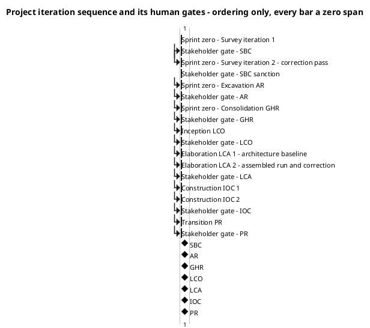
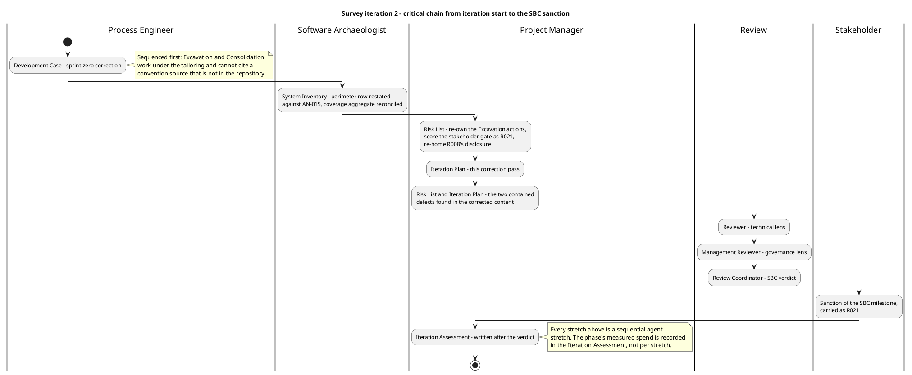

## Document Control
- Phase: Survey
- Status: Draft — every finding of the SBC review addressed and the two contained defects corrected; reviewer closure pending
- Milestone Target: end of Survey (SBC)
## Iteration Objectives
Survey iteration 2 is the correction pass the SBC milestone review requires. The project runs on a system nobody here wrote and nobody can ask about: the delivery is a copy of `davidfowl/TodoApp` at `307a1ead`, and `.iari/README.md` records that it carries no requirements, design or architecture document, no database scripts, no manual, no running installation and no reachable authors. Iteration 1 established what the system is; iteration 2 closes the defects that stopped the milestone advancing. It builds nothing.

The stakeholder's order of 2026-11-19 set this iteration's scope. Asked to sanction advancing past SBC on the first ask, they answered "No", with the reason "All major findings must be corrected." That order, and the seven Major findings the two review lenses recorded, are what this iteration carries. Put again on the corrected set — 0 Critical and 0 Major open from both lenses — the sanction was granted on 2026-11-19, with one order carried out of the milestone: "Minor findings must be corrected in the next phase; they cannot be left unresolved."

| # | Objective | Basis | Outcome at this close |
|---|---|---|---|
| 1 | Correct the sprint-zero tailoring so the phases that work under it have a convention source that exists. | Development Case#F1, Development Case#F2 | Both closed by the Reviewer lens |
| 2 | Remove the internal contradiction in the Perimeter between the `/users` row and AN-015, and reconcile the coverage statement with its own rows. | System Inventory#F2, System Inventory#F1 | Both closed; the aggregate now reconciles, 72 of 132 read |
| 3 | Make every risk action executable where it lands: re-own the Excavation actions to roles at work there, score the stakeholder gate as a risk of its own bound by its ceiling, and home R008's disclosure at the stage that produces the artifact. | Risk List#F1 (both lenses), Risk List#F2 (management lens) | The three Majors closed; one contained Minor corrected this turn, closure with the Reviewer lens |
| 4 | Make this plan single-valued: one iteration total, the tailoring correction sequenced before Excavation, evidence in place of verdict words, a role profile that reconciles with the roster, and no duration on any bar. | Iteration Plan#F1 (both lenses), #F2, #F3, #F4 | Five closed; one contained Minor corrected this turn, closure with the Reviewer lens |
| 5 | Put the corrected set back to both review lenses, and take the SBC sanction question again once every Major is closed. | The stakeholder's order of 2026-11-19; R021 | Executed — verdict SBC, no further iteration required; sanction granted 2026-11-19 |

The three scope decisions of 2026-11-19 — external identity-provider sign-in out of scope, the `admin` role as dead code, the self-service identity surface out — are **inputs** to this iteration, not objectives. Every one is recorded as an exclusion in the System Inventory's Perimeter and carried into R002, R010, R014 and R019. No finding in this iteration reopens any of them, and the perimeter drew no correction from the stakeholder: it is confirmed as drawn.

Two decisions of iteration 1 change the plan rather than merely inform it, and both stand: Excavation stays a single iteration with priorities 1–6 inside AR, which makes Elaboration's second iteration the only place a contradicted recovered statement is corrected; and no token budget is declared, so every iteration ends when its exit criteria pass and spend is measured, never bounded.

## Plan and Milestones
This section carries both levels of the plan: the cross-iteration roadmap with its milestone sequence, and this iteration's fine plan with its owners.

### Coarse roadmap — sprint zero then the RUP phases

`6 ± 3` iterations is the rubber profile; this roadmap commits to **10**, and 10 is stated once, here, as the whole of the plan's iteration total. The sprint zero adds no milestone of its own to the RUP sequence — it runs before Inception and produces the material Inception builds on.

| Order | Phase | Milestone | What the milestone closes | Iterations planned |
|---|---|---|---|---|
| 1 | Survey | **SBC** | The perimeter is drawn and confirmed, the anomalies are recorded, every one scored as a risk, and the tailoring for the sprint zero is issued and usable by the phases that work under it. | 2 |
| 2 | Excavation | **AR** | The recovered use cases, the recovered architecture, the design model with the persistent schema, and the Deployment Model exist — priorities 1–6 recovered in one iteration, 7 read as its cross-check. | 1 |
| 3 | Consolidation | **GHR** | Every entry point of the recovered perimeter has a use case or a recorded exclusion; the Supplementary Specification and the coverage statement complete the set. | 1 |
| 4 | Inception | **LCO** | The declared scope is agreed against the recovered baseline, the candidate architecture exists and the business case is settled. | 1 |
| 5 | Elaboration | **LCA** | The architecture baseline is executable and the first assembled run of the topology has happened; test cases cover it. | 2 |
| 6 | Construction | **IOC** | The declared scope is implemented, tested and baselined. | 2 |
| 7 | Transition | **PR** | The product is deployed, acceptance-tested and documented; the release is baselined. | 1 |

`2 + 1 + 1 + 1 + 2 + 2 + 1 = 10`. The table is the only statement of the total and the arithmetic is its whole derivation.

**Why Survey carries 2.** Its first iteration issued the four artifacts and both review lenses found seven Major defects in them, so the milestone was not sanctioned and the stakeholder declined to advance on 2026-11-19. The correction pass is iteration 2, planned here. A phase whose milestone review leaves findings open runs another iteration; that is the only mechanism by which this total moves, and it has moved once.

The profile is the rubber profile for a small project that is nonetheless **recovery-heavy**, and each move away from it is made against a named risk:

- **The sprint zero carries four of the ten.** Every requirement, component and table has to be read out of code before Inception can declare anything, and the first Survey iteration's defects had to be corrected before any downstream role consumed the set. This is the whole reason the total sits above the median.
- **Excavation stays one iteration.** The stakeholder declined a second one on 2026-11-19, so priorities 1–6 are recovered in a single pass with priority 7 as its cross-check. The cost of that choice lands in Elaboration, not here.
- **Elaboration takes two iterations, unconditionally committed.** R020's accepted contingency is the first assembled run as the Integrator's Architecture Build, and with a single-pass sprint zero there is no other place a contradicted recovered statement can be corrected. The second iteration is planned work, not a reserve.
- **Construction is not bent.** Nothing in the Inventory suggests a large declared scope: the recovered product is registration, login, logout and todo list / create / delete, over one aggregate and eight tables. Two iterations are the whole of it.
- **Transition is not compressed.** One iteration, no user training to carry, and the acceptance test is the only thing there that costs a full iteration.

### This iteration's fine plan

Survey iteration 2 is the correction pass the SBC milestone review requires. Its work items are the stages the IARI DEVELOPMENT PROCESS runs in Survey, each owned by its role, each closing named findings of the Review Record. **No work item carries a size**: no phase has closed, nothing has been measured in this system, and a size filled with a human-team unit would be a figure this process cannot produce. Each item ends when its exit condition passes.

| Order | Work item | Owner | Closes | Exit condition |
|---|---|---|---|---|
| 1 | Development Case — sprint-zero correction | Process Engineer | Development Case#F1, Development Case#F2 | The Templates rows cite files present in the repository; the three convention families are recorded as undocumented with no fallback asserted; the stale "no Risk List exists yet" clause is gone from the PoC trigger row |
| 2 | System Inventory — perimeter row and coverage aggregate | Software Archaeologist | System Inventory#F2, System Inventory#F1 | The `/users` perimeter row agrees with AN-015 and says once whether EP-003 supports a use case; the coverage aggregate reconciles with its own per-area rows or is dropped for them |
| 3 | Risk List — re-own, score the gate, re-home R008 | Project Manager | Risk List#F1 (Reviewer), Risk List#F1 (Management Reviewer), Risk List#F2 (Management Reviewer) | Every avoidance action names a role at work in the phase it lands in; the stakeholder gate is scored as R021 with its mitigation and contingency and the stakeholder's acceptance recorded verbatim; R008's disclosure is homed at the stage that produces the artifact |
| 4 | Iteration Plan — this correction pass | Project Manager | Iteration Plan#F1 (Reviewer), Iteration Plan#F1 (Management Reviewer), Iteration Plan#F2, Iteration Plan#F3, Iteration Plan#F4 | One committed total stated once; the tailoring correction scheduled before Excavation; evidence wording in place of verdict words in the Evaluation Criteria; the role profile reconciled with the roster; no day length on any bar |
| 5 | Risk List and Iteration Plan — the two contained defects found in the corrected content | Project Manager | Risk List#F2 (Reviewer), Iteration Plan#F5 (Reviewer) | The trailing R021 block is gone, its answer standing once in the acceptance table; the opening block of Plan and Milestones is gone, the matter standing once in Measure and forecast |
| 6 | SBC milestone review | Reviewer → Management Reviewer → Review Coordinator | The seven Major findings open at SBC, each by its own lens | Both lenses re-run against the corrected set and each finding is resolved by the lens that raised it, or re-recorded under its key |
| 7 | Stakeholder gate — sanction of SBC | Stakeholder | The refused sanction of 2026-11-19 | The sanction question is answered; carried as R021 |
| 8 | Iteration Assessment | Project Manager | The SBC verdict | Assessment written *after* the verdict records whether the objectives were met |

Item 1 is sequenced first because the tailoring it corrects is the convention source Excavation and Consolidation work under, and no sprint-zero work item put that source in place before they would start. The order is a dependency, not a severity ranking: **Development Case#F1 defines the correction; item 1 schedules it.** A re-pointed table with no work item behind it, or a work item for a correction nobody specified, are each insufficient. The Environment stage that re-prepares the tailoring in Inception remains a separate, later stage — it does not carry this correction.

Item 7 is a human wait, not an agent stretch. It is carried as R021 and quoted in days of queue time with a ceiling of 14, never on the agent clock.

```plantuml
@startgantt
title Survey iteration 2 - stages, the sequencing the SBC findings require, and the human gate - ordering only
skinparam shadowing false

[Development Case - sprint-zero correction] lasts 0 day
[System Inventory - perimeter row and coverage aggregate] lasts 0 day
[Risk List - re-own, score the gate, re-home R008] lasts 0 day
[Iteration Plan - this correction pass] lasts 0 day
[Risk List and Iteration Plan - two contained defects] lasts 0 day
[SBC milestone review - both lenses, then the coordinator] lasts 0 day
[Stakeholder gate - sanction] lasts 0 day
[Iteration Assessment - after the verdict] lasts 0 day

[Risk List - re-own, score the gate, re-home R008] starts at [Development Case - sprint-zero correction]'s end
[System Inventory - perimeter row and coverage aggregate] starts at [Development Case - sprint-zero correction]'s end
[Iteration Plan - this correction pass] starts at [Risk List - re-own, score the gate, re-home R008]'s end
[Risk List and Iteration Plan - two contained defects] starts at [Iteration Plan - this correction pass]'s end
[SBC milestone review - both lenses, then the coordinator] starts at [Risk List and Iteration Plan - two contained defects]'s end
[Stakeholder gate - sanction] starts at [SBC milestone review - both lenses, then the coordinator]'s end
[Iteration Assessment - after the verdict] starts at [Stakeholder gate - sanction]'s end

[SBC] happens at [Stakeholder gate - sanction]'s end

note bottom
  Every bar is a zero span: PlantUML requires the root bar's span to be
  declared, and it is declared zero. No bar is a forecast of duration -
  an item ends when its exit condition passes. The Development Case
  correction is sequenced first because it defines the convention source
  Excavation and Consolidation work under; the Iteration Plan follows it
  because the plan schedules what the tailoring records. The gate is R021:
  days of queue time, ceiling 14, then the process suspends.
end note
@endgantt
```

### Measure and forecast

**No phase has closed.** There is no measured actual, therefore there is no forecast: no token figure, no elapsed figure, and no per-iteration velocity appears in this plan. The ten iterations above are a count of iterations, not a duration, and no declared scope is cut or deferred to fit an estimate.

**The count sits one above the `6 ± 3` heuristic's ceiling, and this is stated rather than absorbed.** The heuristic flags more than 9 iterations as over-engineered process overhead. The tenth is not process overhead added by choice: Survey's first iteration issued four artifacts, both review lenses found seven Major defects in them, and the milestone was not sanctioned. A phase whose milestone review leaves findings open runs another iteration — that is the mechanism, and it fired once. The alternative to the tenth iteration is closing the milestone with seven Major defects open, which the stakeholder refused on 2026-11-19. If a further iteration is added at any later milestone the same test applies: it must trace to an open finding or a stakeholder order, or the roadmap is over-engineered and the count is the symptom.

The budget position was put to the stakeholder in Survey iteration 1 and answered on 2026-11-19:

| What was put | Their answer, verbatim | Recorded |
|---|---|---|
| Whether a token budget has been declared for this project, given that the Development Case records none and this plan commits to a cross-iteration horizon in which R020's contingency may add an iteration. | "No budget declared — record measured spend at each phase close and forecast from the measured actual, never from an assumption." | 2026-11-19 |

So the project declares **no token budget**: there is no box, no figure was invented for the stakeholder to accept, and nothing is trimmed to fit one. Measured spend is recorded as observed at each phase close, and both clocks are reported apart:

| Clock | What it measures | Where it is recorded | Ceiling |
|---|---|---|---|
| Agent work | Tokens consumed per stage and per role; elapsed agent time | Iteration Assessment, at phase close | No ceiling — measured, not bounded |
| Human gates | Days of queue time waiting for the stakeholder | R021, in the Risk List's Risk Register and Risk Mitigation and Contingency sections | 14 days, then the process suspends; the actual is reported apart |

The two are never added and never converted into one another. The gate is a risk with a bound, not a work item with an estimate: it carries no duration here and none is forecast for it.

**The first measured actual now exists.** Survey closes with both clocks recorded in the Iteration Assessment: 21,362,704 tokens and 1:12:20 of agent elapsed across the phase's two iterations, against 1:09:33 of stakeholder queue time. Those are phase totals, not a velocity, and no per-iteration rate is computed from two iterations of one phase. Every later phase's forecast is built from them; nothing in this plan is.

### Critical chain

## Resources
The team is the 26 roles the IARI DC baseline activates, and the plan selects which of them work in this iteration. The roster is not this plan's to change.

**Assignment profile: six agent roles plus the stakeholder gate.** Six agents execute the iteration — Process Engineer, Software Archaeologist, Project Manager, Reviewer, Management Reviewer, Review Coordinator — and the Stakeholder is the one human the iteration waits on, counted separately and never as a role of the agent roster. Seven rows carry "Yes" in total and six of them are agents; the discrepancy the earlier profile left is closed by counting the gate apart from the roster.

The plan adds no agent to accelerate this iteration. The stages that dominate its length are sequential by nature: the tailoring must be corrected before the phases that work under it are planned for, the Inventory must be read before it can be scored, and no verdict can precede the review. Parallelism buys no clock here and costs coordination across artifacts that cite each other's labels.

| Role | At work in Survey iteration 2 | Stage it runs | Produces |
|---|---|---|---|
| Process Engineer | Yes | Development Case — sprint-zero correction | Development Case |
| Software Archaeologist | Yes | System Inventory — perimeter row and coverage aggregate | System Inventory |
| Project Manager | Yes | Risk List; Iteration Plan; Iteration Assessment | Risk List, Iteration Plan, Iteration Assessment |
| Reviewer | Yes | SBC milestone review — technical lens | Review Record |
| Management Reviewer | Yes | SBC milestone review — governance lens | Review Record |
| Review Coordinator | Yes | SBC milestone review — verdict | Review Record, milestone verdict |
| Stakeholder (human, outside the agent roster) | Yes — human gate | Sanction of the SBC milestone | One answer recorded verbatim, carried as R021 |

Roles not at work in Survey, each with its reason:

| Role | Reason |
|---|---|
| Business Process Analyst, Business Reviewer | `business-process-led = false` (Development Case DC-D2). Neither has a stage in this project. |
| Capsule Designer | `real-time-system = false` (Development Case DC-D3). No capsule, protocol or signal exists to design. |
| System Analyst | First at work in Excavation, where Requirements is High and the recovered use cases, Business Rules and Supplementary Specification are written. Nothing in Survey produces those artifacts. |
| Requirements Specifier | First at work in Elaboration, where Use-Case Detail and NFR Thresholds are specified. It is not the sprint zero's Requirements role — Excavation's Requirements stage belongs to the System Analyst, which is why no risk action here may name it. |
| Software Architect | First at work in Excavation, where Analysis and Design is Critical and the Software Architecture Document and Deployment Model are recovered. |
| Designer, Database Designer | First at work in Excavation, where the Design Model and its persistent-data sections are recovered. |
| User Interface Designer | First at work in Elaboration, where the navigation map and boundary classes are designed. Survey produces no screen design. |
| Implementer, Integrator, Code Reviewer | First at work in Inception, where the build environment is set up, and in Elaboration's Executable Architecture. The sprint zero writes no code. |
| Test Manager, Test Analyst, Test Designer, Tester | First at work in Inception (Test Plan) and Elaboration (test cases and architecture test execution). Survey executes no test. |
| Deployment Manager, Technical Writer | First at work in Inception and Construction respectively. No deployment or user documentation exists in Survey. |
| Change Control Manager | First at work in Inception, where the ledger opens. The sprint zero opens no ledger entry — a stakeholder order reaches its owner through the Work Order. |
| Configuration Manager | First at work in Inception, where the CM strategy is set up. The sprint zero baselines nothing. |

Every role of the active roster is therefore accounted for: six execute, one human gate is answered, and the remaining twenty carry a stated reason for their absence. None is silenced by a trigger decision that contradicts the Development Case.
## Use Cases and Scenarios Addressed

**None.** No use case is analysed, designed or implemented in Survey. The system's use cases are recovered from the entry points in Excavation and completed in Consolidation — the Use-Case Model does not exist yet, and no `UC-NNN` has been minted.

Survey's output is the material the recovery is built on: 26 entry points recorded with their anchors, and the three exclusions that decide which of them no use case may be recovered from.

| Recovery input Survey produced | What it fixes for Excavation |
|---|---|
| `EP-001` … `EP-026` with anchors | The set of entry points a use case may be recovered from. |
| `EP-004` … `EP-011`, `EP-020`, `EP-021` excluded by stakeholder decision | Registration, login and logout are recoverable; the self-service identity surface and provider sign-in are not. |
| Priorities, orders 1–8 | The order Excavation reads in: `Todo.Api/Todos` + `Todo.Api/Users` first, the BFF second. |
| `AN-001` … `AN-020` | The anomalies each recovered element must not reproduce — R001 to R020 in the Risk List. |

## Evaluation Criteria
The Survey (SBC) exit criteria. They are what the milestone review judges this iteration against. This table supplies the evidence each criterion rests on; it does not declare a criterion passed, because the verdict belongs to the milestone review and the Review Coordinator holds it.

| # | Criterion | Evidence this plan supplies | What the review judges |
|---|---|---|---|
| 1 | The perimeter of the existing system is **confirmed by the stakeholder** — the seven projects, the components, the external systems, and the three exclusions. | System Inventory, Perimeter — seven projects, the external systems reached, 26 anchored entry points, three exclusions; the stakeholder's answer of 2026-11-19 | Whether the confirmed perimeter is drawn correctly and completely |
| 2 | The **priorities are ordered** for the remaining recovery. | System Inventory, Priorities — eight areas, each with its reason and its anchor | Whether the order serves the recovery Excavation must perform |
| 3 | The **unread areas are declared** with the reason each is unread. | System Inventory, Coverage — per-area rows naming every unread area with its reason | Whether the declarations are complete and reconcile |
| 4 | Every anomaly the reading recorded is a **classified risk** with a strategy, and the High ones carry the stakeholder's acceptance. | Risk List — 20 anomalies, 21 risks with R021 the project's own, magnitude as the band of P × I; R008, R009, R020 and R021 accepted by the stakeholder on 2026-11-19, recorded verbatim | Whether each action names a role at work in the phase it lands in, and whether every High or Significant acceptance rests on the stakeholder's own answer |
| 5 | The tailoring governing the sprint zero is **issued and usable by the phases that work under it**. | Development Case — the decision record, the optional verdicts, and the templates table citing files that exist | Whether the sprint-zero phases that consume the tailoring can work under it |
| 6 | The plan carries the **cross-iteration roadmap** and this iteration's fine plan, with no forecast invented before a measured actual exists. | This artifact, Plan and Milestones — 10 iterations stated once with its arithmetic, the fine plan with owners, no size and no day length on any bar | Whether the plan is single-valued and free of invented forecast |

### Confirmation of the perimeter

Criterion 1 rests on an answer the stakeholder gave in Survey iteration 1 on 2026-11-19. The proposition put, and the answer received:

| What was put | Their answer, verbatim | Recorded |
|---|---|---|
| The perimeter of the existing system as the System Inventory draws it: the seven projects of `TodoApp.sln` (`Todo.Web.Server`, `Todo.Web.Client`, `Todo.Web.Shared`, `Todo.Api`, `TodoApp.AppHost`, `TodoApp.ServiceDefaults`, `Todo.Api.Tests`) plus the CI workflow; the external systems reached (browser, OTLP collector, container runtime, sqliteweb image, `dotnet-ef` CLI, NuGet feed); 26 entry points; and the three exclusions of 2026-11-19 — external provider sign-in, the admin role, the self-service identity surface. | "Yes" | 2026-11-19 |

That boundary is what Excavation recovers within: a use case comes from an entry point inside it, and a component or table outside it is not recovered at all.

The sanction of the milestone was asked twice on that date. The first ask was refused — "No", with the reason "All major findings must be corrected" — and no part of the perimeter was asked to be added, removed or moved in priority by that refusal. The second ask was granted: "Yes", on a ledger reading 0 Critical and 0 Major open from both executing lenses, with the two Minor findings it carries contained inside their own artifacts. The perimeter therefore stands as the System Inventory records it, criterion 1 is met, and the milestone advances.

### Excavation scope — decided by the stakeholder

The AR milestone closes with priority areas **1–6 recovered in a single Excavation iteration**, on the order the System Inventory's Priorities fix:

| Order | Area | Where it is recovered |
|---|---|---|
| 1 | `Todo.Api/Todos` + `Todo.Api/Users` | Excavation — the endpoint groups the whole product arrives through |
| 2 | `Todo.Web/Server` — the BFF | Excavation — identity is decided here; AN-009 and AN-013 |
| 3 | `Todo.Api` cross-cutting — authorization, rate limiting, validation, OpenAPI | Excavation — Supplementary Specification mechanisms |
| 4 | `Todo.Web/Client` — the screens | Excavation — AN-008 is a fact about this layer |
| 5 | `Todo.Api/Migrations` and `TodoDbContext` — the schema | Excavation — the Design Model carries it; no Data Model exists |
| 6 | `TodoApp.AppHost` + `TodoApp.ServiceDefaults` — topology | Excavation — the triggered Deployment Model |
| 7 | `Todo.Api.Tests` | Excavation — read as the cross-check on orders 1 and 2 |
| 8 | Build, environment and tooling | Inception — the Integrator's Build Environment Setup |

The proposition put and the answer received:

| What was put | Their answer, verbatim | Recorded |
|---|---|---|
| Excavation closing with areas 1–4 recovered and the schema and AppHost topology recovered in a second Excavation iteration before GHR, at 9–10 iterations total. | "No" | 2026-11-19 |

The single Excavation iteration therefore carries orders 1–6; order 7 is its cross-check and order 8 opens Inception. Nothing in this iteration schedules that work — it is Excavation's plan to issue.

No criterion here was added that the stakeholder did not declare: criteria 1, 2 and 3 are Survey's exit criteria as the process defines them, and 4–6 are the obligations this plan carries to the review. A criterion that fails at SBC does not close the milestone — it returns to the next iteration of Survey, whose plan is the Review Record's open findings and the stakeholder's orders.

