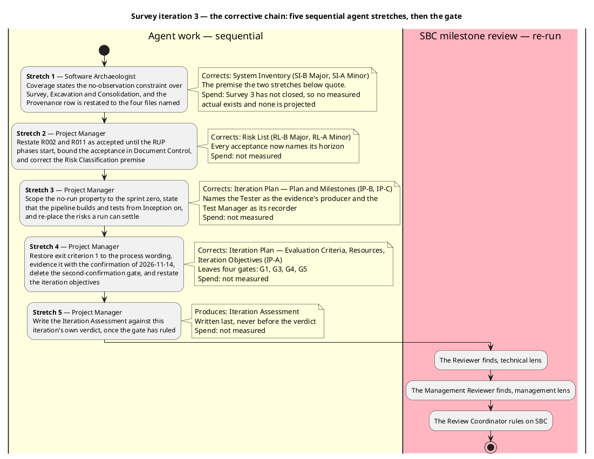
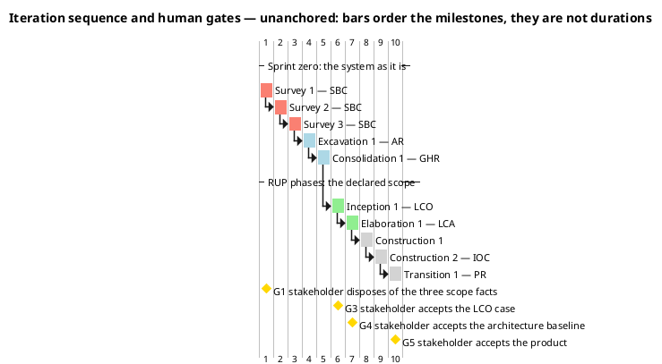
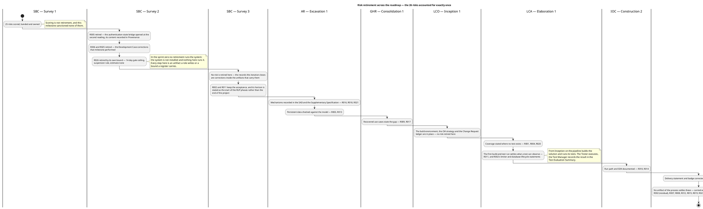
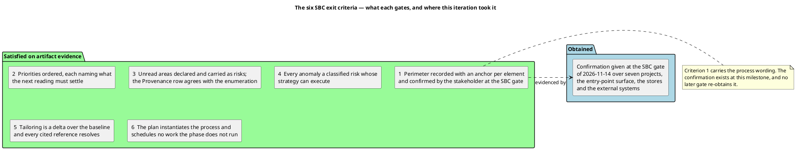

## Document Control
Phase: Survey
Status: Draft — Survey iteration 3, corrective. Coarse roadmap with the risk retirement and the four stakeholder gates across the roadmap; this iteration's fine plan, each exit criterion naming the work item that evidences it; the agent role profile with every risk owner reconciled against the register; the six SBC exit criteria with a per-criterion state. Criterion 1 carries the process wording and is evidenced by the confirmation given at the SBC gate of 2026-11-14; no later gate re-obtains it. Observation is a retirement path from Inception on: the pipeline builds the solution and runs its test suites, and the Tester produces that evidence.
Milestone Target: End-of-Survey (SBC) — not yet achieved
## Iteration Objectives
Survey iteration 3 is corrective. The SBC gate granted the sanction and opened seven records against the artifacts of this phase — four Majors, three Minors, none Critical. This iteration closes them in the order the stakeholder set. No new artifact is produced and no finding asks a new question: each correction narrows content back to a decision the stakeholder has already taken.

1. **Narrow the no-observation constraint to the sprint zero wherever it is stated over more of the lifecycle.** No process is run in Survey, Excavation or Consolidation, so within those three milestones neither read-only claim is settled by observation; both stay declared as read but not observed and are carried as accepted risk until the RUP phases start. From Inception on the pipeline builds the solution and runs its test suites, and a build or test result that bears on an accepted risk settles what it covers. Owner: Software Archaeologist for the System Inventory's Coverage statement, Project Manager for the Risk List and this plan.
2. **Bound every acceptance, and none to the end of the project.** R002 and R011 are accepted until the RUP phases start, on the stakeholder's answer of 2026-11-14; R002's Significant-band grant stays quoted verbatim. Owner: Project Manager.
3. **Restore exit criterion 1 to the process wording and delete the gate the stakeholder deleted.** The perimeter is confirmed by the stakeholder, evidenced by the confirmation given at this milestone on 2026-11-14; there is no second confirmation at Consolidation's start, and that gate leaves the roadmap, the gantt and the gate list, leaving four gates booked for the stakeholder. Owner: Project Manager.
4. **Re-examine the retirement map for what a build and test run settles.** A risk a run can settle is placed at the milestone whose execution produces that evidence, with the producer named; a risk no test the process runs can observe stays on the acceptance. Owner: Project Manager.
5. **Correct the three Minors in their owners' next turn.** The Provenance arithmetic, the citation to a version policy the Development Case does not contain, and the two retirements the LCO row claims but this milestone performed. Owners: Software Archaeologist, Project Manager.

Of the seven records, the Software Archaeologist owns two — SI-B (Major) and SI-A (Minor) — and the Project Manager owns five: three Majors (RL-B, IP-A, IP-B) and two Minors (RL-A, IP-C). The coverage sentence is stated first because the register and this plan both quote it: correcting it last would write the same narrowing into three artifacts that then disagree about the same two risks.

The chain is sequential for the same reason as the two before it: each stretch consumes the one before. The premise correction comes first because the register and the plan both quote the sentence it corrects; the two Minors ride with their owner's stretch rather than earning one of their own, since neither leaves its artifact.

No stretch carries a spend figure. Survey has not closed, so no measured actual exists and no forecast is invented in its place. No stretch and no gate assumes a run of the system: the sprint zero is read-only, and the first build-and-test run the plan relies on is at Elaboration.
## Plan and Milestones
Two levels live in this section: the coarse cross-iteration roadmap and the fine plan for this iteration.

### Coarse roadmap — the milestone sequence and the risk each milestone retires

Ten iterations: three in Survey, then one per phase except Construction, which takes two. Survey takes three because the first iteration's exit criteria did not pass and the second's gate opened four Majors — the iteration-count lever, at schedule cost, with declared scope untouched. The sprint zero still carries three of the ten iterations because the architecture, the data model and the use cases are **recovered from a working system** rather than designed from nothing: the phase in which architectural risk is retired is Excavation inside the sprint zero, and Elaboration's LCA becomes a baseline-confirmation iteration rather than a from-scratch architecture baseline. The justification is the Risk List, not preference: R003 (migrations unvalidated) and R005 (the authentication-state bridge) are both Significant, and both are retired by reading the existing system — work the sprint zero runs and Elaboration does not.

| # | Iteration | Milestone | What the milestone gates | Risks whose retirement this milestone carries | Reviewers, in order |
|---|---|---|---|---|---|
| 1 | Survey 1 | SBC — not reached | The reading, the tailoring and the register produced; the milestone returned them with ten Majors open and the sanction withheld | The 25 risks then known, each scored, banded and owned — scoring is not retirement | Reviewer, Management Reviewer, Review Coordinator |
| 2 | Survey 2 | SBC | The perimeter is recorded with an anchor per element and confirmed by the stakeholder, the reading priorities are ordered, the unread areas are declared, every anomaly is a scored risk whose strategy can execute, and the plan is executable as a governing instrument | R005 — retired by the Provenance record the second reading wrote; R006, R025 — retired by the Development Case corrections this milestone performed; R026 — by its own bound, the 14-day gate ceiling and the suspension rule | Reviewer, Management Reviewer, Review Coordinator |
| 3 | Survey 3 | SBC | Every finding of the Survey 2 gate closed: the no-observation constraint narrowed to the sprint zero wherever it is stated, every acceptance bounded, exit criterion 1 restored to the process wording with the deleted gate removed, and the retirement map re-examined for what a build and test run settles | None — the records this iteration closes are corrections inside the artifacts that carry them, and each risk they touch was already retired or accepted at the milestone named in its row | Reviewer, Management Reviewer, Review Coordinator |
| 4 | Excavation 1 | AR | The recovered architecture, the Design Model with its persistent-data sections and the first recovered use cases are baselined | R003, R013, R016, R018, R021 | Reviewer, Management Reviewer, Review Coordinator |
| 5 | Consolidation 1 | GHR | Every use case is recovered, the Supplementary Specification carries the mechanisms, and the tailoring is confirmed | R009, R017 | Reviewer, Management Reviewer, Review Coordinator |
| 6 | Inception 1 | LCO | The Vision, the use-case model of the declared scope, the candidate architecture, the build environment, the Change Request ledger and the CM strategy are in place; the business case is accepted by the stakeholder (G3) | — | Reviewer, Management Reviewer, Review Coordinator |
| 7 | Elaboration 1 | LCA | The architecture baseline is executed and tested; the Test Manager's plan and the Test Designer's cases exist; the deployment plan is written; the baseline is accepted by the stakeholder (G4) | R001, R004, R020 — and the first build-and-test run, which settles R011 and the runtime statements R002 carries | Reviewer, Management Reviewer, Review Coordinator |
| 8 | Construction 1 | — | The first construction increment: component implementation, iteration build, test execution, technical documentation | — | Reviewer, Management Reviewer, Review Coordinator |
| 9 | Construction 2 | IOC | The declared scope is implemented and tested against the recovered and declared acceptance criteria | R010, R014 | Reviewer, Management Reviewer, Review Coordinator |
| 10 | Transition 1 | PR | Production deployment, acceptance testing, release notes, the closure of the Change Request ledger, and the customer taking ownership of the product (G5) | R022, R024 | Reviewer, Management Reviewer, Review Coordinator |

The Business Reviewer is not a lens of any gate in this table. The Development Case declares Business Modeling inactive (`business-process-led = false`) and stands that role down for the whole project; Reviewer, Management Reviewer and Review Coordinator are the three lenses that remain.

### Fine plan — this iteration's work items and their owners

Survey 3 is the corrective iteration the SBC gate's verdict requires. Every item is a correction inside an artifact its owner already holds: no new question for the stakeholder, no scope change, no Change Request. The order is the stakeholder's — the premise first, then the statements that quote it, then the deleted gate, then the Minors in each owner's next turn.

| Work item | Owner | Produces | Predecessor | Evidences which exit criterion |
|---|---|---|---|---|
| Narrow the Coverage closing statement to Survey, Excavation and Consolidation; drop "for the life of this project", "in any phase" and the prohibition on later milestones | Software Archaeologist | System Inventory — Coverage | — | 3 — unread areas declared, each carried as a risk |
| Restate R002 and R011 as accepted until the RUP phases start, and state in Document Control that the acceptance is bounded to the sprint zero | Project Manager | Risk List — Document Control, Risk Register, Risk Classification, Risk Mitigation and Contingency | System Inventory corrected | 4 — every anomaly a classified risk whose strategy can execute |
| Scope the no-run property to the sprint zero, state that from Inception on the pipeline builds and tests, and re-examine the retirement map for what a build and test run settles | Project Manager | Iteration Plan — Plan and Milestones | Risk List corrected | 6 — the plan instantiates the process |
| Restore exit criterion 1 to the process wording, evidence it with the confirmation of 2026-11-14, and delete G2 from the roadmap, the gantt and the gate list | Project Manager | Iteration Plan — Evaluation Criteria, Plan and Milestones, Resources | Retirement map corrected | 1 — the perimeter confirmed by the stakeholder |
| Cite the pins in `Directory.Packages.props` instead of a version policy the Development Case does not contain | Project Manager | Risk List — Risk Mitigation and Contingency | Owner's next turn | 4 — every strategy names what retires it |
| Move R006 and R025 from the LCO row to Survey 2 — SBC and restate the accounting | Project Manager | Iteration Plan — Plan and Milestones | Owner's next turn | 6 — the retirement map accounts for every risk once |
| Write the assessment against the gate's verdict | Project Manager | Iteration Assessment | The verdict | — the record, not a criterion |

No work item carries a size. This system measures two things only: agent work in tokens and elapsed time, and human gates in days of queue time. An empty size is correct; a figure in hours, days or person-anything would describe a unit this project cannot produce.

Each exit criterion names the work item that evidences it. An exit criterion is a property of an artifact rather than its existence, so an artifact-shaped work item cannot own one.

### Spend — the two clocks, reported apart and never added

| Clock | Position at plan time | What it decides |
|---|---|---|
| Agent work — tokens and elapsed time | Survey 3's measured spend is recorded when the phase closes; no iteration in this project has a measured actual yet, so no forecast of it exists and none is invented | The measured actual replaces every assumed share in the phases after SBC |
| Human queue time — gates G1, G3, G4, G5 | G1 answered on 2026-11-14; each gate's queue duration is measured by the process and reported, never estimated | Whether gates should be batched into fewer points in later phases |

This project declares **no token budget**. None is set here, none is proposed for the stakeholder to accept, and no declared scope is cut or deferred to fit an estimate. An iteration ends when its exit criteria pass — and Survey 1's did not, which is why Survey 2 exists; Survey 2's gate returned four Majors, which is why Survey 3 exists; Survey 3's gate requires a further iteration, which is the same lever applied once more.

### All 26 risks accounted for, each exactly once

| Disposal | Count | Risks |
|---|---|---|
| Retired by a milestone artifact, at the milestone named in the table above | 14 | R001, R003, R004, R009, R010, R013, R014, R016, R017, R018, R020, R021, R022, R024 |
| Retired at Survey 2 — SBC | 3 | R005 — by the Provenance record the second reading wrote; R006, R025 — by the Development Case corrections that milestone performed |
| Retired by its own bound, at Survey 2's SBC | 1 | R026 |
| Carried on the acceptance recorded in the Risk List | 8 | R002, R007, R008, R011, R012, R015, R019, R023 |

Fourteen plus three plus one plus eight is twenty-six, and it agrees with the register's 18 avoided and 8 accepted. R002 is the only accepted risk in the Significant band, and its acceptance is the stakeholder's answer of 2026-11-14, quoted verbatim in the Risk List. Survey 3 retires none: its work is corrections inside the artifacts that carry these rows.

### What the first build-and-test run settles, and what it cannot

The acceptance on R002 and R011 runs **until the RUP phases start**, not to the end of the project. From Inception on the pipeline builds the solution and runs its test suites, so a build or test result is a retirement path from that point and the retirement map must show it.

| Of the eight carried on acceptance | Path from Inception on | Where, and who produces the evidence |
|---|---|---|
| R011 — rate-limiter partition key | **Settled.** Whether the bucket is per-user or global is a property of the request pipeline, and a test that sends two authenticated calls and reads the 429 boundary observes it | Elaboration 1 — LCA. The Test Designer writes the case, the Tester executes it, the Test Manager records the result in the Test Evaluation Summary |
| R002 — the runtime statements of the sprint-zero reading | **Partly settled.** Two of its four statements — the limiter's partition under the real pipeline, and the database lifecycle beyond the AppHost guard — are observable by the same execution. The prerender path and the external-login dance are not: no planned test reaches the client's first paint, and external login needs credentials no environment supplies | Elaboration 1 — LCA for the two observable statements; the remaining two stay accepted, and the row keeps its band |
| R007, R008, R012, R015, R019, R023 | **Not settled.** Each names a condition no test the process runs can observe: an unreachable role, dormant providers with no credentials, a trust boundary between two hosts, a first-paint behaviour with no browser-level test, and a language-version pin whose raising nothing plans | Carried on the acceptance, with the register's contingency standing |

No risk in this table is declared retired by a run that has not happened. The two that will be are placed at the milestone whose execution produces the evidence, and the evidence's producer is named.

Four properties of this roadmap are load-bearing:

- **Sequencing follows the risk bands, not the phase names.** Both High-band risks are retired before Construction: R001 (nothing tests the BFF) at LCA, R009 (a delivered API capability with no screen) at GHR. Of the eight Significant risks, four are retired by AR and GHR — inside the sprint zero — because that is where their evidence lives; R005 is retired at Survey 2 — SBC by the Provenance record the second reading wrote, R004 is retired at LCA, R026 is bounded by its own ceiling, and R002 is carried on the stakeholder's grant. No risk above the Moderate band is carried into Construction or Transition.
- **No retirement in the sprint zero runs the system, and observation returns as a path from Inception on.** In Survey, Excavation and Consolidation every step above is an artifact a role writes or a bound a register carries, because the system is not installed and nothing here runs it. From Inception on the pipeline builds the solution and runs its test suites, so a later phase retires a risk by a build or test result; the Tester produces that evidence and the Test Manager records it. R011 and the observable half of R002 are placed at LCA on that basis, and no other accepted risk is claimed for it.
- **Every milestone whose exit condition is the stakeholder's judgement has a gate at which it is obtained.** G1 at Survey 1's SBC disposed of the three scope facts; G3 at LCO accepts the business case; G4 at LCA accepts the architecture baseline; G5 at PR accepts the product, where ownership transfers. The perimeter needs no gate of its own: the stakeholder confirmed it at the SBC gate of 2026-11-14, and an element Excavation finds outside the perimeter is put to them at that point.
- **The lever is iteration count — never parallel agent roles, never declared scope.** A milestone whose exit criteria do not pass is followed by one more iteration inside that phase at schedule cost. Declared scope is reduced only by a Change Request the stakeholder decides.

### Next iteration's fine plan — the corrective work this gate left open

No iteration beyond Survey 3 is planned inside this phase. Survey 3 carries the four Majors and three Minors the SBC gate opened; whether a fourth Survey iteration follows is decided by the next gate's verdict on that rework, and planning one now would plan past the horizon. If a fourth is required, its fine plan is built from that verdict in the same way this one was.

The phase's next iteration is Excavation 1 — AR, whose profile is in Resources above. Its work items are the ones the process assigns to Analysis & Design, Requirements and Discovery in that milestone, not work carried forward from Survey.

### Next iteration's fine plan — the horizon this plan stops at

No iteration beyond Survey 3 is planned inside this phase at the level of fine plan. Whether a fourth Survey iteration follows is decided by the next gate's verdict on the rework this iteration carries, and planning one now would plan past the horizon. If a fourth is required, its fine plan is built from that verdict in the same way this one was.

The phase's next iteration is Excavation 1 — AR, whose profile is in Resources above. Its work items are the ones the process assigns to Analysis & Design, Requirements and Discovery in that milestone, not work carried forward from Survey.

## Resources
The team is the agent roster the process assigns, not a staffed organisation. The profile below is read from the IARI Development Process and the Development Case's tailoring — no role here does work the process does not run in this phase, and every role named as a risk owner in a milestone row is at work in that milestone.

### Excavation 1 — AR

The process runs four disciplines in Excavation, and every one of them has its role on this iteration's profile. The two that Analysis & Design does not cover are the two that carry risk owners.

| Role | Discipline and intensity | Stage in this iteration | Produces | Risks owned |
|---|---|---|---|---|
| Software Architect | Analysis & Design, Critical | Software Architecture Document — Components and Connectors · Mechanisms, Technology and Deployment | Software Architecture Document | R007, R011, R012, R016, R018, R021, R023 |
| Designer | Analysis & Design, Critical | Design Model — Domain Model · Packages and Classes | Design Model | R015, R019 |
| Database Designer | Analysis & Design, Critical | Persistent Data — Entities, Keys and Associations · Enforced Rules | Design Model — persistent-data sections (Data Model not fired) | R003, R013 |
| System Analyst | Requirements, High | Use-Case Model · Business Rules in the Use-Case Flows · Vision | Use-Case Model, Vision | R017 |
| Software Archaeologist | Discovery, High | System Inventory — Anomalies · History and Coverage | System Inventory | R002 |
| Project Manager | Project Management, Low | Risk List · Iteration Plan | Risk List, Iteration Plan, Iteration Assessment | R026 |

The System Analyst recovers the login and logout scenarios this iteration from the delivered code and the Provenance record the second reading wrote — the file that blocked them was opened at Survey 2 — so no reading work is booked here for R005, which that record retired.

### Consolidation 1 — GHR

| Role | Discipline and intensity | Stage in this iteration | Produces | Risks owned |
|---|---|---|---|---|
| System Analyst | Requirements, High | Use-Case Model · Supplementary Specification | Use-Case Model, Supplementary Specification, Vision | R008, R009, R017 |
| Software Architect | Analysis & Design, Medium | Software Architecture Document — Components · Mechanisms and Use-Case View | Software Architecture Document | R023 |
| Designer | Analysis & Design, Medium | Design Model — Domain Model · Packages and Classes | Design Model | R015, R019 |
| Database Designer | Analysis & Design, Medium | Persistent Data — Entities, Keys and Associations · Enforced Rules | Design Model — persistent-data sections | — |
| Software Archaeologist | Discovery, Low | System Inventory | System Inventory | — |
| Project Manager | Project Management, Low | Risk List · Iteration Plan | Risk List, Iteration Plan, Iteration Assessment | R026 |

### Later iterations — roles at work, recorded so the roadmap is executable

Inception adds the Integrator (Build Environment Setup; R010, R014), the Change Control Manager (Change Request ledger), the Configuration Manager (CM strategy), the Test Manager (Test Plan not fired; Test Evaluation Summary; R004, R020) and the Deployment Manager. Elaboration adds the Test Designer (Test Case; **R001**), the Tester — who produces the build-and-test evidence that settles R011 and the observable statements of R002 — the Test Analyst, the Code Reviewer and the User Interface Designer. Construction adds the Implementer and, for the Technical Writer, R022 and R024. Transition is deployment and acceptance closure.

**Every one of the 26 risks has its owner at work in the milestone that carries it**, whether that milestone retires the risk or carries it on the register's acceptance. The two roles whose first appearance is later than their risk's entry are the Test Manager, at work from LCA, and the Integrator, at work from IOC — and neither risk is one that AR or GHR claims as retired.

**Stood down for the whole project**, per the Development Case classification: Business Process Analyst and Business Reviewer (`business-process-led = false`), Capsule Designer (`real-time-system = false`). They execute no stage in any iteration and sit on no gate.

**Human gates.** The only human in this system is the stakeholder, and the plan books four gates for them: G1 (the three scope facts, answered 2026-11-14), G3 (accepts the LCO case), G4 (accepts the architecture baseline), G5 (accepts the product, where ownership transfers). A gate is bounded in the Risk List at R026, never forecast in the plan: ceiling 14 days of queue time, after which the process suspends rather than filling the gap with an assumption; estimate none; the actual measured and reported apart from agent time.

The perimeter is not one of those gates. The stakeholder confirmed it at the SBC gate of 2026-11-14 — the confirmation Survey 3's exit criterion 1 records — so no plan event re-opens it; an element Excavation finds outside the perimeter goes back to the stakeholder at the point it is found.

### This iteration — Survey 3, SBC

| Role | Discipline and intensity | Stage in this iteration | Produces | Risks owned |
|---|---|---|---|---|
| Software Archaeologist | Discovery, Critical | System Inventory — Coverage | System Inventory — the Coverage closing statement narrowed to the sprint zero | R002 |
| Project Manager | Project Management, Low | Risk List · Iteration Plan · Iteration Assessment | Risk List (the acceptance bound, the R005 row, the R023 citation), Iteration Plan (criterion 1, the gate list, the retirement map, the accounting, the Resources statement), the assessment written after the verdict | R026 |
| Process Engineer | Environment, High | Development Case — Guidelines and Procedures | Development Case — the **Version policy** and **Measurement policy** subsections | R006, R025 |
| Reviewer | Review lens | SBC milestone review, technical | Findings on the artifacts reviewed | — |
| Management Reviewer | Review lens | SBC milestone review, management | Findings on the artifacts reviewed | — |
| Review Coordinator | Review lens | SBC milestone review | The SBC verdict | — |

The Process Engineer executed a stage in this iteration and the fine plan's work-item table carries it: the Development Case's Guidelines and Procedures gained the Version policy and the Measurement policy, which the Management Reviewer's iteration-2 review recorded as absent. It is a revision of an existing artifact, not a new one — which is why it appears on the profile and in the work items, and why "no new artifact is produced this iteration" stays true.

No other role is at work: every open defect of this gate sits in an artifact the Software Archaeologist, the Project Manager or the Process Engineer holds, and the three lenses review.

The Review Coordinator decides whether the milestone closes. It does not decide the Iteration Assessment — the Project Manager writes that against the verdict.

R011's owner first sits at AR — the Software Architect. This iteration restates that risk's strategy in the Risk List; it changes no owner, and no milestone row claims it as retired. R005's owner, the System Analyst, carries no work here: that risk was retired at Survey 2 — SBC by the Provenance record, and the register and this plan now state one retirement.

## Use Cases and Scenarios Addressed

None, and that is the phase's definition rather than a gap in the plan.

The process runs no use-case work in Survey. The Use-Case Model is recovered in Excavation and completed in Consolidation, one use case per endpoint surface performing a distinct user-observable outcome, with authentication, rate limiting, logging and telemetry excluded as mechanisms and carried in the Supplementary Specification instead. On this project the requirements are recovered from a working system, so the phase that would otherwise analyse a declared scope instead reads what exists.

Two consequences for the iterations that do carry use cases, recorded here because they are sequencing decisions rather than recovery decisions:

- The `/todos` use cases are recovered before the authentication ones (System Inventory, Priorities), but the authentication scenarios of every `/todos` use case enter the Supplementary Specification as included constraints, not as separate use cases.
- Three capabilities are recovered as code that exists and is unreachable or dormant, and no use case is recovered for any of them: the owner-or-admin branches (R007), external login (R008), and `PUT /todos/{id}`'s missing screen (R009 — recovered as a use case that states no screen reaches it).

## Evaluation Criteria
The exit criteria for this iteration are the SBC milestone's. They are the stakeholder's and the process's, not criteria this plan invents, and each states a condition this iteration can satisfy. Each is marked with the artifact and the fact that evidences it.

| # | Criterion | How it is evidenced | State at plan time |
|---|---|---|---|
| 1 | The perimeter of the existing system is confirmed by the stakeholder | System Inventory, Perimeter — seven projects, the entry-point surface, the stores and the external systems, each anchored; confirmed by the stakeholder at the SBC gate of 2026-11-14, together with their statement that nothing is missing from it | Evidenced — the confirmation has been given |
| 2 | The reading priorities are ordered | System Inventory, Priorities — eight areas ordered, each naming what the next reading must settle | Evidenced |
| 3 | The unread areas are declared rather than omitted | System Inventory, Coverage — the declared-unread groups and the statements marked as read but not observed, each carried as a risk rather than as an open question; and Provenance, whose row now agrees with the enumeration the Coverage section publishes | Evidenced — the declaration holds and its ownership record agrees with it |
| 4 | Every anomaly is a classified risk, and every strategy can execute | Risk List — 26 risks, each scored for probability and impact, its magnitude the band of their product, each given a strategy, an owner, a mitigation and, where accepted, a contingency; every acceptance bounded to the sprint zero, and observation restored as a retirement path from Inception on; every strategy naming work that remains to be done or a bound that holds | Evidenced — the R005 and R023 rows were restated against the artifact each names |
| 5 | The process is tailored and the tailoring is auditable | Development Case — classification, disciplines and intensities, the OPTIONAL trigger verdicts with the evidence for each, the tool references, and the Version policy and Measurement policy the Guidelines and Procedures section carries | Evidenced — whether the result is auditable is the gate's judgement |
| 6 | The plan instantiates the process, sequences by risk, and schedules no work the phase does not run | This artifact — the roadmap names only the roles and artifacts the process assigns to each phase, each milestone carries its risk retirement, every risk owner is at work in the milestone that carries its risk, the accounting closes at 26, and the fine plan names only the roles Survey runs | Evidenced — 14 + 3 + 1 + 8 = 26, each risk once |

### What can still fail

Criterion 5 turns on a judgement the reviewing lenses make: whether a process authority whose references all resolve is auditable. The Development Case now carries both policies that judgement needs — the Version policy that names the pins and the project file, and the Measurement policy that states the two clocks and binds no figure to a scope decision. Whether the corrected authority is now auditable is the gate's call, not the author's.

The other way an iteration does not close is the perimeter's adequacy: if a reviewing lens finds the record under-evidenced — most likely for the files the reading declared unread, or for the statements marked read rather than observed — the remedy is a further Survey iteration that opens those files. That is the iteration-count lever, and it protects the accuracy of the perimeter at schedule cost. It is never answered by adding agent roles in parallel, and never by narrowing what counts as the perimeter.

**Not an exit criterion:** the risk scores are judgements, and a reviewer may disagree with a score without failing the milestone. What must hold is that every anomaly is classified, that every magnitude is the band of its own exposure, and that no High or Significant risk rests on an acceptance nobody granted.

### Where the perimeter's confirmation was obtained

Criterion 1 carries the process wording and the confirmation has been given. The stakeholder confirmed the perimeter at the SBC gate of 2026-11-14, over the seven projects, the entry-point surface, the stores and the external systems the System Inventory records, and stated that nothing is missing from it. That answer is the evidence, and it is the only confirmation this milestone obtains or needs.

There is no second confirmation. An element Excavation's deeper reading finds outside the perimeter is put to the stakeholder at the point it is found, as a question about that element rather than a re-run of this milestone.

The three scope answers of 2026-11-14 are cited in criterion 1 only as the disposition of three specific facts — the `admin` role's unreachability, the dormancy of the external identity providers, and the BFF-to-API trust boundary. The perimeter's confirmation is the stakeholder's separate answer at the same gate, and it rests on its own words.

### The criteria this iteration's corrections carry

| Criterion | Corrected against | What has to hold at the gate |
|---|---|---|
| 1 | This artifact, Evaluation Criteria — restored to the process wording and evidenced by the confirmation given at SBC on 2026-11-14; the second confirmation gate deleted from the roadmap, the gantt and the Resources gate list | That the record itself is adequate: anchored per element, priorities ordered, unread areas declared |
| 3 | System Inventory, Provenance — the row now agrees with the enumeration the Coverage section publishes: 53 files of the first reading plus the four added at the second, 53 + 4 = 57, agreeing with the Document Control tally and the path-by-path enumeration | That the declaration holds, which it does; nothing else in the criterion is in doubt |
| 4 | Risk List — R005 restated as the anomaly at the first reading with its retirement at Survey 2 — SBC, and R023 routed to `Todo.Web/Server/Todo.Web.Server.csproj`, the file that declares `<RazorLangVersion>`; every acceptance still bounded to the sprint zero | Every strategy names work that remains to be done or a bound that holds, and no acceptance outlives the horizon it was granted for |
| 6 | This artifact, Plan and Milestones and Resources — R005 moved into the "Retired at Survey 2 — SBC" group, the accounting restated as 14 + 3 + 1 + 8 = 26, the Process Engineer named on this iteration's profile | Every role named in a milestone row is at work in that milestone; no gate staffs a stood-down role; no work item is sized in a unit this project does not measure |

