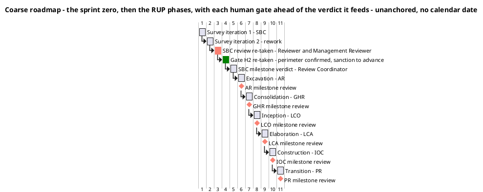
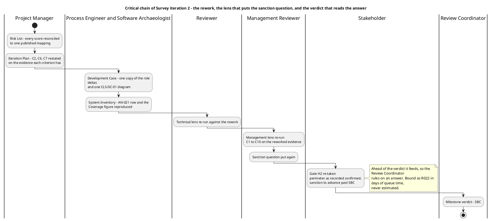
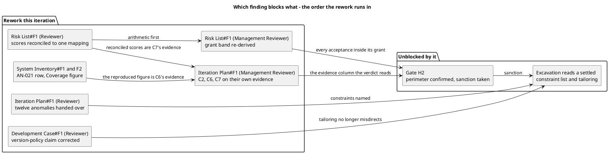
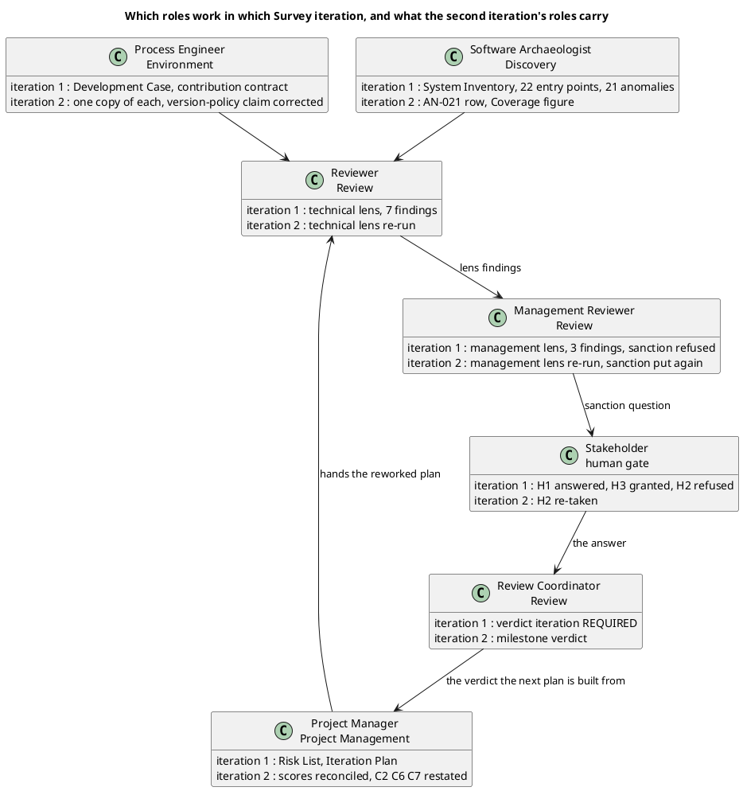

## Document Control
- Phase: Survey
- Status: Draft — issued for iteration 2 on the SBC review's findings and the stakeholder's order of 2026-11-23
- Milestone Target: end-of-Survey (SBC) — not achieved
- Iteration: 2, Cycle 1
- Owner: Project Manager
## Iteration Objectives
This iteration reads the existing system and states what the project inherits. It is the whole of Survey (SBC), the first of the sprint zero's three phases; nothing declared by the stakeholder is worked here.

| # | Objective | Satisfied when | Owner |
|---|---|---|---|
| O1 | The tailoring that governs the sprint zero exists | Development Case records the inactive disciplines, the fired OPTIONAL, the measurement policy and the role deltas | Process Engineer |
| O2 | The existing system is read and its perimeter stated | System Inventory records the process boundary, the entry points, the technology, the stores and the documentation | Software Archaeologist |
| O3 | The unread remainder is declared rather than left implicit | System Inventory's Coverage states which files were not opened and why | Software Archaeologist |
| O4 | The anomalies the reading found are carried as scored, actionable risks | Risk List holds one risk per anomaly, each with probability, impact, magnitude, strategy and owner | Project Manager |
| O5 | The reading's priorities are ordered and the stakeholder's answer recorded | System Inventory's Priorities carries the order and the 2026-11-23 answer | Software Archaeologist |
| O6 | The project's plan for the rest of the sprint zero and the RUP phases exists | This artifact carries the milestone sequence and this iteration's work items with owners | Project Manager |

### Objectives of iteration 2

Survey iterates because its first iteration left the SBC milestone unachieved. The objectives below are the whole of this iteration; none of them adds scope to the reading.

| # | Objective | Satisfied when | Owner |
|---|---|---|---|
| O7 | Every finding the SBC review recorded against an artifact is reworked by the artifact's owner | Each correction the Review Record's Actions table orders is written into the artifact it names, keyed by that finding | The owner the Review Record names, per the fine plan |
| O8 | The exit criteria rest on the evidence each criterion actually has | C2 is split into the answered perimeter-membership and priority questions and the confirmation of the recorded perimeter; C6 cites the coverage figure the System Inventory reproduces; C7 is split into carriage and reproducibility | Project Manager |
| O9 | The perimeter as recorded is put to the stakeholder again | Gate H2 answered: the four-process perimeter confirmed as the System Inventory states it, and the sanction to advance past SBC granted or refused | Project Manager puts it; the stakeholder answers |

## Plan and Milestones
The plan is two-level. The **coarse roadmap** fixes the milestone sequence, the intensity each phase runs at and which risks each milestone confronts. The **fine plan** is this iteration's work items with their owners, bounded to Survey. No milestone below is achieved and no iteration beyond Survey's second is planned in fine detail.

### Coarse roadmap — the milestone sequence

No bar carries an absolute date or a projected calendar span: no phase has closed, so nothing measured exists to project one from. The one-day length is the diagram's sequencing device, not a duration claimed for the work. Each human gate sits ahead of the verdict it feeds, because the verdict reads the answer: at SBC the Management Reviewer puts the sanction question and the Review Coordinator rules on the answer. Survey carries two iterations because its first left six Major findings open: the Review Coordinator's verdict is iteration REQUIRED, so the rework precedes the re-taken review rather than following the sanction.

| Order | Phase | Milestone | Discipline intensity | Risks this milestone confronts | What the milestone is judged on |
|---|---|---|---|---|---|
| 1 | Survey | SBC, iteration 1 | Environment High, Discovery Critical, Project Management Medium | Carries R001 to R021 into the register; R016, R012, R004 and R011 are granted for the sprint zero, R022 governs its gates. SBC retires none of the reading's risks — it makes them owned | Assessed at the SBC review of 2026-11-23: the perimeter and its priorities stated, the anomalies carried as scored risks. Verdict: iteration required, six Major findings open |
| 1b | Survey | SBC re-taken, iteration 2 | Environment High, Discovery Critical, Project Management Medium | Closes the six Major findings and nothing else; no risk is retired by the rework | The perimeter as recorded is confirmed by the stakeholder at gate H2, and every score reproduces from its stated inputs |
| 2 | Excavation | AR | Requirements High, Analysis & Design Critical, Discovery Critical, Project Management Medium | R001, R004, R019, R020, R021 (System Analyst, Use-Case Model); R003, R018 (Designer, Design Model); R002, R009, R010, R017 (Software Architect, SAD and the fired Deployment Model) | The recovered use-case model, architecture, design and deployment rest on anchors and cover the reading's priorities 1 to 5 |
| 3 | Consolidation | GHR | Requirements High, Analysis & Design Medium, Discovery Critical, Project Management Medium | Completes R003 and R010 where the recovered set is closed; confirms R015's volatility statement against the orchestration as it stands | Coverage is counted and declared; every recovered use case, the Supplementary Specification and the fired Deployment Model are complete |
| 4 | Inception | LCO | Requirements Critical, Environment High, Project Management High, Analysis & Design Medium, Implementation Medium, Test Low, Deployment Low, CM Medium | R007, R013, R014 (Integrator, Build Environment Setup); R022 opens the Change Request ledger every later gate depends on | The declared change is scoped, a candidate architecture exists, the CM strategy is set and the Change Request ledger is opened |
| 5 | Elaboration | LCA | Analysis & Design Critical, Requirements High, Implementation Medium, Test Medium, Environment Medium, Project Management Medium, CM Medium, Deployment Low | R012, R011, R005 (Test Manager and Test Designer); R006 (the test project is next touched here) | The architecture baseline is accepted and an executable architecture is built |
| 6 | Construction | IOC | Implementation Critical, Test Critical, Requirements Medium, Analysis & Design High, Project Management High, Deployment Medium, CM High, Business Modeling Low | Completes R012's coverage of the client's todo flow; R008 (Technical Writer, User Documentation) | The declared scope is implemented and its test evaluation is recorded |
| 7 | Transition | PR | Deployment Critical, Test High, Project Management Medium, Implementation Medium, Requirements Low, Analysis & Design Low, CM Medium | Closes what remains: R011's contingency is taken only if a deliberate upgrade lands before the release | The release build is baselined and acceptance-tested; the Change Requests are closed |

Sequencing is driven by the Risk List, not by convenience: the two risks whose actions the System Analyst performs (R001, R019 to R021) land at the milestone that first writes a recovered use case, and R007 — the build that cannot build the tree — lands at Inception because that is the first phase the Integrator works. Elaboration and Construction repeat no further than their exit condition stated above; no iteration count is forecast for them, because a count invented before a single phase has closed is a figure with no measured basis.

### This iteration's fine plan

The work items are the SBC review's ordered actions and the re-taken gate: nothing is planned here that the Review Record does not order and no work the IARI DEVELOPMENT PROCESS does not run in Survey appears.

| # | Work item | Owner | Depends on | State | Forecast spend |
|---|---|---|---|---|---|
| 1 | Risk List — reconcile all twenty-two scores to one published mapping, re-derive the grant band, put every Significant acceptance to the stakeholder | Project Manager | — | Complete — 21 anomaly-derived rows reproduce from the one published mapping; of the 14 Significant-band risks, 4 accept each under a stakeholder grant and 10 avoid | not recorded |
| 2 | Iteration Plan — restate C2, C6 and C7 on the evidence each criterion actually has | Project Manager | 1 | Complete — C2 split into the answered questions and the confirmation gate H2 owes; C6 cites the reproduced 79-of-133 coverage figure; C7 split into carriage and reproducibility, both parts met | not recorded |
| 3 | Iteration Plan — the constraint list handed to Excavation | Project Manager | — | Complete — all twelve entry-point-bearing anomalies named, with the 21 edges the System Inventory records | not recorded |
| 4 | Development Case — delete the duplicated role-delta list and the duplicated CLS-DC-01 diagram, and correct the version-policy claim | Process Engineer | — | With the owner | not recorded |
| 5 | System Inventory — add EP-007 to the AN-021 row, and make the Coverage headline agree with the per-area table | Software Archaeologist | — | With the owner | not recorded |
| 6 | Technical lens re-run — Reviewer reads the reworked Risk List, Iteration Plan, Development Case and System Inventory | Reviewer | 1, 2, 3, 4, 5 | Not started | not recorded |
| 7 | Management lens re-run — C1 to C10 re-taken on the reworked evidence, then the sanction question put | Management Reviewer | 6 | Not started | not recorded |
| 8 | Gate H2 re-taken — the perimeter as recorded confirmed, sanction to advance past SBC | Stakeholder | 7 | Queued; bound as R022 | queued in days; no estimate |
| 9 | SBC milestone verdict — read on the answer gate H2 returns | Review Coordinator | 8 | Not started | not recorded |

Two currencies, never summed. Items 1 to 7 and 9 are agent work, measured in tokens and elapsed agent time; the phase's measured spend is recorded in the Iteration Assessment, and no per-item figure exists. Item 8 is a human gate — waiting, not working — quoted only in days of queue time, bounded as R022 with a ceiling of 14 days and no estimate.

The chain is sequential end to end: the lenses judge what the owners reworked, the stakeholder is asked only what the review has settled, and the verdict reads the answer. Adding agent roles to this chain would buy no clock and would add contention over the same four artifacts.

| Human gate | Who | What the iteration waits for | Bound | Answer |
|---|---|---|---|---|
| H1 | Stakeholder | Four answers: the external-provider path and the admin branch ruled in or out, the eight-area priority order confirmed, and the two Significant-risk acceptances (R012, R016) granted or refused | R022 — ceiling 14 days; on expiry the process suspends and nothing is auto-filled | Taken in-iteration on 2026-11-23, ahead of the review: the external-provider path recorded as a recovered use case marked unreachable in the delivered configuration; the admin branch treated as an exceptional entity; the priority order stands as it is with nothing left out; R012 accepted; R016 accepted |
| H2 | Stakeholder | The perimeter as the System Inventory records it, confirmed, and the sanction to advance past SBC | R022 — same ceiling, no estimate | REFUSED on 2026-11-23, with the instruction that the Development Case's duplicated diagrams and text be corrected and that the Major findings be corrected. Queued for the re-take after this iteration's lenses |
| H3 | Stakeholder | The `R004` and `R011` acceptances, conditionally on their reconciled scores landing at exposure 9 to 12 or above | R022 — same ceiling, no estimate | Both granted on 2026-11-23. The reconciled score lands at 12 on both, and the Risk List records each answer verbatim |

Each gate is answered by the stakeholder in their own words, and none is inferred by a reviewer or by the Project Manager. H2 is the one that has not passed, and it is the reason this milestone is not achieved. The milestone review is the reviewers' to rule on: no work item above is closed by this plan.

### Risk-driven sequencing of this iteration

## Resources
The roles are the 26-role roster of the IARI DC baseline, minus the two the Development Case records as not working in this project. No role is added, merged or renamed.

| Role | Discipline | Works in this iteration | Why |
|---|---|---|---|
| Project Manager | Project Management | Yes | Reconciles the Risk List's scores and restates the Iteration Plan's exit criteria |
| Process Engineer | Environment | Yes | Corrects the Development Case's duplicated role deltas and diagram and its version-policy claim |
| Software Archaeologist | Discovery | Yes | Corrects the System Inventory's AN-021 row and its Coverage figure |
| Reviewer | Review | Yes | Re-runs the technical lens against the rework |
| Management Reviewer | Review | Yes | Re-runs the management lens on C1 to C10 and puts the sanction question again |
| Review Coordinator | Review | Yes | Milestone verdict on the re-taken SBC review |
| System Analyst | Requirements | No — Excavation | Survey produces no Vision and no Use-Case Model |
| Requirements Specifier | Requirements | No — Elaboration | — |
| Software Architect | Analysis & Design | No — Excavation | No architecture is recovered before Excavation |
| Designer | Analysis & Design | No — Excavation | — |
| Database Designer | Analysis & Design | No — Excavation | Persistent data is described in the Design Model, from Excavation |
| User Interface Designer | Analysis & Design | No — Elaboration | — |
| Implementer | Implementation | No — Inception | No code is written in the sprint zero |
| Integrator | Implementation | No — Inception | The build environment is set up in Inception; R007 waits on it |
| Code Reviewer | Implementation | No — Elaboration | — |
| Test Manager | Test | No — Inception | No Test Plan is triggered |
| Test Designer / Tester / Test Analyst | Test | No — Elaboration | No test case is written before a use case is recovered |
| Deployment Manager | Deployment | No — Inception | The Deployment Model is fired but recovered in Consolidation |
| Technical Writer | Deployment | No — Construction | — |
| Configuration Manager | Configuration & Change Management | No — Inception | No baseline exists yet |
| Change Control Manager | Configuration & Change Management | No — Inception | The Change Request ledger is opened at LCO; no CR is opened in the sprint zero |
| Business Reviewer | Review | No — from LCO | Survey's milestone review runs Reviewer, Management Reviewer, Review Coordinator |
| Business Process Analyst | Business Modeling | No — inactive | `business-process-led = false` |
| Capsule Designer | Analysis & Design | No — inactive | `real-time-system = false` |

The stakeholder is not an agent role: they are the only human in the process, and their work in this iteration is gate H2 alone.

### Agent role profile across the phase

## Use Cases and Scenarios Addressed
None. Survey is the sprint zero's first phase and recovers no use case: the 22 entry points are recorded as entry points in the System Inventory, and it is Excavation that recovers them into Use-Case Model use cases — `UC-NNN` from `EP-NNN` — in the reading order of the Priorities section. No use case, no scenario and no use-case realization is planned in this iteration.

What this iteration does hand forward is the material those use cases are recovered from: `EP-001` … `EP-022`, and the twelve anomalies that sit on an entry point and constrain what a recovered use case may claim. All twelve are named below, each with the entry points the System Inventory's Anomalies table hangs it from — the 21 edges that table records — and that table remains Excavation's constraint list.

| Anomaly | Sits on | What a recovered use case may not claim |
|---|---|---|
| `AN-001` | `EP-003`, `EP-013` | That a user-facing path completes a todo: the list's checkbox is bound to nothing and the client makes no update call |
| `AN-002` | `EP-016` | That the BFF-to-API hop is authenticated: the API accepts a bearer token from any caller |
| `AN-004` | `EP-011`, `EP-013`, `EP-014` | That the `admin` branch is live functionality: nothing in the running system grants the role, and the stakeholder ruled it an exceptional entity on 2026-11-23 |
| `AN-008` | `EP-017`, `EP-019` | That the API mounts a Swagger UI: the README names one, the code mounts the Scalar reference UI |
| `AN-009` | `EP-015` | That the Identity endpoints are rate-limited: the token-bucket policy covers `/todos` only |
| `AN-010` | `EP-008`, `EP-016` | That the BFF and the API share a data-protection key ring: only the application discriminator is set |
| `AN-015` | `EP-022` | That the orchestration is settled: the app host is the only part of the delivery still moving |
| `AN-017` | `EP-017`, `EP-019` | That the root redirect is served in every environment: the Scalar UI it targets is mapped in Development only |
| `AN-018` | `EP-010`, `EP-011` | That the list and item endpoints state one visibility rule: `GET /todos` filters on the owner alone while the item endpoints admit an `admin` principal |
| `AN-019` | `EP-007` | That the challenge validates the provider name: it is taken straight from the route and checked against no registered scheme |
| `AN-020` | `EP-008` | That the callback has a failure flow: every path redirects to `/`, so a rejected provider, a null exchange and a failed cookie sign-in are indistinguishable |
| `AN-021` | `EP-004`, `EP-005`, `EP-007` | That a failure's cause reaches the person: every authentication failure answers 401 with no body |

Twelve anomalies, twelve rows, 21 edges — the count the System Inventory's Anomalies diagram and its Traceability table hold. Five of them — `AN-008`, `AN-009`, `AN-010`, `AN-015`, `AN-017` — constrain the reference-UI, Identity, key-ring and app-host reading, which is priorities 6 and 8 of the order Excavation reads in.

The nine anomalies with no entry point — `AN-003`, `AN-005`, `AN-006`, `AN-007`, `AN-011`, `AN-012`, `AN-013`, `AN-014`, `AN-016` — concern the build, the tests and the delivery rather than a path a use case is recovered from. They are carried as risks R003, R005, R006, R007, R011, R012, R013, R014 and R016 and constrain Excavation through the Risk List, not through a recovered path.

## Evaluation Criteria
The exit criteria for this iteration's milestone (SBC). They are the criteria the reading's own decisions imply plus the ones the phase declares; none is invented beyond what the phase must establish to hand off to Excavation. Where a criterion was written as one and the evidence settles only part of it, it is split rather than certified whole — `Iteration Plan#F1` (Management Reviewer).

| # | Criterion | Met when | State | Evidence |
|---|---|---|---|---|
| C1 | The perimeter is stated | The delivery's processes, components, external systems and stores are recorded with anchors | Met | System Inventory — Perimeter: four processes, 19 components and 9 external systems, each anchored |
| C2a | The perimeter-membership questions and the priority order are answered by the stakeholder | The external-provider path and the admin branch are ruled in or out, and the priority order accepted, in the stakeholder's own words | Met — 2026-11-23 | Three answers: the external-provider path is a recovered use case marked unreachable in the delivered configuration; the admin branch is an exceptional entity and not a recovered use case; the order stands as it is with nothing left out |
| C2b | The perimeter as recorded is confirmed by the stakeholder | Gate H2 answered: the four-process perimeter accepted as the System Inventory states it | Not met | Asked at the SBC review whether they confirm the perimeter as recorded and sanction advancing past SBC, the stakeholder answered No on 2026-11-23. C2a's three answers do not confirm the recorded perimeter; H2 is re-taken after this iteration's review |
| C3 | The entry points are enumerated | Every entry point by which the system is reached is listed with its kind, initiator and anchor | Met | System Inventory — Entry points, EP-001…EP-022 |
| C4 | The priorities are ordered | The eight areas carry an order and a reason | Met | System Inventory — Priorities |
| C5 | The priority order is confirmed by the stakeholder | Gate H1 answered: the order accepted | Met — 2026-11-23 | "The order stands as it is: nothing matters more than it reflects, and nothing is to be left out" |
| C6 | The unread areas are declared, and the declared figure reproduces | Every unread file is named with the reason it was not read, and the headline count is the sum of the per-area table | Met | System Inventory — Coverage: 79 files opened and 54 unread of 133; the per-area Read column sums to 79 and its Files column to 133; the 54 unread are named by category with the reason each was not read, and none of them carries a perimeter fact — 45 vendored Bootstrap files, `app.css`, two binary assets, `_Imports.razor`, `Todo.Web.Shared.csproj`, `.gitignore` and three other roles' sprint-zero artifacts |
| C7a | Every anomaly is carried as a risk, none dropped | 21 anomalies map to 22 risks with no silent omission | Met | Risk List — Risk Register: 21 `Refines` edges from `AN-NNN`, plus `R022` whose separate origin is stated |
| C7b | Every score reproduces from its stated inputs | Each probability and impact derives once from the IARI scale and the evidence cited, and the magnitude is the band of their product | Met | Risk List — Risk Classification publishes the one mapping (`possible` = 3, `likely` = 4, `low` = 2, `moderate` = 3, `high` = 4) and every one of the 21 anomaly-derived rows reproduces from it; `R022` refines no anomaly and its 2 × 4 is declared the Project Manager's own reading of the plan. No row scores an inventory word differently from another |
| C8 | Every accepted risk above Moderate carries the stakeholder's grant | No risk the register can place at Significant or High is accepted on the Project Manager's authority | Met — 2026-11-23 | Four grants, none self-granted, on the reconciled scores. `R004` and `R011` at 4 × 3 = 12 and `R012` and `R016` at 4 × 3 = 12, each accepted by the stakeholder in their own words; the Risk List records all four verbatim. The other ten Significant-band risks are avoided, which is the Project Manager's authority |
| C9 | No risk is left unactionable | Every risk names a strategy, an owner, an action and a contingency or warning sign | Met | Risk List — Risk Mitigation and Contingency, all 22 rows |
| C10 | The plan names no work the process does not run | The milestone sequence is recorded and each work item belongs to a stage the IARI DEVELOPMENT PROCESS runs in its phase | Met | This artifact — Plan and Milestones: every iteration-2 work item is an SBC review action against a Survey artifact or the re-taken gate |

C2b is the one criterion this iteration cannot close on its own: a perimeter confirmation is not the reviewers' or the Project Manager's to infer, and it was refused on 2026-11-23. It is answered at gate H2, which is re-taken after this iteration's milestone review.

The gate is decided by the criteria that remain open. No criterion above is certified on an answer that does not state it, and no criterion certifies a figure the artifact it cites does not reproduce.

