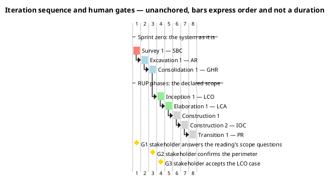
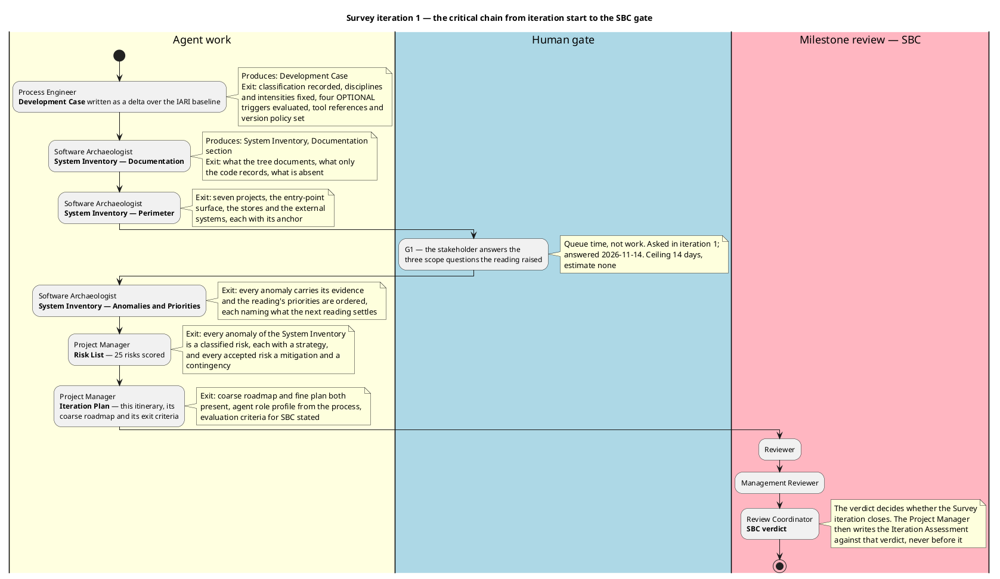

## Document Control

Phase: Survey
Status: Draft — Survey iteration 1 plan; the coarse roadmap and this iteration's work items recorded, exit criteria stated
Milestone Target: End-of-Survey (SBC) — not yet achieved

## Iteration Objectives

Survey iteration 1 is the sprint zero's first iteration. Its objective is to establish the two things every later iteration depends on: a governed process, and a read of the system that already exists.

1. Tailor the IARI Development Process for this project — the classification, the active disciplines, the OPTIONAL trigger verdicts, the stood-down roles and the version policy. Produced by the Process Engineer.
2. Read the delivered system to the depth its own priorities demand: the perimeter, the technology and size, the persistent data, the documentation, the history, the anomalies with their probabilities and impacts, and the reading priorities for Excavation. Produced by the Software Archaeologist.
3. Convert the anomalies the reading found into a scored, classified Risk List with a strategy, an owner, a mitigation and a contingency for every entry. Produced by the Project Manager.
4. Place those risks and the process into a plan: this Iteration Plan's coarse roadmap across the sprint zero and the four RUP phases, and the agent role profile that will execute it.

## Plan and Milestones

Two levels live in this section: the coarse cross-iteration roadmap, which is what the phases ahead look like, and the fine plan for this iteration, which is what is in front of the team now.

### Coarse roadmap — the milestone sequence

Eight iterations, one per phase except Construction, which takes two. The distribution is not the rubber profile's default: the sprint zero carries three of the eight because the architecture, the data model and the use cases are **recovered from a working system** rather than designed from nothing, so the phase in which architectural risk is retired is Excavation inside the sprint zero, and Elaboration's LCA becomes a baseline-confirmation iteration rather than a from-scratch architecture baseline.

| # | Iteration | Milestone | What the milestone gates | Reviewers, in order |
|---|---|---|---|---|
| 1 | Survey 1 | SBC | The perimeter of the existing system is confirmed by the stakeholder, its reading priorities are ordered, the unread areas are declared, and the anomalies are scored risks | Reviewer, Management Reviewer, Review Coordinator |
| 2 | Excavation 1 | AR | The recovered architecture, the Design Model with its persistent-data sections and the first recovered use cases are baselined; the two claims the reading marked as reading-only are settled by running the system | Reviewer, Management Reviewer, Review Coordinator |
| 3 | Consolidation 1 | GHR | Every use case is recovered, the Supplementary Specification carries the mechanisms, and the tailoring is confirmed | Reviewer, Management Reviewer, Review Coordinator |
| 4 | Inception 1 | LCO | The Vision, the use-case model of the declared scope, the candidate architecture, the build environment, the Change Request ledger and the CM strategy are in place | Reviewer, Business Reviewer, Management Reviewer, Review Coordinator |
| 5 | Elaboration 1 | LCA | The architecture baseline is executed and tested; the Test Manager's plan and the Test Designer's cases exist; the deployment plan is written | Reviewer, Business Reviewer, Management Reviewer, Review Coordinator |
| 6 | Construction 1 | — | The first construction increment: component implementation, iteration build, test execution, technical documentation | Reviewer, Management Reviewer, Review Coordinator |
| 7 | Construction 2 | IOC | The declared scope is implemented and tested against the recovered and declared acceptance criteria | Reviewer, Management Reviewer, Review Coordinator |
| 8 | Transition 1 | PR | Production deployment, acceptance testing, release notes, and the closure of the Change Request ledger | Reviewer, Management Reviewer, Review Coordinator |

Two properties of this roadmap are load-bearing:

- **Nothing is scheduled before its phase runs it.** The System Inventory's priorities name what Excavation reads; they do not ask Construction to read it. The Proof-of-Concept optional stays unfired until Elaboration re-evaluates it against the scored Risk List, as the Development Case records.
- **The plan's lever is iteration count, never parallel agent roles and never declared scope.** If a phase's exit criteria do not pass, the remedy is another iteration inside that phase at schedule cost. Declared scope is reduced only by a Change Request the stakeholder decides.

### Fine plan — this iteration's work items and their owners

| Work item | Owner | Produces | Why it is on the chain |
|---|---|---|---|
| Tailor the process for this project | Process Engineer | Development Case | Every later role reads it as the law of its work; nothing else can start without it |
| Read the documentation the delivery carries | Software Archaeologist | System Inventory — Documentation | Establishes what the tree records and what only the code records, including the cited-but-absent `CONTRIBUTING.md` (R006) |
| Read the perimeter | Software Archaeologist | System Inventory — Perimeter | The seven projects, the entry-point surface, the stores and the external systems — the anchor every recovered use case will point at |
| Answer the reading's scope questions | Stakeholder — human gate G1 | Three decisions recorded in the System Inventory | The reading found three facts whose disposition is the stakeholder's: the unreachable `admin` branches, the dormant external login, and the BFF-to-API trust gap. Answered 2026-11-14 |
| Read the anomalies and order the priorities | Software Archaeologist | System Inventory — Anomalies and Priorities | The raw material of the Risk List and the reading plan for Excavation |
| Score and classify the risks | Project Manager | Risk List | 25 risks, two in the High band, each with a strategy, an owner and a contingency |
| Write this plan | Project Manager | Iteration Plan | The coarse roadmap plus this iteration's items, so the next iteration can be built from a measured actual once the first phase closes |

**Spend.** No phase has closed, so no measured actual exists and this plan carries no forecast. Nothing here is sized in hours, days, weeks or person-anything: those units do not describe work this system performs, and an empty cell is correct where nothing has been measured. The two currencies are reported apart and never added — agent work in tokens and measured elapsed time, human gates in days of queue time. This project declares no token budget, and no declared scope is cut or deferred to fit an estimate.

| Clock | Position at plan time | What it will be used for |
|---|---|---|
| Agent work — tokens and elapsed time | Not yet measured; the Survey phase has not closed | Replaces every assumed share in the next forecast the moment SBC closes |
| Human queue time — gate G1 | Answered 2026-11-14; the queue duration is reported by the process, not estimated here | Decides whether gates should be batched into fewer points in later phases |

## Resources

The team is the agent roster the process assigns, not a staffed organisation. The profile below is read from the IARI Development Process and the Development Case's tailoring — no role here does work the process does not run in this phase.

| Role | Stage in this iteration | Produces | Notes |
|---|---|---|---|
| Process Engineer | Development Case | Development Case | Environment discipline, High in Survey. Also the owner of R006 and R025 — both are corrections to that artifact |
| Software Archaeologist | System Inventory — Documentation · Perimeter · Anomalies and Priorities | System Inventory | Discovery discipline, Critical in Survey. Owner of R002 and R005, the two risks about the limits of the reading itself |
| Project Manager | Risk List · Iteration Plan | Risk List, Iteration Plan | Project Management discipline, Low in Survey. Owns this artifact and the assessment that follows the verdict |
| Reviewer | SBC milestone review | Findings on the artifacts reviewed | First lens of the gate |
| Management Reviewer | SBC milestone review | Findings on the artifacts reviewed | Second lens of the gate; the lens that asks whether the milestone's business case holds |
| Review Coordinator | SBC milestone review | The SBC verdict | Decides whether the phase's milestone closes. Does not decide the Iteration Assessment — the Project Manager writes that against the verdict |

**Stood down for the whole project**, per the Development Case classification: Business Process Analyst and Business Reviewer (`business-process-led = false`), and Capsule Designer (`real-time-system = false`). They execute no stage in any iteration.

**Roles at work in later sprint-zero iterations**, recorded here so the roadmap is executable rather than aspirational: Software Architect (SAD and Deployment Model — the only FIRED optional artifact), Designer and Database Designer (Design Model with its persistent-data sections, Data Model not fired), System Analyst (Use-Case Model, Supplementary Specification, Vision — the artifacts Consolidation completes).

**Human gates.** The only human in this system is the stakeholder. Their gates are the three gold markers in the coarse roadmap. A gate is bounded in the Risk List, never forecast in the plan: ceiling 14 days, after which the process suspends rather than filling the gap with an assumption; estimate none; the actual measured and reported apart from agent time.

## Use Cases and Scenarios Addressed

None. Survey is the sprint zero, and the process runs no use-case work in it: the Use-Case Model is recovered in Excavation and completed in Consolidation, where each use case is enumerated one per endpoint surface performing a distinct user-observable outcome, with the authentication, rate-limiting and telemetry mechanisms excluded as mechanisms.

This is not a gap in the plan but the phase's definition. Nothing is declared against this section, and the Development Case records why: on this project the requirements are recovered from a working system, so the phase that would otherwise analyse a declared scope instead reads what exists.

## Evaluation Criteria

The exit criteria for this iteration are the SBC milestone's. They are the stakeholder's and the process's, not criteria this plan invents.

| # | Criterion | How it is evidenced | State at plan time |
|---|---|---|---|
| 1 | The perimeter of the existing system is confirmed by the stakeholder | System Inventory, Perimeter — seven projects, the entry-point surface, the stores and the external systems, each anchored; the three scope questions put to the stakeholder for the facts whose disposition is theirs | Met pending the gate — the perimeter is recorded and the questions were answered on 2026-11-14; the Reviewer's lens decides whether the record is adequate |
| 2 | The reading priorities are ordered | System Inventory, Priorities — eight areas ordered, each naming what the next reading must settle | Met pending the gate |
| 3 | The unread areas are declared rather than omitted | System Inventory, Coverage — six declared-unread groups and the two statements marked as read but not observed | Met pending the gate |
| 4 | Every anomaly is a classified risk | Risk List — 25 risks, each scored for probability and impact, its magnitude the band of their product, and each given a strategy, an owner, a mitigation and, where accepted, a contingency | Met pending the gate |
| 5 | The process is tailored and the tailoring is auditable | Development Case — classification, disciplines and intensities, four OPTIONAL triggers with the evidence for each verdict, four tool references, version policy | Met pending the gate |
| 6 | The plan instantiates the process and schedules no work the phase does not run | This artifact — the coarse roadmap names only the roles and artifacts the process assigns to each phase; the fine plan names only the three roles Survey runs | Met pending the gate |

Criterion 1 is the one that can fail. If the Reviewer or Management Reviewer finds the perimeter under-evidenced — most likely for the files the reading declared unread, or for the two statements it marked as read rather than observed — the iteration does not close, and the remedy is a further Survey iteration that opens those files. That is the iteration-count lever, and it protects the accuracy of the perimeter at schedule cost. It is never answered by adding agent roles in parallel, and never by narrowing what counts as the perimeter.

**Not an exit criterion:** the risk scores are judgements, and a reviewer may disagree with a score without failing the milestone. What must hold is that every anomaly is classified and that no High or Significant risk rests on acceptance nobody granted.
