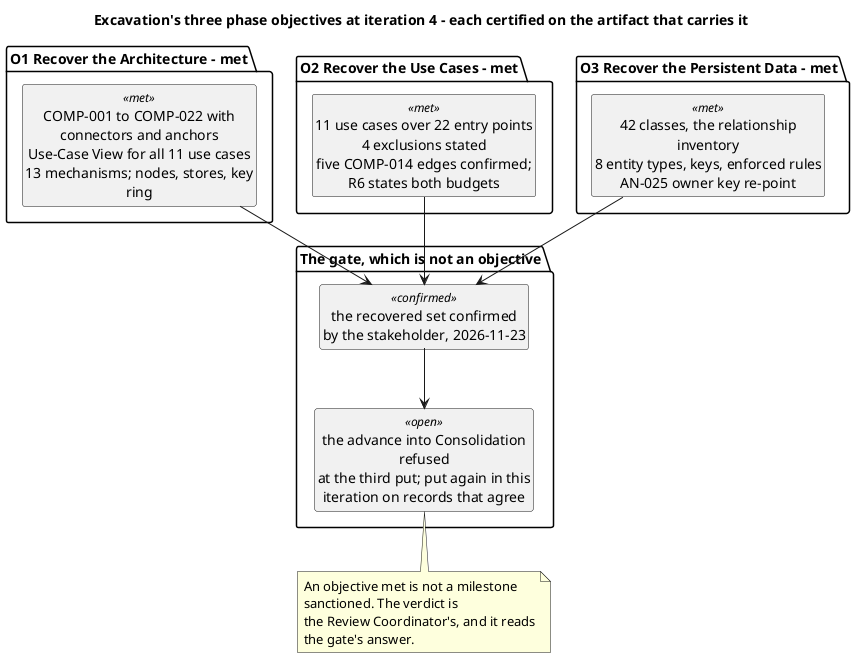
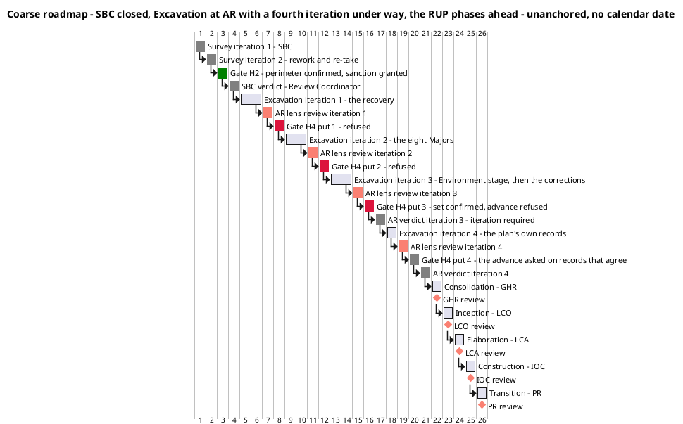
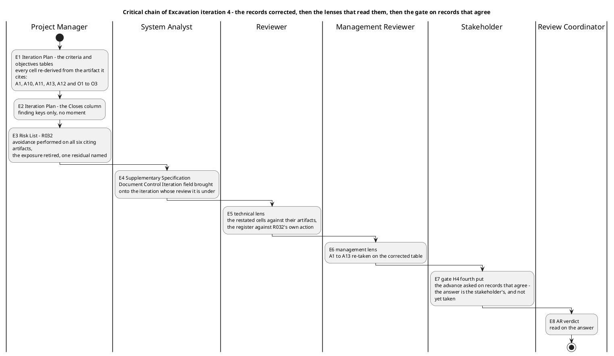
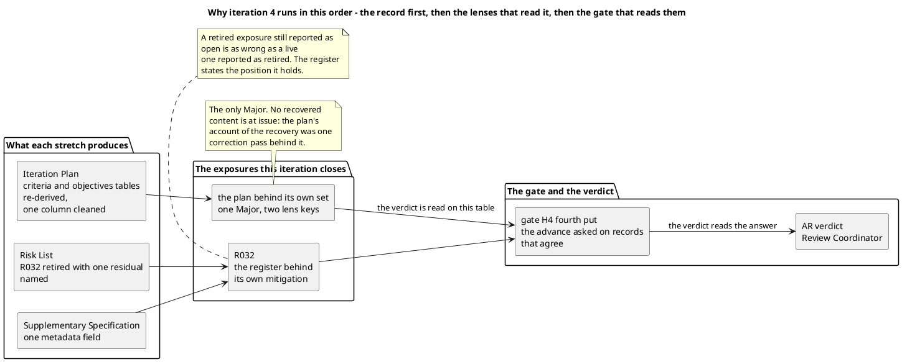
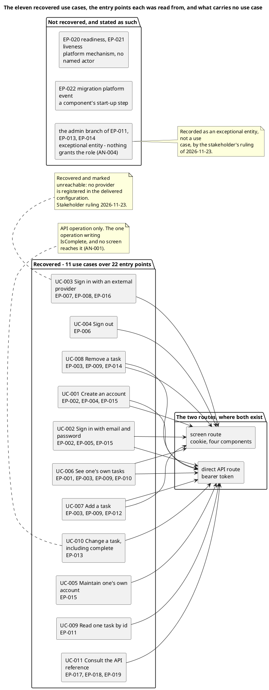
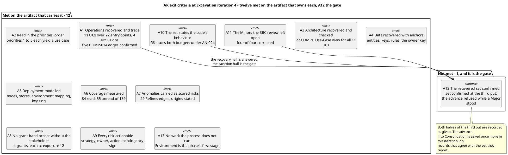

## Document Control
- Phase: Excavation
- Status: Iteration 4 correction pass performed by the plan's two owners; the AR verdict is the Review Coordinator's and is not yet given
- Milestone Target: end-of-Excavation (AR) — not achieved
- Iteration: 4, Cycle 1
- Owner: Project Manager

## Iteration Objectives
Excavation recovers what the existing system is into the models the rest of the project works from. It is the sprint zero's second phase: the SBC milestone is passed, and nothing the stakeholder declares is worked here — the delivery declares no scope, so every element this phase writes is read from code and cites its anchor.

The phase planned three objectives. The standing column states each one's outcome on the artifact the objective rests on, re-derived at this iteration from that artifact.

| # | Objective | Satisfied when | Owner | Standing at iteration 4 |
|---|---|---|---|---|
| O1 | Recover the Architecture | The Software Architecture Document records the components and connectors and the mechanisms, technology and deployment as the code shows them, and the deployment topology is modelled | Software Architect | **Met** — `COMP-001` to `COMP-022` with their connectors and anchors, the Use-Case View naming the components each of the eleven use cases' path crosses, 13 mechanisms, and the Deployment Model's nodes, stores, environment mapping and key-ring requirement. `Software Architecture Document#F1` and `Deployment Model#F1` are closed and verified at SP1, M3, the Quality view's bounded-load row and the Rate limiting row, all reading 50 / 50 / 50 as the bound in force under `AN-024`. No finding stands against either artifact from any lens |
| O2 | Recover the Use Cases | The Use-Case Model carries one use case per entry-point path, each tracing to the `EP-NNN` it was read from, and accounts for every entry point it does not carry | System Analyst | **Met** — 11 use cases over 22 entry points, each with its `EP-NNN`, and the four exclusions stated with their reasons. `Use-Case Model#F3` is closed on a fresh query of `COMP-014` upstream returning five `Realizes` edges to `UC-006` to `UC-010`, none marked suspect, and `Use-Case Model#F4` on the rules diagram's R6, which now states both budgets under `AN-024` — Development in force at 50 / 50 / 50 from `appsettings.Development.json:8-12`, code defaults 100 / 100 per 10 s / queue 100 from `RateLimitExtensions.cs:14-31`. Neither correction added, removed, merged or reclassified a use case; no exclusion is re-opened, and the stakeholder confirmed the set as the model of their system on 2026-11-23 |
| O3 | Recover the Persistent Data | The Design Model carries the domain model, the packages and classes, and the persistent data with its entities, keys, associations and enforced rules | Designer, Database Designer | **Met** — 42 classes, the relationship inventory, the eight entity types, the owner key's re-point under `AN-025` and "What the code does not hold", each anchored to `TodoDbContext.cs:11-17` and the three migrations. `Design Model#F1` closed, and no lens recorded a finding against this objective in any iteration |

All three objectives are met on the artifacts that carry them, and the recovered content they describe is the set the stakeholder confirmed on 2026-11-23 — eleven use cases, four stated exclusions, twenty-two components, eight tables. An objective met is not a milestone sanctioned: the advance into Consolidation was refused at the third put while a Major stood, the Major was this plan's own record of the recovery and is corrected in this pass, and the advance is asked once more on records that agree with the set they report. Declared work is never cut to avoid the iteration it costs.

## Plan and Milestones
The plan is two-level. The **coarse roadmap** fixes the milestone sequence, the intensity each phase runs at and which risks each milestone confronts. The **fine plan** is the current iteration's work items with their owners, bounded to Excavation. What a completed iteration delivered and what it cost is recorded in the Iteration Assessment, not here.

### Coarse roadmap — the milestone sequence

No bar carries an absolute date or a projected calendar span. The one-day and two-day lengths are the diagram's sequencing device, not durations claimed for the work: spend is measured in the two currencies — tokens and agent time, apart from stakeholder queue time — and never as a span. Each human gate sits ahead of the verdict it feeds, because the verdict reads the answer. A gate bar is coloured for the outcome it has; the fourth put's outcome is not yet taken and no colour of sanction is pre-declared.

| Order | Phase | Milestone | Discipline intensity | Risks this milestone confronts | What the milestone is judged on |
|---|---|---|---|---|---|
| 1 | Survey | SBC — passed | Environment High, Discovery Critical, Project Management Medium | Carried R001 to R021 into the register; R016, R012, R004 and R011 granted for the sprint zero. SBC retires none of the reading's risks — it makes them owned | The perimeter and its priorities stated, and the anomalies carried as scored risks. Met at the re-take on 2026-11-23 |
| 2 | Excavation | AR — iterations 1 to 3 reviewed, iteration 4 under way | Environment Low, Requirements High, Analysis & Design Critical, Discovery Critical, Project Management Medium | R001, R004, R019, R020, R021, R023, R028, R030 (System Analyst); R002, R009, R010, R017, R024, R025, R015 (Software Architect); R003, R018, R027 (Designer); R026, R029 (Database Designer); R031 and R032 (the plan's own exposures — R031's contingency performed in iteration 3, R032's avoidance performed on all six citing artifacts) | The recovered use cases, architecture, design and deployment rest on anchors and state the code's behaviour; the coverage is measured; the stakeholder confirms the recovery at gate H4. **Iterations 1 to 3 did not close it: H4 refused three times, and at the third the set was confirmed while the advance was refused.** Twelve of thirteen criteria hold on the artifact that owns each; the one Major was this plan's own account of the recovery, corrected in iteration 4 |
| 3 | Consolidation | GHR | Environment Low, Requirements High, Analysis & Design Medium, Discovery Critical, Project Management Medium | Completes R003 and R010 where the recovered set is closed; confirms R015's volatility statement against the orchestration as it stands; R030's statement is read again if the session surface moves | Every use case, the Supplementary Specification and the Glossary trigger are complete; the coverage is final |
| 4 | Inception | LCO | Environment High, Requirements Critical, Project Management High, Analysis & Design Medium, Implementation Medium, Test Low, Deployment Low, CM Medium | R007, R013, R014 (Integrator, Build Environment Setup); the Change Request ledger opens and every later gate depends on it | The declared change is scoped, a candidate architecture exists, the CM strategy is set, the Change Request ledger is opened |
| 5 | Elaboration | LCA | Environment Medium, Analysis & Design Critical, Requirements High, Implementation Medium, Test Medium, Project Management Medium, CM Medium, Deployment Low | R012, R011, R005 (Test Manager and Test Designer); R006, R029 (the test project is next touched here) | The architecture baseline is accepted and an executable architecture is built |
| 6 | Construction | IOC | Environment Low, Implementation Critical, Test Critical, Requirements Medium, Analysis & Design High, Project Management High, Deployment Medium, CM High, Business Modeling Low | Completes R012's coverage of the client's todo flow; R008 (Technical Writer, User Documentation); R027 and R024 corrected in the implementation they constrain | The declared scope is implemented and its test evaluation is recorded |
| 7 | Transition | PR | Environment Low, Deployment Critical, Test High, Project Management Medium, Implementation Medium, Requirements Low, Analysis & Design Low, CM Medium | Closes what remains: R011's contingency is taken only if a deliberate upgrade lands before the release; R026 becomes a release-blocking conversion if a pre-existing database is in the release's path | The release build is baselined and acceptance-tested; the Change Requests are closed |

**Environment runs in every phase, and in Excavation it is the first discipline at Low intensity.** That is the baseline the stakeholder restated at the AR re-take of 2026-11-23; the Process Engineer held the stage in iteration 3 and the tailoring document is now on that baseline. The fourth iteration schedules no Environment item: nothing it corrects is a Development Case section.

Sequencing is driven by the Risk List, not by convenience. The risks whose actions the System Analyst performs landed in Excavation because it is the one that writes the recovered use-case model; the architecture risks landed beside them because the SAD is recovered from the same code. R007 — the build that cannot build the tree — waits for Inception because that is the first phase the Integrator works, and no plan here schedules it earlier.

### This iteration's fine plan

The fourth iteration is one correction pass over records, on the stakeholder's own statement that no recovered content is at issue. Three of the four correctives are this plan's own, and the fourth is one metadata field on the Supplementary Specification. No item touches the recovered set.

| # | Work item | Stage | Owner | State | Closes |
|---|---|---|---|---|---|
| 1 | Iteration Plan — every cell of the criteria and objectives tables re-derived from the artifact it cites: A1 "Met" with the five `COMP-014` edges requoted from a fresh graph query; A10 "Met — certified on the recovered set", the Use-Case Model's R6 named as the fourth artifact with its wording under `AN-024`; A11 "Met — four of four"; A13 restated on this iteration's own items; A12 recording the third put in both halves; O1 to O3 restated at the state their artifacts hold. No superseded sentence requoted | Project Management | Project Manager | Corrected in this pass; re-derived from each artifact's current text | `Iteration Plan#F4`, `Iteration Plan#F9` |
| 2 | Iteration Plan — the fine plan's Closes column names finding keys only; no moment and no narrative of when the work happened | Project Management | Project Manager | Corrected in this pass | `Iteration Plan#F8` |
| 3 | Risk List — `R032` restated: the avoidance performed on all six citing artifacts with R6 named and its wording under `AN-024`, the exposure recorded as retired, the one residual named as the contingency — the four artifacts re-read in a single pass. `R030` and `R031` unchanged | Project Management | Project Manager | Corrected in this pass | `Risk List#F3` |
| 4 | Supplementary Specification — Document Control brought onto the iteration whose review the artifact is under; no other field and no content | Requirements | System Analyst | Document Control reads iteration 4, Cycle 1 | `Supplementary Specification#F3` |
| 5 | Technical lens re-run against the restated cells and the register | Review | Reviewer | Not yet run this iteration | — |
| 6 | Management lens — A1 to A13 re-taken on the corrected table | Review | Management Reviewer | Not yet run this iteration | — |
| 7 | Gate H4, fourth put — the recovered set already confirmed at the third put; the advance into Consolidation asked once on records that agree with it | Gate | Stakeholder | Not yet put | `A12`, and the milestone |
| 8 | AR milestone verdict | Review | Review Coordinator | Not yet given | — |

**Two currencies, never summed.** Items 1 to 6 and 8 are agent work, quoted in tokens and measured elapsed agent time. Item 7 is a human gate — waiting, not working — quoted only in days of queue time.

**The rule this iteration writes into the plan.** A cell that asserts another artifact's state is re-derived from that artifact in the same turn the artifact changes. Four consecutive AR passes recorded the same defect class against this plan — `#F3`, `#F6`, `#F4`, `#F9` — and each was found by the lens that recorded it. The lenses caught every one; the plan kept producing them. The remedy is not a better warning but the rule: the table is corrected as a table, never one cell at a time.

**Nothing is added and nothing is cut.** The iteration count rises by one for a record correction, not for recovery: declared work is untouched, no agent role is added or duplicated, and no recovered element changes. `R031`'s contingency — a further iteration planned from the record — was taken and performed in iteration 3; `R032`'s avoidance is performed on all six citing artifacts and the exposure is retired.

### Risk-driven sequencing of this iteration

The order is the Review Record's own priority: the Major before the Minors, the record before the lenses that read it, and the gate put once — on records that agree with the set they report — rather than a fourth time on a record that does not.

### Measured actuals and the forecast

Measured, not estimated, and quoted as the closed phases deliver them. Agent work and stakeholder queue are two clocks and are never added.

| Closed phase | Iterations | Agent time | Stakeholder queue | Tokens | Agent runs | Artifacts |
|---|---|---|---|---|---|---|
| Survey | 2 | 29 min | 5 min | 8,995,433 | 10 | 6 |
| Excavation | 3 | 28 min | 7 min | 14,424,767 | 17 | 12 |

Both sprint-zero phases have now closed a measuring record. Excavation's covers iterations 1 to 3 and is the nearest comparable to this one: same phase, same roles, same artifact surface. No per-iteration figure is quoted and none is derived from it — the record is per phase, and a velocity computed by dividing it would be a number this system does not measure.

`[ASSUMPTION — requires validation: iteration 4 costs less in tokens and in elapsed agent time than the three iterations Excavation's measured record covers, taken as a whole. The basis is the shape of the work — four corrections, each a cell or a field in a section that already exists, with no artifact read in full and no recovered element re-derived — against three iterations that recovered an architecture, eleven use cases, a design and a deployment model. No record-only iteration has been measured yet, so the figure is not quotable and none is quoted]`

No figure is projected for the phase as a whole: Excavation has not closed at its milestone, so its cost is not final and is not reported as one. The project declares no token budget, so there is no box to fit: no figure is proposed for the stakeholder to accept, and no declared work is cut or deferred to meet an estimate.

The chain is sequential at its load-bearing points: four corrections precede the lenses that re-read them, and the gate follows the lenses. Adding agent roles would buy no clock and would add contention over the same artifact surface — four corrections across two owners, one turn each, is not work a third owner shortens.

| Human gate | Who | What the iteration waits for | Bound | Answer |
|---|---|---|---|---|
| H4 | Stakeholder | The advance into Consolidation, on records that agree with a recovered set already confirmed as the model of the existing system | `R022` — ceiling 14 days of queue time; on expiry the process suspends and nothing is auto-filled | **Put three times.** Refused at the first and second; at the third the recovered set was confirmed and the advance refused while a Major stood. The fourth put is this iteration's item 7 and is not yet answered. Excavation's three puts cost a measured 7 min of queue time across the phase, reported apart from agent time and never added to it |

## Resources
The roles are the 26-role roster of the IARI DC baseline, minus the two the Development Case records as not working in this project. No role is added, merged or renamed.

**Environment runs in every phase.** The stakeholder restated the baseline at the AR re-take of 2026-11-23: the process runs Environment in every phase, and in Excavation it is the phase's first discipline, at Low intensity, with the Process Engineer's stage. Iteration 3 held that stage and the tailoring document is now on the baseline. The fourth iteration schedules no Environment item: nothing it corrects is a Development Case section.

| Role | Discipline | Iterations 1–2 | Iteration 3 | Iteration 4 | Why |
|---|---|---|---|---|---|
| Project Manager | Project Management | Yes | Yes | **Yes** | Corrects its own record: the five cells of the criteria and objectives tables, the fine plan's Closes column, and `R032`'s strategy cell. Three of the four open findings are this role's |
| System Analyst | Requirements | Yes | Yes | **Yes** | One metadata field on the Supplementary Specification; no recovered content changes |
| Reviewer | Review | Yes | Yes | **Yes** | Technical lens on the restated cells and the register |
| Management Reviewer | Review | Yes | Yes | **Yes** | Management lens — A1 to A13 re-taken, and the gate put |
| Review Coordinator | Review | Yes | Yes | **Yes** | AR milestone verdict, read on the answer |
| Process Engineer | Environment | **Did not run** — no stage recorded | **Yes — the phase's first discipline, at Low** | No | Its three turns ran in iteration 3: `Development Case#F2` and `#F3` are closed and the tailoring states the baseline. No finding remains against the document |
| Software Architect | Analysis & Design | Yes | No | No | Both its Majors are closed; no finding remains against the Software Architecture Document or the Deployment Model |
| Designer | Analysis & Design | Yes | No | No | `Design Model#F1` closed; no finding remains |
| Database Designer | Analysis & Design | Yes | No | No | No finding was recorded against the persistent data in any iteration |
| Software Archaeologist | Discovery | Yes | No | No | The System Inventory has no open finding; both lenses recomputed its coverage and it reproduces |
| Requirements Specifier | Requirements | No — Elaboration | No — Elaboration | No — Elaboration | Use-case detail and NFR thresholds are written against a declared scope; the delivery declares none |
| User Interface Designer | Analysis & Design | No — Elaboration | No — Elaboration | No — Elaboration | Storyboards and the navigation map follow the use-case specification |
| Capsule Designer | Analysis & Design | No — inactive | No — inactive | No — inactive | `real-time-system = false` |
| Business Process Analyst | Business Modeling | No — inactive | No — inactive | No — inactive | `business-process-led = false` |
| Implementer | Implementation | No — Inception | No — Inception | No — Inception | No code is written in the sprint zero |
| Integrator | Implementation | No — Inception | No — Inception | No — Inception | The build environment is set up in Inception; `R007` waits on it |
| Code Reviewer | Implementation | No — Elaboration | No — Elaboration | No — Elaboration | — |
| Test Manager | Test | No — Inception | No — Inception | No — Inception | No Test Plan is triggered |
| Test Designer / Tester / Test Analyst | Test | No — Elaboration | No — Elaboration | No — Elaboration | No test case is written before a use case is specified |
| Deployment Manager | Deployment | No — Inception | No — Inception | No — Inception | The Deployment Model is recovered here; the deployment plan is Inception's |
| Technical Writer | Deployment | No — Construction | No — Construction | No — Construction | — |
| Configuration Manager | Configuration & Change Management | No — Inception | No — Inception | No — Inception | No baseline exists yet |
| Change Control Manager | Configuration & Change Management | No — Inception | No — Inception | No — Inception | The Change Request ledger is opened at LCO |

The stakeholder is not an agent role: they are the only human in the process, and their work is gate H4 — put three times, answered with the set confirmed and the advance refused, and put once more on records that agree with it.

**The role profile narrows, and this is the intended direction.** Iteration 3 ran six agent roles; the fourth runs five, because the one correction that needed the Software Architect, the Designer and the Database Designer is behind the phase. A smaller profile is not a cheaper plan: it is what remains when the recovery is done and only the record of it is behind.
## Use Cases and Scenarios Addressed
Eleven use cases, recovered from the 22 entry points the System Inventory records. Every use case traces to the `EP-NNN` whose code performs it, and no use case is recovered from an intent the code does not carry. Every anomaly cited below is cited for the fact the System Inventory's Anomalies table gives it.

| Use case | Primary actor | Recovered from | What the recovery may not claim, and where that is carried |
|---|---|---|---|
| `UC-001` Create an account | ACT-001, ACT-003 | `EP-002`, `EP-004`, `EP-015` | That a refusal names its cause: the API answers validation problems and the BFF discards them, so every authentication failure reaches the person as one 401 with no body (`AN-021`, `AN-020`) |
| `UC-002` Sign in with email and password | ACT-001, ACT-003 | `EP-002`, `EP-005`, `EP-015` | That a failed sign-in distinguishes a wrong password from a locked or absent account — one 401 covers all three (`AN-021`) — and that lockout ends the access a token already holds: the guard checks it at sign-in alone (`AN-022`) |
| `UC-003` Sign in with an external provider | ACT-001, with ACT-002 authenticating | `EP-007`, `EP-008`, `EP-016` | That it is reachable: no provider is registered in the delivered configuration. Recovered and marked unreachable, per the stakeholder's ruling of 2026-11-23. Also that a callback reports its outcome — it redirects to `/` on every path (`AN-020`) — and that the scheme is checked: it is taken straight from the route (`AN-019`) |
| `UC-004` Sign out | ACT-001 | `EP-006` | That the provider's own session ends: one call signs the local cookie scheme out and nothing else (`Todo.Web/Server/AuthApi.cs:40-52`) |
| `UC-005` Maintain one's own account | ACT-003 | `EP-015` | That a screen reaches it: the client's six operations contain no account-maintenance call, so the framework's endpoint set is mapped with no UI path to it (`Todo.Web/Client/TodoClient.cs:7-71`) |
| `UC-006` See one's own tasks | ACT-001, ACT-003 | `EP-001`, `EP-003`, `EP-009`, `EP-010` | That the list honours the `admin` role: it filters on the owner alone while the item endpoints admit the role, so the four statements disagree (`AN-018`). Also that an unreachable API is distinguishable from an empty list — an absent base address answers `200` and no rows (`AN-026`) |
| `UC-007` Add a task | ACT-001, ACT-003 | `EP-003`, `EP-009`, `EP-012` | That a create body can set a row complete: the insert copies the title alone, so `IsComplete` is created false whatever the body says (`Todo.Api/Todos/TodoApi.cs:38-50`) |
| `UC-008` Remove a task | ACT-001, ACT-003 | `EP-003`, `EP-009`, `EP-014` | That another person's row is distinguished from one that does not exist: the delete filters on the owner and answers 404 either way, never 403 (`Todo.Api/Todos/TodoApi.cs:67-73`) |
| `UC-009` Read one task by id | ACT-003 | `EP-011` | That a screen reaches it: none does. An API operation only. Its `admin` branch is the exceptional entity `AN-004` records — nothing in the running system grants the role |
| `UC-010` Change a task, including marking it complete | ACT-003 | `EP-013` | That a user-facing path completes a task: the client makes no update call and the list's checkbox is bound to nothing, so the only operation writing `IsComplete` has no screen (`AN-001`) |
| `UC-011` Consult the API reference | ACT-003 | `EP-017`, `EP-018`, `EP-019` | That a Swagger UI is mounted, as the README states — the code mounts the Scalar reference UI (`AN-008`) — or that the root redirect resolves outside Development, where that UI is not mapped (`AN-017`) |

Three entry-point groups carry no use case and the Use-Case Model says why: `EP-020` and `EP-021` are a platform mechanism with no actor the delivery names, `EP-022` is a component's start-up step, and the `admin` branch of `EP-011`, `EP-013` and `EP-014` is an exceptional entity no running caller can enter — the stakeholder's ruling of 2026-11-23, recorded in the System Inventory's Perimeter and in `AN-004`.

**Scenarios.** Five of the eleven carry two scenarios rather than one: `UC-001`, `UC-002`, `UC-006`, `UC-007` and `UC-008` have a screen route and a direct API route. They are one use case with two scenarios, never one use case per actor: the two routes reach the same operation and differ only in how the caller authenticated.

**Nothing is qualified.** Both findings that bore on the count at iteration 2 are closed and verified at the Use-Case Model: the five `COMP-014` `Realizes` edges are confirmed in the registered graph, so the shared throttling mechanism is certified for the five use cases that cross it, and the rules diagram's R6 states both request budgets under `AN-024`. The set the fourth iteration hands to Consolidation is the set the stakeholder confirmed on 2026-11-23 — eleven use cases, four exclusions, twenty-two components, eight tables — with no outstanding qualification against `UC-001` to `UC-011`.
## Evaluation Criteria
The exit criteria for this iteration's milestone (AR). Each is decided on the evidence the artifact it cites records, never on an adjacent artifact's answer: a criterion about the recovered set is certified on the recovered set, and one about a role's artifact is certified on that artifact's text. An evidence cell names only sections the cited artifact carries, and is re-derived from its artifact each time that artifact moves.

| # | Criterion | Met when | State | Evidence |
|---|---|---|---|---|
| A1 | The operations the system performs are recovered as use cases | Every use case traces to the entry point whose code performs it, and every entry point is either carried or its exclusion stated | Met | Use-Case Model — Use-Case Survey: `UC-001` to `UC-011`, each with its `EP-NNN` list; "Not recovered, and why" accounts for `EP-020`, `EP-021`, `EP-022` and the `admin` branch of `EP-011`, `EP-013`, `EP-014`. Carriage is intact and the shared mechanism is confirmed for every use case that crosses it: a fresh query of `COMP-014` upstream returns five `Realizes` edges — `UC-006`, `UC-007`, `UC-008`, `UC-009`, `UC-010` — and none carries a SUSPECT marking. `Use-Case Model#F3` and `#F1` are closed on that reading |
| A2 | The recovered use cases are read from the priorities the reading ordered first | Priorities 1 to 5 of the System Inventory each yield at least one recovered use case, and the recovery follows the order the stakeholder confirmed on 2026-11-23 | Met | System Inventory — Priorities: areas 1 to 5, the API's todo operations, its authorization, the BFF, the screens and the tests. The eleven use cases trace to `EP-NNN` in each of those five areas. The criterion claims nothing about priorities 6 to 8, and no deferred-set statement is required of any artifact for this row to hold |
| A3 | The architecture is recovered and checked against the use cases | The Software Architecture Document's components carry the paths the recovered use cases take, and every use case is reachable through a component it names | Met | Software Architecture Document — Logical View (`COMP-001` to `COMP-022` with their connectors) and Use-Case View, which names the components each of the eleven use cases' confirmed path crosses. SP1, M3 and the Quality view's bounded-load row state 50 / 50 / 50 as the bound in force under `AN-024`. `Software Architecture Document#F1` closed |
| A4 | The data is recovered with its anchors | The persistent entities, keys, associations and enforced rules are recorded, each with the file it was read from | Met | Design Model — persisted domain classes (`DM-D1`, `CLS-001` `Todo`, `CLS-007` `TodoUser`, `CLS-006` `TodoDbContext`), the relationship inventory, and "What the code does not hold", each anchored to `TodoDbContext.cs:11-17` and the three migrations; `AN-025` recorded against the owner key. `Design Model#F1` closed |
| A5 | The deployment is modelled | The fired OPTIONAL exists and records the processes, the stores and what must be shared between them | Met | Deployment Model — its §5.2 trigger is recorded fired; Deployment Topology, Nodes and Connectors, and Environment Mapping state the processes, the stores, the ports, the shared key ring (`AN-010`) and the database directory (`AN-013`); the preamble is narrowed to what the files hold and the Rate limiting row reads 50 / 50 / 50 for Development. `Deployment Model#F1` closed |
| A6 | The coverage is measured and the remainder declared | Every file is either read or named with the reason it was not, and the headline figure reproduces from the per-area table | Met | System Inventory — Coverage: 84 opened and 55 unread of 139, the per-area Read column summing to 84 and its Files column to 139, every unread file named by category with none carrying a perimeter fact. Both lenses recomputed the arithmetic and it reproduces |
| A7 | Every anomaly the recovery surfaced is carried as a scored risk | No anomaly maps to no risk, and every score reproduces from the one published mapping | Met | Risk List — Risk Register: 29 `Refines` edges from `AN-NNN`, plus `R022`, `R031` and `R032`, whose separate origins are stated in the register; every anomaly-derived row reproduces from the mapping in Risk Classification |
| A8 | No accepted risk above Moderate lacks the stakeholder's grant | No risk the register places at Significant or High is accepted on the Project Manager's authority | Met — 2026-11-23 | Risk List — the grant table under Risk Register: four grants on `R004`, `R011`, `R012` and `R016`, each at 4 × 3 = 12, recorded verbatim. No risk in the grant band takes the accept strategy, so no second grant was needed and none is assumed |
| A9 | Every risk is actionable | Every risk names a strategy, an owner, an action, a contingency and a warning sign | Met | Risk List — Risk Mitigation and Contingency: every row names a strategy, an owner, an action, a contingency and a warning sign. `Risk List#F2` closed on `R030`'s corrected strategy; `R032` states its avoidance as performed on all six citing artifacts, its exposure retired and its one residual confirmation named |
| A10 | The recovery states what the code does, not what it was meant to do | No artifact in the recovered set states a behaviour the code contradicts, and where code and document disagree the code is recorded and the contradiction identified against its anchor | Met — certified on the recovered set | Decided on all four artifacts the criterion's own test names. **Supplementary Specification** M3, S2, P1 and R8 state the code defaults (100 tokens, 100 per 10 s, queue 100) and the Development override (50 / 50 / 50) as two values in force, citing `AN-024`; R4 states the two outbound hops apart, the token hop inheriting the standard resilience handler and the forwarder hop nothing, citing `AN-023` — verified. **Software Architecture Document** SP1, M3 and the Quality view's "Availability — bounded load" row state 50 / 50 / 50 as the bound in force — verified. **Deployment Model** Environment Mapping's preamble is narrowed to what is true and its Rate limiting row reads 50 / 50 / 50 for Development — verified. **Use-Case Model** — the fourth of the four, verified corrected: the rules diagram's R6 states "In force: 50 tokens, 50 per 10 s, queue 50. Code defaults: 100 tokens, 100 per 10 s, queue 100. Over budget answers 429", under `AN-024`, its note citing `RateLimitExtensions.cs:14-31` and `appsettings.Development.json:8-12`; the artifact's two diagrams give one answer to one question. `Use-Case Model#F4` is closed on that reading |
| A11 | The Minors the SBC review left open are closed | Each is corrected in the artifact that carries it | Met — four of four, as the SBC review counted them | Each holds a closure verified at the artifact. `Iteration Plan#F2` (C2b no longer exists; A1 to A13 replace it) and `Iteration Plan#F3` (the State column states each row's actual outcome) were corrected in iteration 1. `System Inventory#F3` (Document Control names the iteration its content belongs to) was corrected in iteration 1. `Development Case#F2` — "Roles and Ownership" names every contributor: Reviewer, CodeReviewer, Management Reviewer, Business Reviewer, Review Coordinator, plus the Configuration Manager's baseline record, and CLS-DC-01 draws the edges into the Review Record. `Development Case#F3` — Document Control reads Phase: Excavation, Iteration 3, Cycle 1, and the tailoring states Environment active in every phase. Both Development Case corrections were performed by the Process Engineer in the Environment stage this plan records as the phase's first discipline. The criterion stays as written: corrected in this phase, not carried to Inception |
| A12 | The recovered set is confirmed by the stakeholder | Gate H4 answered Yes: the 11 use cases, the architecture and the data accepted as the models of the existing system | **Not met — the set confirmed, the advance refused** | Gate H4 was put for the third time on 2026-11-23. Both halves of the answer are recorded as given and neither is read for more than it says: the recovered set **is confirmed** as the model of the existing system — eleven use cases, four stated exclusions, twenty-two components across four processes, eight tables, nothing wrong or missing and no exclusion re-opened; and the **sanction to advance past the AR milestone was refused** while a Major stood. The criterion is the gate, and it opens on the sanction: the advance is asked once more at this iteration's fourth put, on records that agree with the set they report. No condition is added beyond the answer, and no artifact holds it — it is cited and not re-derived |
| A13 | The plan names no work the process does not run | The milestone sequence is recorded and each work item belongs to a stage the IARI DEVELOPMENT PROCESS runs in Excavation | Met | Decided on the plan's own sequence, not on whether the stage's work has been performed. Milestone sequence, coarse roadmap and Resources record **Environment** as this phase's first discipline at Low intensity, running in every phase: the row `Excavation iteration 3 - Environment stage, then the corrections` sits in the Gantt with its fine-plan items 1 to 3 against the Process Engineer, and iteration 4 schedules no Environment item because nothing it corrects is a Development Case section. Every item of this iteration belongs to a stage the process runs here: Project Management (items 1 to 3), Requirements (item 4), Review (items 5 and 6), Gate (item 7, the stakeholder's), Review (item 8). No item schedules work a phase before Elaboration or Inception performs. The stage is cited as a discipline stage of this phase, not as a stakeholder order. `Iteration Plan#F7` closed on it |

**Twelve met on the artifact that owns each; A12 not met, its recovery half answered and its sanction refused.** No criterion is certified on another's answer and no finding is waived by a criterion's state. The milestone does not close, and the reason is the gate, not the record: every cell above was re-derived from the artifact it cites after that artifact's correction landed.

**A cell that asserts another artifact's state is re-derived from that artifact in the same turn the artifact changes, not at the next milestone.** The four findings this table drew in three consecutive passes — `Iteration Plan#F3`, `#F6`, `#F4`, `#F9` — were one class of defect, and the rule is now the plan's: the table is corrected as a table, and no cell quotes a superseded sentence.

Two criteria are certified on a role's turn and not on this role's reading: A11 on the Process Engineer's Environment stage, and A10 on four artifacts of which three belong to other roles. Each was verified at the artifact after the turn, never on the owner's report of it. A12 is certified on nothing this role can read: it is the stakeholder's answer, recorded in gate H4 as given.

