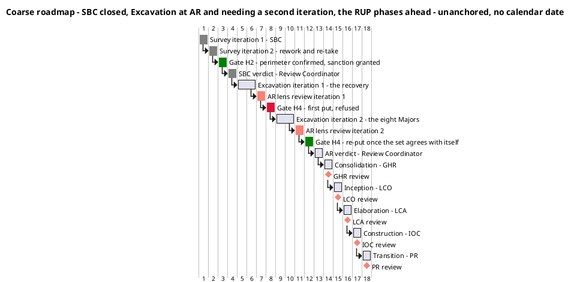
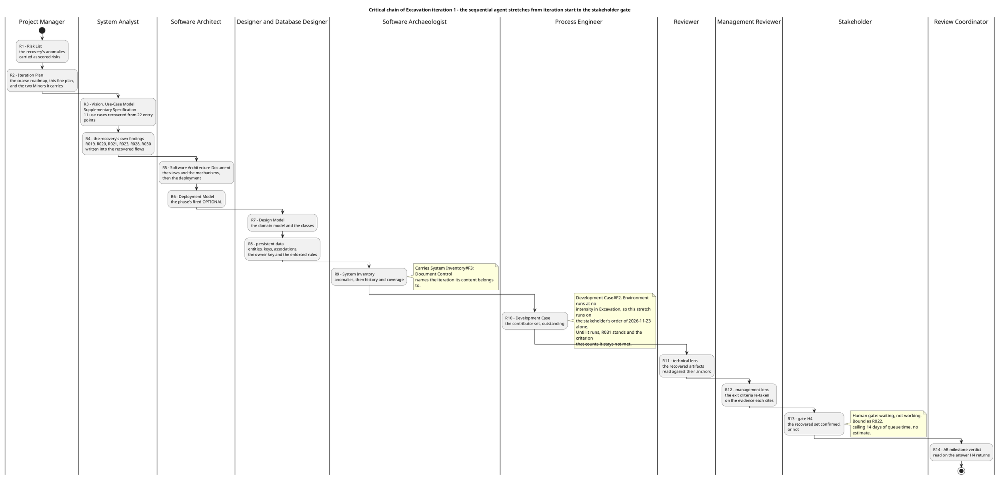
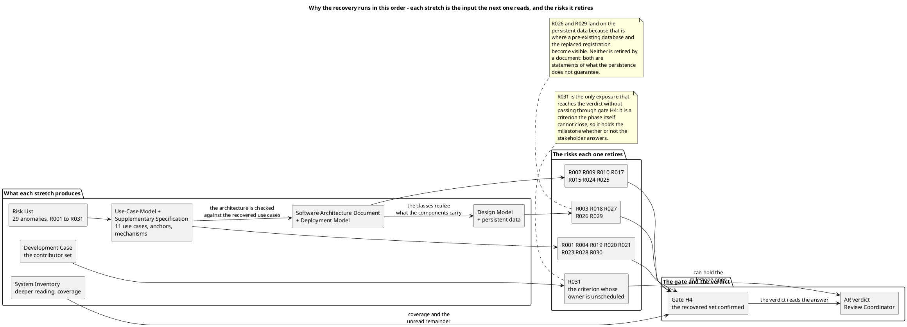
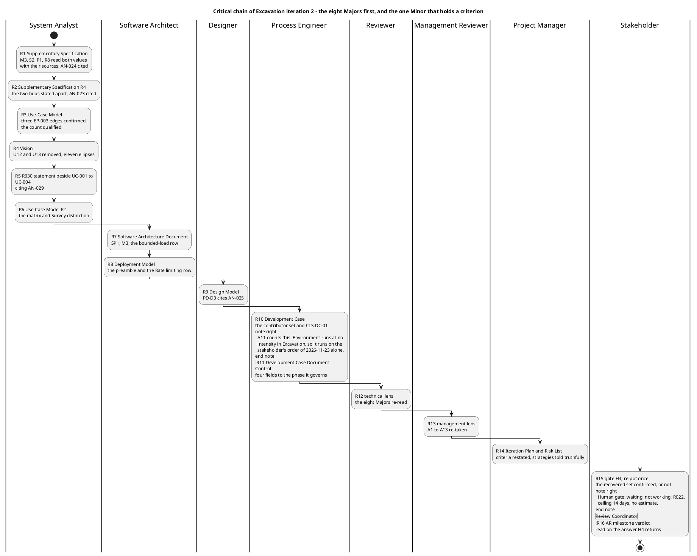
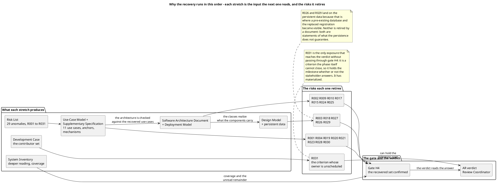
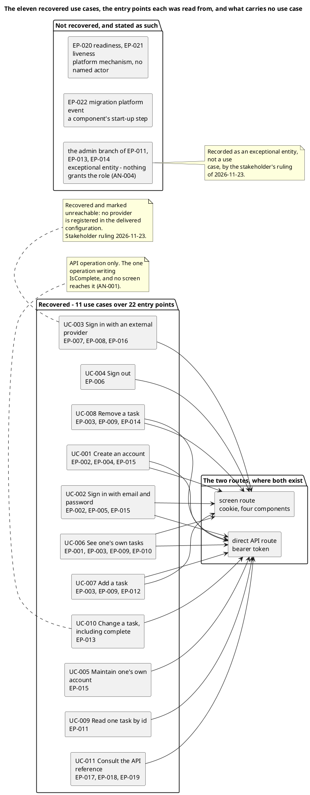

## Document Control
- Phase: Excavation
- Status: Iteration 1 assessed and closed; the AR verdict is the Review Coordinator's — iteration required — and iteration 2 is planned from the Review Record
- Milestone Target: end-of-Excavation (AR) — not achieved; iteration 2 required
- Iteration: 1, Cycle 1 — iteration 2 planned from the Review Record
- Owner: Project Manager
## Iteration Objectives
Excavation recovers what the existing system is into the models the rest of the project works from. It is the sprint zero's second phase: the SBC milestone is passed, and nothing the stakeholder declares is worked here — the delivery declares no scope, so every element this iteration writes is read from code and cites its anchor.

The standing column states each objective's outcome as the AR review found it, not as its owner reported it. Where an owner delivered the artifact but a Major holds the objective short of met, the column says so and names the finding.

| # | Objective | Satisfied when | Owner | Standing after the review |
|---|---|---|---|---|
| O1 | The operations the system performs are recovered as use cases | The Use-Case Model carries one use case per entry-point path, each tracing to the `EP-NNN` it was read from, and accounts for every entry point it does not carry | System Analyst | **Met** — 11 use cases over 22 entry points, four exclusions stated. `Use-Case Model#F1` leaves three `EP-003` edges unconfirmed: a trace defect, not a coverage gap |
| O2 | What the system must satisfy beyond its behaviour is stated | The Supplementary Specification carries the mechanisms, constraints and quality statements read from the code, with the anchor each was read from | System Analyst | **Not met** — `Supplementary Specification#F1` (the rate budget states 100 where the measured environment runs 50) and `#F2` (R4 denies the standard resilience handler) |
| O3 | The architecture the delivery already has is recovered, not invented | The Software Architecture Document records the components and connectors and the mechanisms, technology and deployment as the code shows them | Software Architect | **Partially met** — 22 components and 13 mechanisms recovered and anchored; `Software Architecture Document#F1` carries O2's defect into SP1, M3 and the bounded-load row |
| O4 | The topology the delivery runs in is stated | The Deployment Model — the phase's fired OPTIONAL — records the processes, the stores and what must be shared between them | Software Architect | **Partially met** — trigger confirmed fired and the topology recorded; `Deployment Model#F1` states the one setting that differs between environments backwards |
| O5 | The design and the persistent data are recovered | The Design Model carries the domain model, the packages and classes, and the persistent data with its entities, keys, associations and enforced rules | Designer, Database Designer | **Met** — 42 classes, the relationship inventory, the enforced rules. `Design Model#F1` is a citation on one diagram |
| O6 | The anomalies the recovery surfaced are carried as scored, owned risks | The Risk List holds one risk per anomaly of the System Inventory, each with probability, impact, magnitude, strategy and owner | Project Manager | **Met on carriage, one row not truthful** — 29 anomalies as 31 risks on one mapping, four grants. `Risk List#F2` (Management Reviewer): `R030` read as avoided while its action landed nowhere. Corrected in this turn |
| O7 | The plan for this phase and the milestones ahead exists | This artifact carries the coarse roadmap and this iteration's work items with owners | Project Manager | **Met on existence** — both levels present; `Iteration Plan#F3` (Management Reviewer) records A10 certified on an adjacent artifact, and `#F4`, `#F5` two narrower defects. All three corrected in this turn |
| O8 | The Minors the SBC review left open are closed, not carried again | Each of the four is corrected in the artifact that carries it | The owner each finding names | **Not met — 3 of 4** — `Iteration Plan#F2`, `Iteration Plan#F3` and `System Inventory#F3` are closed; `Development Case#F2` stands because its owner has no stage in this phase. Carried as `R031`, which has materialized |
| O9 | The recovered set is put to the stakeholder for confirmation | Gate H4 answered: the recovered use cases, architecture and data accepted as the models of the existing system, or not | Project Manager puts it; the stakeholder answers | **Not met — refused** — gate H4 was put at the AR review and answered No, with the order "We must correct all major findings" |

O8 and O9 are the two objectives this iteration could not close, and neither is a defect in what an owner wrote. O8's remedy is a stage for a role the phase does not schedule; O9's is a set that agrees with itself before it is put again. Iteration 2 is planned from the Review Record on both counts. Declared work is never cut to avoid the iteration it costs.
## Plan and Milestones
The plan is two-level. The **coarse roadmap** fixes the milestone sequence, the intensity each phase runs at and which risks each milestone confronts. The **fine plan** is each iteration's work items with their owners, bounded to Excavation.

### Coarse roadmap — the milestone sequence



No bar carries an absolute date or a projected calendar span, and no bar's length is a duration claimed for the work: the one-day and two-day lengths are the diagram's sequencing device. The phase that has closed is measured in the Iteration Assessment, in the two currencies — tokens and agent time, apart from stakeholder queue time — never as a span. Each human gate sits ahead of the verdict it feeds, because the verdict reads the answer.

| Order | Phase | Milestone | Discipline intensity | Risks this milestone confronts | What the milestone is judged on |
|---|---|---|---|---|---|
| 1 | Survey | SBC — passed | Environment High, Discovery Critical, Project Management Medium | Carried R001 to R021 into the register; R016, R012, R004 and R011 granted for the sprint zero. SBC retires none of the reading's risks — it makes them owned | The perimeter and its priorities stated, and the anomalies carried as scored risks. Met at the re-take on 2026-11-23 |
| 2 | Excavation | AR — iteration 1 assessed, iteration 2 required | Requirements High, Analysis & Design Critical, Discovery Critical, Project Management Medium | R001, R004, R019, R020, R021, R023, R028, R030 (System Analyst); R002, R009, R010, R017, R024, R025, R015 (Software Architect); R003, R018, R027 (Designer); R026, R029 (Database Designer); R031 (the criterion whose owner this phase does not schedule) | The recovered use cases, architecture, design and deployment rest on anchors and state the code's behaviour; the coverage is measured; the stakeholder confirms the recovery at gate H4. **Iteration 1 did not close it: 8 Major open, A11 at three of four, H4 refused.** The recovery is anchored; four of the Majors are statements that contradict facts the phase itself recorded |
| 3 | Consolidation | GHR | Requirements High, Analysis & Design Medium, Discovery Critical, Project Management Medium | Completes R003 and R010 where the recovered set is closed; confirms R015's volatility statement against the orchestration as it stands; R030's statement is read again if the session surface moves | Every use case, the Supplementary Specification and the Glossary trigger are complete; the coverage is final |
| 4 | Inception | LCO | Requirements Critical, Environment High, Project Management High, Analysis & Design Medium, Implementation Medium, Test Low, Deployment Low, CM Medium | R007, R013, R014 (Integrator, Build Environment Setup); the Change Request ledger opens and every later gate depends on it | The declared change is scoped, a candidate architecture exists, the CM strategy is set, the Change Request ledger is opened |
| 5 | Elaboration | LCA | Analysis & Design Critical, Requirements High, Implementation Medium, Test Medium, Environment Medium, Project Management Medium, CM Medium, Deployment Low | R012, R011, R005 (Test Manager and Test Designer); R006, R029 (the test project is next touched here) | The architecture baseline is accepted and an executable architecture is built |
| 6 | Construction | IOC | Implementation Critical, Test Critical, Requirements Medium, Analysis & Design High, Project Management High, Deployment Medium, CM High, Business Modeling Low | Completes R012's coverage of the client's todo flow; R008 (Technical Writer, User Documentation); R027 and R024 corrected in the implementation they constrain | The declared scope is implemented and its test evaluation is recorded |
| 7 | Transition | PR | Deployment Critical, Test High, Project Management Medium, Implementation Medium, Requirements Low, Analysis & Design Low, CM Medium | Closes what remains: R011's contingency is taken only if a deliberate upgrade lands before the release; R026 becomes a release-blocking conversion if a pre-existing database is in the release's path | The release build is baselined and acceptance-tested; the Change Requests are closed |

Sequencing is driven by the Risk List, not by convenience. The risks whose actions the System Analyst performs land in Excavation because it is the one that writes the recovered use-case model; the architecture risks land beside them because the SAD is recovered from the same code. R007 — the build that cannot build the tree — waits for Inception because that is the first phase the Integrator works, and no plan here schedules it earlier.

### This iteration's fine plan

The work items are the stages the IARI DEVELOPMENT PROCESS runs in Excavation, plus the four Minors the SBC review left open, which the stakeholder ordered closed in this phase rather than left unattended. No work item adds a stage the process does not run and none belongs to another phase. The State column states each row's actual outcome against the artifact it names — no row reads complete whose correction is not in the artifact.



| # | Work item | Owner | Depends on | State |
|---|---|---|---|---|
| 1 | Risk List — carry the recovery's anomalies as scored, owned risks; record the acceptance grants verbatim | Project Manager | — | Complete — 29 anomalies carried as `R001` to `R030`, with `R022`'s separate origin stated; the eight Excavation added (`R023` to `R030`) each restate no prior risk; the four Significant-band acceptances hold the stakeholder's own answer of 2026-11-23 |
| 2 | Iteration Plan — the coarse roadmap, this fine plan, and `Iteration Plan#F2` with `Iteration Plan#F3` | Project Manager | 1 | Complete — this section and Evaluation Criteria; the State column states each row's actual outcome, and the criteria table records no answer the stakeholder did not give |
| 3 | Vision, Use-Case Model, Supplementary Specification — recover the operations, the actors and the constraints | System Analyst | 1 | Complete — 11 use cases from 22 entry points, each tracing to its `EP-NNN`; `UC-003` marked unreachable and `UC-009`, `UC-010` API-only, per the stakeholder's rulings of 2026-11-23 |
| 4 | The recovery's own failure statements written into the flows | System Analyst | 3 | Complete — `R019`, `R020`, `R021`, `R023` and `R028` are recorded as the flows the code performs, each anchored, not as intended behaviour |
| 5 | Software Architecture Document — the views, the mechanisms, then the deployment | Software Architect | 3 | Complete — 22 components recovered with their anchors; SP1 and M3 state the limiter, M9 the migration event, P6 the two hops' unequal protection, and the disagreement with Supplementary Specification R4 is recorded rather than reconciled |
| 6 | Deployment Model — the phase's fired OPTIONAL | Software Architect | 5 | Complete — `get_optional_artifact_triggers` reports the trigger fired; the one-machine placement, the nodes and connectors, the environment mapping and the key-ring requirement (`AN-010`) are stated |
| 7 | Design Model — the domain model and the classes | Designer | 3 | Complete — 42 classes recovered with their anchors; the two contract declarations recorded against one element and the list's absent error path recorded at `AN-026` |
| 8 | Persistent data — entities, keys, associations, enforced rules | Database Designer | 7 | Complete — the entities, the owner key and its re-point by the third migration, what the migrations enforce, and "What the code does not hold" |
| 9 | System Inventory — anomalies, then history and coverage; and `System Inventory#F3` | Software Archaeologist | 1 | Complete — 29 anomalies anchored, 20 history listings, coverage 84 read of 139; Document Control now reads Excavation iteration 1, the iteration its content belongs to |
| 10 | Development Case — `Development Case#F2`, the contributor set | Process Engineer | — | **Not started** — "Roles and Ownership" still reads "Reviewer, CodeReviewer, plus the Configuration Manager's baseline record", and CLS-DC-01 draws no edge into the Review Record from the Management Reviewer, the Business Reviewer or the Review Coordinator. Environment runs at no intensity in Excavation, so this runs on the stakeholder's order of 2026-11-23 alone. Carried as `R031` |
| 11 | Technical lens re-run against the recovered set | Reviewer | 3, 4, 5, 6, 7, 8, 9, 10 | Not started — the lens this iteration's artifacts are reviewed by |
| 12 | Management lens — the AR exit criteria re-taken on the evidence each cites | Management Reviewer | 11 | Not started |
| 13 | Gate H4 — the recovered set confirmed by the stakeholder | Stakeholder | 12 | Queued — a human gate, quoted in days of queue time; no estimate |
| 14 | AR milestone verdict — read on the answer gate H4 returns | Review Coordinator | 13 | Not started |

**Item 10 is the one work item this iteration carries open, and it is carried as `R031` — a scored, avoided risk, not a status note.** It is the only item that runs on the stakeholder's order rather than on a discipline stage, because Environment has no intensity in Excavation; and A11 counts it, so its artifact is a milestone exit criterion while its owner is a role the phase does not otherwise schedule. If the correction lands before the technical lens returns, A11 reads Met on four of four and nothing else in this iteration depends on it. If it does not, `R031` materializes: A11 reads three of four, the AR milestone does not close on this iteration's evidence, and the remedy is another Excavation iteration planned from the Review Record once the lenses have ruled — never more roles in this one, and never a cut in what the phase declared.

**Two currencies, never summed.** Items 1 to 12 and 14 are agent work, quoted in tokens and measured elapsed agent time. Item 13 is a human gate — waiting, not working — quoted only in days of queue time.

| Measured actual of the closed phase | Value |
|---|---|
| Survey — agent time | 29 min |
| Survey — stakeholder queue | 5 min |
| Survey — tokens | 8,995,433 |
| Survey — agent runs | 10 |
| Survey — artifacts | 6 |

That is the one measured actual this project holds, and it is per phase, not per iteration: no per-iteration figure is recorded and none is quoted as a velocity. Excavation has no measured actual yet — it has not closed — so no forecast figure is stated and none is invented. What can be said is the basis on which a forecast is made once this phase closes: Excavation recovered seven artifacts from the same 139-file tree Survey read, each citing an anchor, so what it cost is a question only its own measurement answers. `[ASSUMPTION — requires validation: the relative size of Excavation's reading surface against Survey's is the Project Manager's reading of the two phases' work, not a measurement]`.

The project declares no token budget, so there is no box to fit: no figure is proposed for the stakeholder to accept, and no declared work is cut or deferred to meet an estimate.

The chain is sequential at its load-bearing points: the architecture, the design and the persistent data are read through the use-case model that precedes them, and the lenses judge what the owners wrote. Adding agent roles to this chain would buy no clock and would add contention over the same artifact surface — the recovery is one reading of one tree, and two roles reading it in parallel would reconcile their readings at a cost greater than reading it twice.

| Human gate | Who | What the iteration waits for | Bound | Answer |
|---|---|---|---|---|
| H4 | Stakeholder | The recovered set confirmed: the 11 use cases as the operations the existing system performs, the architecture as the components it already has, and the data as it is stored — each as an interpretation of code with its anchor, since the delivery states no intent to check them against | `R022` — ceiling 14 days of queue time; on expiry the process suspends and nothing is auto-filled | Not yet asked. It is put after this iteration's review, so the stakeholder is asked only what the reviewers have settled |

### Risk-driven sequencing of this iteration



The order is the System Inventory's Priorities order 1 to 5 — the API's todo operations, its authorization, the BFF, the screens and the tests — and the roles follow it: the use-case model is recovered from the endpoints first, because the architecture and the design are read through the operations it names. Nothing in this order is deferred to protect a figure, because no figure exists to protect.

### Iteration 1's fine plan — as it ran

The work items are the stages the IARI DEVELOPMENT PROCESS runs in Excavation, plus the four Minors the SBC review left open. The State column states each row's actual outcome against the artifact it names; no row reads complete whose correction is not in the artifact.

```plantuml
@startuml
title Critical chain of Excavation iteration 1 - what each stretch produced, and where the chain stopped

skinparam shadowing false
skinparam wrapWidth 240

|Project Manager|
start
:R1 Risk List
31 risks, one published mapping,
four granted acceptances;
:R2 Iteration Plan
coarse roadmap, 14 work items, A1 to A13;

|System Analyst|
:R3 Vision, Use-Case Model, Supplementary Specification
11 use cases over 22 entry points;
:R4 the recovery's own findings
R019 R020 R021 R023 R028 R030;

|Software Architect|
:R5 Software Architecture Document
22 components, 13 mechanisms;
:R6 Deployment Model
the fired OPTIONAL;

|Designer and Database Designer|
:R7 Design Model
42 classes;
:R8 persistent data
8 tables, keys, rules, the owner key;

|Software Archaeologist|
:R9 System Inventory
29 anomalies, coverage 84 of 139;

|Process Engineer|
:R10 Development Case
NOT STARTED - no stage in this phase
note right
  R031 materializes here. A11 counts this item
  and the phase cannot close without it.
end note

|Reviewer|
:R11 technical lens
6 Major, 5 Minor recorded;

|Management Reviewer|
:R12 management lens
2 Major, 4 Minor recorded, A1 to A13 re-taken;

|Stakeholder|
:R13 gate H4
ANSWERED NO
note right
  Not met. Queue time 0:02:27.21.
  Bound as R022, ceiling 14 days.
end note

|Review Coordinator|
:R14 AR verdict
ITERATION REQUIRED
stop

@enduml
```

| # | Work item | Owner | Depends on | State |
|---|---|---|---|---|
| 1 | Risk List — carry the recovery's anomalies as scored, owned risks; record the acceptance grants verbatim | Project Manager | — | Complete — 29 anomalies as `R001` to `R030` with `R022`'s separate origin stated; the eight Excavation added each restate no prior risk; four grants at exposure 12. `Risk List#F2` (Management Reviewer) recorded `R030` read as avoided with its action unperformed, and `#F2` (Reviewer) a misattributed premise on `R024` — both corrected in the iteration's closing turn |
| 2 | Iteration Plan — the coarse roadmap, the fine plan, and the two Minors it carries | Project Manager | 1 | Complete — both levels present. `Iteration Plan#F3` (Management Reviewer) recorded A10 certified on the System Inventory's word, `#F4` an unsupported clause in A2 and `#F5` a superseded A12 — all three corrected in the iteration's closing turn |
| 3 | Vision, Use-Case Model, Supplementary Specification — recover the operations, the actors and the constraints | System Analyst | 1 | Complete — 11 use cases from 22 entry points, each tracing to its `EP-NNN`; `UC-003` unreachable and `UC-009`, `UC-010` API-only per the stakeholder's rulings. Four Majors open against the three artifacts: the rate budget in two of them, the resilience handler, and the Vision's use-case count |
| 4 | The recovery's own failure statements written into the flows | System Analyst | 3 | **Incomplete — five of six.** `R019`, `R020`, `R021`, `R023` and `R028` are recorded as the flows the code performs, each anchored. `R030`'s statement was not written, and the register read the risk as retired |
| 5 | Software Architecture Document — the views, the mechanisms, the deployment | Software Architect | 3 | Complete — 22 components with anchors. `Software Architecture Document#F1` open: SP1, M3 and the bounded-load row repeat the rate budget and cite no `AN-024` |
| 6 | Deployment Model — the phase's fired OPTIONAL | Software Architect | 5 | Complete — trigger confirmed fired; the nodes, connectors, environment mapping and key-ring requirement recorded. `Deployment Model#F1` open: the environment table states the one differing setting backwards |
| 7 | Design Model — the domain model and the classes | Designer | 3 | Complete — 42 classes with anchors. `Design Model#F1` open: the `PD-D3` diagram cites `AN-005` where the subject is `AN-025` |
| 8 | Persistent data — entities, keys, associations, enforced rules | Database Designer | 7 | Complete — the entities, the owner key and its re-point by the third migration, what the migrations enforce, "What the code does not hold". No finding from either lens |
| 9 | System Inventory — anomalies, history and coverage; and `System Inventory#F3` | Software Archaeologist | 1 | Complete — 29 anomalies anchored, 20 history listings, coverage 84 of 139; `#F3` closed and a new Minor `#F4` recorded against the history section |
| 10 | Development Case — `Development Case#F2`, the contributor set | Process Engineer | — | **Not started** — "Roles and Ownership" still reads "Reviewer, CodeReviewer, plus the Configuration Manager's baseline record" and CLS-DC-01 draws no edge into the Review Record from the three lenses that write there. Environment runs at no intensity in Excavation, so this ran on the stakeholder's order of 2026-11-23 alone and did not run. Carried as `R031`, which has materialized |
| 11 | Technical lens re-run against the recovered set | Reviewer | 3 to 10 | Complete — 11 findings, 6 Major and 5 Minor, each anchored to the code or the artifact text |
| 12 | Management lens — the AR exit criteria re-taken on the evidence each cites | Management Reviewer | 11 | Complete — 6 findings, 2 Major and 4 Minor, and A1 to A13 re-taken |
| 13 | Gate H4 — the recovered set confirmed by the stakeholder | Stakeholder | 12 | **Answered No** — the sanction was withheld and every Major ordered corrected. Queue time 0:02:27.21; the gate was answered inside the review cycle, not behind it |
| 14 | AR milestone verdict — read on the answer gate H4 returns | Review Coordinator | 13 | Complete — **AR: iteration required**, on 0 Critical, 8 Major, 8 Minor |

**Item 10 is the one work item that did not run, and it is why the phase needs a second iteration.** It carried the exposure as `R031` and the plan recorded that exposure honestly; recording it did not retire it, because Environment has no intensity in Excavation and the role therefore has no stage. A11 counts item 10, so the criterion reads three of four. The remedy is iteration 2 — never more roles in iteration 1, and never a cut in what the phase declared.

**Two currencies, never summed.** Items 1 to 12 and 14 are agent work, quoted in tokens and measured elapsed agent time. Item 13 is a human gate — waiting, not working — quoted only in days of queue time.

### Iteration 2's fine plan — planned from the Review Record

Iteration 2 exists because the AR review left eight Majors open and A11 unmet. Every item below is a corrective action the Review Record's own priority table names, with the owner its recording lens assigned. No item is new scope and none belongs to another phase.



| # | Work item | Owner | Depends on | Closes | Planned state |
|---|---|---|---|---|---|
| 1 | Supplementary Specification — M3, S2, P1, R8 state both the code defaults and the Development override with their sources, citing `AN-024` | System Analyst | — | `Supplementary Specification#F1` | Not started — the root of three Majors |
| 2 | Supplementary Specification — R4 rewritten as the two hops stated apart, citing `AN-023` | System Analyst | 1 | `Supplementary Specification#F2` | Not started |
| 3 | Use-Case Model — the three `EP-003` edges re-registered as confirmed, with the screen-versus-operation reading stated in the Survey | System Analyst | — | `Use-Case Model#F1` | Not started |
| 4 | Vision — `U12` and `U13` removed from the Features diagram, the two rows kept as mechanisms cross-referenced to M8 and M9 | System Analyst | 3 | `Vision#F1` (both lenses) | Not started — after item 3, so the count matches |
| 5 | `R030`'s statement written beside UC-001 to UC-004 citing `AN-029` | System Analyst | 3 | `Risk List#F2` (Management Reviewer) | Not started — the register now reads the retirement as not performed |
| 6 | Use-Case Model — the matrix-versus-Survey distinction stated once, the edges relabelled | System Analyst | 3 | `Use-Case Model#F2` | Not started |
| 7 | Software Architecture Document — SP1, M3 and the bounded-load row corrected, citing `AN-024` | Software Architect | 1 | `Software Architecture Document#F1` | Not started — after item 1, so one settled figure is copied |
| 8 | Deployment Model — preamble narrowed, Rate limiting row corrected | Software Architect | 7 | `Deployment Model#F1` | Not started |
| 9 | Design Model — the `PD-D3` citation changed from `AN-005` to `AN-025` | Designer | — | `Design Model#F1` | Not started |
| 10 | Development Case — every lens named in the Review Record's contributor set, the three missing edges drawn in CLS-DC-01 | Process Engineer | — | `Development Case#F2` (Management Reviewer) — **holds A11** | Not started, on the stakeholder's order of 2026-11-23; the phase gives this role no discipline stage |
| 11 | Development Case — the four Document Control fields brought to the phase the document governs | Process Engineer | 10 | `Development Case#F3` | Not started |
| 12 | Technical lens — the eight Majors re-read against their anchors | Reviewer | 1 to 11 | — | Not started |
| 13 | Management lens — A1 to A13 re-taken on the evidence each cites | Management Reviewer | 12 | — | Not started |
| 14 | Iteration Plan and Risk List — the criteria and risk strategies stated as the evidence establishes them | Project Manager | 12 | `Iteration Plan#F3`, `#F4`, `#F5`; `Risk List#F2` (Reviewer) | **Done in iteration 1's closing turn** — the plan and register are corrected; the lenses' closure is item 12's |
| 15 | Gate H4 re-put — the recovered set confirmed by the stakeholder | Stakeholder | 13 | A12 | Queued — a human gate, quoted in days of queue time, no estimate. Put once, after items 1 to 8 land |
| 16 | AR milestone verdict — read on the answer gate H4 returns | Review Coordinator | 15 | — | Not started |

**What iteration 2 changes, and what it does not.** The iteration count rises by one; declared work is untouched; no agent role is added and no reading is duplicated — the recovery is one reading of one tree, and four of the eight Majors are corrections to sentences rather than work a second reader would prevent. One role, the Process Engineer, is given the stage the phase does not give it, on the stakeholder's standing order and recorded as an order rather than as a discipline stage. Gate H4 is re-put once, so the stakeholder is asked to sanction a set that agrees with itself.

### Risk-driven sequencing of both iterations



The order is the System Inventory's Priorities order 1 to 5 — the API's todo operations, its authorization, the BFF, the screens and the tests — and the roles follow it: the use-case model is recovered from the endpoints first, because the architecture and the design are read through the operations it names. Nothing in this order is deferred to protect a figure, because no figure exists to protect.

### Measured actuals and the forecast

| Measured actual | Value |
|---|---|
| Survey — agent time, whole phase | 29 min |
| Survey — stakeholder queue | 5 min |
| Survey — tokens | 8,995,433 |
| Survey — agent runs | 10 |
| Survey — artifacts | 6 |
| Excavation iteration 1 — agent time | 1:19:41.05 |
| Excavation iteration 1 — stakeholder queue | 0:02:27.21 |
| Excavation iteration 1 — tokens | 43,561,437 |
| Excavation iteration 1 — agent invocations | 16 |
| Excavation iteration 1 — artifacts | 12 |

These are the measured actuals the project holds. Survey's is per CLOSED phase. Excavation's is per iteration and is NOT recorded as a velocity: iterations inside a phase are not compared, and no rate is quoted from two figures.

One forecast is made and it is the only one the figures support: **iteration 2 costs less than iteration 1 in tokens and less in elapsed agent time.** The basis is a measured comparison, not an estimate — iteration 1's 43,561,437 tokens were spent producing twelve artifacts from a 139-file tree it read cold, while iteration 2 re-reads that surface to correct sixteen findings, eight of them one sentence each and three of them the same sentence. The seven artifacts iteration 2 writes into already exist and grow by no section. `[ASSUMPTION — requires validation: the ratio between a cold reading of the tree and a corrective pass over it is the Project Manager's reading of the two iterations' work; iteration 1's 43.6 million tokens against Survey's 9.0 million for six artifacts is the only measured evidence bearing on it, and it measures a different kind of work]`

No figure is projected for the phase as a whole: Excavation has not closed, so no phase actual exists, and the phase's cost is the sum of iterations that are not measured until it closes.

The project declares no token budget, so there is no box to fit: no figure is proposed for the stakeholder to accept, and no declared work is cut or deferred to meet an estimate.

The chain is sequential at its load-bearing points: the architecture, the design and the persistent data are read through the use-case model that precedes them, and the lenses judge what the owners wrote. Adding agent roles to this chain would buy no clock and would add contention over the same artifact surface — the recovery is one reading of one tree, and two roles reading it in parallel would reconcile their readings at a cost greater than reading it twice. That reasoning is not reversed for iteration 2, whose work is correction rather than reading.

| Human gate | Who | What the iteration waits for | Bound | Answer |
|---|---|---|---|---|
| H4 | Stakeholder | The recovered set confirmed: the 11 use cases as the operations the existing system performs, the architecture as the components it already has, and the data as it is stored — each as an interpretation of code with its anchor, since the delivery states no intent to check them against | `R022` — ceiling 14 days of queue time; on expiry the process suspends and nothing is auto-filled | **Put once and answered No at the AR review**, with the order that every Major be corrected. Re-put once, after iteration 2's items 1 to 8 land, so the stakeholder is asked about a set that agrees with itself |

## Resources
The roles are the 26-role roster of the IARI DC baseline, minus the two the Development Case records as not working in this project. No role is added, merged or renamed.

| Role | Discipline | Iteration 1 | Iteration 2 | Why |
|---|---|---|---|---|
| System Analyst | Requirements | Yes | Yes | Recovers the use cases, the actors and the supplementary constraints; in iteration 2 corrects the four Majors against them |
| Software Architect | Analysis & Design | Yes | Yes | Recovers the architecture, its mechanisms and the deployment; in iteration 2 corrects the figure it inherited and the environment table |
| Designer | Analysis & Design | Yes | Yes | Recovers the domain model and the classes; in iteration 2 corrects one citation |
| Database Designer | Analysis & Design | Yes | No | Recovers the persistent data; no finding was recorded against it, so no work item exists for it |
| Software Archaeologist | Discovery | Yes | No | Deepens the System Inventory and closes `System Inventory#F3`; the Minor `#F4` it recorded is on its history section and is not scheduled here |
| Project Manager | Project Management | Yes | Yes | Carries the anomalies as risks, plans both iterations, and states the criteria and strategies as the evidence establishes them |
| Reviewer | Review | Yes | Yes | Technical lens on the recovered set, then on the eight Majors |
| Management Reviewer | Review | Yes | Yes | Management lens — the AR exit criteria re-taken |
| Review Coordinator | Review | Yes | Yes | AR milestone verdict, read twice |
| Process Engineer | Environment | **On order only — did not run** | **Yes, on the stakeholder's order** | Environment runs at no intensity in Excavation. In iteration 1 the role worked for one reason — `Development Case#F2`, a Minor the stakeholder ordered closed in this phase on 2026-11-23 — and it did not run: "Roles and Ownership" still omits three lenses, A11 counts it, and the milestone could not close. Iteration 2 plans it explicitly, as work the phase runs on the stakeholder's order and NOT as a discipline stage; the Development Case records Environment at no intensity here and this plan does not override it |
| Requirements Specifier | Requirements | No — Elaboration | No — Elaboration | Use-case detail and NFR thresholds are written against a declared scope; the delivery declares none |
| User Interface Designer | Analysis & Design | No — Elaboration | No — Elaboration | Storyboards and the navigation map follow the use-case specification |
| Capsule Designer | Analysis & Design | No — inactive | No — inactive | `real-time-system = false` |
| Business Process Analyst | Business Modeling | No — inactive | No — inactive | `business-process-led = false` |
| Implementer | Implementation | No — Inception | No — Inception | No code is written in the sprint zero |
| Integrator | Implementation | No — Inception | No — Inception | The build environment is set up in Inception; `R007` waits on it |
| Code Reviewer | Implementation | No — Elaboration | No — Elaboration | — |
| Test Manager | Test | No — Inception | No — Inception | No Test Plan is triggered |
| Test Designer / Tester / Test Analyst | Test | No — Elaboration | No — Elaboration | No test case is written before a use case is specified |
| Deployment Manager | Deployment | No — Inception | No — Inception | The Deployment Model is recovered here; the deployment plan is Inception's |
| Technical Writer | Deployment | No — Construction | No — Construction | — |
| Configuration Manager | Configuration & Change Management | No — Inception | No — Inception | No baseline exists yet |
| Change Control Manager | Configuration & Change Management | No — Inception | No — Inception | The Change Request ledger is opened at LCO |
| Business Reviewer | Review | No — from LCO | No — from LCO | Excavation's milestone review runs Reviewer, Management Reviewer, Review Coordinator |

The stakeholder is not an agent role: they are the only human in the process, and their work is gate H4 — put in iteration 1 and refused, re-put once in iteration 2.

The Process Engineer's presence is the one resource decision iteration 2 makes, and it is the smallest one available: four metadata fields and one sentence in a diagram, from a role the phase does not otherwise reach. The alternative — assigning the correction to a role that has a stage — is not open: the artifact's owner is fixed, and a role editing another's artifact is the defect ownership exists to prevent.
## Use Cases and Scenarios Addressed
Eleven use cases, recovered from the 22 entry points the System Inventory records. Every use case traces to the `EP-NNN` whose code performs it, and no use case is recovered from an intent the code does not carry. Every anomaly cited below is cited for the fact the System Inventory's Anomalies table gives it.



| Use case | Primary actor | Recovered from | What the recovery may not claim, and where that is carried |
|---|---|---|---|
| `UC-001` Create an account | ACT-001, ACT-003 | `EP-002`, `EP-004`, `EP-015` | That a refusal names its cause: the API answers validation problems and the BFF discards them, so every authentication failure reaches the person as one 401 with no body (`AN-021`, `AN-020`) |
| `UC-002` Sign in with email and password | ACT-001, ACT-003 | `EP-002`, `EP-005`, `EP-015` | That a failed sign-in distinguishes a wrong password from a locked or absent account — one 401 covers all three (`AN-021`) — and that lockout ends the access a token already holds: the guard checks it at sign-in alone (`AN-022`) |
| `UC-003` Sign in with an external provider | ACT-001, with ACT-002 authenticating | `EP-007`, `EP-008`, `EP-016` | That it is reachable: no provider is registered in the delivered configuration. Recovered and marked unreachable, per the stakeholder's ruling of 2026-11-23. Also that a callback reports its outcome — it redirects to `/` on every path (`AN-020`) — and that the scheme is checked: it is taken straight from the route (`AN-019`) |
| `UC-004` Sign out | ACT-001 | `EP-006` | That the provider's own session ends: one call signs the local cookie scheme out and nothing else (`Todo.Web/Server/AuthApi.cs:40-52`) |
| `UC-005` Maintain one's own account | ACT-003 | `EP-015` | That a screen reaches it: the client's six operations contain no account-maintenance call, so the framework's endpoint set is mapped with no UI path to it (`Todo.Web/Client/TodoClient.cs:7-71`) |
| `UC-006` See one's own tasks | ACT-001, ACT-003 | `EP-001`, `EP-003`, `EP-009`, `EP-010` | That the list honours the `admin` role: it filters on the owner alone while the item endpoints admit the role, so the four statements disagree (`AN-018`). Also that an unreachable API is distinguishable from an empty list — an absent base address answers `200` and no rows (`AN-026`) |
| `UC-007` Add a task | ACT-001, ACT-003 | `EP-003`, `EP-009`, `EP-012` | That a create body can set a row complete: the insert copies the title alone, so `IsComplete` is created false whatever the body says (`Todo.Api/Todos/TodoApi.cs:38-50`) |
| `UC-008` Remove a task | ACT-001, ACT-003 | `EP-003`, `EP-009`, `EP-014` | That another person's row is distinguished from one that does not exist: the delete filters on the owner and answers 404 either way, never 403 (`Todo.Api/Todos/TodoApi.cs:67-73`) |
| `UC-009` Read one task by id | ACT-003 | `EP-011` | That a screen reaches it: none does. An API operation only. Its `admin` branch is the exceptional entity `AN-004` records — nothing in the running system grants the role |
| `UC-010` Change a task, including marking it complete | ACT-003 | `EP-013` | That a user-facing path completes a task: the client makes no update call and the list's checkbox is bound to nothing, so the only operation writing `IsComplete` has no screen (`AN-001`) |
| `UC-011` Consult the API reference | ACT-003 | `EP-017`, `EP-018`, `EP-019` | That a Swagger UI is mounted, as the README states — the code mounts the Scalar reference UI (`AN-008`) — or that the root redirect resolves outside Development, where that UI is not mapped (`AN-017`) |

Three entry-point groups carry no use case and the Use-Case Model says why: `EP-020` and `EP-021` are a platform mechanism with no actor the delivery names, `EP-022` is a component's start-up step, and the `admin` branch of `EP-011`, `EP-013` and `EP-014` is an exceptional entity no running caller can enter — the stakeholder's ruling of 2026-11-23, recorded in the System Inventory's Perimeter and in `AN-004`.

**Scenarios.** Five of the eleven carry two scenarios rather than one: `UC-001`, `UC-002`, `UC-006`, `UC-007` and `UC-008` have a screen route and a direct API route. They are one use case with two scenarios, never one use case per actor: the two routes reach the same operation and differ only in how the caller authenticated.

## Evaluation Criteria
The exit criteria for this iteration's milestone (AR), re-taken after the AR review. Each is decided on the evidence the artifact it cites actually records; none is certified on an adjacent artifact's answer, and each evidence cell names a section the cited artifact actually carries. Where a criterion was recorded Met on an answer its own test does not reach, the row is restated to what its evidence establishes and the finding that ordered the restatement is named.

| # | Criterion | Met when | State | Evidence |
|---|---|---|---|---|
| A1 | The operations the system performs are recovered as use cases | Every use case traces to the entry point whose code performs it, and every entry point is either carried or its exclusion stated | Met | Use-Case Model — Use-Case Survey: `UC-001` to `UC-011`, each with its `EP-NNN` list; "Not recovered, and why" accounts for `EP-020`, `EP-021`, `EP-022` and the `admin` branch of `EP-011`, `EP-013`, `EP-014`. `Use-Case Model#F1` records three `EP-003` edges registered but left suspect — a trace defect, not a coverage gap |
| A2 | The recovered use cases are read from the priorities the reading ordered first | Priorities 1 to 5 of the System Inventory each yield at least one recovered use case, and the recovery is not read out of the order the stakeholder confirmed | Met | System Inventory — Priorities: areas 1 to 5 ordered as the API's todo operations, its authorization, the BFF, the screens and the tests, on the stakeholder's answer of 2026-11-23 that the order stands. The Use-Case Model's eleven use cases trace to `EP-NNN` in each of those five areas. The criterion makes no claim about what is deferred: "Not recovered, and why" names permanent exclusions, and `Iteration Plan#F4` (Management Reviewer) correctly recorded that the earlier wording certified a deferred-set sentence its evidence did not carry |
| A3 | The architecture is recovered and checked against the use cases | The Software Architecture Document's components carry the paths the recovered use cases take, and every use case is reachable through a component it names | **Not met while its own Major stands** | Software Architecture Document — Logical View (`COMP-001` to `COMP-022` with their connectors) and Use-Case View, which names the components each of the eleven use cases' confirmed path crosses, including the seven not diagrammed. `Software Architecture Document#F1` states the request budget at 100 where the measured environment runs 50: the artifact exists and is anchored, and its own Major holds the certification |
| A4 | The data is recovered with its anchors | The persistent entities, keys, associations and enforced rules are recorded, each with the file it was read from | Met | Design Model — persisted domain classes (`DM-D1`, `CLS-001` `Todo`, `CLS-007` `TodoUser`, `CLS-006` `TodoDbContext`), the relationship inventory, and "What the code does not hold" — each anchored to `TodoDbContext.cs:11-17` and the three migrations; `AN-025` recorded against the owner key as the fact it is. `Design Model#F1` is a citation on a diagram, not on the recovered data |
| A5 | The deployment is modelled | The fired OPTIONAL exists and records the processes, the stores and what must be shared between them | **Not met while its own Major stands** | Deployment Model — `get_optional_artifact_triggers` reports its trigger fired; Deployment Topology, Nodes and Connectors, and Environment Mapping state the processes, the stores, the ports, and the shared key ring (`AN-010`) and database directory (`AN-013`). `Deployment Model#F1`: the environment table states the one setting that differs between environments backwards, which is the artifact's central claim |
| A6 | The coverage is measured and the remainder declared | Every file is either read or named with the reason it was not, and the headline figure reproduces from the per-area table | Met | System Inventory — Coverage: 84 opened and 55 unread of 139, the per-area Read column summing to 84 and its Files column to 139, and every unread file named by category with none carrying a perimeter fact |
| A7 | Every anomaly the recovery surfaced is carried as a scored risk | 29 anomalies map to risks with no silent omission, and every score reproduces from the one published mapping | Met | Risk List — Risk Register: 29 `Refines` edges from `AN-NNN`, plus `R022` and `R031` whose separate origins are stated in the register; all 29 anomaly-derived rows reproduce from the mapping in Risk Classification |
| A8 | No accepted risk above Moderate lacks the stakeholder's grant | No risk the register places at Significant or High is accepted on the Project Manager's authority | Met — 2026-11-23 | Risk List — the grant table under Risk Register: four grants on `R004`, `R011`, `R012` and `R016`, each at 4 × 3 = 12, recorded verbatim. The sixteen Significant-band risks that do not accept are avoided, which is the Project Manager's authority at any band |
| A9 | Every risk is actionable | Every risk names a strategy, an owner, an action, a contingency and a warning sign | Met | Risk List — Risk Mitigation and Contingency, all 31 rows. `Risk List#F2` (Management Reviewer) recorded that one row's strategy asserted a retirement its action did not perform; the register is corrected in this turn and the criterion's subject — actionability — was never in question |
| A10 | The recovery states what the code does, not what it was meant to do | No artifact in the recovered set states a behaviour the code contradicts, and where code and document disagree the code is recorded and the contradiction identified against its anchor | **Not met** | Three artifacts state the value the phase's own reading contradicts: `Supplementary Specification#F1` (M3, S2, P1, R8), `Software Architecture Document#F1` (SP1, M3, the Quality view's bounded-load row) and `Deployment Model#F1` (the environment preamble and the Rate limiting row), all against `Todo.Api/appsettings.Development.json:8-12`, the fact the System Inventory records as `AN-024`; and `Supplementary Specification#F2` denies a resilience handler that `TodoApp.ServiceDefaults/Extensions.cs:32-42` installs. The criterion was earlier certified on the System Inventory having identified the contradiction — `Iteration Plan#F3` (Management Reviewer) — which is an adjacent artifact's answer: A10's test is about the recovered set, not the inventory's anomalies table. The four contradictions carried correctly (`AN-008`, `AN-024`, `AN-025`, `AN-018`) do not offset four statements that carry them wrongly |
| A11 | The Minors the SBC review left open are closed | Each of the four is corrected in the artifact that carries it | **Not met — three of four** | `Iteration Plan#F2` — C2b reads Met on gate H2's answer; `Iteration Plan#F3` — the State column states each row's actual outcome; `System Inventory#F3` — Document Control names the iteration its content belongs to. `Development Case#F2` **stands**: "Roles and Ownership" still reads "Reviewer, CodeReviewer, plus the Configuration Manager's baseline record" and CLS-DC-01 draws no edge into the Review Record from the Management Reviewer, the Business Reviewer or the Review Coordinator. Carried as `R031`, which has materialized: its owner has no stage in Excavation |
| A12 | The recovered set is confirmed by the stakeholder | Gate H4 answered Yes: the 11 use cases, the architecture and the data accepted as the models of the existing system | **Not met — refused** | Gate H4 was put and answered **No**, with the order "We must correct all major findings." The answer is recorded as given; nothing in it is recorded as a confirmation it did not contain. The criterion turns on the stakeholder's answer alone and no artifact can hold it |
| A13 | The plan names no work the process does not run | The milestone sequence is recorded and each work item belongs to a stage the IARI DEVELOPMENT PROCESS runs in Excavation | Met | This artifact — every work item is an Excavation stage or a Minor closure the stakeholder ordered on 2026-11-23. The Process Engineer's single item is recorded as that order, not as a discipline stage, and the Development Case records Environment as High in Survey and Inception and inactive in Excavation |

**Six met, two not certifiable while their own Major stands, three not met, two met on their own evidence after restatement.** No criterion is met on another criterion's answer, and no finding is waived by a criterion's state.

Three criteria are not this plan's to certify:

- **A11** turns on an artifact this role does not own. The Process Engineer's correction is outstanding; the criterion reads three of four and is carried as `R031`. It is not waived, and no row of the fine plan is marked complete on it.
- **A12** turns on the stakeholder's answer, which was refused.
- **A3** and **A5** rest on artifacts whose own open Majors hold their certification. The artifacts were produced and are anchored; the criterion is not certified while the defect that misdescribes them stands, because a milestone that certifies an artifact whose own figures are wrong is a milestone that will be corrected by the next phase.

The rest of the criteria rest on artifacts this iteration produced, each certified on the evidence that artifact records. No evidence cell cites a section its artifact does not carry.
