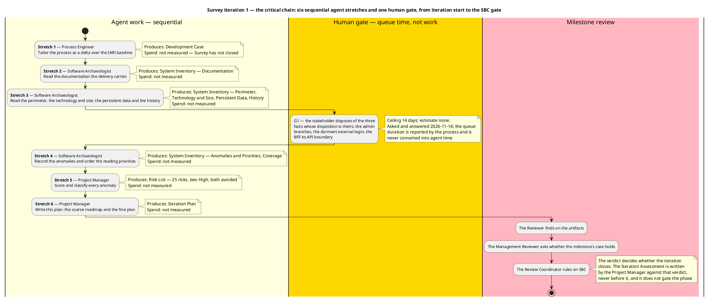
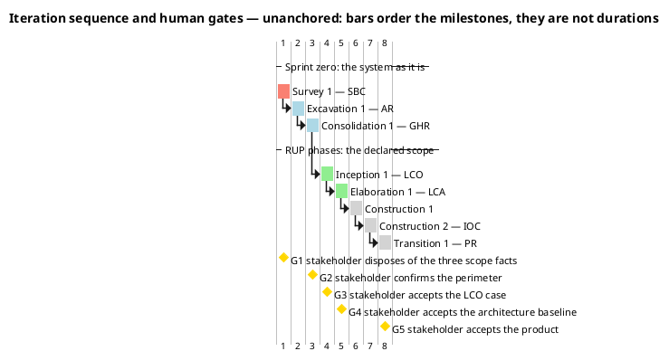
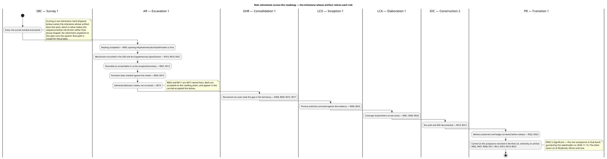

## Document Control

Phase: Survey
Status: Draft — Survey iteration 1 plan; coarse roadmap with the risk retirement per milestone, this iteration's fine plan, the agent role profile and the SBC exit criteria recorded
Milestone Target: End-of-Survey (SBC) — not yet achieved

## Iteration Objectives

Survey iteration 1 opens the sprint zero. Its objective is to establish the two things every later iteration depends on: a governed process, and a read of the system that already exists.

1. Tailor the IARI Development Process for this project — classification, active disciplines, OPTIONAL trigger verdicts, stood-down roles, version policy. Owner: Process Engineer.
2. Read the delivered system to the depth its own priorities demand — the perimeter, technology and size, persistent data, documentation, history, anomalies and priorities. Owner: Software Archaeologist.
3. Convert every anomaly the reading found into a scored, banded risk with a strategy, an owner, a mitigation and a contingency. Owner: Project Manager.
4. Place the risks and the process into a plan — the coarse roadmap across the sprint zero and the four RUP phases with the risk retirement each milestone carries, this iteration's fine plan, and the agent role profile. Owner: Project Manager.

The chain is sequential, not parallel, for one reason: each stretch consumes the one before it. The process tailoring fixes what the reading may record; the reading produces the anomalies; the anomalies are the only legitimate input to the Risk List; the Risk List is half of what this plan is built on. Six agent stretches plus the human gate are the plan's critical path — parallelism buys nothing on a chain whose links are data dependencies.

## Plan and Milestones
Two levels live in this section: the coarse cross-iteration roadmap and the fine plan for this iteration.

### Coarse roadmap — the milestone sequence and the risk each milestone retires

Eight iterations, one per phase except Construction, which takes two. The distribution is not the rubber profile's default: the sprint zero carries three of the eight because the architecture, the data model and the use cases are **recovered from a working system** rather than designed from nothing. The phase in which architectural risk is retired is therefore Excavation inside the sprint zero, and Elaboration's LCA becomes a baseline-confirmation iteration rather than a from-scratch architecture baseline. The justification is the Risk List, not preference: R002 (no runtime observation), R003 (migrations unvalidated) and R005 (unread files block the login scenarios) are all Significant, and all three are retired by reading the existing system — work the sprint zero runs and Elaboration does not.

| # | Iteration | Milestone | What the milestone gates | Risks whose retirement this milestone carries | Reviewers, in order |
|---|---|---|---|---|---|
| 1 | Survey 1 | SBC | The perimeter of the existing system is recorded with an anchor per element and put to the stakeholder, the reading priorities are ordered, the unread areas are declared, and every anomaly is a scored risk | All scored, banded and owned — scoring is not retirement | Reviewer, Management Reviewer, Review Coordinator |
| 2 | Excavation 1 | AR | The recovered architecture, the Design Model with its persistent-data sections and the first recovered use cases are baselined, and the anomalies the reading could not settle are carried with their disposal recorded | R003, R005, R007, R012, R013, R016, R018, R019, R021 | Reviewer, Management Reviewer, Review Coordinator |
| 3 | Consolidation 1 | GHR | Every use case is recovered, the Supplementary Specification carries the mechanisms, the perimeter is confirmed by the stakeholder (G2), and the tailoring is confirmed | R008, R009, R015, R017 | Reviewer, Management Reviewer, Review Coordinator |
| 4 | Inception 1 | LCO | The Vision, the use-case model of the declared scope, the candidate architecture, the build environment, the Change Request ledger and the CM strategy are in place, and the business case is accepted by the stakeholder (G3) | R006, R025 | Reviewer, Management Reviewer, Review Coordinator |
| 5 | Elaboration 1 | LCA | The architecture baseline is executed and tested; the Test Manager's plan and the Test Designer's cases exist; the deployment plan is written; the baseline is accepted by the stakeholder (G4) | R001, R004, R020 | Reviewer, Management Reviewer, Review Coordinator |
| 6 | Construction 1 | — | The first construction increment: component implementation, iteration build, test execution, technical documentation | — | Reviewer, Management Reviewer, Review Coordinator |
| 7 | Construction 2 | IOC | The declared scope is implemented and tested against the recovered and declared acceptance criteria | R010, R014 | Reviewer, Management Reviewer, Review Coordinator |
| 8 | Transition 1 | PR | Production deployment, acceptance testing, release notes, the closure of the Change Request ledger, and the customer taking ownership of the product (G5) | R022, R024 | Reviewer, Management Reviewer, Review Coordinator |

The Business Reviewer is not a lens of any gate in this table. The Development Case declares Business Modeling inactive (`business-process-led = false`) and stands that role down for the whole project; Reviewer, Management Reviewer and Review Coordinator are the three lenses that remain.

Four properties of this roadmap are load-bearing:

- **Sequencing follows the risk bands, not the phase names.** Both High-band risks are retired before Construction: R001 (nothing tests the BFF) at LCA, R009 (a delivered API capability with no screen) at GHR. Six of the seven retired Significant risks are retired by AR and GHR — inside the sprint zero — because that is where their evidence lives. R026 is bounded by the register itself and needs no milestone. No risk above the Moderate band is carried into Construction or Transition.
- **No retirement runs the system.** Every step above is an artifact a role writes. The two risks whose condition could only be settled by observation — R002 and R011 — are carried on the acceptance recorded in the Risk List rather than counted as retired, so no milestone's exit case rests on evidence the project will not produce.
- **Every milestone whose exit condition is the stakeholder's judgement has a gate at which it is obtained.** That is G2 through G5; G1 served SBC and was answered 2026-11-14.
- **The lever is iteration count — never parallel agent roles, never declared scope.** If a milestone's exit criteria do not pass, the remedy is one more iteration inside that phase at schedule cost. Declared scope is reduced only by a Change Request the stakeholder decides.

```plantuml
@startuml
title The five stakeholder gates the plan books, and the milestone each serves
skinparam componentStyle rectangle
skinparam shadowing false

package "Booked gates — queue time, ceiling 14 days, estimate none" #LightBlue {
  component "G1 — three scope facts disposed\nanswered 2026-11-14" as G1
  component "G2 — confirms the perimeter\nConsolidation 1 start" as G2
  component "G3 — accepts the LCO case\nInception 1 end" as G3
  component "G4 — accepts the architecture baseline\nElaboration 1 end" as G4
  component "G5 — accepts the product, ownership passes\nTransition 1 end" as G5
}

package "What each milestone's exit condition requires" {
  component "SBC — perimeter recorded and put to the stakeholder\nanswered at review" as SBC
  component "GHR — perimeter confirmed before the declared scope is modelled" as GHR
  component "LCO — business case acceptable to the stakeholder" as LCO
  component "LCA — architecture baseline acceptable to the stakeholder" as LCA
  component "PR — the customer takes ownership of the software" as PR
}

SBC --> G1
GHR --> G2
LCO --> G3
LCA --> G4
PR --> G5

note right of G4
  No lens can answer whether a baseline is acceptable to
  the stakeholder. It is booked and bounded.
end note
note right of G5
  Acceptance testing is not acceptance. G5 is the event at
  which ownership transfers — the closure the PR milestone
  exists to perform.
end note
note bottom of G1
  Every gate is bounded by R026: at 14 days of queue time the
  process suspends rather than filling the gap with an
  assumption. Actual queue time is reported apart from agent
  time; the two clocks are never summed.
end note
@enduml
```

The bound on every gate above is R026 in the Risk List: ceiling 14 days of queue time, estimate none, actual measured and reported apart from agent time, and on expiry the process suspends rather than filling the gap with an assumption. A gate is bounded in the register, never forecast in this plan.

### Fine plan — this iteration's work items and their owners

| Work item | Owner | Produces | Predecessor | Why it is on the chain |
|---|---|---|---|---|
| Tailor the process for this project | Process Engineer | Development Case | — | Every later role reads it as the law of its work; nothing else can start without it |
| Read the documentation the delivery carries | Software Archaeologist | System Inventory — Documentation | Development Case | Establishes what the tree records and what only the code records, including the cited-but-absent `CONTRIBUTING.md` (R006) |
| Read the perimeter, technology and size, persistent data, history | Software Archaeologist | System Inventory — those sections | Documentation | The seven projects, the entry-point surface and the stores — the anchor every recovered use case will point at |
| Dispose of the three scope facts | Stakeholder — gate G1 | Three decisions recorded in the System Inventory | Perimeter | The reading found three facts whose disposition is the stakeholder's, not the team's. Answered 2026-11-14 |
| Record the anomalies and order the priorities | Software Archaeologist | System Inventory — Anomalies and Priorities, Coverage | G1 | The raw material of the Risk List and the reading plan for Excavation |
| Score and classify the risks, and bound the human gates | Project Manager | Risk List | Anomalies | 26 risks on the IARI scales, each with a strategy, an owner and a contingency; R026 bounds the gates above |
| Write this plan | Project Manager | Iteration Plan | Risk List | The coarse roadmap with its risk retirement, the fine plan, and the SBC exit criteria |

No work item carries a size. Nothing has been measured yet — Survey has not closed — and this system measures two things only: agent work in tokens and elapsed time, and human gates in days of queue time. An empty size is correct; a figure in hours, days or person-anything would describe a unit this project cannot produce.

### Spend — the two clocks, reported apart and never added

| Clock | Position at plan time | What it decides |
|---|---|---|
| Agent work — tokens and elapsed time | Not measured; no phase has closed, so no forecast exists and none is invented | The measured actual of Survey replaces every assumed share in the plans after SBC |
| Human queue time — gates G1 to G5 | G1 answered 2026-11-14; each gate's queue duration is measured by the process and reported here, never estimated | Whether gates should be batched into fewer points in later phases |

This project declares **no token budget**. None is set here, none is proposed for the stakeholder to accept, and no declared scope is cut or deferred to fit an estimate. An iteration ends when its exit criteria pass.

## Resources
The team is the agent roster the process assigns, not a staffed organisation. The profile below is read from the IARI Development Process and the Development Case's tailoring — no role here does work the process does not run in this phase, and every role named as a risk owner in a milestone row is at work in that milestone.

### This iteration — Survey 1, SBC

| Role | Discipline and intensity | Stage in this iteration | Produces | Risks owned |
|---|---|---|---|---|
| Process Engineer | Environment, High | Development Case | Development Case | R006, R025 — both corrections to that artifact, due at LCO |
| Software Archaeologist | Discovery, Critical | System Inventory — Documentation · Perimeter · Anomalies and Priorities | System Inventory | R002, R005 — the two risks about the limits of the reading itself |
| Project Manager | Project Management, Low | Risk List · Iteration Plan | Risk List, Iteration Plan | R026, and this artifact plus the assessment written after the verdict |
| Reviewer | Review lens | SBC milestone review | Findings on the artifacts reviewed | — |
| Management Reviewer | Review lens | SBC milestone review | Findings on the artifacts reviewed | — |
| Review Coordinator | Review lens | SBC milestone review | The SBC verdict | — |

The Review Coordinator decides whether the milestone closes. It does not decide the Iteration Assessment — the Project Manager writes that against the verdict.

### Excavation 1 — AR

The process runs four disciplines in Excavation, and every one of them has its role on this iteration's profile. The two that Analysis & Design does not cover are the two that carry risk owners.

| Role | Discipline and intensity | Stage in this iteration | Produces | Risks owned |
|---|---|---|---|---|
| Software Architect | Analysis & Design, Critical | Software Architecture Document — Components and Connectors · Mechanisms, Technology and Deployment | Software Architecture Document | R007, R012, R016, R018, R021, R023 |
| Designer | Analysis & Design, Critical | Design Model — Domain Model · Packages and Classes | Design Model | R015, R019 |
| Database Designer | Analysis & Design, Critical | Persistent Data — Entities, Keys and Associations · Enforced Rules | Design Model — persistent-data sections (Data Model not fired) | R003, R013 |
| System Analyst | Requirements, High | Use-Case Model · Business Rules in the Use-Case Flows · Vision | Use-Case Model, Vision | R017 |
| Software Archaeologist | Discovery, High | System Inventory — Anomalies · History and Coverage | System Inventory | R002, R005 |
| Project Manager | Project Management, Low | Risk List · Iteration Plan | Risk List, Iteration Plan, Iteration Assessment | R026 |

### Consolidation 1 — GHR

| Role | Discipline and intensity | Stage in this iteration | Produces | Risks owned |
|---|---|---|---|---|
| System Analyst | Requirements, High | Use-Case Model · Supplementary Specification | Use-Case Model, Supplementary Specification, Vision | R008, R009, R015, R017 |
| Software Architect | Analysis & Design, Medium | Software Architecture Document — Components · Mechanisms and Use-Case View | Software Architecture Document | R023 |
| Designer | Analysis & Design, Medium | Design Model — Domain Model · Packages and Classes | Design Model | R019 |
| Database Designer | Analysis & Design, Medium | Persistent Data — Entities, Keys and Associations · Enforced Rules | Design Model — persistent-data sections | — |
| Software Archaeologist | Discovery, Low | System Inventory | System Inventory | — |
| Project Manager | Project Management, Low | Risk List · Iteration Plan | Risk List, Iteration Plan, Iteration Assessment | R026 |

### Later iterations — roles at work, recorded so the roadmap is executable

Inception adds the Integrator (Build Environment Setup; R014), the Change Control Manager (Change Request ledger), the Configuration Manager (CM strategy), the Test Manager (Test Plan not fired; Test Evaluation Summary) and the Deployment Manager. Elaboration adds the Test Designer (Test Case; **R001**), the Tester, the Test Analyst, the Code Reviewer and the User Interface Designer. Construction adds the Implementer and, for the Technical Writer, R022 and R024. Transition is deployment and acceptance closure.

No risk owner in any milestone row above is absent from that milestone's profile. R004's owner is the Test Manager and R010's the Integrator, both at work from LCA and IOC respectively; R001's owner is the Test Designer, at work from Elaboration. The Test Manager and Integrator are the two roles whose first appearance is later than their risk's entry, and neither is a retirement that AR or GHR claims.

**Stood down for the whole project**, per the Development Case classification: Business Process Analyst and Business Reviewer (`business-process-led = false`), Capsule Designer (`real-time-system = false`). They execute no stage in any iteration and sit on no gate.

**Human gates.** The only human in this system is the stakeholder, and the plan books five gates for them: G1 (the three scope facts), G2 (confirms the perimeter at Consolidation 1's start), G3 (accepts the LCO case), G4 (accepts the architecture baseline), G5 (accepts the product, where ownership transfers). A gate is bounded in the Risk List at R026, never forecast in the plan: ceiling 14 days of queue time, after which the process suspends rather than filling the gap with an assumption; estimate none; the actual measured and reported apart from agent time.

## Use Cases and Scenarios Addressed

None, and that is the phase's definition rather than a gap in the plan.

The process runs no use-case work in Survey. The Use-Case Model is recovered in Excavation and completed in Consolidation, one use case per endpoint surface performing a distinct user-observable outcome, with authentication, rate limiting, logging and telemetry excluded as mechanisms and carried in the Supplementary Specification instead. On this project the requirements are recovered from a working system, so the phase that would otherwise analyse a declared scope instead reads what exists.

Two consequences for the iterations that do carry use cases, recorded here because they are sequencing decisions rather than recovery decisions:

- The `/todos` use cases are recovered before the authentication ones (System Inventory, Priorities), but the authentication scenarios of every `/todos` use case enter the Supplementary Specification as included constraints, not as separate use cases.
- Three capabilities are recovered as code that exists and is unreachable or dormant, and no use case is recovered for any of them: the owner-or-admin branches (R007), external login (R008), and `PUT /todos/{id}`'s missing screen (R009 — recovered as a use case that states no screen reaches it).

## Evaluation Criteria

The exit criteria for this iteration are the SBC milestone's. They are the stakeholder's and the process's, not criteria this plan invents.

| # | Criterion | How it is evidenced | State at plan time |
|---|---|---|---|
| 1 | The perimeter of the existing system is confirmed by the stakeholder | System Inventory, Perimeter — seven projects, the entry-point surface, the stores and the external systems, each anchored; the three scope facts put to the stakeholder and answered 2026-11-14 | Met pending the gate — the Reviewer's lens decides whether the record is adequate |
| 2 | The reading priorities are ordered | System Inventory, Priorities — eight areas ordered, each naming what the next reading must settle | Met pending the gate |
| 3 | The unread areas are declared rather than omitted | System Inventory, Coverage — the declared-unread groups and the statements marked as read but not observed | Met pending the gate |
| 4 | Every anomaly is a classified risk | Risk List — 25 risks, each scored for probability and impact, its magnitude the band of their product, and each given a strategy, an owner, a mitigation and, where accepted, a contingency | Met pending the gate |
| 5 | The process is tailored and the tailoring is auditable | Development Case — classification, disciplines and intensities, the OPTIONAL trigger verdicts with the evidence for each, the tool references, the version policy | Met pending the gate |
| 6 | The plan instantiates the process, sequences by risk, and schedules no work the phase does not run | This artifact — the roadmap names only the roles and artifacts the process assigns to each phase, each milestone carries its risk retirement, and the fine plan names only the roles Survey runs | Met pending the gate |

Criterion 1 is the one that can fail. If the Reviewer or Management Reviewer finds the perimeter under-evidenced — most likely for the files the reading declared unread, or for the statements it marked as read rather than observed — the iteration does not close, and the remedy is a further Survey iteration that opens those files. That is the iteration-count lever, and it protects the accuracy of the perimeter at schedule cost. It is never answered by adding agent roles in parallel, and never by narrowing what counts as the perimeter.

**Not an exit criterion:** the risk scores are judgements, and a reviewer may disagree with a score without failing the milestone. What must hold is that every anomaly is classified, that every magnitude is the band of its own exposure, and that no High or Significant risk rests on acceptance nobody granted.
