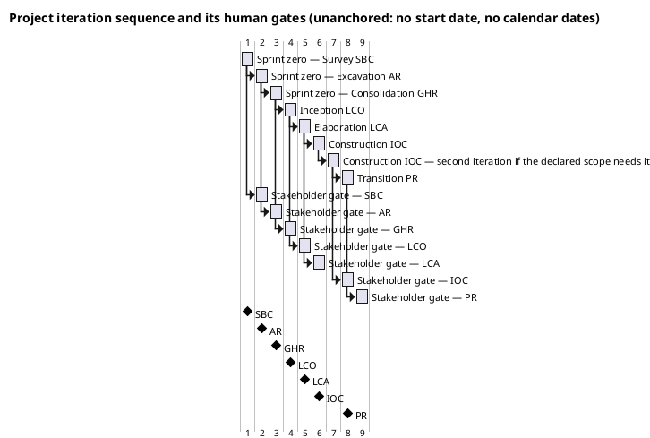
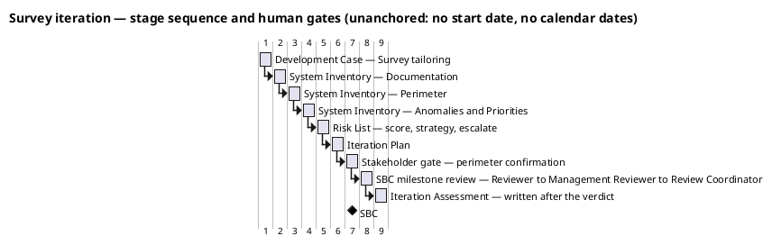
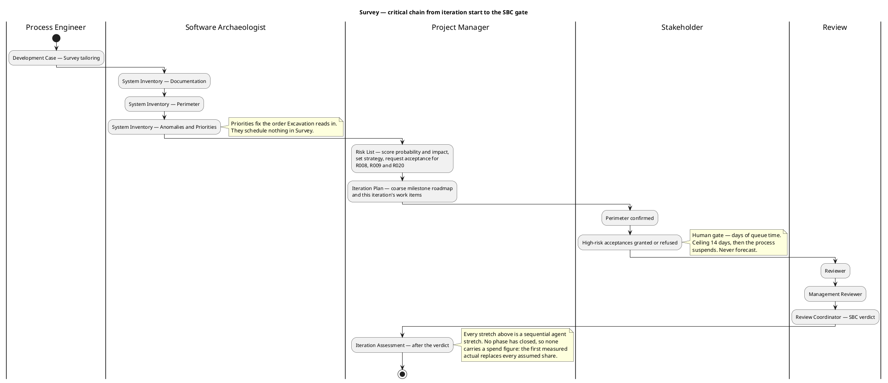

## Document Control
- Phase: Survey
- Status: Draft — issued for the end-of-Survey milestone review
- Milestone Target: end of Survey (SBC) — not yet achieved

## Iteration Objectives

Survey is iteration 1 of the sprint zero. It runs on a system nobody here wrote and nobody can ask about: the delivery is a copy of `davidfowl/TodoApp` at `307a1ead`, and `.iari/README.md` records that it carries no requirements, design or architecture document, no database scripts, no manual, no running installation and no reachable authors. This iteration therefore does not build anything — it establishes what the existing system is, at a perimeter the stakeholder will confirm, before any RUP phase plans against it.

| # | Objective | Basis |
|---|---|---|
| 1 | Record the tailoring that governs the sprint zero — the recovered-element rule, the inactive disciplines, the one fired optional. | Development Case, §1–§7 |
| 2 | Draw the perimeter of the existing system from the code: components, external actors, entry points, with the anchor each row was read from. | Development Case DC-D1, DC-D4 |
| 3 | Read the system and record its anomalies — every place the delivery contradicts itself or the documents that describe it — and order the areas Excavation reads in. | System Inventory, Priorities (order 1–8) |
| 4 | Score every anomaly as a project risk, choose a strategy, and put the High-risk acceptances to the stakeholder. | Risk List, all twenty scored |
| 5 | Issue this plan: the cross-iteration roadmap to PR, and this iteration's work items with their owners. | Development Case DC-D1, DC-D7 |

The three stakeholder decisions of 2026-11-19 already taken — external identity-provider sign-in out of scope, the `admin` role as dead code, the self-service identity surface out — are **inputs** to this iteration, not objectives of it. Every one of them is recorded as an exclusion in the System Inventory's Perimeter and carried into R002, R010, R014 and R019.

## Plan and Milestones
### Coarse roadmap — sprint zero then the RUP phases

`6 ± 3` iterations across the project; the sprint zero adds no milestone of its own to the RUP sequence — it runs before Inception and produces the material Inception builds on. The sequence below is the cross-iteration horizon this plan commits to; nothing beyond the current iteration is planned in detail.

| Order | Phase | Milestone | What the milestone closes | Iterations planned |
|---|---|---|---|---|
| 1 | Survey | **SBC** | The perimeter is drawn and confirmed, the anomalies are recorded, every one scored as a risk, and the tailoring for the sprint zero is issued. | 1 |
| 2 | Excavation | **AR** | The recovered use cases, the recovered architecture, the design model with the persistent schema, and the Deployment Model exist for the priorities Excavation reads first. | 1 |
| 3 | Consolidation | **GHR** | Every entry point of the recovered perimeter has a use case or a recorded exclusion; the Supplementary Specification and the coverage statement complete the set. | 1 |
| 4 | Inception | **LCO** | The declared scope is agreed against the recovered baseline, the candidate architecture exists and the business case is settled. | 1 |
| 5 | Elaboration | **LCA** | The architecture baseline is executable and the first assembled run of the topology has happened; test cases cover it. | 1–2 |
| 6 | Construction | **IOC** | The declared scope is implemented, tested and baselined. | 2–3 |
| 7 | Transition | **PR** | The product is deployed, acceptance-tested and documented; the release is baselined. | 1 |

The `1 + 1 + 1 + 1 + 1–2 + 2–3 + 1` distribution is the rubber profile for a small, low-risk-in-shape project that is nonetheless **recovery-heavy**: the sprint zero carries three of the nine iterations because every requirement, component and table has to be read out of code before Inception can declare anything. The profile bends one step further in Elaboration if the first assembled run contradicts the recovered topology (R020). It is not bent in Construction: nothing in the Inventory suggests a large declared scope, and the recovered product is registration, login, logout and todo read/create/delete.

### This iteration's fine plan

Work items are the stages the IARI DEVELOPMENT PROCESS runs in Survey, each owned by its role. **No work item carries a size**: nothing has been measured in this system yet, no phase has closed, and a size filled with a human-team unit would be a figure this process cannot produce. Each item ends when its exit condition passes.

| Order | Work item | Owner | Input | Exit condition | Status |
|---|---|---|---|---|---|
| 1 | Development Case — Survey tailoring | Process Engineer | IARI DC baseline, the delivery | Tailoring issued: inactive disciplines, fired optionals, referenced tool configuration | Done — issued |
| 2 | System Inventory — Documentation | Software Archaeologist | The delivered documents, read against the code | Each document's usefulness and currency recorded with its anchor | Done — issued |
| 3 | System Inventory — Perimeter | Software Archaeologist | The solution, its projects, configuration and migrations | Components, external systems and 26 entry points drawn, each with its anchor | Done — issued |
| 4 | System Inventory — Anomalies and Priorities | Software Archaeologist | The reading of 71 of 128 files | Twenty anomalies recorded with evidence; the eight areas ordered for Excavation | Done — issued |
| 5 | Risk List — score, strategy, escalate | Project Manager | The twenty anomalies | Every anomaly a classified risk; the three High acceptances put to the stakeholder and answered | Done — R008, R009 and R020 accepted 2026-11-19 |
| 6 | Iteration Plan — this artifact | Project Manager | System Inventory, Development Case, Risk List | Coarse roadmap and fine plan issued | Done — issued |
| 7 | Stakeholder gate — perimeter confirmation | Stakeholder | System Inventory, Perimeter | The perimeter confirmed as drawn — seven projects, the components, the external systems and the three exclusions | **Open — human gate, running** |
| 8 | SBC milestone review | Reviewer → Management Reviewer → Review Coordinator | Every artifact above | Verdict on the SBC milestone | Not started — blocked on item 7 |
| 9 | Iteration Assessment | Project Manager | The SBC verdict | Assessment written *after* the verdict records whether the objectives were met | Not started — blocked on item 8 |

Items 1–6 are the agent stretches of this iteration and are issued. Item 7 is the human gate: the High-risk acceptances it carried were answered on 2026-11-19, and what remains open on it is the stakeholder's confirmation of the perimeter itself.

### Measure and forecast

No phase has closed. There is no measured actual, therefore there is no forecast: no token figure, no elapsed figure, and no per-iteration velocity appears in this plan. The Development Case records that the project declares **no token budget** — so there is no box to fit, and no declared scope is cut or deferred to fit one.

When Survey closes, the Project Manager records its measured spend in the Iteration Assessment and the next plan is built from it — both clocks apart:

| Clock | What it measures | Where it is recorded | Ceiling |
|---|---|---|---|
| Agent work | Tokens consumed per stage and per role; elapsed agent time | Iteration Assessment, at phase close | No ceiling — measured, not bounded |
| Human gates | Days of queue time waiting for the stakeholder | Risk List, as the gate's trigger indicator | 14 days, then the process suspends; the actual is reported apart |

The two are never added and never converted into one another.

### Critical chain

## Resources

The team is the agents the IARI DC baseline activates, and the plan selects which of them work in this iteration. The roster is not this plan's to change; the Development Case records two roles as silenced by its trigger decisions and neither is scheduled here.

| Role | At work in Survey | Stage it runs | Produces | Notes |
|---|---|---|---|---|
| Process Engineer | Yes | Development Case | Development Case | Environment is High in Survey. Re-prepared at the next Environment phase, not before — no finding or Change Request demands a tailoring change yet. |
| Software Archaeologist | Yes | System Inventory — Documentation, Perimeter, Anomalies and Priorities | System Inventory | Discovery is Critical in Survey. The only role minting `EP-NNN` and `AN-NNN`. |
| Project Manager | Yes | Risk List, Iteration Plan | Risk List, Iteration Plan, Iteration Assessment | Project Management is Medium in Survey. |
| Reviewer | Yes | Milestone review SBC | Review Record | First lens of the SBC review. |
| Management Reviewer | Yes | Milestone review SBC | Review Record | Second lens of the SBC review. |
| Review Coordinator | Yes | Milestone review SBC | Review Record, milestone verdict | Holds the verdict; convenes without the Business Reviewer. |
| Stakeholder | Yes — human gate | Perimeter confirmation and High-risk acceptance | Answer recorded verbatim in the Risk List | The only human in this process. Its wait is quoted in days of queue time, never in the agent clock. |
| Business Process Analyst, Business Reviewer | No | — | — | `business-process-led = false` (Development Case DC-D2). |
| Capsule Designer | No | — | — | `real-time-system = false` (Development Case DC-D3). |
| System Analyst, Software Architect, Designer, Database Designer | Not in Survey | — | — | First at work in Excavation, per the process. Nothing in this plan schedules them earlier. |
| Implementer, Integrator, Test roles, Deployment, Change Control | Not in Survey | — | — | The sprint zero carries no Implementation, Test, Deployment or Change Control stage (Development Case §6). |

**Assignment profile.** Six roles at work, one of them the human gate. That is the whole of Survey — the plan adds no role to accelerate it, because the two stages that dominate its length are sequential by nature: the Inventory must be read before it can be scored, and the verdict cannot precede the reading. Parallelism would buy no clock here and would cost coordination across artifacts that cite each other's labels.

## Use Cases and Scenarios Addressed

**None.** No use case is analysed, designed or implemented in Survey. The system's use cases are recovered from the entry points in Excavation and completed in Consolidation — the Use-Case Model does not exist yet, and no `UC-NNN` has been minted.

Survey's output is the material the recovery is built on: 26 entry points recorded with their anchors, and the three exclusions that decide which of them no use case may be recovered from.

| Recovery input Survey produced | What it fixes for Excavation |
|---|---|
| `EP-001` … `EP-026` with anchors | The set of entry points a use case may be recovered from. |
| `EP-004` … `EP-011`, `EP-020`, `EP-021` excluded by stakeholder decision | Registration, login and logout are recoverable; the self-service identity surface and provider sign-in are not. |
| Priorities, orders 1–8 | The order Excavation reads in: `Todo.Api/Todos` + `Todo.Api/Users` first, the BFF second. |
| `AN-001` … `AN-020` | The anomalies each recovered element must not reproduce — R001 to R020 in the Risk List. |

## Evaluation Criteria
The Survey (SBC) exit criteria. They are what the milestone review judges this iteration against; none is met by assertion, and none is this plan's to declare passed.

| # | Criterion | Evidence it rests on | Status |
|---|---|---|---|
| 1 | The perimeter of the existing system is **confirmed by the stakeholder** — the seven projects, the components, the external systems, and the three exclusions. | System Inventory, Perimeter; stakeholder's answer to the gate | **Open** — the three exclusions were decided by the stakeholder on 2026-11-19; the perimeter as a whole has not been confirmed |
| 2 | The **priorities are ordered** for the remaining recovery. | System Inventory, Priorities — eight areas, each with its reason and anchor | Met — recorded |
| 3 | The **unread areas are declared** with the reason each is unread. | System Inventory, Coverage — 71 of 128 files read; the 57 unread named and justified | Met — recorded |
| 4 | Every anomaly the reading recorded is a **classified risk** with a strategy, and the High ones carry the stakeholder's acceptance. | Risk List — 20 anomalies, 20 risks, magnitude by exposure; R008, R009 and R020 accepted by the stakeholder on 2026-11-19, recorded verbatim | Met — recorded |
| 5 | The tailoring governing the sprint zero is issued and its trigger decisions are recorded. | Development Case — §4 decision record DC-D1…DC-D7, §5 optional verdicts | Met — issued |
| 6 | The plan carries the **cross-iteration roadmap** and this iteration's fine plan, with no forecast invented before a measured actual exists. | This artifact, Plan and Milestones | Met — issued |

Criterion 1 is the one SBC turns on. Criteria 2–6 rest on artifacts that are issued; the review judges whether they are adequate, which is not this plan's call.

No criterion is added that the stakeholder did not declare: criteria 1, 2 and 3 are Survey's exit criteria as the process defines them, and 4–6 are the obligations this plan carries to the review. A criterion failing at SBC does not close the milestone — it returns to the next iteration of Survey, whose plan is the Review Record's open findings and the stakeholder's orders.

