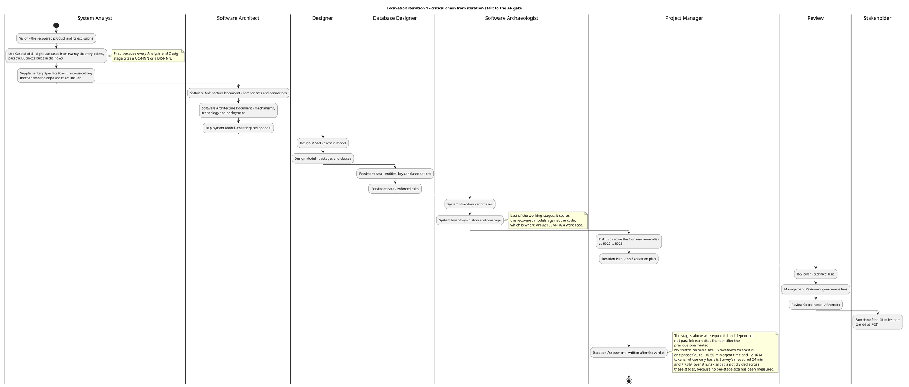
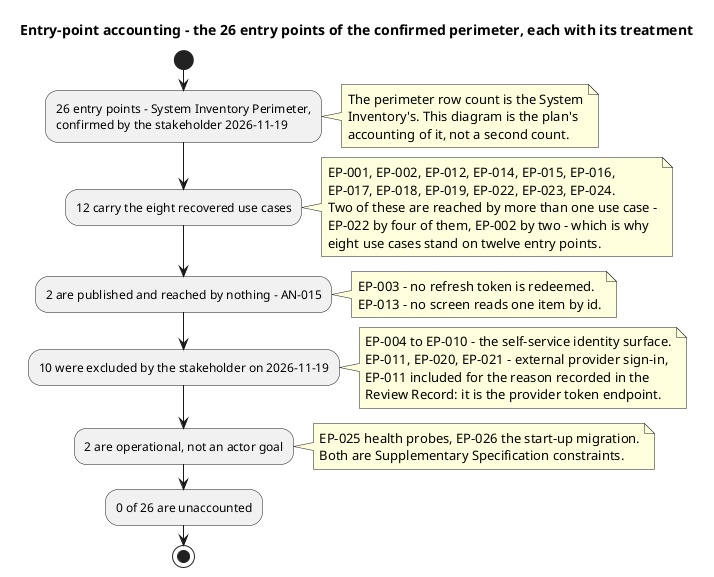

## Document Control
- Phase: Excavation
- Status: Draft — issued for the end-of-Excavation milestone review
- Milestone Target: end of Excavation (AR) — not yet achieved

## Iteration Objectives
Excavation is the second and last phase of the sprint zero: it recovers the existing system into the RUP artifacts Inception builds on. It writes no code, deploys nothing and runs no test. Its milestone is **AR** — Architecture Retrospective — and this iteration is the whole of the phase, because the stakeholder declined a second one on 2026-11-19.

The project runs on a system nobody here wrote and nobody can ask about: the delivery is a copy of `davidfowl/TodoApp` at `307a1ead`, and `.iari/README.md` records that it carries no requirements, design or architecture document, no database scripts, no manual, no running installation and no reachable authors. Survey established the perimeter and the anomalies; this iteration recovers the use cases, the architecture, the design and the persistent schema that perimeter contains.

| # | Objective | Basis | Exit condition |
|---|---|---|---|
| 1 | Recover the product's use cases from the entry points the perimeter confirmed, with the business rules their flows enforce. | The AR milestone; `EP-001` … `EP-026` as the System Inventory records them | Every entry point carries a use case or a recorded exclusion; every recovered flow cites its anchor |
| 2 | Recover the architecture into a component model with its mechanisms, technology and deployment. | The AR milestone (Analysis and Design is Critical in Excavation); `R020`'s static-only condition | Every component cites the files it is read from; every mechanism the use cases include is specified |
| 3 | Recover the design model and the persistent schema from the code, not from a declared design. | `R004`, `R007`; no Data Model fires (Development Case §5) | Every table, key and cascade rule is read from a migration body; the duplication `R024` records is named |
| 4 | Score the anomalies the recovery adds, so the register carries the start-up path, the wire shape and the history rule alongside the earlier twenty. | `AN-021` … `AN-024`; `R022` … `R025` | Every new anomaly is a scored risk with a strategy, or retired with its reason |
| 5 | Issue the Excavation plan itself, with the AR exit criteria stated against evidence rather than a verdict. | The AR milestone; the stakeholder's order that Minor findings are corrected in the next phase | This artifact exists and carries both plan levels |

Two findings of the SBC review are this iteration's too, under the stakeholder's order of 2026-11-19 that "Minor findings must be corrected in the next phase; they cannot be left unresolved". Both are the Project Manager's and both are discharged in this iteration's artifacts: `Risk List#F2` by the removal of the trailing `R021` block, its acceptance standing once in the acceptance table; `Iteration Plan#F5` by the removal of the duplicated opening block of Plan and Milestones, the matter standing once in Measure and forecast. Closure belongs to the Reviewer lens, which is the only lens that may resolve them.

The three scope decisions of 2026-11-19 — external identity-provider sign-in out, the `admin` role as dead code, the self-service identity surface out — are **inputs** to this iteration, not objectives. Each is recorded as an exclusion in the System Inventory's Perimeter and carried into the Supplementary Specification and into `R002`, `R010`, `R014` and `R019`. Nothing in the recovery reopens them.

## Plan and Milestones
The depth of this diagram is the count of sequential agent stretches from iteration start to the gate: eleven working stages, three review stages, one human gate and the closing assessment. They are sequential because each stage cites the identifier the previous one minted.

The human gate is the one stretch that is not agent work at all. It is `R021`: days of queue time, ceiling 14, then the process suspends with nothing auto-filled. It is quoted on its own clock and is never added to the agent figures above.

The fine-plan stage order, with each stage's dependencies, is drawn as a gantt below the roadmap. Both diagrams are ordering only: no bar is a forecast of duration, and no calendar date exists anywhere in this plan.

```plantuml
@startgantt
title Excavation iteration 1 - the process stages in their order and the human gate - ordering only
skinparam shadowing false

[Requirements - System Analyst - Vision] lasts 0 day
[Requirements - System Analyst - Use-Case Model and Business Rules] lasts 0 day
[Requirements - System Analyst - Supplementary Specification] lasts 0 day
[Analysis and Design - Software Architect - SAD Components and Connectors] lasts 0 day
[Analysis and Design - Software Architect - SAD Mechanisms Technology and Deployment] lasts 0 day
[Analysis and Design - Software Architect - Deployment Model] lasts 0 day
[Analysis and Design - Designer - Design Model Domain Model] lasts 0 day
[Analysis and Design - Designer - Design Model Packages and Classes] lasts 0 day
[Analysis and Design - Database Designer - Persistent Data Entities Keys and Associations] lasts 0 day
[Analysis and Design - Database Designer - Persistent Data Enforced Rules] lasts 0 day
[Discovery - Software Archaeologist - System Inventory Anomalies] lasts 0 day
[Discovery - Software Archaeologist - System Inventory History and Coverage] lasts 0 day
[Project Management - Risk List] lasts 0 day
[Project Management - Iteration Plan] lasts 0 day
[AR milestone review - Reviewer then Management Reviewer then Review Coordinator] lasts 0 day
[Stakeholder gate - AR] lasts 0 day
[Project Management - Iteration Assessment after the verdict] lasts 0 day

[Requirements - System Analyst - Use-Case Model and Business Rules] starts at [Requirements - System Analyst - Vision]'s end
[Requirements - System Analyst - Supplementary Specification] starts at [Requirements - System Analyst - Use-Case Model and Business Rules]'s end
[Analysis and Design - Software Architect - SAD Components and Connectors] starts at [Requirements - System Analyst - Use-Case Model and Business Rules]'s end
[Analysis and Design - Designer - Design Model Domain Model] starts at [Requirements - System Analyst - Use-Case Model and Business Rules]'s end
[Analysis and Design - Software Architect - SAD Mechanisms Technology and Deployment] starts at [Analysis and Design - Software Architect - SAD Components and Connectors]'s end
[Analysis and Design - Software Architect - Deployment Model] starts at [Analysis and Design - Software Architect - SAD Mechanisms Technology and Deployment]'s end
[Analysis and Design - Designer - Design Model Packages and Classes] starts at [Analysis and Design - Designer - Design Model Domain Model]'s end
[Analysis and Design - Database Designer - Persistent Data Entities Keys and Associations] starts at [Analysis and Design - Designer - Design Model Packages and Classes]'s end
[Analysis and Design - Database Designer - Persistent Data Enforced Rules] starts at [Analysis and Design - Database Designer - Persistent Data Entities Keys and Associations]'s end
[Discovery - Software Archaeologist - System Inventory Anomalies] starts at [Analysis and Design - Software Architect - SAD Mechanisms Technology and Deployment]'s end
[Discovery - Software Archaeologist - System Inventory History and Coverage] starts at [Discovery - Software Archaeologist - System Inventory Anomalies]'s end
[Project Management - Risk List] starts at [Discovery - Software Archaeologist - System Inventory History and Coverage]'s end
[Project Management - Iteration Plan] starts at [Project Management - Risk List]'s end
[AR milestone review - Reviewer then Management Reviewer then Review Coordinator] starts at [Project Management - Iteration Plan]'s end
[Stakeholder gate - AR] starts at [AR milestone review - Reviewer then Management Reviewer then Review Coordinator]'s end
[Project Management - Iteration Assessment after the verdict] starts at [Stakeholder gate - AR]'s end

[AR] happens at [Stakeholder gate - AR]'s end

note bottom
  Every bar is a zero span: PlantUML requires the root bar's span to be
  declared, and it is declared zero. No bar is a forecast of duration -
  a stage ends when its exit condition passes, and this iteration carries
  no size for any work item because no size for it has been measured.
  The Requirements stage is first because every Analysis and Design stage
  cites a use case or a business rule by identifier, and the Discovery
  stage that scores the reading runs last because it reads the recovered
  models rather than the code alone. The gate is R021: days of queue time
  on the human clock, ceiling 14, and then the process suspends.
end note
@endgantt
```

## Resources
The team is the 26 roles the IARI DC baseline activates, and the plan selects which of them work in this iteration. The roster is not this plan's to change.

**Assignment profile: nine agent roles plus the stakeholder gate.** Excavation activates five disciplines — Requirements (High), Analysis and Design (Critical), Discovery (Critical), Project Management (Medium) and the milestone review — and nine agent roles run stages inside them. Six do the recovery itself: System Analyst, Software Architect, Designer, Database Designer, Software Archaeologist, Project Manager. Three judge it: Reviewer, Management Reviewer, Review Coordinator — the trio the process fixes for AR, not additional capacity. The Stakeholder is the one human the iteration waits on, counted separately and never as a role of the agent roster.

Analysis and Design is the phase's Critical discipline and it is where the plan puts the most roles: three of them — Architect, Designer, Database Designer — work the same stage, in the order their artifacts depend on each other. Discovery is Critical too, and the Software Archaeologist's second stage scores the recovered models against the code, which is why it runs after them and not before.

| Role | At work in Excavation iteration 1 | Stage it runs | Produces |
|---|---|---|---|
| System Analyst | Yes | Vision; Use-Case Model; Business Rules in the Use-Case Flows; Supplementary Specification | Vision, Use-Case Model, Supplementary Specification |
| Software Architect | Yes | SAD — components and connectors; SAD — mechanisms, technology and deployment; Deployment Model | Software Architecture Document, Deployment Model |
| Designer | Yes | Design Model — domain model; Design Model — packages and classes | Design Model |
| Database Designer | Yes | Persistent Data — entities, keys and associations; Persistent Data — enforced rules | Design Model (its persistent-data sections) |
| Software Archaeologist | Yes | System Inventory — anomalies; System Inventory — history and coverage | System Inventory |
| Project Manager | Yes | Risk List; Iteration Plan; Iteration Assessment | Risk List, Iteration Plan, Iteration Assessment |
| Reviewer | Yes | AR milestone review — technical lens | Review Record |
| Management Reviewer | Yes | AR milestone review — governance lens | Review Record |
| Review Coordinator | Yes | AR milestone review — verdict | Review Record, milestone verdict |
| Stakeholder (human, outside the agent roster) | Yes — human gate | Sanction of the AR milestone | One answer recorded verbatim, carried as `R021` |

Roles not at work in Excavation, each with its reason:

| Role | Reason |
|---|---|
| Business Process Analyst, Business Reviewer | `business-process-led = false` (Development Case DC-D2). Neither has a stage in this project. |
| Capsule Designer | `real-time-system = false` (Development Case DC-D3). No capsule, protocol or signal exists to design. |
| Requirements Specifier | First at work in Elaboration, where Use-Case Detail and NFR Thresholds are specified. Excavation's Requirements stage is the System Analyst's, not this role's. |
| User Interface Designer | First at work in Elaboration, where the navigation map and boundary classes are designed. The screens are recovered, not designed, in Excavation. |
| Implementer, Integrator, Code Reviewer | First at work in Inception (build environment) and Elaboration (Executable Architecture). The sprint zero writes no code and builds nothing. |
| Test Manager, Test Analyst, Test Designer, Tester | First at work in Inception (Test Plan) and Elaboration (test cases, architecture test execution). Excavation executes no test. |
| Deployment Manager, Technical Writer | First at work in Inception and Construction respectively. Excavation produces no deployment and no user documentation. |
| Change Control Manager | First at work in Inception, where the ledger opens. The sprint zero opens no ledger entry. |
| Configuration Manager | First at work in Inception, where the CM strategy is set up. The sprint zero baselines nothing. |

Every role of the active roster is therefore accounted for: nine agents execute or judge, one human gate is answered, and the remaining roles carry a stated reason for their absence.

## Use Cases and Scenarios Addressed
The eight use cases the recovery produced, all inside the perimeter the stakeholder confirmed on 2026-11-19. This iteration recovers them — it analyses, specifies and designs them; it implements and tests none, because the sprint zero writes no code.

| UC | Name | Primary actor | Source | Volatility | Scenarios recovered |
|---|---|---|---|---|---|
| UC-001 | Open an account and a session | Todo owner | `EP-017`, `EP-001`, `EP-002` | Medium | 4 — registration accepted; refused by Identity; account created but the sign-in that follows fails; empty field refused client-side |
| UC-002 | Sign in to an existing account | Todo owner | `EP-018`, `EP-002` | Low | 3 — credentials accepted; refused; page validation refusing the input before anything is posted |
| UC-003 | Sign out | Todo owner | `EP-019` | Low | 2 — sign-out with a session; without one |
| UC-004 | Review my todo list | Todo owner | `EP-023`, `EP-022`, `EP-012` | Medium | 4 — items listed; empty list; session no longer accepted; limiter exhausted |
| UC-005 | Add a todo | Todo owner | `EP-022`, `EP-014` | Low | 3 — title accepted; empty title refused by page and client; body refused by the API |
| UC-006 | Change a todo (title and completion) | Todo owner | `EP-022`, `EP-015` | **High** | 5 — owned item; another owner's item; id mismatch; concurrent saves; **and the scenario no delivered screen can perform** |
| UC-007 | Delete a todo | Todo owner | `EP-022`, `EP-016` | Low | 3 — owned item; another owner's item; missing item |
| UC-008 | Consult the API reference | Developer | `EP-024` | Medium | 2 — Development environment; any other environment |

**What the plan must carry forward from this table.** Three facts decide how later phases treat these eight, and each is anchored in a risk rather than asserted here:

- **`UC-006` has no screen path.** The API accepts the update, the forwarder would carry it, and the checkbox binds nothing. The stakeholder accepted the exposure on 2026-11-19 (`R008`), so the use case is recovered with the gap stated inside it, not repaired into scope without a Change Request. Its High volatility follows: any later declared requirement for completion changes it, so its realisation must not be welded to the other four todo flows.
- **`UC-001` and `UC-004` are Medium because their ground moves.** Account creation sits directly beside the excluded self-service identity surface, and the list is the only screen of the unstable browser half (`R013`).
- **`UC-008` is recovered, not designed.** Its environment guard and the unconditional redirect disagree (`R016`), so no artifact may claim an intended production posture.

### Entry-point accounting — what is recovered and what is not

The perimeter is 26 entry points. The recovery leaves none of them unaccounted, and the four groups below are the whole of the accounting. This is the plan's check of the recovery's completeness — the entry points themselves, their paths and their anchors are the System Inventory's.

Entry points that carry no use case, by decision and by reading:

| Entry points | Count | Why no use case | Where that is recorded |
|---|---|---|---|
| `EP-003`, `EP-013` | 2 | Published and reached by nothing in the delivery — no refresh token is redeemed, no screen reads one item by id | Use-Case Model, why-these-eight table; `AN-015` |
| `EP-004` … `EP-011`, `EP-020`, `EP-021` | 10 | Excluded by the stakeholder, 2026-11-19 — self-service identity surface and external provider sign-in | System Inventory Perimeter; Supplementary Specification |
| `EP-025`, `EP-026` | 2 | Operational, not an actor goal — health probes and the start-up migration | Supplementary Specification, Design Constraints |

No use case is named after a cross-cutting mechanism. Authentication, token issue, forwarding, rate limiting, validation and telemetry are Supplementary Specification entries that the eight above `<<include>>`.

### What the recovery does not reach, and why that is not a gap in this plan

The recovery is one pass, on the stakeholder's refusal of a split on 2026-11-19. Three things sit outside what that pass can establish, and the plan carries each as a named exposure rather than as work it quietly does not schedule:

| Not established by this iteration | Why the plan does not schedule it here | Where it lands |
|---|---|---|
| That any recovered behaviour is true of the running system | The sprint zero builds and runs nothing (`R020`, accepted 2026-11-19) | The Integrator's Architecture Build, Elaboration iteration 1 |
| That the identity decision point behaves as read | No test reaches the BFF (`R009`, accepted 2026-11-19) | First BFF coverage, Elaboration iteration 1, before any change to it is accepted |
| That the excluded identity surface can be ignored indefinitely | The stakeholder excluded it; no phase plans work that needs a mail transport (`R014`, `R019`) | Nothing lands: a later requirement re-enters it only through a Change Request |

## Evaluation Criteria
The Excavation (AR) exit criteria. They are what the milestone review judges this iteration against. This table supplies the evidence each criterion rests on; it does not declare a criterion passed, because the verdict belongs to the milestone review and the Review Coordinator holds it.

| # | Criterion | Evidence this plan supplies | What the review judges |
|---|---|---|---|
| 1 | The **use cases are recovered** from the confirmed perimeter, each anchored to the entry point that performs it, and every entry point carries a use case or a recorded exclusion. | Use-Case Model — eight `UC-NNN`, each with its `Source:` entry-point line; the why-these-eight table naming `EP-003`, `EP-013`, `EP-004`…`EP-011`, `EP-020`, `EP-021`, `EP-025`, `EP-026` with their treatment | Whether every use case rests on an entry point inside the confirmed boundary, and whether any delivered goal was left unrecovered |
| 2 | The **architecture is recovered and checked against the use cases** — every component named, every mechanism the use cases include specified, and nothing modelled as a use case that is a mechanism. | Software Architecture Document — `COMP-NNN` with their file anchors; the mechanisms table; Supplementary Specification — each mechanism as an `<<include>>` | Whether the component model accounts for the path each use case takes through the code, and whether any cross-cutting mechanism was promoted to a use case |
| 3 | The **data is recovered with its anchors**: every table, key, index, cascade rule and association read from a migration body, never from a declared schema or a run-time database. | Design Model — persistent-data sections by the Database Designer; no Data Model exists (Development Case §5, `R004`) | Whether every persistent element names the migration that declares it, and whether any is described as designed rather than recovered |
| 4 | The **coverage is measured** and reconciles with its own rows: every area of the tree described or declared unread with its reason, and each renamed area read through both its paths. | System Inventory — Coverage table and its aggregate; History — the union counts (`R025`) | Whether the aggregate is the sum of its rows, and whether any unread area is left without a reason |
| 5 | The **new anomalies are scored** and every action names a role at work in the phase it lands in. | Risk List — `R022` … `R025` refining `AN-021` … `AN-024`, with magnitude as the band of P × I and an owning role per action | Whether any new exposure needed the stakeholder's acceptance and was self-granted, and whether every action is executable where it lands |
| 6 | The **stakeholder confirms** what the recovery recorded — the use cases, the exclusions and the accepted exposures. | The three exclusions of 2026-11-19 carried unchanged; `R008`, `R009`, `R020`, `R021` accepted on their answers | Whether the recovery stayed inside the boundary the stakeholder confirmed, and whether anything now needs a decision they have not been asked for |

### Confirmation of the perimeter

The perimeter criterion does not rest on a question put at this milestone: it rests on the answer the stakeholder gave on 2026-11-19, which sanctioned SBC and confirmed the boundary Excavation recovers within.

| What was put | Their answer, verbatim | Recorded |
|---|---|---|
| The perimeter of the existing system as the System Inventory draws it: the seven projects of `TodoApp.sln` (`Todo.Web.Server`, `Todo.Web.Client`, `Todo.Web.Shared`, `Todo.Api`, `TodoApp.AppHost`, `TodoApp.ServiceDefaults`, `Todo.Api.Tests`) plus the CI workflow; the external systems reached (browser, OTLP collector, container runtime, sqliteweb image, `dotnet-ef` CLI, NuGet feed); 26 entry points; and the three exclusions of 2026-11-19 — external provider sign-in, the admin role, the self-service identity surface. | "Yes" | 2026-11-19 |

A use case comes from an entry point inside that boundary; a component or table outside it is not recovered at all. The recovery drew no correction from the stakeholder to the boundary itself — it added anomalies inside it (`AN-021` … `AN-024`), not perimeter rows.

### Excavation scope — decided by the stakeholder

The AR milestone closes with priority areas **1–6 recovered in a single Excavation iteration**, on the order the System Inventory's Priorities fix:

| Order | Area | Where it is recovered |
|---|---|---|
| 1 | `Todo.Api/Todos` + `Todo.Api/Users` | Excavation — the endpoint groups the whole product arrives through |
| 2 | `Todo.Web/Server` — the BFF | Excavation — identity is decided here; `AN-009`, `AN-013` |
| 3 | `Todo.Api` cross-cutting — authorization, rate limiting, validation, OpenAPI | Excavation — Supplementary Specification mechanisms |
| 4 | `Todo.Web/Client` — the screens | Excavation — `AN-008` is a fact about this layer |
| 5 | `Todo.Api/Migrations` and `TodoDbContext` — the schema | Excavation — the Design Model carries it; no Data Model exists |
| 6 | `TodoApp.AppHost` + `TodoApp.ServiceDefaults` — topology | Excavation — the triggered Deployment Model |
| 7 | `Todo.Api.Tests` | Excavation — read as the cross-check on orders 1 and 2 |
| 8 | Build, environment and tooling | Inception — the Integrator's Build Environment Setup |

The proposition put and the answer received:

| What was put | Their answer, verbatim | Recorded |
|---|---|---|
| Excavation closing with areas 1–4 recovered and the schema and AppHost topology recovered in a second Excavation iteration before GHR, at 9–10 iterations total. | "No" | 2026-11-19 |

The single Excavation iteration therefore carries orders 1–6; order 7 is its cross-check and order 8 opens Inception. That refusal is why the recovery is one pass and why `R009`, `R013` and `R020` concentrate inside it.

### What AR does not claim

Three things the milestone must not be read as establishing, because no evidence for them exists:

- **That the recovered system has been shown to work.** It has never run (`R020`). Every statement in every artifact of this phase is a static reading of source, and the first assembled run is planned as the Integrator's Architecture Build in Elaboration.
- **That the browser-facing half is verified.** Nothing tests it (`R009`), and it is the area the history shows moving most (`R013`). Its recovered behaviour rests on reading alone.
- **That the product can mark a todo complete from any screen.** It cannot (`R008`). The use case is recovered with that stated inside it; the capability needs a Change Request before any plan may deliver it.

### The stakeholder gate

The sanction of AR is asked once, on the artifacts as the review lenses leave them. It is carried as `R021`: days of queue time on the human clock, ceiling 14, and if the ceiling is reached the process suspends with the milestone unsanctioned and nothing auto-filled. The actual queue time is reported at phase close, apart from the agent clock, and is never added to it.

No criterion here was invented. Each is an obligation the AR milestone places on this phase: 1–3 are the recovery the sprint zero exists to perform, 4–5 are the reading's own completeness and its scoring, and 6 is the human confirmation the process requires before a milestone advances. A criterion that fails at AR returns to a second Excavation iteration only if the review leaves findings open — and that iteration's plan is then the Review Record's findings and the stakeholder's orders, not a re-issue of this one.

